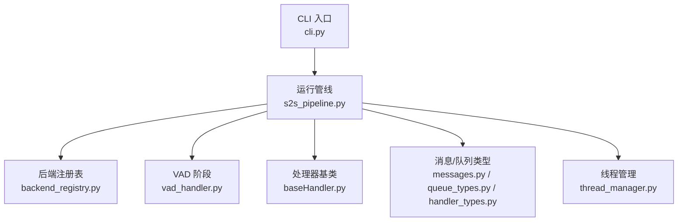
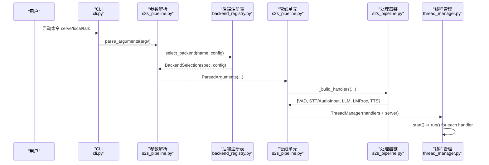
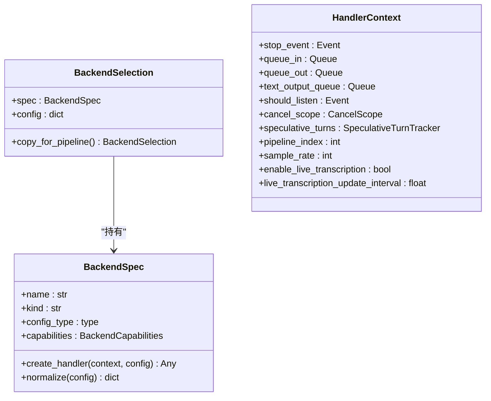
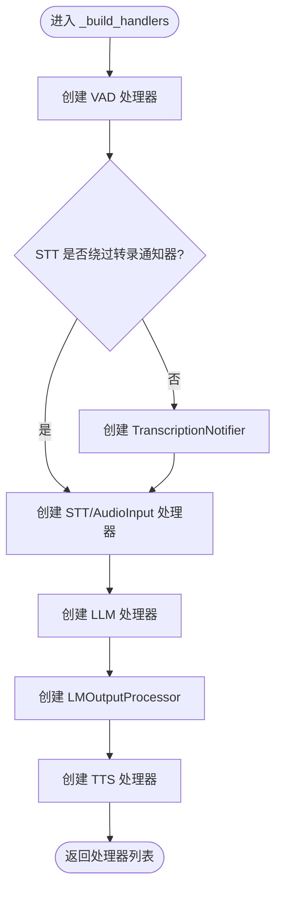
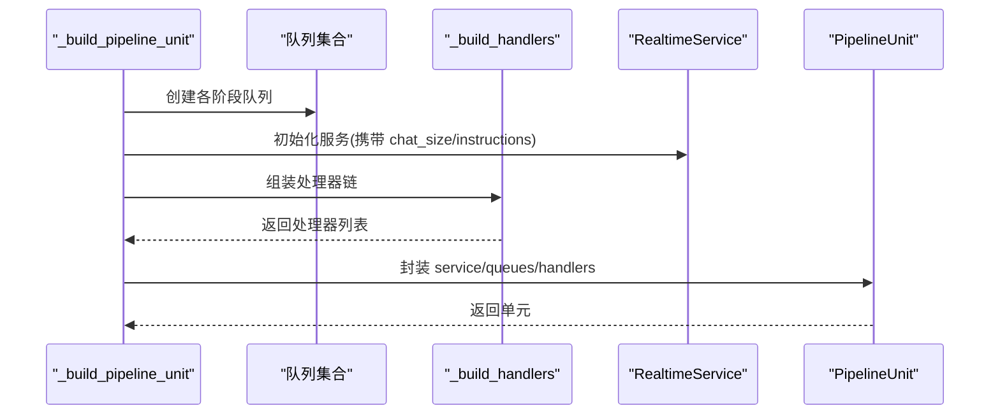
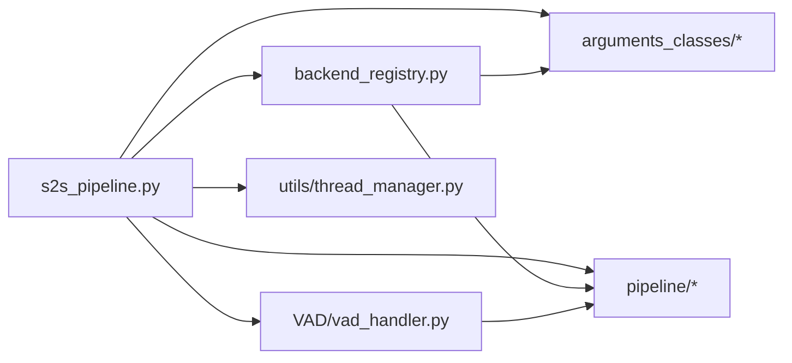

# 管道构建

<cite>
**本文引用的文件**
- [s2s_pipeline.py](file://src/speech_to_speech/s2s_pipeline.py)
- [backend_registry.py](file://src/speech_to_speech/backend_registry.py)
- [baseHandler.py](file://src/speech_to_speech/baseHandler.py)
- [cli.py](file://src/speech_to_speech/cli.py)
- [vad_handler.py](file://src/speech_to_speech/VAD/vad_handler.py)
- [handler_types.py](file://src/speech_to_speech/pipeline/handler_types.py)
- [queue_types.py](file://src/speech_to_speech/pipeline/queue_types.py)
- [messages.py](file://src/speech_to_speech/pipeline/messages.py)
- [module_arguments.py](file://src/speech_to_speech/arguments_classes/module_arguments.py)
- [thread_manager.py](file://src/speech_to_speech/utils/thread_manager.py)
</cite>

## 目录
1. [简介](#简介)
2. [项目结构](#项目结构)
3. [核心组件](#核心组件)
4. [架构总览](#架构总览)
5. [详细组件分析](#详细组件分析)
6. [依赖关系分析](#依赖关系分析)
7. [性能考量](#性能考量)
8. [故障排查指南](#故障排查指南)
9. [结论](#结论)
10. [附录：配置与示例](#附录：配置与示例)

## 简介
本文件聚焦于“语音到语音”实时管道的构建过程，重点解释：
- _build_handlers 如何根据配置动态组装处理器链（VAD → STT/AudioInput → LLM → TTS）。
- 后端注册表机制（STT、LLM、TTS）的注册与选择逻辑。
- 管道初始化流程：线程池/队列创建、处理器实例化、服务装配。
- 配置验证与参数传递机制，确保各组件间数据兼容性。
- 错误处理与回滚机制。
- 自定义处理器添加指南与扩展点说明。
- 不同配置下的管道构建示例。

## 项目结构
该仓库将“运行时入口”“后端注册表”“基础处理器基类”“消息与队列类型”“VAD 实现”等模块解耦，便于按阶段组合成可插拔的管道。关键路径如下：
- 运行时入口与管线装配：s2s_pipeline.py
- 后端注册与工厂：backend_registry.py
- 处理器基类与生命周期：baseHandler.py
- 消息与队列类型定义：pipeline/messages.py, pipeline/queue_types.py, pipeline/handler_types.py
- VAD 阶段实现：VAD/vad_handler.py
- CLI 入口与命令分发：cli.py
- 线程管理：utils/thread_manager.py
- 全局模块参数：arguments_classes/module_arguments.py

图表来源
- [cli.py:26-35](file://src/speech_to_speech/cli.py#L26-L35)
- [s2s_pipeline.py:175-285](file://src/speech_to_speech/s2s_pipeline.py#L175-L285)
- [backend_registry.py:153-173](file://src/speech_to_speech/backend_registry.py#L153-L173)
- [vad_handler.py:53-149](file://src/speech_to_speech/VAD/vad_handler.py#L53-L149)
- [baseHandler.py:25-51](file://src/speech_to_speech/baseHandler.py#L25-L51)
- [queue_types.py:20-47](file://src/speech_to_speech/pipeline/queue_types.py#L20-L47)
- [thread_manager.py:9-40](file://src/speech_to_speech/utils/thread_manager.py#L9-L40)

章节来源
- [cli.py:26-35](file://src/speech_to_speech/cli.py#L26-L35)
- [s2s_pipeline.py:175-285](file://src/speech_to_speech/s2s_pipeline.py#L175-L285)
- [backend_registry.py:153-173](file://src/speech_to_speech/backend_registry.py#L153-L173)
- [vad_handler.py:53-149](file://src/speech_to_speech/VAD/vad_handler.py#L53-L149)
- [baseHandler.py:25-51](file://src/speech_to_speech/baseHandler.py#L25-L51)
- [queue_types.py:20-47](file://src/speech_to_speech/pipeline/queue_types.py#L20-L47)
- [thread_manager.py:9-40](file://src/speech_to_speech/utils/thread_manager.py#L9-L40)

## 核心组件
- 解析与校验参数：parse_arguments、prepare_all_args、build_llm_proxy_config
- 后端注册表：STT_BACKENDS、LLM_BACKENDS、TTS_BACKENDS；BackendSpec、BackendSelection、HandlerContext
- 处理器链构建：_build_handlers（VAD → STT/AudioInput → LLM → LMOutputProcessor → TTS）
- 管线单元与线程：_build_pipeline_unit、build_pipeline/build_local_pipeline、ThreadManager
- 消息与队列：PipelineMessage、各阶段输入输出类型、队列项类型别名

章节来源
- [s2s_pipeline.py:175-285](file://src/speech_to_speech/s2s_pipeline.py#L175-L285)
- [s2s_pipeline.py:324-352](file://src/speech_to_speech/s2s_pipeline.py#L324-L352)
- [s2s_pipeline.py:354-458](file://src/speech_to_speech/s2s_pipeline.py#L354-L458)
- [backend_registry.py:48-122](file://src/speech_to_speech/backend_registry.py#L48-L122)
- [backend_registry.py:309-543](file://src/speech_to_speech/backend_registry.py#L309-L543)
- [queue_types.py:20-47](file://src/speech_to_speech/pipeline/queue_types.py#L20-L47)
- [messages.py:31-367](file://src/speech_to_speech/pipeline/messages.py#L31-L367)

## 架构总览
下图展示了从命令行到处理器链的完整装配流程，以及各阶段之间的数据流。

图表来源
- [cli.py:189-200](file://src/speech_to_speech/cli.py#L189-L200)
- [s2s_pipeline.py:175-285](file://src/speech_to_speech/s2s_pipeline.py#L175-L285)
- [backend_registry.py:166-173](file://src/speech_to_speech/backend_registry.py#L166-L173)
- [s2s_pipeline.py:461-547](file://src/speech_to_speech/s2s_pipeline.py#L461-L547)
- [s2s_pipeline.py:550-587](file://src/speech_to_speech/s2s_pipeline.py#L550-L587)
- [thread_manager.py:18-27](file://src/speech_to_speech/utils/thread_manager.py#L18-L27)

## 详细组件分析

### 1) 参数解析与配置验证
- 支持 JSON 或命令行参数，自动识别 macOS 优化预设并合并默认值。
- 通过 HfArgumentParser 解析多组 dataclass 参数（ModuleArguments、RealtimeServerArguments、LocalAudioArguments、VADHandlerArguments 及各后端配置）。
- prepare_all_args 对选择器进行一致性校验：
  - stt=none 时要求 LLM 后端支持音频输入。
  - enable_llm_proxy 时要求 LLM 后端支持代理能力。
  - 在 macOS 上限制 device 与推荐后端。
  - 将全局 device 注入到各后端配置中（若未显式指定）。
- build_llm_proxy_config 基于所选 LLM 的标准化配置构造代理配置，并在不支持时抛出明确错误。

章节来源
- [s2s_pipeline.py:175-285](file://src/speech_to_speech/s2s_pipeline.py#L175-L285)
- [s2s_pipeline.py:309-352](file://src/speech_to_speech/s2s_pipeline.py#L309-L352)
- [s2s_pipeline.py:111-132](file://src/speech_to_speech/s2s_pipeline.py#L111-L132)
- [module_arguments.py:12-105](file://src/speech_to_speech/arguments_classes/module_arguments.py#L12-L105)

### 2) 后端注册表机制（STT/LLM/TTS）
- BackendSpec：描述一个后端的名称、类型、配置类、工厂函数、可选前缀、归一化函数、必需额外依赖、能力标志。
- 构建注册表：build_backend_registry 会拒绝重复名与不匹配 kind 的条目。
- 选择后端：select_backend 查找 spec 并调用其 normalize 生成 BackendConfig。
- 工厂模式：create_backend_handler 负责调用 spec.create_handler，并将 ImportError 包装为带安装提示的错误。
- 内置后端：
  - STT_BACKENDS：none、whisper、whisper-mlx、mlx-audio-whisper、faster-whisper、parakeet-tdt、paraformer、openai
  - LLM_BACKENDS：transformers、mlx-lm、responses-api、chat-completions
  - TTS_BACKENDS：chatTTS、facebookMMS、omnivoice、pocket、kokoro、qwen3、openai、supertonic
- HandlerContext：向每个工厂提供 stop_event、in/out 队列、text_output_queue、should_listen、cancel_scope、speculative_turns、pipeline_index、sample_rate、live transcription 开关与间隔。

图表来源
- [backend_registry.py:48-122](file://src/speech_to_speech/backend_registry.py#L48-L122)
- [backend_registry.py:153-173](file://src/speech_to_speech/backend_registry.py#L153-L173)
- [backend_registry.py:186-235](file://src/speech_to_speech/backend_registry.py#L186-L235)
- [backend_registry.py:309-543](file://src/speech_to_speech/backend_registry.py#L309-L543)

章节来源
- [backend_registry.py:48-122](file://src/speech_to_speech/backend_registry.py#L48-L122)
- [backend_registry.py:153-173](file://src/speech_to_speech/backend_registry.py#L153-L173)
- [backend_registry.py:186-235](file://src/speech_to_speech/backend_registry.py#L186-L235)
- [backend_registry.py:309-543](file://src/speech_to_speech/backend_registry.py#L309-L543)

### 3) 处理器链构建：_build_handlers
_build_handlers 依据配置与能力动态组装处理器链：
- VAD：始终存在，接收音频片段，检测说话起止，输出 VADAudio。
- STT/AudioInput：
  - 若选择的 STT 后端 bypasses_transcription_notifier（如 none），则跳过 TranscriptionNotifier，直接将 STT 输出送入 text_prompt_queue。
  - 否则插入 TranscriptionNotifier，将 STTOutItem 转换为 TextPromptItem。
- LLM：使用 create_backend_handler 根据 llm_backend 创建语言模型处理器。
- LMOutputProcessor：聚合 LLM 输出，准备 TTS 输入。
- TTS：根据 tts_backend 创建 TTS 处理器，输出音频到 send_audio_chunks_queue。

图表来源
- [s2s_pipeline.py:354-458](file://src/speech_to_speech/s2s_pipeline.py#L354-L458)
- [backend_registry.py:309-396](file://src/speech_to_speech/backend_registry.py#L309-L396)
- [messages.py:62-90](file://src/speech_to_speech/pipeline/messages.py#L62-L90)

章节来源
- [s2s_pipeline.py:354-458](file://src/speech_to_speech/s2s_pipeline.py#L354-L458)

### 4) 管道初始化：线程池、队列与实例化
- _build_pipeline_unit：
  - 为每个管线单元深拷贝 VAD 参数与后端选择，避免共享状态污染。
  - 创建 should_listen/response_playing/cancel_scope/speculative_turns 等单元级状态。
  - 创建各阶段队列：recv_audio_chunks_queue、spoken_prompt_queue、stt_output_queue、text_prompt_queue、lm_response_queue、lm_processed_queue、send_audio_chunks_queue、text_output_queue。
  - 读取 LLM 配置的 chat_size 与 init_chat_prompt，用于 RealtimeService。
  - 调用 _build_handlers 组装处理器，并为每个处理器设置 pipeline_index。
  - 返回 PipelineUnit（包含 service、queues、handlers）。
- build_pipeline：
  - 根据 num_pipelines 创建多个 PipelineUnit。
  - 创建 RealtimeServer 并加入 handlers 列表。
  - 返回 ThreadManager 统一管理所有线程。
- build_local_pipeline：
  - 在本地模式下，封装 RealtimeAudioClient，以 loopback URL 连接同一进程内的服务器。
- ThreadManager：
  - start：为每个 handler.run 创建非守护线程并启动。
  - wait：join 所有线程。
  - stop：设置所有 handler.stop_event，等待最多 5 秒退出。

图表来源
- [s2s_pipeline.py:461-547](file://src/speech_to_speech/s2s_pipeline.py#L461-L547)
- [s2s_pipeline.py:550-587](file://src/speech_to_speech/s2s_pipeline.py#L550-L587)
- [thread_manager.py:18-40](file://src/speech_to_speech/utils/thread_manager.py#L18-L40)

章节来源
- [s2s_pipeline.py:461-547](file://src/speech_to_speech/s2s_pipeline.py#L461-L547)
- [s2s_pipeline.py:550-587](file://src/speech_to_speech/s2s_pipeline.py#L550-L587)
- [thread_manager.py:18-40](file://src/speech_to_speech/utils/thread_manager.py#L18-L40)

### 5) 数据流与类型契约
- 队列项类型统一由 queue_types.py 定义，保证跨阶段的数据兼容。
- 消息类型由 messages.py 集中管理，包括 VADAudio、PartialTranscription、Transcription、TranscriptionFailure、LLMResponseChunk、TokenUsage、EndOfResponse、TTSInput、AudioOutput、GenerateResponseRequest 等。
- handler_types.py 提供各阶段的 In/Out 类型别名，便于声明处理器接口。

章节来源
- [queue_types.py:20-47](file://src/speech_to_speech/pipeline/queue_types.py#L20-L47)
- [messages.py:31-367](file://src/speech_to_speech/pipeline/messages.py#L31-L367)
- [handler_types.py:31-46](file://src/speech_to_speech/pipeline/handler_types.py#L31-L46)

### 6) 错误处理与回滚机制
- 可选依赖缺失：create_backend_handler 捕获 ImportError 并给出安装提示。
- 会话结束与清理：BaseHandler.run 在收到 SESSION_END 时调用 on_session_end，并在结束时发送 PIPELINE_END 以避免队列死锁。
- 取消与过期：BaseHandler.should_process_input 检查 cancel_generation 与 cancel_scope.is_stale，丢弃过期的输入。
- 预取事务：BaseHandler 对带有 prefetch_transaction 的 TTSInput 等待其被 claim 或 discard，避免无效工作继续推进。
- 优雅关闭：run_pipeline_command 注册 SIGINT/SIGTERM，调用 ThreadManager.stop 并等待线程退出。

章节来源
- [backend_registry.py:175-195](file://src/speech_to_speech/backend_registry.py#L175-L195)
- [baseHandler.py:56-81](file://src/speech_to_speech/baseHandler.py#L56-L81)
- [baseHandler.py:105-164](file://src/speech_to_speech/baseHandler.py#L105-L164)
- [messages.py:230-333](file://src/speech_to_speech/pipeline/messages.py#L230-L333)
- [s2s_pipeline.py:628-681](file://src/speech_to_speech/s2s_pipeline.py#L628-L681)

### 7) 自定义处理器添加指南与扩展点
- 新增后端步骤：
  - 在 backend_registry.py 中添加 BackendSpec，指定 name、kind、config_type、create_handler、可选 normalize_config、required_extra、capabilities。
  - 如需简单构造，可使用 _simple_handler_factory；如需复杂上下文注入，编写专用工厂（参考 _create_parakeet/_create_openai_tts/_create_local_llm）。
  - 将新 spec 加入对应注册表（STT_BACKENDS/LLM_BACKENDS/TTS_BACKENDS）。
- 处理器生命周期：
  - 继承 BaseHandler，实现 setup/process/cleanup/on_session_end。
  - 通过 queue_in/queue_out 与上下游通信，遵守消息类型约定。
  - 利用 should_process_input/should_emit_output/before_emit_output 控制过滤与日志。
- 扩展点：
  - HandlerContext：可向工厂注入 cancel_scope、speculative_turns、sample_rate、live transcription 等运行时信息。
  - capabilities：通过 BackendCapabilities 声明是否绕过转录通知器、是否支持音频输入、是否支持 LLM 代理。
  - normalize_dataclass_config：可将带前缀的配置字段归一化为标准字典，便于后端消费。

章节来源
- [backend_registry.py:48-122](file://src/speech_to_speech/backend_registry.py#L48-L122)
- [backend_registry.py:198-235](file://src/speech_to_speech/backend_registry.py#L198-L235)
- [backend_registry.py:309-543](file://src/speech_to_speech/backend_registry.py#L309-L543)
- [baseHandler.py:25-51](file://src/speech_to_speech/baseHandler.py#L25-L51)
- [baseHandler.py:56-81](file://src/speech_to_speech/baseHandler.py#L56-L81)

### 8) 不同配置下的管道构建示例
- 本地模式（serve + local）：
  - 使用 build_local_pipeline，内部创建 RealtimeAudioClient 并以 loopback URL 连接同一进程的服务器。
  - 适用于本机麦克风/扬声器测试。
- 仅服务端模式（serve）：
  - 使用 build_pipeline，创建多个 PipelineUnit 并由 RealtimeServer 监听端口。
  - 适合部署为服务，客户端通过 WebSocket 接入。
- macOS 优化预设：
  - 启用 --mac-optimal-settings 或 JSON mac_optimal_settings=true，自动选择 parakeet-tdt、mlx-lm、qwen3，并将设备设为 mps。
- 禁用 STT 直接传音频：
  - stt=none，配合支持音频输入的 LLM（如 chat-completions），跳过 STT 阶段。
- 开启 LLM 代理：
  - enable_llm_proxy=true，且所选 LLM 后端需支持 supports_llm_proxy（responses-api、chat-completions）。

章节来源
- [s2s_pipeline.py:590-625](file://src/speech_to_speech/s2s_pipeline.py#L590-L625)
- [s2s_pipeline.py:81-97](file://src/speech_to_speech/s2s_pipeline.py#L81-L97)
- [s2s_pipeline.py:324-352](file://src/speech_to_speech/s2s_pipeline.py#L324-L352)
- [backend_registry.py:398-441](file://src/speech_to_speech/backend_registry.py#L398-L441)

## 依赖关系分析
- s2s_pipeline.py 依赖：
  - backend_registry：选择与创建后端处理器。
  - arguments_classes：解析与校验配置。
  - pipeline/*：消息与队列类型、取消范围、推测轮次跟踪。
  - VAD/vad_handler：语音活动检测。
  - utils/thread_manager：线程生命周期管理。
- backend_registry.py 依赖：
  - arguments_classes：各后端对应的配置 dataclass。
  - pipeline/*：取消范围、推测轮次跟踪。
- baseHandler.py 依赖：
  - pipeline/control/events/messages：控制消息、事件与消息体。
  - utils/utils：音频格式转换工具。

图表来源
- [s2s_pipeline.py:1-57](file://src/speech_to_speech/s2s_pipeline.py#L1-L57)
- [backend_registry.py:1-41](file://src/speech_to_speech/backend_registry.py#L1-L41)
- [baseHandler.py:1-18](file://src/speech_to_speech/baseHandler.py#L1-L18)

章节来源
- [s2s_pipeline.py:1-57](file://src/speech_to_speech/s2s_pipeline.py#L1-L57)
- [backend_registry.py:1-41](file://src/speech_to_speech/backend_registry.py#L1-L41)
- [baseHandler.py:1-18](file://src/speech_to_speech/baseHandler.py#L1-L18)

## 性能考量
- 多管线并行：num_pipelines > 1 时，每个单元独立状态与队列，提高并发处理能力。
- MLX 竞争：在 Apple Silicon 上，MLX 推理串行化，当 num_pipelines > 1 且启用实时转录时会禁用 progressive STT，减少日志噪音与竞争。
- 队列与事件：使用 Queue 与 Event 实现无阻塞/低延迟的数据流转；BaseHandler 使用短超时轮询 stop_event，避免忙等。
- 日志节流：VAD 每秒汇总一次统计，降低高频日志开销。
- 音频增强：可选 DeepFilterNet 增强，但需要额外依赖。

章节来源
- [s2s_pipeline.py:643-654](file://src/speech_to_speech/s2s_pipeline.py#L643-L654)
- [vad_handler.py:43-50](file://src/speech_to_speech/VAD/vad_handler.py#L43-L50)
- [vad_handler.py:603-615](file://src/speech_to_speech/VAD/vad_handler.py#L603-L615)
- [baseHandler.py:105-114](file://src/speech_to_speech/baseHandler.py#L105-L114)

## 故障排查指南
- 导入失败/缺少可选依赖：
  - 现象：创建后端处理器时报 ImportError。
  - 处理：根据错误提示安装对应 extra（例如 faster-whisper、mlx-lm、paraformer 等）。
- 不支持的后端名称：
  - 现象：选择后端时报 ValueError，列出可用选项。
  - 处理：确认 stt/llm_backend/tts 名称正确。
- macOS 设备不兼容：
  - 现象：device=cuda 在 macOS 上报错。
  - 处理：改为 cpu 或 mps，并按建议选用 mlx-lm/qwen3。
- 实时转录与多管线竞争：
  - 现象：Apple Silicon 上多管线 + 实时转录导致大量警告。
  - 处理：系统会自动禁用 live transcription；或手动关闭。
- 会话结束与线程未退出：
  - 现象：停止后仍有线程存活。
  - 处理：检查是否发送了 PIPELINE_END；ThreadManager 会在 5 秒后记录告警。

章节来源
- [backend_registry.py:175-195](file://src/speech_to_speech/backend_registry.py#L175-L195)
- [s2s_pipeline.py:309-352](file://src/speech_to_speech/s2s_pipeline.py#L309-L352)
- [s2s_pipeline.py:643-654](file://src/speech_to_speech/s2s_pipeline.py#L643-L654)
- [thread_manager.py:29-40](file://src/speech_to_speech/utils/thread_manager.py#L29-L40)

## 结论
本管道通过“参数解析 → 后端选择 → 处理器链构建 → 线程管理”的分层设计，实现了高度可插拔与可扩展的实时语音处理链路。借助统一的队列与消息类型、严格的配置校验与错误处理，以及灵活的扩展点，开发者可以便捷地替换或新增 STT/LLM/TTS 后端，并根据场景调整性能与行为。

## 附录：配置与示例
- 常用参数：
  - stt：选择 STT 后端（none/whisper/...）
  - llm_backend：选择 LLM 后端（transformers/mlx-lm/responses-api/chat-completions）
  - tts：选择 TTS 后端（qwen3/openai/...）
  - device：全局设备（cpu/metal/mps/cuda）
  - num_pipelines：并发管线数
  - enable_llm_proxy：是否暴露 LLM 代理
  - log_level/log_transcripts：日志级别与转录日志开关
- 示例：
  - 本地模式：speech-to-speech local --stt parakeet-tdt --llm_backend mlx-lm --tts qwen3
  - 服务端模式：speech-to-speech serve --stt none --llm_backend chat-completions --tts openai
  - macOS 优化：speech-to-speech serve --mac-optimal-settings
  - 启用代理：speech-to-speech serve --enable_llm_proxy --llm_backend responses-api

章节来源
- [module_arguments.py:12-105](file://src/speech_to_speech/arguments_classes/module_arguments.py#L12-L105)
- [s2s_pipeline.py:81-97](file://src/speech_to_speech/s2s_pipeline.py#L81-L97)
- [s2s_pipeline.py:590-625](file://src/speech_to_speech/s2s_pipeline.py#L590-L625)