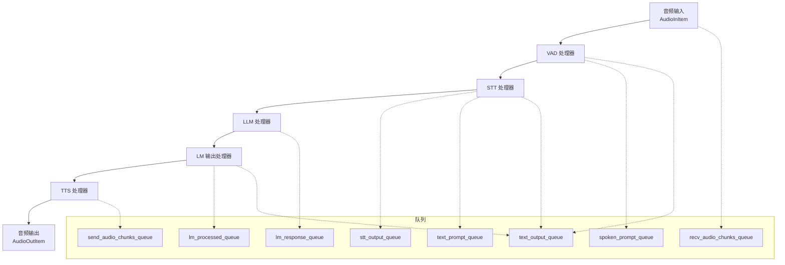
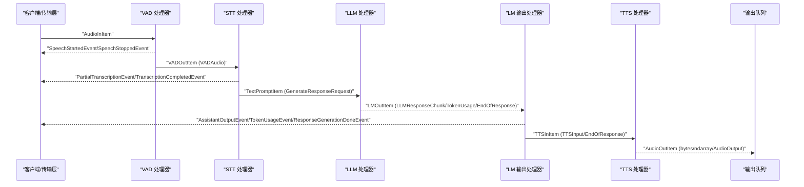
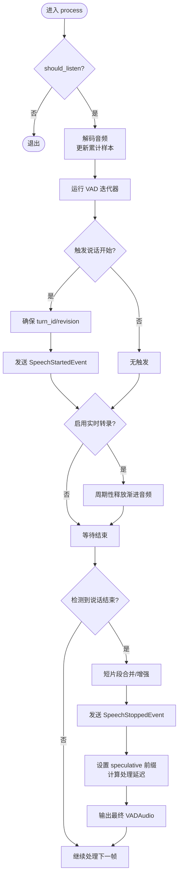
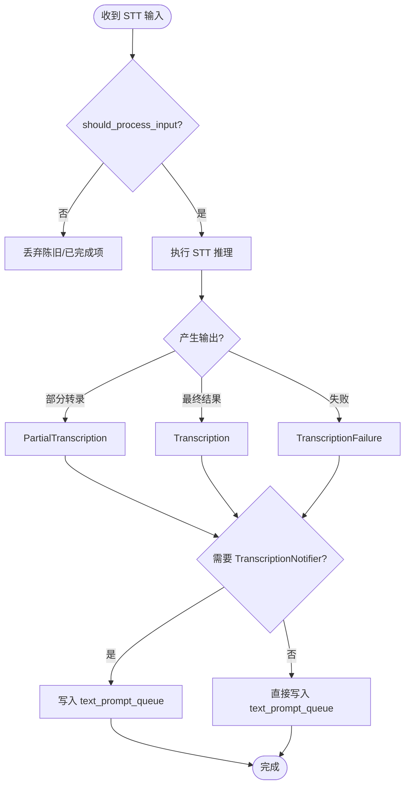
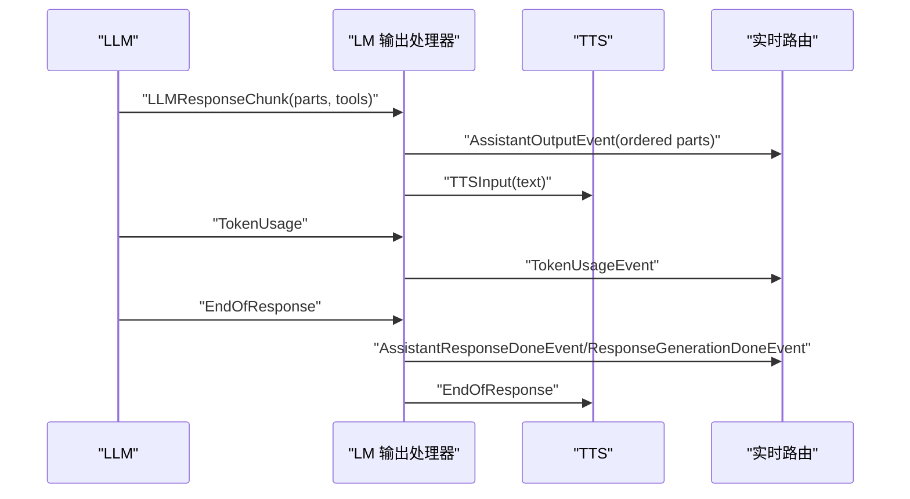
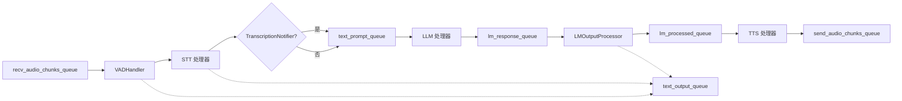
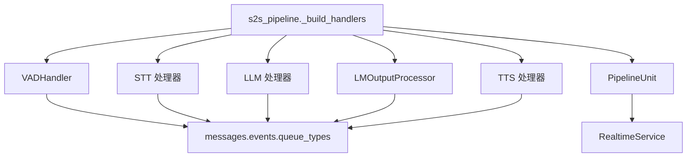

# 管道架构设计

<cite>
**本文引用的文件**
- [s2s_pipeline.py](file://src/speech_to_speech/s2s_pipeline.py)
- [messages.py](file://src/speech_to_speech/pipeline/messages.py)
- [handler_types.py](file://src/speech_to_speech/pipeline/handler_types.py)
- [queue_types.py](file://src/speech_to_speech/pipeline/queue_types.py)
- [vad_handler.py](file://src/speech_to_speech/VAD/vad_handler.py)
- [base_stt_handler.py](file://src/speech_to_speech/STT/base_stt_handler.py)
- [lm_output_processor.py](file://src/speech_to_speech/LLM/lm_output_processor.py)
- [events.py](file://src/speech_to_speech/pipeline/events.py)
- [control.py](file://src/speech_to_speech/pipeline/control.py)
- [baseHandler.py](file://src/speech_to_speech/baseHandler.py)
- [pipeline_unit.py](file://src/speech_to_speech/api/openai_realtime/pipeline_unit.py)
</cite>

## 目录
1. [简介](#简介)
2. [项目结构](#项目结构)
3. [核心组件](#核心组件)
4. [架构总览](#架构总览)
5. [详细组件分析](#详细组件分析)
6. [依赖关系分析](#依赖关系分析)
7. [性能考量](#性能考量)
8. [故障排查指南](#故障排查指南)
9. [结论](#结论)

## 简介
本文件面向语音到语音（Speech-to-Speech）实时管道的架构与实现，重点解释 VAD→STT→LLM→TTS 四个处理阶段的数据流向、职责分工、消息类型、队列机制、构建过程、状态管理与错误传播。文档提供数据流图与时序图，帮助读者理解从音频输入到语音输出的完整流程。

## 项目结构
- 管道入口与编排：负责解析参数、创建多个隔离的 PipelineUnit、组装处理器链并启动线程管理。
- 消息与类型：集中定义跨阶段的消息类型、事件与控制消息，保证类型安全与一致性。
- 处理器基类：统一输入输出队列、生命周期控制、异常捕获与停止信号。
- 各阶段处理器：VAD 语音活动检测、STT 语音转文本、LM 输出处理器、TTS 文本转语音。
- 运行时服务与会话：RealtimeService 维护会话上下文、响应生成与路由；PipelineUnit 封装单条管道的全部资源。

图表来源
- [s2s_pipeline.py:354-458](file://src/speech_to_speech/s2s_pipeline.py#L354-L458)
- [queue_types.py:20-46](file://src/speech_to_speech/pipeline/queue_types.py#L20-L46)

章节来源
- [s2s_pipeline.py:354-458](file://src/speech_to_speech/s2s_pipeline.py#L354-L458)
- [queue_types.py:20-46](file://src/speech_to_speech/pipeline/queue_types.py#L20-L46)

## 核心组件
- BaseHandler：所有处理器的基类，提供统一的 run 循环、输入过滤、输出包装、异常记录、停止与清理。
- VADHandler：语音活动检测，产出分段音频片段，支持渐进式输出与智能断句。
- STT 处理器（以 BaseSTTHandler 为基）：将音频转为文本，支持部分转录与最终结果，具备陈旧输入过滤。
- LLM 处理器：由后端注册表动态创建，接收文本提示并返回结构化响应块。
- LMOutputProcessor：对 LLM 输出进行顺序化，提取文本与工具调用事件，转发 TTS 输入。
- TTS 处理器：由后端注册表动态创建，将文本合成音频并输出。
- RealtimeService/PipelineUnit：会话级状态与管道单元封装，协调输入输出队列与服务逻辑。

章节来源
- [baseHandler.py:25-186](file://src/speech_to_speech/baseHandler.py#L25-L186)
- [vad_handler.py:53-800](file://src/speech_to_speech/VAD/vad_handler.py#L53-L800)
- [base_stt_handler.py:16-214](file://src/speech_to_speech/STT/base_stt_handler.py#L16-L214)
- [lm_output_processor.py:42-227](file://src/speech_to_speech/LLM/lm_output_processor.py#L42-L227)
- [pipeline_unit.py:53-77](file://src/speech_to_speech/api/openai_realtime/pipeline_unit.py#L53-L77)

## 架构总览
整体数据流遵循严格的顺序：音频输入进入 VAD，按说话起止切分后送入 STT；STT 输出文本（含部分与最终结果），经可选的 TranscriptionNotifier 或直接进入 LLM；LLM 返回有序的输出块，LMOutputProcessor 将其转换为 TTS 输入与事件；TTS 合成音频并输出。

图表来源
- [s2s_pipeline.py:354-458](file://src/speech_to_speech/s2s_pipeline.py#L354-L458)
- [events.py:33-206](file://src/speech_to_speech/pipeline/events.py#L33-L206)
- [messages.py:46-225](file://src/speech_to_speech/pipeline/messages.py#L46-L225)

## 详细组件分析

### VAD 阶段
- 职责：检测语音起止，累积音频片段，支持渐进式输出与智能断句，维护 turn_id/turn_revision 用于推测性轮次。
- 输入：AudioInItem（原始音频或带 RuntimeConfig 的元组）。
- 输出：VADOutItem（VADAudio 或控制消息），同时向 text_output_queue 发送 SpeechStartedEvent/SpeechStoppedEvent。
- 关键行为：
  - 渐进式输出：在说话期间周期性释放已累积音频，降低端到端延迟。
  - 短片段合并：避免噪声触发误判，提升稳定性。
  - 智能断句：根据模型预测调整等待窗口，减少不必要延迟。
  - 推测性轮次：通过 SpeculativeTurnTracker 管理 turn 的重开与提交。

图表来源
- [vad_handler.py:548-788](file://src/speech_to_speech/VAD/vad_handler.py#L548-L788)

章节来源
- [vad_handler.py:53-800](file://src/speech_to_speech/VAD/vad_handler.py#L53-L800)
- [events.py:33-51](file://src/speech_to_speech/pipeline/events.py#L33-L51)

### STT 阶段
- 职责：将 VAD 输出的音频片段转为文本，支持部分转录与最终结果，过滤陈旧输入。
- 输入：STTOutItem（VADAudio 或控制消息）。
- 输出：STTOut（PartialTranscription/Transcription/TranscriptionFailure）或控制消息；若未 bypass notifier，则经 TranscriptionNotifier 转发至 text_prompt_queue。
- 关键行为：
  - 陈旧输入过滤：基于 turn_id/turn_revision 与完成态判断丢弃过时项。
  - 稳定窗口：final 模式等待稳定性窗口后再视为最新。
  - 队列清理：必要时清理队列中的陈旧项，避免阻塞。

图表来源
- [base_stt_handler.py:24-71](file://src/speech_to_speech/STT/base_stt_handler.py#L24-L71)
- [s2s_pipeline.py:393-419](file://src/speech_to_speech/s2s_pipeline.py#L393-L419)

章节来源
- [base_stt_handler.py:16-214](file://src/speech_to_speech/STT/base_stt_handler.py#L16-L214)
- [s2s_pipeline.py:393-419](file://src/speech_to_speech/s2s_pipeline.py#L393-L419)

### LLM 阶段
- 职责：接收文本提示，生成结构化响应块（文本与工具调用），支持 token 用量上报与响应结束标记。
- 输入：TextPromptItem（GenerateResponseRequest）。
- 输出：LMOutItem（LLMResponseChunk/TokenUsage/EndOfResponse）。
- 关键行为：
  - 结构化输出：保持文本与工具调用的顺序。
  - 响应键：通过 response_key 关联同一响应的多段输出。
  - 推测性门控：LMOutputProcessor 会依据 reopen grace 过滤陈旧输出。

章节来源
- [messages.py:138-196](file://src/speech_to_speech/pipeline/messages.py#L138-L196)
- [s2s_pipeline.py:436-450](file://src/speech_to_speech/s2s_pipeline.py#L436-L450)

### LM 输出处理器
- 职责：将 LLM 输出顺序化为事件与 TTS 输入，维护 output_sequence 保证顺序，转发工具调用就绪事件。
- 输入：LMOutItem。
- 输出：PipelineEvent（AssistantOutputEvent/TokenUsageEvent/ResponseGenerationDoneEvent/ResponseFailedEvent）与 TTSInItem（TTSInput/EndOfResponse）。
- 关键行为：
  - 顺序化：为每个 part 分配 output_sequence，确保下游顺序消费。
  - 推测性门控：依据 reopen grace 丢弃陈旧输出。
  - 响应结束：生成 AssistantResponseDoneEvent 与 EndOfResponse，供下游清理。

图表来源
- [lm_output_processor.py:97-224](file://src/speech_to_speech/LLM/lm_output_processor.py#L97-L224)
- [events.py:105-206](file://src/speech_to_speech/pipeline/events.py#L105-L206)

章节来源
- [lm_output_processor.py:42-227](file://src/speech_to_speech/LLM/lm_output_processor.py#L42-L227)
- [events.py:105-206](file://src/speech_to_speech/pipeline/events.py#L105-L206)

### TTS 阶段
- 职责：将文本合成为音频片段，输出 AudioOutItem。
- 输入：TTSInItem（TTSInput/EndOfResponse）。
- 输出：AudioOutItem（bytes/ndarray/AudioOutput）。
- 关键行为：
  - 音频包装：BaseHandler.output_for_queue 将原始音频包装为 AudioOutput，携带 cancel_generation/response_key/cleanup_only。
  - 响应结束：EndOfResponse 触发下游清理。

章节来源
- [baseHandler.py:89-103](file://src/speech_to_speech/baseHandler.py#L89-L103)
- [messages.py:201-225](file://src/speech_to_speech/pipeline/messages.py#L201-L225)

### 管道构建过程（_build_handlers）
_build_handlers 函数负责组装处理器链，具体步骤如下：
- 创建 VADHandler，连接 recv_audio_chunks_queue 与 spoken_prompt_queue，注入 should_listen、text_output_queue、speculative_turns。
- 创建 STT 处理器，根据后端能力决定是否插入 TranscriptionNotifier；其输出写入 stt_output_queue 或 text_prompt_queue。
- 创建 LLM 处理器，连接 text_prompt_queue 与 lm_response_queue。
- 创建 LMOutputProcessor，连接 lm_response_queue 与 lm_processed_queue，注入 speculative_turns 与 text_output_queue。
- 创建 TTS 处理器，连接 lm_processed_queue 与 send_audio_chunks_queue。
- 返回处理器列表，交由 ThreadManager 启动。

图表来源
- [s2s_pipeline.py:354-458](file://src/speech_to_speech/s2s_pipeline.py#L354-L458)

章节来源
- [s2s_pipeline.py:354-458](file://src/speech_to_speech/s2s_pipeline.py#L354-L458)

### 队列机制与异步通信
- 各阶段通过 Queue 解耦，BaseHandler.run 循环读取输入、调用 process、写入输出。
- 控制消息（SESSION_END）与哨兵（PIPELINE_END）用于优雅停止与清理。
- 文本事件通过 text_output_queue 独立于音频路径，便于实时展示与调试。
- 推测性轮次与取消作用域（CancelScope）配合 cancel_generation/response_key，实现陈旧输出丢弃与响应级清理。

章节来源
- [baseHandler.py:105-164](file://src/speech_to_speech/baseHandler.py#L105-L164)
- [control.py:7-27](file://src/speech_to_speech/pipeline/control.py#L7-L27)
- [queue_types.py:20-46](file://src/speech_to_speech/pipeline/queue_types.py#L20-L46)

### 管道状态管理
- PipelineUnit 封装单个管道的全部资源：queues、events、service、handlers。
- SessionState 维护 per-client 临时状态（transport、session_id、pending items、drained 标志等）。
- CancelScope 与 SpeculativeTurnTracker 共同管理推测性轮次的重开、提交与陈旧输出过滤。

章节来源
- [pipeline_unit.py:13-77](file://src/speech_to_speech/api/openai_realtime/pipeline_unit.py#L13-L77)

### 错误传播与异常处理策略
- BaseHandler.run 捕获 process 中的异常并记录，避免单点故障导致整条管道崩溃。
- STT 阶段对陈旧输入进行过滤与队列清理，防止阻塞。
- LMOutputProcessor 在 EndOfResponse 时生成 ResponseGenerationDoneEvent/ResponseFailedEvent，通知上层完成或失败。
- 控制消息 SESSION_END 触发 on_session_end 清理，随后传递 PIPELINE_END 停止线程。

章节来源
- [baseHandler.py:144-164](file://src/speech_to_speech/baseHandler.py#L144-L164)
- [base_stt_handler.py:104-128](file://src/speech_to_speech/STT/base_stt_handler.py#L104-L128)
- [lm_output_processor.py:117-163](file://src/speech_to_speech/LLM/lm_output_processor.py#L117-L163)

## 依赖关系分析
- s2s_pipeline 依赖 backend_registry 动态创建 STT/LLM/TTS 处理器。
- 各处理器依赖 messages/events/queue_types 定义的统一类型。
- BaseHandler 提供通用生命周期与异常处理。
- PipelineUnit 聚合 handlers 与 service，供 RealtimeServer 管理。

图表来源
- [s2s_pipeline.py:354-458](file://src/speech_to_speech/s2s_pipeline.py#L354-L458)
- [pipeline_unit.py:53-77](file://src/speech_to_speech/api/openai_realtime/pipeline_unit.py#L53-L77)

章节来源
- [s2s_pipeline.py:354-458](file://src/speech_to_speech/s2s_pipeline.py#L354-L458)
- [pipeline_unit.py:53-77](file://src/speech_to_speech/api/openai_realtime/pipeline_unit.py#L53-L77)

## 性能考量
- 渐进式音频释放：VAD 在说话期间周期性输出，降低首包延迟。
- 短片段合并与智能断句：减少误触发与不必要等待，提高稳定性与效率。
- 陈旧输入过滤：STT/LM 阶段丢弃过时项，避免无效计算与阻塞。
- 推测性轮次与 reopen grace：允许快速重开与提交，平衡延迟与正确性。
- 设备与并发：macOS 下 MLX 全局锁影响 live transcription，多管道时自动禁用以提升日志可读性与吞吐。

[本节为一般性指导，不直接分析具体文件]

## 故障排查指南
- 检查队列是否堵塞：观察 baseHandler 的 qsize 与 dropped 计数，确认陈旧项清理是否生效。
- 关注推测性轮次：turn_id/turn_revision 不一致会导致输出被丢弃，核对 VAD 与 STT/LM 的 turn 状态。
- 查看事件流：text_output_queue 中的 SpeechStarted/Stopped、PartialTranscription/Completed、AssistantOutput/TokenUsage 有助于定位问题阶段。
- 停止与清理：确保 SESSION_END 与 PIPELINE_END 正确传递，避免线程死锁。

章节来源
- [base_stt_handler.py:104-128](file://src/speech_to_speech/STT/base_stt_handler.py#L104-L128)
- [events.py:33-206](file://src/speech_to_speech/pipeline/events.py#L33-L206)
- [control.py:7-27](file://src/speech_to_speech/pipeline/control.py#L7-L27)

## 结论
该管道采用模块化、类型安全的消息驱动架构，通过队列与基类抽象实现高内聚低耦合。VAD→STT→LLM→TTS 四阶段职责清晰，数据流可控，错误传播与状态管理完善。结合推测性轮次与智能断句，系统在低延迟与高稳定性之间取得良好平衡。实际部署中可根据设备与负载调整参数，以获得最佳性能。