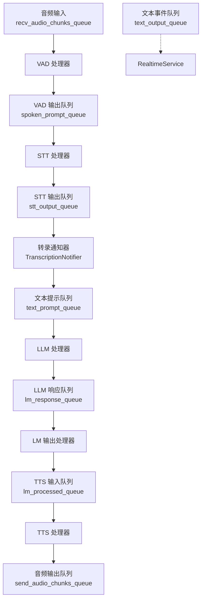
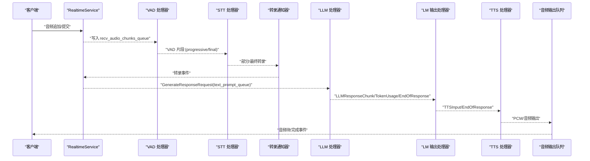
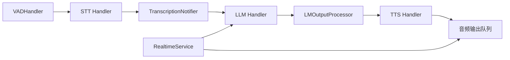

# 队列机制

<cite>
**本文引用的文件**
- [s2s_pipeline.py](file://src/speech_to_speech/s2s_pipeline.py)
- [queue_types.py](file://src/speech_to_speech/pipeline/queue_types.py)
- [handler_types.py](file://src/speech_to_speech/pipeline/handler_types.py)
- [messages.py](file://src/speech_to_speech/pipeline/messages.py)
- [baseHandler.py](file://src/speech_to_speech/baseHandler.py)
- [vad_handler.py](file://src/speech_to_speech/VAD/vad_handler.py)
- [transcription_notifier.py](file://src/speech_to_speech/STT/transcription_notifier.py)
- [service.py](file://src/speech_to_speech/api/openai_realtime/service.py)
- [pipeline_unit.py](file://src/speech_to_speech/api/openai_realtime/pipeline_unit.py)
- [server.py](file://src/speech_to_speech/api/openai_realtime/server.py)
- [control.py](file://src/speech_to_speech/pipeline/control.py)
- [thread_manager.py](file://src/speech_to_speech/utils/thread_manager.py)
</cite>

## 目录
1. [简介](#简介)
2. [项目结构](#项目结构)
3. [核心组件](#核心组件)
4. [架构总览](#架构总览)
5. [详细组件分析](#详细组件分析)
6. [依赖关系分析](#依赖关系分析)
7. [性能与内存管理](#性能与内存管理)
8. [监控与调试](#监控与调试)
9. [故障恢复与背压处理](#故障恢复与背压处理)
10. [结论](#结论)

## 简介
本文件系统性阐述语音到语音（Speech-to-Speech）管道中的队列机制，覆盖音频输入、VAD、STT、LLM、TTS等阶段的队列设计、生产者-消费者模式、异步通信、数据流向、背压与流量控制、监控与调试、性能优化与内存管理、状态监控与故障恢复。目标是帮助读者理解各队列的职责分工与协作方式，并掌握在真实运行环境下的调优与排障方法。

## 项目结构
该项目的队列系统围绕“每单元隔离”的 PipelineUnit 构建：每个单元拥有独立的输入/输出队列、事件标志和处理器链（VAD → STT → LLM → TTS），并通过统一的线程管理器启动与停止。服务层将协议事件转换为内部消息，注入文本提示队列；传输层负责将结果回送到客户端。

图表来源
- [s2s_pipeline.py:489-496](file://src/speech_to_speech/s2s_pipeline.py#L489-L496)
- [s2s_pipeline.py:378-458](file://src/speech_to_speech/s2s_pipeline.py#L378-L458)
- [service.py:287-326](file://src/speech_to_speech/api/openai_realtime/service.py#L287-L326)

章节来源
- [s2s_pipeline.py:461-547](file://src/speech_to_speech/s2s_pipeline.py#L461-L547)
- [pipeline_unit.py:53-77](file://src/speech_to_speech/api/openai_realtime/pipeline_unit.py#L53-L77)
- [server.py:14-70](file://src/speech_to_speech/api/openai_realtime/server.py#L14-L70)

## 核心组件
- 队列类型定义：集中声明各阶段可承载的消息类型与控制哨兵，确保类型安全与一致性。
- 处理器基类：统一的生产者-消费者循环、控制消息处理、停止信号、时序统计与清理。
- VAD 处理器：语音活动检测、分段合并、实时渐进式释放、智能回合判定。
- 转录通知器：将 STT 的中间/最终结果转为协议无关事件，供服务层消费。
- RealtimeService：连接级状态、事件路由、生成请求入队、使用量统计。
- 管道单元与服务：为每个并发会话提供隔离的队列与处理器链，并由服务器统一管理。

章节来源
- [queue_types.py:20-47](file://src/speech_to_speech/pipeline/queue_types.py#L20-L47)
- [handler_types.py:31-46](file://src/speech_to_speech/pipeline/handler_types.py#L31-L46)
- [baseHandler.py:25-186](file://src/speech_to_speech/baseHandler.py#L25-L186)
- [vad_handler.py:53-172](file://src/speech_to_speech/VAD/vad_handler.py#L53-L172)
- [transcription_notifier.py:26-107](file://src/speech_to_speech/STT/transcription_notifier.py#L26-L107)
- [service.py:287-326](file://src/speech_to_speech/api/openai_realtime/service.py#L287-L326)

## 架构总览
下图展示了从音频输入到音频输出的完整数据流，以及文本事件通道的并行路径。

图表来源
- [s2s_pipeline.py:378-458](file://src/speech_to_speech/s2s_pipeline.py#L378-L458)
- [service.py:629-727](file://src/speech_to_speech/api/openai_realtime/service.py#L629-L727)
- [messages.py:335-357](file://src/speech_to_speech/pipeline/messages.py#L335-L357)

## 详细组件分析

### 音频输入队列（recv_audio_chunks_queue）
- 职责：接收来自传输层的 PCM 音频块，送入 VAD 进行语音活动检测。
- 数据类型：AudioInItem = VADIn | PipelineControlMessage。
- 生产者：RealtimeService 通过音频处理逻辑将客户端音频追加/提交后写入。
- 消费者：VADHandler 读取并执行分段、合并、渐进式释放。
- 背压与流量控制：基于 Python Queue 的阻塞 put/get；当队列满时生产者会阻塞，从而自然形成背压。
- 监控与调试：可通过日志与处理器计时观察吞吐；VAD 内部有节流日志。

章节来源
- [queue_types.py:24-28](file://src/speech_to_speech/pipeline/queue_types.py#L24-L28)
- [s2s_pipeline.py:489-496](file://src/speech_to_speech/s2s_pipeline.py#L489-L496)
- [vad_handler.py:548-619](file://src/speech_to_speech/VAD/vad_handler.py#L548-L619)

### VAD 输出队列（spoken_prompt_queue）
- 职责：承载 VAD 产出的音频片段（progressive 或 final），传递给 STT。
- 数据类型：VADOutItem = VADOut | PipelineInternalItem。
- 生产者：VADHandler。
- 消费者：STT 后端处理器。
- 特性：支持 progressive 模式以尽早开始 STT，提高端到端延迟表现。

章节来源
- [queue_types.py:27-29](file://src/speech_to_speech/pipeline/queue_types.py#L27-L29)
- [s2s_pipeline.py:393-408](file://src/speech_to_speech/s2s_pipeline.py#L393-L408)
- [vad_handler.py:621-787](file://src/speech_to_speech/VAD/vad_handler.py#L621-L787)

### STT 输出队列（stt_output_queue）
- 职责：承载 STT 的部分/最终转录结果；若后端未绕过 TranscriptionNotifier，则经其转发。
- 数据类型：STTOutItem = STTOut | PipelineInternalItem。
- 生产者：STT 后端处理器。
- 消费者：TranscriptionNotifier（可选）或直接进入文本提示队列。
- 注意：某些 STT 后端可直接跳过通知器以提升延迟。

章节来源
- [queue_types.py:30-32](file://src/speech_to_speech/pipeline/queue_types.py#L30-L32)
- [s2s_pipeline.py:393-419](file://src/speech_to_speech/s2s_pipeline.py#L393-L419)
- [transcription_notifier.py:42-107](file://src/speech_to_speech/STT/transcription_notifier.py#L42-L107)

### 文本提示队列（text_prompt_queue）
- 职责：承载 GenerateResponseRequest，触发 LLM 生成。
- 数据类型：TextPromptItem = LLMIn | PipelineInternalItem。
- 生产者：RealtimeService（根据转录完成或音频输入完成事件）。
- 消费者：LLM 处理器。
- 语义：包含运行时配置、语言、turn_id/revision、音频上下文等。

章节来源
- [queue_types.py:33-35](file://src/speech_to_speech/pipeline/queue_types.py#L33-L35)
- [service.py:629-727](file://src/speech_to_speech/api/openai_realtime/service.py#L629-L727)
- [messages.py:335-357](file://src/speech_to_speech/pipeline/messages.py#L335-L357)

### LLM 响应队列（lm_response_queue）
- 职责：承载 LLM 的输出分片、用量报告与结束标记。
- 数据类型：LMOutItem = LLMOut | PipelineInternalItem。
- 生产者：LLM 处理器。
- 消费者：LMOutputProcessor（用于排序与聚合）。

章节来源
- [queue_types.py:36-38](file://src/speech_to_speech/pipeline/queue_types.py#L36-L38)
- [handler_types.py:39-42](file://src/speech_to_speech/pipeline/handler_types.py#L39-L42)
- [messages.py:138-196](file://src/speech_to_speech/pipeline/messages.py#L138-L196)

### TTS 输入队列（lm_processed_queue）
- 职责：承载已处理的 TTS 输入与结束标记。
- 数据类型：TTSInItem = TTSIn | PipelineEvent | PipelineInternalItem。
- 生产者：LMOutputProcessor。
- 消费者：TTS 处理器。

章节来源
- [queue_types.py:39-41](file://src/speech_to_speech/pipeline/queue_types.py#L39-L41)
- [handler_types.py:43-45](file://src/speech_to_speech/pipeline/handler_types.py#L43-L45)
- [messages.py:201-225](file://src/speech_to_speech/pipeline/messages.py#L201-L225)

### 音频输出队列（send_audio_chunks_queue）
- 职责：承载最终 PCM 音频块与完成哨兵，按顺序发送到客户端。
- 数据类型：AudioOutItem = bytes | np.ndarray | AudioOutput | PipelineEvent | PipelineControlMessage。
- 生产者：TTS 处理器。
- 消费者：发送循环（由传输层封装），负责编码与投递。

章节来源
- [queue_types.py:42-44](file://src/speech_to_speech/pipeline/queue_types.py#L42-L44)
- [messages.py:217-225](file://src/speech_to_speech/pipeline/messages.py#L217-L225)

### 文本事件队列（text_output_queue）
- 职责：承载不依赖 TTS 的文本事件（如语音开始/停止、部分/最终转录、失败等）。
- 数据类型：TextEventItem = PipelineEvent | PipelineInternalItem。
- 生产者：VAD、STT 通知器等。
- 消费者：RealtimeService，用于更新对话状态与触发后续动作。

章节来源
- [queue_types.py:45-47](file://src/speech_to_speech/pipeline/queue_types.py#L45-L47)
- [vad_handler.py:591-600](file://src/speech_to_speech/VAD/vad_handler.py#L591-L600)
- [transcription_notifier.py:42-107](file://src/speech_to_speech/STT/transcription_notifier.py#L42-L107)
- [service.py:316-326](file://src/speech_to_speech/api/openai_realtime/service.py#L316-L326)

## 依赖关系分析
- 处理器链依赖：VAD → STT →（可选）TranscriptionNotifier → LLM → LMOutputProcessor → TTS。
- 控制流：BaseHandler 统一处理 SESSION_END 与 PIPELINE_END，保证有序关闭。
- 服务层依赖：RealtimeService 维护连接状态，将协议事件映射为内部消息，并驱动 text_prompt_queue。
- 传输层依赖：WebSocketTransport 将音频块编码为协议事件并发送。

图表来源
- [s2s_pipeline.py:378-458](file://src/speech_to_speech/s2s_pipeline.py#L378-L458)
- [service.py:287-326](file://src/speech_to_speech/api/openai_realtime/service.py#L287-L326)
- [baseHandler.py:105-165](file://src/speech_to_speech/baseHandler.py#L105-L165)

章节来源
- [control.py:7-27](file://src/speech_to_speech/pipeline/control.py#L7-L27)
- [baseHandler.py:105-165](file://src/speech_to_speech/baseHandler.py#L105-L165)

## 性能与内存管理
- 背压与流量控制
  - 所有队列均基于标准 Queue，put/get 天然具备阻塞能力，防止上游过快导致下游拥塞。
  - VAD 的 progressive 模式按时间间隔释放片段，避免一次性推送过多数据。
  - 短片段合并窗口减少碎片，降低 STT 压力。
- 内存管理
  - 使用 numpy 数组与 bytes 传递音频，避免频繁拷贝；必要时进行视图拼接。
  - 会话结束时清理 Chat 与缓存，防止内存泄漏。
- 优化建议
  - 合理设置 live_transcription_update_interval 以平衡延迟与负载。
  - 在 Apple Silicon 多管道场景下，禁用 progressive STT 以避免 MLX 全局锁竞争。
  - 对大模型推理与 TTS 解码采用批处理或流水线重叠策略（由后端实现）。

章节来源
- [s2s_pipeline.py:642-655](file://src/speech_to_speech/s2s_pipeline.py#L642-L655)
- [vad_handler.py:621-787](file://src/speech_to_speech/VAD/vad_handler.py#L621-L787)
- [service.py:347-365](file://src/speech_to_speech/api/openai_realtime/service.py#L347-L365)

## 监控与调试
- 队列长度统计
  - 可在 BaseHandler 中记录 last_time 与 _times，结合日志级别过滤慢操作。
  - 通过访问队列内部属性（如 queue.qsize）进行外部监控（需加锁保护）。
- 处理延迟测量
  - BaseHandler 在每个输出上记录耗时，并在超过阈值时输出 DEBUG 日志。
  - VAD 每秒汇总 chunk 数、说话起止次数与 progressive 释放次数。
- 诊断要点
  - 关注 STT 是否启用 bypasses_transcription_notifier 以评估链路长度。
  - 检查文本事件队列是否持续产出 SpeechStarted/Stopped 与转录事件。
  - 观察 LLM 用量事件与响应完成事件是否成对出现。

章节来源
- [baseHandler.py:144-165](file://src/speech_to_speech/baseHandler.py#L144-L165)
- [vad_handler.py:603-616](file://src/speech_to_speech/VAD/vad_handler.py#L603-L616)
- [service.py:731-770](file://src/speech_to_speech/api/openai_realtime/service.py#L731-L770)

## 故障恢复与背压处理
- 控制消息与会话结束
  - SESSION_END 软控制消息在各处理器中透传，允许重置会话状态而不终止线程。
  - PIPELINE_END 哨兵用于优雅退出，避免队列死锁。
- 失效与陈旧事件丢弃
  - BaseHandler.should_process_input 支持 cancel_generation 与 prefetch_transaction 丢弃陈旧或未被认领的工作。
  - RealtimeService 对过期的 turn/revison 事件进行过滤，避免乱序输出。
- 错误处理
  - 转录失败事件直接上报，不会触发 LLM 工作。
  - 生成失败事件会发出 response.failed，并在音频哨兵处关闭响应。
- 背压策略
  - 队列满时生产者阻塞，上游自动降速；VAD 的 progressive 释放与短片段合并进一步平滑流量。
  - 多管道池化与单服务实例共享资源，避免过载。

章节来源
- [control.py:7-27](file://src/speech_to_speech/pipeline/control.py#L7-L27)
- [baseHandler.py:56-81](file://src/speech_to_speech/baseHandler.py#L56-L81)
- [service.py:529-618](file://src/speech_to_speech/api/openai_realtime/service.py#L529-L618)
- [service.py:772-800](file://src/speech_to_speech/api/openai_realtime/service.py#L772-L800)

## 结论
该队列机制通过类型化的消息、统一的处理器基类与隔离的管道单元，实现了高内聚、低耦合的语音到语音流水线。借助队列的背压能力、会话级状态管理与严格的陈旧事件过滤，系统在实时性、稳定性与可观测性之间取得良好平衡。实际部署中，应结合设备能力与负载情况调整 VAD 参数、转录更新间隔与管道数量，以获得最佳体验。