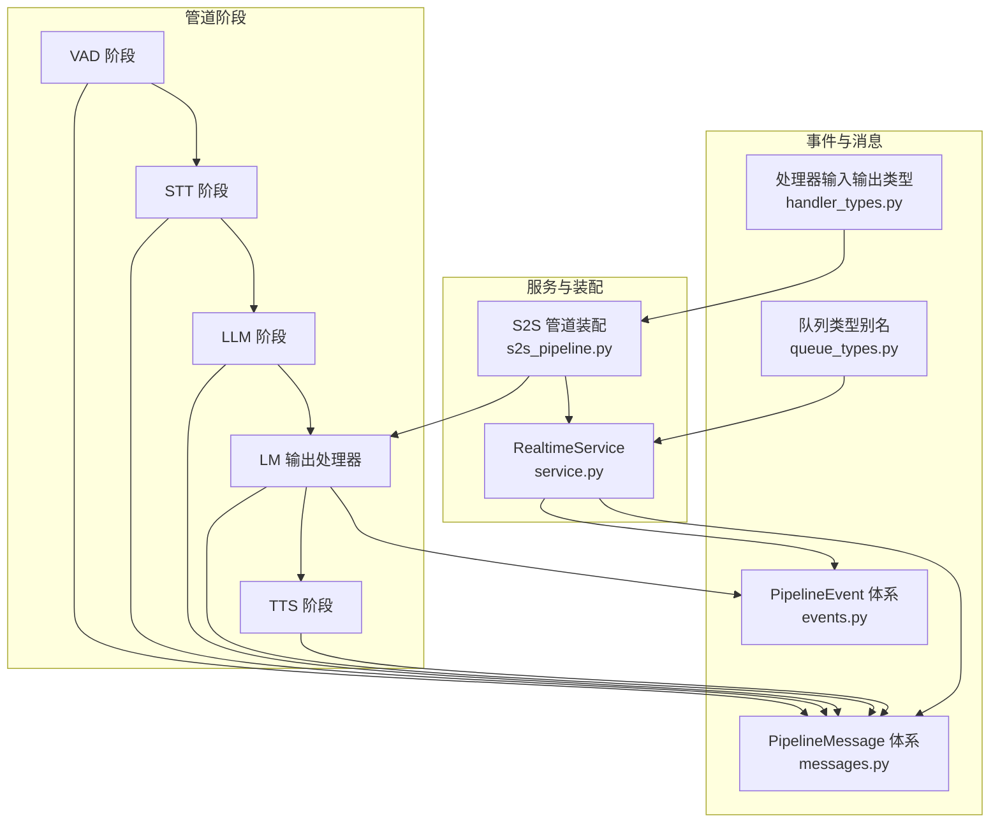
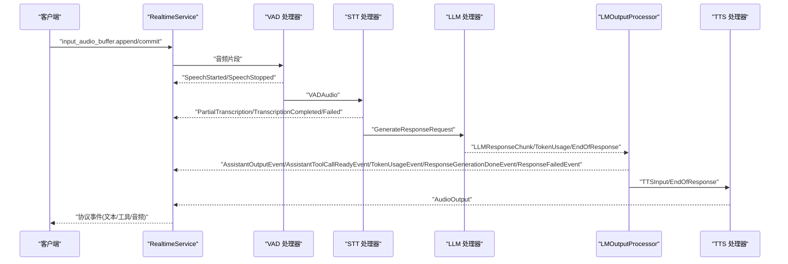
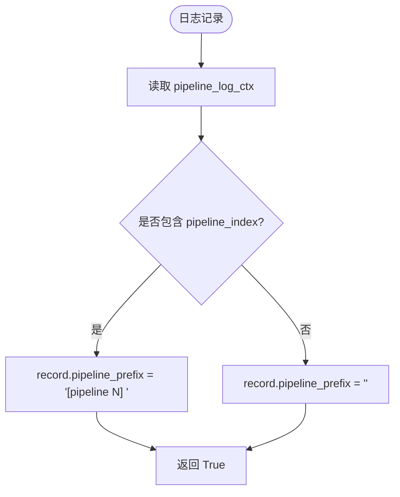
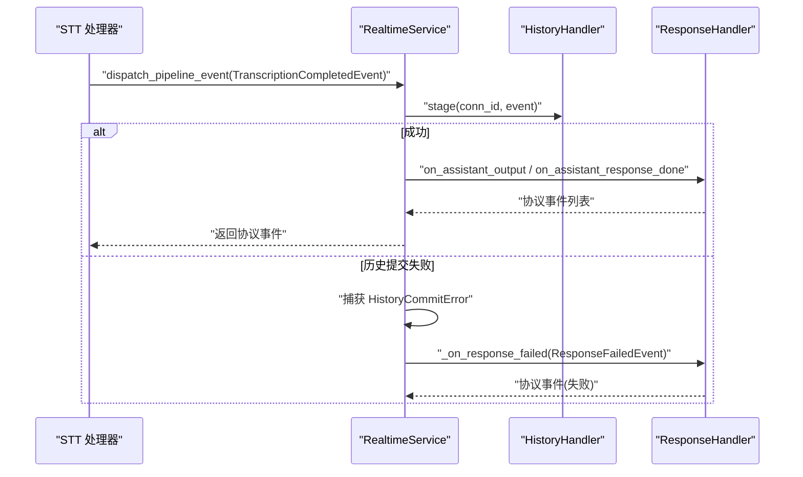
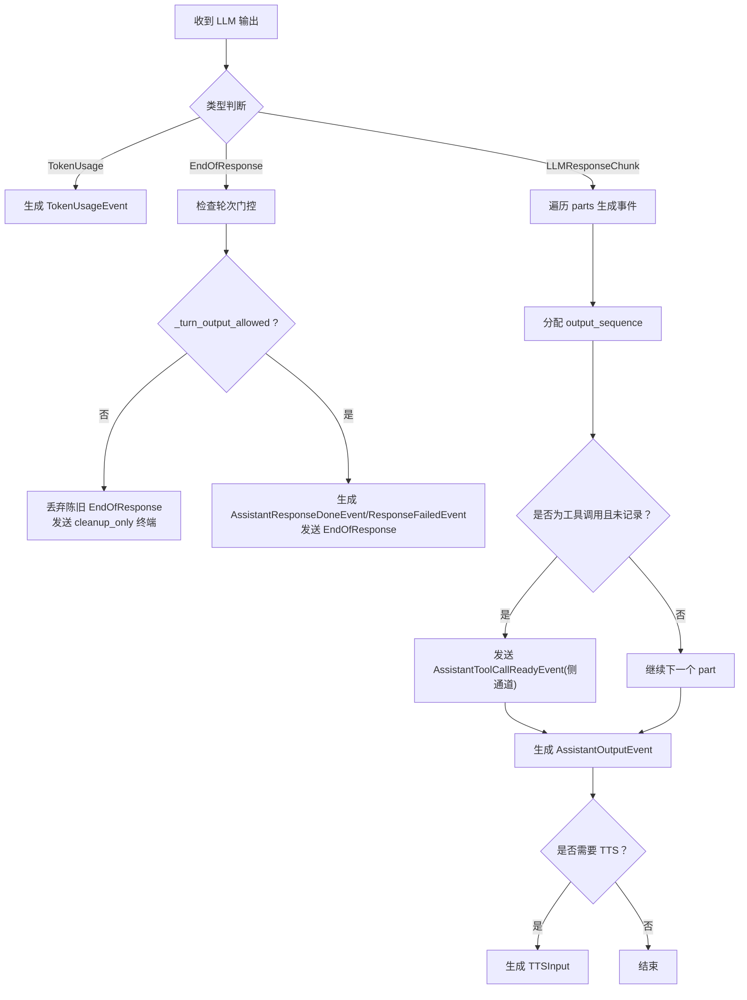
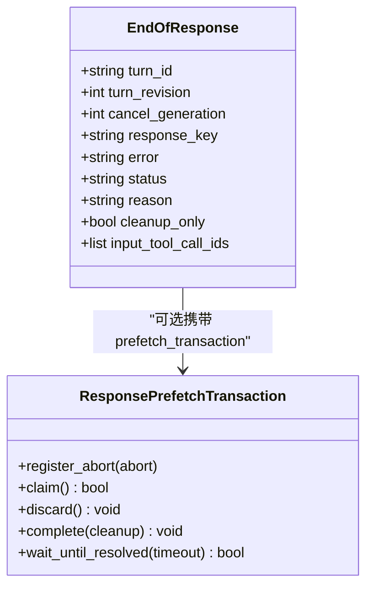
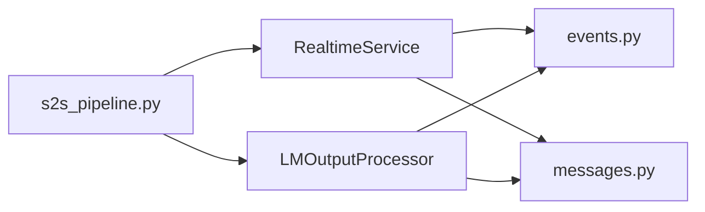

# 事件驱动系统

<cite>
**本文引用的文件**   
- [events.py](file://src/speech_to_speech/pipeline/events.py)
- [messages.py](file://src/speech_to_speech/pipeline/messages.py)
- [queue_types.py](file://src/speech_to_speech/pipeline/queue_types.py)
- [handler_types.py](file://src/speech_to_speech/pipeline/handler_types.py)
- [log_context.py](file://src/speech_to_speech/pipeline/log_context.py)
- [lm_output_processor.py](file://src/speech_to_speech/LLM/lm_output_processor.py)
- [service.py](file://src/speech_to_speech/api/openai_realtime/service.py)
- [s2s_pipeline.py](file://src/speech_to_speech/s2s_pipeline.py)
</cite>

## 目录
1. [简介](#简介)
2. [项目结构](#项目结构)
3. [核心组件](#核心组件)
4. [架构总览](#架构总览)
5. [详细组件分析](#详细组件分析)
6. [依赖关系分析](#依赖关系分析)
7. [性能与调度特性](#性能与调度特性)
8. [故障排查指南](#故障排查指南)
9. [结论](#结论)
10. [附录：自定义事件处理实践](#附录自定义事件处理实践)

## 简介
本文件系统性地梳理语音到语音（Speech-to-Speech）管道中的事件驱动机制，重点覆盖以下方面：
- 事件类型定义与生命周期管理
- 异步事件处理与事件传播路径
- 日志上下文系统与 PipelineLogFilter 过滤规则
- 事件监听器、订阅与发布、错误处理
- 事件优先级、调度策略、批处理与批量提交
- 事件流程图与调试技巧
- 面向开发者的自定义事件处理实践指南

该系统的核心思想是：各阶段处理器通过队列传递强类型消息，由 RealtimeService 将内部 PipelineEvent 路由到协议层，最终序列化并发送给客户端；同时通过 LMOutputProcessor 保证文本与工具调用的有序输出，并与 TTS 输出保持顺序一致性。

## 项目结构
围绕事件驱动的核心代码集中在 pipeline 与 LLM 模块中，RealtimeService 作为协议桥接中心，s2s_pipeline 负责组装各阶段处理器与队列。

图表来源
- [events.py:26-228](file://src/speech_to_speech/pipeline/events.py#L26-L228)
- [messages.py:34-416](file://src/speech_to_speech/pipeline/messages.py#L34-L416)
- [queue_types.py:1-47](file://src/speech_to_speech/pipeline/queue_types.py#L1-L47)
- [handler_types.py:1-46](file://src/speech_to_speech/pipeline/handler_types.py#L1-L46)
- [service.py:355-403](file://src/speech_to_speech/api/openai_realtime/service.py#L355-L403)
- [s2s_pipeline.py:516-671](file://src/speech_to_speech/s2s_pipeline.py#L516-L671)

章节来源
- [events.py:26-228](file://src/speech_to_speech/pipeline/events.py#L26-L228)
- [messages.py:34-416](file://src/speech_to_speech/pipeline/messages.py#L34-L416)
- [queue_types.py:1-47](file://src/speech_to_speech/pipeline/queue_types.py#L1-L47)
- [handler_types.py:1-46](file://src/speech_to_speech/pipeline/handler_types.py#L1-L46)
- [service.py:355-403](file://src/speech_to_speech/api/openai_realtime/service.py#L355-L403)
- [s2s_pipeline.py:516-671](file://src/speech_to_speech/s2s_pipeline.py#L516-L671)

## 核心组件
- PipelineEvent 体系：定义 VAD、转录、助手输出、工具调用就绪、令牌用量、响应完成/失败等事件类型，统一由 RealtimeService 分发。
- PipelineMessage 体系：定义跨阶段的消息类型，如 VADAudio、PartialTranscription、Transcription、LLMResponseChunk、TokenUsage、EndOfResponse、TTSInput、AudioOutput、GenerateResponseRequest 等。
- 队列类型别名：集中声明各阶段队列的输入输出联合类型，避免重复 union 定义。
- 处理器类型别名：为 VAD、STT、LLM、TTS 阶段提供可读的输入输出类型别名。
- LMOutputProcessor：将 LLM 流式输出转换为有序的 AssistantOutputEvent/TTSInput，并在侧通道发送 AssistantToolCallReadyEvent 和 ResponseGenerationDoneEvent。
- RealtimeService：协议桥接中心，维护连接状态、响应生命周期、推测性轮次门控、延迟统计，并将 PipelineEvent 映射到具体处理器方法。
- s2s_pipeline：装配 VAD/STT/LLM/TTS 处理器、队列、LMOutputProcessor 与 RealtimeService，注入配置与资源账本。

章节来源
- [events.py:26-228](file://src/speech_to_speech/pipeline/events.py#L26-L228)
- [messages.py:34-416](file://src/speech_to_speech/pipeline/messages.py#L34-L416)
- [queue_types.py:1-47](file://src/speech_to_speech/pipeline/queue_types.py#L1-L47)
- [handler_types.py:1-46](file://src/speech_to_speech/pipeline/handler_types.py#L1-L46)
- [lm_output_processor.py:44-308](file://src/speech_to_speech/LLM/lm_output_processor.py#L44-L308)
- [service.py:355-403](file://src/speech_to_speech/api/openai_realtime/service.py#L355-L403)
- [s2s_pipeline.py:516-671](file://src/speech_to_speech/s2s_pipeline.py#L516-L671)

## 架构总览
下图展示从音频输入到协议输出的事件流与关键组件交互。

图表来源
- [service.py:393-403](file://src/speech_to_speech/api/openai_realtime/service.py#L393-L403)
- [service.py:610-670](file://src/speech_to_speech/api/openai_realtime/service.py#L610-L670)
- [lm_output_processor.py:134-308](file://src/speech_to_speech/LLM/lm_output_processor.py#L134-L308)
- [messages.py:146-217](file://src/speech_to_speech/pipeline/messages.py#L146-L217)
- [messages.py:222-267](file://src/speech_to_speech/pipeline/messages.py#L222-L267)

## 详细组件分析

### 事件类型与生命周期
- 基类 PipelineEvent 使用 type 字段作为 Pydantic 判别器，便于按类型分派。
- VAD 事件：SpeechStartedEvent、SpeechStoppedEvent，携带 turn_id/turn_revision 以支持推测性轮次。
- 转录事件：PartialTranscriptionEvent、TranscriptionCompletedEvent、TranscriptionFailedEvent，其中 PartialTranscriptionEvent.delta 保留兼容语义。
- 直接音频事件：AudioInputCompletedEvent，用于等待实时响应记账。
- LLM 输出事件：AssistantOutputEvent（有序助手输出）、AssistantToolCallReadyEvent（工具调用就绪侧通道）、TokenUsageEvent、AssistantResponseDoneEvent、ResponseGenerationDoneEvent（内部信号）、ResponseFailedEvent。
- 生命周期关键点：
  - response_key 标识一次响应，贯穿 TokenUsage、AssistantOutput、AssistantResponseDone、ResponseFailed 等事件。
  - cancel_generation 用于丢弃陈旧响应输出。
  - output_sequence 保证助手文本与工具调用的顺序。
  - turn_id/turn_revision 配合 SpeculativeTurnTracker 进行门控与陈旧事件丢弃。

```mermaid
classDiagram
class PipelineEvent {
+string type
}
class SpeechStartedEvent {
+int audio_start_ms
+string turn_id
+int turn_revision
+bool reopened
}
class SpeechStoppedEvent {
+float duration_s
+int audio_end_ms
+string turn_id
+int turn_revision
}
class PartialTranscriptionEvent {
+string delta
+string turn_id
+int turn_revision
}
class TranscriptionCompletedEvent {
+string transcript
+SpeakerAttribution speaker_attribution
+string language_code
+string turn_id
+int turn_revision
}
class TranscriptionFailedEvent {
+string message
+string turn_id
+int turn_revision
}
class AudioInputCompletedEvent {
+bytes audio
+int audio_sample_rate
+float audio_duration_s
+string turn_id
+int turn_revision
}
class AssistantOutputEvent {
+list parts
+string text
+list tools
+string turn_id
+int turn_revision
+int cancel_generation
+string response_key
+int output_sequence
}
class AssistantToolCallReadyEvent {
+AssistantToolCallPart part
+int output_sequence
+string turn_id
+int turn_revision
+int cancel_generation
+string response_key
}
class TokenUsageEvent {
+int input_tokens
+int output_tokens
+string turn_id
+int turn_revision
+int cancel_generation
+string response_key
}
class AssistantResponseDoneEvent {
+string status
+ResponseIncompleteReason reason
+string response_key
+list input_tool_call_ids
+string turn_id
+int turn_revision
+int cancel_generation
}
class ResponseGenerationDoneEvent {
+string response_key
+list call_ids
+bool succeeded
+string turn_id
+int turn_revision
+int cancel_generation
}
class ResponseFailedEvent {
+string message
+string turn_id
+int turn_revision
+int cancel_generation
+string response_key
}
PipelineEvent <|-- SpeechStartedEvent
PipelineEvent <|-- SpeechStoppedEvent
PipelineEvent <|-- PartialTranscriptionEvent
PipelineEvent <|-- TranscriptionCompletedEvent
PipelineEvent <|-- TranscriptionFailedEvent
PipelineEvent <|-- AudioInputCompletedEvent
PipelineEvent <|-- AssistantOutputEvent
PipelineEvent <|-- AssistantToolCallReadyEvent
PipelineEvent <|-- TokenUsageEvent
PipelineEvent <|-- AssistantResponseDoneEvent
PipelineEvent <|-- ResponseGenerationDoneEvent
PipelineEvent <|-- ResponseFailedEvent
```

图表来源
- [events.py:26-228](file://src/speech_to_speech/pipeline/events.py#L26-L228)

章节来源
- [events.py:26-228](file://src/speech_to_speech/pipeline/events.py#L26-L228)

### 日志上下文系统与 PipelineLogFilter
- 使用 contextvars 保存当前 pipeline_index，每个隔离的管道单元在线程/协程入口设置上下文变量。
- PipelineLogFilter 在每个 LogRecord 上注入 pipeline_prefix，格式为 “[pipeline N] ”，未绑定管道的日志为空前缀。
- 适用于线程（处理器线程）与 asyncio（WebSocket 路由、发送循环），因为 contextvars 是每线程/每任务隔离的。

图表来源
- [log_context.py:1-26](file://src/speech_to_speech/pipeline/log_context.py#L1-L26)

章节来源
- [log_context.py:1-26](file://src/speech_to_speech/pipeline/log_context.py#L1-L26)

### 事件监听器、订阅与发布、错误处理
- 订阅：RealtimeService 在构造时建立 _pipeline_dispatch，将 PipelineEvent 类型映射到具体处理方法（如 on_speech_started、on_partial_transcription、on_assistant_output 等）。
- 发布：各阶段处理器通过队列向 RealtimeService 或 LMOutputProcessor 推送消息/事件；LMOutputProcessor 还会通过 text_output_queue 发送侧通道事件（AssistantToolCallReadyEvent、ResponseGenerationDoneEvent）。
- 错误处理：
  - 转录失败：TranscriptionFailedEvent 触发 _on_transcription_failed。
  - 生成失败：ResponseFailedEvent 触发 _on_response_failed，关闭进行中的响应并标记 failed。
  - 历史提交异常：HistoryCommitError 被捕获后转为 ResponseFailedEvent。
  - 陈旧事件：_is_stale_turn_event 与 is_turn_output_held 结合 SpeculativeTurnTracker 丢弃或暂存陈旧输出。

图表来源
- [service.py:610-670](file://src/speech_to_speech/api/openai_realtime/service.py#L610-L670)

章节来源
- [service.py:393-403](file://src/speech_to_speech/api/openai_realtime/service.py#L393-L403)
- [service.py:610-670](file://src/speech_to_speech/api/openai_realtime/service.py#L610-L670)

### 事件优先级与调度策略
- 顺序保证：
  - LMOutputProcessor 维护 output_sequence，确保 AssistantOutputEvent 与 AssistantToolCallReadyEvent 的顺序一致，避免工具调用早于前面的助手文本到达客户端。
  - AssistantOutputEvent.parts 与 legacy views（text/tools）保持一致，防止乱序。
- 推测性轮次门控：
  - _TURN_INPUT_EVENTS 与 _TURN_OUTPUT_EVENTS 分别标记输入与输出事件类别。
  - is_turn_output_held 与 _is_stale_turn_event 根据 SpeculativeTurnTracker 决定 HOLD/DROP/RELEASE。
  - LMOutputProcessor._turn_output_allowed 在 EndOfResponse 与 LLMResponseChunk 处检查，允许最新轮次输出，丢弃陈旧轮次。
- 响应生命周期：
  - response_key 贯穿 TokenUsage、AssistantOutput、AssistantResponseDone、ResponseFailed 等事件，用于关联与清理。
  - cancel_generation 用于丢弃陈旧响应的后续输出。

图表来源
- [lm_output_processor.py:134-308](file://src/speech_to_speech/LLM/lm_output_processor.py#L134-L308)
- [service.py:671-688](file://src/speech_to_speech/api/openai_realtime/service.py#L671-L688)

章节来源
- [lm_output_processor.py:134-308](file://src/speech_to_speech/LLM/lm_output_processor.py#L134-L308)
- [service.py:671-688](file://src/speech_to_speech/api/openai_realtime/service.py#L671-L688)

### 事件批处理与批量提交
- 批处理：
  - LLMResponseChunk.parts 可包含多个 AssistantTextPart/AssistantToolCallPart，LMOutputProcessor 逐个处理并保持顺序。
  - 工具调用就绪事件通过侧通道提前暴露，不阻塞 TTS 主队列。
- 批量提交：
  - EndOfResponse 作为哨兵标记响应结束，可能携带 error/status/reason/input_tool_call_ids。
  - AUDIO_RESPONSE_DONE 与 PIPELINE_END 作为二进制哨兵用于音频/输出队列的生命周期控制。
  - ResponsePrefetchTransaction 协调预取事务的 claim/discard/complete，确保清理只执行一次。

图表来源
- [messages.py:194-217](file://src/speech_to_speech/pipeline/messages.py#L194-L217)
- [messages.py:272-374](file://src/speech_to_speech/pipeline/messages.py#L272-L374)
- [messages.py:414-416](file://src/speech_to_speech/pipeline/messages.py#L414-L416)

章节来源
- [messages.py:194-217](file://src/speech_to_speech/pipeline/messages.py#L194-L217)
- [messages.py:272-374](file://src/speech_to_speech/pipeline/messages.py#L272-L374)
- [messages.py:414-416](file://src/speech_to_speech/pipeline/messages.py#L414-L416)

## 依赖关系分析
- 组件耦合：
  - RealtimeService 依赖 events.py 与 messages.py 的类型，并通过 _pipeline_dispatch 解耦事件处理逻辑。
  - LMOutputProcessor 依赖 messages.py 的 LLMResponseChunk/TokenUsage/EndOfResponse/TTSInput，以及 events.py 的输出事件。
  - s2s_pipeline 装配各处理器与队列，注入 speculative_turns、cancel_scope、resource_ledger 等外部依赖。
- 外部依赖：
  - openai.types.realtime.* 协议模型用于与服务端事件互转。
  - numpy 用于音频数据。
  - pydantic 用于模型校验与判别器。

图表来源
- [service.py:355-403](file://src/speech_to_speech/api/openai_realtime/service.py#L355-L403)
- [lm_output_processor.py:44-308](file://src/speech_to_speech/LLM/lm_output_processor.py#L44-L308)
- [s2s_pipeline.py:516-671](file://src/speech_to_speech/s2s_pipeline.py#L516-L671)

章节来源
- [service.py:355-403](file://src/speech_to_speech/api/openai_realtime/service.py#L355-L403)
- [lm_output_processor.py:44-308](file://src/speech_to_speech/LLM/lm_output_processor.py#L44-L308)
- [s2s_pipeline.py:516-671](file://src/speech_to_speech/s2s_pipeline.py#L516-L671)

## 性能与调度特性
- 顺序与吞吐：
  - LMOutputProcessor 通过 output_sequence 与 parts 迭代保证顺序，减少重排开销。
  - 工具调用就绪事件走侧通道，避免阻塞 TTS 主队列，提升端到端延迟。
- 推测性轮次：
  - 通过 SpeculativeTurnTracker 的门控与陈旧事件丢弃，避免多余计算与无效输出。
- 语言检测：
  - LMOutputProcessor 可选择检测助手输出语言，影响 TTS 语言选择与 selected_language/tts_language_code 的推导。
- 资源与清理：
  - ResponsePrefetchTransaction 确保预取工作仅在 claim 后提交清理，discard 时中止未认领的工作。
  - EndOfResponse.cleanup_only 用于绕过下游门控的生命周期清理。

[本节为通用性能讨论，不直接分析具体文件]

## 故障排查指南
- 常见问题定位：
  - 陈旧事件：检查 turn_id/turn_revision 与 SpeculativeTurnTracker 的状态，确认是否被 _is_stale_turn_event 丢弃。
  - 响应失败：查看 ResponseFailedEvent.message 与 history.resolve 状态，确认是否因 Provider 错误或历史提交失败导致。
  - 工具调用顺序：核对 AssistantToolCallReadyEvent.output_sequence 与 AssistantOutputEvent.output_sequence，确保顺序一致。
  - 日志前缀：确认 pipeline_log_ctx 是否正确设置，PipelineLogFilter 是否注入 pipeline_prefix。
- 调试建议：
  - 在 RealtimeService.dispatch_pipeline_event 前后增加日志，观察事件类型与 response_key。
  - 在 LMOutputProcessor.process 中打印 output_sequence 与 parts 摘要，验证顺序。
  - 使用 TurnLatencyStore 与 SpeechLatencyAnchor 检查延迟锚点与来源（speech/client/tool）。

章节来源
- [service.py:610-670](file://src/speech_to_speech/api/openai_realtime/service.py#L610-L670)
- [lm_output_processor.py:134-308](file://src/speech_to_speech/LLM/lm_output_processor.py#L134-L308)
- [log_context.py:1-26](file://src/speech_to_speech/pipeline/log_context.py#L1-L26)

## 结论
本事件驱动系统通过强类型事件与消息、严格的顺序保证、推测性轮次门控与清晰的响应生命周期管理，实现了高可靠、低延迟的语音到语音管道。RealtimeService 作为协议桥接中心，LMOutputProcessor 作为有序输出与 TTS 编排者，配合队列类型别名与处理器类型别名，形成清晰、可扩展的架构。开发者可基于此扩展自定义事件处理，遵循顺序与生命周期约定，确保系统稳定性与性能。

[本节为总结性内容，不直接分析具体文件]

## 附录：自定义事件处理实践
- 新增事件类型：
  - 在 events.py 中定义新的 PipelineEvent 子类，设置 type 字面量与必要字段。
  - 在 service.py 的 _pipeline_dispatch 中添加映射，指向新的处理器方法。
- 订阅与发布：
  - 在相应阶段处理器中通过队列推送新事件，或在侧通道（text_output_queue）发送辅助事件。
  - 在 RealtimeService.dispatch_pipeline_event 中处理新事件，必要时更新 ConnState 与 UsageMetrics。
- 错误处理：
  - 对异常路径抛出或构造 ResponseFailedEvent，确保响应正确关闭。
  - 对陈旧事件使用 turn_id/turn_revision 与 SpeculativeTurnTracker 进行丢弃或暂存。
- 调试与观测：
  - 使用 PipelineLogFilter 的 pipeline_prefix 区分不同管道实例的日志。
  - 借助 TurnLatencyStore 与 SpeechLatencyAnchor 观测延迟与来源。

章节来源
- [events.py:26-228](file://src/speech_to_speech/pipeline/events.py#L26-L228)
- [service.py:393-403](file://src/speech_to_speech/api/openai_realtime/service.py#L393-L403)
- [service.py:610-670](file://src/speech_to_speech/api/openai_realtime/service.py#L610-L670)
- [log_context.py:1-26](file://src/speech_to_speech/pipeline/log_context.py#L1-L26)