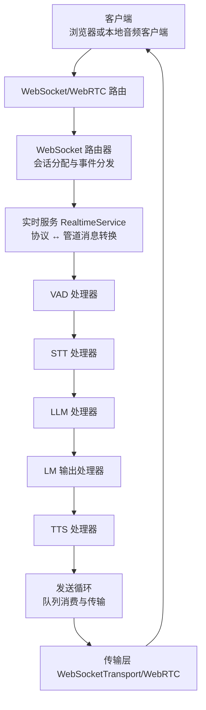
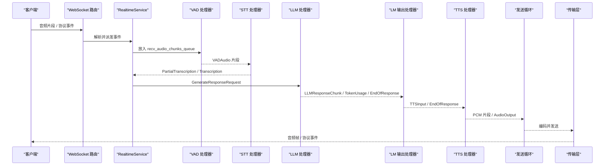
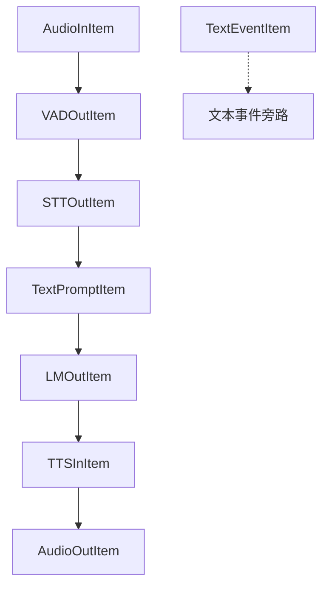
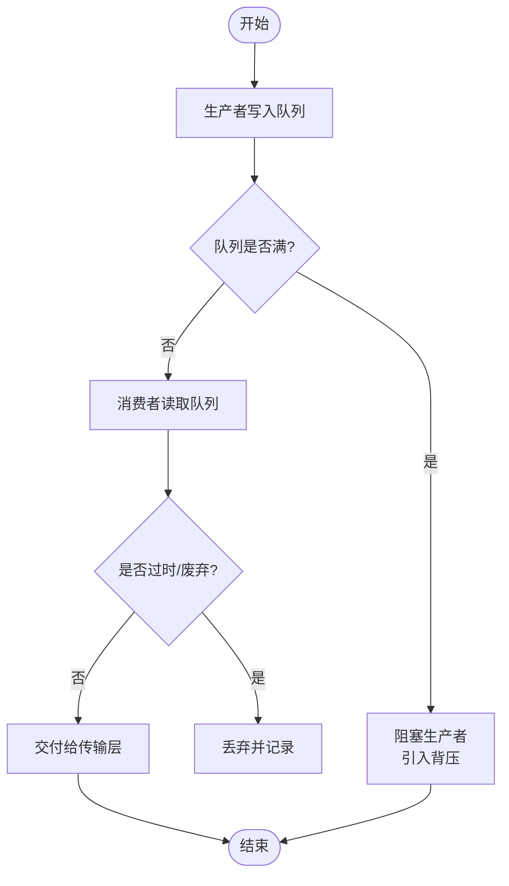
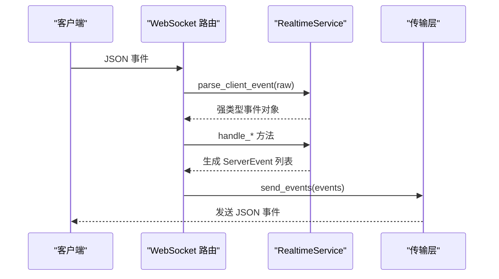
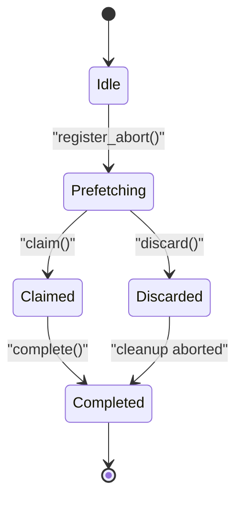
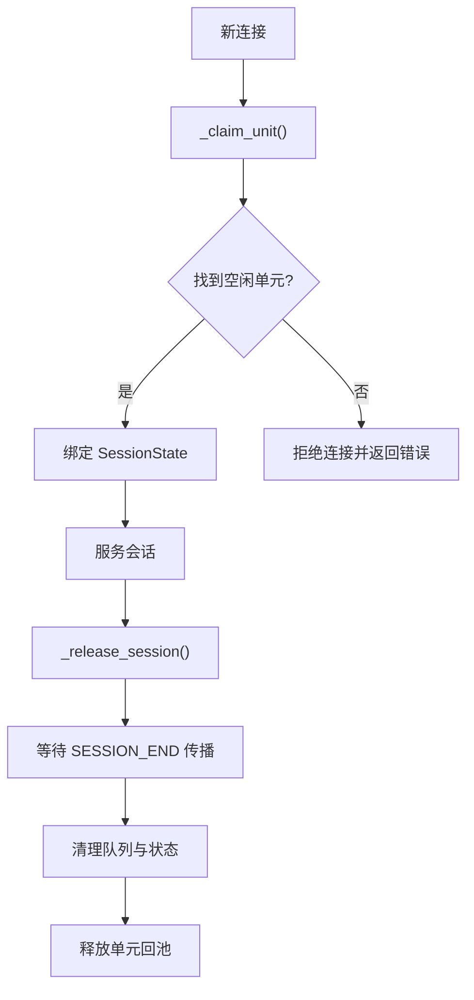
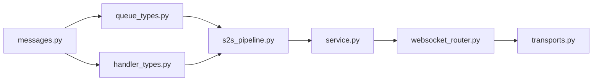

# 消息传递机制

<cite>
**本文引用的文件**   
- [messages.py](file://src/speech_to_speech/pipeline/messages.py)
- [queue_types.py](file://src/speech_to_speech/pipeline/queue_types.py)
- [handler_types.py](file://src/speech_to_speech/pipeline/handler_types.py)
- [s2s_pipeline.py](file://src/speech_to_speech/s2s_pipeline.py)
- [service.py](file://src/speech_to_speech/api/openai_realtime/service.py)
- [websocket_router.py](file://src/speech_to_speech/api/openai_realtime/websocket_router.py)
- [transports.py](file://src/speech_to_speech/api/openai_realtime/transports.py)
</cite>

## 目录
1. [引言](#引言)
2. [项目结构](#项目结构)
3. [核心组件](#核心组件)
4. [架构总览](#架构总览)
5. [详细组件分析](#详细组件分析)
6. [依赖关系分析](#依赖关系分析)
7. [性能与背压](#性能与背压)
8. [故障排查指南](#故障排查指南)
9. [结论](#结论)
10. [附录：自定义消息类型指南](#附录自定义消息类型指南)

## 引言
本文件面向开发者，系统性说明语音到语音（Speech-to-Speech）管道中的消息传递机制。重点包括：
- 核心消息类型的数据结构与语义，如 AudioInItem、TextPromptItem、LMOutItem、AudioOutItem 等。
- 队列系统与生产者-消费者模型、容量管理与背压处理。
- 消息的序列化、传输与反序列化流程，以及跨线程通信的安全性保证。
- 消息路由机制，包括多路复用与会话隔离、负载均衡策略。
- 消息流转图与错误处理机制，并提供扩展自定义消息类型的指导。

## 项目结构
该项目的消息系统围绕“管道单元”组织：每个 PipelineUnit 拥有独立的输入/输出队列和处理器链，服务层负责协议事件与内部消息的桥接，WebSocket/WebRTC 作为外部传输层。

**图示来源**  
- [websocket_router.py:531-634](file://src/speech_to_speech/api/openai_realtime/websocket_router.py#L531-L634)  
- [service.py:355-403](file://src/speech_to_speech/api/openai_realtime/service.py#L355-L403)  
- [s2s_pipeline.py:594-707](file://src/speech_to_speech/s2s_pipeline.py#L594-L707)

**章节来源**  
- [s2s_pipeline.py:594-707](file://src/speech_to_speech/s2s_pipeline.py#L594-L707)  
- [websocket_router.py:531-634](file://src/speech_to_speech/api/openai_realtime/websocket_router.py#L531-L634)

## 核心组件
- 消息定义：所有跨阶段的消息统一继承自 PipelineMessage，并通过 tag 字段进行判别式验证。
- 队列类型别名：集中定义各阶段的输入/输出类型，避免重复声明大型联合类型。
- 处理器类型别名：为各阶段处理器提供清晰的泛型签名。
- 管道构建：按 VAD → STT → LLM → LMOutputProcessor → TTS 的顺序组装处理器链，并注入共享状态与取消作用域。
- 服务层：将 OpenAI Realtime 协议事件转换为内部消息，并在连接级维护会话状态。
- 路由与传输：WebSocket/WebRTC 路由负责会话分配、事件分发与音频流转发；传输层封装具体网络细节。

**章节来源**  
- [messages.py:34-267](file://src/speech_to_speech/pipeline/messages.py#L34-L267)  
- [queue_types.py:20-47](file://src/speech_to_speech/pipeline/queue_types.py#L20-L47)  
- [handler_types.py:31-46](file://src/speech_to_speech/pipeline/handler_types.py#L31-L46)  
- [s2s_pipeline.py:382-574](file://src/speech_to_speech/s2s_pipeline.py#L382-L574)  
- [service.py:355-403](file://src/speech_to_speech/api/openai_realtime/service.py#L355-L403)  
- [transports.py:29-116](file://src/speech_to_speech/api/openai_realtime/transports.py#L29-L116)

## 架构总览
下图展示从客户端输入到服务端输出的完整消息流，包括控制信号与二进制哨兵。

**图示来源**  
- [websocket_router.py:392-511](file://src/speech_to_speech/api/openai_realtime/websocket_router.py#L392-L511)  
- [service.py:493-560](file://src/speech_to_speech/api/openai_realtime/service.py#L493-L560)  
- [messages.py:49-267](file://src/speech_to_speech/pipeline/messages.py#L49-L267)  
- [s2s_pipeline.py:407-574](file://src/speech_to_speech/s2s_pipeline.py#L407-L574)

## 详细组件分析

### 消息类型与数据结构
- 基类 PipelineMessage：统一 tag 判别式，支持从原始字典校验 Union 子类型。
- VADAudio：携带音频片段、说话人归属、运行时配置、模式与时间戳等元数据。
- PartialTranscription / Transcription / TranscriptionFailure：STT 阶段性结果与失败通知。
- LLMResponseChunk：有序文本与工具调用片段，兼容 legacy text/tools 视图。
- TokenUsage：侧信道 token 用量报告。
- EndOfResponse：响应结束哨兵，包含错误、状态与原因。
- TTSInput：待合成文本及语言快照，自动推导 tts_language_code。
- AudioOutput：带 response_key 的音频输出项，支持 visemes 与清理标记。
- ResponsePrefetchTransaction：预取事务的生命周期管理，确保清理仅在预取被认领后提交。
- GenerateResponseRequest：触发 LLM 生成的请求，聚合会话配置与响应覆盖。

```mermaid
classDiagram
class PipelineMessage {
+string tag
}
class VADAudio {
+bytes audio
+SpeakerAttribution speaker_attribution
+RuntimeConfig runtime_config
+string mode
+string turn_id
+int turn_revision
+float processing_delay_s
+float created_at_s
+float speech_end_at_s
}
class PartialTranscription {
+string text
+string turn_id
+int turn_revision
}
class Transcription {
+string text
+SpeakerAttribution speaker_attribution
+string language_code
+string turn_id
+int turn_revision
+float speech_stopped_at_s
}
class TranscriptionFailure {
+string message
+string turn_id
+int turn_revision
+float speech_stopped_at_s
}
class LLMResponseChunk {
+list parts
+string text
+string language_code
+string selected_language
+list tools
+RuntimeConfig runtime_config
+RealtimeResponseCreateParams response
+string turn_id
+int turn_revision
+float speech_stopped_at_s
+int cancel_generation
+string response_key
}
class TokenUsage {
+int input_tokens
+int output_tokens
+string turn_id
+int turn_revision
+int cancel_generation
+string response_key
}
class EndOfResponse {
+string turn_id
+int turn_revision
+int cancel_generation
+string response_key
+string error
+string status
+string reason
+bool cleanup_only
+list input_tool_call_ids
}
class TTSInput {
+string text
+string language_code
+string selected_language
+string tts_language_code
+string response_assistant_language_code
+RuntimeConfig runtime_config
+RealtimeResponseCreateParams response
+string turn_id
+int turn_revision
+float speech_stopped_at_s
+int cancel_generation
+string response_key
}
class AudioOutput {
+bytes|np.ndarray audio
+list visemes
+int cancel_generation
+string response_key
+bool cleanup_only
}
class ResponsePrefetchTransaction {
+register_abort(abort)
+discarded bool
+claimed bool
+wait_until_resolved(timeout) bool
+complete(cleanup)
+claim() bool
+discard()
}
class GenerateResponseRequest {
+string response_key
+RuntimeConfig runtime_config
+string selected_language
+RealtimeResponseCreateParams response
+bytes|np.ndarray audio
+int audio_sample_rate
+string input_item_id
+string language_code
+string turn_id
+int turn_revision
+float speech_stopped_at_s
+ResponsePrefetchTransaction prefetch_transaction
}
PipelineMessage <|-- VADAudio
PipelineMessage <|-- PartialTranscription
PipelineMessage <|-- Transcription
PipelineMessage <|-- TranscriptionFailure
PipelineMessage <|-- LLMResponseChunk
PipelineMessage <|-- TokenUsage
PipelineMessage <|-- EndOfResponse
PipelineMessage <|-- TTSInput
PipelineMessage <|-- AudioOutput
PipelineMessage <|-- GenerateResponseRequest
```

**图示来源**  
- [messages.py:34-416](file://src/speech_to_speech/pipeline/messages.py#L34-L416)

**章节来源**  
- [messages.py:34-416](file://src/speech_to_speech/pipeline/messages.py#L34-L416)

### 队列类型与阶段映射
- AudioInItem：VAD 输入（PCM 字节或带 RuntimeConfig 的元组）与控制消息。
- VADOutItem：VAD 输出（VADAudio）与内部控制消息。
- STTOutItem：STT 输出（PartialTranscription / Transcription / TranscriptionFailure）与控制消息。
- TextPromptItem：LLM 输入（GenerateResponseRequest）与控制消息。
- LMOutItem：LLM 输出（LLMResponseChunk / TokenUsage / EndOfResponse）与控制消息。
- TTSInItem：TTS 输入（TTSInput / EndOfResponse）与事件与控制消息。
- AudioOutItem：最终输出（PCM 字节 / numpy 数组 / AudioOutput / 事件 / 控制消息）。
- TextEventItem：非 TTS 等待的文本事件（PipelineEvent / 控制消息）。

**图示来源**  
- [queue_types.py:20-47](file://src/speech_to_speech/pipeline/queue_types.py#L20-L47)

**章节来源**  
- [queue_types.py:20-47](file://src/speech_to_speech/pipeline/queue_types.py#L20-L47)

### 生产者-消费者与背压
- 生产者：
  - 客户端通过 WebSocket/WebRTC 发送音频与协议事件，路由将其解析并推入对应队列。
  - VAD/STT/LLM/TTS 处理器各自生产下一阶段的消息。
- 消费者：
  - 发送循环在独立任务中轮询输出队列，根据 response_key 与取消作用域丢弃过时输出，并将有效音频与事件交给传输层。
- 背压与容量：
  - 使用 Python 标准库 queue.Queue，默认无界；可通过构造函数设置 maxsize 实现有界队列以引入背压。
  - 取消与释放路径会刷新队列，保留关键控制消息与使用量事件，避免泄漏与死锁。

**图示来源**  
- [websocket_router.py:193-243](file://src/speech_to_speech/api/openai_realtime/websocket_router.py#L193-L243)  
- [websocket_router.py:294-389](file://src/speech_to_speech/api/openai_realtime/websocket_router.py#L294-L389)

**章节来源**  
- [websocket_router.py:193-243](file://src/speech_to_speech/api/openai_realtime/websocket_router.py#L193-L243)  
- [websocket_router.py:294-389](file://src/speech_to_speech/api/openai_realtime/websocket_router.py#L294-L389)

### 序列化、传输与反序列化
- 协议事件：
  - 客户端事件由 RealtimeService.parse_client_event 使用 Pydantic 模型校验并反序列化为强类型对象。
  - 服务端事件通过 transports.send_ws_event 或 WebRTC data channel 发送。
- 音频数据：
  - 管道内以 bytes 或 numpy 数组传递 PCM 片段；发送前可能进行 base64 编码（WebSocket）或直接走 RTP（WebRTC）。
- 安全性：
  - 传输层对 WebSocket 关闭状态进行检查，忽略已断开连接的发送；异常分类日志便于定位问题。

**图示来源**  
- [service.py:477-491](file://src/speech_to_speech/api/openai_realtime/service.py#L477-L491)  
- [transports.py:60-116](file://src/speech_to_speech/api/openai_realtime/transports.py#L60-L116)

**章节来源**  
- [service.py:477-491](file://src/speech_to_speech/api/openai_realtime/service.py#L477-L491)  
- [transports.py:60-116](file://src/speech_to_speech/api/openai_realtime/transports.py#L60-L116)

### 跨线程通信与安全性
- 线程隔离：
  - 每个 PipelineUnit 拥有独立的服务实例与队列，避免跨会话状态污染。
- 同步原语：
  - Event 用于控制监听与播放状态；Lock 与 Event 在 ResponsePrefetchTransaction 中保护预取生命周期。
- 取消作用域：
  - CancelScope 提供 generation 级别的可丢弃窗口，防止旧响应输出污染新会话。

**图示来源**  
- [messages.py:272-374](file://src/speech_to_speech/pipeline/messages.py#L272-L374)

**章节来源**  
- [messages.py:272-374](file://src/speech_to_speech/pipeline/messages.py#L272-L374)

### 消息路由与多路复用
- 多路复用：
  - 路由为每个连接创建独立的 SessionState，绑定到某个 PipelineUnit；多个连接可复用同一套处理器链但保持会话隔离。
- 负载均衡：
  - _claim_unit 选择第一个空闲的 PipelineUnit，实现简单轮询式负载分配。
- 会话释放：
  - _release_session 启动异步释放任务，等待 SESSION_END 传播完成后再释放单元；超时则进入隔离状态，防止会话泄漏。

**图示来源**  
- [websocket_router.py:561-634](file://src/speech_to_speech/api/openai_realtime/websocket_router.py#L561-L634)  
- [websocket_router.py:347-389](file://src/speech_to_speech/api/openai_realtime/websocket_router.py#L347-L389)

**章节来源**  
- [websocket_router.py:561-634](file://src/speech_to_speech/api/openai_realtime/websocket_router.py#L561-L634)  
- [websocket_router.py:347-389](file://src/speech_to_speech/api/openai_realtime/websocket_router.py#L347-L389)

## 依赖关系分析
- messages.py 是所有消息类型的单一事实来源，被 queue_types.py 与 handler_types.py 引用。
- s2s_pipeline.py 组装处理器链并注入队列与服务。
- service.py 桥接协议事件与内部消息，维护会话状态与指标。
- websocket_router.py 负责路由、会话分配、队列刷新与发送循环。
- transports.py 抽象传输层，提供 WebSocket 与 WebRTC 的实现差异。

**图示来源**  
- [messages.py:1-416](file://src/speech_to_speech/pipeline/messages.py#L1-L416)  
- [queue_types.py:1-47](file://src/speech_to_speech/pipeline/queue_types.py#L1-L47)  
- [handler_types.py:1-46](file://src/speech_to_speech/pipeline/handler_types.py#L1-L46)  
- [s2s_pipeline.py:382-707](file://src/speech_to_speech/s2s_pipeline.py#L382-L707)  
- [service.py:355-403](file://src/speech_to_speech/api/openai_realtime/service.py#L355-L403)  
- [websocket_router.py:531-634](file://src/speech_to_speech/api/openai_realtime/websocket_router.py#L531-L634)  
- [transports.py:29-116](file://src/speech_to_speech/api/openai_realtime/transports.py#L29-L116)

**章节来源**  
- [messages.py:1-416](file://src/speech_to_speech/pipeline/messages.py#L1-L416)  
- [queue_types.py:1-47](file://src/speech_to_speech/pipeline/queue_types.py#L1-L47)  
- [handler_types.py:1-46](file://src/speech_to_speech/pipeline/handler_types.py#L1-L46)  
- [s2s_pipeline.py:382-707](file://src/speech_to_speech/s2s_pipeline.py#L382-L707)  
- [service.py:355-403](file://src/speech_to_speech/api/openai_realtime/service.py#L355-L403)  
- [websocket_router.py:531-634](file://src/speech_to_speech/api/openai_realtime/websocket_router.py#L531-L634)  
- [transports.py:29-116](file://src/speech_to_speech/api/openai_realtime/transports.py#L29-L116)

## 性能与背压
- 队列容量：
  - 当前使用无界队列；如需背压，可在构造 Queue 时指定 maxsize，使生产者阻塞以避免内存增长。
- 批处理与缓冲：
  - 发送循环批量收集音频字节以减少网络开销；传输层对 WebSocket 使用 base64 编码，WebRTC 走媒体轨道。
- 资源清理：
  - 释放路径保留 TokenUsageEvent 与 AUDIO_RESPONSE_DONE 等关键哨兵，确保指标与生命周期正确收尾。

[本节为通用性能建议，不直接分析具体文件]

## 故障排查指南
- 常见错误：
  - 客户端事件无效或缺少 type 字段：RealtimeService.parse_client_event 会记录警告并返回 None。
  - WebSocket 关闭竞态：transports.send_ws_event 捕获 WebSocketDisconnect 与 RuntimeError，区分无害与严重错误。
  - 会话释放卡住：_release_unit_after_drain 在超时后隔离单元，暴露“stuck”状态供运维观察。
- 诊断步骤：
  - 检查 /v1/pool 接口，确认单元状态是否为 idle/active/draining/stuck。
  - 查看日志中关于“Skipped event”“Failed to send event to client”的记录。
  - 确认 SESSION_END 是否正确传播至输出队列并被发送循环消费。

**章节来源**  
- [service.py:477-491](file://src/speech_to_speech/api/openai_realtime/service.py#L477-L491)  
- [transports.py:60-81](file://src/speech_to_speech/api/openai_realtime/transports.py#L60-L81)  
- [websocket_router.py:294-389](file://src/speech_to_speech/api/openai_realtime/websocket_router.py#L294-L389)

## 结论
该消息传递机制通过统一的 Pydantic 消息模型、明确的队列类型别名与处理器链，实现了高内聚、低耦合的语音到语音管道。服务层与路由层解耦了协议与业务逻辑，传输层屏蔽了网络差异。通过取消作用域、预取事务与会话隔离，系统在并发与动态会话场景下保持了安全性与一致性。开发者可基于现有消息类型扩展功能，同时遵循背压与错误处理的最佳实践。

[本节为总结性内容，不直接分析具体文件]

## 附录：自定义消息类型指南
- 新增消息类型：
  - 继承 PipelineMessage，设置 Literal tag 值。
  - 若需与现有 Union 类型集成，请在 queue_types.py 中添加对应的 TypeAlias。
- 处理器适配：
  - 在 handler_types.py 中更新阶段输入/输出类型，确保处理器泛型签名一致。
- 路由与传输：
  - 若消息需要跨协议传输，请在 service.py 的事件映射中添加处理逻辑，并在 transports.py 中实现序列化/反序列化。
- 测试建议：
  - 针对新消息类型编写单元测试，覆盖正常路径、边界条件与错误分支。

[本节为概念性指导，不直接分析具体文件]