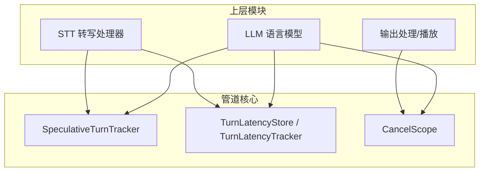
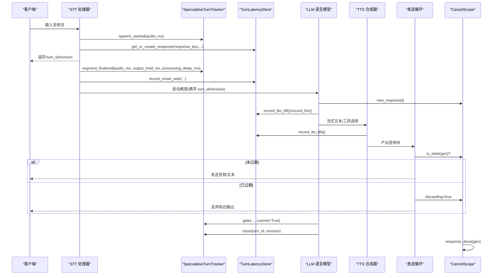
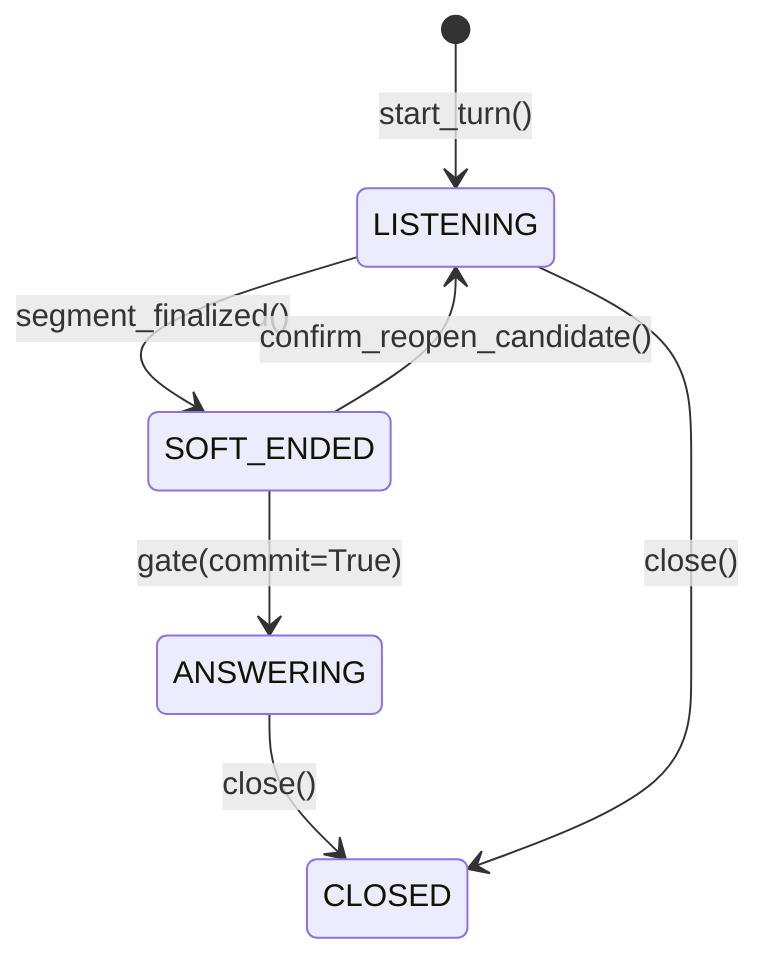
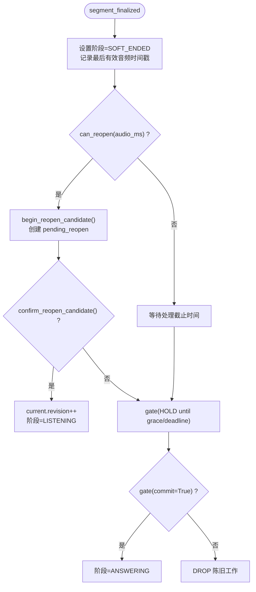
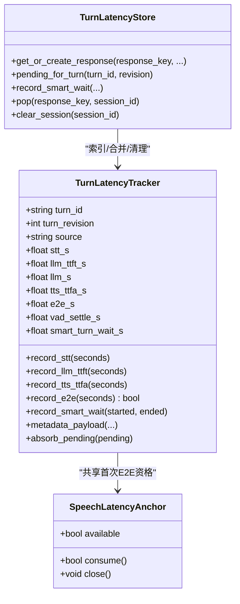
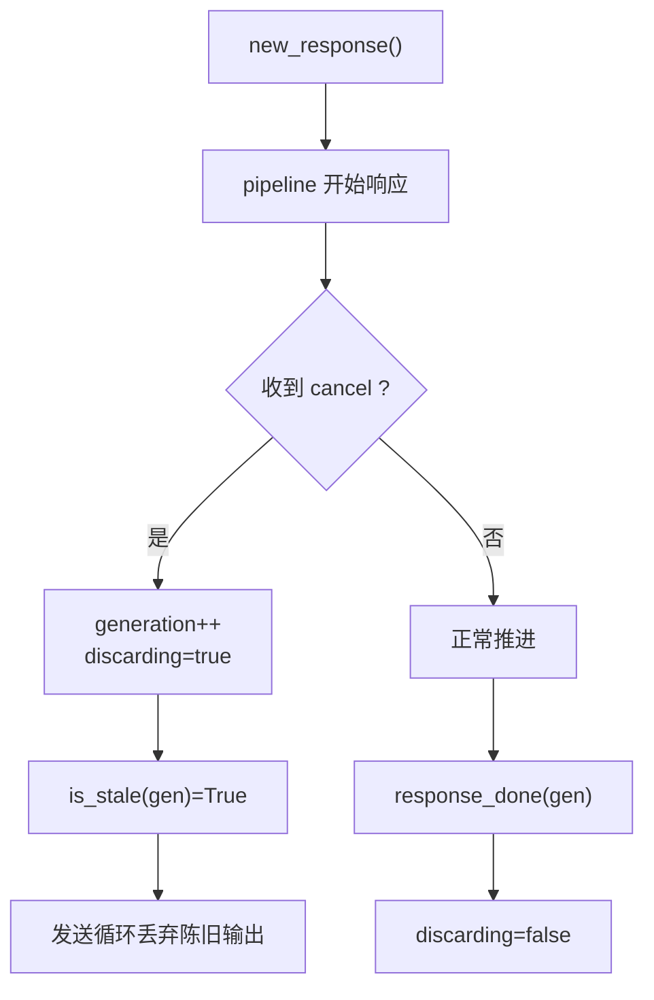
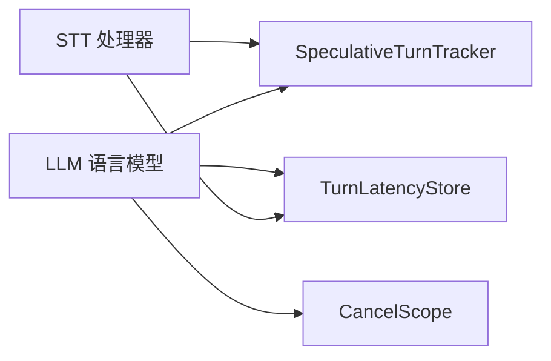

# 状态管理

<cite>
**本文引用的文件**   
- [speculative_turns.py](file://src/speech_to_speech/pipeline/speculative_turns.py)
- [turn_latency.py](file://src/speech_to_speech/pipeline/turn_latency.py)
- [cancel_scope.py](file://src/speech_to_speech/pipeline/cancel_scope.py)
- [base_openai_compatible_language_model.py](file://src/speech_to_speech/LLM/base_openai_compatible_language_model.py)
- [audio_input_notifier.py](file://src/speech_to_speech/LLM/audio_input_notifier.py)
- [lm_output_processor.py](file://src/speech_to_speech/LLM/lm_output_processor.py)
- [base_stt_handler.py](file://src/speech_to_speech/STT/base_stt_handler.py)
</cite>

## 目录
1. [引言](#引言)
2. [项目结构](#项目结构)
3. [核心组件](#核心组件)
4. [架构总览](#架构总览)
5. [详细组件分析](#详细组件分析)
6. [依赖关系分析](#依赖关系分析)
7. [性能与延迟分析](#性能与延迟分析)
8. [故障排查指南](#故障排查指南)
9. [结论](#结论)

## 引言
本文件聚焦语音到语音管道中的“状态管理”子系统，围绕三个关键能力展开：
- 推测性对话跟踪（SpeculativeTurnTracker）：维护当前对话轮次、版本修订、软结束与重开候选，提供线程安全的门控与提交语义。
- 延迟统计系统（TurnLatencyStore/TurnLatencyTracker）：采集 STT/LLM/TTS/E2E 等指标，合并智能等待区间，支持会话级清理。
- 取消作用域（CancelScope）：统一取消信号与生成号机制，配合发送循环丢弃陈旧输出，实现优雅停止。

文档同时给出状态转换图、时序图、流程图和监控指标说明，帮助开发者调试与优化。

## 项目结构
与状态管理直接相关的代码位于 pipeline 层，并被 LLM、STT 等模块消费：
- pipeline/speculative_turns.py：推测性对话状态机与门控逻辑
- pipeline/turn_latency.py：延迟追踪器与存储
- pipeline/cancel_scope.py：取消作用域
- LLM/STT 相关处理器通过构造函数或属性注入上述组件

图表来源
- [speculative_turns.py:65-489](file://src/speech_to_speech/pipeline/speculative_turns.py#L65-L489)
- [turn_latency.py:75-421](file://src/speech_to_speech/pipeline/turn_latency.py#L75-L421)
- [cancel_scope.py:1-65](file://src/speech_to_speech/pipeline/cancel_scope.py#L1-L65)

章节来源
- [speculative_turns.py:65-489](file://src/speech_to_speech/pipeline/speculative_turns.py#L65-L489)
- [turn_latency.py:75-421](file://src/speech_to_speech/pipeline/turn_latency.py#L75-L421)
- [cancel_scope.py:1-65](file://src/speech_to_speech/pipeline/cancel_scope.py#L1-L65)

## 核心组件
- SpeculativeTurnTracker：线程安全的对话游标，负责：
  - 维护当前 turn_id 与 revision
  - 监听 VAD 软结束并设置处理截止时间
  - 管理重开候选（pending reopen）与确认/取消
  - 门控 gate/wait_for_gate 控制工作项接受、丢弃或等待
  - 提交 commit 与关闭 close 的幂等语义
- TurnLatencyStore/TurnLatencyTracker：
  - 按 response_key 索引最终追踪器，按 (turn_id, revision) 暂存待合并的中间测量
  - 记录 STT/LLM TTFT/时长、TTS 首帧时间、端到端时间、VAD 决策与智能等待
  - 合并 MLX 锁等待/持有统计，格式化日志与元数据
- CancelScope：
  - 使用自增 generation 与 discarding 标志，区分“已取消但尚未完成”的输出
  - is_stale 判断旧响应是否应被丢弃

章节来源
- [speculative_turns.py:65-489](file://src/speech_to_speech/pipeline/speculative_turns.py#L65-L489)
- [turn_latency.py:75-421](file://src/speech_to_speech/pipeline/turn_latency.py#L75-L421)
- [cancel_scope.py:1-65](file://src/speech_to_speech/pipeline/cancel_scope.py#L1-L65)

## 架构总览
下图展示一次典型语音输入到语音输出的状态流转与协作关系：

图表来源
- [speculative_turns.py:132-193](file://src/speech_to_speech/pipeline/speculative_turns.py#L132-L193)
- [speculative_turns.py:149-174](file://src/speech_to_speech/pipeline/speculative_turns.py#L149-L174)
- [speculative_turns.py:201-248](file://src/speech_to_speech/pipeline/speculative_turns.py#L201-L248)
- [speculative_turns.py:384-462](file://src/speech_to_speech/pipeline/speculative_turns.py#L384-L462)
- [turn_latency.py:326-353](file://src/speech_to_speech/pipeline/turn_latency.py#L326-L353)
- [turn_latency.py:402-421](file://src/speech_to_speech/pipeline/turn_latency.py#L402-L421)
- [cancel_scope.py:24-54](file://src/speech_to_speech/pipeline/cancel_scope.py#L24-L54)

## 详细组件分析

### 推测性对话跟踪（SpeculativeTurnTracker）
职责与关键点：
- 状态机阶段：LISTENING → SOFT_ENDED → ANSWERING/CLOSED；ANSWERING 表示已提交且可继续输出。
- 重开策略：在 SOFT_ENDED 且未超过未回答阈值时，允许基于音频时间戳开启 candidate_revision，并在 VAD 确认后提升为新的 current。
- 门控语义：gate 非阻塞决策，wait_for_gate 阻塞等待直到 ACCEPT/DROP 或截止时间；HOLD 用于等待 VAD 检查、reopen grace 或外部 hold_until。
- 提交与关闭：commit 将当前 revision 加入 committed 集合并进入 ANSWERING；close 释放已提交状态，若仍为 current 则标记 CLOSED，阻止再次重开。
- 并发安全：所有可变状态均通过 Condition 保护，内部方法以 _locked 后缀命名。

图表来源
- [speculative_turns.py:13-17](file://src/speech_to_speech/pipeline/speculative_turns.py#L13-L17)
- [speculative_turns.py:176-193](file://src/speech_to_speech/pipeline/speculative_turns.py#L176-L193)
- [speculative_turns.py:149-159](file://src/speech_to_speech/pipeline/speculative_turns.py#L149-L159)
- [speculative_turns.py:334-369](file://src/speech_to_speech/pipeline/speculative_turns.py#L334-L369)
- [speculative_turns.py:384-399](file://src/speech_to_speech/pipeline/speculative_turns.py#L384-L399)
- [speculative_turns.py:272-290](file://src/speech_to_speech/pipeline/speculative_turns.py#L272-L290)

#### 冲突解决与重开流程

图表来源
- [speculative_turns.py:149-174](file://src/speech_to_speech/pipeline/speculative_turns.py#L149-L174)
- [speculative_turns.py:99-121](file://src/speech_to_speech/pipeline/speculative_turns.py#L99-L121)
- [speculative_turns.py:307-332](file://src/speech_to_speech/pipeline/speculative_turns.py#L307-L332)
- [speculative_turns.py:334-369](file://src/speech_to_speech/pipeline/speculative_turns.py#L334-L369)
- [speculative_turns.py:433-462](file://src/speech_to_speech/pipeline/speculative_turns.py#L433-L462)

章节来源
- [speculative_turns.py:65-489](file://src/speech_to_speech/pipeline/speculative_turns.py#L65-L489)

### 延迟统计系统（TurnLatencyStore / TurnLatencyTracker）
职责与关键点：
- 追踪维度：stt_s、llm_ttft_s、llm_s、tts_ttfa_s、e2e_s、vad_decision_s、smart_turn_* 系列指标。
- 生命周期：
  - 先通过 get_or_create_response 获取/创建 tracker，绑定 session_id 以便清理。
  - STT 阶段可能先写入 pending slot，随后合并到正式 tracker。
  - 通过 record_e2e 保证仅首个音频样本计入 E2E（SpeechLatencyAnchor）。
- 智能等待合并：record_smart_wait 对重叠区间进行归并，避免重复计数。
- 日志与元数据：format_log_line 与 metadata_payload 提供可读日志与结构化输出。

图表来源
- [turn_latency.py:49-73](file://src/speech_to_speech/pipeline/turn_latency.py#L49-L73)
- [turn_latency.py:75-259](file://src/speech_to_speech/pipeline/turn_latency.py#L75-L259)
- [turn_latency.py:261-400](file://src/speech_to_speech/pipeline/turn_latency.py#L261-L400)

章节来源
- [turn_latency.py:75-421](file://src/speech_to_speech/pipeline/turn_latency.py#L75-L421)

### 取消作用域（CancelScope）
职责与关键点：
- 生成号递增：cancel 增加 generation，is_stale 比较捕获的 gen 是否过时。
- 丢弃守卫：discarding 标志指示发送循环静默丢弃陈旧输出；response_done/new_response/reset 清除该标志。
- 线程模型：单一写入者（异步路由线程），多个读取者（LLM/TTS 等管线线程），依赖 GIL 原子性，无需额外锁。

图表来源
- [cancel_scope.py:13-65](file://src/speech_to_speech/pipeline/cancel_scope.py#L13-L65)

章节来源
- [cancel_scope.py:1-65](file://src/speech_to_speech/pipeline/cancel_scope.py#L1-L65)

## 依赖关系分析
- LLM 侧：
  - base_openai_compatible_language_model.py：构造时接收 CancelScope 与 SpeculativeTurnTracker，在流式迭代中检查 is_stale，并在合适时机调用 tracker.gate/commit/close。
  - audio_input_notifier.py：向 LLM 传递 SpeculativeTurnTracker，使 LLM 能感知音频输入事件。
  - lm_output_processor.py：根据 SpeculativeTurnTracker 的状态调整输出行为。
- STT 侧：
  - base_stt_handler.py：可选注入 SpeculativeTurnTracker，驱动 speech_started/segment_finalized 等状态更新。

图表来源
- [base_openai_compatible_language_model.py:49-64](file://src/speech_to_speech/LLM/base_openai_compatible_language_model.py#L49-L64)
- [audio_input_notifier.py:13-23](file://src/speech_to_speech/LLM/audio_input_notifier.py#L13-L23)
- [lm_output_processor.py:37-55](file://src/speech_to_speech/LLM/lm_output_processor.py#L37-L55)
- [base_stt_handler.py:11-24](file://src/speech_to_speech/STT/base_stt_handler.py#L11-L24)

章节来源
- [base_openai_compatible_language_model.py:49-64](file://src/speech_to_speech/LLM/base_openai_compatible_language_model.py#L49-L64)
- [audio_input_notifier.py:13-23](file://src/speech_to_speech/LLM/audio_input_notifier.py#L13-L23)
- [lm_output_processor.py:37-55](file://src/speech_to_speech/LLM/lm_output_processor.py#L37-L55)
- [base_stt_handler.py:11-24](file://src/speech_to_speech/STT/base_stt_handler.py#L11-L24)

## 性能与延迟分析
- 关键指标
  - stt_s：STT 耗时
  - llm_ttft_s：LLM 首 token 时间
  - llm_s：LLM 完整生成耗时（含锁等待）
  - tts_ttfa_s：TTS 首音频帧时间
  - e2e_s：从估计语音结束到首个 TTS 音频的端到端时间
  - vad_settle_s/vad_decision_s：VAD 稳定/决策耗时
  - smart_turn_wait_s：智能等待总时长（区间合并后）
  - mlx_lock_wait_s/mlx_lock_hold_s：MLX 锁等待/持有总时长及分 handler 明细
- 指标采集点
  - STT：record_stt、record_vad_settle、record_smart_wait
  - LLM：record_llm_ttft、record_llm
  - TTS：record_tts_ttfa
  - 输出：record_e2e（仅首个音频样本）
- 延迟优化建议
  - 合理配置 output_hold_ms 与 processing_delay_ms，减少不必要的 HOLD 与重试
  - 关注 smart_turn_wait_s 分布，识别长尾等待
  - 监控 mlx_lock_* 指标，定位热点 handler 的锁竞争
  - 利用 metadata_payload 导出结构化指标，结合可视化面板做趋势分析

章节来源
- [turn_latency.py:75-259](file://src/speech_to_speech/pipeline/turn_latency.py#L75-L259)
- [turn_latency.py:326-421](file://src/speech_to_speech/pipeline/turn_latency.py#L326-L421)

## 故障排查指南
- 常见问题与定位
  - 输出被丢弃：检查 CancelScope.discarding 是否为真，以及 is_stale(gen) 是否返回 True；确认 response_done 是否被正确调用。
  - 重开未生效：确认 can_reopen(audio_ms) 条件满足（SOFT_ENDED、未超阈值、未被 blocked），并检查 confirm_reopen_candidate 是否成功。
  - 门控长时间 HOLD：查看 reopen grace 与 pending_reopen.deadline 是否到期；必要时调整 output_hold_ms 或 processing_delay_ms。
  - 指标缺失：确保 get_or_create_response 已创建 tracker，且各阶段 record_* 被调用；检查 pending slot 是否正确 absorb_pending。
- 诊断步骤
  - 打印 TurnLatencyTracker.format_log_line，观察各阶段耗时与状态
  - 导出 metadata_payload，分析 e2e_s、hold、status 字段
  - 在 gate/wait_for_gate 处添加观测，确认 ACCEPT/HOLD/DROP 分支
  - 在 CancelScope.cancel/response_done 处加日志，核对 generation 变化

章节来源
- [cancel_scope.py:24-65](file://src/speech_to_speech/pipeline/cancel_scope.py#L24-L65)
- [speculative_turns.py:201-248](file://src/speech_to_speech/pipeline/speculative_turns.py#L201-L248)
- [speculative_turns.py:307-369](file://src/speech_to_speech/pipeline/speculative_turns.py#L307-L369)
- [turn_latency.py:220-259](file://src/speech_to_speech/pipeline/turn_latency.py#L220-L259)

## 结论
SpeculativeTurnTracker、TurnLatencyStore 与 CancelScope 共同构成了语音到语音管道的状态管理与可观测性基础：
- 通过严格的阶段与修订号管理，确保多路并发下的对话一致性；
- 通过细粒度的延迟指标与区间合并，支撑端到端性能分析与瓶颈定位；
- 通过生成号与丢弃守卫，实现优雅停止与陈旧输出抑制。

开发者可据此构建更稳健的实时语音交互系统，并通过提供的监控接口持续优化体验。