# 管道架构设计

<cite>
**本文引用的文件**   
- [s2s_pipeline.py](file://src/speech_to_speech/s2s_pipeline.py)
- [pipeline_unit.py](file://src/speech_to_speech/api/openai_realtime/pipeline_unit.py)
- [thread_manager.py](file://src/speech_to_speech/utils/thread_manager.py)
- [backend_registry.py](file://src/speech_to_speech/backend_registry.py)
- [baseHandler.py](file://src/speech_to_speech/baseHandler.py)
- [server.py](file://src/speech_to_speech/api/openai_realtime/server.py)
- [service.py](file://src/speech_to_speech/api/openai_realtime/service.py)
- [vad_handler.py](file://src/speech_to_speech/VAD/vad_handler.py)
- [streaming_handler.py](file://src/speech_to_speech/STT/streaming_handler.py)
- [language_model.py](file://src/speech_to_speech/LLM/language_model.py)
- [qwen3_tts_handler.py](file://src/speech_to_speech/TTS/qwen3_tts_handler.py)
- [config.py](file://src/speech_to_speech/config.py)
</cite>

## 目录
1. [简介](#简介)
2. [项目结构](#项目结构)
3. [核心组件](#核心组件)
4. [架构总览](#架构总览)
5. [详细组件分析](#详细组件分析)
6. [依赖关系分析](#依赖关系分析)
7. [性能与并发特性](#性能与并发特性)
8. [故障排查指南](#故障排查指南)
9. [结论](#结论)
10. [附录：扩展管道的指导原则](#附录扩展管道的指导原则)

## 简介
本文件面向开发者，系统性阐述语音处理四阶段管道（VAD → STT → LLM → TTS）的架构设计与实现细节。重点包括：
- 管道单元 PipelineUnit 的设计模式、生命周期与会话隔离
- 管道构建流程：参数解析、后端选择、处理器链组装
- 线程模型与并发控制：ThreadManager、队列通信、取消作用域
- 管道池化策略、多实例管理与服务启动关闭流程
- 架构图与数据流图，以及扩展新阶段的实践建议

## 项目结构
仓库围绕“可插拔后端 + 管道处理器”组织代码：
- s2s_pipeline.py：入口编排、参数解析、管道构建与服务装配
- api/openai_realtime：实时协议适配层，包含服务、会话、路由与管道单元
- backend_registry.py：后端注册表、能力声明与工厂创建
- baseHandler.py：所有处理器的基类，统一线程运行、事件与消息处理
- VAD/STT/LLM/TTS：各阶段处理器实现
- utils/thread_manager.py：线程管理器
- config.py：离线配置解析与校验

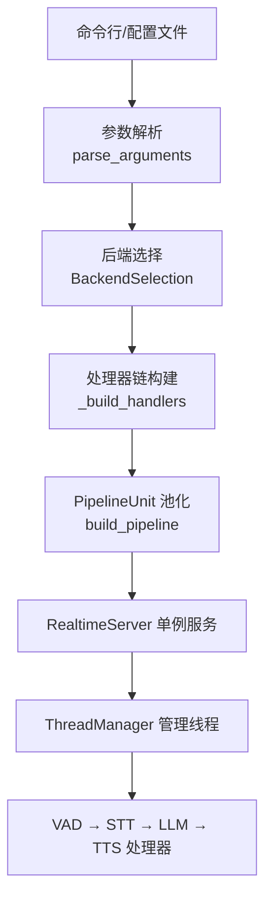

图示来源
- [s2s_pipeline.py:185-297](file://src/speech_to_speech/s2s_pipeline.py#L185-L297)
- [s2s_pipeline.py:382-574](file://src/speech_to_speech/s2s_pipeline.py#L382-L574)
- [s2s_pipeline.py:710-747](file://src/speech_to_speech/s2s_pipeline.py#L710-L747)
- [server.py:14-70](file://src/speech_to_speech/api/openai_realtime/server.py#L14-L70)
- [thread_manager.py:9-40](file://src/speech_to_speech/utils/thread_manager.py#L9-L40)

章节来源
- [s2s_pipeline.py:185-297](file://src/speech_to_speech/s2s_pipeline.py#L185-L297)
- [s2s_pipeline.py:710-747](file://src/speech_to_speech/s2s_pipeline.py#L710-L747)
- [server.py:14-70](file://src/speech_to_speech/api/openai_realtime/server.py#L14-L70)
- [thread_manager.py:9-40](file://src/speech_to_speech/utils/thread_manager.py#L9-L40)

## 核心组件
- PipelineUnit：一个隔离的实时管道实例，持有输入输出队列、文本队列、处理器链、CancelScope、should_listen/response_playing 事件以及 RealtimeService。
- RealtimeService：OpenAI Realtime 协议与内部管道事件的翻译器，维护连接状态、对话历史、响应生命周期与延迟统计。
- BaseHandler：所有处理器的抽象基类，提供 run/_run_loop、事件分发、会话结束处理、异常与计时记录。
- BackendRegistry：后端注册表，定义 STT/LLM/TTS 的后端规格、能力、标准化配置与工厂函数。
- ThreadManager：统一管理处理器线程的启动、等待与停止。
- RealtimeServer：单例 uvicorn 服务器，负责 WebSocket/WebRTC 接入与管道单元的分配释放。

章节来源
- [pipeline_unit.py:13-77](file://src/speech_to_speech/api/openai_realtime/pipeline_unit.py#L13-L77)
- [service.py:355-403](file://src/speech_to_speech/api/openai_realtime/service.py#L355-L403)
- [baseHandler.py:32-68](file://src/speech_to_speech/baseHandler.py#L32-L68)
- [backend_registry.py:65-140](file://src/speech_to_speech/backend_registry.py#L65-L140)
- [thread_manager.py:9-40](file://src/speech_to_speech/utils/thread_manager.py#L9-L40)
- [server.py:14-70](file://src/speech_to_speech/api/openai_realtime/server.py#L14-L70)

## 架构总览
下图展示从客户端到各阶段处理器的端到端数据流，以及协议与内部消息的转换点。

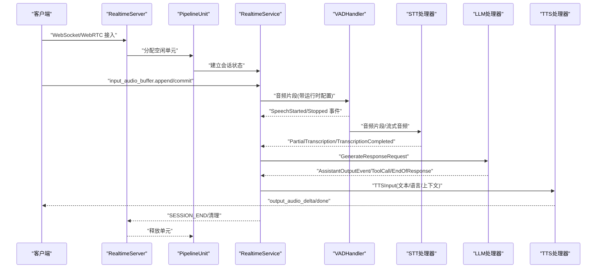

图示来源
- [server.py:14-70](file://src/speech_to_speech/api/openai_realtime/server.py#L14-L70)
- [service.py:355-403](file://src/speech_to_speech/api/openai_realtime/service.py#L355-L403)
- [vad_handler.py:58-88](file://src/speech_to_speech/VAD/vad_handler.py#L58-L88)
- [streaming_handler.py:349-475](file://src/speech_to_speech/STT/streaming_handler.py#L349-L475)
- [language_model.py:560-765](file://src/speech_to_speech/LLM/language_model.py#L560-L765)
- [qwen3_tts_handler.py:96-140](file://src/speech_to_speech/TTS/qwen3_tts_handler.py#L96-L140)

## 详细组件分析

### 管道单元 PipelineUnit 与生命周期
- 职责：封装单个管道的全部状态与处理器链；对外暴露输入/输出队列和文本队列；通过 session 字段绑定当前会话。
- 生命周期：
  - 创建：由 _build_pipeline_unit 构造，初始化 CancelScope、SpeculativeTurnTracker、TurnLatencyStore、各类 Queue 与 RealtimeService。
  - 使用：RealtimeServer 在 accept 时选择一个空闲 unit，设置 session；断开后清空 session。
  - 清理：SessionState.drained 保证 SESSION_END 完全回传后才释放单元，避免抢占导致的状态污染。

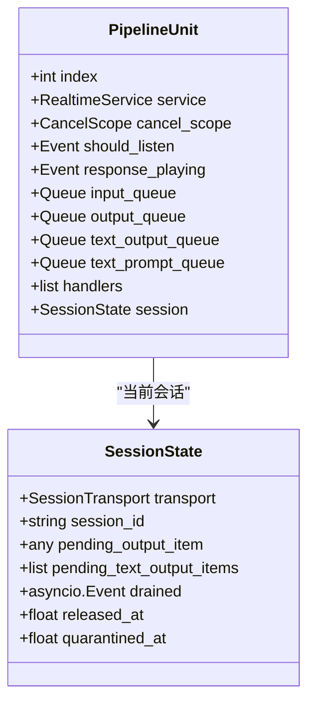

图示来源
- [pipeline_unit.py:13-77](file://src/speech_to_speech/api/openai_realtime/pipeline_unit.py#L13-L77)

章节来源
- [s2s_pipeline.py:594-707](file://src/speech_to_speech/s2s_pipeline.py#L594-L707)
- [pipeline_unit.py:13-77](file://src/speech_to_speech/api/openai_realtime/pipeline_unit.py#L13-L77)

### 处理器链构建与后端选择
- 参数解析：
  - parse_arguments 支持 JSON/CLI 两种输入，解析 ModuleArguments、RealtimeServerArguments、LocalAudioArguments、VADHandlerArguments 与各后端参数。
  - 根据 stt/llm_backend/tts 名称从注册表选择后端，并调用 normalize 生成标准化配置。
- 后端选择：
  - BackendSelection 封装 spec 与 normalized config；copy_for_pipeline 为每个管道深拷贝配置，避免跨实例污染。
- 处理器链组装：
  - _build_handlers 按顺序构建 VAD → STT/AudioInput → LM → TTS，并根据后端能力插入 TranscriptionNotifier 或 STV 可视化音素处理器。
  - HandlerContext 注入 stop_event、队列、cancel_scope、speculative_turns、sample_rate、live_transcription 等上下文。

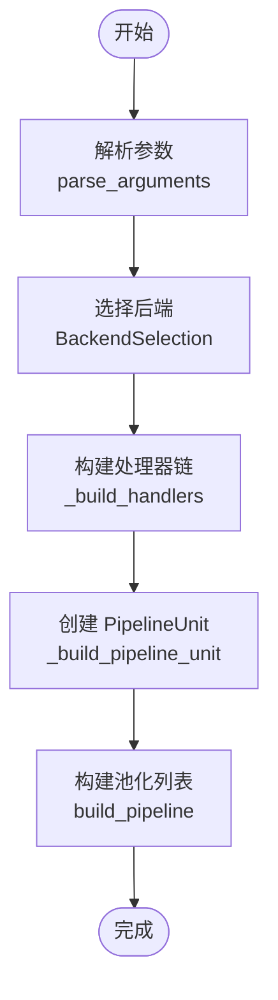

图示来源
- [s2s_pipeline.py:185-297](file://src/speech_to_speech/s2s_pipeline.py#L185-L297)
- [backend_registry.py:102-140](file://src/speech_to_speech/backend_registry.py#L102-L140)
- [s2s_pipeline.py:382-574](file://src/speech_to_speech/s2s_pipeline.py#L382-L574)
- [s2s_pipeline.py:594-707](file://src/speech_to_speech/s2s_pipeline.py#L594-L707)

章节来源
- [s2s_pipeline.py:185-297](file://src/speech_to_speech/s2s_pipeline.py#L185-L297)
- [backend_registry.py:102-140](file://src/speech_to_speech/backend_registry.py#L102-L140)
- [s2s_pipeline.py:382-574](file://src/speech_to_speech/s2s_pipeline.py#L382-L574)

### 线程模型与并发控制
- ThreadManager：
  - start：为每个 handler.run 创建非守护线程并启动。
  - wait：join 所有线程。
  - stop：向所有 handler.stop_event 置位，并带超时 join。
- BaseHandler：
  - run：进入 _run_loop，循环读取 queue_in，处理控制消息（SESSION_END）、PIPELINE_END 哨兵，转发 PipelineEvent，调用 process 产出结果。
  - should_process_input/output：过滤过时请求、预取未认领项、包装 AudioOutput。
- CancelScope 与 SpeculativeTurnTracker：
  - 用于中断旧轮次、丢弃陈旧输出、协调推测性对话轮次。

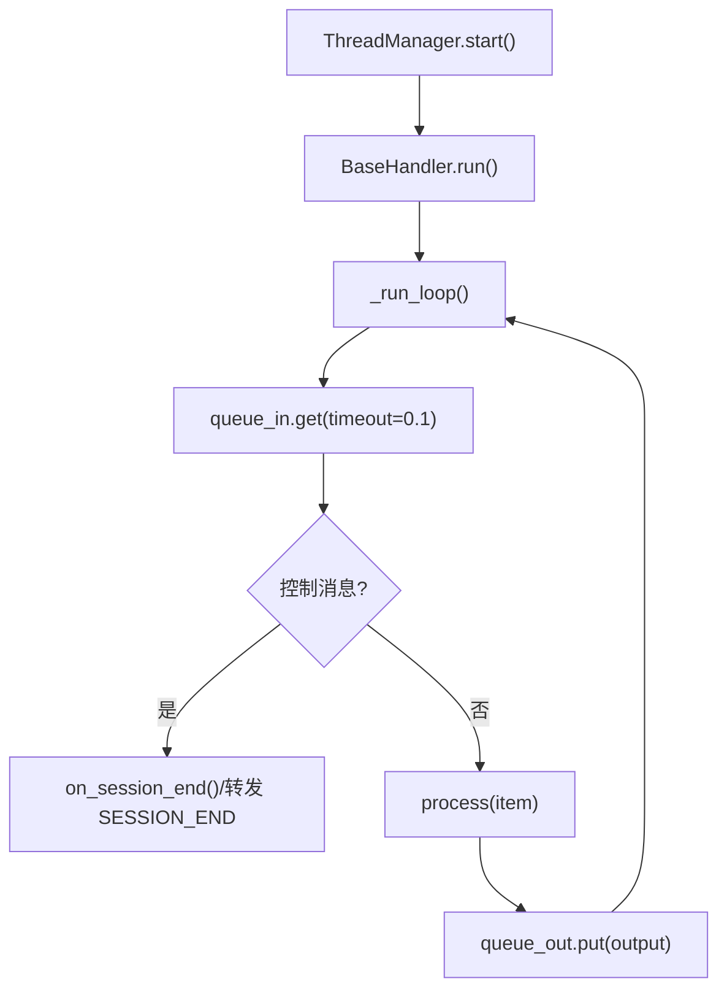

图示来源
- [thread_manager.py:14-40](file://src/speech_to_speech/utils/thread_manager.py#L14-L40)
- [baseHandler.py:126-242](file://src/speech_to_speech/baseHandler.py#L126-L242)

章节来源
- [thread_manager.py:9-40](file://src/speech_to_speech/utils/thread_manager.py#L9-L40)
- [baseHandler.py:32-68](file://src/speech_to_speech/baseHandler.py#L32-L68)
- [baseHandler.py:126-242](file://src/speech_to_speech/baseHandler.py#L126-L242)

### 服务启动与关闭流程
- 启动：
  - build_pipeline 创建多个 PipelineUnit，构造 RealtimeServer，收集所有 handlers 与 server 交给 ThreadManager。
  - RealtimeServer.run 启动 uvicorn，监听 stop_event 以优雅退出。
- 关闭：
  - ThreadManager.stop 触发所有 handler.stop_event，等待线程结束；若超时则告警。
  - RealtimeServer 在 bind/startup 失败时也设置 stop_event，确保模型线程被回收。

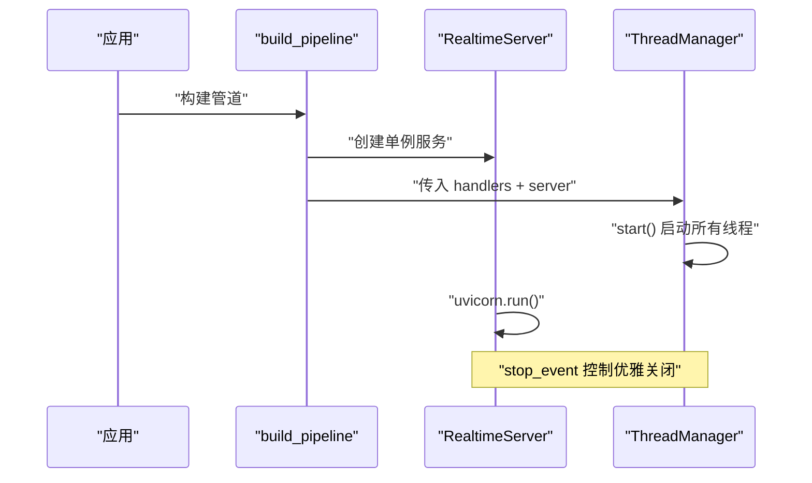

图示来源
- [s2s_pipeline.py:710-747](file://src/speech_to_speech/s2s_pipeline.py#L710-L747)
- [server.py:39-70](file://src/speech_to_speech/api/openai_realtime/server.py#L39-L70)
- [thread_manager.py:18-40](file://src/speech_to_speech/utils/thread_manager.py#L18-L40)

章节来源
- [s2s_pipeline.py:710-747](file://src/speech_to_speech/s2s_pipeline.py#L710-L747)
- [server.py:39-70](file://src/speech_to_speech/api/openai_realtime/server.py#L39-L70)
- [thread_manager.py:18-40](file://src/speech_to_speech/utils/thread_manager.py#L18-L40)

### VAD 阶段
- 功能：语音活动检测、分段、可选音频增强、智能断句（Smart Turn）、流式转写对接、说话人标注（Diarization）。
- 关键行为：
  - 根据 should_listen 决定是否处理音频。
  - 维护 speculative_turns，发射 SpeechStarted/Stopped 事件，并同步给下游 STT/Diarization。
  - 支持 progressive 快照与窗口采样，配合 live transcription。

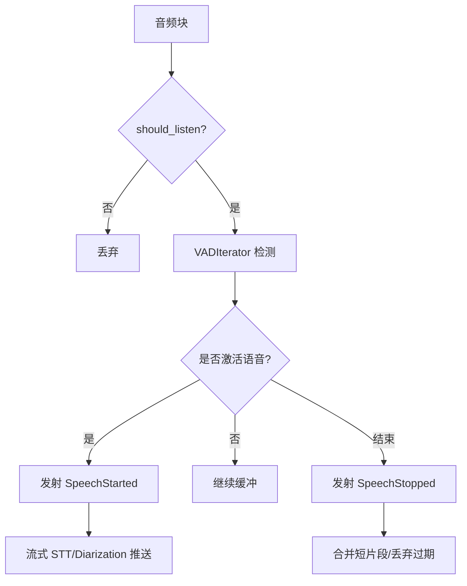

图示来源
- [vad_handler.py:58-88](file://src/speech_to_speech/VAD/vad_handler.py#L58-L88)
- [vad_handler.py:565-668](file://src/speech_to_speech/VAD/vad_handler.py#L565-L668)
- [vad_handler.py:670-800](file://src/speech_to_speech/VAD/vad_handler.py#L670-L800)

章节来源
- [vad_handler.py:58-88](file://src/speech_to_speech/VAD/vad_handler.py#L58-L88)
- [vad_handler.py:565-668](file://src/speech_to_speech/VAD/vad_handler.py#L565-L668)
- [vad_handler.py:670-800](file://src/speech_to_speech/VAD/vad_handler.py#L670-L800)

### STT 阶段
- 功能：多种 STT 后端（Whisper、Paraformer、SenseVoice、Qwen3-ASR、OpenAI Realtime、vLLM Realtime 等），支持流式转写与增量文本。
- 关键行为：
  - StreamingSTTProtocol 抽象不同协议的会话、追加音频、提交边界、丢弃话语。
  - _StreamingSession 维护重连、命令序列化、item_id/content_index 对齐、错误恢复。
  - 与 VAD 协作：start_turn/append_audio/commit_boundary/discard_utterance。

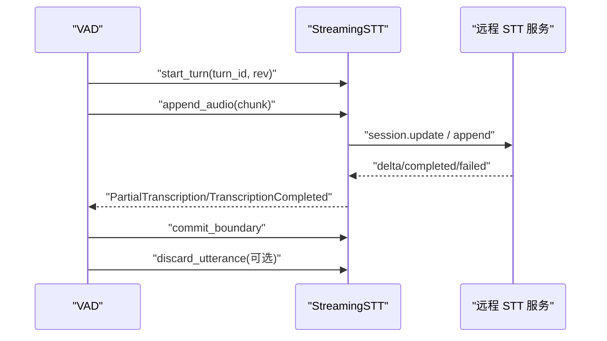

图示来源
- [streaming_handler.py:349-475](file://src/speech_to_speech/STT/streaming_handler.py#L349-L475)
- [streaming_handler.py:476-800](file://src/speech_to_speech/STT/streaming_handler.py#L476-L800)

章节来源
- [streaming_handler.py:349-475](file://src/speech_to_speech/STT/streaming_handler.py#L349-L475)
- [streaming_handler.py:476-800](file://src/speech_to_speech/STT/streaming_handler.py#L476-L800)

### LLM 阶段
- 功能：本地/远程语言模型推理，工具调用抽取，文本/工具流式输出，历史压缩与缓存。
- 关键行为：
  - BaseLanguageModelHandler.process 接收 GenerateResponseRequest，构建 active_chat，执行 _generate，流式分词与句子切分，提取工具调用。
  - 支持 MLX/Transformers 后端，统一取消与推测轮次门控。

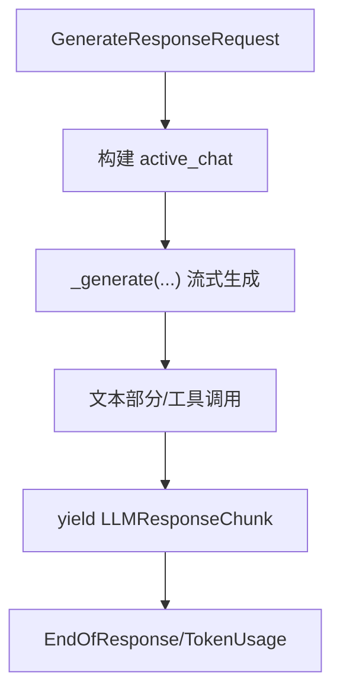

图示来源
- [language_model.py:560-765](file://src/speech_to_speech/LLM/language_model.py#L560-L765)

章节来源
- [language_model.py:560-765](file://src/speech_to_speech/LLM/language_model.py#L560-L765)

### TTS 阶段
- 功能：Qwen3-TTS 为主，支持 Apple Silicon (mlx-audio) 与非 macOS (faster-qwen3-tts) 后端，流式音频输出、语言自适应、音色/参考音频。
- 关键行为：
  - warmup 预热模型，stream 循环按 blocksize 切片输出 int16 音频。
  - 支持会话级 voice 覆盖、自动语言检测、TTFA/RTF 指标记录。

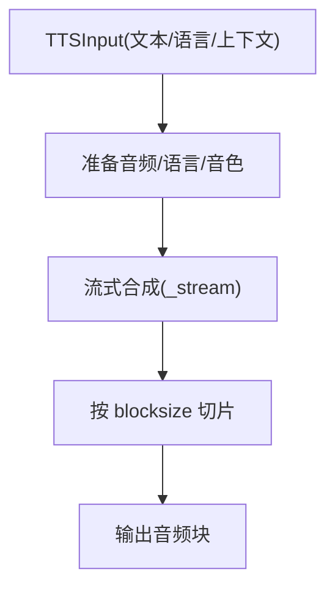

图示来源
- [qwen3_tts_handler.py:96-140](file://src/speech_to_speech/TTS/qwen3_tts_handler.py#L96-L140)
- [qwen3_tts_handler.py:704-763](file://src/speech_to_speech/TTS/qwen3_tts_handler.py#L704-L763)

章节来源
- [qwen3_tts_handler.py:96-140](file://src/speech_to_speech/TTS/qwen3_tts_handler.py#L96-L140)
- [qwen3_tts_handler.py:704-763](file://src/speech_to_speech/TTS/qwen3_tts_handler.py#L704-L763)

## 依赖关系分析
- 模块耦合：
  - s2s_pipeline.py 依赖 backend_registry、arguments_classes、api/openai_realtime 的 service/server/pipeline_unit。
  - 各阶段处理器继承 baseHandler.BaseHandler，并通过 HandlerContext 共享上下文。
- 外部依赖：
  - uvicorn 作为 Web 服务器。
  - 各后端按需导入，缺失时抛出 ImportError 并提供安装指引。

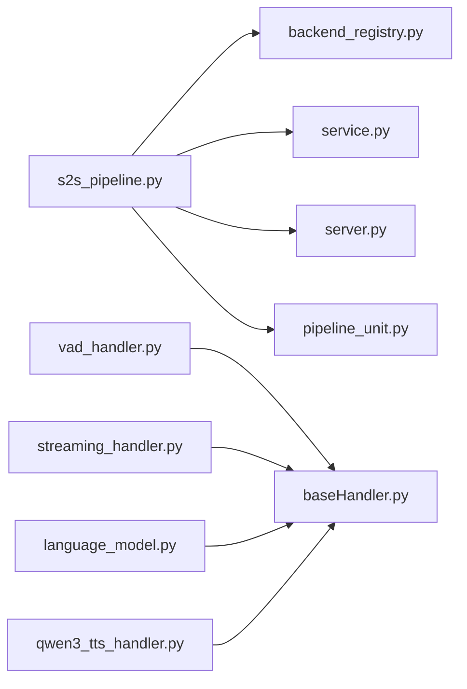

图示来源
- [s2s_pipeline.py:21-58](file://src/speech_to_speech/s2s_pipeline.py#L21-L58)
- [backend_registry.py:172-206](file://src/speech_to_speech/backend_registry.py#L172-L206)
- [baseHandler.py:32-68](file://src/speech_to_speech/baseHandler.py#L32-L68)

章节来源
- [s2s_pipeline.py:21-58](file://src/speech_to_speech/s2s_pipeline.py#L21-L58)
- [backend_registry.py:172-206](file://src/speech_to_speech/backend_registry.py#L172-L206)
- [baseHandler.py:32-68](file://src/speech_to_speech/baseHandler.py#L32-L68)

## 性能与并发特性
- 线程模型：每个处理器独立线程，通过队列解耦；ThreadManager 统一生命周期。
- 并发控制：
  - stop_event 全局停止信号。
  - CancelScope 与 SpeculativeTurnTracker 控制陈旧轮次与推测性工作。
  - BaseHandler.should_process_input 丢弃未认领的预取输入与陈旧 cancel_generation。
- 资源管理：
  - resource_ledger 收集需释放的资源（如 DiarizationWorker）。
  - 设备与线程数：apply_torch_num_threads 控制 PyTorch 线程数；resolve_device 选择 CUDA/MPS/CPU。
- 流式优化：
  - VAD 渐进快照与窗口采样降低延迟。
  - STT 流式协议减少首字延迟。
  - TTS 流式合成按块输出，结合 TTFA/RTF 监控。

章节来源
- [s2s_pipeline.py:336-345](file://src/speech_to_speech/s2s_pipeline.py#L336-L345)
- [s2s_pipeline.py:407-574](file://src/speech_to_speech/s2s_pipeline.py#L407-L574)
- [baseHandler.py:70-98](file://src/speech_to_speech/baseHandler.py#L70-L98)
- [vad_handler.py:670-800](file://src/speech_to_speech/VAD/vad_handler.py#L670-L800)
- [streaming_handler.py:349-475](file://src/speech_to_speech/STT/streaming_handler.py#L349-L475)
- [qwen3_tts_handler.py:704-763](file://src/speech_to_speech/TTS/qwen3_tts_handler.py#L704-L763)

## 故障排查指南
- 常见错误与定位：
  - 后端未安装：ImportError 会提示 pip install 命令与可选依赖名。
  - 设备不匹配：macOS 不支持 CUDA，需切换 cpu/mps。
  - 配置无效：config.py 对 schema_version、blocks/pipelines、num_pipelines、阈值等进行严格校验。
  - 流式 STT 超时：_StreamingSession 对 setup/final 超时进行报错与重连。
- 日志与诊断：
  - setup_logger 启用 pipeline_prefix 过滤；debug 级别打开 torch compile 日志。
  - set_log_transcripts/warn_if_log_transcripts_enabled 控制转录日志开关与警告。

章节来源
- [backend_registry.py:185-206](file://src/speech_to_speech/backend_registry.py#L185-L206)
- [s2s_pipeline.py:300-319](file://src/speech_to_speech/s2s_pipeline.py#L300-L319)
- [s2s_pipeline.py:321-334](file://src/speech_to_speech/s2s_pipeline.py#L321-L334)
- [config.py:371-438](file://src/speech_to_speech/config.py#L371-L438)
- [streaming_handler.py:588-628](file://src/speech_to_speech/STT/streaming_handler.py#L588-L628)

## 结论
该语音处理管道采用“处理器链 + 队列 + 线程”的经典架构，通过 PipelineUnit 实现会话隔离与资源复用，借助 BackendRegistry 实现后端可插拔，配合 ThreadManager 与 CancelScope 保障并发安全与优雅关闭。VAD/STT/LLM/TTS 各阶段均具备流式处理能力，整体在保证低延迟的同时具备良好的可扩展性与可观测性。

## 附录：扩展管道的指导原则
- 新增阶段处理器：
  - 继承 BaseHandler，实现 setup/process/cleanup/on_session_end。
  - 在 _build_handlers 中插入到合适位置，并更新队列类型与 HandlerContext。
- 新增后端：
  - 在 backend_registry.py 注册 BackendSpec，定义 config_type、create_handler、capabilities。
  - 如需特殊配置前缀或归一化逻辑，提供 config_prefix/normalize_config。
- 配置与参数：
  - 在 arguments_classes 下新增 dataclass，并在 parse_arguments 中纳入解析。
  - 如需 YAML 配置支持，遵循 config.py 的校验与解析规则。
- 并发与资源：
  - 使用 stop_event 控制退出，必要时加入 resource_ledger 管理资源释放。
  - 合理设置 sample_rate、device、torch_num_threads 等全局参数。

章节来源
- [baseHandler.py:32-68](file://src/speech_to_speech/baseHandler.py#L32-L68)
- [s2s_pipeline.py:382-574](file://src/speech_to_speech/s2s_pipeline.py#L382-L574)
- [backend_registry.py:102-140](file://src/speech_to_speech/backend_registry.py#L102-L140)
- [config.py:441-538](file://src/speech_to_speech/config.py#L441-L538)