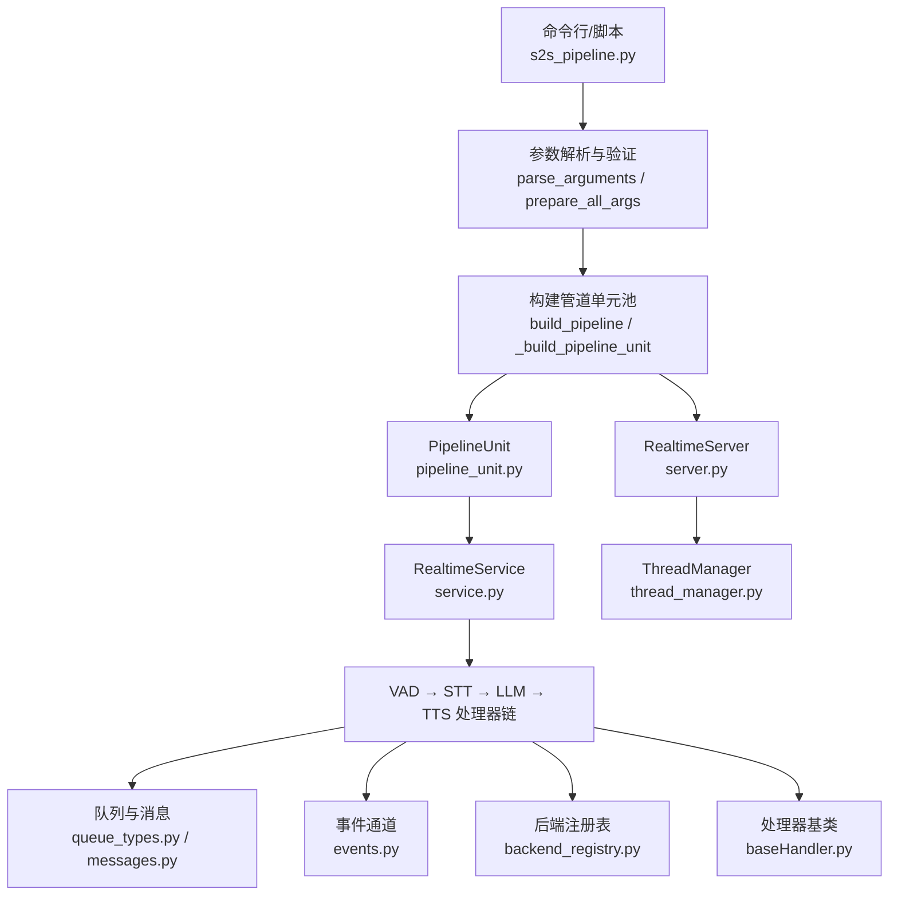
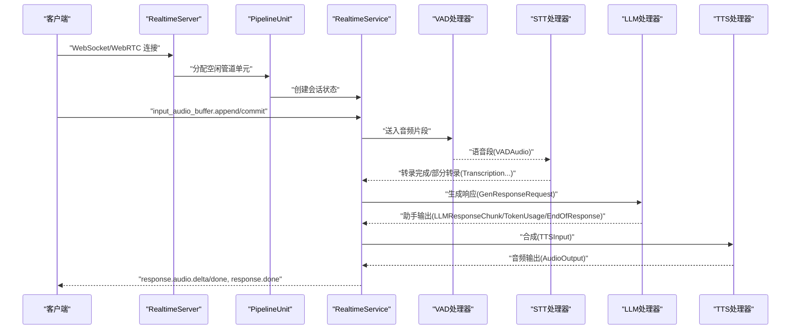
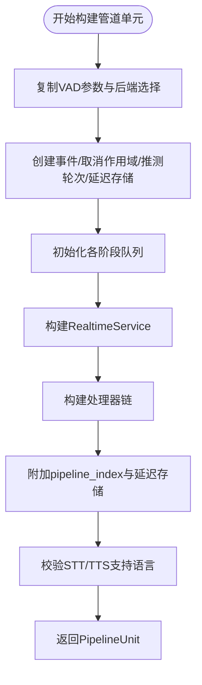
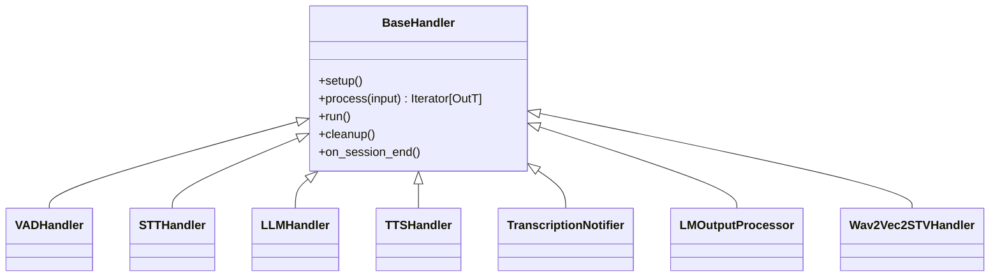
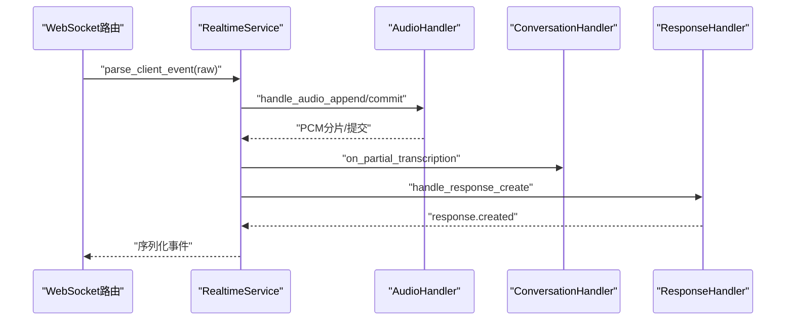
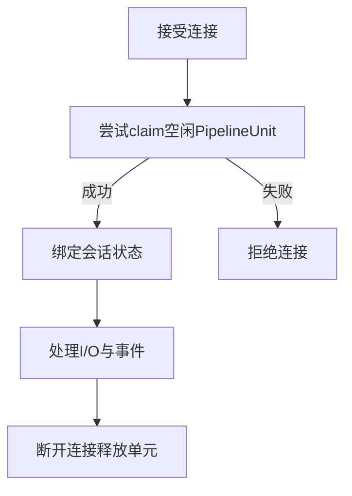
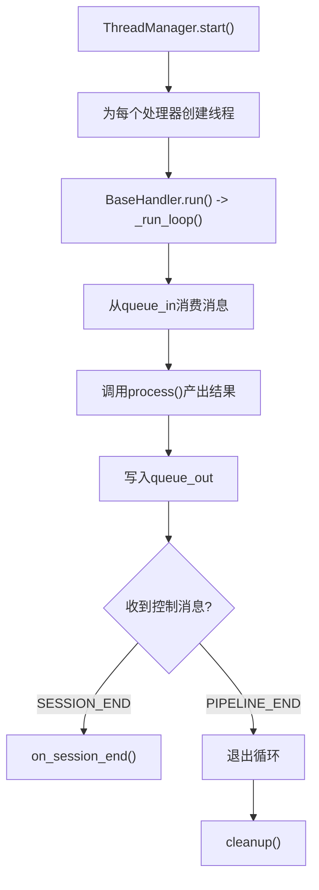
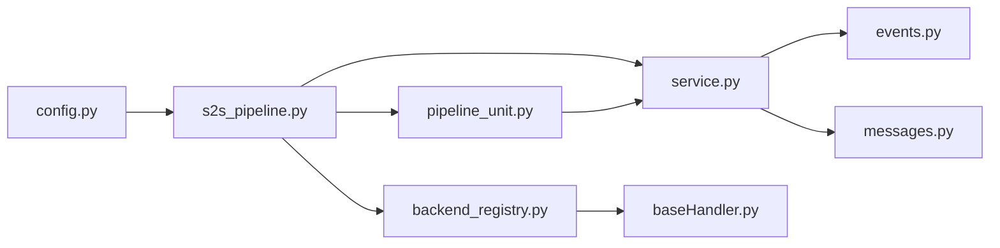

# 管道系统

<cite>
**本文引用的文件**   
- [s2s_pipeline.py](file://src/speech_to_speech/s2s_pipeline.py)
- [pipeline_unit.py](file://src/speech_to_speech/api/openai_realtime/pipeline_unit.py)
- [service.py](file://src/speech_to_speech/api/openai_realtime/service.py)
- [server.py](file://src/speech_to_speech/api/openai_realtime/server.py)
- [events.py](file://src/speech_to_speech/pipeline/events.py)
- [messages.py](file://src/speech_to_speech/pipeline/messages.py)
- [queue_types.py](file://src/speech_to_speech/pipeline/queue_types.py)
- [handler_types.py](file://src/speech_to_speech/pipeline/handler_types.py)
- [baseHandler.py](file://src/speech_to_speech/baseHandler.py)
- [thread_manager.py](file://src/speech_to_speech/utils/thread_manager.py)
- [backend_registry.py](file://src/speech_to_speech/backend_registry.py)
- [config.py](file://src/speech_to_speech/config.py)
</cite>

## 目录
1. [引言](#引言)
2. [项目结构](#项目结构)
3. [核心组件](#核心组件)
4. [架构总览](#架构总览)
5. [详细组件分析](#详细组件分析)
6. [依赖关系分析](#依赖关系分析)
7. [性能与并发模型](#性能与并发模型)
8. [配置、参数调优与故障排查](#配置参数调优与故障排查)
9. [扩展指南](#扩展指南)
10. [结论](#结论)

## 引言
本文件系统性地解析语音到语音处理管道的四阶段架构：VAD（语音活动检测）→ STT（语音转文本）→ LLM（大语言模型）→ TTS（文本转语音）。文档重点说明以下方面：
- 数据流在各阶段间的传递机制，包括队列、消息类型、事件类型和状态管理。
- 管道单元 PipelineUnit 的构建过程、线程模型与并发控制。
- 事件驱动架构如何协调各阶段，包括异步处理、错误恢复、推测式对话轮次与会话清理。
- 管道配置、参数调优与常见故障排查。
- 面向开发者的扩展建议，包括新增处理器、后端注册与自定义事件。

该系统的核心思想是“每个连接由一个隔离的管道单元承载”，通过多队列串联处理器，并由统一的服务层将 OpenAI Realtime 协议事件映射为内部消息，再分发到 VAD/STT/LLM/TTS 等处理器链。

## 项目结构
仓库中与管道系统直接相关的代码主要位于以下路径：
- `src/speech_to_speech/s2s_pipeline.py`：入口、参数解析、管道池与服务组装。
- `src/speech_to_speech/api/openai_realtime/`：Realtime 服务、服务器、传输路由、会话状态与管道单元。
- `src/speech_to_speech/pipeline/`：管道消息、事件、队列类型、处理器基类、历史与会话元数据。
- `src/speech_to_speech/backend_registry.py`：STT/LLM/TTS 后端注册表与工厂。
- `src/speech_to_speech/config.py`：YAML 配置解析、校验与解析结果。
- `src/speech_to_speech/baseHandler.py`：通用处理器基类，定义 run/process/cleanup 生命周期。
- `src/speech_to_speech/utils/thread_manager.py`：线程管理器，负责启动、等待与停止处理器线程。

**图表来源**
- [s2s_pipeline.py:185-297](file://src/speech_to_speech/s2s_pipeline.py#L185-L297)
- [s2s_pipeline.py:594-747](file://src/speech_to_speech/s2s_pipeline.py#L594-L747)
- [server.py:14-70](file://src/speech_to_speech/api/openai_realtime/server.py#L14-L70)
- [pipeline_unit.py:53-77](file://src/speech_to_speech/api/openai_realtime/pipeline_unit.py#L53-L77)
- [service.py:355-403](file://src/speech_to_speech/api/openai_realtime/service.py#L355-L403)
- [queue_types.py:20-47](file://src/speech_to_speech/pipeline/queue_types.py#L20-L47)
- [messages.py:34-416](file://src/speech_to_speech/pipeline/messages.py#L34-L416)
- [events.py:26-228](file://src/speech_to_speech/pipeline/events.py#L26-L228)
- [backend_registry.py:102-206](file://src/speech_to_speech/backend_registry.py#L102-L206)
- [baseHandler.py:32-134](file://src/speech_to_speech/baseHandler.py#L32-L134)
- [thread_manager.py:9-40](file://src/speech_to_speech/utils/thread_manager.py#L9-L40)

**章节来源**
- [s2s_pipeline.py:185-297](file://src/speech_to_speech/s2s_pipeline.py#L185-L297)
- [s2s_pipeline.py:594-747](file://src/speech_to_speech/s2s_pipeline.py#L594-L747)
- [server.py:14-70](file://src/speech_to_speech/api/openai_realtime/server.py#L14-L70)
- [pipeline_unit.py:53-77](file://src/speech_to_speech/api/openai_realtime/pipeline_unit.py#L53-L77)
- [service.py:355-403](file://src/speech_to_speech/api/openai_realtime/service.py#L355-L403)
- [queue_types.py:20-47](file://src/speech_to_speech/pipeline/queue_types.py#L20-L47)
- [messages.py:34-416](file://src/speech_to_speech/pipeline/messages.py#L34-L416)
- [events.py:26-228](file://src/speech_to_speech/pipeline/events.py#L26-L228)
- [backend_registry.py:102-206](file://src/speech_to_speech/backend_registry.py#L102-L206)
- [baseHandler.py:32-134](file://src/speech_to_speech/baseHandler.py#L32-L134)
- [thread_manager.py:9-40](file://src/speech_to_speech/utils/thread_manager.py#L9-L40)

## 核心组件
- **参数与配置**：`parse_arguments` 从 CLI 或 JSON/YAML 解析模块、实时服务器、本地音频、VAD、STT、LLM、TTS 参数；`prepare_all_args` 做全局设备与能力校验；`config.py` 提供 YAML 配置解析与校验。
- **管道单元**：`PipelineUnit` 封装一个独立的处理实例，包含队列、事件、`RealtimeService`、取消作用域、以及处理器链。
- **服务层**：`RealtimeService` 维护每连接状态、协议事件解析、历史与会话、响应生命周期、推测式轮次跟踪、延迟统计。
- **服务器**：`RealtimeServer` 持有 uvicorn 服务与管道单元池，WS/WebRTC 接入时分配空闲单元。
- **处理器基类**：`BaseHandler` 定义输入输出队列、run/process/cleanup 生命周期、会话结束、PIPELINE_END 哨兵、控制消息处理。
- **后端注册表**：`backend_registry.py` 集中注册 STT/LLM/TTS 后端，提供工厂函数、能力声明、配置归一化。
- **消息与事件**：`messages.py` 定义跨阶段消息（如 `GenerateResponseRequest`、`LLMResponseChunk`、`TTSInput`、`AudioOutput`、`EndOfResponse`），`events.py` 定义面向服务的事件（如 `SpeechStartedEvent`、`TranscriptionCompletedEvent`、`AssistantOutputEvent`）。
- **队列类型**：`queue_types.py` 集中定义各队列项的类型别名，避免重复 union 类型。

**章节来源**
- [s2s_pipeline.py:185-297](file://src/speech_to_speech/s2s_pipeline.py#L185-L297)
- [s2s_pipeline.py:368-403](file://src/speech_to_speech/s2s_pipeline.py#L368-L403)
- [pipeline_unit.py:53-77](file://src/speech_to_speech/api/openai_realtime/pipeline_unit.py#L53-L77)
- [service.py:355-403](file://src/speech_to_speech/api/openai_realtime/service.py#L355-L403)
- [server.py:14-70](file://src/speech_to_speech/api/openai_realtime/server.py#L14-L70)
- [baseHandler.py:32-134](file://src/speech_to_speech/baseHandler.py#L32-L134)
- [backend_registry.py:102-206](file://src/speech_to_speech/backend_registry.py#L102-L206)
- [messages.py:34-416](file://src/speech_to_speech/pipeline/messages.py#L34-L416)
- [events.py:26-228](file://src/speech_to_speech/pipeline/events.py#L26-L228)
- [queue_types.py:20-47](file://src/speech_to_speech/pipeline/queue_types.py#L20-L47)
- [config.py:371-538](file://src/speech_to_speech/config.py#L371-L538)

## 架构总览
下图展示从客户端到处理器的端到端流程：

**图表来源**
- [server.py:14-70](file://src/speech_to_speech/api/openai_realtime/server.py#L14-L70)
- [pipeline_unit.py:53-77](file://src/speech_to_speech/api/openai_realtime/pipeline_unit.py#L53-L77)
- [service.py:509-560](file://src/speech_to_speech/api/openai_realtime/service.py#L509-L560)
- [s2s_pipeline.py:407-574](file://src/speech_to_speech/s2s_pipeline.py#L407-L574)
- [messages.py:376-416](file://src/speech_to_speech/pipeline/messages.py#L376-L416)
- [events.py:39-228](file://src/speech_to_speech/pipeline/events.py#L39-L228)

## 详细组件分析

### 管道单元 PipelineUnit 与构建流程
`_build_pipeline_unit` 负责创建一个隔离的管道单元，包括：
- 深拷贝 VAD 参数与后端选择，确保多实例互不干扰。
- 创建 `should_listen`、`response_playing`、`CancelScope`、`SpeculativeTurnTracker`、`TurnLatencyStore`。
- 初始化各阶段队列：音频输入、音频输出、VAD 输出、STT 输出、文本提示、LLM 响应、TTS 输入、文本事件。
- 构造 `RealtimeService`，并设置支持的 STT/TTS 语言集合。
- 调用 `_build_handlers` 构建处理器链：VAD、可选说话人分离、STT、可选转录通知器、LLM、LLM 输出处理器、TTS、可选口型同步。
- 将处理器附加 `pipeline_index` 与 `turn_latency_store`，以便日志与延迟追踪。

**图表来源**
- [s2s_pipeline.py:594-707](file://src/speech_to_speech/s2s_pipeline.py#L594-L707)

**章节来源**
- [s2s_pipeline.py:594-707](file://src/speech_to_speech/s2s_pipeline.py#L594-L707)

### 处理器链与数据流
处理器链顺序为：
- VAD：接收音频片段，检测语音起止，输出 `VADAudio`。
- STT：将语音转为文本，输出 `PartialTranscription`、`Transcription`、`TranscriptionFailure`。
- LLM：根据 `GenerateResponseRequest` 生成响应，输出 `LLMResponseChunk`、`TokenUsage`、`EndOfResponse`。
- TTS：将文本合成为音频，输出 `AudioOutput`。

中间可能插入：
- 转录通知器：当 STT 后端不绕过通知器时，将 STT 输出转换为文本提示。
- LLM 输出处理器：规范化助手输出，处理工具调用与语言检测。
- 口型同步（STV）：在 TTS 后生成 viseme 事件。

**图表来源**
- [baseHandler.py:32-134](file://src/speech_to_speech/baseHandler.py#L32-L134)
- [s2s_pipeline.py:407-574](file://src/speech_to_speech/s2s_pipeline.py#L407-L574)

**章节来源**
- [s2s_pipeline.py:407-574](file://src/speech_to_speech/s2s_pipeline.py#L407-L574)
- [baseHandler.py:32-134](file://src/speech_to_speech/baseHandler.py#L32-L134)

### 消息与事件类型
- **消息（跨阶段）**：`VADAudio`、`PartialTranscription`、`Transcription`、`TranscriptionFailure`、`GenerateResponseRequest`、`LLMResponseChunk`、`TokenUsage`、`EndOfResponse`、`TTSInput`、`AudioOutput`。
- **事件（面向服务）**：`SpeechStartedEvent`、`SpeechStoppedEvent`、`PartialTranscriptionEvent`、`TranscriptionCompletedEvent`、`TranscriptionFailedEvent`、`AudioInputCompletedEvent`、`AssistantOutputEvent`、`AssistantToolCallReadyEvent`、`TokenUsageEvent`、`AssistantResponseDoneEvent`、`ResponseGenerationDoneEvent`、`ResponseFailedEvent`。
- **队列类型别名**：`AudioInItem`、`VADOutItem`、`STTOutItem`、`TextPromptItem`、`LMOutItem`、`TTSInItem`、`AudioOutItem`、`TextEventItem`。

这些类型确保各阶段之间的数据契约稳定，便于调试与扩展。

**章节来源**
- [messages.py:34-416](file://src/speech_to_speech/pipeline/messages.py#L34-L416)
- [events.py:26-228](file://src/speech_to_speech/pipeline/events.py#L26-L228)
- [queue_types.py:20-47](file://src/speech_to_speech/pipeline/queue_types.py#L20-L47)
- [handler_types.py:31-46](file://src/speech_to_speech/pipeline/handler_types.py#L31-L46)

### 服务层与协议映射
`RealtimeService` 承担以下职责：
- 解析客户端事件（如 `input_audio_buffer.append`、`response.create`）。
- 维护每连接状态 `ConnState`，包括会话 ID、响应键、音频缓冲、历史、工具调用、延迟锚点等。
- 将内部管道事件分发到对应处理器（如 `audio.on_speech_started`、`conversation.on_partial_transcription`、`response.on_assistant_output`）。
- 管理响应生命周期：创建、取消、完成、失败，以及与历史、用量统计、推测式轮次的交互。
- 暴露方法供发送循环使用，如 `begin_audio_response`、`encode_audio_chunk`、`finish_audio_output`、`finish_response`。

**图表来源**
- [service.py:477-560](file://src/speech_to_speech/api/openai_realtime/service.py#L477-L560)
- [service.py:610-689](file://src/speech_to_speech/api/openai_realtime/service.py#L610-L689)

**章节来源**
- [service.py:355-403](file://src/speech_to_speech/api/openai_realtime/service.py#L355-L403)
- [service.py:477-560](file://src/speech_to_speech/api/openai_realtime/service.py#L477-L560)
- [service.py:610-689](file://src/speech_to_speech/api/openai_realtime/service.py#L610-L689)

### 服务器与会话分配
`RealtimeServer` 持有 uvicorn 应用与管道单元池。每次 WebSocket/WebRTC 连接建立时，路由会尝试分配一个空闲的 `PipelineUnit`；若全部占用则拒绝新连接。断开连接后释放单元，允许后续连接复用。

**图表来源**
- [server.py:14-70](file://src/speech_to_speech/api/openai_realtime/server.py#L14-L70)
- [pipeline_unit.py:13-51](file://src/speech_to_speech/api/openai_realtime/pipeline_unit.py#L13-L51)

**章节来源**
- [server.py:14-70](file://src/speech_to_speech/api/openai_realtime/server.py#L14-L70)
- [pipeline_unit.py:13-51](file://src/speech_to_speech/api/openai_realtime/pipeline_unit.py#L13-L51)

### 线程模型与并发控制
- 每个处理器继承 `BaseHandler`，拥有独立线程执行 `run()`，从输入队列消费消息，调用 `process()` 产出结果，写入输出队列。
- `ThreadManager` 统一管理所有处理器线程，支持启动、等待与停止。
- 控制消息 `SESSION_END` 用于软重置会话状态，`PIPELINE_END` 作为哨兵防止队列死锁。
- `CancelScope` 与 `cancel_generation` 字段用于丢弃陈旧响应输出，避免取消后的乱序数据污染。
- `SpeculativeTurnTracker` 与 `TurnLatencyStore` 管理推测式轮次与延迟统计，确保最新轮次优先。

**图表来源**
- [thread_manager.py:9-40](file://src/speech_to_speech/utils/thread_manager.py#L9-L40)
- [baseHandler.py:126-242](file://src/speech_to_speech/baseHandler.py#L126-L242)

**章节来源**
- [thread_manager.py:9-40](file://src/speech_to_speech/utils/thread_manager.py#L9-L40)
- [baseHandler.py:126-242](file://src/speech_to_speech/baseHandler.py#L126-L242)

## 依赖关系分析
- `s2s_pipeline.py` 依赖 `backend_registry.py` 以动态创建 STT/LLM/TTS 处理器。
- `s2s_pipeline.py` 依赖 `api/openai_realtime/pipeline_unit.py` 与 `service.py` 构建服务与单元。
- `service.py` 依赖 `pipeline/events.py` 与 `pipeline/messages.py` 进行事件与消息转换。
- `baseHandler.py` 被所有处理器继承，提供统一生命周期。
- `config.py` 提供 YAML 配置解析，与 `arguments_classes` 配合生成后端选择。

**图表来源**
- [s2s_pipeline.py:21-59](file://src/speech_to_speech/s2s_pipeline.py#L21-L59)
- [backend_registry.py:350-693](file://src/speech_to_speech/backend_registry.py#L350-L693)
- [service.py:70-89](file://src/speech_to_speech/api/openai_realtime/service.py#L70-L89)
- [baseHandler.py:16-24](file://src/speech_to_speech/baseHandler.py#L16-L24)
- [config.py:106-125](file://src/speech_to_speech/config.py#L106-L125)

**章节来源**
- [s2s_pipeline.py:21-59](file://src/speech_to_speech/s2s_pipeline.py#L21-L59)
- [backend_registry.py:350-693](file://src/speech_to_speech/backend_registry.py#L350-L693)
- [service.py:70-89](file://src/speech_to_speech/api/openai_realtime/service.py#L70-L89)
- [baseHandler.py:16-24](file://src/speech_to_speech/baseHandler.py#L16-L24)
- [config.py:106-125](file://src/speech_to_speech/config.py#L106-L125)

## 性能与并发模型
- **并行度**：通过 `num_pipelines` 创建多个管道单元，提升并发处理能力。
- **线程隔离**：每个处理器独立线程，避免阻塞；`ThreadManager` 保证优雅关闭。
- **推测式轮次**：`SpeculativeTurnTracker` 允许在用户继续说话时提前发起 LLM 请求，提高首字延迟。
- **延迟统计**：`TurnLatencyStore` 记录语音、STT、LLM、TTS 阶段的延迟，辅助性能优化。
- **资源管理**：`CancelScope` 与 `cancel_generation` 丢弃陈旧输出，避免无效计算。
- **设备与线程数**：可通过 `torch_num_threads` 调整 PyTorch 线程数，避免 CPU 争用。

**章节来源**
- [s2s_pipeline.py:710-747](file://src/speech_to_speech/s2s_pipeline.py#L710-L747)
- [service.py:448-470](file://src/speech_to_speech/api/openai_realtime/service.py#L448-L470)
- [baseHandler.py:73-98](file://src/speech_to_speech/baseHandler.py#L73-L98)
- [thread_manager.py:18-40](file://src/speech_to_speech/utils/thread_manager.py#L18-L40)

## 配置、参数调优与故障排查

### 配置方式
- **CLI/JSON**：`parse_arguments` 支持从命令行或 JSON 文件解析参数，自动选择 STT/LLM/TTS 后端。
- **YAML**：`config.py` 提供结构化 YAML 配置，支持环境变量引用、路径展开、字段校验。
- **关键选项**：
  - `num_pipelines`：管道实例数量。
  - `device`：全局设备（CPU/CUDA/MPS）。
  - `enable_live_transcription`：启用实时转录。
  - `live_transcription_update_interval`：实时转录更新间隔。
  - `detect_llm_output_language`：检测 LLM 输出语言。
  - `enable_visemes`：启用口型同步。
  - `diarization_model_name`：说话人分离模型。

**章节来源**
- [s2s_pipeline.py:185-297](file://src/speech_to_speech/s2s_pipeline.py#L185-L297)
- [config.py:371-538](file://src/speech_to_speech/config.py#L371-L538)

### 参数调优建议
- **STT**：选择合适的后端（如 `faster-whisper`、`parakeet-tdt`、`qwen3-asr`），并根据硬件选择设备。
- **LLM**：本地模型（`mlx-lm`、`transformers`）需关注显存与线程数；远程 API（`responses-api`、`chat-completions`）需关注网络延迟。
- **TTS**：根据语言与音质需求选择后端（如 `qwen3`、`kokoro`、`pocket`）。
- **VAD**：调整阈值与窗口大小，平衡误检与漏检。
- **并发**：根据 CPU/GPU 资源调整 `num_pipelines`，避免过载。

**章节来源**
- [backend_registry.py:350-693](file://src/speech_to_speech/backend_registry.py#L350-L693)
- [s2s_pipeline.py:368-403](file://src/speech_to_speech/s2s_pipeline.py#L368-L403)

### 故障排查指南
- **队列死锁**：检查是否发送 `PIPELINE_END` 哨兵，确保处理器正常退出。
- **会话未释放**：检查 `SESSION_END` 是否正确传播，确认 `PipelineUnit.session.drained` 已触发。
- **陈旧输出**：检查 `cancel_scope.is_stale(cancel_generation)` 逻辑，确保取消后的输出被丢弃。
- **后端导入失败**：查看 `backend_registry.py` 中的 `required_extra` 与依赖安装提示。
- **配置错误**：使用 `config.py` 的 `validate_config` 与 `resolve_config` 获取详细错误位置。

**章节来源**
- [baseHandler.py:157-164](file://src/speech_to_speech/baseHandler.py#L157-L164)
- [pipeline_unit.py:26-50](file://src/speech_to_speech/api/openai_realtime/pipeline_unit.py#L26-L50)
- [backend_registry.py:185-206](file://src/speech_to_speech/backend_registry.py#L185-L206)
- [config.py:96-104](file://src/speech_to_speech/config.py#L96-L104)

## 扩展指南

### 新增处理器
1. 继承 `BaseHandler`，实现 `process()` 方法。
2. 定义输入输出类型，遵循 `handler_types.py` 的约定。
3. 在 `_build_handlers` 中插入处理器链，并连接相应队列。
4. 如需事件输出，实现 `process_pipeline_event()` 以转发有序事件。

**章节来源**
- [baseHandler.py:70-125](file://src/speech_to_speech/baseHandler.py#L70-L125)
- [s2s_pipeline.py:407-574](file://src/speech_to_speech/s2s_pipeline.py#L407-L574)

### 注册新后端
1. 在 `backend_registry.py` 中添加 `BackendSpec`，指定名称、配置类型、工厂函数、能力声明。
2. 实现工厂函数，创建处理器实例并注入上下文。
3. 在 `s2s_pipeline.py` 的参数解析中确保后端名称可用。

**章节来源**
- [backend_registry.py:102-206](file://src/speech_to_speech/backend_registry.py#L102-L206)
- [s2s_pipeline.py:221-231](file://src/speech_to_speech/s2s_pipeline.py#L221-L231)

### 自定义事件
1. 在 `events.py` 中定义新的 `PipelineEvent` 子类。
2. 在 `service.py` 的 `_pipeline_dispatch` 中注册事件处理器。
3. 在处理器中通过 `text_output_queue` 或 `output_queue` 发送事件。

**章节来源**
- [events.py:26-228](file://src/speech_to_speech/pipeline/events.py#L26-L228)
- [service.py:393-403](file://src/speech_to_speech/api/openai_realtime/service.py#L393-L403)

## 结论
本管道系统通过清晰的阶段划分、稳定的消息契约、灵活的处理器基类与后端注册表，实现了可扩展、高性能的语音到语音处理流水线。开发者可基于现有架构快速扩展处理器、后端与事件，同时借助配置系统与故障排查工具保障系统稳定性与可观测性。