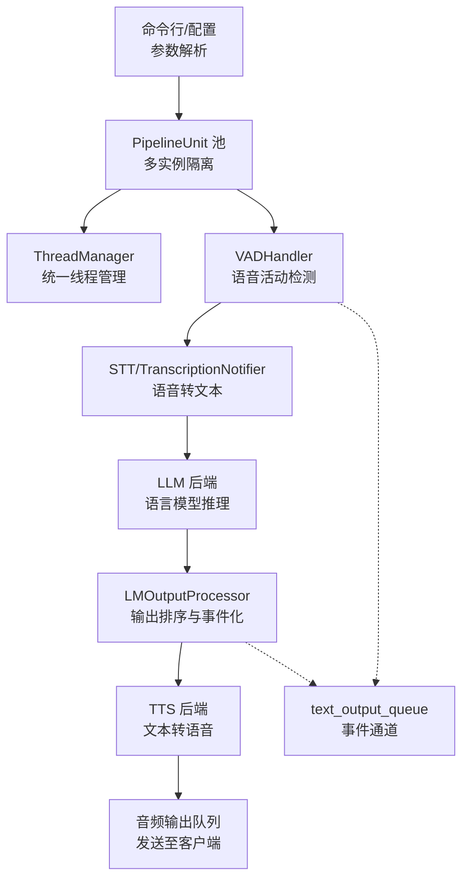
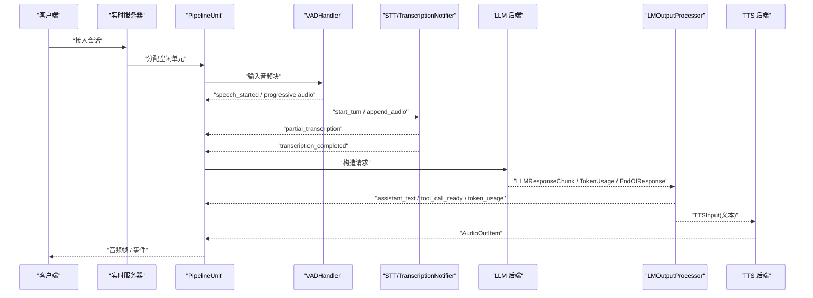
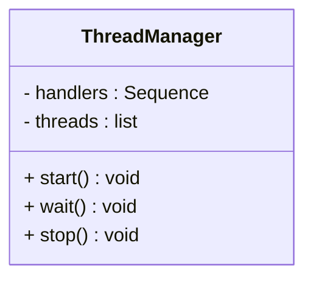
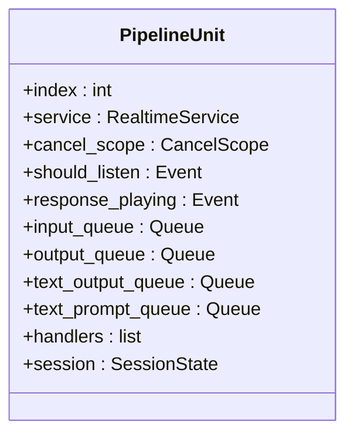
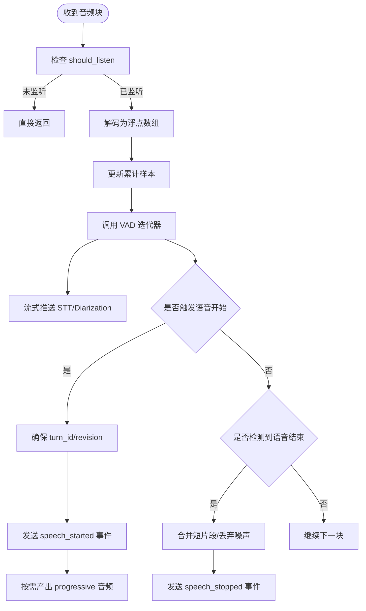
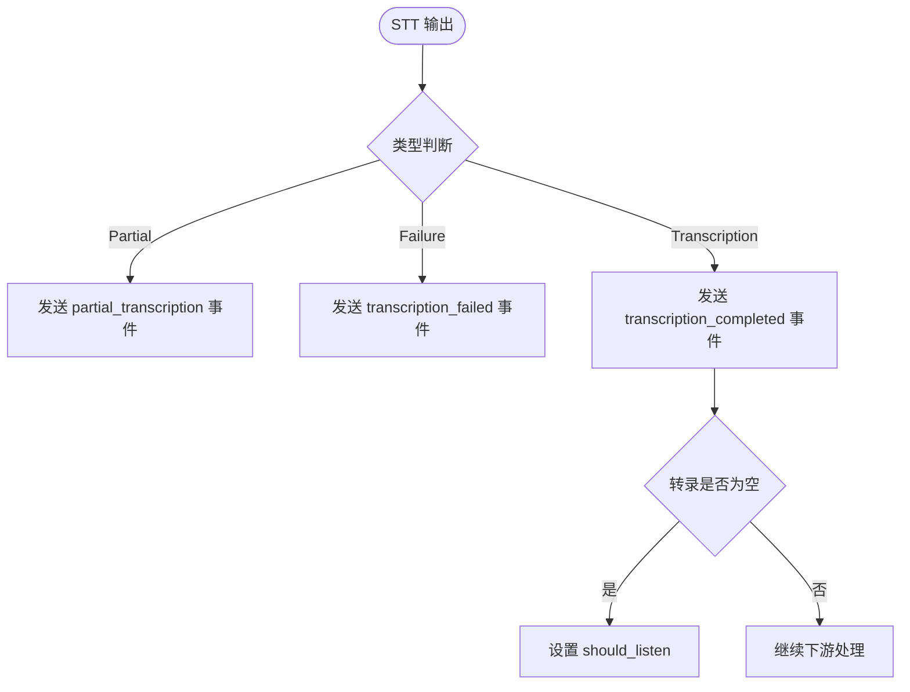
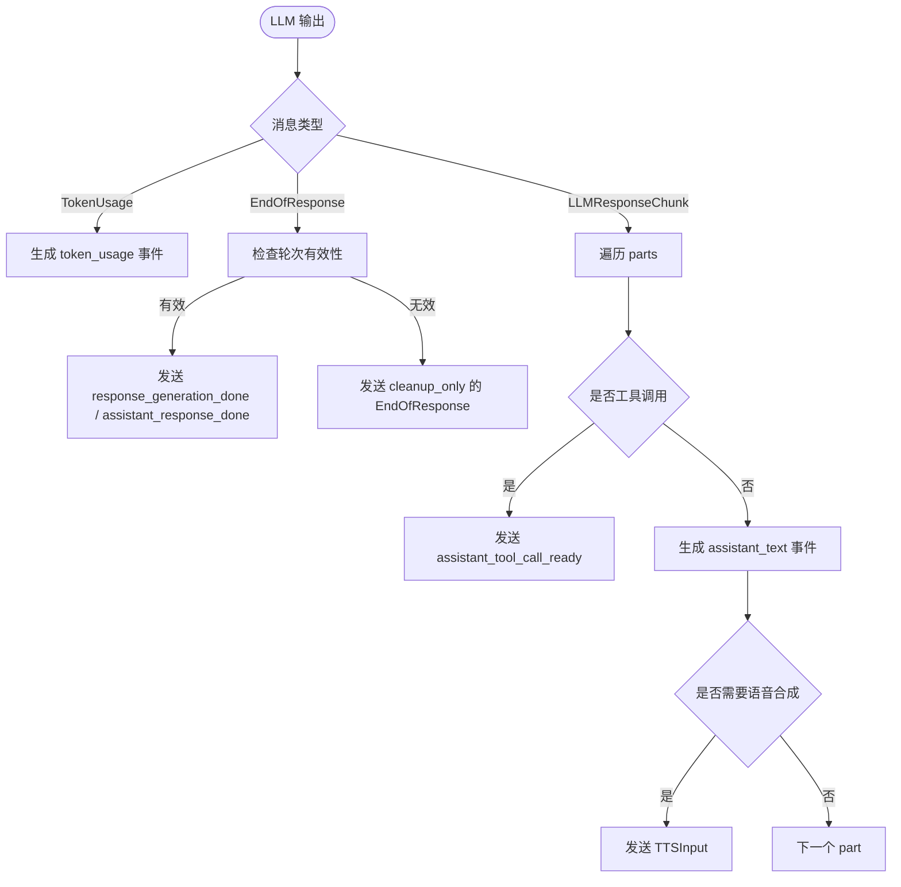
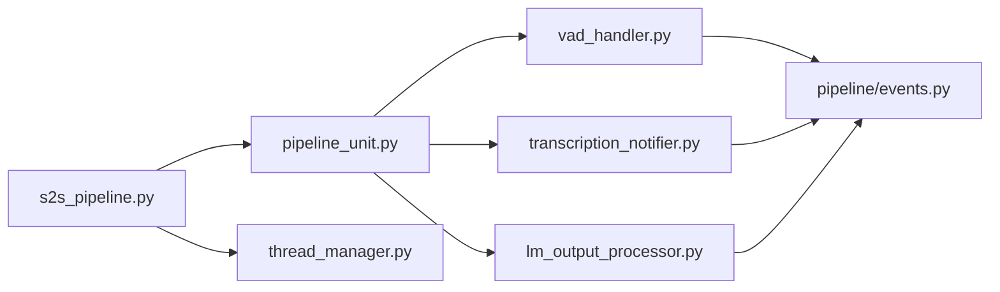
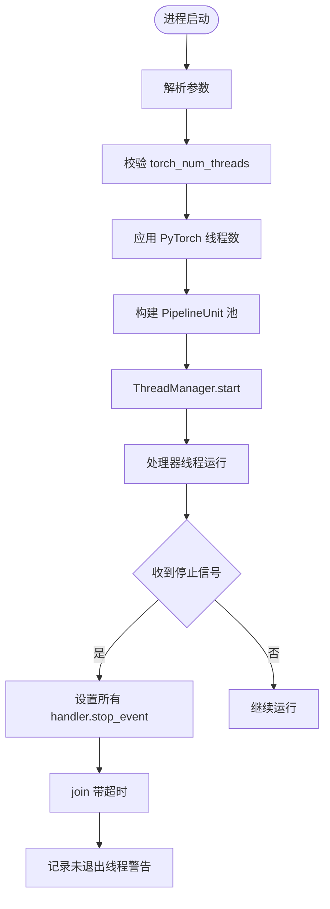

# 线程模型

<cite>
**本文引用的文件**   
- [src/speech_to_speech/utils/thread_manager.py](file://src/speech_to_speech/utils/thread_manager.py)
- [src/speech_to_speech/s2s_pipeline.py](file://src/speech_to_speech/s2s_pipeline.py)
- [src/speech_to_speech/api/openai_realtime/pipeline_unit.py](file://src/speech_to_speech/api/openai_realtime/pipeline_unit.py)
- [src/speech_to_speech/VAD/vad_handler.py](file://src/speech_to_speech/VAD/vad_handler.py)
- [src/speech_to_speech/STT/transcription_notifier.py](file://src/speech_to_speech/STT/transcription_notifier.py)
- [src/speech_to_speech/LLM/lm_output_processor.py](file://src/speech_to_speech/LLM/lm_output_processor.py)
- [src/speech_to_speech/pipeline/events.py](file://src/speech_to_speech/pipeline/events.py)
- [tests/test_torch_num_threads.py](file://tests/test_torch_num_threads.py)
</cite>

## 目录
1. [引言](#引言)
2. [项目结构](#项目结构)
3. [核心组件](#核心组件)
4. [架构总览](#架构总览)
5. [详细组件分析](#详细组件分析)
6. [依赖关系分析](#依赖关系分析)
7. [性能与资源管理](#性能与资源管理)
8. [故障排查指南](#故障排查指南)
9. [结论](#结论)
10. [附录：线程安全最佳实践](#附录线程安全最佳实践)

## 引言
本文件面向开发者，系统化梳理语音到语音（Speech-to-Speech）系统的线程模型。重点包括：
- 多线程架构的设计决策：以“管道单元 + 队列”为主，配合统一的线程管理器进行生命周期控制。
- 任务调度策略：VAD → STT/AudioInput → LLM → TTS 的有向流水线；可选的说话人分离、可视化唇形等旁路处理。
- 资源分配与隔离：每个 PipelineUnit 拥有独立的队列、事件、服务状态和处理器链，避免跨会话污染。
- 竞态条件与死锁防护：通过队列、Event、取消作用域、推测性轮次门控等机制降低并发风险。
- 事件同步与线程间通信：基于 Pydantic 的事件对象在 text_output_queue 与 TTS 输出队列中有序传递。
- 内存管理与优雅关闭：ThreadManager 统一触发 stop_event，等待线程退出并记录超时告警。
- 性能优化与调试：PyTorch 线程数控制、日志节流、流式中间结果、延迟统计等。

## 项目结构
从线程视角看，系统由以下层次组成：
- 进程入口与参数解析：负责选择后端、校验配置、构建多个 PipelineUnit。
- 管道单元：封装 VAD、STT、LM、TTS 等处理器及其队列，形成独立工作流。
- 线程管理器：启动、等待、停止所有处理器线程。
- 事件系统：将 VAD、转录、LLM 输出等事件标准化，供实时路由消费。

**图示来源**
- [src/speech_to_speech/s2s_pipeline.py:594-747](file://src/speech_to_speech/s2s_pipeline.py#L594-L747)
- [src/speech_to_speech/utils/thread_manager.py:9-39](file://src/speech_to_speech/utils/thread_manager.py#L9-L39)
- [src/speech_to_speech/api/openai_realtime/pipeline_unit.py:53-76](file://src/speech_to_speech/api/openai_realtime/pipeline_unit.py#L53-L76)

**章节来源**
- [src/speech_to_speech/s2s_pipeline.py:185-380](file://src/speech_to_speech/s2s_pipeline.py#L185-L380)
- [src/speech_to_speech/s2s_pipeline.py:594-747](file://src/speech_to_speech/s2s_pipeline.py#L594-L747)

## 核心组件
- ThreadManager：统一管理处理器线程的生命周期，提供 start、wait、stop 接口。
- PipelineUnit：一个完整的语音处理管道，包含输入/输出队列、事件队列、RealtimeService 以及处理器链。
- VADHandler：负责语音片段检测、流式快照、推测性轮次协调、可选说话人分离。
- TranscriptionNotifier：将 STT 输出转换为协议无关的转录事件，并回写 text_output_queue。
- LMOutputProcessor：对 LLM 输出进行顺序化处理，生成助手输出事件、工具调用就绪事件、用量事件，并将需要语音合成的文本转发给 TTS。
- 事件体系：SpeechStarted/Stopped、Partial/Completed/Failed Transcription、Assistant Output/Tool Call Ready、Token Usage、Response Done/Failed 等。

**章节来源**
- [src/speech_to_speech/utils/thread_manager.py:9-39](file://src/speech_to_speech/utils/thread_manager.py#L9-L39)
- [src/speech_to_speech/api/openai_realtime/pipeline_unit.py:53-76](file://src/speech_to_speech/api/openai_realtime/pipeline_unit.py#L53-L76)
- [src/speech_to_speech/VAD/vad_handler.py:58-209](file://src/speech_to_speech/VAD/vad_handler.py#L58-L209)
- [src/speech_to_speech/STT/transcription_notifier.py:26-122](file://src/speech_to_speech/STT/transcription_notifier.py#L26-L122)
- [src/speech_to_speech/LLM/lm_output_processor.py:44-308](file://src/speech_to_speech/LLM/lm_output_processor.py#L44-L308)
- [src/speech_to_speech/pipeline/events.py:26-228](file://src/speech_to_speech/pipeline/events.py#L26-L228)

## 架构总览
下图展示了一个 PipelineUnit 内部的主要线程与数据流。每个 handler 运行在自己的线程中，通过 queue.Queue 单向传递数据，避免共享可变状态。

**图示来源**
- [src/speech_to_speech/s2s_pipeline.py:407-574](file://src/speech_to_speech/s2s_pipeline.py#L407-L574)
- [src/speech_to_speech/VAD/vad_handler.py:565-668](file://src/speech_to_speech/VAD/vad_handler.py#L565-L668)
- [src/speech_to_speech/STT/transcription_notifier.py:42-122](file://src/speech_to_speech/STT/transcription_notifier.py#L42-L122)
- [src/speech_to_speech/LLM/lm_output_processor.py:134-308](file://src/speech_to_speech/LLM/lm_output_processor.py#L134-L308)

## 详细组件分析

### ThreadManager：线程生命周期管理
ThreadManager 的职责是集中管理一组 handler 的线程。它不关心业务逻辑，只负责：
- 启动：为每个 handler.run 创建非守护线程并启动。
- 等待：主线程 join 所有子线程，确保正常退出。
- 停止：设置所有 handler.stop_event，然后带超时 join，未退出的线程记录警告日志。

**图示来源**
- [src/speech_to_speech/utils/thread_manager.py:9-39](file://src/speech_to_speech/utils/thread_manager.py#L9-L39)

**章节来源**
- [src/speech_to_speech/utils/thread_manager.py:9-39](file://src/speech_to_speech/utils/thread_manager.py#L9-L39)

### PipelineUnit：管道单元与线程隔离
PipelineUnit 是一个“自包含”的管道实例，包含：
- 输入/输出音频队列：recv_audio_chunks_queue、send_audio_chunks_queue。
- 文本事件队列：text_output_queue、text_prompt_queue。
- 中间队列：spoken_prompt_queue、stt_output_queue、lm_response_queue、lm_processed_queue。
- 服务与状态：RealtimeService、CancelScope、SpeculativeTurnTracker、TurnLatencyStore。
- 处理器链：VAD、可选 DiarizationWorker、STT、TranscriptionNotifier、LLM、LMOutputProcessor、TTS、可选 STV。

每个 PipelineUnit 的队列和事件都是独立的，从而保证不同会话之间不会互相干扰。

**图示来源**
- [src/speech_to_speech/api/openai_realtime/pipeline_unit.py:53-76](file://src/speech_to_speech/api/openai_realtime/pipeline_unit.py#L53-L76)

**章节来源**
- [src/speech_to_speech/api/openai_realtime/pipeline_unit.py:13-76](file://src/speech_to_speech/api/openai_realtime/pipeline_unit.py#L13-L76)
- [src/speech_to_speech/s2s_pipeline.py:594-707](file://src/speech_to_speech/s2s_pipeline.py#L594-L707)

### VADHandler：语音活动检测与流式处理
VADHandler 是音频输入的第一站，承担以下职责：
- 接收音频块，维护累计样本计数、时间戳、活跃语音时长。
- 使用底层迭代器（Silero/FireRed）判断语音起止。
- 支持流式 progressive 快照，用于实时转录或下游消费。
- 与 SpeculativeTurnTracker 协作，处理推测性轮次、重开窗口、丢弃过期片段。
- 可选对接 DiarizationWorker，进行说话人分离。
- 对队列中的过时 VAD 音频进行清理，避免竞态导致的乱序。

**图示来源**
- [src/speech_to_speech/VAD/vad_handler.py:565-668](file://src/speech_to_speech/VAD/vad_handler.py#L565-L668)
- [src/speech_to_speech/VAD/vad_handler.py:670-800](file://src/speech_to_speech/VAD/vad_handler.py#L670-L800)

**章节来源**
- [src/speech_to_speech/VAD/vad_handler.py:58-209](file://src/speech_to_speech/VAD/vad_handler.py#L58-L209)
- [src/speech_to_speech/VAD/vad_handler.py:565-800](file://src/speech_to_speech/VAD/vad_handler.py#L565-L800)

### TranscriptionNotifier：转录事件桥接
TranscriptionNotifier 位于 STT 与 LLM 之间，负责：
- 将 PartialTranscription、Transcription、TranscriptionFailure 转换为 Protocol-neutral 事件。
- 将事件写入 text_output_queue，供 RealtimeService 消费。
- 空转录时重新启用 listening，避免阻塞后续输入。

**图示来源**
- [src/speech_to_speech/STT/transcription_notifier.py:42-122](file://src/speech_to_speech/STT/transcription_notifier.py#L42-L122)

**章节来源**
- [src/speech_to_speech/STT/transcription_notifier.py:26-122](file://src/speech_to_speech/STT/transcription_notifier.py#L26-L122)

### LMOutputProcessor：LLM 输出顺序化与事件化
LMOutputProcessor 的核心目标是保持 LLM 输出的顺序，同时把需要语音合成的文本转发给 TTS：
- 维护 response_key、tool_call_ids、output_sequence，保证事件顺序。
- 对 TokenUsage、AssistantTextPart、AssistantToolCallPart、EndOfResponse 分别处理。
- 通过 speculative_turns.wait_for_gate 过滤过期的轮次输出。
- 将 AssistantOutputEvent、AssistantToolCallReadyEvent、TokenUsageEvent、AssistantResponseDoneEvent、ResponseGenerationDoneEvent、ResponseFailedEvent 发送到 text_output_queue。
- 将 TTSInput 发送到 TTS 队列，携带语言、runtime_config、turn_id 等信息。

**图示来源**
- [src/speech_to_speech/LLM/lm_output_processor.py:134-308](file://src/speech_to_speech/LLM/lm_output_processor.py#L134-L308)

**章节来源**
- [src/speech_to_speech/LLM/lm_output_processor.py:44-308](file://src/speech_to_speech/LLM/lm_output_processor.py#L44-L308)

### 事件体系：线程间通信契约
events.py 定义了 pipeline 内部的标准事件，这些事件通过 text_output_queue 和 TTS 输出队列传递：
- VAD 事件：speech_started、speech_stopped。
- 转录事件：partial_transcription、transcription_completed、transcription_failed。
- LLM 输出事件：assistant_text、assistant_tool_call_ready、token_usage、assistant_response_done、response_generation_done、response_failed。
- 音频输入完成事件：audio_input_completed。

这些事件是线程间通信的“契约”，下游消费者根据 type 字段进行分派。

```mermaid
classDiagram
class PipelineEvent {
+type : str
}
class SpeechStartedEvent {
+audio_start_ms : int
+turn_id : string
+turn_revision : int
+reopened : bool
}
class SpeechStoppedEvent {
+duration_s : float
+audio_end_ms : int
+turn_id : string
+turn_revision : int
}
class PartialTranscriptionEvent {
+delta : string
+turn_id : string
+turn_revision : int
}
class TranscriptionCompletedEvent {
+transcript : string
+speaker_attribution : SpeakerAttribution
+language_code : string
+turn_id : string
+turn_revision : int
}
class AssistantOutputEvent {
+parts : list
+text : string
+tools : list
+turn_id : string
+turn_revision : int
+cancel_generation : int
+response_key : string
+output_sequence : int
}
class AssistantToolCallReadyEvent {
+part : AssistantToolCallPart
+output_sequence : int
+turn_id : string
+turn_revision : int
+cancel_generation : int
+response_key : string
}
class TokenUsageEvent {
+input_tokens : int
+output_tokens : int
+turn_id : string
+turn_revision : int
+cancel_generation : int
+response_key : string
}
class AssistantResponseDoneEvent {
+status : string
+reason : ResponseIncompleteReason
+response_key : string
+input_tool_call_ids : list
+turn_id : string
+turn_revision : int
+cancel_generation : int
}
class ResponseGenerationDoneEvent {
+response_key : string
+call_ids : list
+succeeded : bool
+turn_id : string
+turn_revision : int
+cancel_generation : int
}
class ResponseFailedEvent {
+message : string
+turn_id : string
+turn_revision : int
+cancel_generation : int
+response_key : string
}
PipelineEvent <|-- SpeechStartedEvent
PipelineEvent <|-- SpeechStoppedEvent
PipelineEvent <|-- PartialTranscriptionEvent
PipelineEvent <|-- TranscriptionCompletedEvent
PipelineEvent <|-- AssistantOutputEvent
PipelineEvent <|-- AssistantToolCallReadyEvent
PipelineEvent <|-- TokenUsageEvent
PipelineEvent <|-- AssistantResponseDoneEvent
PipelineEvent <|-- ResponseGenerationDoneEvent
PipelineEvent <|-- ResponseFailedEvent
```

**图示来源**
- [src/speech_to_speech/pipeline/events.py:26-228](file://src/speech_to_speech/pipeline/events.py#L26-L228)

**章节来源**
- [src/speech_to_speech/pipeline/events.py:26-228](file://src/speech_to_speech/pipeline/events.py#L26-L228)

## 依赖关系分析
- s2s_pipeline.py 负责参数解析、后端选择、PipelineUnit 构建、ThreadManager 组装。
- pipeline_unit.py 定义 PipelineUnit 的数据结构，承载会话级状态。
- vad_handler.py 依赖 speculative turns、diarization worker、streaming stt sink。
- transcription_notifier.py 依赖 events 与 messages，桥接 STT 与 LLM。
- lm_output_processor.py 依赖 events、messages、speculative turns、language detection。
- thread_manager.py 仅依赖 threading 与 logging，职责单一。

**图示来源**
- [src/speech_to_speech/s2s_pipeline.py:594-747](file://src/speech_to_speech/s2s_pipeline.py#L594-L747)
- [src/speech_to_speech/api/openai_realtime/pipeline_unit.py:53-76](file://src/speech_to_speech/api/openai_realtime/pipeline_unit.py#L53-L76)
- [src/speech_to_speech/VAD/vad_handler.py:58-209](file://src/speech_to_speech/VAD/vad_handler.py#L58-L209)
- [src/speech_to_speech/STT/transcription_notifier.py:26-122](file://src/speech_to_speech/STT/transcription_notifier.py#L26-L122)
- [src/speech_to_speech/LLM/lm_output_processor.py:44-308](file://src/speech_to_speech/LLM/lm_output_processor.py#L44-L308)
- [src/speech_to_speech/pipeline/events.py:26-228](file://src/speech_to_speech/pipeline/events.py#L26-L228)

**章节来源**
- [src/speech_to_speech/s2s_pipeline.py:594-747](file://src/speech_to_speech/s2s_pipeline.py#L594-L747)
- [src/speech_to_speech/api/openai_realtime/pipeline_unit.py:53-76](file://src/speech_to_speech/api/openai_realtime/pipeline_unit.py#L53-L76)

## 性能与资源管理

### 线程模型设计要点
- 单队列单向流：每个阶段通过 queue.Queue 单向传递数据，减少锁竞争。
- 处理器线程隔离：每个 handler.run 运行在独立线程，避免阻塞上游。
- 事件驱动：text_output_queue 作为事件总线，解耦各阶段。
- 推测性轮次：SpeculativeTurnTracker 防止旧轮次输出污染新轮次。

### 资源清理与优雅关闭
- ThreadManager.stop 会设置所有 handler.stop_event，然后带超时 join。
- 未按时退出的线程会记录警告日志，便于定位卡住的处理器。
- PipelineUnit.session.drained 用于等待会话输出完全排空后再释放单元。

### PyTorch 线程数控制
- 默认情况下，若未显式设置 torch_num_threads，系统保留 Silero 的单线程行为。
- 可通过 --torch_num_threads 显式设置，并在每次 VAD 构建后重新应用，避免第三方库覆盖全局设置。
- 测试覆盖了默认值、显式值、非法值等场景。

**图示来源**
- [src/speech_to_speech/s2s_pipeline.py:336-344](file://src/speech_to_speech/s2s_pipeline.py#L336-L344)
- [src/speech_to_speech/s2s_pipeline.py:421-426](file://src/speech_to_speech/s2s_pipeline.py#L421-L426)
- [src/speech_to_speech/utils/thread_manager.py:29-39](file://src/speech_to_speech/utils/thread_manager.py#L29-L39)
- [tests/test_torch_num_threads.py:81-105](file://tests/test_torch_num_threads.py#L81-L105)

**章节来源**
- [src/speech_to_speech/s2s_pipeline.py:336-344](file://src/speech_to_speech/s2s_pipeline.py#L336-L344)
- [src/speech_to_speech/s2s_pipeline.py:421-426](file://src/speech_to_speech/s2s_pipeline.py#L421-L426)
- [src/speech_to_speech/utils/thread_manager.py:29-39](file://src/speech_to_speech/utils/thread_manager.py#L29-L39)
- [tests/test_torch_num_threads.py:81-105](file://tests/test_torch_num_threads.py#L81-L105)

## 故障排查指南
- 线程未退出：检查 ThreadManager.stop 的超时日志，确认 handler 是否正确响应 stop_event。
- 转录卡顿：查看 TranscriptionNotifier 是否持续发送 partial_transcription，确认 STT 后端是否正常。
- LLM 输出乱序：检查 LMOutputProcessor 的 output_sequence 与 speculative_turns 门控，确认是否出现过期轮次。
- 语音识别误触发：调整 VADHandler 的阈值、最小语音时长、短片段合并窗口。
- PyTorch 线程数异常：确认是否显式设置了 torch_num_threads，以及是否在 VAD 构建后重新应用。

**章节来源**
- [src/speech_to_speech/utils/thread_manager.py:29-39](file://src/speech_to_speech/utils/thread_manager.py#L29-L39)
- [src/speech_to_speech/STT/transcription_notifier.py:42-122](file://src/speech_to_speech/STT/transcription_notifier.py#L42-L122)
- [src/speech_to_speech/LLM/lm_output_processor.py:134-308](file://src/speech_to_speech/LLM/lm_output_processor.py#L134-L308)
- [src/speech_to_speech/VAD/vad_handler.py:565-800](file://src/speech_to_speech/VAD/vad_handler.py#L565-L800)
- [tests/test_torch_num_threads.py:81-105](file://tests/test_torch_num_threads.py#L81-L105)

## 结论
该线程模型以“管道单元 + 队列 + 事件”为核心，实现了高内聚、低耦合的多阶段语音处理流程。ThreadManager 提供统一的线程生命周期管理，PipelineUnit 实现会话级隔离，VAD/STT/LM/TTS 各司其职并通过标准事件通信。通过推测性轮次、取消作用域、PyTorch 线程数控制等手段，系统在并发安全性、性能与可观测性方面取得了平衡。

## 附录：线程安全最佳实践
- 优先使用队列而非共享变量进行线程间通信。
- 使用 Event 表示生命周期信号（如 stop_event、should_listen）。
- 对可能产生乱序的输出，使用序列号或轮次 ID 进行过滤。
- 对长时间运行的处理器，定期检查 stop_event 并快速退出。
- 对第三方库可能修改的全局状态（如 PyTorch 线程数），在关键路径后重新应用期望值。
- 对关键路径添加日志节流与指标采集，便于定位性能瓶颈。