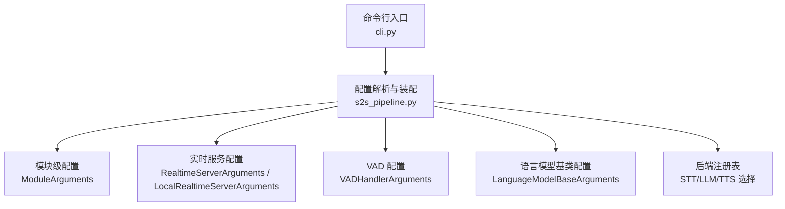
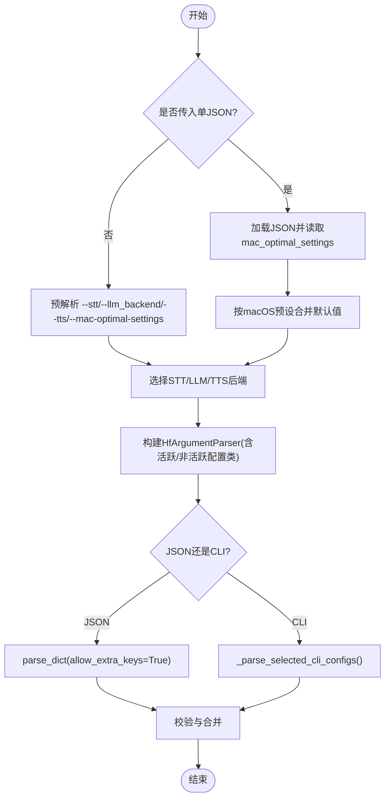
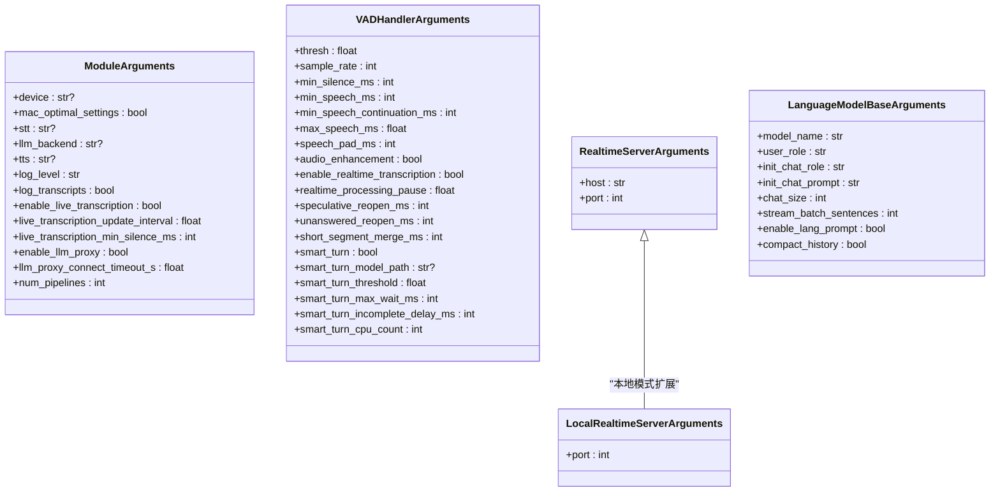
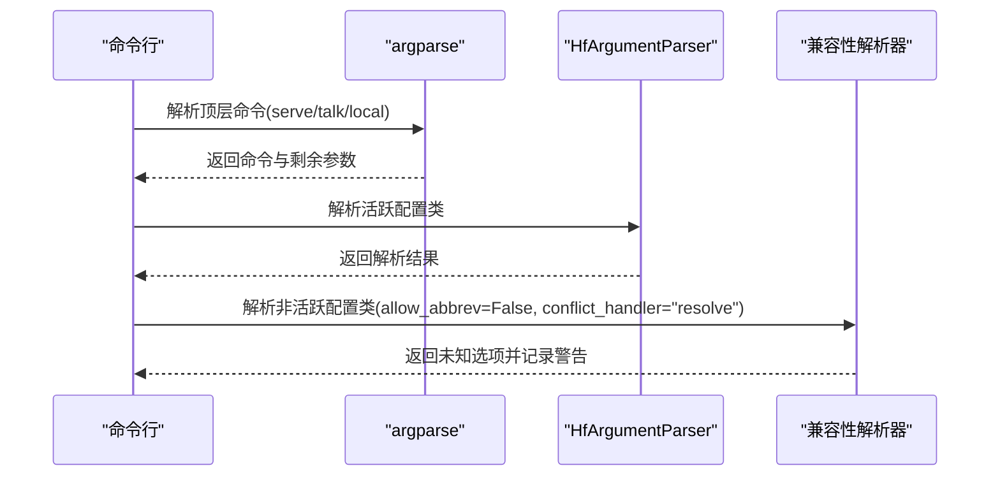
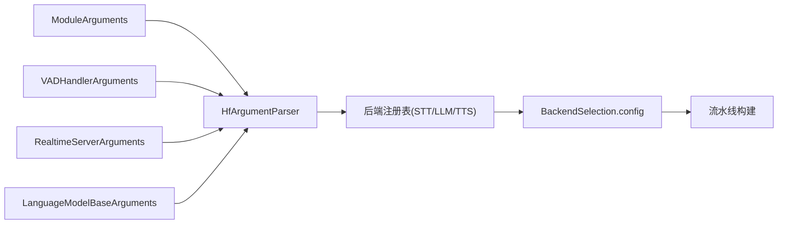

# 配置系统

<cite>
**本文引用的文件**
- [s2s_pipeline.py](file://src/speech_to_speech/s2s_pipeline.py)
- [cli.py](file://src/speech_to_speech/cli.py)
- [module_arguments.py](file://src/speech_to_speech/arguments_classes/module_arguments.py)
- [vad_arguments.py](file://src/speech_to_speech/arguments_classes/vad_arguments.py)
- [realtime_server_arguments.py](file://src/speech_to_speech/arguments_classes/realtime_server_arguments.py)
- [language_model_base_arguments.py](file://src/speech_to_speech/arguments_classes/language_model_base_arguments.py)
</cite>

## 目录
1. [简介](#简介)
2. [项目结构](#项目结构)
3. [核心组件](#核心组件)
4. [架构总览](#架构总览)
5. [详细组件分析](#详细组件分析)
6. [依赖关系分析](#依赖关系分析)
7. [性能考虑](#性能考虑)
8. [故障排查指南](#故障排查指南)
9. [结论](#结论)
10. [附录](#附录)

## 简介
本文件系统化说明该语音到语音项目的配置系统，重点覆盖：
- HfArgumentParser 的使用方式与参数解析流程
- 配置类的继承结构与字段定义（ModuleArguments、VADHandlerArguments 等）
- 命令行参数解析过程（类型转换、冲突处理、兼容性处理）
- JSON 配置文件支持（合并策略、macOS 预设注入）
- 配置验证机制（后端选择校验、设备限制、依赖关系检查）
- 平台特定配置（macOS 优化设置与设备检测）
- 最佳实践（组织、版本兼容与安全）
- 调试工具与常见问题解决方案

## 项目结构
配置系统围绕以下关键模块组织：
- 入口与命令分发：cli.py
- 配置解析与流水线装配：s2s_pipeline.py
- 通用与专用配置类：arguments_classes/*（如 module_arguments.py、vad_arguments.py、realtime_server_arguments.py、language_model_base_arguments.py）



图表来源
- [cli.py:26-95](file://src/speech_to_speech/cli.py#L26-L95)
- [s2s_pipeline.py:175-285](file://src/speech_to_speech/s2s_pipeline.py#L175-L285)
- [module_arguments.py:12-105](file://src/speech_to_speech/arguments_classes/module_arguments.py#L12-L105)
- [realtime_server_arguments.py:4-25](file://src/speech_to_speech/arguments_classes/realtime_server_arguments.py#L4-L25)
- [vad_arguments.py:4-116](file://src/speech_to_speech/arguments_classes/vad_arguments.py#L4-L116)
- [language_model_base_arguments.py:4-47](file://src/speech_to_speech/arguments_classes/language_model_base_arguments.py#L4-L47)

章节来源
- [cli.py:26-95](file://src/speech_to_speech/cli.py#L26-L95)
- [s2s_pipeline.py:175-285](file://src/speech_to_speech/s2s_pipeline.py#L175-L285)

## 核心组件
- ModuleArguments：全局模块级配置，包含设备、日志级别、是否启用代理、并发管线数、实时转录开关等。
- VADHandlerArguments：语音活动检测器参数，包括阈值、采样率、静音/语音时长、Smart Turn 相关参数等。
- RealtimeServerArguments / LocalRealtimeServerArguments：实时服务监听地址与端口。
- LanguageModelBaseArguments：语言模型通用配置，如模型名、角色、初始提示、聊天历史大小、流式批句数等。

这些配置通过 HfArgumentParser 统一解析并组合为 ParsedArguments，随后用于构建后端处理器与流水线。

章节来源
- [module_arguments.py:12-105](file://src/speech_to_speech/arguments_classes/module_arguments.py#L12-L105)
- [vad_arguments.py:4-116](file://src/speech_to_speech/arguments_classes/vad_arguments.py#L4-L116)
- [realtime_server_arguments.py:4-25](file://src/speech_to_speech/arguments_classes/realtime_server_arguments.py#L4-L25)
- [language_model_base_arguments.py:4-47](file://src/speech_to_speech/arguments_classes/language_model_base_arguments.py#L4-L47)

## 架构总览
配置系统以“命令分发 → 预解析 → 动态选择后端 → HfArgumentParser 解析 → 校验与合并 → 构建流水线”为主线。

```mermaid
sequenceDiagram
participant U as "用户"
participant CLI as "cli.py"
participant PIPE as "s2s_pipeline.py"
participant PAR as "HfArgumentParser"
participant REG as "后端注册表"
participant CFG as "配置对象"
U->>CLI : 执行命令(serve/talk/local)
CLI->>PIPE : 转发子命令与参数
PIPE->>REG : 根据 --stt/--llm_backend/--tts 选择后端
PIPE->>PAR : 组装参数类列表并解析
PAR-->>PIPE : 返回各配置实例
PIPE->>CFG : 合并JSON/CLI、应用macOS预设、设备覆盖
PIPE->>PIPE : 运行校验(设备/能力/依赖)
PIPE-->>U : 返回已验证的配置并启动流水线
```

图表来源
- [cli.py:26-95](file://src/speech_to_speech/cli.py#L26-L95)
- [s2s_pipeline.py:175-285](file://src/speech_to_speech/s2s_pipeline.py#L175-L285)
- [s2s_pipeline.py:309-352](file://src/speech_to_speech/s2s_pipeline.py#L309-L352)

## 详细组件分析

### HfArgumentParser 使用与参数解析流程
- 动态参数类集合：根据所选 STT/LLM/TTS 后端，将对应配置类加入解析器。
- 兼容模式：对未激活后端的选项进行“已知但忽略”的处理，避免报错。
- JSON 支持：若传入单个 .json 路径，则加载为字典并使用 parse_dict 解析，允许额外键。
- macOS 预设：当检测到 mac_optimal_settings 时，自动注入一组默认值（如 stt=parakeet-tdt、llm_backend=mlx-lm、tts=qwen3、设备=mmps）。
- 冲突解决：通过兼容性解析器与 allow_abbrev=False、conflict_handler="resolve" 抑制未知或重复选项的歧义。



图表来源
- [s2s_pipeline.py:175-285](file://src/speech_to_speech/s2s_pipeline.py#L175-L285)
- [s2s_pipeline.py:135-172](file://src/speech_to_speech/s2s_pipeline.py#L135-L172)

章节来源
- [s2s_pipeline.py:135-172](file://src/speech_to_speech/s2s_pipeline.py#L135-L172)
- [s2s_pipeline.py:175-285](file://src/speech_to_speech/s2s_pipeline.py#L175-L285)

### 配置类与继承结构
- ModuleArguments：提供全局设备、日志级别、实时转录开关、LLM 代理开关与超时、并发管线数等。
- VADHandlerArguments：提供 VAD 阈值、采样率、静音/语音时长、Smart Turn 行为控制等。
- RealtimeServerArguments / LocalRealtimeServerArguments：服务监听 host/port。
- LanguageModelBaseArguments：模型名、角色、初始提示、聊天历史大小、流式批句数、语言提示开关、历史压缩开关。



图表来源
- [module_arguments.py:12-105](file://src/speech_to_speech/arguments_classes/module_arguments.py#L12-L105)
- [vad_arguments.py:4-116](file://src/speech_to_speech/arguments_classes/vad_arguments.py#L4-L116)
- [realtime_server_arguments.py:4-25](file://src/speech_to_speech/arguments_classes/realtime_server_arguments.py#L4-L25)
- [language_model_base_arguments.py:4-47](file://src/speech_to_speech/arguments_classes/language_model_base_arguments.py#L4-L47)

章节来源
- [module_arguments.py:12-105](file://src/speech_to_speech/arguments_classes/module_arguments.py#L12-L105)
- [vad_arguments.py:4-116](file://src/speech_to_speech/arguments_classes/vad_arguments.py#L4-L116)
- [realtime_server_arguments.py:4-25](file://src/speech_to_speech/arguments_classes/realtime_server_arguments.py#L4-L25)
- [language_model_base_arguments.py:4-47](file://src/speech_to_speech/arguments_classes/language_model_base_arguments.py#L4-L47)

### 命令行参数解析过程（类型转换、冲突解决、兼容性）
- 类型转换：由 argparse/HfArgumentParser 负责，如 int、float、bool 等。
- 冲突解决：对未激活后端的选项使用兼容性解析器，仅记录警告并忽略。
- 兼容性：保留旧版 --mode 的迁移逻辑，提示弃用并映射到新命令。



图表来源
- [cli.py:26-95](file://src/speech_to_speech/cli.py#L26-L95)
- [s2s_pipeline.py:135-172](file://src/speech_to_speech/s2s_pipeline.py#L135-L172)

章节来源
- [cli.py:26-95](file://src/speech_to_speech/cli.py#L26-L95)
- [s2s_pipeline.py:135-172](file://src/speech_to_speech/s2s_pipeline.py#L135-L172)

### JSON 配置文件支持（合并、环境变量注入、模板替换）
- 支持方式：当传入单个 .json 路径时，作为配置源加载并通过 parse_dict 解析，允许额外键。
- 合并策略：若开启 mac_optimal_settings，则以 macOS 预设默认值为基础，再与 JSON 内容合并（JSON 可覆盖预设）。
- 环境变量注入与模板替换：当前实现中未发现显式的环境变量注入或模板替换逻辑；如需扩展，可在解析前后增加相应步骤。

章节来源
- [s2s_pipeline.py:175-285](file://src/speech_to_speech/s2s_pipeline.py#L175-L285)

### 配置验证机制（必填字段、范围验证、依赖关系）
- 后端选择校验：确保 stt/llm_backend/tts 在注册表中存在，否则抛出错误。
- 依赖关系检查：
  - 若 stt=none，则要求 LLM 后端支持音频输入，否则报错。
  - 若启用 llm proxy，则要求 LLM 后端支持代理能力，否则报错。
- 设备限制：macOS 上禁止使用 CUDA，推荐 mlx-lm 与指定 TTS 后端。
- 并发与性能：num_pipelines 必须 ≥ 1；多管线且 macOS 下会禁用实时转录以避免 MLX 锁竞争。

章节来源
- [s2s_pipeline.py:211-222](file://src/speech_to_speech/s2s_pipeline.py#L211-L222)
- [s2s_pipeline.py:309-352](file://src/speech_to_speech/s2s_pipeline.py#L309-L352)
- [s2s_pipeline.py:628-655](file://src/speech_to_speech/s2s_pipeline.py#L628-L655)

### 平台特定配置（macOS 优化与设备检测）
- macOS 预设：自动设置 stt=parakeet-tdt、llm_backend=mlx-lm、tts=qwen3，并将相关设备设为 mps；若 LLM 后端非 responses-api/chat-completions，还会设置 llm_device=mps，并在 mlx-lm 时设置默认模型名。
- 设备检测：macOS 上拒绝 cuda；建议 mlx-lm 与 qwen3/pocket/kokoro/omnivoice 等 TTS。
- 多管线优化：Apple Silicon 上多管线时关闭实时转录以减少 MLX 锁争用。

章节来源
- [s2s_pipeline.py:81-97](file://src/speech_to_speech/s2s_pipeline.py#L81-L97)
- [s2s_pipeline.py:309-352](file://src/speech_to_speech/s2s_pipeline.py#L309-L352)
- [s2s_pipeline.py:643-655](file://src/speech_to_speech/s2s_pipeline.py#L643-L655)

### 最佳实践（组织、版本兼容、安全）
- 组织建议：
  - 使用 JSON 集中管理复杂配置，结合 mac_optimal_settings 快速适配 macOS。
  - 通过 --stt/--llm_backend/--tts 明确选择后端，减少歧义。
- 版本兼容：
  - 保留对旧 --mode 的兼容提示，逐步迁移至 serve/local 命令。
  - 对不活跃后端的选项保持“已知但忽略”，避免升级中断。
- 安全考虑：
  - 暴露 llm proxy 仅在可信网络或网关后进行。
  - 谨慎开启 log_transcripts，避免会话内容长期留存于日志系统。
  - 明确监听 host（默认 127.0.0.1），避免意外外网暴露。

章节来源
- [s2s_pipeline.py:175-285](file://src/speech_to_speech/s2s_pipeline.py#L175-L285)
- [s2s_pipeline.py:628-655](file://src/speech_to_speech/s2s_pipeline.py#L628-L655)
- [module_arguments.py:49-88](file://src/speech_to_speech/arguments_classes/module_arguments.py#L49-L88)

## 依赖关系分析
- 配置类与解析器：HfArgumentParser 依据选择的后端动态装载配置类，形成“活跃/非活跃”两类参数集。
- 后端注册表：STT/LLM/TTS 的后端名称与配置类型一一对应，解析后通过 normalize 生成最终配置。
- 运行时影响：配置决定设备、并发、代理、实时转录等行为，直接影响流水线构建与性能。



图表来源
- [s2s_pipeline.py:175-285](file://src/speech_to_speech/s2s_pipeline.py#L175-L285)
- [s2s_pipeline.py:354-458](file://src/speech_to_speech/s2s_pipeline.py#L354-L458)

章节来源
- [s2s_pipeline.py:175-285](file://src/speech_to_speech/s2s_pipeline.py#L175-L285)
- [s2s_pipeline.py:354-458](file://src/speech_to_speech/s2s_pipeline.py#L354-L458)

## 性能考虑
- 多管线并发：num_pipelines 控制隔离的流水线数量，影响最大并发 WebSocket 会话数。
- 实时转录：在 Apple Silicon 多管线场景下自动关闭，避免 MLX 锁争用导致的日志风暴。
- 编译缓存：设置 torch inductor 缓存目录以提升编译速度。
- 设备选择：macOS 优先使用 MPS；合理设置设备可降低延迟与内存占用。

章节来源
- [s2s_pipeline.py:68-72](file://src/speech_to_speech/s2s_pipeline.py#L68-L72)
- [s2s_pipeline.py:643-655](file://src/speech_to_speech/s2s_pipeline.py#L643-L655)

## 故障排查指南
- 常见错误与定位
  - 不支持的后端：检查 --stt/--llm_backend/--tts 是否在注册表中。
  - macOS 设备错误：避免使用 cuda，改用 cpu 或 mps。
  - 依赖缺失：stt=none 需配合支持音频输入的 LLM 后端；启用 llm proxy 需后端具备代理能力。
  - 多管线与实时转录：Apple Silicon 上多管线会自动关闭实时转录，属预期行为。
- 调试建议
  - 提高日志级别：使用 --log_level debug 获取更详细信息。
  - 启用转录日志：谨慎使用 --log_transcripts，便于追踪 STT/LLM/TTS 流程。
  - 使用 JSON 配置：便于复现实验与对比不同参数组合。

章节来源
- [s2s_pipeline.py:211-222](file://src/speech_to_speech/s2s_pipeline.py#L211-L222)
- [s2s_pipeline.py:309-352](file://src/speech_to_speech/s2s_pipeline.py#L309-L352)
- [s2s_pipeline.py:628-655](file://src/speech_to_speech/s2s_pipeline.py#L628-L655)

## 结论
该配置系统通过 HfArgumentParser 实现了灵活、可扩展的参数解析与验证，结合后端注册表与平台预设，提供了良好的易用性与健壮性。建议在复杂部署中使用 JSON 配置并结合 macOS 预设快速适配；在生产环境中注意日志安全与网络暴露面控制；在多管线与 Apple Silicon 环境下遵循性能优化建议以获得稳定体验。

## 附录
- 常用命令参考
  - serve：运行实时服务
  - talk：连接麦克风与扬声器到远程实时端点
  - local：在同一机器上同时运行服务与客户端（回环）
- 关键参数速览
  - 模块级：device、mac_optimal_settings、stt、llm_backend、tts、log_level、log_transcripts、enable_live_transcription、enable_llm_proxy、llm_proxy_connect_timeout_s、num_pipelines
  - VAD：thresh、sample_rate、min_silence_ms、min_speech_ms、smart_turn_* 系列
  - 服务：host、port

章节来源
- [cli.py:26-95](file://src/speech_to_speech/cli.py#L26-L95)
- [module_arguments.py:12-105](file://src/speech_to_speech/arguments_classes/module_arguments.py#L12-L105)
- [vad_arguments.py:4-116](file://src/speech_to_speech/arguments_classes/vad_arguments.py#L4-L116)
- [realtime_server_arguments.py:4-25](file://src/speech_to_speech/arguments_classes/realtime_server_arguments.py#L4-L25)