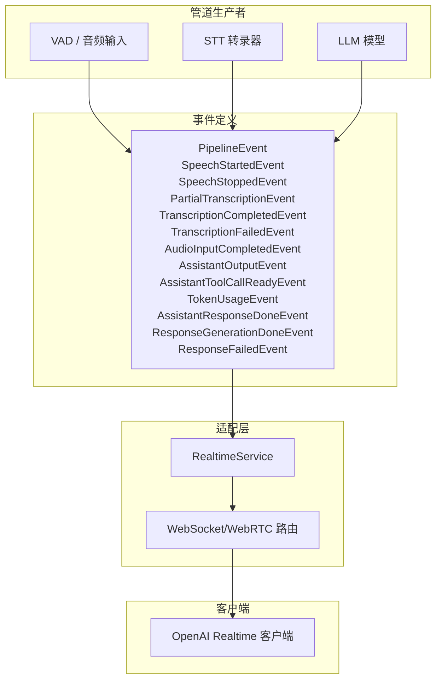
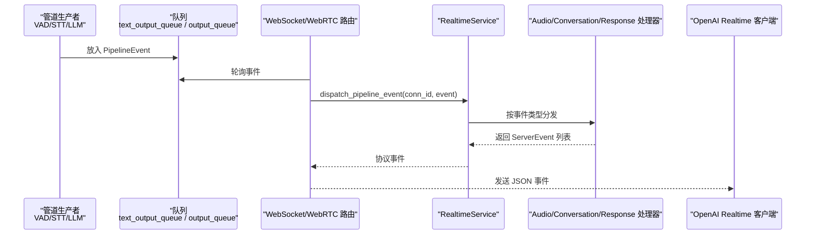
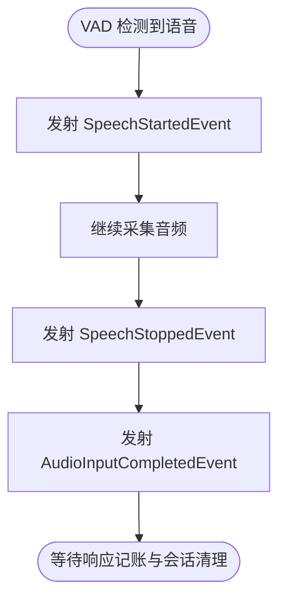
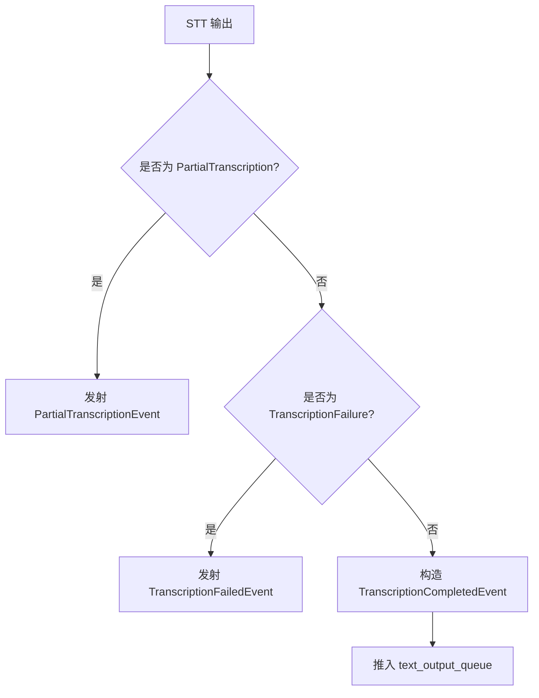
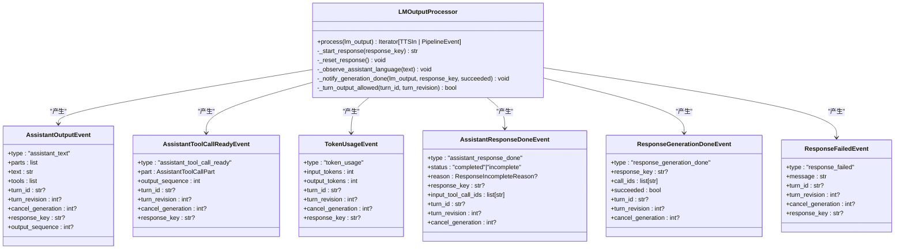
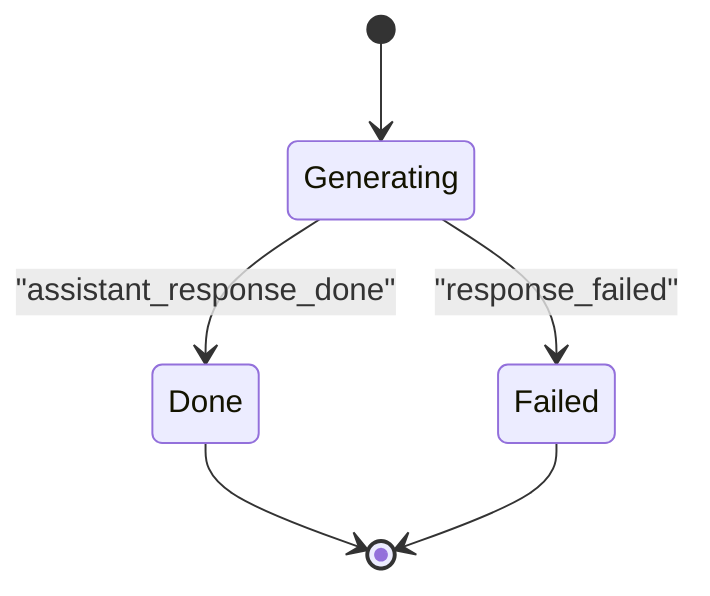
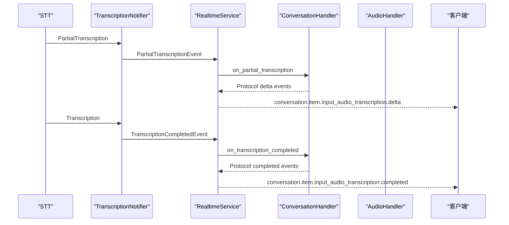
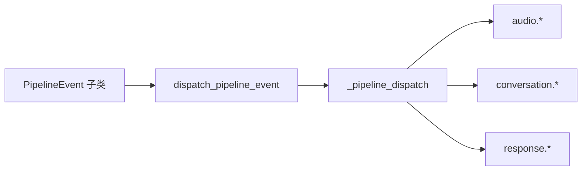
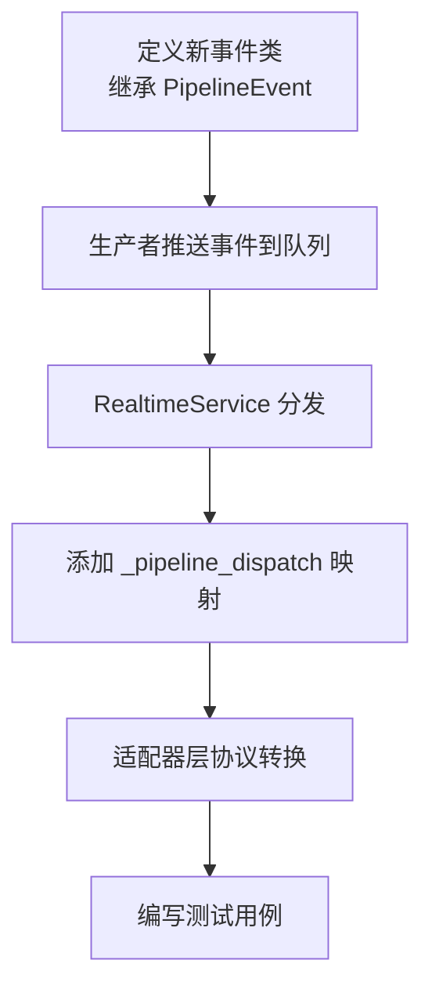

# 事件系统

<cite>
**本文引用的文件**   
- [events.py](file://src/speech_to_speech/pipeline/events.py)
- [service.py](file://src/speech_to_speech/api/openai_realtime/service.py)
- [websocket_router.py](file://src/speech_to_speech/api/openai_realtime/websocket_router.py)
- [transcription_notifier.py](file://src/speech_to_speech/STT/transcription_notifier.py)
- [lm_output_processor.py](file://src/speech_to_speech/LLM/lm_output_processor.py)
- [test_streaming_stt_handler.py](file://tests/test_streaming_stt_handler.py)
</cite>

## 目录
1. [引言](#引言)
2. [项目结构与事件入口](#项目结构与事件入口)
3. [核心事件类型总览](#核心事件类型总览)
4. [架构总览与数据流](#架构总览与数据流)
5. [详细组件分析](#详细组件分析)
6. [OpenAI Realtime 协议映射](#openai-realtime-协议映射)
7. [依赖关系分析](#依赖关系分析)
8. [性能与生命周期特性](#性能与生命周期特性)
9. [故障排查指南](#故障排查指南)
10. [扩展自定义事件类型](#扩展自定义事件类型)
11. [结论](#结论)

## 引言
本技术文档聚焦于语音到语音管道中的“事件系统”。该系统将 VAD、STT、LLM、TTS 等模块产生的内部事件统一抽象为协议无关的 `PipelineEvent`，再由 OpenAI Realtime 适配层转换为客户端可见的实时协议事件。文档覆盖以下事件类别：
- 语音活动检测事件：`SpeechStartedEvent`、`SpeechStoppedEvent`
- 转录事件：`PartialTranscriptionEvent`、`TranscriptionCompletedEvent`、`TranscriptionFailedEvent`
- 音频输入事件：`AudioInputCompletedEvent`
- LLM 输出事件：`AssistantOutputEvent`、`AssistantToolCallReadyEvent`、`TokenUsageEvent`、`AssistantResponseDoneEvent`
- 响应管理事件：`ResponseGenerationDoneEvent`、`ResponseFailedEvent`

读者可据此理解每个事件的字段含义、使用场景、数据流向、生命周期、与 OpenAI Realtime 协议的映射关系，以及如何扩展自定义事件类型。

## 项目结构与事件入口
事件系统的核心定义位于管道事件模块；事件的生产者包括 STT 转录通知器、LLM 输出处理器以及 VAD/音频输入路径；事件的消费者是 OpenAI Realtime 服务与 WebSocket/WebRTC 路由。

**图表来源**
- [events.py:26-228](file://src/speech_to_speech/pipeline/events.py#L26-L228)
- [service.py:393-403](file://src/speech_to_speech/api/openai_realtime/service.py#L393-L403)
- [websocket_router.py:41-54](file://src/speech_to_speech/api/openai_realtime/websocket_router.py#L41-L54)

**章节来源**
- [events.py:1-228](file://src/speech_to_speech/pipeline/events.py#L1-L228)
- [service.py:355-403](file://src/speech_to_speech/api/openai_realtime/service.py#L355-L403)
- [websocket_router.py:392-511](file://src/speech_to_speech/api/openai_realtime/websocket_router.py#L392-L511)

## 核心事件类型总览
所有事件继承自 `PipelineEvent`，通过 `type` 字段作为 Pydantic 判别器。事件按来源分为三类：
- VAD 与直接音频事件：用于标记用户说话起止、最终音频输入完成。
- STT 转录事件：用于流式与终态转录结果。
- LLM 输出与响应管理事件：用于有序助手文本、工具调用、用量统计、响应完成或失败。

| 事件类 | type 值 | 主要字段 | 用途 | 典型生产者 | 典型消费者 |
|---|---|---|---|---|---|
| `SpeechStartedEvent` | `speech_started` | `audio_start_ms`、`turn_id`、`turn_revision`、`reopened`、`interrupt_response` | 标记用户开始说话，可能打断当前响应 | VAD | `RealtimeService.audio.on_speech_started` |
| `SpeechStoppedEvent` | `speech_stopped` | `duration_s`、`audio_end_ms`、`turn_id`、`turn_revision` | 标记用户停止说话，携带时长与时间戳 | VAD | `RealtimeService.audio.on_speech_stopped` |
| `PartialTranscriptionEvent` | `partial_transcription` | `delta`、`turn_id`、`turn_revision` | 流式转录增量（内部累积假设） | STT → `TranscriptionNotifier` | `RealtimeService.conversation.on_partial_transcription` |
| `TranscriptionCompletedEvent` | `transcription_completed` | `transcript`、`speaker_attribution`、`language_code`、`turn_id`、`turn_revision`、`speech_stopped_at_s` | 最终转录结果，触发对话项创建与 LLM 请求 | STT → `TranscriptionNotifier` | `_on_transcription_completed` |
| `TranscriptionFailedEvent` | `transcription_failed` | `message`、`turn_id`、`turn_revision` | 转录失败，不创建对话项 | STT → `TranscriptionNotifier` | `_on_transcription_failed` |
| `AudioInputCompletedEvent` | `audio_input_completed` | `audio`、`audio_sample_rate`、`audio_duration_s`、`turn_id`、`turn_revision`、`speech_stopped_at_s` | 最终音频输入，等待响应记账与会话状态清理 | VAD/音频输入 | `_on_audio_input_completed` |
| `AssistantOutputEvent` | `assistant_text` | `parts`、`text`、`tools`、`turn_id`、`turn_revision`、`cancel_generation`、`response_key`、`output_sequence` | 有序助手输出，等待 TTS 序列化 | LLM → `LMOutputProcessor` | `RealtimeService.response.on_assistant_output` |
| `AssistantToolCallReadyEvent` | `assistant_tool_call_ready` | `part`、`output_sequence`、`turn_id`、`turn_revision`、`cancel_generation`、`response_key` | 工具调用参数提前暴露，允许客户端执行工具 | LLM → `LMOutputProcessor` | `RealtimeService.response.on_assistant_tool_call_ready` |
| `TokenUsageEvent` | `token_usage` | `input_tokens`、`output_tokens`、`turn_id`、`turn_revision`、`cancel_generation`、`response_key` | 用量统计，按 response_key 聚合 | LLM → `LMOutputProcessor` | `_on_token_usage` |
| `AssistantResponseDoneEvent` | `assistant_response_done` | `status`、`reason`、`response_key`、`input_tool_call_ids`、`turn_id`、`turn_revision`、`cancel_generation` | 有序输出完成，携带工具结果集合 | LLM → `LMOutputProcessor` | `RealtimeService.response.on_assistant_response_done` |
| `ResponseGenerationDoneEvent` | `response_generation_done` | `response_key`、`call_ids`、`succeeded`、`turn_id`、`turn_revision`、`cancel_generation` | 内部信号：LLM 生成结束，供后续 follow-up 预取 | LLM → `LMOutputProcessor` | `RealtimeService.response.on_response_generation_done` |
| `ResponseFailedEvent` | `response_failed` | `message`、`turn_id`、`turn_revision`、`cancel_generation`、`response_key` | 响应无法生成（如无效上下文），关闭响应并上报错误 | LLM → `LMOutputProcessor` | `_on_response_failed` |

**章节来源**
- [events.py:26-228](file://src/speech_to_speech/pipeline/events.py#L26-L228)

## 架构总览与数据流
事件从管道侧进入 `RealtimeService`，再根据事件类型分发到具体处理器。关键流程如下：

**图表来源**
- [websocket_router.py:531-634](file://src/speech_to_speech/api/openai_realtime/websocket_router.py#L531-L634)
- [service.py:610-669](file://src/speech_to_speech/api/openai_realtime/service.py#L610-L669)

**章节来源**
- [websocket_router.py:531-634](file://src/speech_to_speech/api/openai_realtime/websocket_router.py#L531-L634)
- [service.py:610-669](file://src/speech_to_speech/api/openai_realtime/service.py#L610-L669)

## 详细组件分析

### VAD 与音频输入事件
- `SpeechStartedEvent`：包含说话起始时间、会话轮次标识、是否重新打开、是否中断当前响应等字段。用于在客户端侧同步语音缓冲区的“开始”状态。
- `SpeechStoppedEvent`：包含说话时长、结束时间、轮次标识。用于关闭语音缓冲区“停止”状态并参与延迟统计。
- `AudioInputCompletedEvent`：包含原始音频数组、采样率、时长、轮次与说话停止时间点。用于记录最终输入音频并在无 STT 模式下保留为聊天消息。

**图表来源**
- [events.py:39-54](file://src/speech_to_speech/pipeline/events.py#L39-L54)
- [events.py:92-104](file://src/speech_to_speech/pipeline/events.py#L92-L104)

**章节来源**
- [events.py:39-54](file://src/speech_to_speech/pipeline/events.py#L39-L54)
- [events.py:92-104](file://src/speech_to_speech/pipeline/events.py#L92-L104)

### 转录事件
`TranscriptionNotifier` 将 STT 输出的中间结果和终态结果转换为管道事件：
- `PartialTranscriptionEvent`：每次流式转录结果都推入 `text_output_queue`，携带累积文本与轮次信息。
- `TranscriptionCompletedEvent`：最终转录结果，携带转写文本、说话人归属、语言代码、轮次与说话停止时间点。
- `TranscriptionFailedEvent`：转录失败时携带错误消息与轮次。

**图表来源**
- [transcription_notifier.py:42-107](file://src/speech_to_speech/STT/transcription_notifier.py#L42-L107)

**章节来源**
- [transcription_notifier.py:26-122](file://src/speech_to_speech/STT/transcription_notifier.py#L26-L122)
- [events.py:59-87](file://src/speech_to_speech/pipeline/events.py#L59-L87)

### LLM 输出事件
`LMOutputProcessor` 负责保持 LLM 输出顺序，并将文本、工具调用、用量统计与响应结束事件发送到 TTS 输出队列或文本事件通道：
- `AssistantOutputEvent`：有序助手输出，包含文本片段、工具列表、轮次、序列号、响应键等。
- `AssistantToolCallReadyEvent`：工具调用参数提前暴露，允许客户端在执行工具的同时继续合成语音。
- `TokenUsageEvent`：用量统计，按 response_key 聚合。
- `AssistantResponseDoneEvent`：有序输出完成，携带状态、原因、输入工具调用 ID 集合。
- `ResponseGenerationDoneEvent`：内部信号，表示 LLM 生成结束，供后续 follow-up 预取。
- `ResponseFailedEvent`：响应失败，携带错误消息与轮次。

**图表来源**
- [lm_output_processor.py:44-308](file://src/speech_to_speech/LLM/lm_output_processor.py#L44-L308)
- [events.py:109-228](file://src/speech_to_speech/pipeline/events.py#L109-L228)

**章节来源**
- [lm_output_processor.py:44-308](file://src/speech_to_speech/LLM/lm_output_processor.py#L44-L308)
- [events.py:109-228](file://src/speech_to_speech/pipeline/events.py#L109-L228)

### 响应管理事件
- `ResponseGenerationDoneEvent`：内部信号，不在客户端可见。用于让服务器安全地预计算 follow-up 工作。
- `ResponseFailedEvent`：当响应无法生成时，服务会关闭进行中的响应并以 `status="failed"` 上报错误。

**图表来源**
- [events.py:191-228](file://src/speech_to_speech/pipeline/events.py#L191-L228)
- [service.py:1006-1044](file://src/speech_to_speech/api/openai_realtime/service.py#L1006-L1044)

**章节来源**
- [events.py:191-228](file://src/speech_to_speech/pipeline/events.py#L191-L228)
- [service.py:1006-1044](file://src/speech_to_speech/api/openai_realtime/service.py#L1006-L1044)

## OpenAI Realtime 协议映射
`RealtimeService` 维护一个事件类型到处理器的映射，将内部 `PipelineEvent` 转换为 OpenAI Realtime 协议事件。例如：
- `SpeechStartedEvent` → `InputAudioBufferSpeechStartedEvent`
- `SpeechStoppedEvent` → `InputAudioBufferSpeechStoppedEvent`
- `PartialTranscriptionEvent` → `ConversationItemInputAudioTranscriptionDeltaEvent`
- `TranscriptionCompletedEvent` → `ConversationItemInputAudioTranscriptionCompletedEvent`
- `TranscriptionFailedEvent` → `ConversationItemInputAudioTranscriptionFailedEvent`
- `AssistantOutputEvent` → `ResponseTextDeltaEvent` / `ResponseContentPartAddedEvent` / `ResponseOutputItemAddedEvent`
- `AssistantToolCallReadyEvent` → `ResponseFunctionCallArgumentsDoneEvent`
- `TokenUsageEvent` → 用量累计，不直接对外暴露
- `AssistantResponseDoneEvent` → `ResponseOutputItemDoneEvent` / `ResponseDoneEvent`
- `ResponseGenerationDoneEvent` → 内部信号，不对外暴露
- `ResponseFailedEvent` → `error` 事件 + `ResponseDoneEvent(status="failed")`

**图表来源**
- [service.py:393-403](file://src/speech_to_speech/api/openai_realtime/service.py#L393-L403)
- [service.py:798-873](file://src/speech_to_speech/api/openai_realtime/service.py#L798-L873)
- [test_streaming_stt_handler.py:387-400](file://tests/test_streaming_stt_handler.py#L387-L400)

**章节来源**
- [service.py:393-403](file://src/speech_to_speech/api/openai_realtime/service.py#L393-L403)
- [service.py:798-873](file://src/speech_to_speech/api/openai_realtime/service.py#L798-L873)
- [test_streaming_stt_handler.py:387-400](file://tests/test_streaming_stt_handler.py#L387-L400)

## 依赖关系分析
事件系统与适配器之间的耦合点集中在 `RealtimeService.dispatch_pipeline_event` 与 `_pipeline_dispatch` 映射表。该映射将事件类型绑定到具体处理器方法，确保高内聚低耦合。

**图表来源**
- [service.py:393-403](file://src/speech_to_speech/api/openai_realtime/service.py#L393-L403)
- [service.py:610-669](file://src/speech_to_speech/api/openai_realtime/service.py#L610-L669)

**章节来源**
- [service.py:393-403](file://src/speech_to_speech/api/openai_realtime/service.py#L393-L403)
- [service.py:610-669](file://src/speech_to_speech/api/openai_realtime/service.py#L610-L669)

## 性能与生命周期特性
- 事件队列分离：VAD 与转录事件走 `text_output_queue`；LLM 输出与用量事件共享 TTS 输出队列，保证有序性。
- 废弃轮次过滤：服务对过时轮次事件进行丢弃，避免陈旧转录或输出污染当前会话。
- 响应键隔离：用量与输出事件通过 `response_key` 关联到具体响应，支持并发响应与取消。
- 早暴露工具调用：`AssistantToolCallReadyEvent` 允许客户端在 TTS 仍在播放时执行工具，降低端到端延迟。
- 资源清理：连接释放时会清理 pending responses、held items 与 latency anchors，防止跨会话泄漏。

**章节来源**
- [events.py:1-6](file://src/speech_to_speech/pipeline/events.py#L1-L6)
- [service.py:562-594](file://src/speech_to_speech/api/openai_realtime/service.py#L562-L594)
- [websocket_router.py:347-390](file://src/speech_to_speech/api/openai_realtime/websocket_router.py#L347-L390)

## 故障排查指南
常见问题与定位要点：
- 转录未触发 LLM：检查 `TranscriptionCompletedEvent` 是否被消费，确认 `create_response_enabled` 与 `queue` 配置。
- 工具调用未暴露：检查 `AssistantToolCallReadyEvent` 是否发出，确认 `output_sequence` 与 `response_key` 是否正确。
- 响应失败：查看 `ResponseFailedEvent.message` 与服务日志，确认是否因无效上下文或空上下文导致。
- 用量统计异常：核对 `TokenUsageEvent.response_key` 与 `pending_token_usage` 聚合逻辑。
- 连接释放后仍有输出：检查 `_release_session` 与 `_clean_unit` 是否保留了必要控制消息与用量事件。

**章节来源**
- [service.py:965-1004](file://src/speech_to_speech/api/openai_realtime/service.py#L965-L1004)
- [service.py:1006-1044](file://src/speech_to_speech/api/openai_realtime/service.py#L1006-L1044)
- [websocket_router.py:347-390](file://src/speech_to_speech/api/openai_realtime/websocket_router.py#L347-L390)

## 扩展自定义事件类型
若需扩展自定义事件类型，建议遵循以下步骤：
1. 在 `events.py` 中新增继承自 `PipelineEvent` 的事件类，设置稳定的 `type` 字面量。
2. 在生产者处构造并推送该事件到对应队列（`text_output_queue` 或 TTS 输出队列）。
3. 在 `RealtimeService._pipeline_dispatch` 中添加事件类型到处理器的映射。
4. 在 `dispatch_pipeline_event` 中增加特殊分支（如需），处理历史提交错误或状态校验。
5. 在适配器层实现协议转换，将内部事件映射为 OpenAI Realtime 协议事件。
6. 更新测试用例，验证事件序列、协议字段与生命周期行为。

**图表来源**
- [events.py:26-34](file://src/speech_to_speech/pipeline/events.py#L26-L34)
- [service.py:393-403](file://src/speech_to_speech/api/openai_realtime/service.py#L393-L403)
- [service.py:610-669](file://src/speech_to_speech/api/openai_realtime/service.py#L610-L669)

**章节来源**
- [events.py:26-34](file://src/speech_to_speech/pipeline/events.py#L26-L34)
- [service.py:393-403](file://src/speech_to_speech/api/openai_realtime/service.py#L393-L403)
- [service.py:610-669](file://src/speech_to_speech/api/openai_realtime/service.py#L610-L669)

## 结论
本事件系统以 `PipelineEvent` 为核心抽象，将 VAD、STT、LLM、TTS 等模块的输出统一为协议无关事件，再通过 `RealtimeService` 转换为 OpenAI Realtime 协议事件。该设计保证了事件的可观测性、有序性与可扩展性，同时提供了完善的生命周期管理与错误处理机制。开发者可基于此框架快速扩展自定义事件类型，并与现有适配器无缝集成。