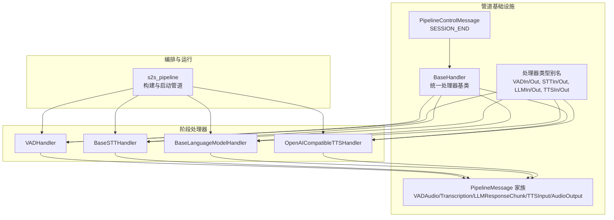
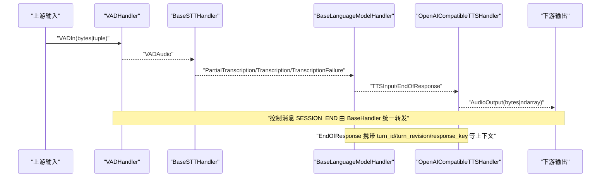
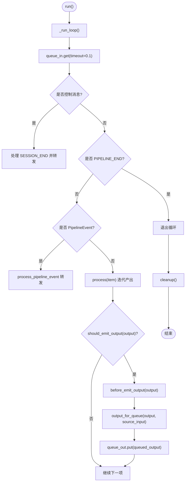
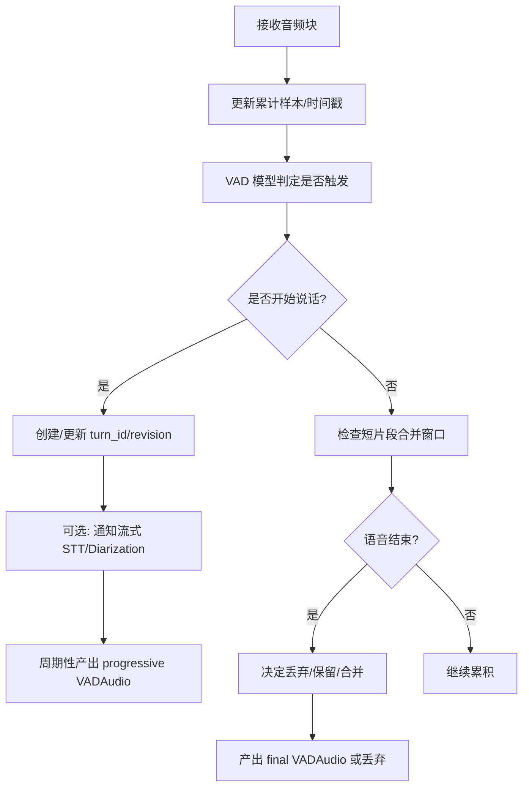
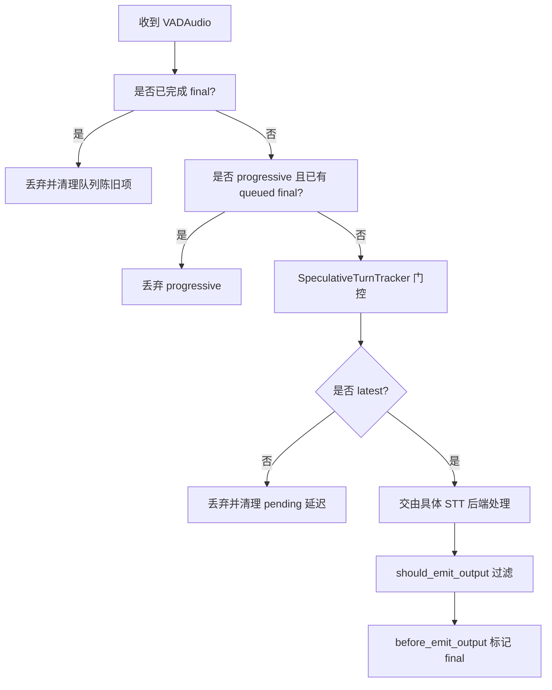
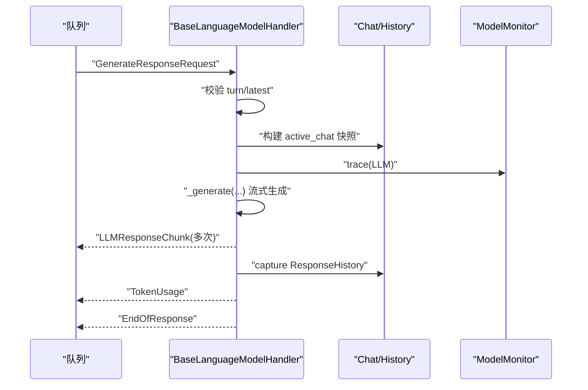
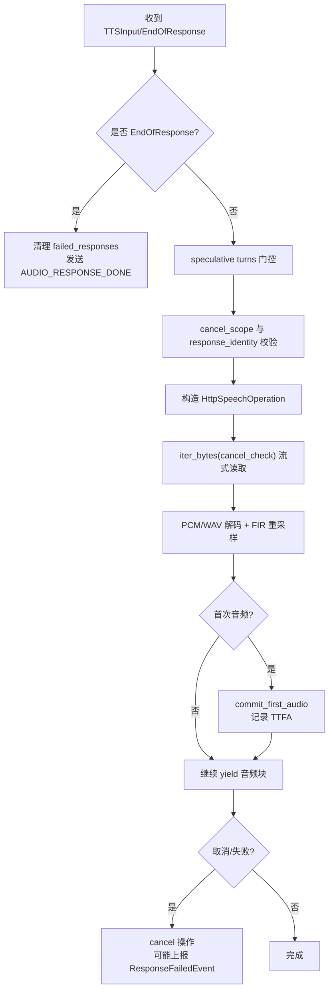
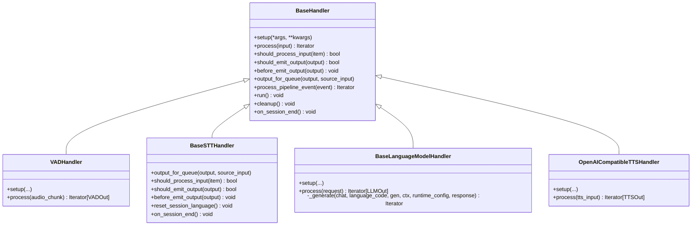

# 处理器接口

<cite>
**本文引用的文件**   
- [baseHandler.py](file://src/speech_to_speech/baseHandler.py)
- [handler_types.py](file://src/speech_to_speech/pipeline/handler_types.py)
- [messages.py](file://src/speech_to_speech/pipeline/messages.py)
- [control.py](file://src/speech_to_speech/pipeline/control.py)
- [vad_handler.py](file://src/speech_to_speech/VAD/vad_handler.py)
- [base_stt_handler.py](file://src/speech_to_speech/STT/base_stt_handler.py)
- [language_model.py](file://src/speech_to_speech/LLM/language_model.py)
- [openai_compatible_handler.py](file://src/speech_to_speech/TTS/openai_compatible_handler.py)
- [s2s_pipeline.py](file://src/speech_to_speech/s2s_pipeline.py)
</cite>

## 目录
1. [引言](#引言)
2. [项目结构](#项目结构)
3. [核心组件](#核心组件)
4. [架构总览](#架构总览)
5. [详细组件分析](#详细组件分析)
6. [依赖关系分析](#依赖关系分析)
7. [性能与并发考虑](#性能与并发考虑)
8. [故障排查指南](#故障排查指南)
9. [结论](#结论)
10. [附录：自定义处理器实现指南](#附录自定义处理器实现指南)

## 引言
本文件面向“语音到语音”管道中的处理器接口，系统性说明处理器类型定义、异步处理模式、错误处理机制、生命周期管理、资源清理策略、处理器链执行顺序、依赖注入方式、上下文传递机制，并给出实现指南、最佳实践和性能建议。文档同时覆盖 VAD、STT、LLM、TTS 四类典型处理器，帮助读者理解如何在同一套 BaseHandler 抽象之上扩展新的后端或中间阶段。

## 项目结构
本项目采用“按功能域 + 分层”的组织方式：
- pipeline 层提供统一的处理器基类、消息模型、控制消息、队列类型等基础设施。
- VAD / STT / LLM / TTS 各自提供具体处理器实现。
- s2s_pipeline 负责组装各阶段处理器、连接队列、启动线程、协调生命周期。

**图表来源**
- [baseHandler.py:32-68](file://src/speech_to_speech/baseHandler.py#L32-L68)
- [messages.py:34-64](file://src/speech_to_speech/pipeline/messages.py#L34-L64)
- [control.py:7-22](file://src/speech_to_speech/pipeline/control.py#L7-L22)
- [handler_types.py:31-45](file://src/speech_to_speech/pipeline/handler_types.py#L31-L45)
- [vad_handler.py:58-88](file://src/speech_to_speech/VAD/vad_handler.py#L58-L88)
- [base_stt_handler.py:16-31](file://src/speech_to_speech/STT/base_stt_handler.py#L16-L31)
- [language_model.py:166-215](file://src/speech_to_speech/LLM/language_model.py#L166-L215)
- [openai_compatible_handler.py:364-421](file://src/speech_to_speech/TTS/openai_compatible_handler.py#L364-L421)
- [s2s_pipeline.py:516-553](file://src/speech_to_speech/s2s_pipeline.py#L516-L553)

**章节来源**
- [baseHandler.py:32-68](file://src/speech_to_speech/baseHandler.py#L32-L68)
- [handler_types.py:31-45](file://src/speech_to_speech/pipeline/handler_types.py#L31-L45)
- [messages.py:34-64](file://src/speech_to_speech/pipeline/messages.py#L34-L64)
- [control.py:7-22](file://src/speech_to_speech/pipeline/control.py#L7-L22)
- [vad_handler.py:58-88](file://src/speech_to_speech/VAD/vad_handler.py#L58-L88)
- [base_stt_handler.py:16-31](file://src/speech_to_speech/STT/base_stt_handler.py#L16-L31)
- [language_model.py:166-215](file://src/speech_to_speech/LLM/language_model.py#L166-L215)
- [openai_compatible_handler.py:364-421](file://src/speech_to_speech/TTS/openai_compatible_handler.py#L364-L421)
- [s2s_pipeline.py:516-553](file://src/speech_to_speech/s2s_pipeline.py#L516-L553)

## 核心组件
- BaseHandler：所有处理器的统一基类，封装输入输出队列、run 主循环、setup/cleanup/on_session_end 生命周期钩子、should_process_input/should_emit_output/before_emit_output/output_for_queue 等扩展点。
- PipelineMessage 家族：VADAudio、PartialTranscription、Transcription、TranscriptionFailure、LLMResponseChunk、TokenUsage、EndOfResponse、TTSInput、AudioOutput 等，作为阶段间数据契约。
- PipelineControlMessage：强类型的控制消息（如 SESSION_END），用于会话级重置与优雅停止。
- 处理器类型别名：VADIn/Out、STTIn/Out、LLMIn/Out、TTSIn/Out，明确每个阶段的输入输出语义。

关键职责划分：
- BaseHandler 负责线程化执行、异常捕获、PIPELINE_END 哨兵、日志与计时。
- 具体处理器实现 process 迭代器，产出下游所需的消息类型。
- 上层 s2s_pipeline 将各处理器通过 Queue 串联，形成 VAD → STT → LLM → TTS 的流水线。

**章节来源**
- [baseHandler.py:32-241](file://src/speech_to_speech/baseHandler.py#L32-L241)
- [messages.py:34-267](file://src/speech_to_speech/pipeline/messages.py#L34-L267)
- [control.py:7-22](file://src/speech_to_speech/pipeline/control.py#L7-L22)
- [handler_types.py:31-45](file://src/speech_to_speech/pipeline/handler_types.py#L31-L45)

## 架构总览
下图展示从音频输入到语音输出的端到端流程，以及控制消息与响应结束信号在管道中的传播路径。

**图表来源**
- [vad_handler.py:565-668](file://src/speech_to_speech/VAD/vad_handler.py#L565-L668)
- [base_stt_handler.py:32-86](file://src/speech_to_speech/STT/base_stt_handler.py#L32-L86)
- [language_model.py:560-765](file://src/speech_to_speech/LLM/language_model.py#L560-L765)
- [openai_compatible_handler.py:451-603](file://src/speech_to_speech/TTS/openai_compatible_handler.py#L451-L603)
- [messages.py:49-267](file://src/speech_to_speech/pipeline/messages.py#L49-L267)

## 详细组件分析

### BaseHandler：处理器基类与生命周期
- 构造参数：stop_event、queue_in、queue_out、setup_args、setup_kwargs。
- setup：子类初始化资源；若抛出异常，会调用 cleanup 再重新抛出。
- run/_run_loop：单线程主循环，周期性从 queue_in 取 item，分派控制消息、事件、业务数据；调用 process 迭代器产出结果，经 should_emit_output/before_emit_output/output_for_queue 处理后入队。
- 生命周期钩子：cleanup、on_session_end。
- 扩展点：should_process_input、should_emit_output、before_emit_output、output_for_queue、process_pipeline_event。
- 错误处理：process 中异常被捕获并通过 log_exception 记录；run finally 确保 PIPELINE_END 入队，避免下游死锁。

**图表来源**
- [baseHandler.py:126-220](file://src/speech_to_speech/baseHandler.py#L126-L220)

**章节来源**
- [baseHandler.py:32-241](file://src/speech_to_speech/baseHandler.py#L32-L241)

### VADHandler：语音活动检测与分段
- 输入：bytes 或 (bytes, RuntimeConfig)。
- 输出：VADAudio，包含 audio、speaker_attribution、runtime_config、mode（progressive/final）、turn_id/turn_revision 等。
- 特性：
  - 支持实时转写快照与流式 STT 对接。
  - 短片段合并窗口，抑制误触发。
  - 与 SpeculativeTurnTracker 协作，维护 turn 的生命周期与重开策略。
  - 可选说话人分离（Diarization）集成。
- 关键流程：
  - 每帧音频进入 iterator 判断是否触发语音。
  - 在活跃语音期间周期性产出 progressive 快照。
  - 语音结束时根据阈值决定是否丢弃、保留或合并短片段。
  - 通过 text_output_queue 发送 SpeechStarted/SpeechStopped 事件。

**图表来源**
- [vad_handler.py:565-800](file://src/speech_to_speech/VAD/vad_handler.py#L565-L800)

**章节来源**
- [vad_handler.py:58-209](file://src/speech_to_speech/VAD/vad_handler.py#L58-L209)
- [vad_handler.py:565-800](file://src/speech_to_speech/VAD/vad_handler.py#L565-L800)

### BaseSTTHandler：转录与推测轮次过滤
- 输入：VADAudio。
- 输出：PartialTranscription、Transcription、TranscriptionFailure。
- 特性：
  - 基于 SpeculativeTurnTracker 对陈旧/非最新 turn 的输入与输出进行过滤。
  - 维护已完成 final revision 的有序集合，限制长度以避免内存增长。
  - 在 output_for_queue 中回填 speaker_attribution。
  - 提供 reset_session_language 与 on_session_end 以清理会话状态。
- 关键逻辑：
  - should_process_input：检查是否已存在 final、是否 progressive 早于 final、是否 latest。
  - should_emit_output：拒绝陈旧输出，必要时丢弃 pending 延迟统计。
  - before_emit_output：标记 completed final revision。

**图表来源**
- [base_stt_handler.py:32-130](file://src/speech_to_speech/STT/base_stt_handler.py#L32-L130)

**章节来源**
- [base_stt_handler.py:16-312](file://src/speech_to_speech/STT/base_stt_handler.py#L16-L312)

### BaseLanguageModelHandler：语言模型生成与会话历史
- 输入：GenerateResponseRequest。
- 输出：LLMResponseChunk、TokenUsage、EndOfResponse。
- 特性：
  - 统一管理 chat、工具调用、文本/工具交错输出。
  - 支持 transformers 与 MLX 后端，封装 _load_model/_generate 抽象。
  - 通过 StreamContext 累积生成状态，支持中断、停止、推测轮次校验。
  - 在 process 中完成 history 快照、工具提取、token 用量上报、错误兜底。
- 关键流程：
  - 校验 turn 是否 latest，否则直接返回 EndOfResponse。
  - 应用 instructions/tools/tool_choice，构建系统提示。
  - 流式消费 token，分批输出句子级 chunk。
  - 最终输出 trailing chunk、TokenUsage、EndOfResponse。

**图表来源**
- [language_model.py:560-765](file://src/speech_to_speech/LLM/language_model.py#L560-L765)

**章节来源**
- [language_model.py:166-215](file://src/speech_to_speech/LLM/language_model.py#L166-L215)
- [language_model.py:560-765](file://src/speech_to_speech/LLM/language_model.py#L560-L765)

### OpenAICompatibleTTSHandler：远程 TTS 流式合成
- 输入：TTSInput 或 EndOfResponse。
- 输出：bytes、np.ndarray、AudioOutput。
- 特性：
  - 支持 PCM/WAV 流式解码、FIR 重采样、块大小切分。
  - 通过 HttpSpeechOperation 封装 HTTP 流式请求，支持取消与超时。
  - 与 CancelScope/SpeculativeTurnTracker 协作，保证响应级别取消与推测轮次一致性。
  - 首次音频到达时记录 TTFA 指标，失败时上报 ResponseFailedEvent。
- 关键流程：
  - 处理 EndOfResponse：清理 failed_responses，发送 AUDIO_RESPONSE_DONE。
  - 校验 speculative turns 与 cancel_scope，构造请求 payload。
  - 流式读取音频字节，解码为块，yield 给下游。
  - 异常路径：规范化错误、记录失败 response identity、发出失败事件。

**图表来源**
- [openai_compatible_handler.py:451-603](file://src/speech_to_speech/TTS/openai_compatible_handler.py#L451-L603)
- [openai_compatible_handler.py:696-800](file://src/speech_to_speech/TTS/openai_compatible_handler.py#L696-L800)

**章节来源**
- [openai_compatible_handler.py:364-421](file://src/speech_to_speech/TTS/openai_compatible_handler.py#L364-L421)
- [openai_compatible_handler.py:451-603](file://src/speech_to_speech/TTS/openai_compatible_handler.py#L451-L603)
- [openai_compatible_handler.py:696-800](file://src/speech_to_speech/TTS/openai_compatible_handler.py#L696-L800)

## 依赖关系分析
- BaseHandler 依赖：
  - pipeline.control.PipelineControlMessage、SESSION_END。
  - pipeline.events.PipelineEvent、TokenUsageEvent。
  - pipeline.messages.AUDIO_RESPONSE_DONE、PIPELINE_END、AudioOutput、EndOfResponse、GenerateResponseRequest、TTSInput。
  - utils.model_monitor.get_model_monitor。
- 各阶段处理器依赖：
  - VADHandler：RuntimeConfig、events、messages、speculative_turns、diarization worker。
  - BaseSTTHandler：speculative_turns、turn_latency_store。
  - BaseLanguageModelHandler：chat/history、tool_call、utils、monitor、speculative_turns。
  - OpenAICompatibleTTSHandler：httpx、scipy.signal、cancel_scope、speculative_turns、turn_latency。

**图表来源**
- [baseHandler.py:32-241](file://src/speech_to_speech/baseHandler.py#L32-L241)
- [vad_handler.py:58-88](file://src/speech_to_speech/VAD/vad_handler.py#L58-L88)
- [base_stt_handler.py:16-312](file://src/speech_to_speech/STT/base_stt_handler.py#L16-L312)
- [language_model.py:166-215](file://src/speech_to_speech/LLM/language_model.py#L166-L215)
- [openai_compatible_handler.py:364-421](file://src/speech_to_speech/TTS/openai_compatible_handler.py#L364-L421)

**章节来源**
- [baseHandler.py:32-241](file://src/speech_to_speech/baseHandler.py#L32-L241)
- [vad_handler.py:58-88](file://src/speech_to_speech/VAD/vad_handler.py#L58-L88)
- [base_stt_handler.py:16-312](file://src/speech_to_speech/STT/base_stt_handler.py#L16-L312)
- [language_model.py:166-215](file://src/speech_to_speech/LLM/language_model.py#L166-L215)
- [openai_compatible_handler.py:364-421](file://src/speech_to_speech/TTS/openai_compatible_handler.py#L364-L421)

## 性能与并发考虑
- 异步与线程模型：
  - BaseHandler.run 使用单线程主循环，通过 queue_in/queue_out 解耦阶段。
  - OpenAICompatibleTTSHandler.HttpSpeechOperation 内部使用独立线程与 asyncio 事件循环进行 HTTP 流式读取，避免阻塞主处理线程。
- 取消与超时：
  - CancelScope 与 cancel_generation 字段贯穿 LLM/TTS，确保用户中断后及时终止生成与网络请求。
  - HttpSpeechOperation 支持 deadline 与 cancelled 标志，超时或取消时抛出规范化错误。
- 推测轮次与陈旧数据处理：
  - SpeculativeTurnTracker 在各阶段被广泛使用，防止旧 turn 的输出污染当前响应。
  - VAD/STT/LLM/TTS 均通过 is_latest/wait_for_gate 做门控。
- 资源清理：
  - BaseHandler.setup 异常时调用 cleanup；run finally 确保 PIPELINE_END 入队。
  - LLM 生成完成后关闭 streamer/线程；TTS 释放 active_operation。
- 指标与监控：
  - ModelMonitor 记录 LLM 输入/输出摘要与 token 数。
  - TurnLatencyStore 记录 TTFT、TTFA、VAD settle 等关键延迟。

[本节为通用指导，不直接分析具体文件]

## 故障排查指南
- 常见异常与定位：
  - LLM 生成失败：BaseLanguageModelHandler.process 捕获异常并输出 EndOfResponse(error)，同时 discard prefetch_transaction。
  - TTS 网络失败：OpenAICompatibleTTSHandler 将 httpx 异常规范化为 SpeechRequestError，并记录失败 response identity，必要时发出 ResponseFailedEvent。
  - VAD 短片段误触发：通过 short_segment_merge_ms 与 active speech 阈值抑制；可调整 min_speech_ms/min_silence_ms。
- 日志与诊断：
  - BaseHandler._run_loop 使用 log_exception 统一记录 process 异常。
  - VAD/STT/LLM/TTS 均有阶段性日志，关注 “dropping stale input/output”、“speech request timed out”、“generation cancelled” 等关键字。
- 恢复策略：
  - 会话重置：通过 SESSION_END 触发 on_session_end，清理 per-session 状态。
  - 队列清理：VAD/STT 在检测到 final 或最新 turn 后主动清理队列陈旧项，避免下游堆积。

**章节来源**
- [language_model.py:735-765](file://src/speech_to_speech/LLM/language_model.py#L735-L765)
- [openai_compatible_handler.py:578-603](file://src/speech_to_speech/TTS/openai_compatible_handler.py#L578-L603)
- [vad_handler.py:467-521](file://src/speech_to_speech/VAD/vad_handler.py#L467-L521)
- [baseHandler.py:219-220](file://src/speech_to_speech/baseHandler.py#L219-L220)

## 结论
该管道处理器体系以 BaseHandler 为核心，结合强类型消息与控制消息，实现了 VAD/STT/LLM/TTS 的可插拔、可观测、可取消的异步流水线。通过 SpeculativeTurnTracker 与 CancelScope，系统在并发与推测场景下保持输出一致性与响应及时性。开发者可基于 handler_types 与 messages 扩展新阶段，遵循生命周期钩子与扩展点，确保资源安全与错误可控。

[本节为总结性内容，不直接分析具体文件]

## 附录：自定义处理器实现指南

### 设计原则
- 明确输入输出类型：使用 handler_types 中的 TypeAlias 或新增类型，确保上下游契约清晰。
- 继承 BaseHandler：复用 run/_run_loop、生命周期钩子与错误处理。
- 使用 PipelineMessage：避免裸 tuple/dict，提升类型安全与可读性。
- 支持取消与推测轮次：在 process 中检查 cancel_scope.is_stale 与 speculative_turns.is_latest。

### 生命周期管理
- setup：加载模型、初始化资源；若失败应让 BaseHandler 自动调用 cleanup。
- process：实现 Iterator，按需产出下游消息；注意 EndOfResponse 的处理。
- cleanup：释放网络/文件/句柄等资源；确保无悬挂任务。
- on_session_end：清理 per-session 状态（如语言检测、缓存）。

### 错误处理
- 捕获并记录异常，必要时产出 EndOfResponse(error) 或专用事件（如 ResponseFailedEvent）。
- 对网络/IO 异常进行规范化，避免泄露敏感信息。
- 在 finally 中确保资源释放与哨兵消息（如 AUDIO_RESPONSE_DONE/PIPELINE_END）的发送。

### 日志记录
- 使用 logger.info/debug 记录关键决策（如丢弃陈旧输入、首次音频到达、取消原因）。
- 避免高频打印大对象，使用截断或摘要。

### 并发与状态同步
- 共享状态加锁：如 OpenAICompatibleTTSHandler._operation_lock。
- 使用 Event/Lock 协调取消与超时。
- 谨慎访问队列内部结构（如 queue.queue），仅在必要时持有 mutex。

### 示例：自定义处理器骨架
- 定义输入输出类型：参考 handler_types 与 messages。
- 继承 BaseHandler[InT, OutT]，实现 setup/process/cleanup。
- 在 process 中：
  - 校验 cancel_scope/speculative_turns。
  - 产出业务消息，必要时包装为 AudioOutput/EndOfResponse。
  - 记录指标与日志。
- 在 s2s_pipeline 中注册并连接队列。

[本节为概念性指导，不直接分析具体文件]