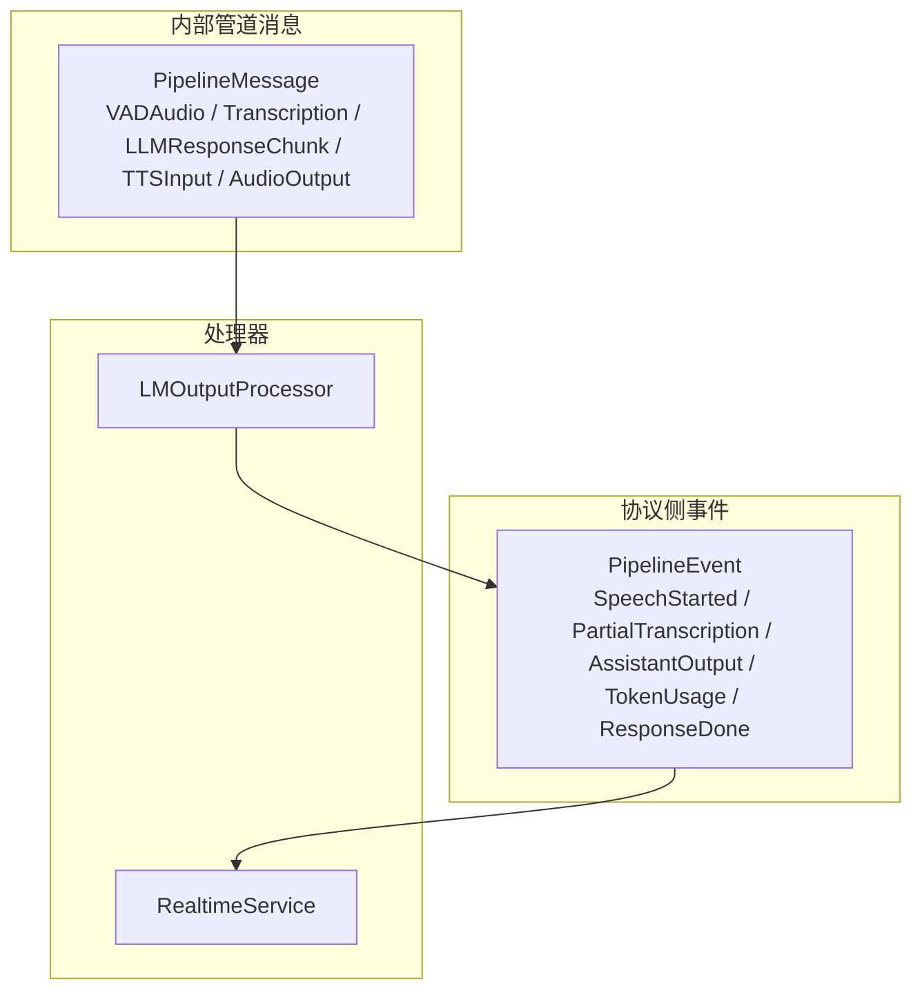
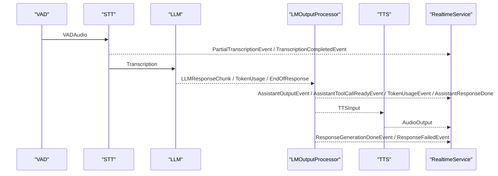
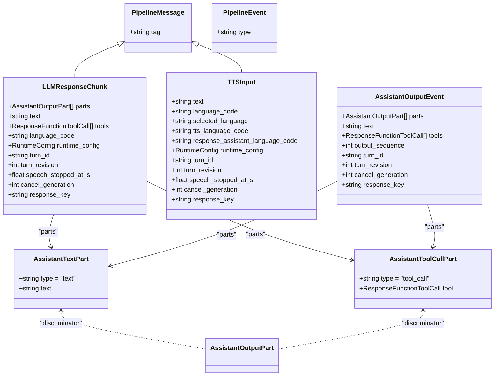
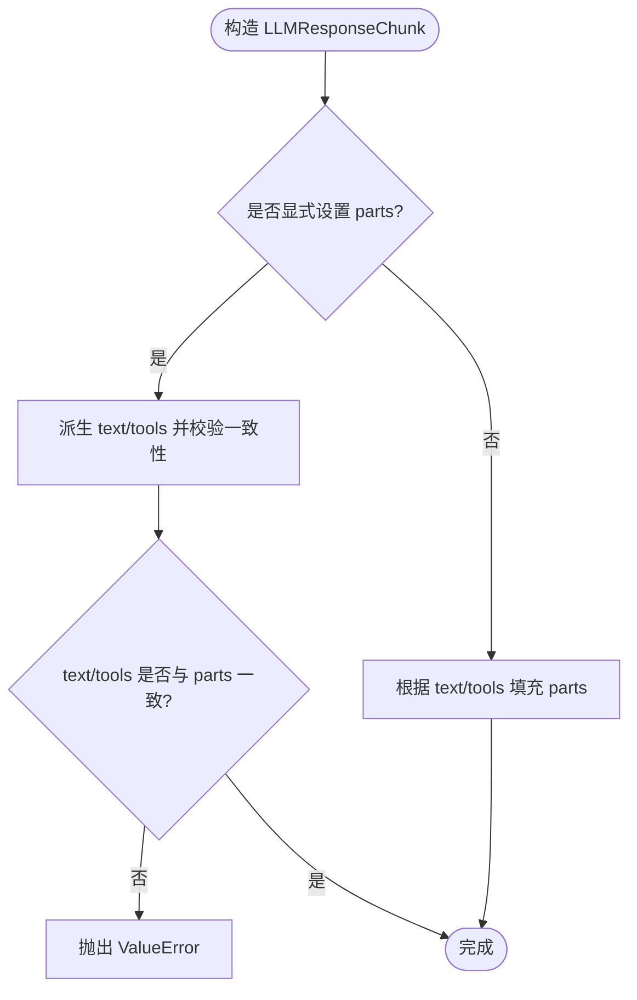
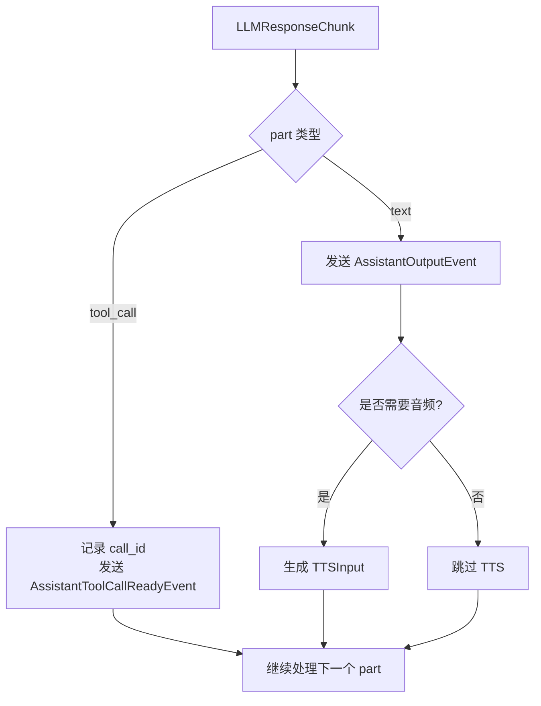
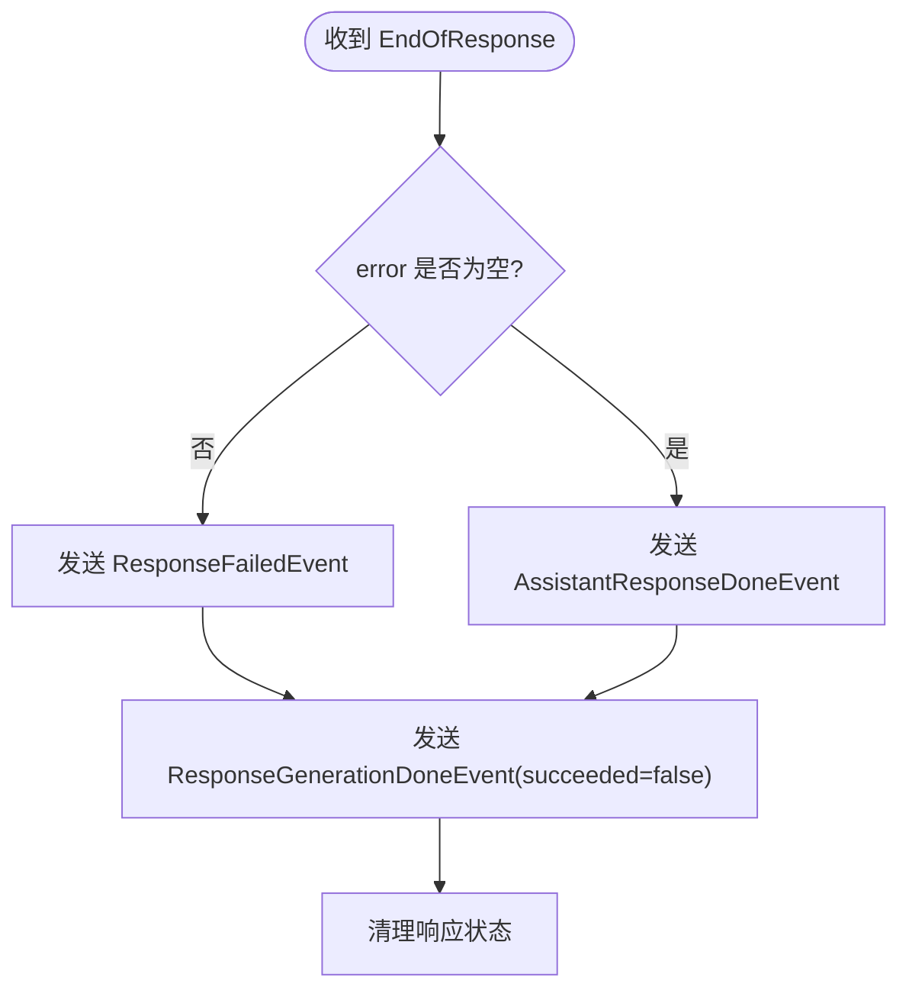
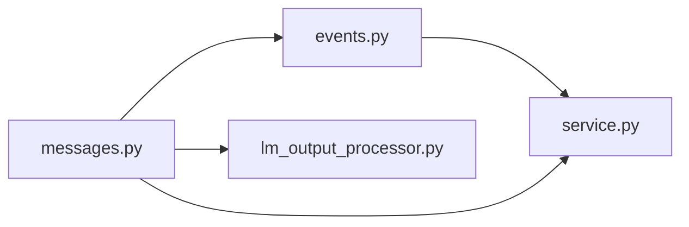

# 消息处理

<cite>
**本文引用的文件**   
- [messages.py](file://src/speech_to_speech/pipeline/messages.py)
- [events.py](file://src/speech_to_speech/pipeline/events.py)
- [lm_output_processor.py](file://src/speech_to_speech/LLM/lm_output_processor.py)
- [service.py](file://src/speech_to_speech/api/openai_realtime/service.py)
- [s2s_pipeline.py](file://src/speech_to_speech/s2s_pipeline.py)
</cite>

## 目录
1. [引言](#引言)
2. [项目结构](#项目结构)
3. [核心组件](#核心组件)
4. [架构总览](#架构总览)
5. [详细组件分析](#详细组件分析)
6. [依赖关系分析](#依赖关系分析)
7. [性能考虑](#性能考虑)
8. [故障排查指南](#故障排查指南)
9. [结论](#结论)
10. [附录](#附录)

## 引言
本文围绕语音到语音管道中的“消息处理”展开，重点解释：
- 消息数据结构设计，尤其是 AssistantOutputPart、AssistantToolCallPart 等核心类型。
- 消息的序列化机制、字段验证规则与向后兼容策略。
- 消息在 VAD → STT → LLM → LMOutputProcessor → TTS → 实时服务各阶段之间的传递格式、转换规则与数据处理流程。
- 错误处理、调试技巧与自定义消息处理器开发方法。
- 面向高吞吐低延迟的消息优化策略。

## 项目结构
本项目的消息体系集中在 pipeline 层，分为两类：
- PipelineMessage：用于内部队列（STT/LLM/TTS）之间传输的结构化消息。
- PipelineEvent：用于从 pipeline 流向实时协议路由器的结构化事件。

图表来源
- [messages.py:34-267](file://src/speech_to_speech/pipeline/messages.py#L34-L267)
- [events.py:26-228](file://src/speech_to_speech/pipeline/events.py#L26-L228)
- [lm_output_processor.py:44-308](file://src/speech_to_speech/LLM/lm_output_processor.py#L44-L308)
- [service.py:355-403](file://src/speech_to_speech/api/openai_realtime/service.py#L355-L403)

章节来源
- [messages.py:1-416](file://src/speech_to_speech/pipeline/messages.py#L1-L416)
- [events.py:1-228](file://src/speech_to_speech/pipeline/events.py#L1-L228)

## 核心组件
- 基础消息基类：PipelineMessage，使用 tag 作为 Pydantic 判别器，便于 Union 反序列化。
- 关键消息类型：
  - VADAudio：VAD 输出的音频片段，携带说话人归属、运行时配置、轮次标识等。
  - PartialTranscription / Transcription / TranscriptionFailure：STT 中间结果与最终结果。
  - AssistantTextPart / AssistantToolCallPart：LLM 输出有序片段，支持文本与工具调用交错。
  - LLMResponseChunk：LLM 响应块，包含 parts、text/tools 兼容视图、语言信息、轮次与取消标记。
  - TokenUsage：令牌用量统计。
  - EndOfResponse：响应结束哨兵，可携带错误、状态、原因、清理标志。
  - TTSInput：TTS 输入文本及语言快照。
  - AudioOutput：TTS 音频输出，附带 visemes 与生命周期字段。
  - GenerateResponseRequest：触发 LLM 生成的请求，封装会话上下文与响应覆盖参数。
- 协议事件：
  - AssistantOutputEvent：内部有序助手输出，等待 API 序列化。
  - AssistantToolCallReadyEvent：工具调用可提前暴露给客户端执行。
  - TokenUsageEvent / AssistantResponseDoneEvent / ResponseGenerationDoneEvent / ResponseFailedEvent：响应生命周期与用量事件。

章节来源
- [messages.py:34-267](file://src/speech_to_speech/pipeline/messages.py#L34-L267)
- [events.py:26-228](file://src/speech_to_speech/pipeline/events.py#L26-L228)

## 架构总览
下图展示消息在管道中的流转路径与关键处理器：

图表来源
- [messages.py:49-267](file://src/speech_to_speech/pipeline/messages.py#L49-L267)
- [events.py:39-228](file://src/speech_to_speech/pipeline/events.py#L39-L228)
- [lm_output_processor.py:134-308](file://src/speech_to_speech/LLM/lm_output_processor.py#L134-L308)
- [service.py:393-403](file://src/speech_to_speech/api/openai_realtime/service.py#L393-L403)

## 详细组件分析

### 消息数据模型与序列化
- 统一基类与判别器：
  - PipelineMessage 使用 tag 字段作为 Pydantic discriminator，使 Union 子类型可从原始字典安全反序列化。
  - PipelineEvent 使用 type 字段作为协议侧事件的判别器。
- 有序片段与兼容性视图：
  - AssistantOutputPart 是 AssistantTextPart 与 AssistantToolCallPart 的联合类型，通过 Field(discriminator="type") 区分。
  - LLMResponseChunk 同时维护 parts 与 text/tools 两个视图：
    - 若显式设置 parts，则派生 text/tools；若二者不一致会抛出校验错误。
    - 若仅设置 text/tools，则在构造时自动填充 parts，保持顺序一致。
  - AssistantOutputEvent 复用同一规范化逻辑，保证协议侧事件与内部消息的一致性。
- 语言字段快照与推导：
  - TTSInput 在 before 校验中根据 selected_language 与 runtime_config 推导 tts_language_code，避免下游重复计算。
  - GenerateResponseRequest 在 before 校验中从 runtime_config.selected_language 快照 selected_language。

图表来源
- [messages.py:103-176](file://src/speech_to_speech/pipeline/messages.py#L103-L176)
- [messages.py:222-255](file://src/speech_to_speech/pipeline/messages.py#L222-L255)
- [events.py:109-137](file://src/speech_to_speech/pipeline/events.py#L109-L137)

章节来源
- [messages.py:34-176](file://src/speech_to_speech/pipeline/messages.py#L34-L176)
- [messages.py:222-255](file://src/speech_to_speech/pipeline/messages.py#L222-L255)
- [events.py:109-137](file://src/speech_to_speech/pipeline/events.py#L109-L137)

### 字段验证规则与向后兼容
- 一致性校验：
  - _normalize_assistant_output_fields 确保 parts 与 text/tools 的一致性；当显式设置 parts 且与 derived 值不一致时抛出 ValueError。
- 兼容视图：
  - 旧代码可直接设置 text/tools，系统会自动生成 parts；新代码应优先设置 parts，以获得任意文本/工具交错顺序。
- 语言字段默认值：
  - TTSInput 与 GenerateResponseRequest 在 before 校验中补全 selected_language/tts_language_code，降低上游耦合。

图表来源
- [messages.py:123-143](file://src/speech_to_speech/pipeline/messages.py#L123-L143)
- [messages.py:171-176](file://src/speech_to_speech/pipeline/messages.py#L171-L176)

章节来源
- [messages.py:123-176](file://src/speech_to_speech/pipeline/messages.py#L123-L176)

### 消息在管道阶段的传递与转换
- VAD → STT：
  - VADAudio 携带音频与元数据进入 STT；STT 产出 PartialTranscription 与 Transcription。
- STT → LLM：
  - Transcription 作为 LLM 输入；PartialTranscription 走 TranscriptionNotifier 不进入 LLM。
- LLM → LMOutputProcessor：
  - LLMResponseChunk 包含 parts 列表，LMOutputProcessor 按序分发：
    - 对 AssistantToolCallPart：记录 call_id，并通过 side-channel 发送 AssistantToolCallReadyEvent。
    - 对 AssistantTextPart：生成 AssistantOutputEvent，并在需要时转发 TTSInput。
  - TokenUsage 转换为 TokenUsageEvent。
  - EndOfResponse 转换为 AssistantResponseDoneEvent 或 ResponseFailedEvent，并发送 ResponseGenerationDoneEvent。
- LMOutputProcessor → TTS：
  - TTSInput 携带文本与语言快照；TTS 返回 AudioOutput。
- 实时服务：
  - RealtimeService 将 PipelineEvent 映射到具体处理器，负责协议序列化、状态管理与生命周期控制。

图表来源
- [lm_output_processor.py:225-304](file://src/speech_to_speech/LLM/lm_output_processor.py#L225-L304)
- [events.py:144-163](file://src/speech_to_speech/pipeline/events.py#L144-L163)

章节来源
- [lm_output_processor.py:134-308](file://src/speech_to_speech/LLM/lm_output_processor.py#L134-L308)
- [events.py:109-163](file://src/speech_to_speech/pipeline/events.py#L109-L163)

### 错误处理机制
- 转录失败：
  - TranscriptionFailure 表示 STT 最终失败且不产生 LLM 输入。
- LLM 响应结束：
  - EndOfResponse.error 非空时，LMOutputProcessor 发送 ResponseFailedEvent；否则发送 AssistantResponseDoneEvent。
- 过时轮次与丢弃：
  - 通过 SpeculativeTurnTracker 判断 turn_id/turn_revision 是否为最新，过时事件被丢弃并记录日志。
- 历史提交失败：
  - RealtimeService.dispatch_pipeline_event 捕获 HistoryCommitError，转为 ResponseFailedEvent。

图表来源
- [lm_output_processor.py:154-208](file://src/speech_to_speech/LLM/lm_output_processor.py#L154-L208)
- [service.py:648-669](file://src/speech_to_speech/api/openai_realtime/service.py#L648-L669)

章节来源
- [lm_output_processor.py:154-208](file://src/speech_to_speech/LLM/lm_output_processor.py#L154-L208)
- [service.py:648-669](file://src/speech_to_speech/api/openai_realtime/service.py#L648-L669)

### 自定义消息处理器开发
- 内部处理器（实现 BaseHandler）：
  - 定义 process(self, input_msg) -> Iterator[output_msg]，输入输出为 PipelineMessage 子类。
  - 示例：LMOutputProcessor 接收 LLMOut（LLMResponseChunk/TokenUsage/EndOfResponse），输出 TTSIn | PipelineEvent。
- 协议侧处理器（接入 RealtimeService）：
  - 在 service._pipeline_dispatch 中注册 PipelineEvent 类型到处理方法。
  - 示例：AssistantOutputEvent 由 response.on_assistant_output 处理，AssistantToolCallReadyEvent 由 response.on_assistant_tool_call_ready 处理。
- 扩展建议：
  - 新增 PipelineMessage 时，确保 tag 唯一且与业务语义匹配。
  - 新增 PipelineEvent 时，在 events.py 定义类型，并在 service.py 注册 dispatch。
  - 如需跨阶段共享状态，使用 response_key/cancel_generation/turn_id/turn_revision 进行关联与生命周期管理。

章节来源
- [lm_output_processor.py:44-70](file://src/speech_to_speech/LLM/lm_output_processor.py#L44-L70)
- [service.py:393-403](file://src/speech_to_speech/api/openai_realtime/service.py#L393-L403)

## 依赖关系分析
- messages.py 依赖：
  - openai.types.responses.response_function_tool_call.ResponseFunctionToolCall
  - openai.types.realtime.realtime_response_create_params.RealtimeResponseCreateParams
  - pydantic BaseModel/Field/model_validator
  - RuntimeConfig、ResponseHistory、SpeakerAttribution、Viseme 等管道上下文对象。
- events.py 依赖：
  - messages 中的 AssistantOutputPart、AssistantToolCallPart 与 _normalize_assistant_output_fields。
- lm_output_processor.py 依赖：
  - messages 中的 LLMResponseChunk、TokenUsage、EndOfResponse、TTSInput。
  - events 中的 AssistantOutputEvent、AssistantToolCallReadyEvent、TokenUsageEvent、AssistantResponseDoneEvent、ResponseFailedEvent、ResponseGenerationDoneEvent。
- service.py 依赖：
  - events 中的所有 PipelineEvent 类型，以及 messages.GenerateResponseRequest。

图表来源
- [messages.py:1-416](file://src/speech_to_speech/pipeline/messages.py#L1-L416)
- [events.py:1-228](file://src/speech_to_speech/pipeline/events.py#L1-L228)
- [lm_output_processor.py:1-308](file://src/speech_to_speech/LLM/lm_output_processor.py#L1-L308)
- [service.py:1-403](file://src/speech_to_speech/api/openai_realtime/service.py#L1-L403)

章节来源
- [messages.py:1-416](file://src/speech_to_speech/pipeline/messages.py#L1-L416)
- [events.py:1-228](file://src/speech_to_speech/pipeline/events.py#L1-L228)
- [lm_output_processor.py:1-308](file://src/speech_to_speech/LLM/lm_output_processor.py#L1-L308)
- [service.py:1-403](file://src/speech_to_speech/api/openai_realtime/service.py#L1-L403)

## 性能考虑
- 有序输出与并行暴露：
  - AssistantOutputEvent 与 AssistantToolCallReadyEvent 分离：文本走 TTS 有序队列，工具调用通过 side-channel 提前暴露，减少端到端延迟。
- 语言检测与缓存：
  - LMOutputProcessor 仅在必要时启动语言检测，并缓存 detected_assistant_language 与 last_assistant_language，避免重复计算。
- 过时事件过滤：
  - 基于 SpeculativeTurnTracker 的 turn_id/turn_revision 过滤，丢弃陈旧输出，避免无效处理。
- 二进制哨兵与队列：
  - AUDIO_RESPONSE_DONE 与 PIPELINE_END 作为音频/输出队列的二进制哨兵，简化生命周期终止信号。
- 批量与流式：
  - LLM 输出以 chunk 形式流式处理，TTS 按需消费文本，减少内存峰值与首包延迟。

章节来源
- [lm_output_processor.py:89-107](file://src/speech_to_speech/LLM/lm_output_processor.py#L89-L107)
- [lm_output_processor.py:129-133](file://src/speech_to_speech/LLM/lm_output_processor.py#L129-L133)
- [messages.py:414-416](file://src/speech_to_speech/pipeline/messages.py#L414-L416)

## 故障排查指南
- 常见错误与定位：
  - 字段不一致：当 parts 与 text/tools 不一致时抛出 ValueError，检查构造逻辑是否混用两种视图。
  - 过时轮次：日志中出现 “Dropping stale ... for turn=... rev=...”，检查 SpeculativeTurnTracker 的 turn 状态。
  - 历史提交失败：捕获 HistoryCommitError 后转为 ResponseFailedEvent，检查 Chat 写入与压缩逻辑。
- 调试技巧：
  - 启用 transcript_for_log 打印 parts 与文本摘要，确认顺序与内容。
  - 在 RealtimeService.dispatch_pipeline_event 中添加断点，观察 event.type 与 response_key 的关联。
  - 使用 response_key/cancel_generation 追踪特定响应的生命周期，避免跨响应污染。
- 恢复策略：
  - 转录失败后，确保后续转轮能正常重建；必要时重置 STT 会话语言状态。
  - 响应失败时，清理 pending_response_keys 与 closed_response_keys，防止状态泄漏。

章节来源
- [messages.py:131-138](file://src/speech_to_speech/pipeline/messages.py#L131-L138)
- [lm_output_processor.py:154-208](file://src/speech_to_speech/LLM/lm_output_processor.py#L154-L208)
- [service.py:648-669](file://src/speech_to_speech/api/openai_realtime/service.py#L648-L669)

## 结论
该消息处理体系通过统一的 PipelineMessage/PipelineEvent 模型、严格的 Pydantic 校验与向后兼容视图，实现了 STT/LLM/TTS 与实时协议之间的高内聚、低耦合通信。LMOutputProcessor 在保证输出顺序的同时，利用 side-channel 提前暴露工具调用，显著优化了端到端延迟。配合 SpeculativeTurnTracker 与 response_key 生命周期管理，系统在并发与撤销场景下具备稳健的错误处理能力。

## 附录
- 实际代码示例路径：
  - 消息定义与校验：[messages.py:103-176](file://src/speech_to_speech/pipeline/messages.py#L103-L176)、[messages.py:222-255](file://src/speech_to_speech/pipeline/messages.py#L222-L255)
  - 事件定义与规范化：[events.py:109-137](file://src/speech_to_speech/pipeline/events.py#L109-L137)
  - LLM 输出处理流程：[lm_output_processor.py:225-304](file://src/speech_to_speech/LLM/lm_output_processor.py#L225-L304)
  - 实时服务事件分发：[service.py:393-403](file://src/speech_to_speech/api/openai_realtime/service.py#L393-L403)
  - 管道装配与处理器连接：[s2s_pipeline.py:523-547](file://src/speech_to_speech/s2s_pipeline.py#L523-L547)