# 管道和事件系统

<cite>
**本文引用的文件**   
- [pipeline/__init__.py](file://src/speech_to_speech/pipeline/__init__.py)
- [pipeline/events.py](file://src/speech_to_speech/pipeline/events.py)
- [pipeline/messages.py](file://src/speech_to_speech/pipeline/messages.py)
- [pipeline/control.py](file://src/speech_to_speech/pipeline/control.py)
- [pipeline/handler_types.py](file://src/speech_to_speech/pipeline/handler_types.py)
- [pipeline/queue_types.py](file://src/speech_to_speech/pipeline/queue_types.py)
- [pipeline/cancel_scope.py](file://src/speech_to_speech/pipeline/cancel_scope.py)
- [pipeline/history.py](file://src/speech_to_speech/pipeline/history.py)
- [pipeline/log_context.py](file://src/speech_to_speech/pipeline/log_context.py)
- [pipeline/transcript_logging.py](file://src/speech_to_speech/pipeline/transcript_logging.py)
- [pipeline/turn_latency.py](file://src/speech_to_speech/pipeline/turn_latency.py)
</cite>

## 目录
1. [引言](#引言)
2. [项目结构](#项目结构)
3. [核心组件](#核心组件)
4. [架构总览](#架构总览)
5. [详细组件分析](#详细组件分析)
6. [依赖关系分析](#依赖关系分析)
7. [性能与监控](#性能与监控)
8. [故障排查指南](#故障排查指南)
9. [结论](#结论)
10. [附录：扩展与最佳实践](#附录扩展与最佳实践)

## 引言
本文件面向“语音到语音”实时系统的异步管道与事件子系统，目标是帮助开发者理解并安全扩展该系统的核心机制。文档覆盖以下主题：
- 异步管道架构的设计原理、数据流与控制流
- 事件类型定义与消息传递协议
- 状态管理、生命周期与取消机制
- 处理器链执行流程、错误恢复策略
- 管道控制接口、监控与日志记录
- 自定义处理器开发指南、事件监听器实现、性能监控方法
- 实际代码示例路径与调试技巧

## 项目结构
`pipeline` 模块是语音到语音管道的核心基础设施，负责统一消息类型、事件类型、队列项类型、控制信号、取消语义、历史写入、日志上下文、转录内容脱敏以及端到端延迟统计。

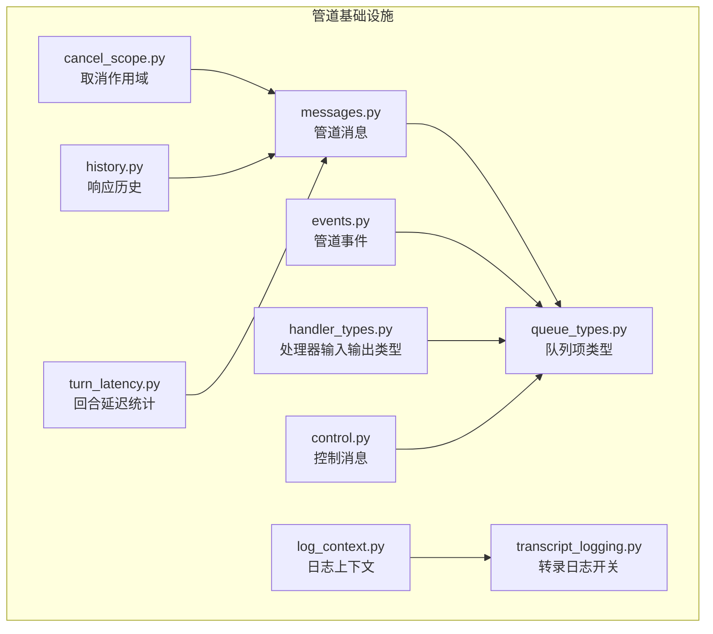

**图表来源**
- [pipeline/messages.py:1-416](file://src/speech_to_speech/pipeline/messages.py#L1-L416)
- [pipeline/events.py:1-228](file://src/speech_to_speech/pipeline/events.py#L1-L228)
- [pipeline/queue_types.py:1-47](file://src/speech_to_speech/pipeline/queue_types.py#L1-L47)
- [pipeline/handler_types.py:1-46](file://src/speech_to_speech/pipeline/handler_types.py#L1-L46)
- [pipeline/control.py:1-27](file://src/speech_to_speech/pipeline/control.py#L1-L27)
- [pipeline/cancel_scope.py:1-65](file://src/speech_to_speech/pipeline/cancel_scope.py#L1-L65)
- [pipeline/history.py:1-98](file://src/speech_to_speech/pipeline/history.py#L1-L98)
- [pipeline/log_context.py:1-26](file://src/speech_to_speech/pipeline/log_context.py#L1-L26)
- [pipeline/transcript_logging.py:1-81](file://src/speech_to_speech/pipeline/transcript_logging.py#L1-L81)
- [pipeline/turn_latency.py:1-421](file://src/speech_to_speech/pipeline/turn_latency.py#L1-L421)

**章节来源**
- [pipeline/__init__.py:1-68](file://src/speech_to_speech/pipeline/__init__.py#L1-L68)

## 核心组件
本节从“消息—事件—队列—控制—取消—历史—日志—延迟”八个维度说明核心组件的职责与协作方式。

- 消息层（messages）
  - 定义跨阶段传输的强类型消息，如 VAD 音频、STT 转写、LLM 响应块、TTS 输入、音频输出、令牌用量、响应结束等。
  - 使用 Pydantic 模型与 `tag` 字段作为判别器，保证序列化与反序列化的稳定性。
  - 提供二进制哨兵常量用于队列终止与响应结束。

- 事件层（events）
  - 定义面向实时路由器的协议中性事件，包括 VAD 开始/停止、部分/完成转写、助手文本/工具调用、令牌用量、响应完成/失败等。
  - 通过 `type` 字段作为 Pydantic 判别器，便于路由器分发。

- 队列项类型（queue_types）
  - 集中定义各阶段队列可承载的联合类型，包含业务消息、控制消息、事件与二进制哨兵。
  - 将“控制+哨兵”抽象为 `PipelineInternalItem`，避免重复 union。

- 处理器类型（handler_types）
  - 为 VAD、STT、LLM、TTS 各阶段定义输入输出类型别名，使处理器签名清晰且稳定。

- 控制消息（control）
  - 定义强类型的管道控制消息，例如会话结束。
  - 提供判断是否为控制消息的工具函数。

- 取消作用域（cancel_scope）
  - 基于生成号与丢弃标志的统一取消语义，供 LLM/TTS 线程检测陈旧输出，并由异步发送循环丢弃旧响应。

- 历史写入（history）
  - 以不可变快照形式携带一次响应的对话增量，支持提交、清理与回滚。

- 日志上下文（log_context）
  - 基于 contextvar 注入每管道前缀，便于区分并发会话日志。

- 转录日志（transcript_logging）
  - 默认关闭完整对话内容落盘，仅在显式开启时输出全文；提供异常日志封装，避免泄露敏感信息。

- 延迟统计（turn_latency）
  - 记录 STT、LLM TTFT/时长、TTS 首帧时间、端到端延迟、VAD 等待、智能回合等待、MLX 锁等待/持有等指标。
  - 提供按 response_key 与 session_id 的生命周期管理。

**章节来源**
- [pipeline/messages.py:1-416](file://src/speech_to_speech/pipeline/messages.py#L1-L416)
- [pipeline/events.py:1-228](file://src/speech_to_speech/pipeline/events.py#L1-L228)
- [pipeline/queue_types.py:1-47](file://src/speech_to_speech/pipeline/queue_types.py#L1-L47)
- [pipeline/handler_types.py:1-46](file://src/speech_to_speech/pipeline/handler_types.py#L1-L46)
- [pipeline/control.py:1-27](file://src/speech_to_speech/pipeline/control.py#L1-L27)
- [pipeline/cancel_scope.py:1-65](file://src/speech_to_speech/pipeline/cancel_scope.py#L1-L65)
- [pipeline/history.py:1-98](file://src/speech_to_speech/pipeline/history.py#L1-L98)
- [pipeline/log_context.py:1-26](file://src/speech_to_speech/pipeline/log_context.py#L1-L26)
- [pipeline/transcript_logging.py:1-81](file://src/speech_to_speech/pipeline/transcript_logging.py#L1-L81)
- [pipeline/turn_latency.py:1-421](file://src/speech_to_speech/pipeline/turn_latency.py#L1-L421)

## 架构总览
下图展示语音到语音管道的主要阶段、消息与事件流向，以及控制与取消如何贯穿整个链路。

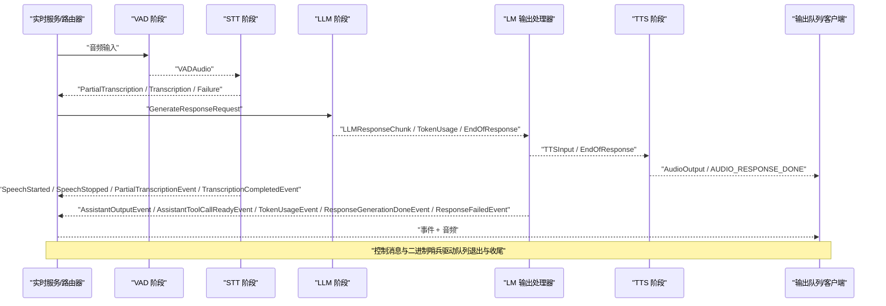

**图表来源**
- [pipeline/messages.py:49-267](file://src/speech_to_speech/pipeline/messages.py#L49-L267)
- [pipeline/events.py:39-228](file://src/speech_to_speech/pipeline/events.py#L39-L228)
- [pipeline/queue_types.py:20-46](file://src/speech_to_speech/pipeline/queue_types.py#L20-L46)
- [pipeline/control.py:7-27](file://src/speech_to_speech/pipeline/control.py#L7-L27)

## 详细组件分析

### 消息体系与处理器链
- 输入输出类型
  - VAD 输入：原始字节或带运行时配置的元组；输出：`VADAudio`。
  - STT 输入：`VADAudio`；输出：部分转写、最终转写或失败。
  - LLM 输入：`GenerateResponseRequest`；输出：响应块、令牌用量、响应结束。
  - TTS 输入：`TTSInput` 或响应结束；输出：音频或 `AudioOutput`。

- 关键消息
  - `VADAudio`：携带音频、说话人信息、运行配置、模式、回合标识、处理耗时等。
  - `PartialTranscription` / `Transcription` / `TranscriptionFailure`：STT 结果与失败。
  - `LLMResponseChunk`：有序助手输出片段，兼容 legacy text/tools 视图。
  - `TokenUsage`：侧信道令牌用量上报。
  - `EndOfResponse`：响应结束哨兵，支持错误、不完整原因、清理标记、输入工具调用 ID。
  - `TTSInput`：TTS 文本输入，自动解析语言相关字段。
  - `AudioOutput`：音频输出，附带 viseme、取消生成号、response_key。
  - `GenerateResponseRequest`：触发 LLM 生成，携带运行时配置、响应参数、音频、回合信息等。
  - 二进制哨兵：`AUDIO_RESPONSE_DONE`、`PIPELINE_END`。

- 有序输出与兼容性
  - `AssistantTextPart` / `AssistantToolCallPart` 组成有序 `AssistantOutputPart`。
  - `_normalize_assistant_output_fields` 保证 parts 与 legacy text/tools 一致性。

```mermaid
classDiagram
class PipelineMessage {
+string tag
}
class VADAudio {
+bytes audio
+SpeakerAttribution speaker_attribution
+RuntimeConfig runtime_config
+string mode
+string turn_id
+int turn_revision
+float processing_delay_s
+float created_at_s
+float speech_end_at_s
}
class PartialTranscription {
+string text
+string turn_id
+int turn_revision
}
class Transcription {
+string text
+SpeakerAttribution speaker_attribution
+string language_code
+string turn_id
+int turn_revision
+float speech_stopped_at_s
}
class TranscriptionFailure {
+string message
+string turn_id
+int turn_revision
+float speech_stopped_at_s
}
class AssistantTextPart {
+string type = "text"
+string text
}
class AssistantToolCallPart {
+string type = "tool_call"
+ResponseFunctionToolCall tool
}
class LLMResponseChunk {
+AssistantOutputPart[] parts
+string text
+string language_code
+ResponseFunctionToolCall[] tools
+RuntimeConfig runtime_config
+RealtimeResponseCreateParams response
+string turn_id
+int turn_revision
+float speech_stopped_at_s
+int cancel_generation
+string response_key
}
class TokenUsage {
+int input_tokens
+int output_tokens
+string turn_id
+int turn_revision
+int cancel_generation
+string response_key
}
class EndOfResponse {
+string turn_id
+int turn_revision
+int cancel_generation
+string response_key
+string error
+string status
+string reason
+bool cleanup_only
+string[] input_tool_call_ids
}
class TTSInput {
+string text
+string language_code
+string selected_language
+string tts_language_code
+string response_assistant_language_code
+RuntimeConfig runtime_config
+RealtimeResponseCreateParams response
+string turn_id
+int turn_revision
+float speech_stopped_at_s
+int cancel_generation
+string response_key
}
class AudioOutput {
+bytes|ndarray audio
+Viseme[] visemes
+int cancel_generation
+string response_key
+bool cleanup_only
}
class GenerateResponseRequest {
+string response_key
+RuntimeConfig runtime_config
+string selected_language
+RealtimeResponseCreateParams response
+ndarray audio
+int audio_sample_rate
+string input_item_id
+string language_code
+string turn_id
+int turn_revision
+float speech_stopped_at_s
+ResponsePrefetchTransaction prefetch_transaction
}
PipelineMessage <|-- VADAudio
PipelineMessage <|-- PartialTranscription
PipelineMessage <|-- Transcription
PipelineMessage <|-- TranscriptionFailure
PipelineMessage <|-- LLMResponseChunk
PipelineMessage <|-- TokenUsage
PipelineMessage <|-- EndOfResponse
PipelineMessage <|-- TTSInput
PipelineMessage <|-- AudioOutput
PipelineMessage <|-- GenerateResponseRequest
```

**图表来源**
- [pipeline/messages.py:49-267](file://src/speech_to_speech/pipeline/messages.py#L49-L267)
- [pipeline/messages.py:376-416](file://src/speech_to_speech/pipeline/messages.py#L376-L416)

**章节来源**
- [pipeline/handler_types.py:31-46](file://src/speech_to_speech/pipeline/handler_types.py#L31-L46)
- [pipeline/messages.py:49-267](file://src/speech_to_speech/pipeline/messages.py#L49-L267)
- [pipeline/messages.py:376-416](file://src/speech_to_speech/pipeline/messages.py#L376-L416)

### 事件体系与实时路由
- 事件分类
  - VAD 事件：`SpeechStartedEvent`、`SpeechStoppedEvent`
  - 转写事件：`PartialTranscriptionEvent`、`TranscriptionCompletedEvent`、`TranscriptionFailedEvent`
  - 直接音频事件：`AudioInputCompletedEvent`
  - LLM 输出事件：`AssistantOutputEvent`、`AssistantToolCallReadyEvent`、`TokenUsageEvent`、`AssistantResponseDoneEvent`、`ResponseGenerationDoneEvent`、`ResponseFailedEvent`

- 事件特性
  - 所有事件继承 `PipelineEvent`，通过 `type` 字段进行判别。
  - 部分事件携带 `turn_id`、`turn_revision`、`cancel_generation`、`response_key`，用于关联响应与丢弃陈旧输出。
  - 工具调用就绪事件允许在 TTS 顺序通道之前暴露标准函数调用参数，提升交互体验。

```mermaid
classDiagram
class PipelineEvent {
+string type
}
class SpeechStartedEvent {
+int audio_start_ms
+string turn_id
+int turn_revision
+bool reopened
+bool interrupt_response
}
class SpeechStoppedEvent {
+float duration_s
+int audio_end_ms
+string turn_id
+int turn_revision
}
class PartialTranscriptionEvent {
+string delta
+string turn_id
+int turn_revision
}
class TranscriptionCompletedEvent {
+string transcript
+SpeakerAttribution speaker_attribution
+string language_code
+string turn_id
+int turn_revision
+float speech_stopped_at_s
}
class TranscriptionFailedEvent {
+string message
+string turn_id
+int turn_revision
}
class AudioInputCompletedEvent {
+ndarray audio
+int audio_sample_rate
+float audio_duration_s
+string turn_id
+int turn_revision
+float speech_stopped_at_s
}
class AssistantOutputEvent {
+ResponseHistory history
+AssistantOutputPart[] parts
+string text
+ResponseFunctionToolCall[] tools
+string turn_id
+int turn_revision
+int cancel_generation
+string response_key
+int output_sequence
}
class AssistantToolCallReadyEvent {
+ResponseHistory history
+AssistantToolCallPart part
+int output_sequence
+string turn_id
+int turn_revision
+int cancel_generation
+string response_key
}
class TokenUsageEvent {
+int input_tokens
+int output_tokens
+string turn_id
+int turn_revision
+int cancel_generation
+string response_key
}
class AssistantResponseDoneEvent {
+ResponseHistory history
+string status
+ResponseIncompleteReason reason
+string response_key
+string[] input_tool_call_ids
+string turn_id
+int turn_revision
+int cancel_generation
}
class ResponseGenerationDoneEvent {
+ResponseHistory history
+string response_key
+string[] call_ids
+bool succeeded
+string turn_id
+int turn_revision
+int cancel_generation
}
class ResponseFailedEvent {
+ResponseHistory history
+string message
+string turn_id
+int turn_revision
+int cancel_generation
+string response_key
}
PipelineEvent <|-- SpeechStartedEvent
PipelineEvent <|-- SpeechStoppedEvent
PipelineEvent <|-- PartialTranscriptionEvent
PipelineEvent <|-- TranscriptionCompletedEvent
PipelineEvent <|-- TranscriptionFailedEvent
PipelineEvent <|-- AudioInputCompletedEvent
PipelineEvent <|-- AssistantOutputEvent
PipelineEvent <|-- AssistantToolCallReadyEvent
PipelineEvent <|-- TokenUsageEvent
PipelineEvent <|-- AssistantResponseDoneEvent
PipelineEvent <|-- ResponseGenerationDoneEvent
PipelineEvent <|-- ResponseFailedEvent
```

**图表来源**
- [pipeline/events.py:26-228](file://src/speech_to_speech/pipeline/events.py#L26-L228)

**章节来源**
- [pipeline/events.py:1-228](file://src/speech_to_speech/pipeline/events.py#L1-L228)

### 队列项类型与内部协议
- 队列项联合类型
  - `PipelineInternalItem`：控制消息或二进制哨兵。
  - `AudioInItem`：VAD 输入或控制消息。
  - `VADOutItem`：VAD 输出或内部项。
  - `STTOutItem`：STT 输出或内部项。
  - `TextPromptItem`：LLM 输入或内部项。
  - `LMOutItem`：LLM 输出或内部项。
  - `TTSInItem`：TTS 输入、事件或内部项。
  - `AudioOutItem`：音频、事件或控制消息。
  - `TextEventItem`：纯文本事件或内部项。

- 设计要点
  - 使用 plain `bytes` 作为哨兵值，避免 Literal 类型不兼容 Queue 不变性。
  - 将控制消息与业务数据解耦，便于统一消费与退出逻辑。

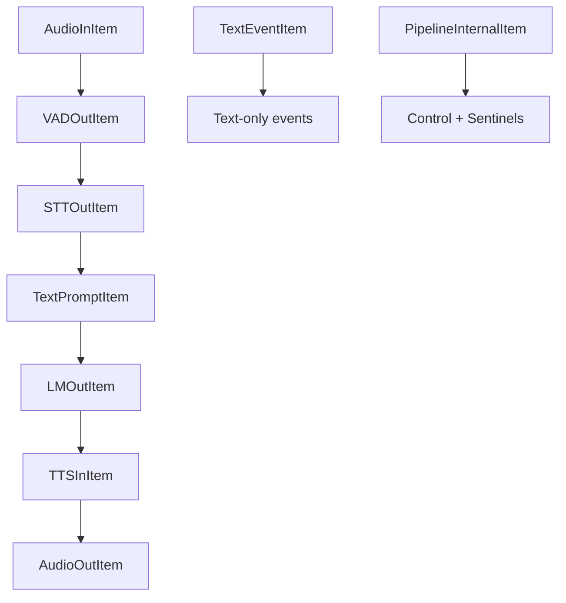

**图表来源**
- [pipeline/queue_types.py:20-46](file://src/speech_to_speech/pipeline/queue_types.py#L20-L46)

**章节来源**
- [pipeline/queue_types.py:1-47](file://src/speech_to_speech/pipeline/queue_types.py#L1-L47)

### 控制消息与会话生命周期
- 控制消息
  - `ControlKind.SESSION_END`：会话结束。
  - `PipelineControlMessage`：包含 kind 与可选 session_id，用于池化发送循环忽略已释放会话的消息。
  - `is_control_message`：判断是否为控制消息并可过滤特定 kind。

- 生命周期
  - 会话结束时，发送 `SESSION_END`，下游队列消费者识别后退出。
  - 二进制哨兵 `PIPELINE_END` 用于管道整体结束。

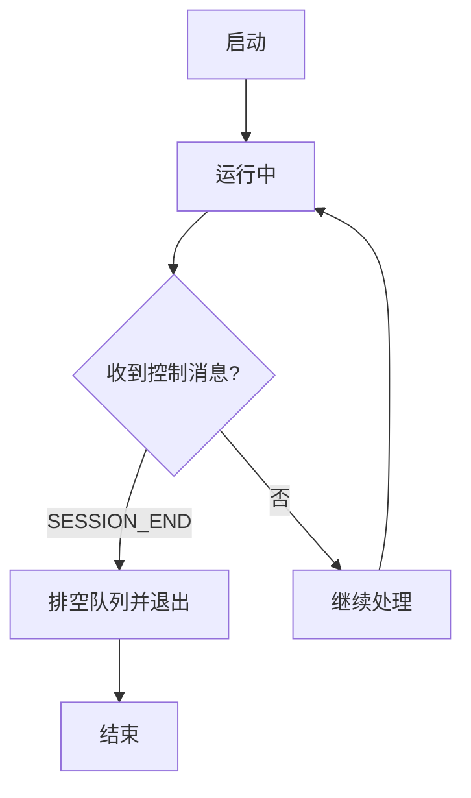

**图表来源**
- [pipeline/control.py:7-27](file://src/speech_to_speech/pipeline/control.py#L7-L27)

**章节来源**
- [pipeline/control.py:1-27](file://src/speech_to_speech/pipeline/control.py#L1-L27)

### 取消机制与陈旧输出丢弃
- 取消作用域
  - `generation`：当前生成号，每次 cancel 递增。
  - `discarding`：发送循环丢弃陈旧输出的标志。
  - `discarded_generation`：被丢弃的生成号，用于精确匹配。
  - `is_stale(gen)`：判断捕获的 generation 是否已被替代。
  - `response_done(generation)`：管道确认完成，清除丢弃标志。
  - `new_response()`：新 response.create 清除丢弃状态。

- 应用点
  - LLM/TTS 线程在开始响应时捕获 generation，后续产出携带 cancel_generation。
  - 发送循环根据 discarding 与 generation 比较，丢弃陈旧输出，避免旧响应污染新响应。

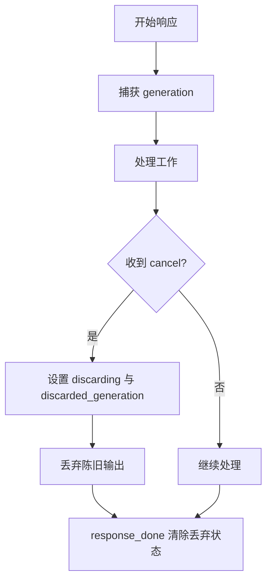

**图表来源**
- [pipeline/cancel_scope.py:1-65](file://src/speech_to_speech/pipeline/cancel_scope.py#L1-L65)

**章节来源**
- [pipeline/cancel_scope.py:1-65](file://src/speech_to_speech/pipeline/cancel_scope.py#L1-L65)

### 历史写入与预取事务
- 响应历史
  - `ResponseHistory`：不可变快照，携带 chat、items、after_item_id、complete、input_item_id、consumed_image_ids、item_order、audio_history_turns、consumed_audio_items、compactor。
  - `capture`：从 Chat 捕获快照。
  - `write`：写入临时生成项。
  - `clean_up`：终端清理，支持回滚。

- 预取事务
  - `ResponsePrefetchTransaction`：承诺仅在被 claim 后提交聊天清理，防止推测请求失效后污染共享状态。
  - 提供 register_abort、claim、discard、wait_until_resolved 等方法。

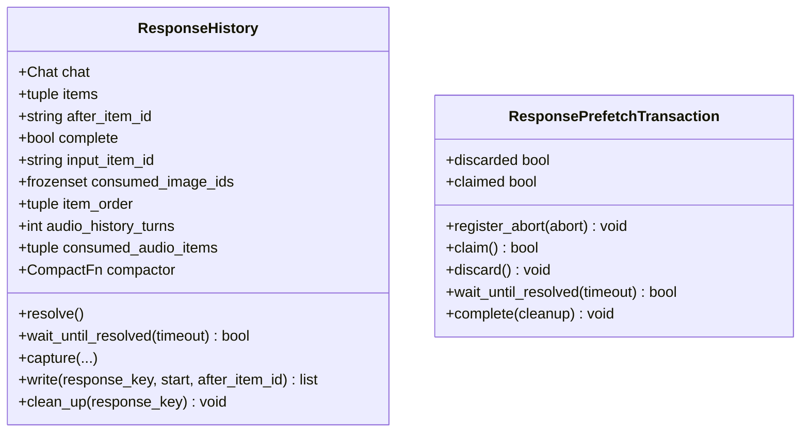

**图表来源**
- [pipeline/history.py:14-98](file://src/speech_to_speech/pipeline/history.py#L14-L98)
- [pipeline/messages.py:272-374](file://src/speech_to_speech/pipeline/messages.py#L272-L374)

**章节来源**
- [pipeline/history.py:1-98](file://src/speech_to_speech/pipeline/history.py#L1-L98)
- [pipeline/messages.py:272-374](file://src/speech_to_speech/pipeline/messages.py#L272-L374)

### 日志与转录内容保护
- 日志上下文
  - `pipeline_log_ctx`：contextvar，注入 `[pipeline N]` 前缀。
  - `PipelineLogFilter`：自动注入前缀，适用于线程与 asyncio 任务。

- 转录日志
  - 默认关闭完整对话内容落盘，避免生产环境泄露敏感信息。
  - `set_log_transcripts(enabled)`：进程级开关。
  - `warn_if_log_transcripts_enabled()`：启用时发出警告。
  - `transcript_for_log(text)`：返回长度或全文。
  - `log_exception(target, message, exc, level)`：封装异常日志，默认不暴露详情。

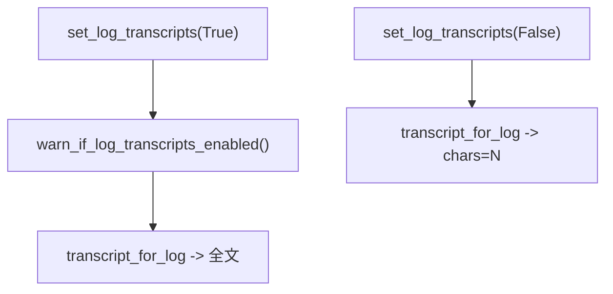

**图表来源**
- [pipeline/log_context.py:12-26](file://src/speech_to_speech/pipeline/log_context.py#L12-L26)
- [pipeline/transcript_logging.py:25-81](file://src/speech_to_speech/pipeline/transcript_logging.py#L25-L81)

**章节来源**
- [pipeline/log_context.py:1-26](file://src/speech_to_speech/pipeline/log_context.py#L1-L26)
- [pipeline/transcript_logging.py:1-81](file://src/speech_to_speech/pipeline/transcript_logging.py#L1-L81)

### 延迟统计与性能观测
- 关键指标
  - STT 耗时、LLM TTFT/总时长、TTS 首帧时间、端到端延迟、VAD 等待、智能回合等待、MLX 锁等待/持有。
  - 支持合并区间、格式化日志行、元数据负载。

- 存储与生命周期
  - `TurnLatencyStore`：按 response_key 与 session_id 管理 tracker。
  - pending 槽位：STT 先于 response_key 存在时的暂存。
  - 会话清理：clear_session 移除 session 相关 tracker。

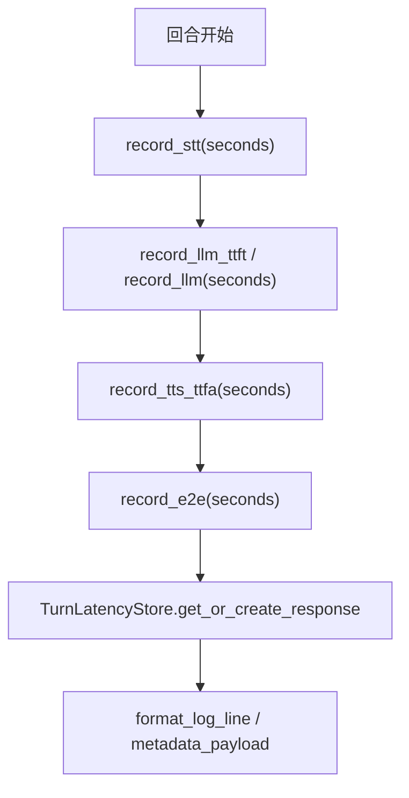

**图表来源**
- [pipeline/turn_latency.py:49-258](file://src/speech_to_speech/pipeline/turn_latency.py#L49-L258)
- [pipeline/turn_latency.py:261-421](file://src/speech_to_speech/pipeline/turn_latency.py#L261-L421)

**章节来源**
- [pipeline/turn_latency.py:1-421](file://src/speech_to_speech/pipeline/turn_latency.py#L1-L421)

## 依赖关系分析
- 模块内依赖
  - messages 依赖 history、runtime_config、speaker_metadata、transcript_logging、visemes。
  - events 依赖 history、messages、speaker_metadata。
  - queue_types 聚合 handler_types、messages、events、control。
  - handler_types 依赖 messages 与 runtime_config。
  - control 独立。
  - cancel_scope 独立。
  - log_context 独立。
  - transcript_logging 独立。
  - turn_latency 独立。

- 外部依赖
  - OpenAI 类型：`ResponseFunctionToolCall`、`RealtimeResponseCreateParams`。
  - Pydantic：BaseModel、Field、model_validator。
  - numpy：音频数组。
  - threading：Event、Lock。
  - openai.types.responses.response_function_tool_call。

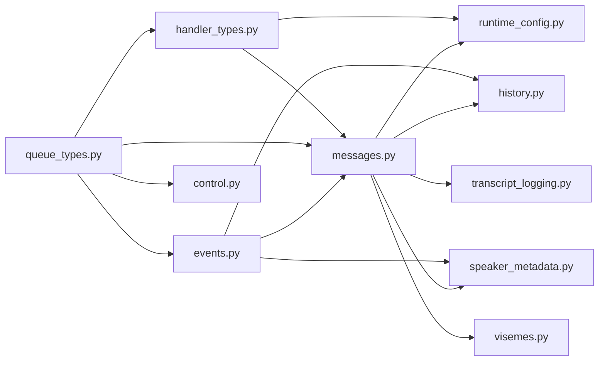

**图表来源**
- [pipeline/messages.py:1-416](file://src/speech_to_speech/pipeline/messages.py#L1-L416)
- [pipeline/events.py:1-228](file://src/speech_to_speech/pipeline/events.py#L1-L228)
- [pipeline/queue_types.py:1-47](file://src/speech_to_speech/pipeline/queue_types.py#L1-L47)
- [pipeline/handler_types.py:1-46](file://src/speech_to_speech/pipeline/handler_types.py#L1-L46)
- [pipeline/control.py:1-27](file://src/speech_to_speech/pipeline/control.py#L1-L27)

**章节来源**
- [pipeline/messages.py:1-416](file://src/speech_to_speech/pipeline/messages.py#L1-L416)
- [pipeline/events.py:1-228](file://src/speech_to_speech/pipeline/events.py#L1-L228)
- [pipeline/queue_types.py:1-47](file://src/speech_to_speech/pipeline/queue_types.py#L1-L47)
- [pipeline/handler_types.py:1-46](file://src/speech_to_speech/pipeline/handler_types.py#L1-L46)
- [pipeline/control.py:1-27](file://src/speech_to_speech/pipeline/control.py#L1-L27)

## 性能与监控
- 延迟观测
  - 使用 `TurnLatencyTracker` 记录各阶段耗时，并通过 `TurnLatencyStore` 管理生命周期。
  - 关注 TTFT、TTFA、E2E、vad_settle、smart_turn_wait、mlx_lock_wait/hold。

- 日志优化
  - 使用 `PipelineLogFilter` 注入 pipeline 前缀，便于多会话区分。
  - 默认关闭转录内容落盘，避免生产泄露；调试时可开启。

- 取消与陈旧输出
  - 利用 `CancelScope` 的 generation 与 discarding 机制，确保旧响应不会污染新响应。

- 建议
  - 在关键路径插入延迟记录点，尤其是 STT gate、LLM first token、TTS first frame。
  - 结合 `metadata_payload` 输出结构化指标，便于外部监控系统采集。

[本节为通用指导，不直接分析具体文件]

## 故障排查指南
- 常见问题定位
  - 转写失败：检查 `TranscriptionFailure` 消息与 `TranscriptionFailedEvent` 事件，确认 STT 后端状态。
  - 响应未完成：查看 `EndOfResponse.status` 与 `reason`，区分 provider 限制或过滤器截断。
  - 陈旧输出：确认 `CancelScope.discarding` 与 `cancel_generation` 是否匹配。
  - 会话未退出：检查 `SESSION_END` 控制消息与 `PIPELINE_END` 哨兵是否到达下游。

- 调试技巧
  - 开启转录日志：`set_log_transcripts(True)`，观察完整对话内容。
  - 使用 `log_exception` 记录异常，避免泄露敏感信息。
  - 打印 `TurnLatencyTracker.format_log_line()`，快速定位瓶颈。

**章节来源**
- [pipeline/messages.py:90-98](file://src/speech_to_speech/pipeline/messages.py#L90-L98)
- [pipeline/messages.py:194-217](file://src/speech_to_speech/pipeline/messages.py#L194-L217)
- [pipeline/events.py:82-87](file://src/speech_to_speech/pipeline/events.py#L82-L87)
- [pipeline/cancel_scope.py:24-59](file://src/speech_to_speech/pipeline/cancel_scope.py#L24-L59)
- [pipeline/transcript_logging.py:35-81](file://src/speech_to_speech/pipeline/transcript_logging.py#L35-L81)
- [pipeline/turn_latency.py:226-258](file://src/speech_to_speech/pipeline/turn_latency.py#L226-L258)

## 结论
该管道与事件系统通过强类型消息、协议中性事件、统一控制与取消语义、历史快照与预取事务、日志脱敏与延迟统计，构建了高内聚、低耦合的实时语音到语音处理框架。开发者可基于这些基础能力扩展处理器、监听事件、监控性能，并在生产环境中保持安全性与可观测性。

[本节为总结，不直接分析具体文件]

## 附录：扩展与最佳实践

### 自定义处理器开发指南
- 输入输出类型
  - 参考 `handler_types.py` 中的类型别名，确保处理器签名与管道一致。
  - 例如 STT 处理器接收 `VADAudio`，输出 `PartialTranscription | Transcription | TranscriptionFailure`。

- 错误处理
  - 使用 `log_exception` 记录异常，避免泄露敏感信息。
  - 对于 STT 失败，返回 `TranscriptionFailure` 消息，并触发 `TranscriptionFailedEvent`。

- 生命周期
  - 在处理器启动时绑定 `TurnLatencyTracker`，结束时 pop 或 discard。
  - 使用 `CancelScope.is_stale` 检查陈旧输出，及时退出。

**章节来源**
- [pipeline/handler_types.py:31-46](file://src/speech_to_speech/pipeline/handler_types.py#L31-L46)
- [pipeline/transcript_logging.py:62-81](file://src/speech_to_speech/pipeline/transcript_logging.py#L62-L81)
- [pipeline/cancel_scope.py:52-59](file://src/speech_to_speech/pipeline/cancel_scope.py#L52-L59)

### 事件监听器实现
- 订阅事件
  - 监听 `PipelineEvent` 子类，如 `SpeechStartedEvent`、`TranscriptionCompletedEvent`、`AssistantOutputEvent`。
  - 使用 `type` 字段进行判别，避免硬编码字符串。

- 关联响应
  - 使用 `turn_id`、`turn_revision`、`cancel_generation`、`response_key` 关联事件与响应。
  - 在发送循环中根据 `discarding` 丢弃陈旧事件。

**章节来源**
- [pipeline/events.py:26-228](file://src/speech_to_speech/pipeline/events.py#L26-L228)
- [pipeline/cancel_scope.py:24-59](file://src/speech_to_speech/pipeline/cancel_scope.py#L24-L59)

### 性能监控方法
- 延迟指标
  - 记录 STT、LLM TTFT/时长、TTS TTFA、E2E。
  - 使用 `TurnLatencyStore` 管理 tracker，结合 `metadata_payload` 输出结构化指标。

- 日志与脱敏
  - 使用 `PipelineLogFilter` 注入 pipeline 前缀。
  - 默认关闭转录内容落盘，调试时开启。

**章节来源**
- [pipeline/turn_latency.py:75-258](file://src/speech_to_speech/pipeline/turn_latency.py#L75-L258)
- [pipeline/log_context.py:12-26](file://src/speech_to_speech/pipeline/log_context.py#L12-L26)
- [pipeline/transcript_logging.py:35-81](file://src/speech_to_speech/pipeline/transcript_logging.py#L35-L81)