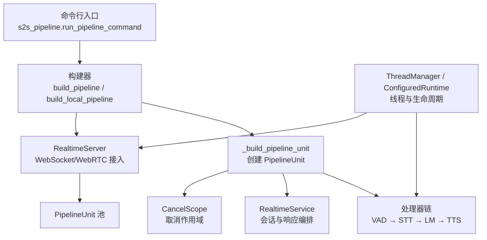
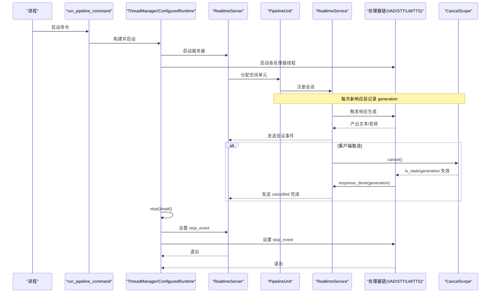
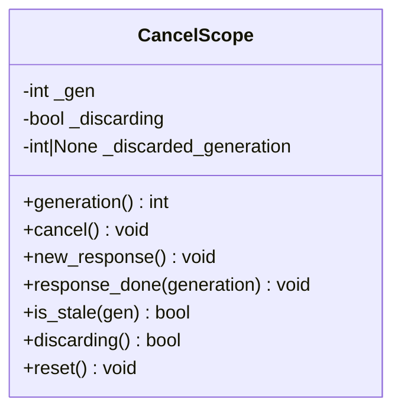
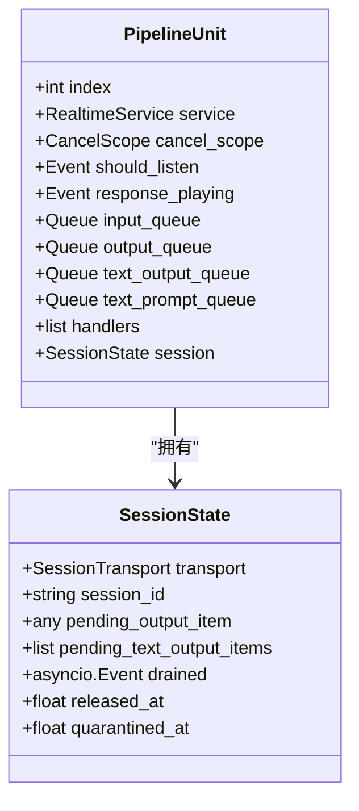
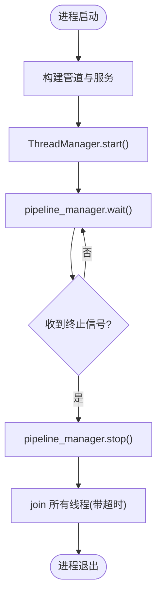
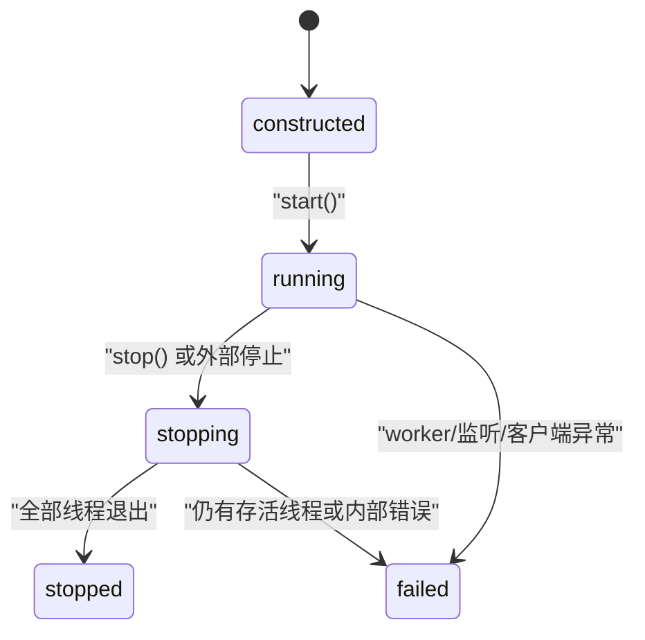
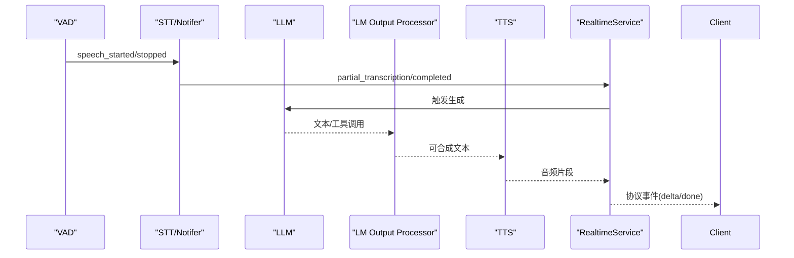
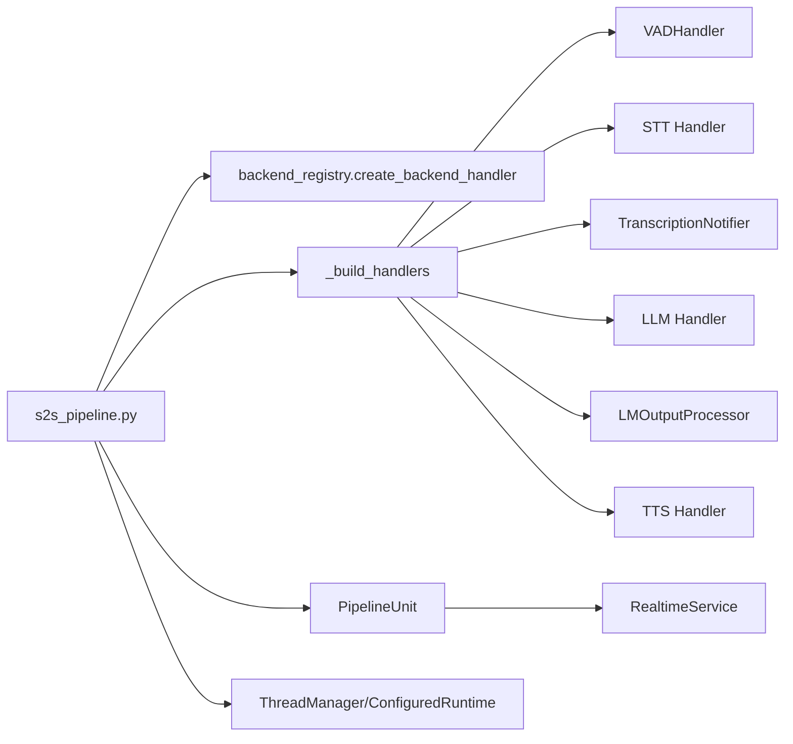

# 管道控制

<cite>
**本文引用的文件**   
- [cancel_scope.py](file://src/speech_to_speech/pipeline/cancel_scope.py)
- [control.py](file://src/speech_to_speech/pipeline/control.py)
- [pipeline_unit.py](file://src/speech_to_speech/api/openai_realtime/pipeline_unit.py)
- [thread_manager.py](file://src/speech_to_speech/utils/thread_manager.py)
- [configured_runtime.py](file://src/speech_to_speech/configured_runtime.py)
- [s2s_pipeline.py](file://src/speech_to_speech/s2s_pipeline.py)
- [service.py](file://src/speech_to_speech/api/openai_realtime/service.py)
- [events.py](file://src/speech_to_speech/pipeline/events.py)
</cite>

## 目录
1. [引言](#引言)
2. [项目结构](#项目结构)
3. [核心组件](#核心组件)
4. [架构总览](#架构总览)
5. [详细组件分析](#详细组件分析)
6. [依赖关系分析](#依赖关系分析)
7. [性能与配置调优](#性能与配置调优)
8. [故障恢复与健康检查](#故障恢复与健康检查)
9. [扩展点与自定义控制逻辑](#扩展点与自定义控制逻辑)
10. [结论](#结论)

## 引言
本文面向“语音到语音”实时管道的控制机制，聚焦以下目标：
- 管道生命周期管理、启动与停止流程
- 取消作用域 CancelScope 的实现原理与任务协调
- 资源释放策略与优雅关闭
- 管道状态监控、健康检查与指标收集
- 管道配置选项、性能调优参数
- 管道状态图、控制流程图与实际控制代码示例路径
- 故障恢复与扩展点使用指南

本仓库采用“多阶段处理器链 + 队列通信 + 线程/协程混合”的架构：VAD → STT（可选转写通知）→ LLM → LM 输出处理 → TTS（可选唇形同步）。每个 PipelineUnit 拥有独立的队列、事件、CancelScope 和 RealtimeService；上层由 ThreadManager 或 ConfiguredRuntime 统一调度。

## 项目结构
与管道控制直接相关的核心目录与文件如下：
- pipeline：CancelScope、控制消息类型、事件模型等
- api/openai_realtime：PipelineUnit、RealtimeService、传输与会话相关
- utils：ThreadManager 线程管理
- configured_runtime：显式配置运行时、命名池、信号与资源清理
- s2s_pipeline：命令行入口、参数解析、构建管道单元与服务

**图表来源**
- [s2s_pipeline.py:594-747](file://src/speech_to_speech/s2s_pipeline.py#L594-L747)
- [pipeline_unit.py:53-77](file://src/speech_to_speech/api/openai_realtime/pipeline_unit.py#L53-L77)
- [thread_manager.py:9-40](file://src/speech_to_speech/utils/thread_manager.py#L9-L40)
- [configured_runtime.py:162-348](file://src/speech_to_speech/configured_runtime.py#L162-L348)

**章节来源**
- [s2s_pipeline.py:185-297](file://src/speech_to_speech/s2s_pipeline.py#L185-L297)
- [s2s_pipeline.py:594-747](file://src/speech_to_speech/s2s_pipeline.py#L594-L747)

## 核心组件
- CancelScope：跨线程的取消信号与生成号，用于中断正在进行的响应并丢弃陈旧输出
- ControlKind/PipelineControlMessage：强类型控制消息，如 SESSION_END
- PipelineUnit：一个隔离的实时管道，包含服务、队列、处理器链、CancelScope 与 SessionState
- ThreadManager：简单线程管理器，负责 start/wait/stop
- ConfiguredRuntime：显式配置的运行时，负责命名池、启动、等待、停止、失败传播与资源清理
- RealtimeService：会话级编排，将管道事件映射为 OpenAI Realtime 协议事件，并维护 UsageMetrics

**章节来源**
- [cancel_scope.py:1-65](file://src/speech_to_speech/pipeline/cancel_scope.py#L1-L65)
- [control.py:1-27](file://src/speech_to_speech/pipeline/control.py#L1-L27)
- [pipeline_unit.py:13-77](file://src/speech_to_speech/api/openai_realtime/pipeline_unit.py#L13-L77)
- [thread_manager.py:9-40](file://src/speech_to_speech/utils/thread_manager.py#L9-L40)
- [configured_runtime.py:162-348](file://src/speech_to_speech/configured_runtime.py#L162-L348)
- [service.py:175-200](file://src/speech_to_speech/api/openai_realtime/service.py#L175-L200)

## 架构总览
下图展示从进程入口到具体处理器链的控制流，以及取消信号如何贯穿各阶段。

**图表来源**
- [s2s_pipeline.py:788-841](file://src/speech_to_speech/s2s_pipeline.py#L788-L841)
- [thread_manager.py:18-40](file://src/speech_to_speech/utils/thread_manager.py#L18-L40)
- [configured_runtime.py:209-274](file://src/speech_to_speech/configured_runtime.py#L209-L274)
- [pipeline_unit.py:53-77](file://src/speech_to_speech/api/openai_realtime/pipeline_unit.py#L53-L77)
- [cancel_scope.py:13-65](file://src/speech_to_speech/pipeline/cancel_scope.py#L13-L65)

## 详细组件分析

### 取消作用域 CancelScope
CancelScope 提供统一的取消信号，核心设计要点：
- 使用“生成号”避免短暂脉冲竞态：每个响应开始捕获当前 generation，后续通过 is_stale(gen) 判断是否被覆盖
- discarding 标志位让异步发送循环静默丢弃陈旧输出
- 线程安全：单写多读，Python GIL 保证 int/bool 原子读写，无需额外锁

关键方法语义：
- cancel()：递增 generation，开启 discarding
- new_response()：新响应开始时清除 discard 状态
- response_done(generation)：下游确认完成，仅允许已废弃或最新 generation 清理 discard
- is_stale(gen)：若 gen 不等于当前 generation，则视为陈旧

**图表来源**
- [cancel_scope.py:1-65](file://src/speech_to_speech/pipeline/cancel_scope.py#L1-L65)

**章节来源**
- [cancel_scope.py:1-65](file://src/speech_to_speech/pipeline/cancel_scope.py#L1-L65)

### 控制消息与控制类型
- ControlKind：强类型枚举，目前支持 SESSION_END
- PipelineControlMessage：不可变数据类，携带 kind 与 session_id
- is_control_message(message, kind)：快速判断是否为控制消息

用途：在会话结束或强制释放时，向管道输出队列注入控制消息，确保所有阶段有序收尾。

**章节来源**
- [control.py:1-27](file://src/speech_to_speech/pipeline/control.py#L1-L27)

### PipelineUnit 与会话状态
PipelineUnit 是单个隔离管道实例，持有：
- service：RealtimeService，编排会话与响应
- cancel_scope：CancelScope，控制取消
- should_listen/response_playing：线程事件，协调监听与播放
- input_queue/output_queue/text_output_queue/text_prompt_queue：内部队列
- handlers：处理器链实例列表
- session：SessionState，封装 transport、session_id、pending 输出项、drained 事件、released_at/quarantined_at 等

SessionState 的关键职责：
- 将传输对象与会话 ID 绑定，避免悬空引用
- drained 事件由发送循环在收到 SESSION_END 后设置，释放路径 await drained 后再清空 PipelineUnit.session，防止抢占
- released_at/quarantined_at 用于暴露“卡住”的单元，便于监控

**图表来源**
- [pipeline_unit.py:13-77](file://src/speech_to_speech/api/openai_realtime/pipeline_unit.py#L13-L77)

**章节来源**
- [pipeline_unit.py:13-77](file://src/speech_to_speech/api/openai_realtime/pipeline_unit.py#L13-L77)

### 线程管理与优雅关闭
ThreadManager 提供最小化的线程生命周期管理：
- start()：为每个 handler.run 启动非守护线程
- wait()：join 所有线程
- stop()：对所有 handler.stop_event.set()，然后带超时 join

s2s_pipeline.run_pipeline_command 中注册 SIGINT/SIGTERM 信号处理器，调用 pipeline_manager.stop() 实现优雅关闭。

**图表来源**
- [thread_manager.py:18-40](file://src/speech_to_speech/utils/thread_manager.py#L18-L40)
- [s2s_pipeline.py:816-841](file://src/speech_to_speech/s2s_pipeline.py#L816-L841)

**章节来源**
- [thread_manager.py:9-40](file://src/speech_to_speech/utils/thread_manager.py#L9-L40)
- [s2s_pipeline.py:788-841](file://src/speech_to_speech/s2s_pipeline.py#L788-L841)

### 显式配置运行时 ConfiguredRuntime
ConfiguredRuntime 提供更强的生命周期与资源管理能力：
- state：constructed → running → stopping → stopped/failed
- start()：按顺序启动所有 handler 线程，并启动监控线程
- stop()：设置停止事件，join 所有线程，清理资源，最终置为 stopped 或 failed
- wait()：阻塞直到运行结束或外部停止，再执行 stop()
- 构造期异常会触发反向清理，保证部分构建的资源也能释放

**图表来源**
- [configured_runtime.py:162-274](file://src/speech_to_speech/configured_runtime.py#L162-L274)

**章节来源**
- [configured_runtime.py:162-348](file://src/speech_to_speech/configured_runtime.py#L162-L348)

### 响应生命周期与事件模型
RealtimeService 将管道事件转换为 OpenAI Realtime 协议事件，并维护 UsageMetrics。关键事件包括：
- SpeechStartedEvent/SpeechStoppedEvent
- PartialTranscriptionEvent/TranscriptionCompletedEvent/TranscriptionFailedEvent
- AssistantOutputEvent/AssistantResponseDoneEvent
- ResponseGenerationDoneEvent/ResponseFailedEvent
- TokenUsageEvent

这些事件驱动响应状态机，决定何时发送 response.created、response.done、audio delta、text delta 等。

**图表来源**
- [events.py:37-194](file://src/speech_to_speech/pipeline/events.py#L37-L194)
- [service.py:118-169](file://src/speech_to_speech/api/openai_realtime/service.py#L118-L169)

**章节来源**
- [events.py:37-194](file://src/speech_to_speech/pipeline/events.py#L37-L194)
- [service.py:118-169](file://src/speech_to_speech/api/openai_realtime/service.py#L118-L169)

## 依赖关系分析
- s2s_pipeline 依赖 backend_registry 选择 STT/LLM/TTS，并通过 create_backend_handler 构建处理器链
- _build_handlers 组装 VAD、STT、可选 TranscriptionNotifier、LLM、LMOutputProcessor、TTS，以及可选 Visemes
- PipelineUnit 聚合 handlers 与 queues，并由 RealtimeService 编排
- ThreadManager/ConfiguredRuntime 统一管理线程与资源

**图表来源**
- [s2s_pipeline.py:382-574](file://src/speech_to_speech/s2s_pipeline.py#L382-L574)
- [s2s_pipeline.py:594-747](file://src/speech_to_speech/s2s_pipeline.py#L594-L747)

**章节来源**
- [s2s_pipeline.py:382-574](file://src/speech_to_speech/s2s_pipeline.py#L382-L574)
- [s2s_pipeline.py:594-747](file://src/speech_to_speech/s2s_pipeline.py#L594-L747)

## 性能与配置调优
- torch_num_threads：可通过 ModuleArguments.torch_num_threads 显式设置 PyTorch 线程数；VAD 加载后会重新应用该值，避免第三方库修改全局线程数影响推理
- num_pipelines：并行管道数量，需结合硬件能力调整
- enable_live_transcription：启用实时转写；macOS 下默认禁用以避免竞争
- live_transcription_update_interval：实时转写更新间隔
- diarization：说话人分离，建议 CUDA/MPS；CPU 上可能跟不上持续语音
- device：全局设备选择，会应用到 STT/LLM/TTS 的配置中（若未显式指定）
- llm_proxy：需要后端具备 supports_llm_proxy 能力
- visemes：唇形同步模块，增加额外处理阶段

参考路径：
- [s2s_pipeline.py:336-344](file://src/speech_to_speech/s2s_pipeline.py#L336-L344)
- [s2s_pipeline.py:347-380](file://src/speech_to_speech/s2s_pipeline.py#L347-L380)
- [s2s_pipeline.py:429-467](file://src/speech_to_speech/s2s_pipeline.py#L429-L467)
- [s2s_pipeline.py:646-649](file://src/speech_to_speech/s2s_pipeline.py#L646-L649)

**章节来源**
- [s2s_pipeline.py:336-380](file://src/speech_to_speech/s2s_pipeline.py#L336-L380)
- [s2s_pipeline.py:429-467](file://src/speech_to_speech/s2s_pipeline.py#L429-L467)
- [s2s_pipeline.py:646-649](file://src/speech_to_speech/s2s_pipeline.py#L646-L649)

## 故障恢复与健康检查
- 线程级故障：ConfiguredRuntime._watch 检测 worker/listener/client 异常，设置 _failure 并触发停止；wait() 抛出 ConfiguredRuntimeError
- 会话级卡住：SessionState.released_at/quarantined_at 暴露长时间未释放或未 drain 的单元，可用于 /v1/pool 健康检查
- 资源清理：ConfiguredRuntime 在构造失败或停止时，按逆序调用 cleanup/reset，确保模型、工作线程等资源释放
- 优雅关闭：Signal 处理器与 stop_event 协同，确保所有线程在超时内退出

实践建议：
- 对外暴露 /v1/pool 接口，统计 released_at/quarantined_at 超时的单元
- 监控 ConfiguredRuntime.state 与存活线程数
- 对长时间无响应的会话主动触发 cancel() 并观察 response_done 回调

**章节来源**
- [configured_runtime.py:204-274](file://src/speech_to_speech/configured_runtime.py#L204-L274)
- [pipeline_unit.py:26-50](file://src/speech_to_speech/api/openai_realtime/pipeline_unit.py#L26-L50)

## 扩展点与自定义控制逻辑
- 自定义处理器：实现标准处理器接口并通过 backend_registry 注册，参与 _build_handlers 构建的链
- 控制消息：扩展 ControlKind 与 PipelineControlMessage，配合 is_control_message 在输出队列中注入控制指令
- 取消行为：在自定义处理器中读取 CancelScope.generation 并在生成过程中检查 is_stale，必要时调用 response_done 以清理 discard 状态
- 指标扩展：在 RealtimeService 中累积 UsageMetrics，或通过 TurnLatencyStore 记录智能等待延迟

示例路径（不展示代码内容，仅提供定位）：
- 控制消息定义：[control.py:7-27](file://src/speech_to_speech/pipeline/control.py#L7-L27)
- 取消作用域用法：[cancel_scope.py:13-65](file://src/speech_to_speech/pipeline/cancel_scope.py#L13-L65)
- 处理器链构建：[s2s_pipeline.py:382-574](file://src/speech_to_speech/s2s_pipeline.py#L382-L574)
- 指标模型：[service.py:175-200](file://src/speech_to_speech/api/openai_realtime/service.py#L175-L200)

**章节来源**
- [control.py:7-27](file://src/speech_to_speech/pipeline/control.py#L7-L27)
- [cancel_scope.py:13-65](file://src/speech_to_speech/pipeline/cancel_scope.py#L13-L65)
- [s2s_pipeline.py:382-574](file://src/speech_to_speech/s2s_pipeline.py#L382-L574)
- [service.py:175-200](file://src/speech_to_speech/api/openai_realtime/service.py#L175-L200)

## 结论
本项目的管道控制机制围绕“明确的取消作用域、清晰的会话状态、严格的线程生命周期管理”展开。CancelScope 通过生成号与丢弃标志位解决并发场景下的陈旧输出问题；PipelineUnit 与 SessionState 将传输与会话生命周期绑定；ThreadManager 与 ConfiguredRuntime 分别提供轻量与强约束的生命周期管理；RealtimeService 将内部事件映射为协议事件并维护用量指标。通过合理配置 num_pipelines、torch_num_threads、diarization 与设备参数，可在不同硬件环境下取得稳定低延迟表现。借助 released_at/quarantined_at 与状态机，可实现健康检查与故障恢复；通过扩展 ControlKind 与处理器链，可灵活定制控制逻辑。