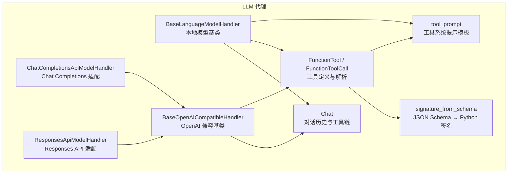
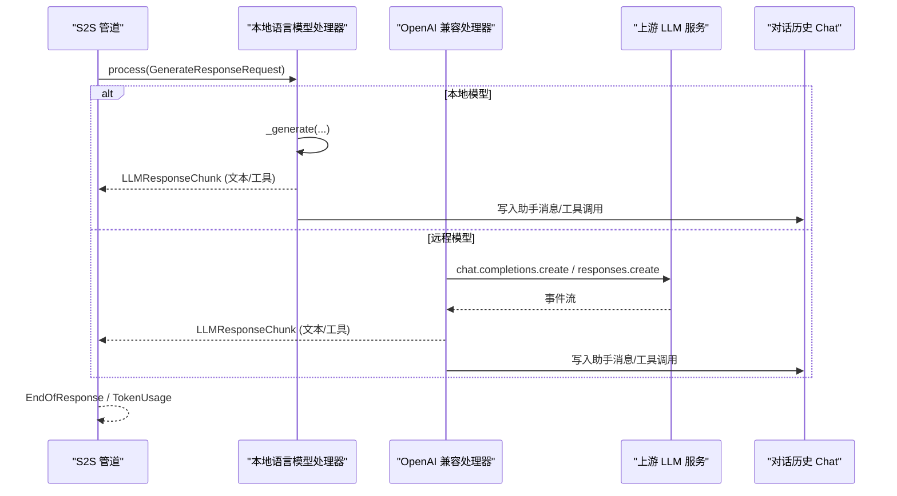
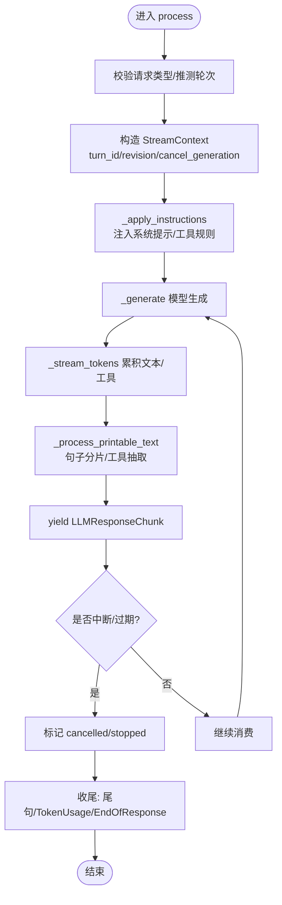
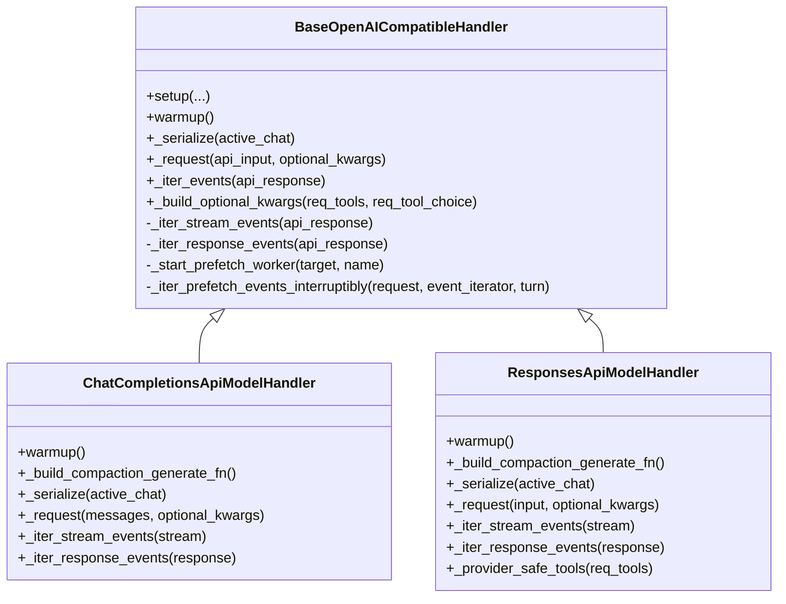
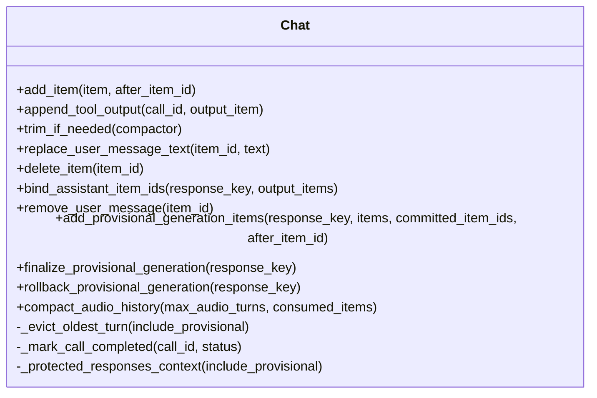
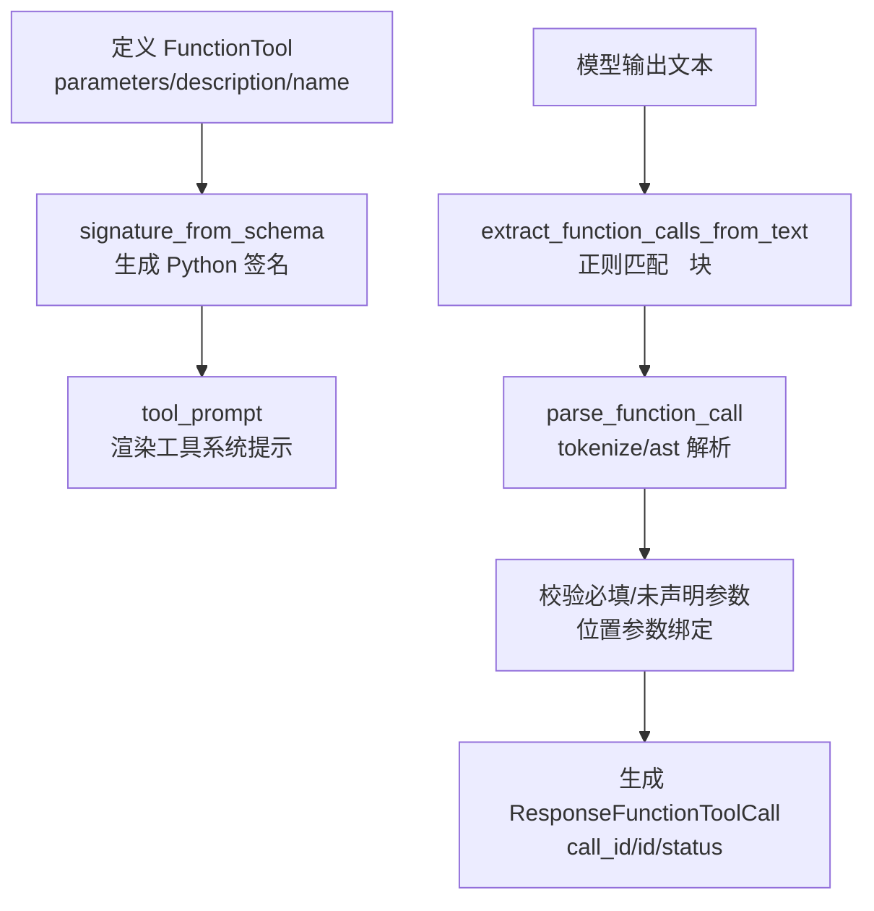
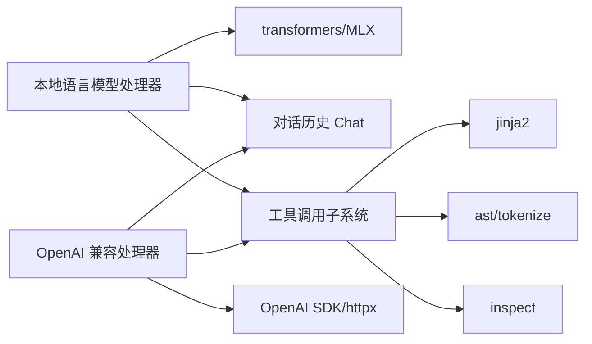

# LLM 代理功能

<cite>
**本文引用的文件**   
- [language_model.py](file://src/speech_to_speech/LLM/language_model.py)
- [base_openai_compatible_language_model.py](file://src/speech_to_speech/LLM/base_openai_compatible_language_model.py)
- [chat_completions_language_model.py](file://src/speech_to_speech/LLM/chat_completions_language_model.py)
- [responses_api_language_model.py](file://src/speech_to_speech/LLM/responses_api_language_model.py)
- [chat.py](file://src/speech_to_speech/LLM/chat.py)
- [function_call.py](file://src/speech_to_speech/LLM/tool_call/function_call.py)
- [function_tool.py](file://src/speech_to_speech/LLM/tool_call/function_tool.py)
- [signature_from_schema.py](file://src/speech_to_speech/LLM/tool_call/signature_from_schema.py)
- [tool_prompt.py](file://src/speech_to_speech/LLM/tool_call/tool_prompt.py)
</cite>

## 目录
1. [引言](#引言)
2. [项目结构](#项目结构)
3. [核心组件](#核心组件)
4. [架构总览](#架构总览)
5. [详细组件分析](#详细组件分析)
6. [依赖关系分析](#依赖关系分析)
7. [性能与延迟特性](#性能与延迟特性)
8. [故障排查指南](#故障排查指南)
9. [结论](#结论)

## 引言
本文件聚焦于语音到语音（Speech-to-Speech）系统中的“大语言模型代理”能力，包括：
- 本地 Transformers/MLX 文本语言模型的流式生成、工具调用解析、历史压缩与中断控制。
- OpenAI 兼容后端（Chat Completions 与 Responses API）的统一事件化抽象、预取工作线程、取消与推测轮次门控。
- 函数工具定义、签名推导、系统提示构建与代码块包裹的工具调用抽取。
- 对话历史管理、音频输入处理、工具链状态与历史回写一致性。

该文档面向希望理解或扩展 LLM 代理能力的开发者，既提供高层架构图，也深入到关键类的职责、数据流和错误处理。

## 项目结构
LLM 代理相关代码集中在 `src/speech_to_speech/LLM` 下，按职责划分为：
- 语言模型基类与实现：本地模型路径与 OpenAI 兼容路径。
- 工具调用子系统：函数工具描述、签名推导、系统提示模板、从文本中抽取工具调用。
- 对话历史与消息模型：统一 Realtime/Responses 消息类型，支持工具链、推理项、音频占位等。

**图示来源**
- [language_model.py:166-765](file://src/speech_to_speech/LLM/language_model.py#L166-L765)
- [base_openai_compatible_language_model.py:174-800](file://src/speech_to_speech/LLM/base_openai_compatible_language_model.py#L174-L800)
- [chat_completions_language_model.py:303-395](file://src/speech_to_speech/LLM/chat_completions_language_model.py#L303-L395)
- [responses_api_language_model.py:63-379](file://src/speech_to_speech/LLM/responses_api_language_model.py#L63-L379)
- [chat.py:123-800](file://src/speech_to_speech/LLM/chat.py#L123-L800)
- [function_call.py:189-330](file://src/speech_to_speech/LLM/tool_call/function_call.py#L189-L330)
- [function_tool.py:8-35](file://src/speech_to_speech/LLM/tool_call/function_tool.py#L8-L35)
- [signature_from_schema.py:79-125](file://src/speech_to_speech/LLM/tool_call/signature_from_schema.py#L79-L125)
- [tool_prompt.py:76-110](file://src/speech_to_speech/LLM/tool_call/tool_prompt.py#L76-L110)

**章节来源**
- [language_model.py:166-765](file://src/speech_to_speech/LLM/language_model.py#L166-L765)
- [base_openai_compatible_language_model.py:174-800](file://src/speech_to_speech/LLM/base_openai_compatible_language_model.py#L174-L800)
- [chat_completions_language_model.py:303-395](file://src/speech_to_speech/LLM/chat_completions_language_model.py#L303-L395)
- [responses_api_language_model.py:63-379](file://src/speech_to_speech/LLM/responses_api_language_model.py#L63-L379)
- [chat.py:123-800](file://src/speech_to_speech/LLM/chat.py#L123-L800)
- [function_call.py:189-330](file://src/speech_to_speech/LLM/tool_call/function_call.py#L189-L330)
- [function_tool.py:8-35](file://src/speech_to_speech/LLM/tool_call/function_tool.py#L8-L35)
- [signature_from_schema.py:79-125](file://src/speech_to_speech/LLM/tool_call/signature_from_schema.py#L79-L125)
- [tool_prompt.py:76-110](file://src/speech_to_speech/LLM/tool_call/tool_prompt.py#L76-L110)

## 核心组件
- 本地语言模型处理器：负责加载模型、流式生成、句子级分片、工具调用解析、历史回写与中断控制。
- OpenAI 兼容处理器：统一抽象 Chat Completions 与 Responses API，将上游事件标准化为 TextDelta、AssistantMessage、ToolCall、Usage、ProviderResponseEnd。
- 对话历史 Chat：维护 bounded 历史、工具链状态、推理项、音频历史压缩、临时生成项的回滚与提交。
- 工具调用子系统：基于 JSON Schema 生成 Python 风格签名，渲染系统提示，从模型输出中提取并校验工具调用。

**章节来源**
- [language_model.py:166-765](file://src/speech_to_speech/LLM/language_model.py#L166-L765)
- [base_openai_compatible_language_model.py:174-800](file://src/speech_to_speech/LLM/base_openai_compatible_language_model.py#L174-L800)
- [chat.py:123-800](file://src/speech_to_speech/LLM/chat.py#L123-L800)
- [function_call.py:189-330](file://src/speech_to_speech/LLM/tool_call/function_call.py#L189-L330)
- [function_tool.py:8-35](file://src/speech_to_speech/LLM/tool_call/function_tool.py#L8-L35)
- [signature_from_schema.py:79-125](file://src/speech_to_speech/LLM/tool_call/signature_from_schema.py#L79-L125)
- [tool_prompt.py:76-110](file://src/speech_to_speech/LLM/tool_call/tool_prompt.py#L76-L110)

## 架构总览
LLM 代理采用“双通道 + 统一事件”的架构：
- 本地通道：Transformers/MLX 模型直接生成 token，通过 `_stream_tokens` 累积文本、提取工具调用、按句子批次输出。
- 远程通道：OpenAI 兼容后端以事件流形式返回，由 BaseOpenAICompatibleHandler 统一消费，映射为标准 ProviderEvent，再转换为下游 LLMResponseChunk。

**图示来源**
- [language_model.py:560-765](file://src/speech_to_speech/LLM/language_model.py#L560-L765)
- [base_openai_compatible_language_model.py:772-800](file://src/speech_to_speech/LLM/base_openai_compatible_language_model.py#L772-L800)
- [chat_completions_language_model.py:303-395](file://src/speech_to_speech/LLM/chat_completions_language_model.py#L303-L395)
- [responses_api_language_model.py:63-379](file://src/speech_to_speech/LLM/responses_api_language_model.py#L63-L379)
- [chat.py:123-800](file://src/speech_to_speech/LLM/chat.py#L123-L800)

## 详细组件分析

### 本地语言模型处理器
职责要点：
- 生命周期：setup 加载模型与 tokenizer，构建 compactor；process 接收请求，构造 StreamContext，执行 _generate，流式产出 LLMResponseChunk。
- 中断与撤销：_check_stop 检查取消范围、推测轮次、停止事件；prefetch_transaction 丢弃隐藏工作。
- 工具调用：_apply_instructions 注入工具系统提示，_process_printable_text 解析 `<code>` 包裹的工具调用，转为 AssistantToolCallPart。
- 历史回写：_ordered_output_items 组装 assistant message 与 function call，ResponseHistory.capture 记录增量历史。

**图示来源**
- [language_model.py:560-765](file://src/speech_to_speech/LLM/language_model.py#L560-L765)
- [language_model.py:486-553](file://src/speech_to_speech/LLM/language_model.py#L486-L553)
- [language_model.py:324-427](file://src/speech_to_speech/LLM/language_model.py#L324-L427)
- [language_model.py:280-323](file://src/speech_to_speech/LLM/language_model.py#L280-L323)

**章节来源**
- [language_model.py:166-765](file://src/speech_to_speech/LLM/language_model.py#L166-L765)

### OpenAI 兼容处理器（Chat Completions 与 Responses API）
职责要点：
- 统一抽象：BaseOpenAICompatibleHandler 定义 warmup、_serialize、_request、_iter_events、_build_optional_kwargs 等钩子。
- 事件标准化：TextDelta、AssistantMessage、ToolCall、Usage、ProviderResponseEnd 作为统一词汇，屏蔽上游差异。
- 预取与并发：_start_prefetch_worker 限制并发 worker，_iter_prefetch_events_interruptibly 安全消费上游流，支持取消与重试。
- 会话配置：_build_extra_body 根据 base_url 与 reasoning_effort 调整 thinking 开关，兼容官方 OpenAI 与非官方服务器。

**图示来源**
- [base_openai_compatible_language_model.py:174-800](file://src/speech_to_speech/LLM/base_openai_compatible_language_model.py#L174-L800)
- [chat_completions_language_model.py:303-395](file://src/speech_to_speech/LLM/chat_completions_language_model.py#L303-L395)
- [responses_api_language_model.py:63-379](file://src/speech_to_speech/LLM/responses_api_language_model.py#L63-L379)

**章节来源**
- [base_openai_compatible_language_model.py:174-800](file://src/speech_to_speech/LLM/base_openai_compatible_language_model.py#L174-L800)
- [chat_completions_language_model.py:303-395](file://src/speech_to_speech/LLM/chat_completions_language_model.py#L303-L395)
- [responses_api_language_model.py:63-379](file://src/speech_to_speech/LLM/responses_api_language_model.py#L63-L379)

### 对话历史 Chat
职责要点：
- 有界缓冲：size 控制用户轮数上限，超过阈值触发 evict 或 compaction。
- 工具链状态：pending tool calls、ordered pending calls、provisional generations 保证工具调用与结果顺序一致。
- 临时生成项：add_provisional_generation_items 原子写入，finalize/rollback 提交或回滚。
- 音频历史压缩：compact_audio_history 保留最新音频轮次，旧音频替换为占位文本。

**图示来源**
- [chat.py:123-800](file://src/speech_to_speech/LLM/chat.py#L123-L800)

**章节来源**
- [chat.py:123-800](file://src/speech_to_speech/LLM/chat.py#L123-L800)

### 工具调用子系统
职责要点：
- FunctionTool：封装 RealtimeFunctionTool，to_code_prompt 生成 Python 风格函数签名与文档字符串。
- signature_from_schema：将 JSON Schema 属性映射为 Python 类型注解，生成 inspect.Signature，用于参数排序与默认值推断。
- function_call：使用 tokenize/ast 解析模型输出的函数调用字符串，支持位置参数与命名参数，校验必填字段与未声明参数。
- tool_prompt：Jinja2 模板渲染工具系统提示，指导模型在 `<code>` 块内输出工具调用。

**图示来源**
- [function_tool.py:8-35](file://src/speech_to_speech/LLM/tool_call/function_tool.py#L8-L35)
- [signature_from_schema.py:79-125](file://src/speech_to_speech/LLM/tool_call/signature_from_schema.py#L79-L125)
- [function_call.py:189-330](file://src/speech_to_speech/LLM/tool_call/function_call.py#L189-L330)
- [tool_prompt.py:76-110](file://src/speech_to_speech/LLM/tool_call/tool_prompt.py#L76-L110)

**章节来源**
- [function_tool.py:8-35](file://src/speech_to_speech/LLM/tool_call/function_tool.py#L8-L35)
- [signature_from_schema.py:79-125](file://src/speech_to_speech/LLM/tool_call/signature_from_schema.py#L79-L125)
- [function_call.py:189-330](file://src/speech_to_speech/LLM/tool_call/function_call.py#L189-L330)
- [tool_prompt.py:76-110](file://src/speech_to_speech/LLM/tool_call/tool_prompt.py#L76-L110)

## 依赖关系分析
- 本地模型处理器依赖：
  - transformers/MLX 模型加载与流式生成。
  - Chat 历史管理与 Tool 工具解析。
  - 取消范围与推测轮次跟踪。
- OpenAI 兼容处理器依赖：
  - httpx/OpenAI SDK 发起请求。
  - 事件标准化与消费逻辑。
  - Chat 历史与工具调用。
- 工具子系统依赖：
  - jinja2 渲染系统提示。
  - ast/tokenize 解析函数调用。
  - inspect 生成签名。

**图示来源**
- [language_model.py:166-765](file://src/speech_to_speech/LLM/language_model.py#L166-L765)
- [base_openai_compatible_language_model.py:174-800](file://src/speech_to_speech/LLM/base_openai_compatible_language_model.py#L174-L800)
- [function_call.py:189-330](file://src/speech_to_speech/LLM/tool_call/function_call.py#L189-L330)
- [tool_prompt.py:76-110](file://src/speech_to_speech/LLM/tool_call/tool_prompt.py#L76-L110)

**章节来源**
- [language_model.py:166-765](file://src/speech_to_speech/LLM/language_model.py#L166-L765)
- [base_openai_compatible_language_model.py:174-800](file://src/speech_to_speech/LLM/base_openai_compatible_language_model.py#L174-L800)
- [function_call.py:189-330](file://src/speech_to_speech/LLM/tool_call/function_call.py#L189-L330)
- [tool_prompt.py:76-110](file://src/speech_to_speech/LLM/tool_call/tool_prompt.py#L76-L110)

## 性能与延迟特性
- 本地模型：
  - 流式生成按句子批次输出，减少 TTS 等待时间。
  - MLX 路径使用专用锁上下文避免竞争。
  - 历史压缩后台运行，避免阻塞主流程。
- 远程模型：
  - 预取工作线程限制并发，避免资源耗尽。
  - 事件标准化后统一消费，降低分支复杂度。
  - 超时与重试策略提升稳定性。

[本节为通用性能讨论，不直接分析具体文件]

## 故障排查指南
常见问题与定位建议：
- 工具调用解析失败：
  - 检查模型输出是否包含 `<code>` 块，确认 block_regex 与 enter/end code 匹配。
  - 查看 function_call.py 中的 parse_function_call 与 extract_function_calls_from_text 日志。
- 上游服务不可用：
  - BaseOpenAICompatibleHandler 提供 provider_unavailable_message，可在服务降级时播报。
  - 检查 _is_official_openai 与 _is_local_base_url 判断是否正确。
- 历史不一致：
  - 确认 Chat.add_provisional_generation_items 与 finalize/rollback 配对调用。
  - 检查 tool_output_call_ids 与 has_pending_tool_calls 状态。

**章节来源**
- [function_call.py:269-330](file://src/speech_to_speech/LLM/tool_call/function_call.py#L269-L330)
- [base_openai_compatible_language_model.py:302-314](file://src/speech_to_speech/LLM/base_openai_compatible_language_model.py#L302-L314)
- [chat.py:668-775](file://src/speech_to_speech/LLM/chat.py#L668-L775)

## 结论
LLM 代理功能通过本地模型与 OpenAI 兼容后端的统一抽象，实现了高内聚、低耦合的语音到语音对话能力。其核心优势在于：
- 统一的流式事件处理与历史回写机制。
- 健壮的工具调用解析与校验。
- 可插拔的后端适配与灵活的提示工程。
- 完善的取消、撤销与推测轮次门控。

这些设计使得系统在复杂交互场景下仍能保持低延迟、高可靠与易扩展。