# BaseLanguageModelHandler 抽象基类

<cite>
**本文引用的文件**   
- [language_model.py](file://src/speech_to_speech/LLM/language_model.py)
- [base_openai_compatible_language_model.py](file://src/speech_to_speech/LLM/base_openai_compatible_language_model.py)
- [chat_completions_language_model.py](file://src/speech_to_speech/LLM/chat_completions_language_model.py)
- [responses_api_language_model.py](file://src/speech_to_speech/LLM/responses_api_language_model.py)
</cite>

## 目录
1. [引言](#引言)
2. [项目结构定位](#项目结构定位)
3. [核心职责与统一接口设计](#核心职责与统一接口设计)
4. [生命周期管理](#生命周期管理)
5. [流式处理框架](#流式处理框架)
6. [取消机制与线程安全](#取消机制与线程安全)
7. [工具调用、指令应用与文本处理](#工具调用指令应用与文本处理)
8. [OpenAI 兼容后端扩展点](#openai-兼容后端扩展点)
9. [架构总览](#架构总览)
10. [详细组件分析](#详细组件分析)
11. [依赖关系分析](#依赖关系分析)
12. [性能与可观测性](#性能与可观测性)
13. [扩展新后端的最佳实践](#扩展新后端的最佳实践)
14. [故障排查指南](#故障排查指南)
15. [结论](#结论)

## 引言

本文围绕 `BaseLanguageModelHandler` 及其在 OpenAI 兼容 LLM 路径中的对应基类 `BaseOpenAICompatibleHandler`，系统化说明以下目标：

- 作为所有 LLM 后端统一接口的设计模式。
- 核心职责：请求编排、流式输出、历史写入、工具调用、语言提示、取消控制、错误终止。
- 生命周期：`setup()` 初始化、模型加载、预热、清理。
- 流式处理：事件归一化、句子分片、音频/文本双路径、预取工作线程。
- 取消机制：`CancelScope`、推测生成轮次、预取事务、停止信号。
- 线程安全：锁、有界信号量、后台 worker 集合、响应关闭。
- 共享功能：指令注入、工具系统提示、Markdown 与不可发音字符处理、历史锚点。
- 扩展方式：如何基于抽象钩子实现新的本地或远程 LLM 后端。

需要特别注意：**本仓库中存在两套“语言模型处理器”体系**：

| 基类 | 适用场景 | 主要职责 |
|---|---|---|
| `BaseLanguageModelHandler` | 本地 Transformers / MLX 文本或视觉语言模型 | 模型加载、token 流消费、代码块与工具解析、句子分片、历史提交 |
| `BaseOpenAICompatibleHandler` | OpenAI 兼容的 `/v1/chat/completions` 或 `/v1/responses` 远程后端 | 请求序列化、ProviderEvent 归一化、预取 worker、失败回退、历史顺序对齐 |

两者都承担“统一 LLM 后端接口”的角色，但面向不同实现域。文档将分别展开，并在最后给出统一的扩展建议。

## 项目结构定位

`BaseLanguageModelHandler` 位于本地 LLM 处理层，而 `BaseOpenAICompatibleHandler` 位于 OpenAI 兼容后端层；两个具体实现族分别由 `ChatCompletionsApiModelHandler` 和 `ResponsesApiModelHandler` 继承。

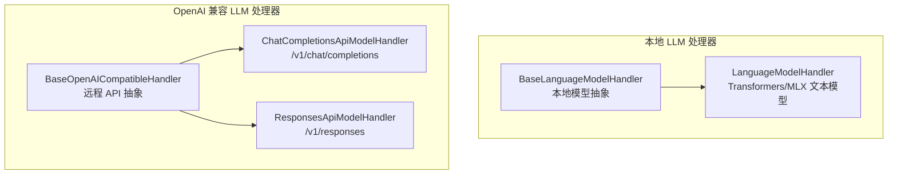

**图表来源**
- [language_model.py:166-770](file://src/speech_to_speech/LLM/language_model.py#L166-L770)
- [base_openai_compatible_language_model.py:174-1168](file://src/speech_to_speech/LLM/base_openai_compatible_language_model.py#L174-L1168)
- [chat_completions_language_model.py:303-395](file://src/speech_to_speech/LLM/chat_completions_language_model.py#L303-L395)
- [responses_api_language_model.py:63-379](file://src/speech_to_speech/LLM/responses_api_language_model.py#L63-L379)

**章节来源**
- [language_model.py:166-770](file://src/speech_to_speech/LLM/language_model.py#L166-L770)
- [base_openai_compatible_language_model.py:174-1168](file://src/speech_to_speech/LLM/base_openai_compatible_language_model.py#L174-L1168)

## 核心职责与统一接口设计

### `BaseLanguageModelHandler` 的统一接口

`BaseLanguageModelHandler` 是本地 LLM 处理器的抽象基类，其统一接口体现在：

1. **输入类型统一**：通过 `process(request)` 接收 `LLMIn`，典型为 `GenerateResponseRequest`。
2. **输出类型统一**：产出 `LLMOut`，包括 `LLMResponseChunk`、`TokenUsage`、`EndOfResponse`。
3. **状态上下文统一**：使用 `StreamContext` 累积生成状态。
4. **抽象钩子明确**：子类只需实现 `_load_model()` 和 `_generate()`。
5. **共享逻辑集中**：指令注入、工具解析、句子分片、历史写入、错误终止全部在基类完成。

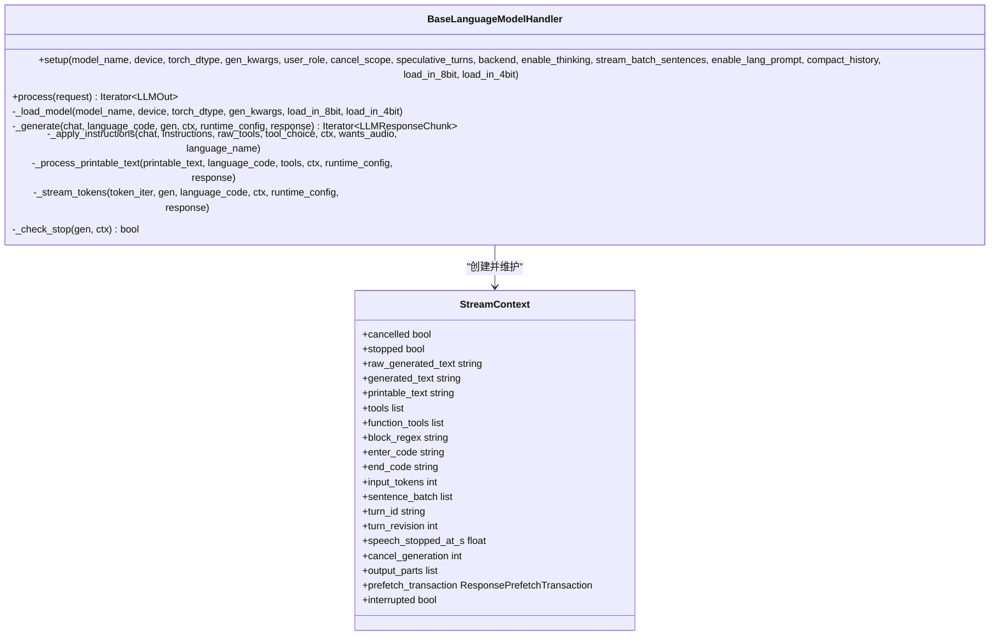

**图表来源**
- [language_model.py:118-159](file://src/speech_to_speech/LLM/language_model.py#L118-L159)
- [language_model.py:166-770](file://src/speech_to_speech/LLM/language_model.py#L166-L770)

### `BaseOpenAICompatibleHandler` 的统一接口

`BaseOpenAICompatibleHandler` 是 OpenAI 兼容远程后端的抽象基类，其统一接口体现在：

1. **ProviderEvent 归一化**：无论 Chat Completions 还是 Responses API，最终都映射到 `TextDelta`、`AssistantMessage`、`ToolCall`、`Usage`、`ProviderResponseEnd`。
2. **请求/响应钩子统一**：子类实现 `_serialize()`、`_request()`、`_iter_stream_events()`、`_iter_response_events()`。
3. **音频输入统一**：通过 `_serialize_audio()`、`_build_audio_optional_kwargs()`、`_request_audio()`、`_iter_audio_events()` 支持语音对话。
4. **预取与推测轮次统一**：通过 `_iter_prefetch_events_interruptibly()` 和 `SpeculativeTurnTracker` 协调隐藏请求。
5. **失败回退统一**：当上游不可用时，可返回用户可听见的回退文本。

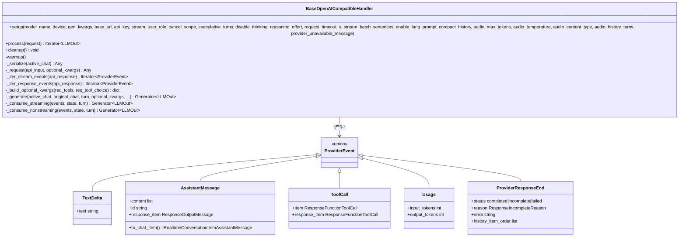

**图表来源**
- [base_openai_compatible_language_model.py:84-137](file://src/speech_to_speech/LLM/base_openai_compatible_language_model.py#L84-L137)
- [base_openai_compatible_language_model.py:174-1168](file://src/speech_to_speech/LLM/base_openai_compatible_language_model.py#L174-L1168)

**章节来源**
- [language_model.py:166-770](file://src/speech_to_speech/LLM/language_model.py#L166-L770)
- [base_openai_compatible_language_model.py:84-137](file://src/speech_to_speech/LLM/base_openai_compatible_language_model.py#L84-L137)
- [base_openai_compatible_language_model.py:174-1168](file://src/speech_to_speech/LLM/base_openai_compatible_language_model.py#L174-L1168)

## 生命周期管理

### `BaseLanguageModelHandler.setup()` 初始化流程

`setup()` 负责：

1. 根据后端选择设备：Transformers 使用 `resolve_device()`，MLX 走独立路径。
2. 保存 `cancel_scope`、`speculative_turns`、`model_name`、`device`、`enable_thinking`、`stream_batch_sentences`、`enable_lang_prompt`。
3. 调用抽象方法 `_load_model()` 加载模型、分词器及后端资源。
4. 设置 `user_role`。
5. 创建 `_transformers_lock`，用于串行化 Transformers 管道或 `model.generate()` 调用，避免与压缩后台任务竞争。
6. 构建历史压缩器 `compactor`（可选）。

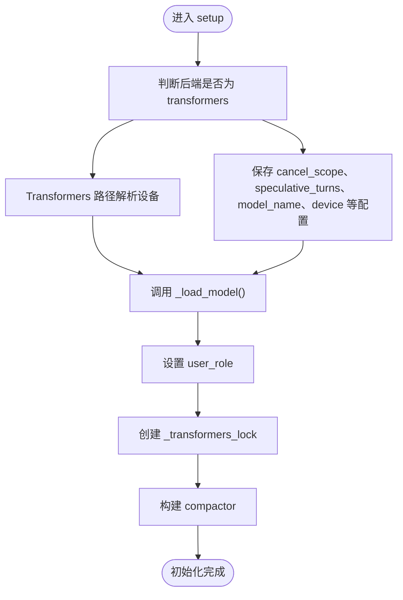

**图表来源**
- [language_model.py:178-215](file://src/speech_to_speech/LLM/language_model.py#L178-L215)

**章节来源**
- [language_model.py:178-215](file://src/speech_to_speech/LLM/language_model.py#L178-L215)

### `BaseOpenAICompatibleHandler.setup()` 初始化流程

`setup()` 负责：

1. 保存取消范围、推测轮次、模型名、流式开关、句子批大小、语言提示开关。
2. 保存生成参数、音频相关参数、推理努力程度、请求超时。
3. 构造 `httpx.Timeout`。
4. 处理本地 `base_url` 时自动设置 `api_key="none"`。
5. 创建 OpenAI SDK 客户端。
6. 构建 provider-specific `extra_body`，用于禁用思考或设置推理强度。
7. 创建预取 worker 限流信号量和线程集合。
8. 构建历史压缩器。
9. 调用 `warmup()` 预热连接或模型。

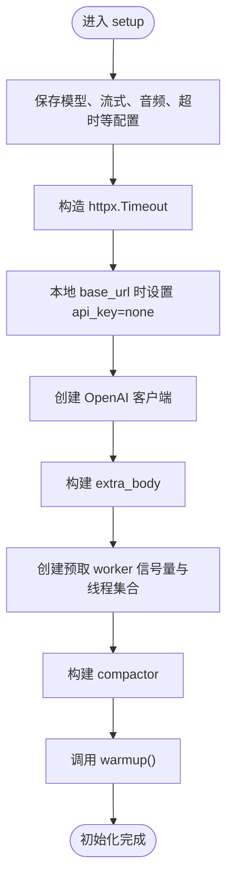

**图表来源**
- [base_openai_compatible_language_model.py:188-249](file://src/speech_to_speech/LLM/base_openai_compatible_language_model.py#L188-L249)

**章节来源**
- [base_openai_compatible_language_model.py:188-249](file://src/speech_to_speech/LLM/base_openai_compatible_language_model.py#L188-L249)

## 流式处理框架

### `BaseLanguageModelHandler` 的流式处理

`BaseLanguageModelHandler.process()` 的核心流程如下：

1. 创建 `StreamContext`。
2. 校验请求类型，填充 `turn_id`、`turn_revision`、`speech_stopped_at_s`、`cancel_generation`、`prefetch_transaction`。
3. 跳过陈旧轮次。
4. 检查是否仍有待处理的工具调用输出。
5. 处理 out-of-band 响应。
6. 解析语言、语言名称、指令、工具、工具选择。
7. 调用 `_apply_instructions()` 注入系统提示。
8. 捕获当前对话快照和历史锚点。
9. 调用子类实现的 `_generate()`。
10. 累积 `output_parts`，必要时更新 history。
11. 输出尾部文本、`TokenUsage`、`EndOfResponse`。
12. 异常路径保证始终发出 `EndOfResponse`，避免后续响应被永久锁定。

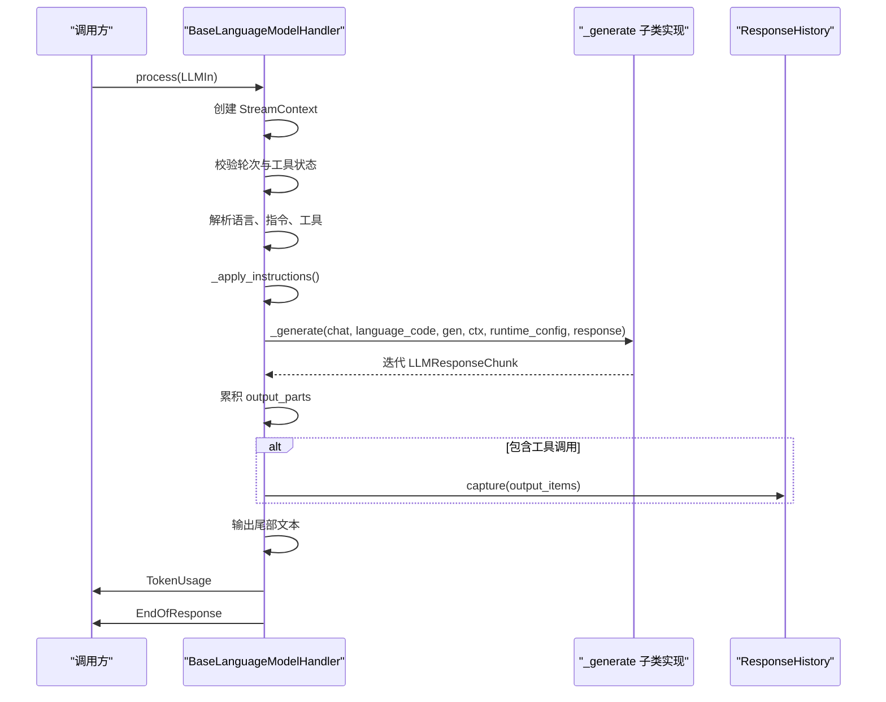

**图表来源**
- [language_model.py:560-765](file://src/speech_to_speech/LLM/language_model.py#L560-L765)

**章节来源**
- [language_model.py:560-765](file://src/speech_to_speech/LLM/language_model.py#L560-L765)

### `BaseOpenAICompatibleHandler` 的流式处理

`BaseOpenAICompatibleHandler._generate()` 的核心流程如下：

1. 序列化 active chat。
2. 记录本轮实际看到的图片 ID。
3. 若无输入则直接报错。
4. 若存在 `prefetch_transaction`，则启动预取 worker；否则直接发起请求。
5. 包装事件迭代器以测量首 token 时间。
6. 根据 `self.stream` 选择 `_consume_streaming()` 或 `_consume_nonstreaming()`。
7. 处理超时、上游错误、分类错误。
8. 若无输出且上游失败，则尝试发送回退文本。
9. 允许时提交历史，并输出 `TokenUsage` 和 `EndOfResponse`。

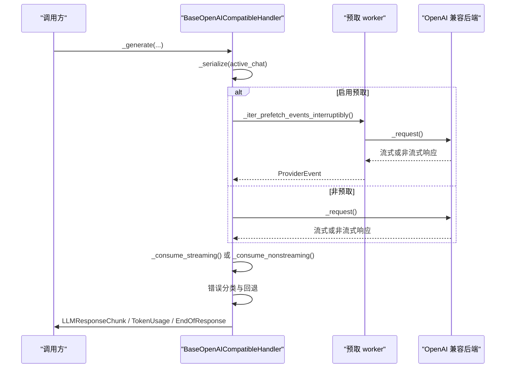

**图表来源**
- [base_openai_compatible_language_model.py:772-951](file://src/speech_to_speech/LLM/base_openai_compatible_language_model.py#L772-L951)
- [base_openai_compatible_language_model.py:415-530](file://src/speech_to_speech/LLM/base_openai_compatible_language_model.py#L415-L530)

**章节来源**
- [base_openai_compatible_language_model.py:772-951](file://src/speech_to_speech/LLM/base_openai_compatible_language_model.py#L772-L951)

## 取消机制与线程安全

### `StreamContext` 状态管理

`StreamContext` 是本地 LLM 生成过程中的可变状态容器，关键状态包括：

| 字段 | 含义 |
|---|---|
| `cancelled` | 因预取丢弃、中断、陈旧轮次等原因被取消 |
| `stopped` | 因会话停止信号被停止 |
| `raw_generated_text` | 原始生成文本，用于日志截断与统计 |
| `generated_text` | 清洗后的生成文本 |
| `printable_text` | 用于句子分片和工具块检测的可打印文本 |
| `tools` | 已解析的工具调用列表 |
| `function_tools` | 当前会话可用的函数工具定义 |
| `block_regex`、`enter_code`、`end_code` | 工具代码块边界标记 |
| `input_tokens` | 上游提供的输入 token 数 |
| `sentence_batch` | 待输出的句子缓冲 |
| `turn_id`、`turn_revision` | 轮次标识 |
| `speech_stopped_at_s` | 语音停止时间点 |
| `cancel_generation` | 取消生成的 generation 编号 |
| `output_parts` | 结构化输出部分，用于历史顺序重建 |
| `prefetch_transaction` | 预取事务，用于隐藏请求的生命周期管理 |

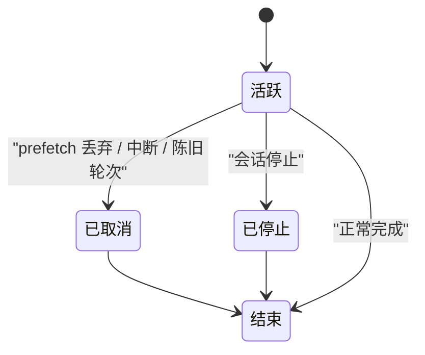

**图表来源**
- [language_model.py:134-164](file://src/speech_to_speech/LLM/language_model.py#L134-L164)
- [language_model.py:466-484](file://src/speech_to_speech/LLM/language_model.py#L466-L484)

**章节来源**
- [language_model.py:134-164](file://src/speech_to_speech/LLM/language_model.py#L134-L164)
- [language_model.py:466-484](file://src/speech_to_speech/LLM/language_model.py#L466-L484)

### `_CancelCriteria` 取消机制

`_CancelCriteria` 继承自 `StoppingCriteria`，用于本地模型生成过程中外部触发取消：

- `cancel()` 设置内部取消标志。
- `reset()` 重置取消标志。
- `__call__()` 返回 `_cancelled`，使底层生成器提前结束。

该机制与 `BaseLanguageModelHandler._finish_transformers_generation()` 配合：先取消，再清空 streamer，再 join 线程。

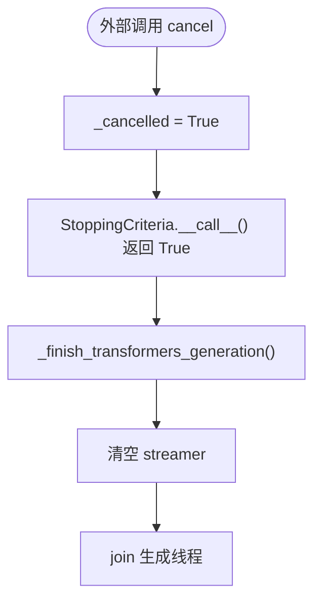

**图表来源**
- [language_model.py:118-132](file://src/speech_to_speech/LLM/language_model.py#L118-L132)
- [language_model.py:266-275](file://src/speech_to_speech/LLM/language_model.py#L266-L275)

**章节来源**
- [language_model.py:118-132](file://src/speech_to_speech/LLM/language_model.py#L118-L132)
- [language_model.py:266-275](file://src/speech_to_speech/LLM/language_model.py#L266-L275)

### 预取 worker 与线程安全

`BaseOpenAICompatibleHandler` 使用以下机制保证并发安全：

| 机制 | 作用 |
|---|---|
| `BoundedSemaphore(PREFETCH_PROVIDER_WORKER_LIMIT)` | 限制同时运行的 provider worker 数量 |
| `_prefetch_workers_lock` | 保护 `_prefetch_workers` 集合 |
| `_prefetch_workers` | 记录已启动的 daemon worker |
| `_start_prefetch_worker()` | 启动 worker 并注册/注销线程 |
| `_iter_prefetch_events_interruptibly()` | 在 worker 中连接、消费、关闭响应，并通过队列向主流程推送事件 |
| `transaction.discard()` | 将失败的隐藏请求标记为不可 claim |
| `transaction.claimed` | 防止已公开的隐藏响应被丢弃 |

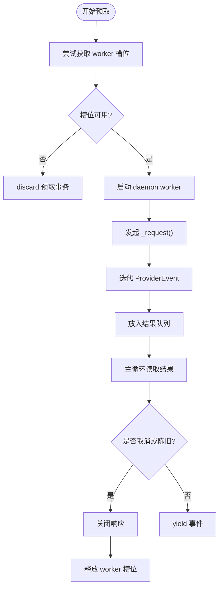

**图表来源**
- [base_openai_compatible_language_model.py:415-530](file://src/speech_to_speech/LLM/base_openai_compatible_language_model.py#L415-L530)

**章节来源**
- [base_openai_compatible_language_model.py:415-530](file://src/speech_to_speech/LLM/base_openai_compatible_language_model.py#L415-L530)

## 工具调用、指令应用与文本处理

### 指令应用

`BaseLanguageModelHandler._apply_instructions()` 负责：

1. 如果既无指令也无语言名称，则直接返回。
2. 从原始工具中提取 `FunctionTool`。
3. 根据 `wants_audio` 选择语音或文本系统提示构建器。
4. 如果启用了工具且未禁止工具选择，则附加工具系统提示、代码块正则、进入码、结束码。
5. 将完整指令追加到 chat。
6. 将工具元信息写入 `StreamContext`，供后续工具解析使用。

`BaseOpenAICompatibleHandler._apply_config()` 更简洁：根据 `wants_audio` 选择语音或文本系统提示，然后追加到 chat。

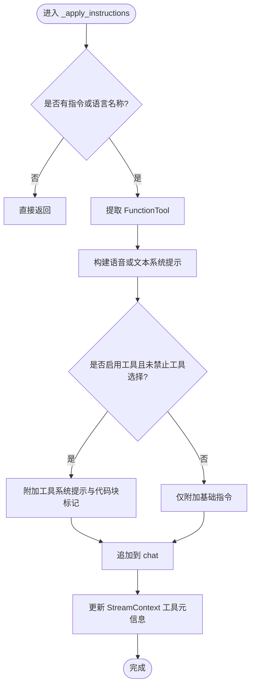

**图表来源**
- [language_model.py:280-323](file://src/speech_to_speech/LLM/language_model.py#L280-L323)
- [base_openai_compatible_language_model.py:536-549](file://src/speech_to_speech/LLM/base_openai_compatible_language_model.py#L536-L549)

**章节来源**
- [language_model.py:280-323](file://src/speech_to_speech/LLM/language_model.py#L280-L323)
- [base_openai_compatible_language_model.py:536-549](file://src/speech_to_speech/LLM/base_openai_compatible_language_model.py#L536-L549)

### 工具调用集成

本地路径中，工具调用通过代码块语法解析：

1. 在 `_apply_instructions()` 中设置 `block_regex`、`enter_code`、`end_code`。
2. 在 `_process_printable_text()` 中检测 `enter_code` 和 `end_code`。
3. 使用 `extract_function_calls_from_text()` 解析工具调用。
4. 转换为 `ResponseFunctionToolCall`。
5. 生成 `AssistantToolCallPart`。
6. 更新历史顺序。

OpenAI 兼容路径中，工具调用通过 ProviderEvent 的 `ToolCall` 事件传递，并由 `_record_tool_call()` 写入历史。

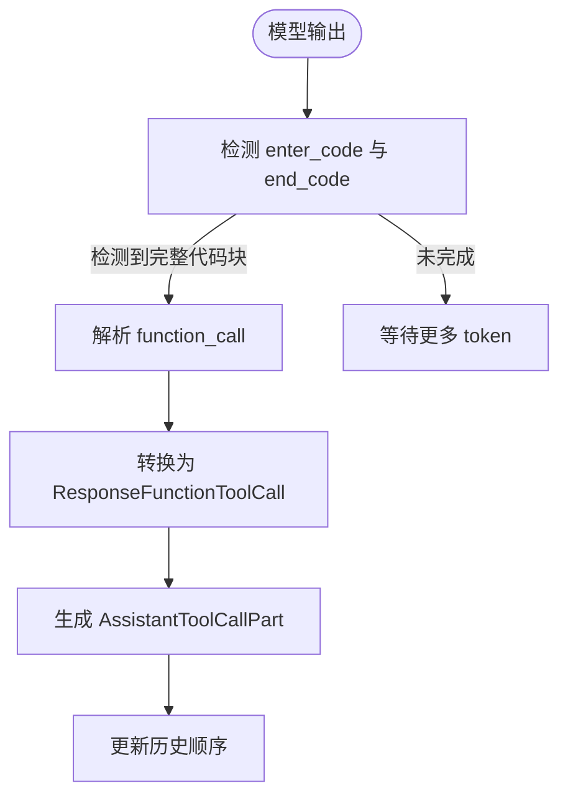

**图表来源**
- [language_model.py:324-427](file://src/speech_to_speech/LLM/language_model.py#L324-L427)
- [base_openai_compatible_language_model.py:577-611](file://src/speech_to_speech/LLM/base_openai_compatible_language_model.py#L577-L611)

**章节来源**
- [language_model.py:324-427](file://src/speech_to_speech/LLM/language_model.py#L324-L427)
- [base_openai_compatible_language_model.py:577-611](file://src/speech_to_speech/LLM/base_openai_compatible_language_model.py#L577-L611)

### 文本处理

两种基类的文本处理策略略有不同：

| 特性 | `BaseLanguageModelHandler` | `BaseOpenAICompatibleHandler` |
|---|---|---|
| 文本来源 | token 流或本地模型输出 | ProviderEvent 中的 `TextDelta` |
| 音频路径 | 移除不可发音字符、Markdown 清理、句子分片 | 移除不可发音字符、Markdown 清理、句子分片 |
| 文本路径 | 保留每个字符，不强制句子分片 | 保留每个字符，不强制句子分片 |
| 工具块检测 | 基于 `enter_code`/`end_code` | 基于 ProviderEvent 的 `ToolCall` |
| 句子批大小 | `stream_batch_sentences` | `stream_batch_sentences` |

**章节来源**
- [language_model.py:486-554](file://src/speech_to_speech/LLM/language_model.py#L486-L554)
- [base_openai_compatible_language_model.py:615-717](file://src/speech_to_speech/LLM/base_openai_compatible_language_model.py#L615-L717)
- [base_openai_compatible_language_model.py:719-768](file://src/speech_to_speech/LLM/base_openai_compatible_language_model.py#L719-L768)

## OpenAI 兼容后端扩展点

### 抽象钩子

`BaseOpenAICompatibleHandler` 要求子类实现以下抽象方法：

| 方法 | 职责 |
|---|---|
| `warmup()` | 发起一次轻量请求，确保模型或连接就绪 |
| `_build_compaction_generate_fn()` | 返回用于长历史压缩的 `(system, user) -> text` 函数 |
| `_serialize()` | 将 `Chat` 序列化为后端请求 payload |
| `_request()` | 发起 create 调用并返回响应或流 |
| `_iter_stream_events()` | 将流式响应映射为 `ProviderEvent` |
| `_iter_response_events()` | 将非流式响应映射为 `ProviderEvent` |
| `_build_optional_kwargs()` | 构建 per-request 的 tools/tool_choice 参数 |

### ChatCompletionsApiModelHandler

`ChatCompletionsApiModelHandler` 实现 `/v1/chat/completions` 路径：

- 使用 `_chat_messages()` 序列化消息。
- 使用 `_build_chat_optional_kwargs()` 转换工具。
- 使用 `_request_chat_completions()` 发起请求。
- 使用 `_iter_chat_stream_events()` 和 `_iter_chat_response_events()` 归一化事件。

### ResponsesApiModelHandler

`ResponsesApiModelHandler` 实现 `/v1/responses` 路径：

- 使用 `active_chat.to_responses_api_chat()` 序列化。
- 使用 `_provider_safe_tools()` 修复某些 provider 对 schema 的严格校验。
- 使用 `_provider_safe_input()` 将 `function_call_output` 转为普通用户文本。
- 使用 `_iter_stream_events()` 处理 Responses 专用事件。

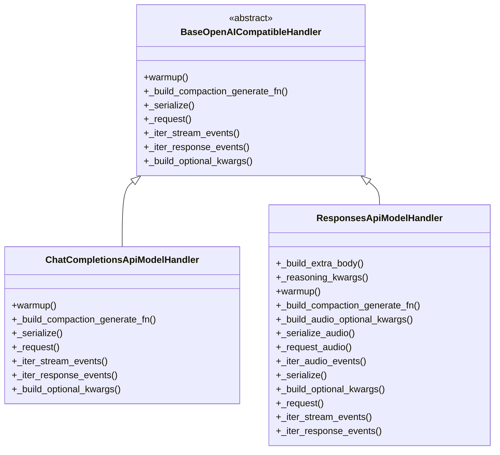

**图表来源**
- [base_openai_compatible_language_model.py:315-357](file://src/speech_to_speech/LLM/base_openai_compatible_language_model.py#L315-L357)
- [chat_completions_language_model.py:303-395](file://src/speech_to_speech/LLM/chat_completions_language_model.py#L303-L395)
- [responses_api_language_model.py:63-379](file://src/speech_to_speech/LLM/responses_api_language_model.py#L63-L379)

**章节来源**
- [base_openai_compatible_language_model.py:315-357](file://src/speech_to_speech/LLM/base_openai_compatible_language_model.py#L315-L357)
- [chat_completions_language_model.py:303-395](file://src/speech_to_speech/LLM/chat_completions_language_model.py#L303-L395)
- [responses_api_language_model.py:63-379](file://src/speech_to_speech/LLM/responses_api_language_model.py#L63-L379)

## 架构总览

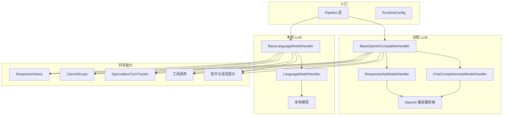

**图表来源**
- [language_model.py:166-770](file://src/speech_to_speech/LLM/language_model.py#L166-L770)
- [base_openai_compatible_language_model.py:174-1168](file://src/speech_to_speech/LLM/base_openai_compatible_language_model.py#L174-L1168)
- [chat_completions_language_model.py:303-395](file://src/speech_to_speech/LLM/chat_completions_language_model.py#L303-L395)
- [responses_api_language_model.py:63-379](file://src/speech_to_speech/LLM/responses_api_language_model.py#L63-L379)

## 详细组件分析

### `BaseLanguageModelHandler.process()` 主流程

`process()` 是整个本地 LLM 处理的主入口，它负责：

1. 校验请求类型。
2. 初始化 `StreamContext`。
3. 跳过陈旧轮次。
4. 检查 pending tool calls。
5. 处理 out-of-band 响应。
6. 解析语言和语言名称。
7. 应用指令和工具。
8. 捕获历史锚点。
9. 调用 `_generate()`。
10. 累积输出部分。
11. 提交历史。
12. 输出 token 用量。
13. 输出 `EndOfResponse`。
14. 异常路径保证终止。

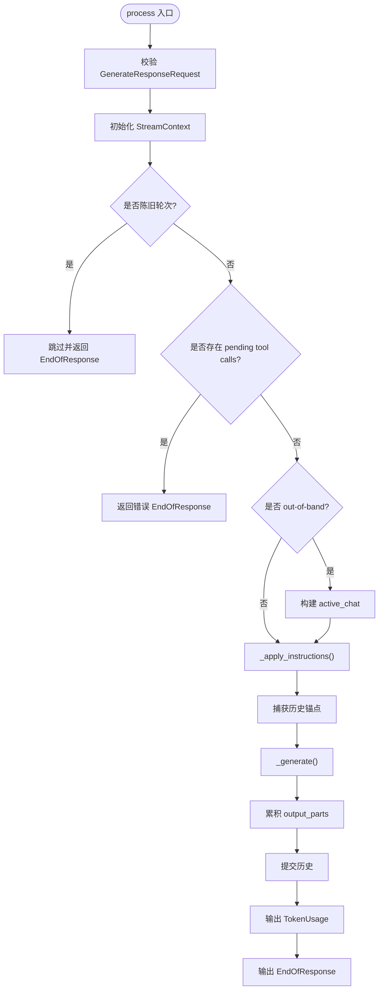

**图表来源**
- [language_model.py:560-765](file://src/speech_to_speech/LLM/language_model.py#L560-L765)

**章节来源**
- [language_model.py:560-765](file://src/speech_to_speech/LLM/language_model.py#L560-L765)

### `BaseOpenAICompatibleHandler._generate()` 主流程

`_generate()` 是整个 OpenAI 兼容 LLM 处理的核心编排方法，它负责：

1. 序列化 active chat。
2. 记录 consumed image IDs。
3. 校验输入。
4. 发起请求或预取。
5. 测量 TTFT。
6. 消费事件。
7. 处理超时和上游错误。
8. 发送失败回退文本。
9. 提交历史。
10. 输出 token 用量和 `EndOfResponse`。

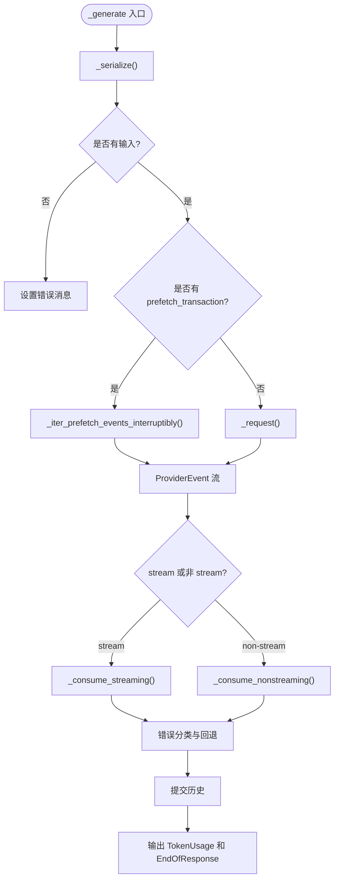

**图表来源**
- [base_openai_compatible_language_model.py:772-951](file://src/speech_to_speech/LLM/base_openai_compatible_language_model.py#L772-L951)

**章节来源**
- [base_openai_compatible_language_model.py:772-951](file://src/speech_to_speech/LLM/base_openai_compatible_language_model.py#L772-L951)

## 依赖关系分析

### 模块依赖

`BaseLanguageModelHandler` 依赖：

- `BaseHandler`：通用处理器基类。
- `Chat`：对话历史与消息结构。
- `CompactGenerateFn`：历史压缩函数类型。
- `text_prompt` 与 `voice_prompt`：系统提示构建。
- `tool_call`：工具解析与工具系统提示。
- `utils`：语言名称、Markdown 清理、不可发音字符处理。
- `cancel_scope`：取消范围。
- `handler_types`：`LLMIn`、`LLMOut`。
- `history`：`ResponseHistory`。
- `messages`：`LLMResponseChunk`、`TokenUsage`、`EndOfResponse`。
- `speculative_turns`：推测轮次跟踪。
- `transcript_logging`：日志辅助。
- `model_monitor`：模型监控。
- `utils.utils`：设备解析、out-of-band 判断。

`BaseOpenAICompatibleHandler` 依赖：

- `BaseHandler`。
- `OpenAI` SDK。
- `httpx`：超时控制。
- `nltk`：句子分词。
- `pydantic`：数据模型。
- `chat`：对话结构。
- `compaction_prompt`：历史压缩。
- `text_prompt` 与 `voice_prompt`。
- `utils`：文本处理工具。
- `cancel_scope`。
- `handler_types`。
- `history`。
- `messages`。
- `provider_errors`：上游错误分类。
- `speculative_turns`。
- `transcript_logging`。
- `utils.utils`：音频转 base64、out-of-band 判断。

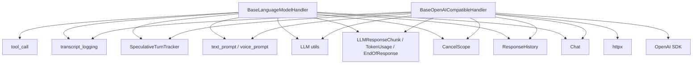

**图表来源**
- [language_model.py:1-77](file://src/speech_to_speech/LLM/language_model.py#L1-L77)
- [base_openai_compatible_language_model.py:1-67](file://src/speech_to_speech/LLM/base_openai_compatible_language_model.py#L1-L67)

**章节来源**
- [language_model.py:1-77](file://src/speech_to_speech/LLM/language_model.py#L1-L77)
- [base_openai_compatible_language_model.py:1-67](file://src/speech_to_speech/LLM/base_openai_compatible_language_model.py#L1-L67)

## 性能与可观测性

### 性能特征

| 维度 | `BaseLanguageModelHandler` | `BaseOpenAICompatibleHandler` |
|---|---|---|
| 首 token 时间 | 通过 `active_turn_latency_tracker` 记录 TTFT | 通过 `tracker.record_llm_ttft()` 记录 |
| 总耗时 | 通过 `monitor.trace("LLM", ...)` 记录 | 通过 `tracker.record_llm()` 记录 |
| 并发控制 | Transformers 路径使用 `_transformers_lock` | 预取 worker 使用 `BoundedSemaphore` |
| 流式吞吐 | 按句子分片输出 | 按 ProviderEvent 分片输出 |
| 历史压缩 | 可选 `compactor` | 可选 `compactor` |

### 可观测性

- 本地路径使用 `monitor.trace()` 记录生成文本长度、工具调用数、输入 token、输出 parts。
- 远程路径使用 `tracker.record_llm_ttft()` 和 `tracker.record_llm()` 记录网络侧指标。
- 两者均使用 `transcript_for_log()` 对敏感文本进行脱敏日志。
- 两者均记录工具调用列表。

**章节来源**
- [language_model.py:640-683](file://src/speech_to_speech/LLM/language_model.py#L640-L683)
- [base_openai_compatible_language_model.py:832-842](file://src/speech_to_speech/LLM/base_openai_compatible_language_model.py#L832-L842)
- [base_openai_compatible_language_model.py:878-882](file://src/speech_to_speech/LLM/base_openai_compatible_language_model.py#L878-L882)

## 扩展新后端的最佳实践

### 扩展本地 LLM 后端

如果你要新增一个本地 LLM 后端，应继承 `BaseLanguageModelHandler` 并实现：

1. `_load_model()`：加载模型、分词器、流式器或其他后端资源。
2. `_generate()`：实现 token 流或批量生成，并产出 `LLMResponseChunk`。
3. 如需历史压缩，重写 `_build_compaction_generate_fn()`。
4. 如使用 MLX，注意 `_finish_mlx_generation()` 的资源释放。
5. 如使用 Transformers，注意 `_finish_transformers_generation()` 的取消与线程 join。

推荐步骤：

1. 确定后端是 Transformers 还是 MLX。
2. 在 `_load_model()` 中完成模型加载和设备分配。
3. 在 `_generate()` 中调用后端生成接口。
4. 将 token 流交给 `_stream_tokens()` 或直接 yield `LLMResponseChunk`。
5. 确保 `ctx.input_tokens` 正确设置。
6. 确保异常路径能正常结束响应。

### 扩展 OpenAI 兼容 LLM 后端

如果你要新增一个 OpenAI 兼容后端，应继承 `BaseOpenAICompatibleHandler` 并实现：

1. `warmup()`：发起一次轻量请求。
2. `_build_compaction_generate_fn()`：返回压缩函数。
3. `_serialize()`：将 `Chat` 转为后端请求格式。
4. `_request()`：发起 create 调用。
5. `_iter_stream_events()`：将流式响应转为 `ProviderEvent`。
6. `_iter_response_events()`：将非流式响应转为 `ProviderEvent`。
7. `_build_optional_kwargs()`：构造 tools/tool_choice。

推荐步骤：

1. 确认后端支持 Chat Completions 或 Responses API。
2. 复用 `chat_completions_language_model.py` 中的工具转换函数，除非后端协议完全不同。
3. 确保 `ProviderEvent` 语义正确：`TextDelta`、`AssistantMessage`、`ToolCall`、`Usage`、`ProviderResponseEnd`。
4. 处理 finish_reason、incomplete、failed 等终止状态。
5. 处理工具调用的增量拼接。
6. 确保历史项顺序与 provider 返回一致。

### 代码示例路径

由于文档规范不允许直接粘贴代码，请参考以下路径：

| 任务 | 参考文件 | 行号范围 |
|---|---|---|
| 本地模型加载 | [language_model.py](file://src/speech_to_speech/LLM/language_model.py) | 791-800+ |
| 本地模型生成 | [language_model.py](file://src/speech_to_speech/LLM/language_model.py) | 246-256 |
| OpenAI Chat Completions 实现 | [chat_completions_language_model.py](file://src/speech_to_speech/LLM/chat_completions_language_model.py) | 303-395 |
| OpenAI Responses API 实现 | [responses_api_language_model.py](file://src/speech_to_speech/LLM/responses_api_language_model.py) | 63-379 |
| ProviderEvent 定义 | [base_openai_compatible_language_model.py](file://src/speech_to_speech/LLM/base_openai_compatible_language_model.py) | 84-137 |
| 预取 worker | [base_openai_compatible_language_model.py](file://src/speech_to_speech/LLM/base_openai_compatible_language_model.py) | 415-530 |
| 失败回退 | [base_openai_compatible_language_model.py](file://src/speech_to_speech/LLM/base_openai_compatible_language_model.py) | 302-313 |

**章节来源**
- [language_model.py:791-800](file://src/speech_to_speech/LLM/language_model.py#L791-L800)
- [language_model.py:246-256](file://src/speech_to_speech/LLM/language_model.py#L246-L256)
- [chat_completions_language_model.py:303-395](file://src/speech_to_speech/LLM/chat_completions_language_model.py#L303-L395)
- [responses_api_language_model.py:63-379](file://src/speech_to_speech/LLM/responses_api_language_model.py#L63-L379)
- [base_openai_compatible_language_model.py:84-137](file://src/speech_to_speech/LLM/base_openai_compatible_language_model.py#L84-L137)
- [base_openai_compatible_language_model.py:415-530](file://src/speech_to_speech/LLM/base_openai_compatible_language_model.py#L415-L530)
- [base_openai_compatible_language_model.py:302-313](file://src/speech_to_speech/LLM/base_openai_compatible_language_model.py#L302-L313)

## 故障排查指南

### 常见问题与定位

| 现象 | 可能原因 | 排查位置 |
|---|---|---|
| 本地模型生成卡住 | streamer 未清空或线程未 join | `_finish_transformers_generation()` |
| 远程请求无响应 | 网络超时或 provider 未返回终端事件 | `_generate()` 超时处理、stream 事件终止检查 |
| 工具调用丢失 | 工具解析未完成或 provider 未返回 tool_call | `_process_printable_text()`、`_iter_chat_stream_events()` |
| 历史顺序错乱 | 未使用 history_anchor_id 或 history_item_order | `ResponseHistory.capture()` |
| 推测轮次泄漏 | 预取事务未 discard | `_iter_prefetch_events_interruptibly()` |
| 上游 500 显示不清晰 | 未分类 provider 错误 | `classify_provider_error()` |
| 语音输出包含 Markdown | 音频路径未过滤不可发音字符 | `_consume_streaming()`、`_consume_nonstreaming()` |

### 错误终止保障

两个基类都强调：**任何生成失败都必须发出 `EndOfResponse`**。否则 `st.in_response` 会保持 true，导致后续响应被永久锁定。

- 本地路径：`process()` 的 `except Exception` 分支。
- 远程路径：`_generate()` 的 `except Exception` 分支。

**章节来源**
- [language_model.py:735-752](file://src/speech_to_speech/LLM/language_model.py#L735-L752)
- [base_openai_compatible_language_model.py:848-882](file://src/speech_to_speech/LLM/base_openai_compatible_language_model.py#L848-L882)

## 结论

`BaseLanguageModelHandler` 与 `BaseOpenAICompatibleHandler` 共同构成了 speech-to-speech 项目中 LLM 后端的统一抽象层：

- `BaseLanguageModelHandler` 聚焦本地模型加载、token 流消费、工具代码块解析、句子分片和历史提交。
- `BaseOpenAICompatibleHandler` 聚焦 OpenAI 兼容远端 API 的请求编排、ProviderEvent 归一化、预取 worker、失败回退和历史顺序对齐。
- 两者都提供清晰的抽象钩子，使新增后端只需关注模型或协议差异，而不必重复实现取消、历史、工具、日志、超时等横切逻辑。
- 对于开发者而言，优先判断目标是本地模型还是远程 OpenAI 兼容服务，再选择合适的基类进行扩展。