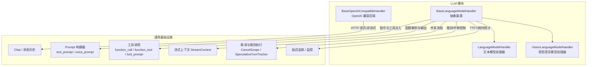
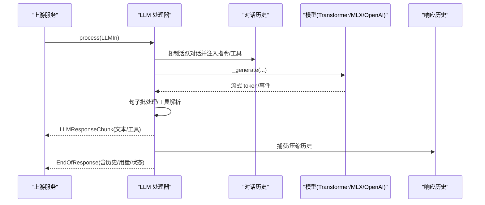
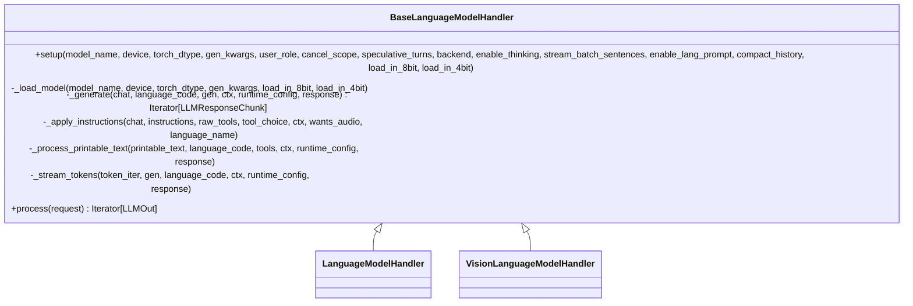
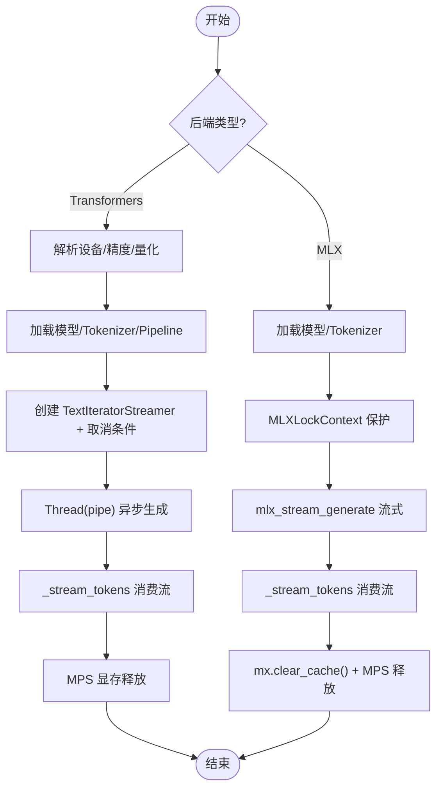
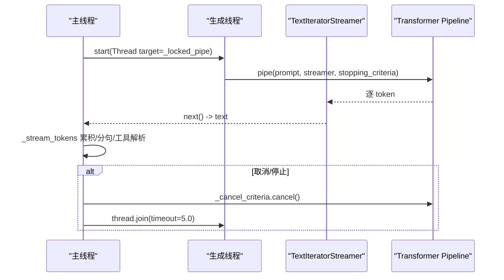
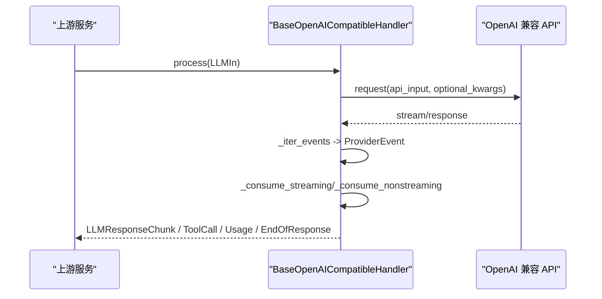
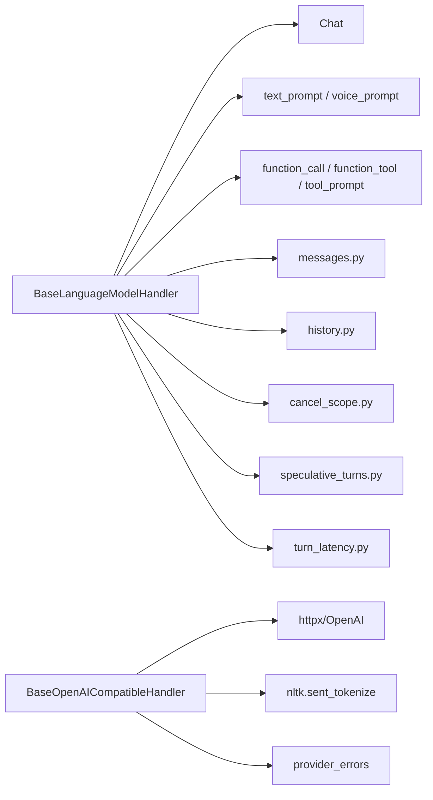
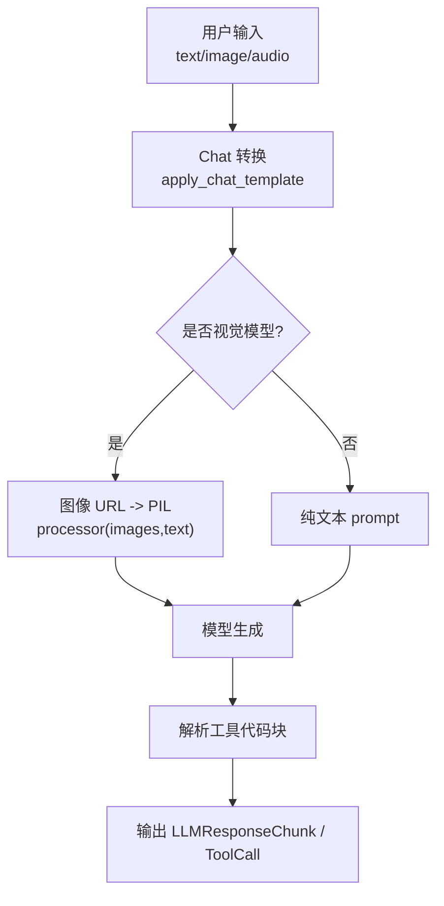

# LLM 后端架构

<cite>
**本文引用的文件**   
- [language_model.py](file://src/speech_to_speech/LLM/language_model.py)
- [base_openai_compatible_language_model.py](file://src/speech_to_speech/LLM/base_openai_compatible_language_model.py)
- [mlx_lock.py](file://src/speech_to_speech/utils/mlx_lock.py)
- [s2s_pipeline.py](file://src/speech_to_speech/s2s_pipeline.py)
- [chat.py](file://src/speech_to_speech/LLM/chat.py)
- [text_prompt.py](file://src/speech_to_speech/LLM/text_prompt.py)
- [voice_prompt.py](file://src/speech_to_speech/LLM/voice_prompt.py)
- [compaction_prompt.py](file://src/speech_to_speech/LLM/compaction_prompt.py)
- [function_call.py](file://src/speech_to_speech/LLM/tool_call/function_call.py)
- [function_tool.py](file://src/speech_to_speech/LLM/tool_call/function_tool.py)
- [tool_prompt.py](file://src/speech_to_speech/LLM/tool_call/tool_prompt.py)
- [utils.py](file://src/speech_to_speech/LLM/utils.py)
- [messages.py](file://src/speech_to_speech/pipeline/messages.py)
- [history.py](file://src/speech_to_speech/pipeline/history.py)
- [cancel_scope.py](file://src/speech_to_speech/pipeline/cancel_scope.py)
- [speculative_turns.py](file://src/speech_to_speech/pipeline/speculative_turns.py)
- [transcript_logging.py](file://src/speech_to_speech/pipeline/transcript_logging.py)
- [turn_latency.py](file://src/speech_to_speech/pipeline/turn_latency.py)
- [model_monitor.py](file://src/speech_to_speech/utils/model_monitor.py)
</cite>

## 目录
1. [引言](#引言)
2. [项目结构](#项目结构)
3. [核心组件](#核心组件)
4. [架构总览](#架构总览)
5. [详细组件分析](#详细组件分析)
6. [依赖关系分析](#依赖关系分析)
7. [性能与内存优化](#性能与内存优化)
8. [多模态与工具调用](#多模态与工具调用)
9. [错误处理、资源清理与生命周期](#错误处理资源清理与生命周期)
10. [后端选择指南与配置建议](#后端选择指南与配置建议)
11. [故障排查](#故障排查)
12. [结论](#结论)

## 引言
本文面向需要深入理解语音到语音系统中“大语言模型后端”的工程师与架构师，系统梳理 BaseLanguageModelHandler 抽象基类的设计模式、Transformers 与 MLX 两种后端的实现差异、设备与内存管理、流式生成、线程安全、多模态输入、音频处理能力、工具调用集成，以及后端选择、性能对比和配置优化建议。文档同时覆盖错误处理、资源清理与生命周期管理的最佳实践。

## 项目结构
LLM 后端主要位于 `src/speech_to_speech/LLM` 目录，包含两类实现：
- 本地模型后端：基于 Transformers 或 MLX 的文本与视觉语言模型处理器。
- OpenAI 兼容后端：通过 HTTP 调用远程 LLM（Responses API / Chat Completions），统一事件归一化。

**图表来源**
- [language_model.py:166-256](file://src/speech_to_speech/LLM/language_model.py#L166-L256)
- [base_openai_compatible_language_model.py:174-357](file://src/speech_to_speech/LLM/base_openai_compatible_language_model.py#L174-L357)

**章节来源**
- [language_model.py:166-256](file://src/speech_to_speech/LLM/language_model.py#L166-L256)
- [base_openai_compatible_language_model.py:174-357](file://src/speech_to_speech/LLM/base_openai_compatible_language_model.py#L174-L357)

## 核心组件
- BaseLanguageModelHandler：抽象基类，封装流式生成、句子批处理、工具提取、历史写入、Token 用量统计、推测轮次门控、中断与停止等通用逻辑；子类仅负责模型加载与具体生成。
- LanguageModelHandler：文本模型的 Transformers/MLX 双后端实现，支持量化、SDPA、TextIteratorStreamer、MLXLockContext 等。
- VisionLanguageModelHandler：视觉语言模型处理器，支持图像 URL 转 PIL、多模态 prompt 构造、MLX-VLM 与 Transformers VLM 路径。
- BaseOpenAICompatibleHandler：OpenAI 兼容后端，将 Responses/Chat 事件归一化为 TextDelta/ToolCall/Usage/ProviderResponseEnd，统一消费逻辑。

**章节来源**
- [language_model.py:166-256](file://src/speech_to_speech/LLM/language_model.py#L166-L256)
- [language_model.py:776-999](file://src/speech_to_speech/LLM/language_model.py#L776-L999)
- [language_model.py:1005-1240](file://src/speech_to_speech/LLM/language_model.py#L1005-L1240)
- [base_openai_compatible_language_model.py:174-357](file://src/speech_to_speech/LLM/base_openai_compatible_language_model.py#L174-L357)

## 架构总览
下图展示从请求进入、指令注入、模型生成、流式分句、工具解析、历史回写到结束终止的完整链路。

**图表来源**
- [language_model.py:560-765](file://src/speech_to_speech/LLM/language_model.py#L560-L765)
- [base_openai_compatible_language_model.py:772-951](file://src/speech_to_speech/LLM/base_openai_compatible_language_model.py#L772-L951)

## 详细组件分析

### BaseLanguageModelHandler 抽象基类
设计要点：
- 使用 Template Method 模式：setup 中完成设备、后端、锁、压缩器等初始化，再调用抽象方法 `_load_model` 与 `_generate`。
- 统一的流式处理 `_stream_tokens`：累积 raw/generated/printable 文本，按句子分批，过滤 TTS 不友好字符，检测工具代码块。
- 工具调用集成：根据 FunctionTool 列表构建工具提示，解析模型输出的代码块为 ResponseFunctionToolCall，并维护 output_parts 顺序。
- 推测轮次与中断：结合 CancelScope 与 SpeculativeTurnTracker，对陈旧/被抢占的 turn 进行丢弃与早停。
- 历史与 Token 用量：在 finally 中记录 TTFT、input/output tokens，并在允许时提交历史快照。

**图表来源**
- [language_model.py:166-256](file://src/speech_to_speech/LLM/language_model.py#L166-L256)
- [language_model.py:280-427](file://src/speech_to_speech/LLM/language_model.py#L280-L427)
- [language_model.py:486-554](file://src/speech_to_speech/LLM/language_model.py#L486-L554)
- [language_model.py:560-765](file://src/speech_to_speech/LLM/language_model.py#L560-L765)

**章节来源**
- [language_model.py:166-256](file://src/speech_to_speech/LLM/language_model.py#L166-L256)
- [language_model.py:280-427](file://src/speech_to_speech/LLM/language_model.py#L280-L427)
- [language_model.py:486-554](file://src/speech_to_speech/LLM/language_model.py#L486-L554)
- [language_model.py:560-765](file://src/speech_to_speech/LLM/language_model.py#L560-L765)

### Transformers 与 MLX 后端差异

#### 设备管理与内存优化
- Transformers：
  - 设备解析：当 backend=transformers 时，使用 resolve_device 解析 CUDA/MPS/CPU。
  - 精度与加速：启用 TF32、cudnn SDPA，使用 attn_implementation="sdpa" 提升预填充/解码速度并降低注意力内存。
  - 量化：可选 BitsAndBytesConfig(load_in_4bit/load_in_8bit)。
  - 流式：TextIteratorStreamer + Thread 异步 pipe，配合 StoppingCriteria 外部取消。
  - MPS 显存释放：生成结束后调用 torch.mps.empty_cache()。
- MLX：
  - 全局互斥：MLXLockContext 保证 Metal/MLX 资源串行访问，避免并发导致的 GPU 重启/崩溃。
  - 缓存清理：生成结束后尝试 mx.clear_cache() 与 torch.mps.empty_cache()。
  - 流式：mlx_stream_generate 直接返回 token 迭代器，无需额外线程。

**图表来源**
- [language_model.py:800-854](file://src/speech_to_speech/LLM/language_model.py#L800-L854)
- [language_model.py:856-917](file://src/speech_to_speech/LLM/language_model.py#L856-L917)
- [mlx_lock.py:1-22](file://src/speech_to_speech/utils/mlx_lock.py#L1-L22)
- [mlx_lock.py:175-196](file://src/speech_to_speech/utils/mlx_lock.py#L175-L196)

**章节来源**
- [language_model.py:800-854](file://src/speech_to_speech/LLM/language_model.py#L800-L854)
- [language_model.py:856-917](file://src/speech_to_speech/LLM/language_model.py#L856-L917)
- [mlx_lock.py:1-22](file://src/speech_to_speech/utils/mlx_lock.py#L1-L22)
- [mlx_lock.py:175-196](file://src/speech_to_speech/utils/mlx_lock.py#L175-L196)

#### 流式生成与线程安全
- Transformers：
  - 使用 TextIteratorStreamer 与独立线程运行 pipeline，主线程消费流。
  - 通过 _CancelCriteria 外部信号中断生成，finish_transformers_generation 中 drain 流并 join 线程。
  - 使用 _transformers_lock 序列化 speech 响应路径与后台 compaction worker 的调用。
- MLX：
  - 通过 MLXLockContext 串行化所有 MLX 调用，避免 Metal 并发问题。
  - 生成完成后立即关闭迭代器以释放资源。

**图表来源**
- [language_model.py:856-917](file://src/speech_to_speech/LLM/language_model.py#L856-L917)
- [language_model.py:118-132](file://src/speech_to_speech/LLM/language_model.py#L118-L132)

**章节来源**
- [language_model.py:856-917](file://src/speech_to_speech/LLM/language_model.py#L856-L917)
- [language_model.py:118-132](file://src/speech_to_speech/LLM/language_model.py#L118-L132)

### OpenAI 兼容后端
- 事件归一化：将 Responses/Chat 的流式/非流式响应映射为 TextDelta、AssistantMessage、ToolCall、Usage、ProviderResponseEnd。
- 统一消费：_consume_streaming/_consume_nonstreaming 分别处理流式与非流式，支持文本直发（text-only）与音频路径（去 TTS 不友好字符）。
- 预取与并发：_iter_prefetch_events_interruptibly 限制最多一个 provider worker，使用 Queue 与 ThreadingEvent 实现可中断消费。
- 失败回退：httpx.ReadTimeout 与 classify_provider_error 分类错误，必要时返回 provider_unavailable_message。

**图表来源**
- [base_openai_compatible_language_model.py:335-357](file://src/speech_to_speech/LLM/base_openai_compatible_language_model.py#L335-L357)
- [base_openai_compatible_language_model.py:615-717](file://src/speech_to_speech/LLM/base_openai_compatible_language_model.py#L615-L717)
- [base_openai_compatible_language_model.py:719-768](file://src/speech_to_speech/LLM/base_openai_compatible_language_model.py#L719-L768)
- [base_openai_compatible_language_model.py:848-951](file://src/speech_to_speech/LLM/base_openai_compatible_language_model.py#L848-L951)

**章节来源**
- [base_openai_compatible_language_model.py:335-357](file://src/speech_to_speech/LLM/base_openai_compatible_language_model.py#L335-L357)
- [base_openai_compatible_language_model.py:615-717](file://src/speech_to_speech/LLM/base_openai_compatible_language_model.py#L615-L717)
- [base_openai_compatible_language_model.py:719-768](file://src/speech_to_speech/LLM/base_openai_compatible_language_model.py#L719-L768)
- [base_openai_compatible_language_model.py:848-951](file://src/speech_to_speech/LLM/base_openai_compatible_language_model.py#L848-L951)

## 依赖关系分析
- BaseLanguageModelHandler 依赖：
  - Chat 与 Prompt 构建器：用于注入系统指令、语言名、工具提示。
  - Tool Call 模块：解析模型输出中的代码块为函数调用。
  - 管道消息与历史：LLMResponseChunk、TokenUsage、ResponseHistory。
  - 取消与推测执行：CancelScope、SpeculativeTurnTracker。
  - 监控与延迟追踪：active_turn_latency_tracker、model_monitor。
- BaseOpenAICompatibleHandler 依赖：
  - httpx/OpenAI SDK：发起请求与流式读取。
  - NLTK 分词：sent_tokenize_preserving_markdown_code。
  - 提供者错误分类：provider_errors。

**图表来源**
- [language_model.py:36-76](file://src/speech_to_speech/LLM/language_model.py#L36-L76)
- [base_openai_compatible_language_model.py:1-67](file://src/speech_to_speech/LLM/base_openai_compatible_language_model.py#L1-L67)

**章节来源**
- [language_model.py:36-76](file://src/speech_to_speech/LLM/language_model.py#L36-L76)
- [base_openai_compatible_language_model.py:1-67](file://src/speech_to_speech/LLM/base_openai_compatible_language_model.py#L1-L67)

## 性能与内存优化
- Transformers 路径：
  - 启用 TF32 与 cudnn SDPA，减少注意力计算内存占用并提升吞吐。
  - 可选 4-bit/8-bit 量化，显著降低显存占用。
  - TextIteratorStreamer 与异步线程解耦 IO 与推理。
  - MPS 路径在生成后释放缓存。
- MLX 路径：
  - 全局 MLX 锁避免 Metal 并发崩溃，保障稳定性。
  - 生成后调用 mx.clear_cache() 与 torch.mps.empty_cache() 释放内存。
- 流式分句：
  - 按句子批次（默认 3）聚合输出，平衡延迟与流畅性。
  - 文本直发模式保留原始字符，音频路径去除 TTS 不友好符号。
- 历史压缩：
  - 通过 build_compactor 与 CompactGenerateFn 对长历史进行压缩，减少后续请求长度。

**章节来源**
- [language_model.py:800-854](file://src/speech_to_speech/LLM/language_model.py#L800-L854)
- [language_model.py:856-917](file://src/speech_to_speech/LLM/language_model.py#L856-L917)
- [language_model.py:918-953](file://src/speech_to_speech/LLM/language_model.py#L918-L953)
- [language_model.py:955-999](file://src/speech_to_speech/LLM/language_model.py#L955-L999)

## 多模态与工具调用
- 多模态输入：
  - VisionLanguageModelHandler 支持 input_text/input_image 内容，转换为 processor 所需的 text/image 格式，并调用 apply_chat_template。
  - Transformers VLM：AutoProcessor 处理文本与图像张量，送入 model.generate。
  - MLX-VLM：mlx_vlm_load 加载模型与 processor，mlx_vlm_stream_generate 流式生成。
- 工具调用：
  - 根据 FunctionTool 列表构建工具提示，模型输出中包含代码块时，解析为 ResponseFunctionToolCall。
  - 维护 output_parts 顺序，确保历史写入与实时会话一致。
  - BaseOpenAICompatibleHandler 将 ToolCall 事件标准化并插入历史。

**图表来源**
- [language_model.py:1172-1240](file://src/speech_to_speech/LLM/language_model.py#L1172-L1240)
- [language_model.py:280-427](file://src/speech_to_speech/LLM/language_model.py#L280-L427)
- [base_openai_compatible_language_model.py:577-611](file://src/speech_to_speech/LLM/base_openai_compatible_language_model.py#L577-L611)

**章节来源**
- [language_model.py:1172-1240](file://src/speech_to_speech/LLM/language_model.py#L1172-L1240)
- [language_model.py:280-427](file://src/speech_to_speech/LLM/language_model.py#L280-L427)
- [base_openai_compatible_language_model.py:577-611](file://src/speech_to_speech/LLM/base_openai_compatible_language_model.py#L577-L611)

## 错误处理、资源清理与生命周期
- 错误处理：
  - Transformers/MLX 路径：try/except 捕获异常，记录日志并发送 EndOfResponse，确保下游不会卡住。
  - OpenAI 兼容路径：httpx.ReadTimeout 与 classify_provider_error 分类错误，必要时返回 provider_unavailable_message。
- 资源清理：
  - Transformers：finish_transformers_generation 中 cancel 停止条件、drain 流、join 线程；MPS 路径释放缓存。
  - MLX：finish_mlx_generation 关闭迭代器，mx.clear_cache() 与 torch.mps.empty_cache()。
  - OpenAI：cleanup 关闭 httpx client；_close_response 确保响应对象关闭。
- 生命周期：
  - setup 中 warmup，on_session_end 重置会话状态。
  - BaseOpenAICompatibleHandler.cleanup 显式关闭客户端连接。

**章节来源**
- [language_model.py:262-275](file://src/speech_to_speech/LLM/language_model.py#L262-L275)
- [language_model.py:735-765](file://src/speech_to_speech/LLM/language_model.py#L735-L765)
- [language_model.py:896-917](file://src/speech_to_speech/LLM/language_model.py#L896-L917)
- [base_openai_compatible_language_model.py:386-391](file://src/speech_to_speech/LLM/base_openai_compatible_language_model.py#L386-L391)
- [base_openai_compatible_language_model.py:407-414](file://src/speech_to_speech/LLM/base_openai_compatible_language_model.py#L407-L414)
- [base_openai_compatible_language_model.py:848-951](file://src/speech_to_speech/LLM/base_openai_compatible_language_model.py#L848-L951)

## 后端选择指南与配置建议
- Transformers：
  - 适用场景：CUDA/MPS 环境，需灵活量化与 SDPA 加速。
  - 推荐配置：torch_dtype=float16，attn_implementation="sdpa"，可选 load_in_4bit/load_in_8bit。
  - 注意：MPS 路径需在生成后释放缓存。
- MLX：
  - 适用场景：Apple Silicon，Metal 稳定优先。
  - 推荐配置：启用 MLXLockContext，生成后清理缓存。
  - 注意：全局锁可能成为瓶颈，但能避免并发崩溃。
- OpenAI 兼容：
  - 适用场景：远程 LLM，需统一事件处理与失败回退。
  - 推荐配置：request_timeout_s 合理设置，provider_unavailable_message 自定义失败提示。
  - 注意：预取 worker 限制为 1，避免资源竞争。

**章节来源**
- [language_model.py:800-854](file://src/speech_to_speech/LLM/language_model.py#L800-L854)
- [language_model.py:856-917](file://src/speech_to_speech/LLM/language_model.py#L856-L917)
- [base_openai_compatible_language_model.py:188-249](file://src/speech_to_speech/LLM/base_openai_compatible_language_model.py#L188-L249)
- [base_openai_compatible_language_model.py:848-951](file://src/speech_to_speech/LLM/base_openai_compatible_language_model.py#L848-L951)

## 故障排查
- 常见问题：
  - MLX 并发导致 GPU 重启：确认使用 MLXLockContext，避免多线程并行调用 MLX 模型。
  - Transformers MPS 显存泄漏：检查生成后是否调用 torch.mps.empty_cache()。
  - OpenAI 超时：调整 request_timeout_s，检查网络与 provider 状态。
  - 工具解析失败：检查 tool_prompt 与 block_regex 配置，确认模型输出符合预期。
- 调试建议：
  - 启用 transcript logging 查看 clean text 与工具调用。
  - 使用 turn_latency_tracker 观察 TTFT 与 MLX 锁等待时间。
  - 检查 SpeculativeTurnTracker 是否导致陈旧 turn 被丢弃。

**章节来源**
- [mlx_lock.py:1-22](file://src/speech_to_speech/utils/mlx_lock.py#L1-L22)
- [language_model.py:896-917](file://src/speech_to_speech/LLM/language_model.py#L896-L917)
- [base_openai_compatible_language_model.py:848-951](file://src/speech_to_speech/LLM/base_openai_compatible_language_model.py#L848-L951)

## 结论
BaseLanguageModelHandler 通过抽象基类统一了流式生成、工具解析、历史写入与错误处理，而 Transformers 与 MLX 后端分别在性能与稳定性上提供差异化优势。OpenAI 兼容后端则通过事件归一化简化了远程 LLM 的集成。在多模态与工具调用方面，系统提供了灵活的输入处理与输出解析机制。通过合理的设备管理、内存优化与线程安全策略，系统能够在多种硬件与部署环境中稳定运行。