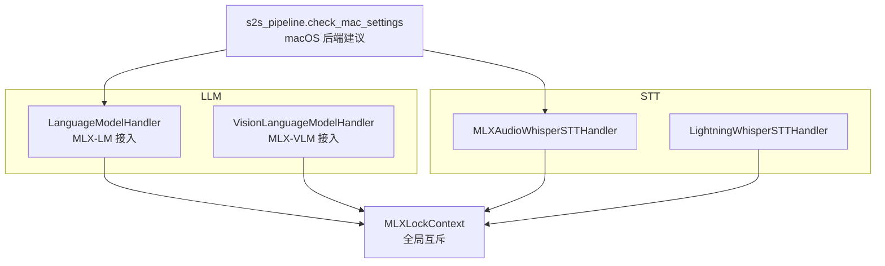
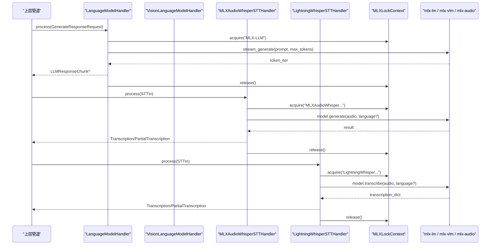
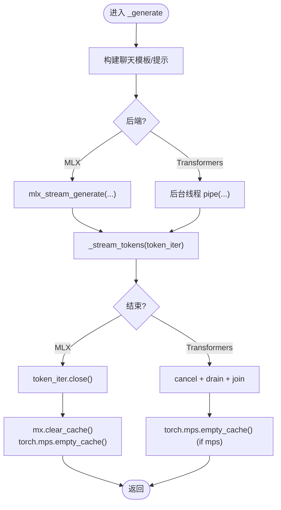
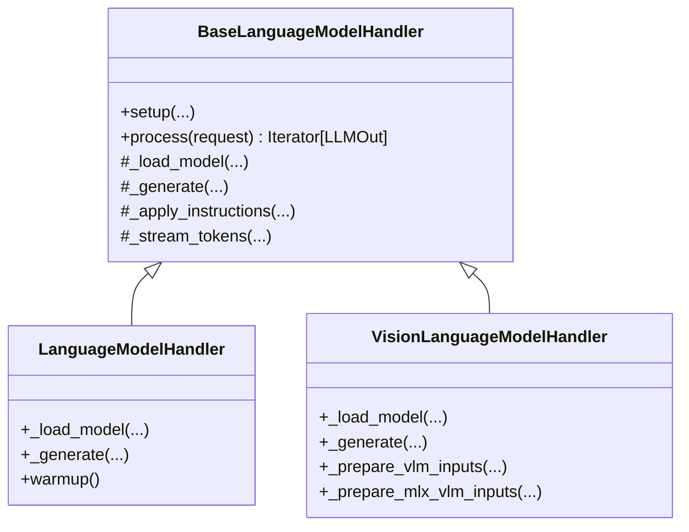
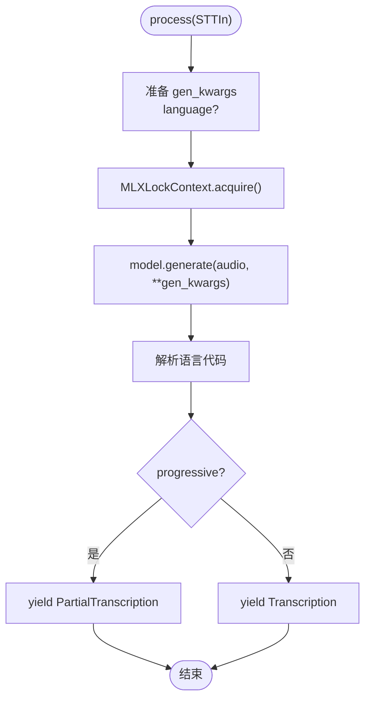
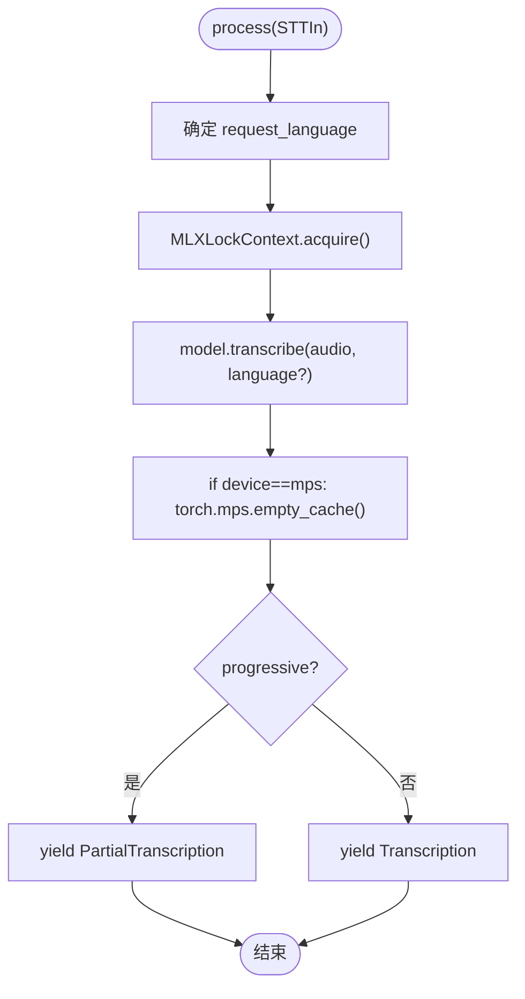
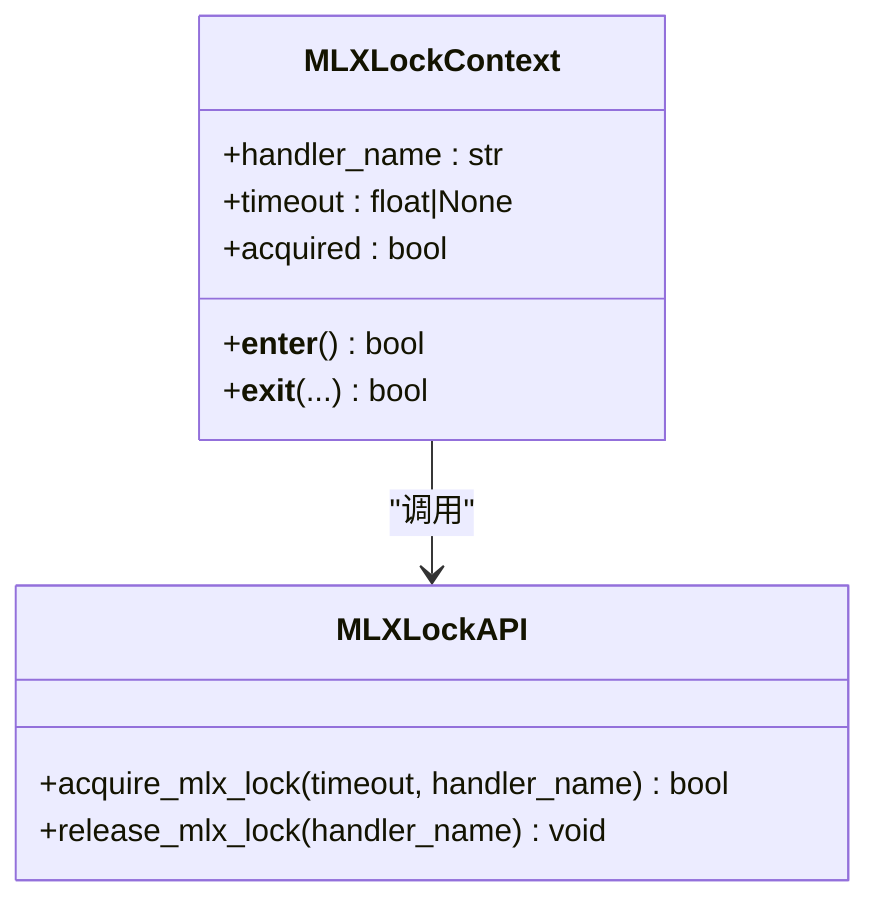
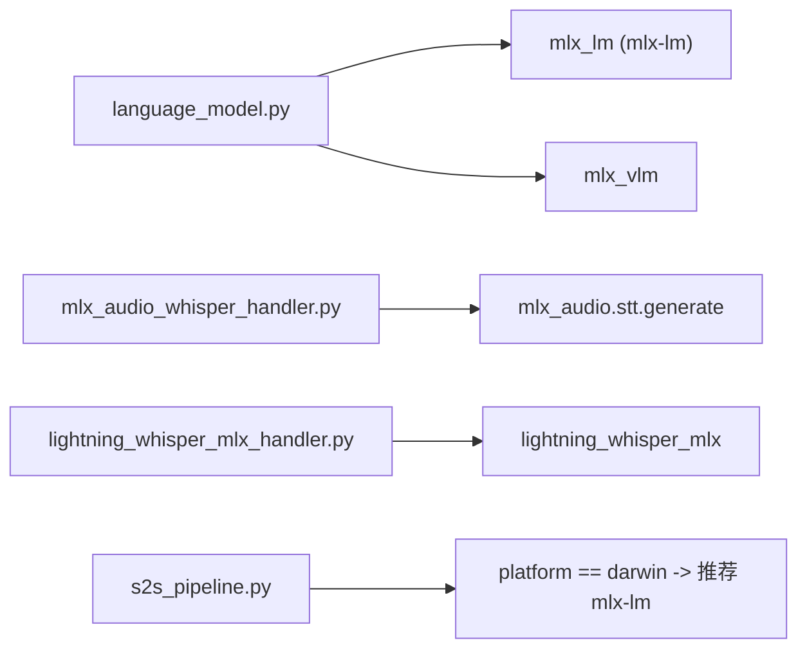

# MLX 后端实现

<cite>
**本文引用的文件**   
- [language_model.py](file://src/speech_to_speech/LLM/language_model.py)
- [mlx_lock.py](file://src/speech_to_speech/utils/mlx_lock.py)
- [mlx_audio_whisper_handler.py](file://src/speech_to_speech/STT/mlx_audio_whisper_handler.py)
- [lightning_whisper_mlx_handler.py](file://src/speech_to_speech/STT/lightning_whisper_mlx_handler.py)
- [s2s_pipeline.py](file://src/speech_to_speech/s2s_pipeline.py)
</cite>

## 目录
1. [引言](#引言)
2. [项目结构](#项目结构)
3. [核心组件](#核心组件)
4. [架构总览](#架构总览)
5. [详细组件分析](#详细组件分析)
6. [依赖关系分析](#依赖关系分析)
7. [性能与优化](#性能与优化)
8. [故障排查指南](#故障排查指南)
9. [结论](#结论)
10. [附录：Apple 平台部署要点](#附录apple-平台部署要点)

## 引言
本文面向 Apple Silicon 平台的本地大模型推理，系统性梳理本项目中基于 Apple MLX 的 LLM 与 STT 后端实现。重点覆盖以下主题：
- MLX-LM 集成与流式生成
- Apple Silicon 优化、Metal GPU 加速与 MPS 设备清理
- 内存映射加载与量化模型支持
- MLXLockContext 线程同步机制
- 流式生成器管理与资源清理策略
- 与 Core ML/MPS 的关系说明
- 设备检测、内存监控与性能优化技巧
- Apple 平台部署建议与性能对比思路

本仓库并未直接封装 Core ML 运行时；MLX 通过 Metal 在 Apple Silicon 上获得硬件加速。Core ML 在本项目中不作为显式依赖出现。

## 项目结构
围绕 MLX 的关键代码分布在以下位置：
- LLM 层：语言模型处理器统一抽象与 MLX-LM 接入
- STT 层：基于 MLX-Audio Whisper 与 Lightning Whisper MLX 的语音转文本
- 工具层：全局 MLX 锁与延迟追踪
- 管道入口：macOS 设备与后端选择校验

**图表来源**
- [language_model.py:776-998](file://src/speech_to_speech/LLM/language_model.py#L776-L998)
- [language_model.py:1005-1240](file://src/speech_to_speech/LLM/language_model.py#L1005-L1240)
- [mlx_audio_whisper_handler.py:37-194](file://src/speech_to_speech/STT/mlx_audio_whisper_handler.py#L37-L194)
- [lightning_whisper_mlx_handler.py:37-120](file://src/speech_to_speech/STT/lightning_whisper_mlx_handler.py#L37-L120)
- [mlx_lock.py:175-196](file://src/speech_to_speech/utils/mlx_lock.py#L175-L196)
- [s2s_pipeline.py:321-328](file://src/speech_to_speech/s2s_pipeline.py#L321-L328)

**章节来源**
- [language_model.py:776-998](file://src/speech_to_speech/LLM/language_model.py#L776-L998)
- [mlx_audio_whisper_handler.py:37-194](file://src/speech_to_speech/STT/mlx_audio_whisper_handler.py#L37-L194)
- [lightning_whisper_mlx_handler.py:37-120](file://src/speech_to_speech/STT/lightning_whisper_mlx_handler.py#L37-L120)
- [mlx_lock.py:175-196](file://src/speech_to_speech/utils/mlx_lock.py#L175-L196)
- [s2s_pipeline.py:321-328](file://src/speech_to_speech/s2s_pipeline.py#L321-L328)

## 核心组件
- LanguageModelHandler：文本型 LLM 处理器，支持 transformers 与 MLX 两种后端。MLX 路径使用 mlx-lm 进行模型加载与流式生成。
- VisionLanguageModelHandler：多模态 VLM 处理器，支持 MLX-VLM 与 transformers 后端。
- MLXAudioWhisperSTTHandler：基于 MLX-Audio Whisper 的 STT 后端，适配 Apple Silicon。
- LightningWhisperSTTHandler：基于 lightning-whisper-mlx 的 STT 后端，同样走 MLX/Metal 路径。
- MLXLockContext：全局可重入锁，序列化所有 MLX 模型访问，避免 Metal 并发问题。

**章节来源**
- [language_model.py:776-998](file://src/speech_to_speech/LLM/language_model.py#L776-L998)
- [language_model.py:1005-1240](file://src/speech_to_speech/LLM/language_model.py#L1005-L1240)
- [mlx_audio_whisper_handler.py:37-194](file://src/speech_to_speech/STT/mlx_audio_whisper_handler.py#L37-L194)
- [lightning_whisper_mlx_handler.py:37-120](file://src/speech_to_speech/STT/lightning_whisper_mlx_handler.py#L37-L120)
- [mlx_lock.py:1-196](file://src/speech_to_speech/utils/mlx_lock.py#L1-L196)

## 架构总览
下图展示 MLX 相关组件在推理流程中的交互关系：LLM 与 STT 均通过 MLXLockContext 串行化访问 MLX/Metal；LLM 侧根据后端分支调用 mlx-lm 或 transformers；STT 侧分别对接 MLX-Audio Whisper 与 Lightning Whisper MLX。

**图表来源**
- [language_model.py:856-916](file://src/speech_to_speech/LLM/language_model.py#L856-L916)
- [language_model.py:1065-1130](file://src/speech_to_speech/LLM/language_model.py#L1065-L1130)
- [mlx_audio_whisper_handler.py:133-194](file://src/speech_to_speech/STT/mlx_audio_whisper_handler.py#L133-L194)
- [lightning_whisper_mlx_handler.py:72-120](file://src/speech_to_speech/STT/lightning_whisper_mlx_handler.py#L72-L120)
- [mlx_lock.py:175-196](file://src/speech_to_speech/utils/mlx_lock.py#L175-L196)

## 详细组件分析

### LLM：LanguageModelHandler（MLX-LM）
- 模型加载
  - MLX 后端：通过 mlx-lm 的 load 接口加载模型与分词器。
  - Transformers 后端：使用 AutoModelForCausalLM + pipeline，并可选 BitsAndBytes 量化。
- 流式生成
  - MLX 后端：使用 mlx_stream_generate 返回迭代器，逐 token 消费；支持预取事务取消。
  - Transformers 后端：TextIteratorStreamer + 后台线程 + StoppingCriteria 控制取消。
- 资源清理
  - MLX 路径：显式关闭生成器，尝试清理 MLX 缓存，并释放 MPS 缓存。
  - Transformers 路径：触发停止条件、清空 streamer、join 线程，并在 MPS 设备上释放缓存。
- 历史压缩
  - 提供 _build_compaction_generate_fn，MLX 路径使用 mlx_generate 非流式压缩。

**图表来源**
- [language_model.py:856-916](file://src/speech_to_speech/LLM/language_model.py#L856-L916)
- [language_model.py:918-953](file://src/speech_to_speech/LLM/language_model.py#L918-L953)

**章节来源**
- [language_model.py:776-998](file://src/speech_to_speech/LLM/language_model.py#L776-L998)

### LLM：VisionLanguageModelHandler（MLX-VLM）
- 模型加载
  - MLX-VLM：mlx_vlm_load 加载模型与 processor，tokenizer 来自 processor。
  - Transformers：AutoModelForImageTextToText + AutoProcessor，支持量化。
- 输入准备
  - 将 Realtime 风格消息转换为处理器所需的 text/image 格式，并提取图像列表。
- 流式生成
  - MLX-VLM：mlx_vlm_stream_generate 返回 token 迭代器，支持 enable_thinking。
  - Transformers：model.generate + TextIteratorStreamer。
- 资源清理
  - MLX-VLM：关闭迭代器、清理 MLX 缓存、释放 MPS 缓存。
  - Transformers：停止条件、drain streamer、join 线程、释放 MPS 缓存。

**图表来源**
- [language_model.py:166-256](file://src/speech_to_speech/LLM/language_model.py#L166-L256)
- [language_model.py:776-998](file://src/speech_to_speech/LLM/language_model.py#L776-L998)
- [language_model.py:1005-1240](file://src/speech_to_speech/LLM/language_model.py#L1005-L1240)

**章节来源**
- [language_model.py:1005-1240](file://src/speech_to_speech/LLM/language_model.py#L1005-L1240)

### STT：MLXAudioWhisperSTTHandler
- 模型加载
  - 使用 mlx_audio.stt.generate.load_model 加载 Whisper 模型。
  - 若未附带 processor，则从对应 openai/whisper-* 模型加载 WhisperProcessor。
- 预热
  - 使用空音频进行一次 generate，确保 Metal 初始化完成。
- 推理
  - 在 MLXLockContext 保护下执行 model.generate，支持强制语言与自动语言回退。
- 输出
  - progressive 模式返回 PartialTranscription，否则返回 Transcription。

**图表来源**
- [mlx_audio_whisper_handler.py:43-105](file://src/speech_to_speech/STT/mlx_audio_whisper_handler.py#L43-L105)
- [mlx_audio_whisper_handler.py:133-194](file://src/speech_to_speech/STT/mlx_audio_whisper_handler.py#L133-L194)

**章节来源**
- [mlx_audio_whisper_handler.py:37-194](file://src/speech_to_speech/STT/mlx_audio_whisper_handler.py#L37-L194)

### STT：LightningWhisperSTTHandler
- 模型加载
  - 使用 lightning_whisper_mlx.LightningWhisperMLX，batch_size=6，quant=None。
- 预热
  - 一次 dummy 输入 transcribe，确保编译/图捕获等预热步骤完成。
- 推理
  - 在 MLXLockContext 保护下执行 transcribe，支持指定语言或自动语言。
- 资源清理
  - 当 device 为 mps 时，调用 torch.mps.empty_cache() 释放缓存。

**图表来源**
- [lightning_whisper_mlx_handler.py:42-84](file://src/speech_to_speech/STT/lightning_whisper_mlx_handler.py#L42-L84)
- [lightning_whisper_mlx_handler.py:91-120](file://src/speech_to_speech/STT/lightning_whisper_mlx_handler.py#L91-L120)

**章节来源**
- [lightning_whisper_mlx_handler.py:37-120](file://src/speech_to_speech/STT/lightning_whisper_mlx_handler.py#L37-L120)

### 线程同步：MLXLockContext
- 设计动机
  - MLX 0.32.0 虽允许多线程独立计算，但完整语音管线（STT/LLM/TTS）并发仍不稳定，曾出现 Metal MMU GPU 重启、IndexError 与 GPU 挂起等问题。因此引入全局可重入锁，串行化所有 MLX 模型访问。
- 关键特性
  - 全局 RLock，记录持有者线程、处理程序名、获取时间、深度。
  - acquire/release 带日志与延迟追踪，便于定位瓶颈。
  - MLXLockContext 作为上下文管理器，保证异常安全释放。
- 使用点
  - LLM：MLX-LLM、MLX-VLM、MLX-compact。
  - STT：MLXAudioWhisper、LightningWhisper。

**图表来源**
- [mlx_lock.py:96-173](file://src/speech_to_speech/utils/mlx_lock.py#L96-L173)
- [mlx_lock.py:175-196](file://src/speech_to_speech/utils/mlx_lock.py#L175-L196)

**章节来源**
- [mlx_lock.py:1-196](file://src/speech_to_speech/utils/mlx_lock.py#L1-L196)

## 依赖关系分析
- MLX-LM
  - 通过 try/except 导入 mlx.core、mlx_lm 的 load/generate/stream_generate。
  - 若未安装，抛出 ImportError 并给出安装提示。
- MLX-VLM
  - 通过 try/except 导入 mlx_vlm 的 load/stream_generate。
- MLX-Audio Whisper
  - 通过 mlx_audio.stt.generate.load_model 加载模型。
- Lightning Whisper MLX
  - 通过 lightning_whisper_mlx.LightningWhisperMLX 加载模型。
- 设备与后端选择
  - macOS 下禁止 CUDA，推荐 mlx-lm；若未选择 mlx-lm，会发出警告。

**图表来源**
- [language_model.py:78-96](file://src/speech_to_speech/LLM/language_model.py#L78-L96)
- [mlx_audio_whisper_handler.py:49-50](file://src/speech_to_speech/STT/mlx_audio_whisper_handler.py#L49-L50)
- [lightning_whisper_mlx_handler.py:9-10](file://src/speech_to_speech/STT/lightning_whisper_mlx_handler.py#L9-L10)
- [s2s_pipeline.py:321-328](file://src/speech_to_speech/s2s_pipeline.py#L321-L328)

**章节来源**
- [language_model.py:78-96](file://src/speech_to_speech/LLM/language_model.py#L78-L96)
- [mlx_audio_whisper_handler.py:49-50](file://src/speech_to_speech/STT/mlx_audio_whisper_handler.py#L49-L50)
- [lightning_whisper_mlx_handler.py:9-10](file://src/speech_to_speech/STT/lightning_whisper_mlx_handler.py#L9-L10)
- [s2s_pipeline.py:321-328](file://src/speech_to_speech/s2s_pipeline.py#L321-L328)

## 性能与优化

### Apple Silicon 与 Metal 加速
- MLX 原生针对 Apple Silicon 优化，底层使用 Metal 进行 GPU 加速。
- LLM 与 STT 各模块均在 MLXLockContext 保护下运行，避免 Metal 并发导致的崩溃或降级。
- 在 MPS 设备上，多次调用 torch.mps.empty_cache() 以释放 PyTorch 侧缓存，减少峰值内存占用。

**章节来源**
- [language_model.py:896-900](file://src/speech_to_speech/LLM/language_model.py#L896-L900)
- [language_model.py:1100-1104](file://src/speech_to_speech/LLM/language_model.py#L1100-L1104)
- [lightning_whisper_mlx_handler.py:93-96](file://src/speech_to_speech/STT/lightning_whisper_mlx_handler.py#L93-L96)

### 内存映射加载与量化模型支持
- MLX-LM：通过 mlx-lm 的 load 接口加载模型，具体是否启用内存映射由 mlx-lm 内部决定；本项目未显式传入 mmap 参数。
- Transformers 路径：支持 BitsAndBytes 4-bit/8-bit 量化，并使用 SDPA（FlashAttention-2 可用时）提升 prefill/decode 速度并降低注意力内存。

**章节来源**
- [language_model.py:803-807](file://src/speech_to_speech/LLM/language_model.py#L803-L807)
- [language_model.py:818-836](file://src/speech_to_speech/LLM/language_model.py#L818-L836)

### 流式生成与资源清理
- MLX 流式生成：mlx_stream_generate 返回迭代器，逐 token 消费；在 prefetch 取消场景下，注册 abort 回调以尽早关闭迭代器。
- 资源清理：
  - MLX：close 迭代器、mx.clear_cache()、torch.mps.empty_cache()。
  - Transformers：设置 stopping criteria、drain streamer、join 线程、必要时释放 MPS 缓存。

**章节来源**
- [language_model.py:874-900](file://src/speech_to_speech/LLM/language_model.py#L874-L900)
- [language_model.py:901-916](file://src/speech_to_speech/LLM/language_model.py#L901-L916)

### 设备检测与 macOS 限制
- macOS 下禁止 CUDA，若配置为 cuda 将抛出错误。
- 推荐在 macOS 上使用 mlx-lm；若未选择，会发出警告。

**章节来源**
- [s2s_pipeline.py:321-328](file://src/speech_to_speech/s2s_pipeline.py#L321-L328)

## 故障排查指南
- MLX 并发导致 Metal 崩溃或 GPU 重启
  - 现象：STT/LLM/TTS 并发时出现 Metal MMU GPU 重启、IndexError 或 GPU 挂起。
  - 原因：MLX 多线程能力不等于全链路稳定；当前采用全局锁串行化所有 MLX 访问。
  - 解决：确保所有 MLX 调用均在 MLXLockContext 内；避免绕过锁的直接调用。
- MLX 锁等待过长
  - 现象：日志中出现“MLX lock acquired after ...s”或超时失败。
  - 排查：检查是否有长时间运行的 MLX 任务阻塞锁；关注 MLXLockContext 的 hold/wait 日志。
- MPS 内存泄漏或峰值过高
  - 现象：推理后内存不释放，或后续请求 OOM。
  - 解决：确认在 MLX 与 MPS 路径末尾调用了 torch.mps.empty_cache()；必要时增加批量大小或降低模型精度。
- Transformers 路径无法流式输出
  - 现象：streamer 为空或线程未结束。
  - 解决：检查 StoppingCriteria 是否正确重置；确保后台线程被 join；确认 streamer timeout 合理。

**章节来源**
- [mlx_lock.py:1-22](file://src/speech_to_speech/utils/mlx_lock.py#L1-L22)
- [mlx_lock.py:96-173](file://src/speech_to_speech/utils/mlx_lock.py#L96-L173)
- [language_model.py:896-916](file://src/speech_to_speech/LLM/language_model.py#L896-L916)

## 结论
本项目在 Apple Silicon 平台上通过 MLX 生态实现了高效的本地 LLM 与 STT 推理：
- LLM 侧统一抽象，兼容 MLX-LM 与 transformers，并提供流式生成、历史压缩与完善的资源清理。
- STT 侧提供 MLX-Audio Whisper 与 Lightning Whisper MLX 两条路径，均受全局 MLX 锁保护。
- 通过 MLXLockContext 保证 Metal 稳定性，结合 MPS 缓存清理与量化/SDPA 优化，兼顾性能与内存。
- macOS 下推荐使用 mlx-lm，避免 CUDA 误配。

## 附录：Apple 平台部署要点
- 后端选择
  - macOS：优先使用 mlx-lm；若未选择，系统会发出警告。
  - 禁止 CUDA；如检测到 cuda 配置，将抛出错误。
- 模型与量化
  - MLX-LM：通过 mlx-lm 加载模型；量化由 mlx-lm 管理。
  - Transformers：可使用 BitsAndBytes 4-bit/8-bit 量化，并开启 SDPA。
- 性能优化
  - 使用流式生成降低首字延迟。
  - 在 MPS 设备上及时释放缓存。
  - 预热模型以减少首次推理开销。
- 稳定性
  - 所有 MLX 调用必须经过 MLXLockContext。
  - 监控锁等待与持有时间，定位瓶颈。

**章节来源**
- [s2s_pipeline.py:321-328](file://src/speech_to_speech/s2s_pipeline.py#L321-L328)
- [language_model.py:803-836](file://src/speech_to_speech/LLM/language_model.py#L803-L836)
- [language_model.py:896-916](file://src/speech_to_speech/LLM/language_model.py#L896-L916)
- [mlx_lock.py:1-22](file://src/speech_to_speech/utils/mlx_lock.py#L1-L22)