# Transformers 后端实现

<cite>
**本文引用的文件**   
- [language_model.py](file://src/speech_to_speech/LLM/language_model.py)
- [language_model_arguments.py](file://src/speech_to_speech/arguments_classes/language_model_arguments.py)
- [s2s_pipeline.py](file://src/speech_to_speech/s2s_pipeline.py)
- [backend_registry.py](file://src/speech_to_speech/backend_registry.py)
- [test_configured_runtime.py](file://tests/test_configured_runtime.py)
</cite>

## 目录
1. [引言](#引言)
2. [项目结构定位](#项目结构定位)
3. [核心组件总览](#核心组件总览)
4. [架构概览](#架构概览)
5. [LanguageModelHandler 详细分析](#languagemodelhandler-详细分析)
6. [设备管理与内存优化](#设备管理与内存优化)
7. [流式生成与 TextIteratorStreamer](#流式生成与-textiteratorstreamer)
8. [批处理、并发与多进程安全](#批处理并发与多进程安全)
9. [量化加载：8bit 与 4bit](#量化加载8bit-与-4bit)
10. [PyTorch 生态集成与 CUDA 优化](#pytorch-生态集成与-cuda-优化)
11. [性能调优参数](#性能调优参数)
12. [错误恢复机制](#错误恢复机制)
13. [配置示例](#配置示例)
14. [性能基准建议](#性能基准建议)
15. [故障排查指南](#故障排查指南)
16. [结论](#结论)

## 引言
本文聚焦于本仓库中基于 Hugging Face Transformers 的本地大语言模型后端实现，重点解析 `LanguageModelHandler` 类如何封装 Transformers 的模型加载、推理、流式输出、设备管理、量化加载以及与 PyTorch 生态的集成。文档同时覆盖显存管理、CUDA 优化、多进程安全、错误恢复、性能调优参数和可操作的配置示例，并给出面向生产环境的性能基准建议。

## 项目结构定位
Transformers 后端位于 LLM 模块中，核心实现集中在 `src/speech_to_speech/LLM/language_model.py`，并通过参数定义类 `src/speech_to_speech/arguments_classes/language_model_arguments.py` 暴露命令行与配置文件选项。运行时由 `s2s_pipeline.py` 组装 STT → LLM → TTS 管道，`backend_registry.py` 负责根据配置选择具体后端类。

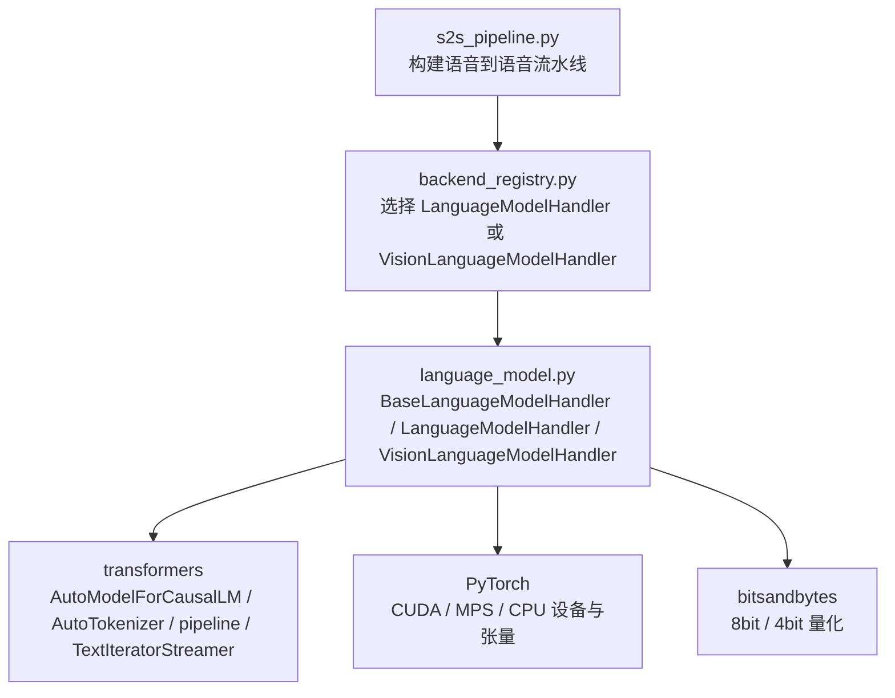

**图示来源**
- [s2s_pipeline.py:523-553](file://src/speech_to_speech/s2s_pipeline.py#L523-L553)
- [backend_registry.py:338-338](file://src/speech_to_speech/backend_registry.py#L338-L338)
- [language_model.py:166-214](file://src/speech_to_speech/LLM/language_model.py#L166-L214)
- [language_model.py:776-854](file://src/speech_to_speech/LLM/language_model.py#L776-L854)

**章节来源**
- [s2s_pipeline.py:523-553](file://src/speech_to_speech/s2s_pipeline.py#L523-L553)
- [backend_registry.py:338-338](file://src/speech_to_speech/backend_registry.py#L338-L338)
- [language_model.py:166-214](file://src/speech_to_speech/LLM/language_model.py#L166-L214)

## 核心组件总览
- `BaseLanguageModelHandler`：抽象基类，统一流式生成、工具调用提取、历史压缩、取消与停止控制、延迟统计等通用逻辑。
- `LanguageModelHandler`：文本型 LLM 的 Transformers 与 MLX 双后端实现；默认使用 Transformers + PyTorch。
- `VisionLanguageModelHandler`：视觉语言模型的 Transformers 与 MLX-VLM 后端实现，支持图像输入。
- `StreamContext`：流式生成上下文，累积原始文本、可打印文本、工具调用、句子批次、时间戳、取消状态等。
- `_CancelCriteria`：基于 `StoppingCriteria` 的外部可中断生成条件。

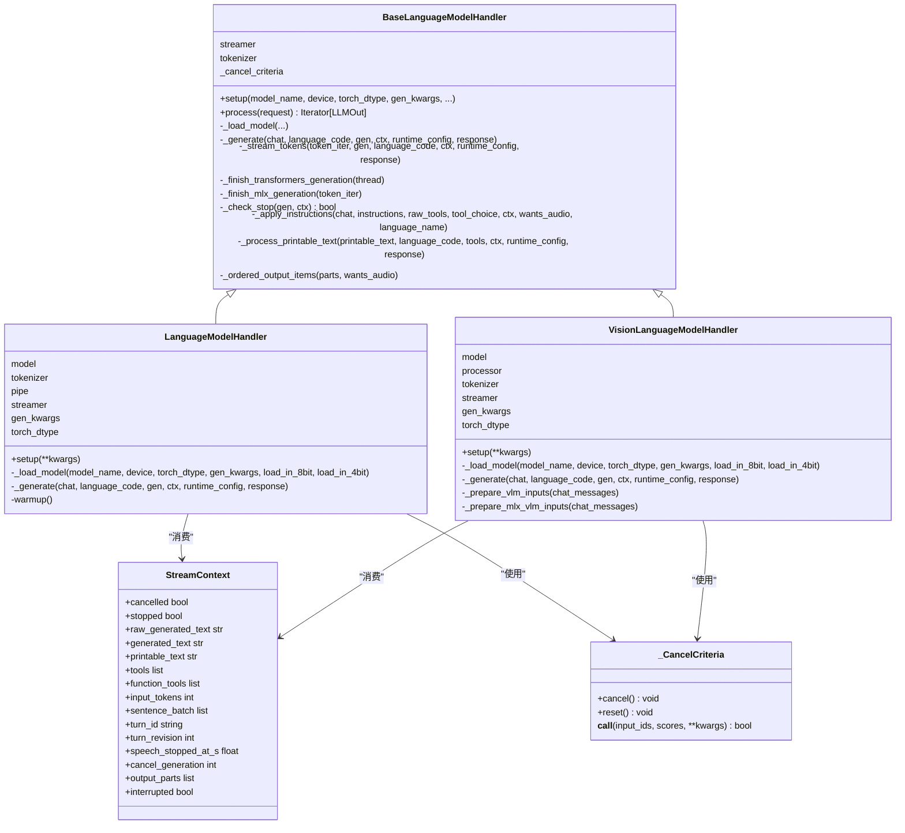

**图示来源**
- [language_model.py:118-159](file://src/speech_to_speech/LLM/language_model.py#L118-L159)
- [language_model.py:166-257](file://src/speech_to_speech/LLM/language_model.py#L166-L257)
- [language_model.py:776-854](file://src/speech_to_speech/LLM/language_model.py#L776-L854)
- [language_model.py:1005-1063](file://src/speech_to_speech/LLM/language_model.py#L1005-L1063)

**章节来源**
- [language_model.py:118-159](file://src/speech_to_speech/LLM/language_model.py#L118-L159)
- [language_model.py:166-257](file://src/speech_to_speech/LLM/language_model.py#L166-L257)
- [language_model.py:776-854](file://src/speech_to_speech/LLM/language_model.py#L776-L854)
- [language_model.py:1005-1063](file://src/speech_to_speech/LLM/language_model.py#L1005-L1063)

## 架构概览
从请求进入管道到模型输出的关键流程如下：

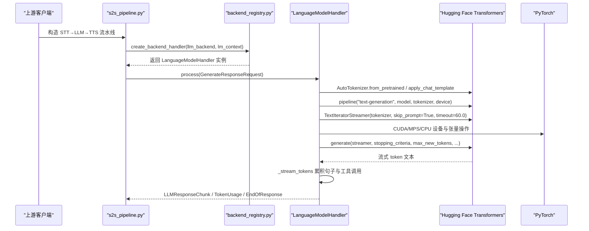

**图示来源**
- [s2s_pipeline.py:523-553](file://src/speech_to_speech/s2s_pipeline.py#L523-L553)
- [backend_registry.py:338-338](file://src/speech_to_speech/backend_registry.py#L338-L338)
- [language_model.py:560-765](file://src/speech_to_speech/LLM/language_model.py#L560-L765)
- [language_model.py:839-854](file://src/speech_to_speech/LLM/language_model.py#L839-L854)
- [language_model.py:856-917](file://src/speech_to_speech/LLM/language_model.py#L856-L917)

## LanguageModelHandler 详细分析

### 模型加载策略
- Transformers 路径：
  - 通过 `AutoTokenizer.from_pretrained` 加载分词器。
  - 通过 `AutoModelForCausalLM.from_pretrained` 加载因果语言模型。
  - 当未启用量化时，将模型移动到指定设备。
  - 使用 `pipeline("text-generation", model, tokenizer, device)` 包装模型，便于统一调用。
  - 创建 `TextIteratorStreamer`，用于流式输出。
  - 设置 `gen_kwargs`，包含 `streamer`、`return_full_text=False`、`stopping_criteria`（外部可取消）。
- MLX 路径：
  - 通过 `mlx_load` 加载模型与分词器。
  - 直接使用 MLX 的流式生成接口。

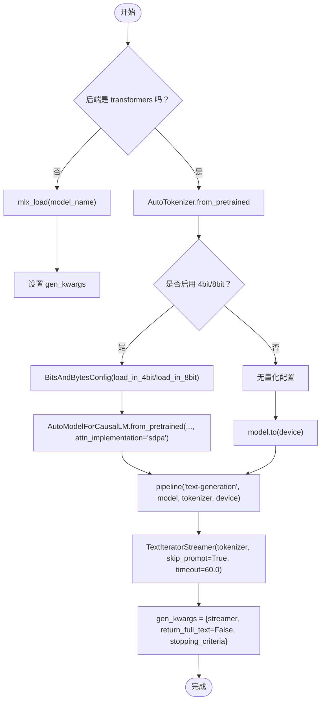

**图示来源**
- [language_model.py:808-854](file://src/speech_to_speech/LLM/language_model.py#L808-L854)

**章节来源**
- [language_model.py:808-854](file://src/speech_to_speech/LLM/language_model.py#L808-L854)

### 生成流程与流式处理
- 预处理：
  - 将聊天消息转换为 Transformers 格式。
  - 计算提示词 token 数并记录到 `ctx.input_tokens`。
  - 应用 chat template 生成 prompt。
- 执行生成：
  - Transformers 路径：在独立线程中调用 `self.pipe(chat_prompt, **self.gen_kwargs)`，主线程消费 `self.streamer`。
  - MLX 路径：直接迭代 MLX 流式生成器。
- 流式消费：
  - `_stream_tokens` 循环读取 token，累积原始文本、清理后文本、可打印文本。
  - 按句子切分，达到 `stream_batch_sentences` 批量发送。
  - 检测工具调用代码块，解析函数调用。
  - 检查取消/停止条件，避免陈旧 speculative turn 的输出。

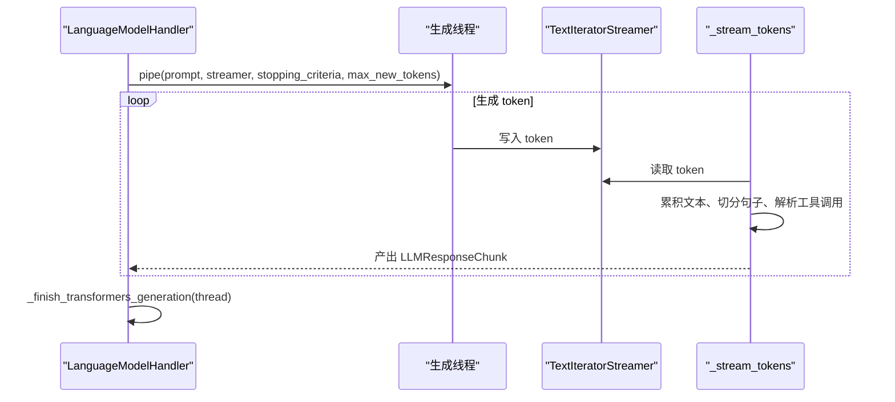

**图示来源**
- [language_model.py:856-917](file://src/speech_to_speech/LLM/language_model.py#L856-L917)
- [language_model.py:486-554](file://src/speech_to_speech/LLM/language_model.py#L486-L554)

**章节来源**
- [language_model.py:486-554](file://src/speech_to_speech/LLM/language_model.py#L486-L554)
- [language_model.py:856-917](file://src/speech_to_speech/LLM/language_model.py#L856-L917)

## 设备管理与内存优化

### 设备选择
- 非 MLX 后端：通过 `resolve_device(device, TORCH_DEVICES, "Transformers LLM")` 自动选择可用设备。
- macOS 限制：若检测到 macOS 且用户配置为 CUDA，会抛出异常，要求改为 CPU 或 MPS。
- MPS 路径：在生成结束后主动释放 MPS 缓存。

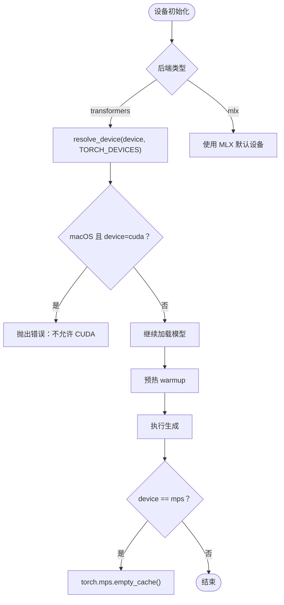

**图示来源**
- [language_model.py:196-207](file://src/speech_to_speech/LLM/language_model.py#L196-L207)
- [s2s_pipeline.py:321-328](file://src/speech_to_speech/s2s_pipeline.py#L321-L328)
- [language_model.py:915-916](file://src/speech_to_speech/LLM/language_model.py#L915-L916)

**章节来源**
- [language_model.py:196-207](file://src/speech_to_speech/LLM/language_model.py#L196-L207)
- [s2s_pipeline.py:321-328](file://src/speech_to_speech/s2s_pipeline.py#L321-L328)
- [language_model.py:915-916](file://src/speech_to_speech/LLM/language_model.py#L915-L916)

### 显存优化
- 量化加载：8bit/4bit 显著降低显存占用。
- SDPA（FlashAttention-2）：减少注意力计算显存，提升预填充与解码速度。
- MPS 缓存释放：每次生成后释放 MPS 缓存。
- MLX 缓存清理：生成结束后尝试 `mx.clear_cache()`。

**章节来源**
- [language_model.py:818-838](file://src/speech_to_speech/LLM/language_model.py#L818-L838)
- [language_model.py:915-916](file://src/speech_to_speech/LLM/language_model.py#L915-L916)
- [language_model.py:896-900](file://src/speech_to_speech/LLM/language_model.py#L896-L900)

## 流式生成与 TextIteratorStreamer

### TextIteratorStreamer 的作用
- 解耦模型生成与下游消费：模型在后台线程生成 token，主线程通过 `TextIteratorStreamer` 流式消费。
- 跳过 prompt 与特殊 token：仅输出实际生成的文本片段。
- 超时保护：设置 `timeout=60.0`，防止阻塞。

### 流式消费逻辑
- 累积原始文本与清理后文本。
- 按句子切分，达到批量阈值后发送。
- 解析工具调用代码块，提取函数调用。
- 检查取消/停止条件，确保响应及时终止。

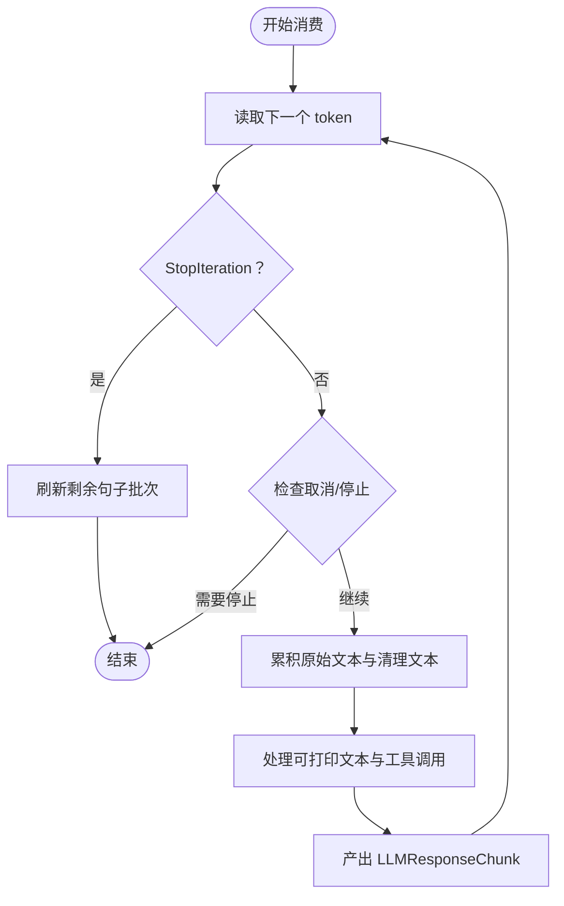

**图示来源**
- [language_model.py:486-554](file://src/speech_to_speech/LLM/language_model.py#L486-L554)

**章节来源**
- [language_model.py:486-554](file://src/speech_to_speech/LLM/language_model.py#L486-L554)

## 批处理、并发与多进程安全

### 批处理生成
- 句子级批处理：`stream_batch_sentences` 控制累积多少句子后再发送一个 chunk，平衡延迟与吞吐。
- 工具调用代码块：在流式过程中识别完整代码块，立即解析并发送工具调用结果。

### 并发与锁
- Transformers 路径：使用 `Lock` 串行化 `pipe` 调用，避免多线程竞争。
- MLX 路径：使用 `MLXLockContext` 保证 MLX 推理互斥。
- 背景压缩任务：与主生成路径共享锁，避免并发访问模型。

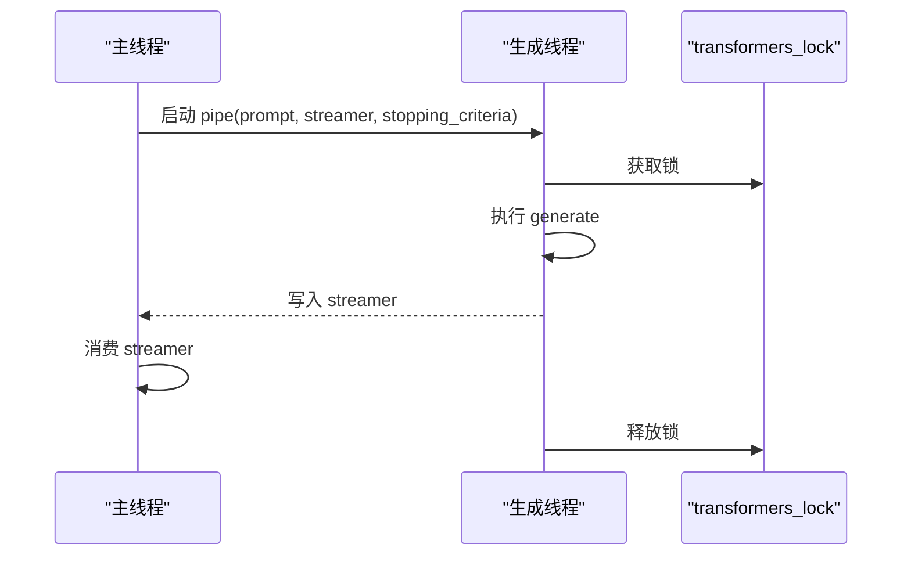

**图示来源**
- [language_model.py:905-914](file://src/speech_to_speech/LLM/language_model.py#L905-L914)

**章节来源**
- [language_model.py:905-914](file://src/speech_to_speech/LLM/language_model.py#L905-L914)

## 量化加载：8bit 与 4bit

### 配置入口
- `llm_load_in_8bit`：启用 bitsandbytes 8bit 量化。
- `llm_load_in_4bit`：启用 bitsandbytes 4bit（NF4）量化，优先级高于 8bit。

### 加载行为
- 根据开关构造 `BitsAndBytesConfig`。
- 传入 `AutoModelForCausalLM.from_pretrained`。
- 量化模式下不移动模型到设备，由量化加载过程处理设备映射。

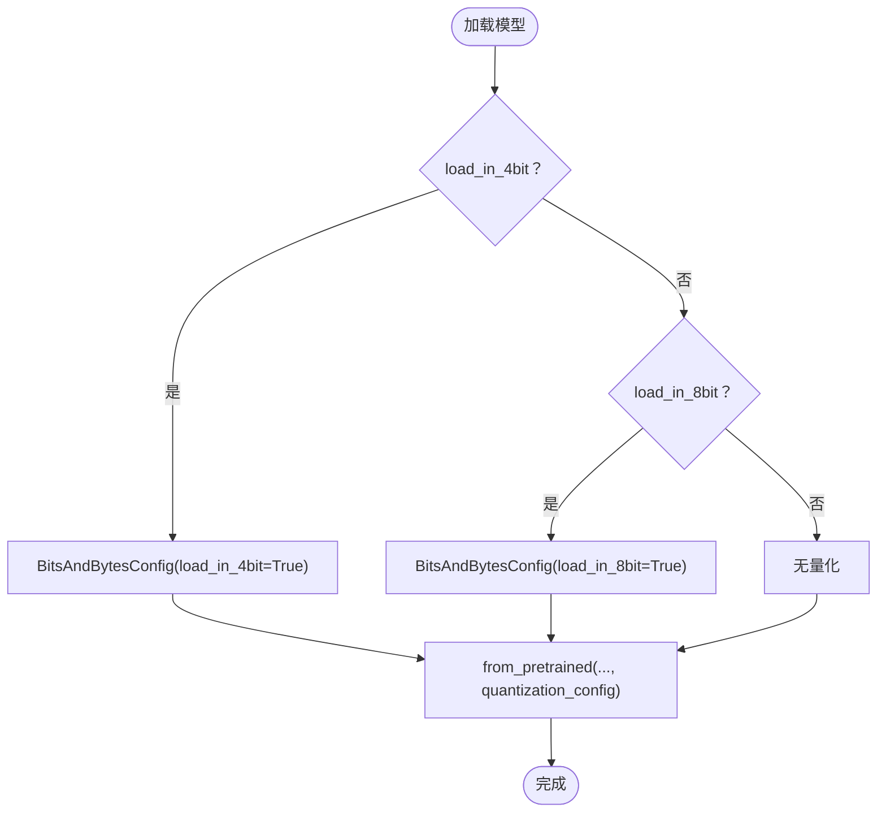

**图示来源**
- [language_model.py:818-838](file://src/speech_to_speech/LLM/language_model.py#L818-L838)
- [language_model_arguments.py:20-33](file://src/speech_to_speech/arguments_classes/language_model_arguments.py#L20-L33)

**章节来源**
- [language_model.py:818-838](file://src/speech_to_speech/LLM/language_model.py#L818-L838)
- [language_model_arguments.py:20-33](file://src/speech_to_speech/arguments_classes/language_model_arguments.py#L20-L33)

## PyTorch 生态集成与 CUDA 优化

### SDPA 与 FlashAttention-2
- 启用 `attn_implementation="sdpa"`，优先使用 FlashAttention-2（如果架构支持），提升预填充与解码速度，降低注意力显存。
- 通过 `enable_cudnn_sdp(True)` 启用 cuDNN SDPA 路径。

### TF32 加速
- 允许 FP32 矩阵乘使用 TF32，对 4bit/8bit 解码有小幅加速，质量影响可忽略。

### CUDA 事件计时
- 预热阶段使用 CUDA Event 测量首次推理耗时，便于监控冷启动性能。

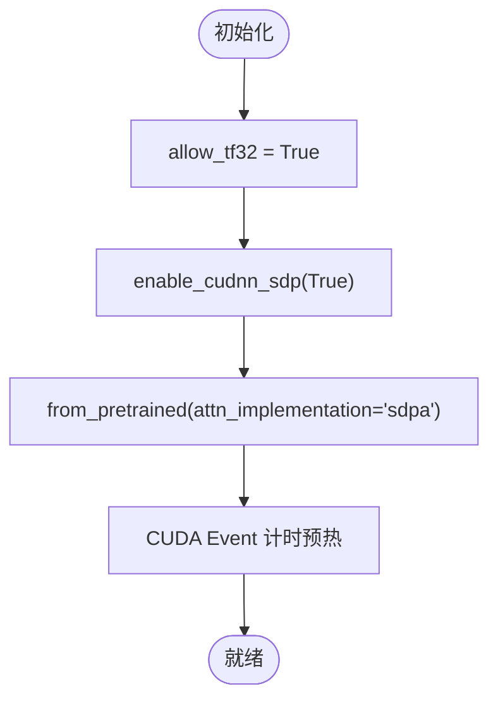

**图示来源**
- [language_model.py:810-838](file://src/speech_to_speech/LLM/language_model.py#L810-L838)
- [language_model.py:979-997](file://src/speech_to_speech/LLM/language_model.py#L979-L997)

**章节来源**
- [language_model.py:810-838](file://src/speech_to_speech/LLM/language_model.py#L810-L838)
- [language_model.py:979-997](file://src/speech_to_speech/LLM/language_model.py#L979-L997)

## 性能调优参数

### 模型加载与推理参数
- `llm_device`：设备选择，推荐 `auto` 或明确 `cuda`/`cpu`/`mps`。
- `llm_torch_dtype`：数据类型，推荐 `float16` 或 `bfloat16`。
- `llm_load_in_8bit` / `llm_load_in_4bit`：量化开关，优先 4bit。
- `llm_gen_max_new_tokens`：单次最大生成长度。
- `llm_gen_min_new_tokens`：最小生成长度。
- `llm_gen_temperature`：温度，0.0 表示确定性输出。
- `llm_gen_do_sample`：是否采样，False 表示贪心解码。

### 流式与批处理参数
- `stream_batch_sentences`：句子批大小，默认 3。
- `enable_lang_prompt`：是否在提示中加入语言信息。
- `compact_history`：是否启用历史压缩。

**章节来源**
- [language_model_arguments.py:10-59](file://src/speech_to_speech/arguments_classes/language_model_arguments.py#L10-L59)
- [language_model.py:178-214](file://src/speech_to_speech/LLM/language_model.py#L178-L214)

## 错误恢复机制

### 生成失败处理
- 捕获所有异常，记录日志并产出 `EndOfResponse`，确保下游不会卡住。
- 对于预取事务，标记丢弃，避免异步完成通知导致状态不一致。

### 取消与停止
- `_check_stop` 检查预取事务丢弃、生成轮次陈旧、speculative turn 陈旧、全局停止事件。
- `_CancelCriteria` 作为 `StoppingCriteria`，允许外部信号中断生成。

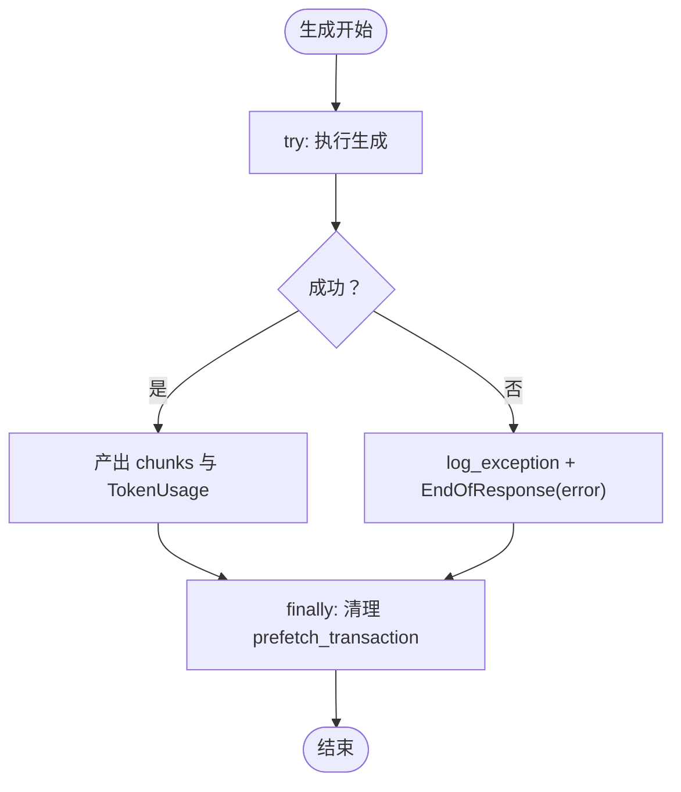

**图示来源**
- [language_model.py:735-765](file://src/speech_to_speech/LLM/language_model.py#L735-L765)
- [language_model.py:466-484](file://src/speech_to_speech/LLM/language_model.py#L466-L484)
- [language_model.py:118-131](file://src/speech_to_speech/LLM/language_model.py#L118-L131)

**章节来源**
- [language_model.py:735-765](file://src/speech_to_speech/LLM/language_model.py#L735-L765)
- [language_model.py:466-484](file://src/speech_to_speech/LLM/language_model.py#L466-L484)
- [language_model.py:118-131](file://src/speech_to_speech/LLM/language_model.py#L118-L131)

## 配置示例

### 基础 Transformers 配置
- 设备：`cuda`
- 数据类型：`float16`
- 量化：关闭（或开启 8bit/4bit）
- 最大生成长度：1024
- 流式批大小：3

### MLX 配置
- 设备：`mps`
- 模型：`mlx-community/Qwen3.5-4B-4bit`

### 运行时验证
- 测试用例验证设备配置正确传递到后端。

**章节来源**
- [language_model_arguments.py:63-72](file://src/speech_to_speech/arguments_classes/language_model_arguments.py#L63-L72)
- [test_configured_runtime.py:481-491](file://tests/test_configured_runtime.py#L481-L491)

## 性能基准建议

### 建议指标
- 首 token 延迟（TTFT）：从请求到第一个 token 的时间。
- 端到端延迟：从请求到最后一个 token 的时间。
- 吞吐量：每秒生成 token 数。
- 显存占用：模型常驻显存峰值。
- 预热时间：首次推理耗时。

### 建议场景
- 短对话：1-3 句，关注 TTFT。
- 长对话：10+ 句，关注吞吐与显存稳定性。
- 量化对比：FP16 vs 8bit vs 4bit。
- 设备对比：CUDA vs MPS vs CPU。

### 基准脚本参考
- 可使用项目中的 `latency_test.py` 或自定义脚本，结合 `perf_counter` 与 CUDA Event 测量。

**章节来源**
- [language_model.py:979-997](file://src/speech_to_speech/LLM/language_model.py#L979-L997)

## 故障排查指南

### 常见问题
- macOS 上 CUDA 报错：请改用 `cpu` 或 `mps`。
- 显存不足：启用 4bit/8bit 量化，或减小 `max_new_tokens`。
- 流式卡顿：检查 `TextIteratorStreamer` 超时与 `_stream_tokens` 取消逻辑。
- 并发冲突：确认 `transformers_lock` 或 `MLXLockContext` 正确使用。

### 调试技巧
- 开启 debug 日志，查看 CUDA 编译与图断点信息。
- 使用 `torch._logging.set_logs(graph_breaks=True, recompiles=True, cudagraphs=True)` 分析性能瓶颈。

**章节来源**
- [s2s_pipeline.py:316-319](file://src/speech_to_speech/s2s_pipeline.py#L316-L319)
- [s2s_pipeline.py:321-328](file://src/speech_to_speech/s2s_pipeline.py#L321-L328)

## 结论
`LanguageModelHandler` 在本仓库中提供了稳定、可扩展的 Transformers 后端实现，涵盖模型加载、设备管理、流式生成、量化加载、并发安全与错误恢复。通过合理配置 `llm_device`、`llm_torch_dtype`、`llm_load_in_4bit`/`llm_load_in_8bit`、`llm_gen_max_new_tokens` 等参数，可在不同硬件环境下取得良好性能与稳定性。建议在生产环境中结合量化、SDPA、TF32 与 MPS/CUDA 优化，进行系统性的性能基准测试与故障排查。