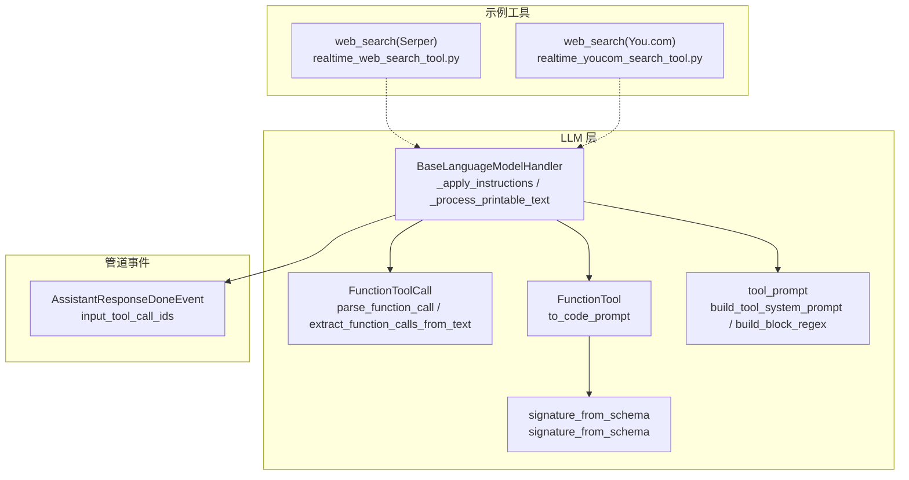
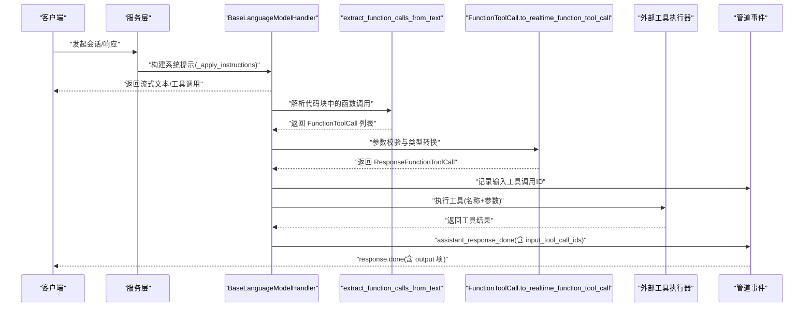
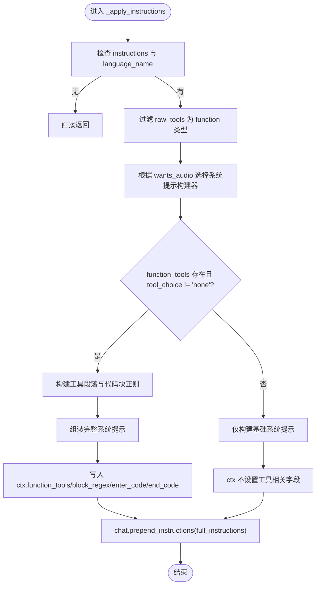
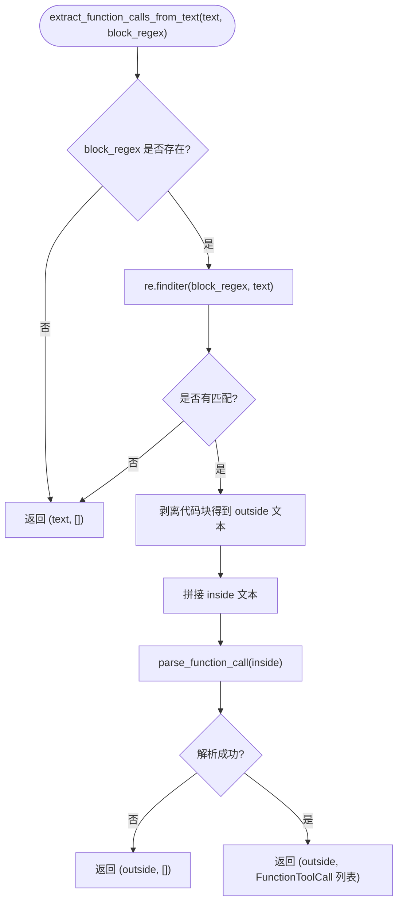
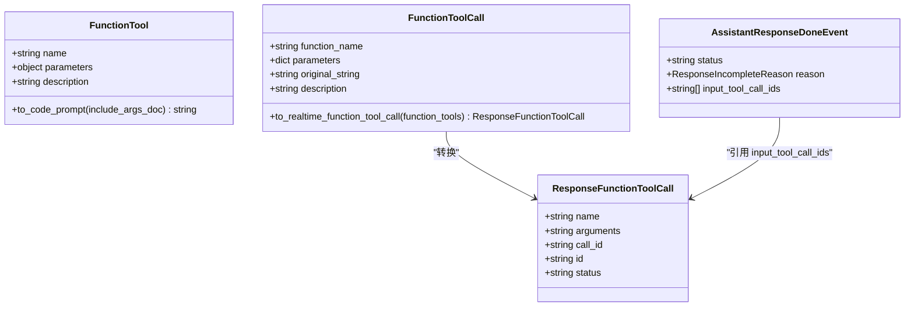
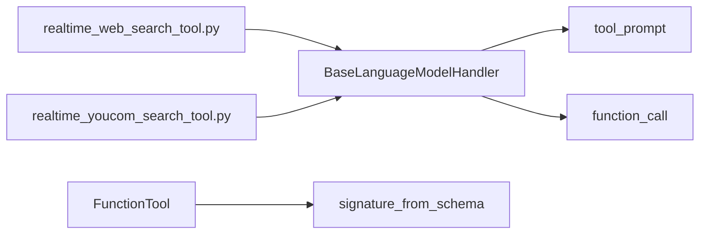
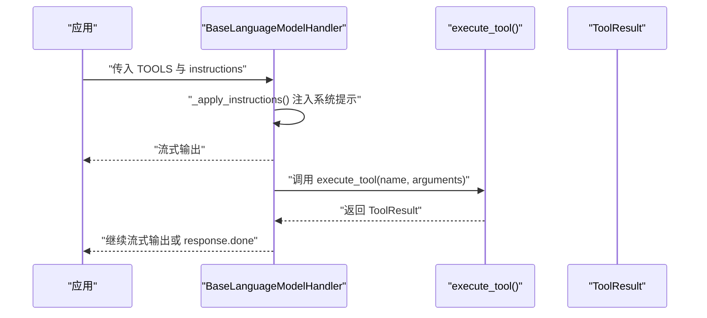

# 工具调用集成

<cite>
**本文引用的文件**   
- [language_model.py](file://src/speech_to_speech/LLM/language_model.py)
- [function_call.py](file://src/speech_to_speech/LLM/tool_call/function_call.py)
- [function_tool.py](file://src/speech_to_speech/LLM/tool_call/function_tool.py)
- [tool_prompt.py](file://src/speech_to_speech/LLM/tool_call/tool_prompt.py)
- [signature_from_schema.py](file://src/speech_to_speech/LLM/tool_call/signature_from_schema.py)
- [realtime_web_search_tool.py](file://examples/realtime_web_search_tool.py)
- [realtime_youcom_search_tool.py](file://examples/realtime_youcom_search_tool.py)
- [events.py](file://src/speech_to_speech/pipeline/events.py)
</cite>

## 目录
1. [引言](#引言)
2. [项目结构](#项目结构)
3. [核心组件](#核心组件)
4. [架构总览](#架构总览)
5. [详细组件分析](#详细组件分析)
6. [依赖关系分析](#依赖关系分析)
7. [性能考量](#性能考量)
8. [故障排查指南](#故障排查指南)
9. [结论](#结论)
10. [附录：使用示例与数据流图](#附录使用示例与数据流图)

## 引言
本文面向“工具调用集成”的技术文档，聚焦以下目标：
- 深入讲解 _apply_instructions() 如何动态注入工具定义、构建系统提示、并准备代码块解析规则。
- 详细说明 extract_function_calls_from_text() 的正则匹配、参数验证与类型转换流程。
- 解释工具执行结果的回传机制、状态管理与错误处理。
- 提供工具调用链路的完整数据流图与实际使用示例，帮助读者从端到端理解整个工具调用过程。

## 项目结构
围绕工具调用的关键代码集中在 LLM 模块的 tool_call 子包以及语言模型处理器中：
- language_model.py：负责在对话上下文中注入系统提示、维护工具上下文、解析流式输出中的工具调用。
- tool_call/function_call.py：实现函数调用字符串解析、参数绑定与校验、生成标准工具调用对象。
- tool_call/function_tool.py：将工具描述与 JSON Schema 转换为可被 LLM 理解的 Python 风格签名与文档。
- tool_call/tool_prompt.py：基于 Jinja2 模板渲染工具系统提示，并提供代码块正则表达式构造器。
- tool_call/signature_from_schema.py：将 JSON Schema 映射为 Python 类型注解与 inspect.Signature。
- examples/*_search_tool.py：展示外部工具声明与执行器的实际用法。
- pipeline/events.py：定义响应完成事件，包含已使用的工具调用 ID 等元信息。

图表来源
- [language_model.py:280-427](file://src/speech_to_speech/LLM/language_model.py#L280-L427)
- [function_call.py:189-329](file://src/speech_to_speech/LLM/tool_call/function_call.py#L189-L329)
- [function_tool.py:8-34](file://src/speech_to_speech/LLM/tool_call/function_tool.py#L8-L34)
- [tool_prompt.py:76-109](file://src/speech_to_speech/LLM/tool_call/tool_prompt.py#L76-L109)
- [signature_from_schema.py:79-124](file://src/speech_to_speech/LLM/tool_call/signature_from_schema.py#L79-L124)
- [events.py:175-189](file://src/speech_to_speech/pipeline/events.py#L175-L189)

章节来源
- [language_model.py:280-427](file://src/speech_to_speech/LLM/language_model.py#L280-L427)
- [function_call.py:189-329](file://src/speech_to_speech/LLM/tool_call/function_call.py#L189-L329)
- [function_tool.py:8-34](file://src/speech_to_speech/LLM/tool_call/function_tool.py#L8-L34)
- [tool_prompt.py:76-109](file://src/speech_to_speech/LLM/tool_call/tool_prompt.py#L76-L109)
- [signature_from_schema.py:79-124](file://src/speech_to_speech/LLM/tool_call/signature_from_schema.py#L79-L124)
- [events.py:175-189](file://src/speech_to_speech/pipeline/events.py#L175-L189)

## 核心组件
- BaseLanguageModelHandler._apply_instructions()
  - 作用：根据是否启用工具与工具选择策略，动态注入系统提示，并在 StreamContext 中保存工具列表、代码块正则与分隔符。
  - 关键点：
    - 过滤 raw_tools 中 type="function" 的工具，转为 FunctionTool。
    - 根据 wants_audio 选择语音或文本系统提示构建器。
    - 当存在工具且 tool_choice != "none" 时，构建工具段落与代码块正则，设置 ENTER_CODE 与 END_CODE。
    - 将 full_instructions 追加到 Chat 上下文，并将 function_tools、block_regex、enter_code、end_code 写入 ctx。
- FunctionTool.to_code_prompt()
  - 作用：将工具的 JSON Schema 与描述转换为 Python 风格的函数签名与文档字符串，便于 LLM 理解参数结构与用途。
- tool_prompt.build_tool_system_prompt() 与 build_block_regex()
  - 作用：渲染工具系统提示（支持语音与纯文本两种模板），并生成非贪婪的代码块正则以匹配 <code>...</code> 包裹的内容。
- FunctionToolCall.parse_function_call() 与 extract_function_calls_from_text()
  - 作用：从 LLM 输出中提取 <code>...</code> 包裹的函数调用，解析为 FunctionToolCall，再转换为 ResponseFunctionToolCall。
- signature_from_schema.signature_from_schema()
  - 作用：将 JSON Schema 属性映射为 Python 类型注解与默认值，生成 inspect.Signature，用于位置参数绑定与校验。

章节来源
- [language_model.py:280-322](file://src/speech_to_speech/LLM/language_model.py#L280-L322)
- [function_tool.py:8-34](file://src/speech_to_speech/LLM/tool_call/function_tool.py#L8-L34)
- [tool_prompt.py:76-109](file://src/speech_to_speech/LLM/tool_call/tool_prompt.py#L76-L109)
- [function_call.py:189-329](file://src/speech_to_speech/LLM/tool_call/function_call.py#L189-L329)
- [signature_from_schema.py:79-124](file://src/speech_to_speech/LLM/tool_call/signature_from_schema.py#L79-L124)

## 架构总览
下图展示了从 LLM 输出到工具调用再到结果回传的端到端流程：

图表来源
- [language_model.py:280-427](file://src/speech_to_speech/LLM/language_model.py#L280-L427)
- [function_call.py:189-329](file://src/speech_to_speech/LLM/tool_call/function_call.py#L189-L329)
- [events.py:175-189](file://src/speech_to_speech/pipeline/events.py#L175-L189)

## 详细组件分析

### _apply_instructions() 动态注入工具定义与系统提示
- 功能要点
  - 过滤 raw_tools 中 type="function" 的工具，实例化为 FunctionTool。
  - 根据 wants_audio 选择语音或文本系统提示构建器。
  - 当存在工具且 tool_choice != "none" 时：
    - 通过 build_tool_system_prompt(function_tools, text_only=not wants_audio) 生成工具段落。
    - 通过 build_system_prompt(instructions, tool_section, language_name) 组装完整系统提示。
    - 通过 build_block_regex() 生成代码块正则，设置 ENTER_CODE 与 END_CODE。
  - 将完整系统提示追加到 Chat 上下文，并将 function_tools、block_regex、enter_code、end_code 写入 StreamContext。
- 设计模式
  - 条件装配：根据工具与工具选择策略决定是否注入工具段落与代码块解析规则。
  - 上下文传递：通过 ctx 将工具定义与解析配置传递给后续流式处理逻辑。

图表来源
- [language_model.py:280-322](file://src/speech_to_speech/LLM/language_model.py#L280-L322)
- [tool_prompt.py:76-109](file://src/speech_to_speech/LLM/tool_call/tool_prompt.py#L76-L109)

章节来源
- [language_model.py:280-322](file://src/speech_to_speech/LLM/language_model.py#L280-L322)
- [tool_prompt.py:76-109](file://src/speech_to_speech/LLM/tool_call/tool_prompt.py#L76-L109)

### extract_function_calls_from_text() 正则匹配、参数验证与类型转换
- 正则匹配
  - 使用 block_regex（由 build_block_regex() 生成）匹配 <code>...</code> 包裹的代码块。
  - 若未找到匹配，直接返回原始文本与空调用列表。
  - 若找到匹配，剥离代码块内容，拼接内部文本后交由 parse_function_call() 解析。
- 解析与参数验证
  - parse_function_call() 优先尝试 tokenize 分割顶层调用；失败时使用宽松正则回退。
  - _parse_call_expr() 使用 ast 解析单个 name(args...) 表达式，提取函数名与参数。
  - FunctionToolCall.to_realtime_function_tool_call() 进行参数校验：
    - 位置参数绑定：依据 signature_from_schema(schema).parameters 的顺序绑定 __arg_i__ 键。
    - 未知参数丢弃：不在 properties 中的参数将被丢弃并记录警告。
    - 必填参数校验：required 集合缺失时报错。
    - 生成 ResponseFunctionToolCall，包含 name、arguments(JSON 字符串)、call_id、id、status="in_progress"。
- 类型转换
  - _literal_from_ast() 将 AST 节点转换为 Python 字面量（字符串、数字、布尔、列表、元组、字典、一元运算）。
  - signature_from_schema() 将 JSON Schema 映射为 Python 类型注解与默认值，确保位置参数顺序正确。

图表来源
- [function_call.py:296-329](file://src/speech_to_speech/LLM/tool_call/function_call.py#L296-L329)
- [function_call.py:269-293](file://src/speech_to_speech/LLM/tool_call/function_call.py#L269-L293)
- [function_call.py:163-183](file://src/speech_to_speech/LLM/tool_call/function_call.py#L163-L183)
- [function_call.py:133-160](file://src/speech_to_speech/LLM/tool_call/function_call.py#L133-L160)
- [signature_from_schema.py:79-124](file://src/speech_to_speech/LLM/tool_call/signature_from_schema.py#L79-L124)

章节来源
- [function_call.py:296-329](file://src/speech_to_speech/LLM/tool_call/function_call.py#L296-L329)
- [function_call.py:269-293](file://src/speech_to_speech/LLM/tool_call/function_call.py#L269-L293)
- [function_call.py:163-183](file://src/speech_to_speech/LLM/tool_call/function_call.py#L163-L183)
- [function_call.py:133-160](file://src/speech_to_speech/LLM/tool_call/function_call.py#L133-L160)
- [signature_from_schema.py:79-124](file://src/speech_to_speech/LLM/tool_call/signature_from_schema.py#L79-L124)

### 工具执行结果回传机制、状态管理与错误处理
- 流式文本与工具调用分离
  - _process_printable_text() 在检测到 enter_code 与 end_code 时，将代码块视为工具调用区域，其余文本按句子分片输出。
  - 对每个解析出的 FunctionToolCall，调用 to_realtime_function_tool_call(ctx.function_tools) 进行参数校验与转换。
  - 校验失败时记录警告并跳过该调用；成功时追加到 tools 列表，并生成 AssistantToolCallPart 作为 LLMResponseChunk 的一部分。
- 状态管理
  - ResponseFunctionToolCall.status 初始为 "in_progress"，后续由上层服务更新为 "completed"/"failed" 等状态。
  - AssistantResponseDoneEvent 携带 input_tool_call_ids，标识本次响应使用的工具调用 ID。
- 错误处理
  - 工具调用解析失败：记录警告并跳过。
  - 工具执行异常：示例工具返回 ToolResult 包装的错误信息，供上层决定后续行为。
  - 必填参数缺失或多余位置参数：抛出 ValueError，阻止无效调用进入执行阶段。

图表来源
- [function_tool.py:8-34](file://src/speech_to_speech/LLM/tool_call/function_tool.py#L8-L34)
- [function_call.py:189-263](file://src/speech_to_speech/LLM/tool_call/function_call.py#L189-L263)
- [events.py:175-189](file://src/speech_to_speech/pipeline/events.py#L175-L189)

章节来源
- [language_model.py:324-427](file://src/speech_to_speech/LLM/language_model.py#L324-L427)
- [function_call.py:189-263](file://src/speech_to_speech/LLM/tool_call/function_call.py#L189-L263)
- [events.py:175-189](file://src/speech_to_speech/pipeline/events.py#L175-L189)

## 依赖关系分析
- 组件耦合
  - BaseLanguageModelHandler 依赖 tool_prompt 构建系统提示与代码块正则，依赖 function_call 解析与校验工具调用。
  - FunctionTool 依赖 signature_from_schema 生成 Python 风格签名，以便 LLM 理解参数顺序与类型。
  - 示例工具通过 execute_tool(name, arguments) 接口与上层服务交互，返回 ToolResult。
- 外部依赖
  - openai.types.responses.ResponseFunctionToolCall：标准工具调用对象。
  - jinja2.Template：渲染工具系统提示模板。
  - httpx：示例工具进行 HTTP 请求。

图表来源
- [language_model.py:280-427](file://src/speech_to_speech/LLM/language_model.py#L280-L427)
- [function_call.py:189-329](file://src/speech_to_speech/LLM/tool_call/function_call.py#L189-L329)
- [function_tool.py:8-34](file://src/speech_to_speech/LLM/tool_call/function_tool.py#L8-L34)
- [tool_prompt.py:76-109](file://src/speech_to_speech/LLM/tool_call/tool_prompt.py#L76-L109)
- [signature_from_schema.py:79-124](file://src/speech_to_speech/LLM/tool_call/signature_from_schema.py#L79-L124)
- [realtime_web_search_tool.py:20-118](file://examples/realtime_web_search_tool.py#L20-L118)
- [realtime_youcom_search_tool.py:27-147](file://examples/realtime_youcom_search_tool.py#L27-L147)

章节来源
- [language_model.py:280-427](file://src/speech_to_speech/LLM/language_model.py#L280-L427)
- [function_call.py:189-329](file://src/speech_to_speech/LLM/tool_call/function_call.py#L189-L329)
- [function_tool.py:8-34](file://src/speech_to_speech/LLM/tool_call/function_tool.py#L8-L34)
- [tool_prompt.py:76-109](file://src/speech_to_speech/LLM/tool_call/tool_prompt.py#L76-L109)
- [signature_from_schema.py:79-124](file://src/speech_to_speech/LLM/tool_call/signature_from_schema.py#L79-L124)
- [realtime_web_search_tool.py:20-118](file://examples/realtime_web_search_tool.py#L20-L118)
- [realtime_youcom_search_tool.py:27-147](file://examples/realtime_youcom_search_tool.py#L27-L147)

## 性能考量
- 流式处理优化
  - _process_printable_text() 按句子分片输出，减少延迟；仅在达到 stream_batch_sentences 阈值时批量发送。
  - 代码块解析仅在检测到 enter_code 与 end_code 时触发，避免不必要的解析开销。
- 解析与校验
  - 优先使用 tokenize 分割顶层调用，失败时回退到宽松正则，提升鲁棒性。
  - 参数校验在 to_realtime_function_tool_call() 中进行，提前拦截无效调用，避免下游执行浪费。
- 内存与计算
  - 使用 ast 与 tokenize 解析表达式，避免 eval 带来的安全风险与性能问题。
  - signature_from_schema() 生成 inspect.Signature，确保位置参数顺序正确，减少运行时绑定成本。

[本节为通用指导，不直接分析具体文件]

## 故障排查指南
- 常见问题
  - 工具未被识别：检查 raw_tools 中 type 是否为 "function"，并确保 tool_choice != "none"。
  - 参数缺失或多余：查看 FunctionToolCall.to_realtime_function_tool_call() 抛出的 ValueError，确认 required 字段与位置参数数量。
  - 工具执行失败：检查示例工具的 execute_tool() 返回的 ToolResult，关注 error 字段与日志。
- 调试建议
  - 启用日志记录，观察 WARNING 与 ERROR 消息。
  - 在 _process_printable_text() 中打印 parsed_tools 与 tools 列表，确认工具调用是否正确累积。
  - 使用 AssistantResponseDoneEvent.input_tool_call_ids 核对已使用的工具调用 ID。

章节来源
- [function_call.py:189-263](file://src/speech_to_speech/LLM/tool_call/function_call.py#L189-L263)
- [language_model.py:324-427](file://src/speech_to_speech/LLM/language_model.py#L324-L427)
- [events.py:175-189](file://src/speech_to_speech/pipeline/events.py#L175-L189)

## 结论
本技术文档详细阐述了工具调用集成的核心机制：
- _apply_instructions() 动态注入工具定义与系统提示，准备代码块解析规则。
- extract_function_calls_from_text() 通过正则与 AST/tokenize 解析函数调用，并进行参数校验与类型转换。
- 工具执行结果通过 ResponseFunctionToolCall 与 AssistantResponseDoneEvent 回传，状态管理与错误处理贯穿全流程。
- 示例工具展示了外部工具声明与执行的实践方式，结合数据流图帮助读者理解端到端链路。

[本节为总结，不直接分析具体文件]

## 附录：使用示例与数据流图

### 实际使用示例
- 声明工具
  - 在 examples/realtime_web_search_tool.py 与 examples/realtime_youcom_search_tool.py 中，TOOLS 列表定义了 web_search 工具的 JSON Schema。
- 执行工具
  - execute_tool(name, arguments) 根据名称路由到具体实现，进行参数校验、HTTP 请求与结果封装。
- 集成到 LLM
  - 将 TOOLS 传入 BaseLanguageModelHandler，_apply_instructions() 会将其注入系统提示，并在流式输出中解析与执行。

图表来源
- [realtime_web_search_tool.py:20-118](file://examples/realtime_web_search_tool.py#L20-L118)
- [realtime_youcom_search_tool.py:27-147](file://examples/realtime_youcom_search_tool.py#L27-L147)
- [language_model.py:280-427](file://src/speech_to_speech/LLM/language_model.py#L280-L427)

章节来源
- [realtime_web_search_tool.py:20-118](file://examples/realtime_web_search_tool.py#L20-L118)
- [realtime_youcom_search_tool.py:27-147](file://examples/realtime_youcom_search_tool.py#L27-L147)
- [language_model.py:280-427](file://src/speech_to_speech/LLM/language_model.py#L280-L427)