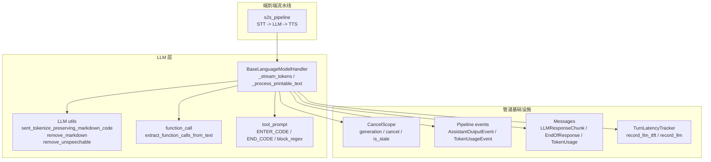
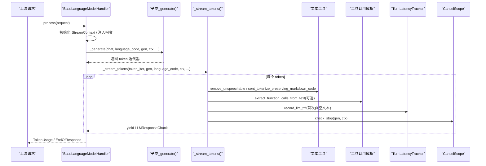
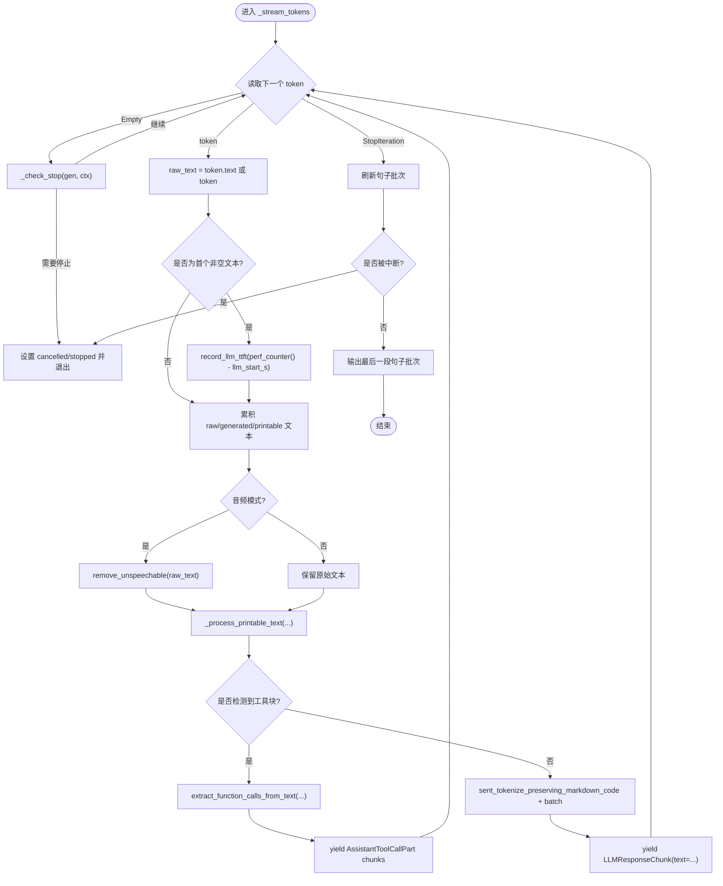
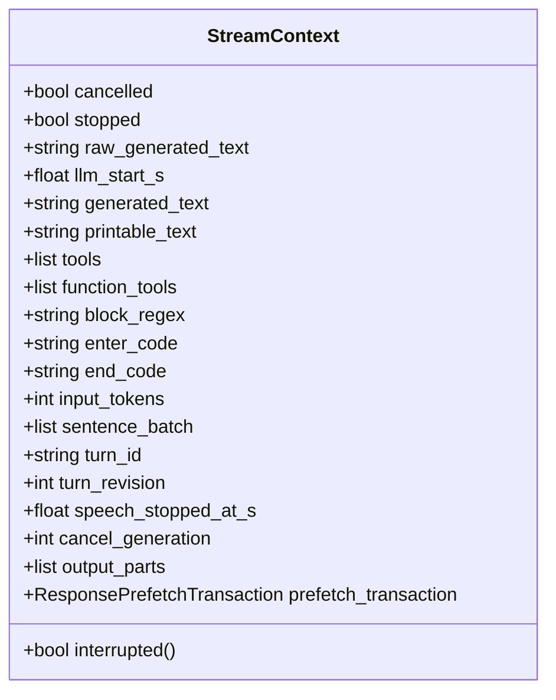
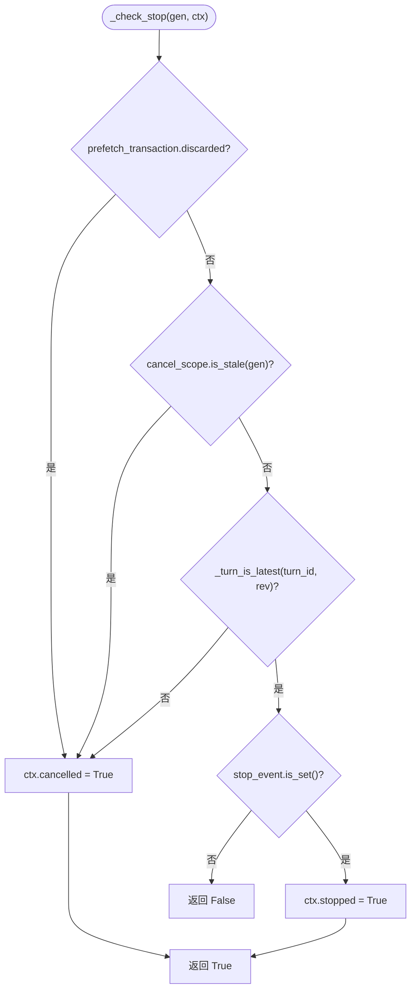
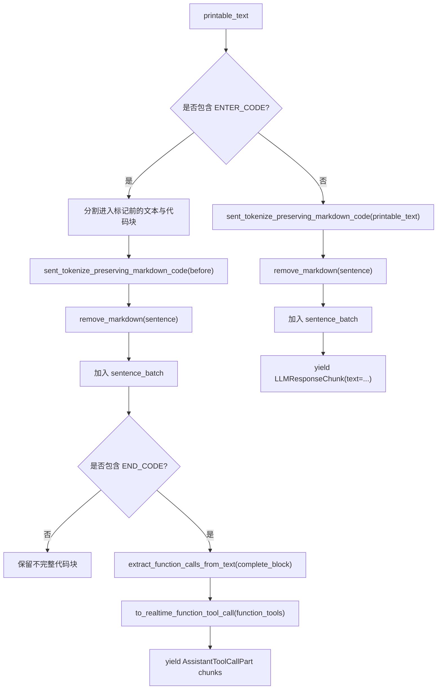
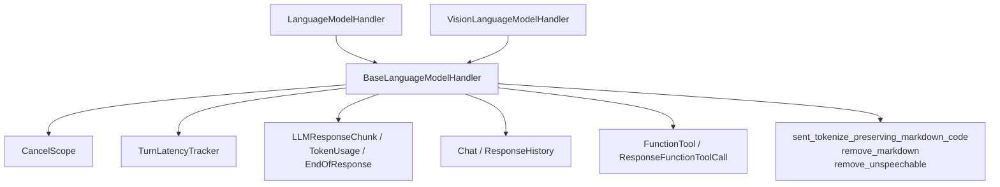
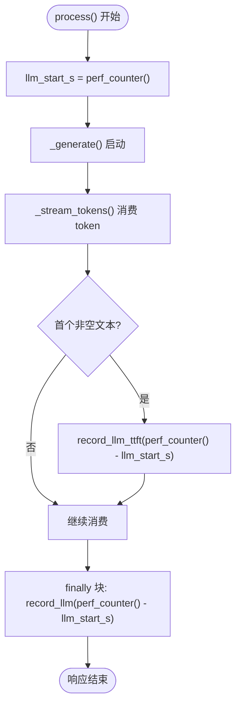

# 流式生成机制

<cite>
**本文引用的文件**   
- [language_model.py](file://src/speech_to_speech/LLM/language_model.py)
- [cancel_scope.py](file://src/speech_to_speech/pipeline/cancel_scope.py)
- [events.py](file://src/speech_to_speech/pipeline/events.py)
- [messages.py](file://src/speech_to_speech/pipeline/messages.py)
- [turn_latency.py](file://src/speech_to_speech/pipeline/turn_latency.py)
- [utils.py](file://src/speech_to_speech/LLM/utils.py)
- [function_call.py](file://src/speech_to_speech/LLM/tool_call/function_call.py)
- [tool_prompt.py](file://src/speech_to_speech/LLM/tool_call/tool_prompt.py)
- [s2s_pipeline.py](file://src/speech_to_speech/s2s_pipeline.py)
</cite>

## 目录
1. [引言](#引言)
2. [项目结构](#项目结构)
3. [核心组件](#核心组件)
4. [架构总览](#架构总览)
5. [详细组件分析](#详细组件分析)
6. [依赖关系分析](#依赖关系分析)
7. [性能与延迟追踪](#性能与延迟追踪)
8. [调试技巧与常见问题](#调试技巧与常见问题)
9. [结论](#结论)

## 引言
本文面向“语音到语音”系统中的语言模型流式生成路径，重点解析 `_stream_tokens()` 的核心算法、`StreamContext` 状态管理、取消与中断处理、文本清洗与 Markdown 处理、工具调用提取、语言代码传递，以及 TTFT 时间测量与整体延迟监控。文档同时给出架构图、流程图和类图，帮助读者从高层到代码层逐步理解该机制。

## 项目结构
与流式生成直接相关的代码集中在 LLM 模块与管道基础设施中：
- LLM 抽象基类与具体处理器负责加载模型、发起生成、消费 token 流并输出句子级片段。
- 管道基础设施提供取消作用域、事件类型、消息类型、延迟追踪等通用能力。
- 工具调用与提示词构建位于 LLM 的工具调用子模块。
- 文本清洗、分句、Markdown 处理位于 LLM 工具函数。
- 端到端流水线将 STT、LLM、TTS 串联起来，并把语言模型响应交给下游 TTS 或历史写入逻辑。

**图表来源**
- [language_model.py:166-768](file://src/speech_to_speech/LLM/language_model.py#L166-L768)
- [cancel_scope.py:1-34](file://src/speech_to_speech/pipeline/cancel_scope.py#L1-L34)
- [events.py:161-194](file://src/speech_to_speech/pipeline/events.py#L161-L194)
- [messages.py:1-200](file://src/speech_to_speech/pipeline/messages.py#L1-L200)
- [turn_latency.py:1-200](file://src/speech_to_speech/pipeline/turn_latency.py#L1-L200)
- [utils.py:111-173](file://src/speech_to_speech/LLM/utils.py#L111-L173)
- [function_call.py:1-200](file://src/speech_to_speech/LLM/tool_call/function_call.py#L1-L200)
- [tool_prompt.py:1-200](file://src/speech_to_speech/LLM/tool_call/tool_prompt.py#L1-L200)
- [s2s_pipeline.py:463-553](file://src/speech_to_speech/s2s_pipeline.py#L463-L553)

**章节来源**
- [language_model.py:166-768](file://src/speech_to_speech/LLM/language_model.py#L166-L768)
- [s2s_pipeline.py:463-553](file://src/speech_to_speech/s2s_pipeline.py#L463-L553)

## 核心组件
- `StreamContext`：流式生成的可变状态容器，保存已生成原始文本、可打印文本、句子批次、工具列表、回合标识、是否被取消或停止等信息。
- `BaseLanguageModelHandler`：语言模型处理的抽象基类，封装了流式 token 消费、句子分词、批量输出、工具调用提取、指令注入、TTFT 记录、历史提交与错误终止等通用逻辑。
- `CancelScope`：统一的取消信号，使用 generation 计数器避免短暂脉冲竞态，支持异步发送循环丢弃陈旧输出。
- `LLMResponseChunk`、`TokenUsage`、`EndOfResponse`：流式输出、用量统计与响应结束的消息类型。
- `TurnLatencyTracker`：记录 TTFT、LLM 耗时、端到端延迟等指标。
- `sent_tokenize_preserving_markdown_code`、`remove_markdown`、`remove_unspeechable`：文本清洗与分句工具。
- `extract_function_calls_from_text`、`ENTER_CODE`、`END_CODE`、`block_regex`：工具调用块识别与解析。

**章节来源**
- [language_model.py:134-163](file://src/speech_to_speech/LLM/language_model.py#L134-L163)
- [language_model.py:166-768](file://src/speech_to_speech/LLM/language_model.py#L166-L768)
- [cancel_scope.py:1-34](file://src/speech_to_speech/pipeline/cancel_scope.py#L1-L34)
- [events.py:161-194](file://src/speech_to_speech/pipeline/events.py#L161-L194)
- [messages.py:1-200](file://src/speech_to_speech/pipeline/messages.py#L1-L200)
- [utils.py:111-173](file://src/speech_to_speech/LLM/utils.py#L111-L173)
- [function_call.py:1-200](file://src/speech_to_speech/LLM/tool_call/function_call.py#L1-L200)
- [tool_prompt.py:1-200](file://src/speech_to_speech/LLM/tool_call/tool_prompt.py#L1-L200)

## 架构总览
流式生成在 LLM 层由 `BaseLanguageModelHandler.process()` 启动，内部创建 `StreamContext`，准备系统提示与工具定义，然后调用子类 `_generate()` 获取 token 迭代器，并通过 `_stream_tokens()` 消费 token、累积文本、分句、批量输出。期间通过 `CancelScope` 检查取消、通过 `TurnLatencyTracker` 记录 TTFT 与总耗时，最终输出 `LLMResponseChunk`、`TokenUsage` 与 `EndOfResponse`。

**图表来源**
- [language_model.py:560-768](file://src/speech_to_speech/LLM/language_model.py#L560-L768)
- [language_model.py:486-554](file://src/speech_to_speech/LLM/language_model.py#L486-L554)
- [language_model.py:324-427](file://src/speech_to_speech/LLM/language_model.py#L324-L427)
- [cancel_scope.py:1-34](file://src/speech_to_speech/pipeline/cancel_scope.py#L1-L34)
- [turn_latency.py:1-200](file://src/speech_to_speech/pipeline/turn_latency.py#L1-L200)

## 详细组件分析

### `_stream_tokens()` 核心算法
该方法负责消费底层 token 迭代器，维护 `StreamContext`，执行以下关键步骤：
- 增量文本处理：每次取一个 token，若包含文本则追加到 `raw_generated_text`；音频模式下对文本进行“不可发音字符清理”，得到 `clean`，再追加到 `generated_text` 与 `printable_text`。
- TTFT 测量：当首次出现非空白文本且 `llm_start_s` 已设置时，计算当前时间与起始时间的差值，并通过 `active_turn_latency_tracker().record_llm_ttft(...)` 记录首 token 时间（TTFT）。
- 文本清洗与分句：调用 `_process_printable_text()`，按 Markdown 代码块边界切分，对普通文本使用 `sent_tokenize_preserving_markdown_code` 分句，并按 `stream_batch_sentences` 批量输出。
- 工具调用提取：如果检测到进入标记（如 `<code>`）与结束标记（如 `</code>`），则用 `extract_function_calls_from_text` 解析工具调用，构造 `AssistantToolCallPart` 并作为独立 chunk 输出。
- 取消与中断：每轮都调用 `_check_stop()`，若发现预取事务丢弃、generation 过期、推测回合陈旧或服务关闭，则设置 `ctx.cancelled` 或 `ctx.stopped` 并提前退出。
- 尾部刷新：迭代结束后，若仍有未输出的句子批次且未被中断，则拼接剩余文本并输出最后一个 chunk。

**图表来源**
- [language_model.py:486-554](file://src/speech_to_speech/LLM/language_model.py#L486-L554)
- [language_model.py:324-427](file://src/speech_to_speech/LLM/language_model.py#L324-L427)
- [utils.py:111-173](file://src/speech_to_speech/LLM/utils.py#L111-L173)
- [function_call.py:1-200](file://src/speech_to_speech/LLM/tool_call/function_call.py#L1-L200)

**章节来源**
- [language_model.py:486-554](file://src/speech_to_speech/LLM/language_model.py#L486-L554)
- [language_model.py:324-427](file://src/speech_to_speech/LLM/language_model.py#L324-L427)
- [utils.py:111-173](file://src/speech_to_speech/LLM/utils.py#L111-L173)

### `StreamContext` 状态管理
`StreamContext` 是一个 Pydantic 模型，承载流式生成过程中的所有可变状态：
- 控制位：`cancelled`、`stopped`、`interrupted`（只读属性）。
- 文本累积：`raw_generated_text`、`generated_text`、`printable_text`。
- 分句缓冲：`sentence_batch`。
- 工具相关：`tools`、`function_tools`、`block_regex`、`enter_code`、`end_code`。
- 元数据：`input_tokens`、`turn_id`、`turn_revision`、`speech_stopped_at_s`、`cancel_generation`、`output_parts`、`prefetch_transaction`。
- 计时：`llm_start_s` 用于 TTFT 计算。

该上下文在 `process()` 中创建，贯穿 `_generate()` 与 `_stream_tokens()`，并在响应结束时用于构建历史、输出用量与结束事件。

**图表来源**
- [language_model.py:134-163](file://src/speech_to_speech/LLM/language_model.py#L134-L163)

**章节来源**
- [language_model.py:134-163](file://src/speech_to_speech/LLM/language_model.py#L134-L163)

### 取消机制与中断处理
取消由 `CancelScope` 驱动：
- `CancelScope.cancel()` 递增 generation 并启用丢弃标志，使后续发送循环丢弃陈旧输出。
- `_check_stop()` 在每次 token 消费前检查：
  - 预取事务是否被丢弃（`prefetch_transaction.discarded`）。
  - 当前 generation 是否过时（`cancel_scope.is_stale(gen)`）。
  - 当前回合是否为最新（`_turn_is_latest`）。
  - 服务是否已停止（`stop_event.is_set()`）。
- 一旦满足任一条件，设置 `ctx.cancelled` 或 `ctx.stopped`，并提前退出流式循环。

此外，`_finish_transformers_generation()` 会触发 `_CancelCriteria.cancel()`，确保底层生成线程也能感知取消信号。

**图表来源**
- [language_model.py:466-484](file://src/speech_to_speech/LLM/language_model.py#L466-L484)
- [cancel_scope.py:1-34](file://src/speech_to_speech/pipeline/cancel_scope.py#L1-L34)

**章节来源**
- [language_model.py:466-484](file://src/speech_to_speech/LLM/language_model.py#L466-L484)
- [cancel_scope.py:1-34](file://src/speech_to_speech/pipeline/cancel_scope.py#L1-L34)

### 文本清洗、Markdown 处理与工具调用提取
- 文本清洗：
  - 音频模式：使用 `remove_unspeechable()` 去除不适合 TTS 的符号。
  - 文本模式：保留原始字符，不应用去噪。
- Markdown 处理：
  - 使用 `sent_tokenize_preserving_markdown_code()` 分句，同时保护 Markdown 代码块不被错误切分。
  - 对普通句子使用 `remove_markdown()` 去除 Markdown 标记，便于 TTS 朗读。
- 工具调用提取：
  - 当检测到进入标记（`ENTER_CODE`）与结束标记（`END_CODE`）时，使用 `extract_function_calls_from_text()` 与 `block_regex` 解析工具调用。
  - 解析结果转换为 `ResponseFunctionToolCall`，再通过 `to_realtime_function_tool_call()` 映射为实时对话中的函数调用项。
  - 工具调用以 `AssistantToolCallPart` 的形式单独输出，不影响普通文本流。

**图表来源**
- [language_model.py:324-427](file://src/speech_to_speech/LLM/language_model.py#L324-L427)
- [utils.py:111-173](file://src/speech_to_speech/LLM/utils.py#L111-L173)
- [function_call.py:1-200](file://src/speech_to_speech/LLM/tool_call/function_call.py#L1-L200)
- [tool_prompt.py:1-200](file://src/speech_to_speech/LLM/tool_call/tool_prompt.py#L1-L200)

**章节来源**
- [language_model.py:324-427](file://src/speech_to_speech/LLM/language_model.py#L324-L427)
- [utils.py:111-173](file://src/speech_to_speech/LLM/utils.py#L111-L173)
- [function_call.py:1-200](file://src/speech_to_speech/LLM/tool_call/function_call.py#L1-L200)
- [tool_prompt.py:1-200](file://src/speech_to_speech/LLM/tool_call/tool_prompt.py#L1-L200)

### 语言代码传递
- 输入侧：`process()` 从请求中读取 `language_code`，调用 `resolve_auto_language()` 自动解析，并通过 `language_name_for_prompt()` 生成提示词中的语言名称。
- 处理侧：`_apply_instructions()` 将语言名称注入系统提示，影响模型输出风格。
- 输出侧：每个 `LLMResponseChunk` 携带 `language_code`，供下游 TTS 或客户端使用。
- 选择语言：`chunk.selected_language` 来自请求的 `selected_language`，用于显式指定语言。

**章节来源**
- [language_model.py:613-631](file://src/speech_to_speech/LLM/language_model.py#L613-L631)
- [language_model.py:657-671](file://src/speech_to_speech/LLM/language_model.py#L657-L671)

### 批量输出策略
- 句子批次：`ctx.sentence_batch` 累积完整句子，直到达到 `self.stream_batch_sentences` 才输出一个 `LLMResponseChunk`。
- 代码块优先：遇到工具调用块时，先输出块前文本，再解析并输出工具调用部分。
- 尾部刷新：流结束后，若仍有未输出句子且未被中断，则拼接剩余文本并输出最后一个 chunk。
- 文本模式与音频模式差异：文本模式保留每个字符；音频模式对句子进行 Markdown 清理，以提升 TTS 质量。

**章节来源**
- [language_model.py:324-427](file://src/speech_to_speech/LLM/language_model.py#L324-L427)
- [language_model.py:535-554](file://src/speech_to_speech/LLM/language_model.py#L535-L554)

## 依赖关系分析
- `BaseLanguageModelHandler` 依赖：
  - `CancelScope`：取消与中断判断。
  - `TurnLatencyTracker`：TTFT 与总耗时记录。
  - `LLMResponseChunk`、`TokenUsage`、`EndOfResponse`：输出消息。
  - `Chat`、`ResponseHistory`：对话历史与快照。
  - `FunctionTool`、`ResponseFunctionToolCall`：工具定义与调用。
  - `sent_tokenize_preserving_markdown_code`、`remove_markdown`、`remove_unspeechable`：文本处理。
- 子类 `LanguageModelHandler` 与 `VisionLanguageModelHandler` 分别实现 `_load_model()` 与 `_generate()`，复用基类的流式处理逻辑。

**图表来源**
- [language_model.py:166-768](file://src/speech_to_speech/LLM/language_model.py#L166-L768)
- [cancel_scope.py:1-34](file://src/speech_to_speech/pipeline/cancel_scope.py#L1-L34)
- [messages.py:1-200](file://src/speech_to_speech/pipeline/messages.py#L1-L200)
- [utils.py:111-173](file://src/speech_to_speech/LLM/utils.py#L111-L173)

**章节来源**
- [language_model.py:166-768](file://src/speech_to_speech/LLM/language_model.py#L166-L768)

## 性能与延迟追踪
- TTFT（Time To First Token）：
  - 在 `_stream_tokens()` 中，当首次收到非空文本且 `llm_start_s` 已设置时，计算 `perf_counter() - ctx.llm_start_s` 并通过 `active_turn_latency_tracker().record_llm_ttft(...)` 记录。
  - `llm_start_s` 在 `process()` 开始时设置为 `perf_counter()`。
- LLM 总耗时：
  - 在 `process()` 的 `finally` 块中，通过 `tracker.record_llm(perf_counter() - llm_start_s)` 记录整个 LLM 生成阶段的耗时。
- 端到端延迟：
  - 由下游 TTS 或其他组件记录 `e2e_s`，与 LLM 的 TTFT 共同构成完整的延迟视图。
- 监控埋点：
  - `self.monitor.trace("LLM", ...)` 包裹生成过程，记录输入参数、输出文本长度、工具调用数量、输入 token 数等。

**图表来源**
- [language_model.py:640-676](file://src/speech_to_speech/LLM/language_model.py#L640-L676)
- [language_model.py:513-516](file://src/speech_to_speech/LLM/language_model.py#L513-L516)

**章节来源**
- [language_model.py:640-676](file://src/speech_to_speech/LLM/language_model.py#L640-L676)
- [language_model.py:513-516](file://src/speech_to_speech/LLM/language_model.py#L513-L516)

## 调试技巧与常见问题
- 观察 TTFT：
  - 检查 `active_turn_latency_tracker().llm_ttft_s` 是否在首次非空文本后设置。
  - 确认 `ctx.llm_start_s` 在 `process()` 开始时正确赋值。
- 排查取消与中断：
  - 查看日志中的 “LLM generation cancelled (interruption)”、“LLM generation cancelled (stale speculative turn)”、“LLM prefetch cancelled”。
  - 检查 `CancelScope.generation` 是否被递增，`is_stale(gen)` 是否返回真。
- 工具调用解析失败：
  - 确认 `ENTER_CODE` 与 `END_CODE` 是否正确匹配。
  - 检查 `block_regex` 是否与模型输出格式一致。
  - 查看警告日志 “Skipping invalid tool call”。
- 文本清洗问题：
  - 音频模式下，确认 `remove_unspeechable()` 是否过度清理导致语义丢失。
  - 文本模式下，确认 `remove_markdown()` 是否误删必要内容。
- 句子批次未输出：
  - 检查 `stream_batch_sentences` 配置是否过大。
  - 确认流结束后是否有残留 `sentence_batch` 并被刷新。
- 资源泄漏：
  - 对于 Transformers 后端，确认 `_finish_transformers_generation()` 是否被调用，线程是否 join。
  - 对于 MLX 后端，确认 `token_iter.close()` 是否执行。

**章节来源**
- [language_model.py:466-484](file://src/speech_to_speech/LLM/language_model.py#L466-L484)
- [language_model.py:376-383](file://src/speech_to_speech/LLM/language_model.py#L376-L383)
- [language_model.py:535-554](file://src/speech_to_speech/LLM/language_model.py#L535-L554)
- [language_model.py:266-274](file://src/speech_to_speech/LLM/language_model.py#L266-L274)

## 结论
`_stream_tokens()` 是流式生成的核心，它统一处理增量文本、句子分句、批量输出、工具调用提取、取消中断与 TTFT 测量。配合 `StreamContext` 的状态管理、`CancelScope` 的取消机制、`TurnLatencyTracker` 的性能监控，以及 `sent_tokenize_preserving_markdown_code`、`remove_markdown`、`remove_unspeechable` 等文本工具，系统实现了高效、可控、可观测的语言模型流式输出。通过本文的架构图、流程图与类图，读者可以深入理解其设计意图与实现细节，并在实际部署中进行有效调试与优化。