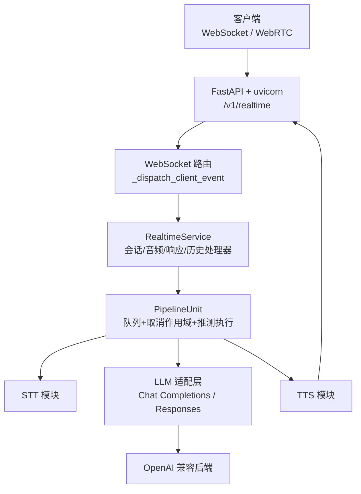
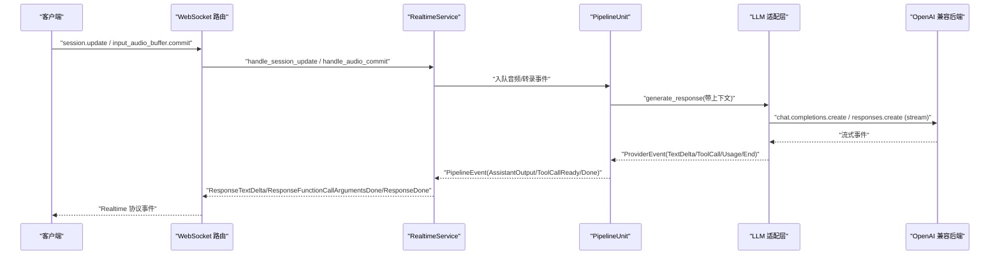
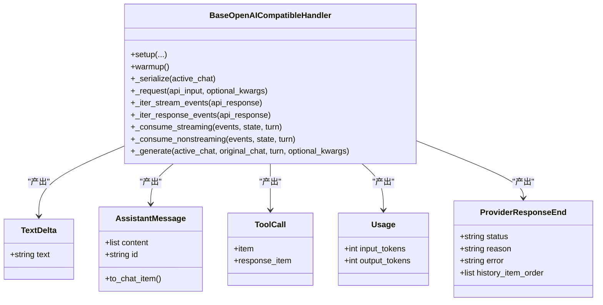
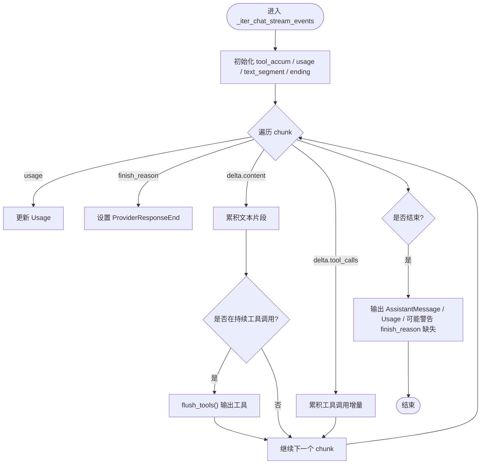
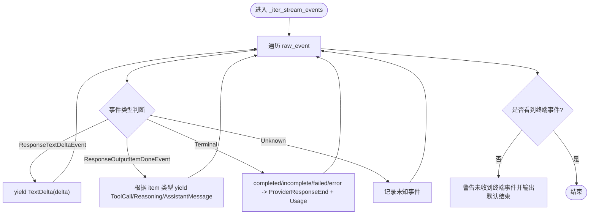
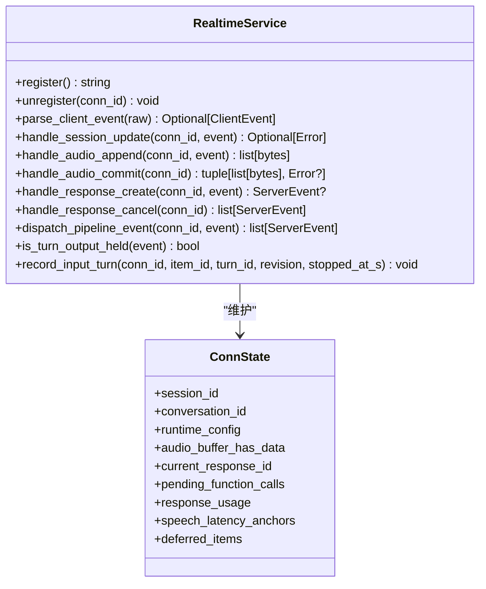
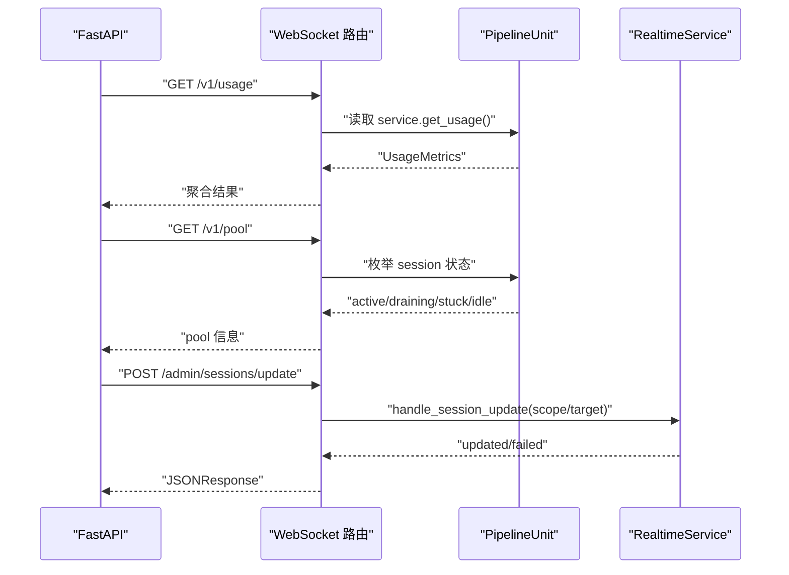
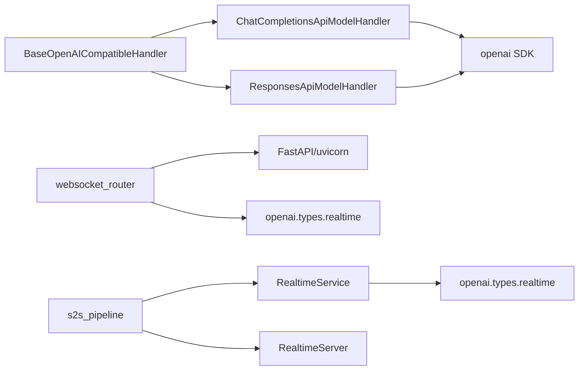

# OpenAI 兼容 API

<cite>
**本文引用的文件**   
- [base_openai_compatible_language_model.py](file://src/speech_to_speech/LLM/base_openai_compatible_language_model.py)
- [chat_completions_language_model.py](file://src/speech_to_speech/LLM/chat_completions_language_model.py)
- [responses_api_language_model.py](file://src/speech_to_speech/LLM/responses_api_language_model.py)
- [server.py](file://src/speech_to_speech/api/openai_realtime/server.py)
- [service.py](file://src/speech_to_speech/api/openai_realtime/service.py)
- [websocket_router.py](file://src/speech_to_speech/api/openai_realtime/websocket_router.py)
- [s2s_pipeline.py](file://src/speech_to_speech/s2s_pipeline.py)
- [arguments_classes/chat_completions_language_model_arguments.py](file://src/speech_to_speech/arguments_classes/chat_completions_language_model_arguments.py)
</cite>

## 目录
1. [引言](#引言)
2. [项目结构](#项目结构)
3. [核心组件](#核心组件)
4. [架构总览](#架构总览)
5. [详细组件分析](#详细组件分析)
6. [依赖关系分析](#依赖关系分析)
7. [性能与扩展性](#性能与扩展性)
8. [故障排查指南](#故障排查指南)
9. [结论](#结论)
10. [附录：API 版本与迁移](#附录api-版本与迁移)

## 引言
本技术文档面向需要集成“OpenAI 兼容”能力的工程团队，重点解释本项目中两类 LLM 适配层实现差异、协议适配层设计、请求转换与响应格式化、错误映射机制，以及流式响应、事件驱动架构和 WebSocket/WebRTC 集成。同时给出 API 版本兼容性、向后兼容策略、迁移建议，并说明客户端集成、SDK 使用、认证授权配置，以及限流、缓存、负载均衡等企业级特性支持现状与建议。

## 项目结构
本项目围绕“语音到语音”的实时对话链路构建，其中 OpenAI 兼容能力主要体现在两个层面：
- LLM 适配层：将内部统一的 Chat/Responses 抽象映射到 OpenAI 的 `/v1/chat/completions` 或 `/v1/responses`。
- Realtime 服务层：提供 OpenAI Realtime 协议的 WebSocket/WebRTC 接入，负责会话、音频缓冲、转录、LLM 调用、TTS 输出、工具调用等端到端流程。

**图表来源**
- [websocket_router.py:531-634](file://src/speech_to_speech/api/openai_realtime/websocket_router.py#L531-L634)
- [service.py:355-403](file://src/speech_to_speech/api/openai_realtime/service.py#L355-L403)
- [s2s_pipeline.py:610-747](file://src/speech_to_speech/s2s_pipeline.py#L610-L747)

**章节来源**
- [websocket_router.py:531-634](file://src/speech_to_speech/api/openai_realtime/websocket_router.py#L531-L634)
- [service.py:355-403](file://src/speech_to_speech/api/openai_realtime/service.py#L355-L403)
- [s2s_pipeline.py:610-747](file://src/speech_to_speech/s2s_pipeline.py#L610-L747)

## 核心组件
- BaseOpenAICompatibleHandler：统一生命周期、推测轮次门控、取消、句子分片、文本/音频路径、历史回写、Token 用量统计、异常终止。
- ChatCompletionsApiModelHandler：基于 `/v1/chat/completions` 的适配实现，复用 Responses 的会话序列化与工具参数构造。
- ResponsesApiModelHandler：基于 `/v1/responses` 的适配实现，处理 provider-safe tools、function_call_output 转义、推理开关等。
- RealtimeServer：uvicorn 服务器封装，持有 PipelineUnit 池。
- RealtimeService：OpenAI Realtime 协议与内部 Pipeline 事件的翻译器，维护 ConnState、UsageMetrics、全局指标。
- WebSocket 路由：FastAPI 路由、连接池分配、事件分发、WebRTC calls 入口、管理接口。

**章节来源**
- [base_openai_compatible_language_model.py:174-384](file://src/speech_to_speech/LLM/base_openai_compatible_language_model.py#L174-L384)
- [chat_completions_language_model.py:303-395](file://src/speech_to_speech/LLM/chat_completions_language_model.py#L303-L395)
- [responses_api_language_model.py:63-379](file://src/speech_to_speech/LLM/responses_api_language_model.py#L63-L379)
- [server.py:14-70](file://src/speech_to_speech/api/openai_realtime/server.py#L14-L70)
- [service.py:355-403](file://src/speech_to_speech/api/openai_realtime/service.py#L355-L403)
- [websocket_router.py:531-634](file://src/speech_to_speech/api/openai_realtime/websocket_router.py#L531-L634)

## 架构总览
整体采用“事件驱动 + 队列管道”的架构：
- 客户端通过 WebSocket 发送 Realtime 协议事件（session.update、input_audio_buffer.append/commit、response.create/cancel 等）。
- WebSocket 路由解析事件，交由 RealtimeService 处理，更新 ConnState，并将音频数据入队。
- PipelineUnit 内多个队列串联 STT → LLM → TTS，配合 CancelScope 与 SpeculativeTurnTracker 实现中断与推测执行。
- LLM 适配层将内部 Chat/Responses 模型转换为后端请求，并将流式/非流式响应归一化为 ProviderEvent，供上层统一消费。
- TTS 输出经编码后以 Realtime 协议事件返回客户端；工具调用在 LLM 侧生成，由服务层编排函数执行与后续生成。

**图表来源**
- [websocket_router.py:392-510](file://src/speech_to_speech/api/openai_realtime/websocket_router.py#L392-L510)
- [service.py:477-551](file://src/speech_to_speech/api/openai_realtime/service.py#L477-L551)
- [base_openai_compatible_language_model.py:772-800](file://src/speech_to_speech/LLM/base_openai_compatible_language_model.py#L772-L800)
- [chat_completions_language_model.py:166-187](file://src/speech_to_speech/LLM/chat_completions_language_model.py#L166-L187)
- [responses_api_language_model.py:260-281](file://src/speech_to_speech/LLM/responses_api_language_model.py#L260-L281)

## 详细组件分析

### LLM 适配层：BaseOpenAICompatibleHandler
职责与关键点：
- 统一初始化：设置 base_url、api_key、超时、流式开关、音频参数、压缩历史、预热等。
- 提供者无关的事件模型：TextDelta、AssistantMessage、ToolCall、Usage、ProviderResponseEnd。
- 推测轮次与取消：通过 SpeculativeTurnTracker 与 CancelScope 控制输出是否允许、是否陈旧。
- 流式与非流式消费：按 ProviderEvent 类型分别处理文本、工具调用、推理项、用量与结束状态。
- 历史回写与 Token 统计：记录 history_items、clean_text、input_tokens/output_tokens。
- 失败回退：当上游不可用时，可配置 provider_unavailable_message 作为口语化提示。

**图表来源**
- [base_openai_compatible_language_model.py:84-133](file://src/speech_to_speech/LLM/base_openai_compatible_language_model.py#L84-L133)
- [base_openai_compatible_language_model.py:174-384](file://src/speech_to_speech/LLM/base_openai_compatible_language_model.py#L174-L384)
- [base_openai_compatible_language_model.py:615-768](file://src/speech_to_speech/LLM/base_openai_compatible_language_model.py#L615-L768)

**章节来源**
- [base_openai_compatible_language_model.py:174-384](file://src/speech_to_speech/LLM/base_openai_compatible_language_model.py#L174-L384)
- [base_openai_compatible_language_model.py:615-768](file://src/speech_to_speech/LLM/base_openai_compatible_language_model.py#L615-L768)

### Chat Completions 适配层
- 工具定义转换：将 Responses 风格的 function tool 扁平结构转换为 Chat Completions 的嵌套 function 结构。
- 工具选择转换：将 Responses 的 tool_choice 强制函数对象转换为 Chat Completions 的 named tool choice。
- 消息序列化：将 Chat.to_transformers_chat 的结果规范化，确保 tool_calls 包含 type 字段，tool arguments 为字符串。
- 请求构造：统一设置 stream_options.include_usage=true，调用 client.chat.completions.create。
- 流式事件归一化：累积 tool_calls delta，遇到文本时先 flush 工具，再输出 TextDelta；结束时输出 AssistantMessage 与 Usage。
- 非流式事件归一化：直接输出 Usage、AssistantMessage、TextDelta 与 ToolCall。

**图表来源**
- [chat_completions_language_model.py:216-275](file://src/speech_to_speech/LLM/chat_completions_language_model.py#L216-L275)

**章节来源**
- [chat_completions_language_model.py:44-94](file://src/speech_to_speech/LLM/chat_completions_language_model.py#L44-L94)
- [chat_completions_language_model.py:97-163](file://src/speech_to_speech/LLM/chat_completions_language_model.py#L97-L163)
- [chat_completions_language_model.py:166-187](file://src/speech_to_speech/LLM/chat_completions_language_model.py#L166-L187)
- [chat_completions_language_model.py:190-301](file://src/speech_to_speech/LLM/chat_completions_language_model.py#L190-L301)
- [chat_completions_language_model.py:303-395](file://src/speech_to_speech/LLM/chat_completions_language_model.py#L303-L395)

### Responses API 适配层
- 推理开关：对非官方 OpenAI 地址，优先通过 chat_template_kwargs.enable_thinking=false 关闭思考；reasoning.effort 单独注入。
- 工具安全化：为 DashScope/Bailian 等 provider 补充 parameters.required=[]，避免 schema 校验失败。
- function_call_output 转义：将结构化 function_call_output 替换为 user message 文本，避免 role:tool 不被接受的问题。
- 流式事件映射：处理 response.output_item.added/done、content_part.added/done、output_text.delta/done、completed/incomplete/failed/error 等事件，映射为 ProviderEvent。
- 非流式事件映射：输出 Usage、ProviderResponseEnd、AssistantMessage、ToolCall、TextDelta。

**图表来源**
- [responses_api_language_model.py:289-347](file://src/speech_to_speech/LLM/responses_api_language_model.py#L289-L347)

**章节来源**
- [responses_api_language_model.py:63-96](file://src/speech_to_speech/LLM/responses_api_language_model.py#L63-L96)
- [responses_api_language_model.py:183-258](file://src/speech_to_speech/LLM/responses_api_language_model.py#L183-L258)
- [responses_api_language_model.py:260-281](file://src/speech_to_speech/LLM/responses_api_language_model.py#L260-L281)
- [responses_api_language_model.py:283-379](file://src/speech_to_speech/LLM/responses_api_language_model.py#L283-L379)

### Realtime 服务层：RealtimeService
职责与关键点：
- 协议事件解析：将客户端 JSON 事件解析为 Pydantic 模型，校验失败返回错误事件。
- 会话/音频/响应/历史处理器：SessionHandler、AudioHandler、ResponseHandler、HistoryHandler、ConversationHandler。
- 连接状态 ConnState：维护 session_id、conversation_id、runtime_config、音频缓冲、转录状态、响应生命周期、工具调用顺序、延迟锚点等。
- 指标统计：UsageMetrics 与 GlobalUsageMetrics，聚合 token、音频时长、响应数、工具调用、连接数、错误类型。
- 管线事件分发：将 STT/LM/TTS 产生的 PipelineEvent 映射为 Realtime 协议事件，处理陈旧轮次、失败响应、历史提交错误等。

**图表来源**
- [service.py:228-327](file://src/speech_to_speech/api/openai_realtime/service.py#L228-L327)
- [service.py:355-403](file://src/speech_to_speech/api/openai_realtime/service.py#L355-L403)
- [service.py:477-551](file://src/speech_to_speech/api/openai_realtime/service.py#L477-L551)
- [service.py:610-688](file://src/speech_to_speech/api/openai_realtime/service.py#L610-L688)

**章节来源**
- [service.py:175-214](file://src/speech_to_speech/api/openai_realtime/service.py#L175-L214)
- [service.py:228-327](file://src/speech_to_speech/api/openai_realtime/service.py#L228-L327)
- [service.py:355-403](file://src/speech_to_speech/api/openai_realtime/service.py#L355-L403)
- [service.py:477-551](file://src/speech_to_speech/api/openai_realtime/service.py#L477-L551)
- [service.py:610-688](file://src/speech_to_speech/api/openai_realtime/service.py#L610-L688)

### WebSocket 路由与传输层
- FastAPI 应用创建：lifespan 启动每个 PipelineUnit 的发送循环，优雅关闭。
- 连接池管理：_claim_unit 原子抢占空闲 unit，拒绝满负载连接。
- 事件分发：_dispatch_client_event 解析并转发至 RealtimeService，区分 WebSocket/WebRTC 有效事件。
- 释放与隔离：_release_session 清理队列、取消工作、enqueue SESSION_END，异步等待 drain，超时报警并 quarantine。
- 管理接口：/v1/usage、/v1/pool、/admin/sessions/update、/v1/realtime/calls。

**图表来源**
- [websocket_router.py:531-559](file://src/speech_to_speech/api/openai_realtime/websocket_router.py#L531-L559)
- [websocket_router.py:636-695](file://src/speech_to_speech/api/openai_realtime/websocket_router.py#L636-L695)
- [websocket_router.py:717-792](file://src/speech_to_speech/api/openai_realtime/websocket_router.py#L717-L792)

**章节来源**
- [websocket_router.py:531-634](file://src/speech_to_speech/api/openai_realtime/websocket_router.py#L531-L634)
- [websocket_router.py:636-695](file://src/speech_to_speech/api/openai_realtime/websocket_router.py#L636-L695)
- [websocket_router.py:717-792](file://src/speech_to_speech/api/openai_realtime/websocket_router.py#L717-L792)

## 依赖关系分析
- LLM 适配层依赖 openai SDK 的类型与 Stream，并通过 BaseOpenAICompatibleHandler 统一行为。
- RealtimeService 依赖 openai.types.realtime 协议模型，用于严格校验客户端事件与服务端事件。
- WebSocket 路由依赖 FastAPI、uvicorn，可选 aiortc 支持 WebRTC。
- s2s_pipeline 组装 PipelineUnit、RealtimeService、RealtimeServer，并提供本地音频与工具加载能力。

**图表来源**
- [base_openai_compatible_language_model.py:1-67](file://src/speech_to_speech/LLM/base_openai_compatible_language_model.py#L1-L67)
- [chat_completions_language_model.py:1-40](file://src/speech_to_speech/LLM/chat_completions_language_model.py#L1-L40)
- [responses_api_language_model.py:1-44](file://src/speech_to_speech/LLM/responses_api_language_model.py#L1-L44)
- [service.py:1-90](file://src/speech_to_speech/api/openai_realtime/service.py#L1-L90)
- [websocket_router.py:1-76](file://src/speech_to_speech/api/openai_realtime/websocket_router.py#L1-L76)
- [s2s_pipeline.py:610-747](file://src/speech_to_speech/s2s_pipeline.py#L610-L747)

**章节来源**
- [base_openai_compatible_language_model.py:1-67](file://src/speech_to_speech/LLM/base_openai_compatible_language_model.py#L1-L67)
- [chat_completions_language_model.py:1-40](file://src/speech_to_speech/LLM/chat_completions_language_model.py#L1-L40)
- [responses_api_language_model.py:1-44](file://src/speech_to_speech/LLM/responses_api_language_model.py#L1-L44)
- [service.py:1-90](file://src/speech_to_speech/api/openai_realtime/service.py#L1-L90)
- [websocket_router.py:1-76](file://src/speech_to_speech/api/openai_realtime/websocket_router.py#L1-L76)
- [s2s_pipeline.py:610-747](file://src/speech_to_speech/s2s_pipeline.py#L610-L747)

## 性能与扩展性
- 流式优化：
  - Chat Completions 使用 stream_options.include_usage=true 获取用量。
  - Responses 流式事件细粒度映射，减少中间态拼接。
- 推测执行与取消：
  - SpeculativeTurnTracker 与 CancelScope 控制陈旧输出丢弃与资源回收。
  - 预取 worker 限制并发，避免上游过载。
- 批处理与句子分片：
  - 文本路径按句子分片批量输出，降低 TTS 压力。
- 指标与监控：
  - UsageMetrics/GlobalUsageMetrics 聚合 token、音频时长、错误类型。
  - /v1/usage 与 /v1/pool 暴露运行态。
- 可扩展点：
  - LLM 适配层通过子类钩子扩展不同 provider 的请求/响应映射。
  - RealtimeService 的 pipeline_dispatch 可扩展新 PipelineEvent 的处理。

**章节来源**
- [chat_completions_language_model.py:166-187](file://src/speech_to_speech/LLM/chat_completions_language_model.py#L166-L187)
- [base_openai_compatible_language_model.py:415-530](file://src/speech_to_speech/LLM/base_openai_compatible_language_model.py#L415-L530)
- [service.py:175-214](file://src/speech_to_speech/api/openai_realtime/service.py#L175-L214)
- [websocket_router.py:636-695](file://src/speech_to_speech/api/openai_realtime/websocket_router.py#L636-L695)

## 故障排查指南
- 上游不可用：
  - BaseOpenAICompatibleHandler 提供 provider_unavailable_message，结合 classify_provider_error 分类错误类型。
- 流式结束无终端事件：
  - Responses 与 Chat Completions 均记录警告并输出默认结束事件。
- 历史提交失败：
  - RealtimeService.dispatch_pipeline_event 捕获 HistoryCommitError，转为 ResponseFailedEvent。
- 连接释放卡住：
  - websocket_router._release_unit_after_drain 检测 SESSION_END drain 超时，quarantine unit 并报警。
- 工具调用参数无效：
  - ResponsesApiModelHandler._provider_safe_tools 自动补齐 required=[]，避免 schema 校验失败。

**章节来源**
- [base_openai_compatible_language_model.py:302-313](file://src/speech_to_speech/LLM/base_openai_compatible_language_model.py#L302-L313)
- [chat_completions_language_model.py:267-275](file://src/speech_to_speech/LLM/chat_completions_language_model.py#L267-L275)
- [responses_api_language_model.py:343-347](file://src/speech_to_speech/LLM/responses_api_language_model.py#L343-L347)
- [service.py:659-669](file://src/speech_to_speech/api/openai_realtime/service.py#L659-L669)
- [websocket_router.py:294-339](file://src/speech_to_speech/api/openai_realtime/websocket_router.py#L294-L339)
- [responses_api_language_model.py:186-215](file://src/speech_to_speech/LLM/responses_api_language_model.py#L186-L215)

## 结论
本项目通过 BaseOpenAICompatibleHandler 统一了 Chat Completions 与 Responses API 的生命周期与事件模型，并在 RealtimeService 中实现了完整的 OpenAI Realtime 协议适配。WebSocket/WebRTC 路由提供了连接池、事件分发、管理接口与 WebRTC 握手能力。系统具备流式优化、推测执行、取消与隔离、指标监控等企业级特性。对于多 provider 兼容，代码已考虑 reasoning 开关、tools schema 安全化、function_call_output 转义等细节。

## 附录：API 版本与迁移

### Chat Completions vs Responses API 差异
- 协议形态：
  - Chat Completions：成熟的消息流式工具调用协议（choices[].delta.tool_calls）。
  - Responses：更现代的 item-based 事件流（output_item.added/done、content_part.*、output_text.*）。
- 工具定义：
  - Chat Completions：function 嵌套结构。
  - Responses：扁平 function 定义，需 provider-safe 转换。
- 推理控制：
  - Chat Completions：extra_body.reasoning_effort 或 chat_template_kwargs.enable_thinking=false。
  - Responses：reasoning.effort 与 chat_template_kwargs.enable_thinking=false 组合。
- 历史项：
  - Responses：明确 output_index 与 history_item_order，便于回放与顺序保证。
  - Chat Completions：依赖消息顺序与 tool_calls 累积。

**章节来源**
- [chat_completions_language_model.py:303-395](file://src/speech_to_speech/LLM/chat_completions_language_model.py#L303-L395)
- [responses_api_language_model.py:63-96](file://src/speech_to_speech/LLM/responses_api_language_model.py#L63-L96)
- [responses_api_language_model.py:186-258](file://src/speech_to_speech/LLM/responses_api_language_model.py#L186-L258)

### 向后兼容策略
- 参数继承：
  - ChatCompletionsLanguageModelHandlerArguments 继承 ResponsesApiLanguageModelHandlerArguments，保持 CLI/env 一致。
- 工具兼容：
  - Chat Completions 适配器自动将 Responses 风格工具转换为 Chat 风格。
- 历史兼容：
  - Responses 适配器将 function_call_output 转为用户文本，避免 role:tool 不被接受的 provider 问题。

**章节来源**
- [arguments_classes/chat_completions_language_model_arguments.py:1-29](file://src/speech_to_speech/arguments_classes/chat_completions_language_model_arguments.py#L1-L29)
- [chat_completions_language_model.py:44-94](file://src/speech_to_speech/LLM/chat_completions_language_model.py#L44-L94)
- [responses_api_language_model.py:228-258](file://src/speech_to_speech/LLM/responses_api_language_model.py#L228-L258)

### 迁移指南
- 从 Chat Completions 迁移到 Responses：
  - 调整工具定义格式，确保 parameters.required 存在。
  - 关注 output_index 与 history_item_order 的顺序语义。
  - 检查推理开关配置，必要时启用 reasoning.effort。
- 从 Responses 迁移到 Chat Completions：
  - 使用 _build_chat_optional_kwargs 与 _to_chat_tools/_to_chat_tool_choice 进行参数转换。
  - 注意 tool_calls 累积与 flush 时机，避免文本与工具交错。
- 通用建议：
  - 使用 BaseOpenAICompatibleHandler 的统一事件模型，减少上层逻辑耦合。
  - 利用 /v1/usage 与 /v1/pool 监控迁移后的稳定性与性能。

**章节来源**
- [chat_completions_language_model.py:44-94](file://src/speech_to_speech/LLM/chat_completions_language_model.py#L44-L94)
- [responses_api_language_model.py:186-215](file://src/speech_to_speech/LLM/responses_api_language_model.py#L186-L215)
- [websocket_router.py:636-695](file://src/speech_to_speech/api/openai_realtime/websocket_router.py#L636-L695)