# 对话管理

<cite>
**本文引用的文件**   
- [chat.py](file://src/speech_to_speech/LLM/chat.py)
- [text_prompt.py](file://src/speech_to_speech/LLM/text_prompt.py)
- [voice_prompt.py](file://src/speech_to_speech/LLM/voice_prompt.py)
- [messages.py](file://src/speech_to_speech/pipeline/messages.py)
- [history.py](file://src/speech_to_speech/pipeline/history.py)
- [runtime_config.py](file://src/speech_to_speech/api/openai_realtime/runtime_config.py)
- [compaction_prompt.py](file://src/speech_to_speech/LLM/compaction_prompt.py)
- [utils.py](file://src/speech_to_speech/LLM/utils.py)
- [chat_completions_language_model.py](file://src/speech_to_speech/LLM/chat_completions_language_model.py)
- [responses_api_language_model.py](file://src/speech_to_speech/LLM/responses_api_language_model.py)
</cite>

## 目录
1. [引言](#引言)
2. [项目结构](#项目结构)
3. [核心组件](#核心组件)
4. [架构总览](#架构总览)
5. [详细组件分析](#详细组件分析)
6. [依赖关系分析](#依赖关系分析)
7. [性能与并发](#性能与并发)
8. [故障排查指南](#故障排查指南)
9. [结论](#结论)
10. [附录：提示工程与多语言策略](#附录提示工程与多语言策略)

## 引言
本技术文档围绕“对话管理系统”展开，重点解释 Chat 类的设计模式、消息历史管理、上下文维护机制；说明文本提示与语音提示的构建策略、系统指令注入、语言检测集成；深入讲解消息类型定义、角色管理、时间戳处理；并覆盖对话状态持久化、会话恢复、上下文压缩、对话模板设计、提示工程最佳实践、多语言支持策略，以及性能优化、内存管理与并发安全实现细节。

## 项目结构
对话管理相关代码主要分布在以下模块：
- LLM 层：Chat 类、文本/语音系统提示构建、压缩摘要、语言工具函数、两种 LLM 适配（Responses API 与 Chat Completions）。
- Pipeline 层：统一的消息类型、响应历史提案、运行时配置。
- API 层：实时会话运行时配置，持有 Chat 实例。

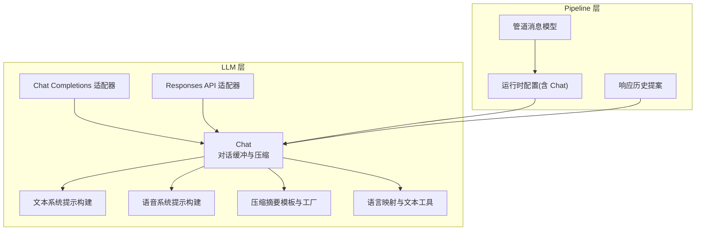

**图表来源**
- [chat.py:123-175](file://src/speech_to_speech/LLM/chat.py#L123-L175)
- [text_prompt.py:30-48](file://src/speech_to_speech/LLM/text_prompt.py#L30-L48)
- [voice_prompt.py:35-53](file://src/speech_to_speech/LLM/voice_prompt.py#L35-L53)
- [compaction_prompt.py:139-181](file://src/speech_to_speech/LLM/compaction_prompt.py#L139-L181)
- [utils.py:186-321](file://src/speech_to_speech/LLM/utils.py#L186-L321)
- [chat_completions_language_model.py:303-395](file://src/speech_to_speech/LLM/chat_completions_language_model.py#L303-L395)
- [responses_api_language_model.py:63-379](file://src/speech_to_speech/LLM/responses_api_language_model.py#L63-L379)
- [messages.py:34-416](file://src/speech_to_speech/pipeline/messages.py#L34-L416)
- [history.py:14-98](file://src/speech_to_speech/pipeline/history.py#L14-L98)
- [runtime_config.py:27-116](file://src/speech_to_speech/api/openai_realtime/runtime_config.py#L27-L116)

**章节来源**
- [chat.py:123-175](file://src/speech_to_speech/LLM/chat.py#L123-L175)
- [messages.py:34-416](file://src/speech_to_speech/pipeline/messages.py#L34-L416)
- [history.py:14-98](file://src/speech_to_speech/pipeline/history.py#L14-L98)
- [runtime_config.py:27-116](file://src/speech_to_speech/api/openai_realtime/runtime_config.py#L27-L116)

## 核心组件
- Chat：对话缓冲、消息路由、工具调用配对、上下文保护、压缩摘要、音频历史压缩、序列化输出、并发安全。
- 文本/语音系统提示构建器：按通道生成系统提示，支持会话提示、工具描述、语言提示注入。
- 压缩摘要：将多轮对话压缩为用户/助手摘要对，后台线程执行，避免阻塞主流程。
- 管道消息：统一消息类型，承载 STT→LLM→TTS 的数据流与会话元数据。
- 响应历史提案：封装一次响应写入与清理策略，支持回滚与顺序重排。
- 运行时配置：保存会话级配置与 Chat 实例，提供语言选择等属性。

**章节来源**
- [chat.py:123-175](file://src/speech_to_speech/LLM/chat.py#L123-L175)
- [text_prompt.py:30-48](file://src/speech_to_speech/LLM/text_prompt.py#L30-L48)
- [voice_prompt.py:35-53](file://src/speech_to_speech/LLM/voice_prompt.py#L35-L53)
- [compaction_prompt.py:139-181](file://src/speech_to_speech/LLM/compaction_prompt.py#L139-L181)
- [messages.py:34-416](file://src/speech_to_speech/pipeline/messages.py#L34-L416)
- [history.py:14-98](file://src/speech_to_speech/pipeline/history.py#L14-L98)
- [runtime_config.py:27-116](file://src/speech_to_speech/api/openai_realtime/runtime_config.py#L27-L116)

## 架构总览
对话管理在实时语音交互中的整体流程如下：VAD 检测到语音段后进入 STT，STT 产出最终转录，触发 LLM 生成；LLM 返回文本或工具调用，LMOutputProcessor 将其转为 TTS 输入；同时，Chat 维护对话历史，并在需要时进行压缩与清理。

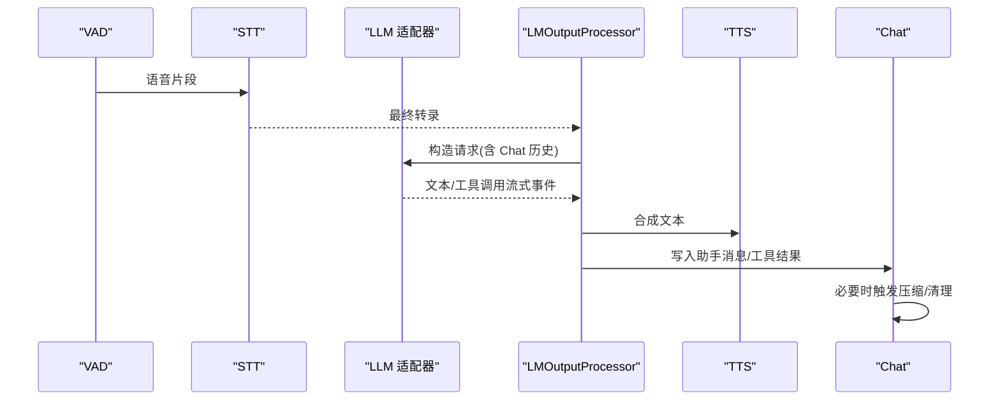

**图表来源**
- [messages.py:69-176](file://src/speech_to_speech/pipeline/messages.py#L69-L176)
- [chat_completions_language_model.py:303-395](file://src/speech_to_speech/LLM/chat_completions_language_model.py#L303-L395)
- [responses_api_language_model.py:63-379](file://src/speech_to_speech/LLM/responses_api_language_model.py#L63-L379)
- [chat.py:422-500](file://src/speech_to_speech/LLM/chat.py#L422-L500)

## 详细组件分析

### Chat 类设计与消息历史管理
Chat 是对话缓冲的核心，负责：
- 消息验证与路由：区分 system/user/assistant/function_call/function_call_output/reasoning 等类型，校验内容有效性。
- 工具调用配对：维护 pending tool calls 与 ordered pending calls，确保 function_call_output 能正确关联到对应 call。
- 上下文保护：保留 Responses 工具链所需的上下文项，防止压缩或驱逐破坏未完成工具链。
- 锚点插入：通过 history_anchor_id 与 insert_at 索引，保证异步生成的结果可写回原 turn 位置。
- 硬上限与软限制：用户轮次超过 size 时触发 trim_if_needed；超过 2*size 时强制驱逐最老完整轮次。
- 音频历史压缩：将旧音频部分替换为占位文本，保持 user/assistant 配对语义。
- 序列化输出：to_responses_api_chat 与 to_transformers_chat 分别适配 Responses API 与 Transformers 模板。
- 并发安全：所有可变状态变更均通过 _lock 串行化，内部方法使用 _locked 前缀约定。

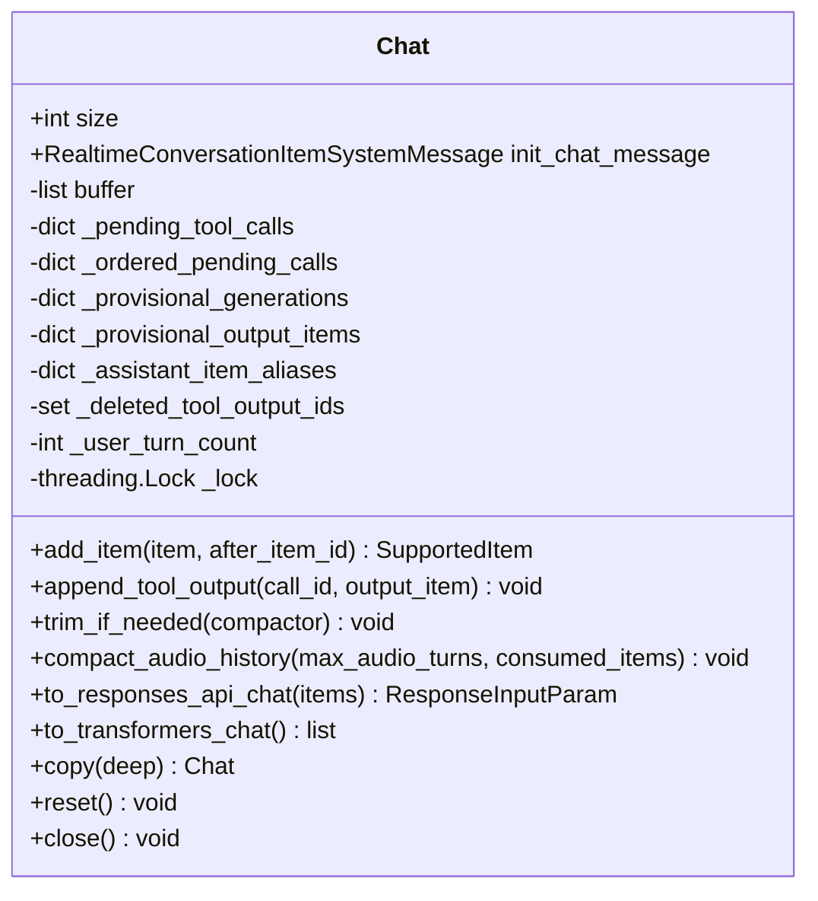

**图表来源**
- [chat.py:123-175](file://src/speech_to_speech/LLM/chat.py#L123-L175)
- [chat.py:422-500](file://src/speech_to_speech/LLM/chat.py#L422-L500)
- [chat.py:793-829](file://src/speech_to_speech/LLM/chat.py#L793-L829)
- [chat.py:910-1068](file://src/speech_to_speech/LLM/chat.py#L910-L1068)

**章节来源**
- [chat.py:123-175](file://src/speech_to_speech/LLM/chat.py#L123-L175)
- [chat.py:422-500](file://src/speech_to_speech/LLM/chat.py#L422-L500)
- [chat.py:793-829](file://src/speech_to_speech/LLM/chat.py#L793-L829)
- [chat.py:910-1068](file://src/speech_to_speech/LLM/chat.py#L910-L1068)

### 消息类型定义与角色管理
- 支持的 ConversationItem 类型包括 system、user、assistant、function_call、function_call_output、reasoning 等。
- 角色管理：system 作为 init_chat_message 单独存储，不放入 buffer；user/assistant 正常入队；function_call 与 function_call_output 成对管理。
- 时间戳处理：管道消息中携带 created_at_s、speech_stopped_at_s 等字段用于延迟与停顿统计；Turn 级别有 turn_id、turn_revision。

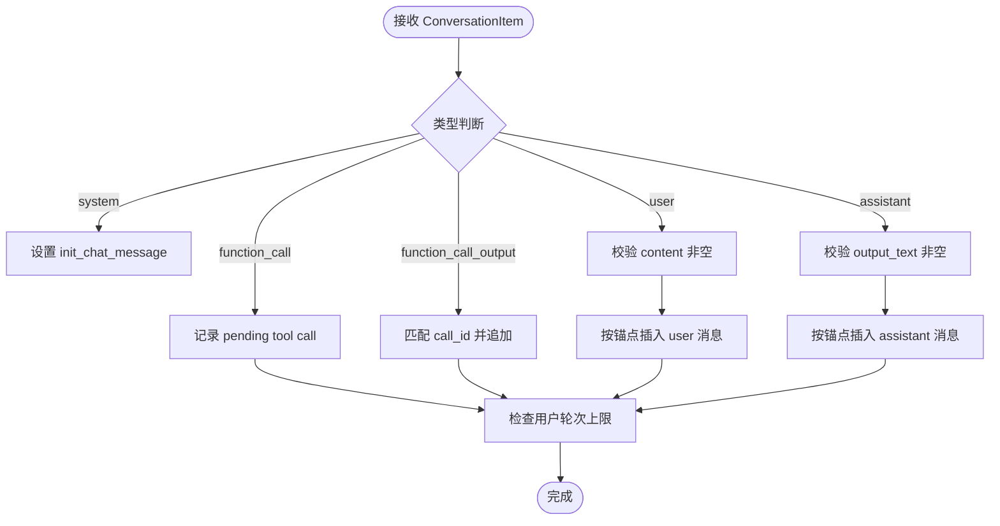

**图表来源**
- [chat.py:346-420](file://src/speech_to_speech/LLM/chat.py#L346-L420)
- [messages.py:49-176](file://src/speech_to_speech/pipeline/messages.py#L49-L176)

**章节来源**
- [chat.py:346-420](file://src/speech_to_speech/LLM/chat.py#L346-L420)
- [messages.py:49-176](file://src/speech_to_speech/pipeline/messages.py#L49-L176)

### 文本提示与语音提示构建策略
- 文本通道：build_text_system_prompt 组装 lead、session prompt、可选工具描述、可选语言提示、tail 规则。
- 语音通道：build_voice_system_prompt 类似结构，但 tail 强调口语化、简洁、工具使用规范。
- 语言提示：format_language_instruction 根据 STT 语言名称注入“请用某语言回复”的约束。

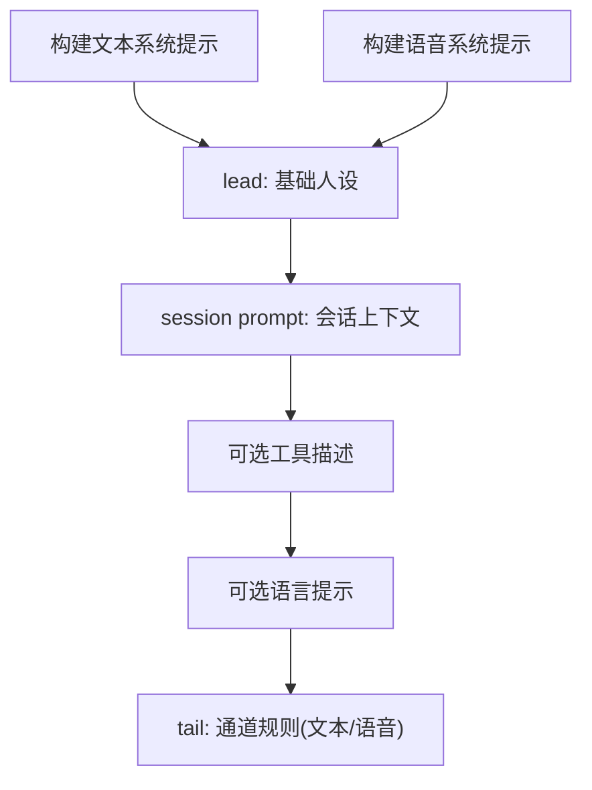

**图表来源**
- [text_prompt.py:30-48](file://src/speech_to_speech/LLM/text_prompt.py#L30-L48)
- [voice_prompt.py:35-53](file://src/speech_to_speech/LLM/voice_prompt.py#L35-L53)
- [utils.py:296-321](file://src/speech_to_speech/LLM/utils.py#L296-L321)

**章节来源**
- [text_prompt.py:30-48](file://src/speech_to_speech/LLM/text_prompt.py#L30-L48)
- [voice_prompt.py:35-53](file://src/speech_to_speech/LLM/voice_prompt.py#L35-L53)
- [utils.py:296-321](file://src/speech_to_speech/LLM/utils.py#L296-L321)

### 系统指令注入与语言检测集成
- 系统指令注入：prepend_instructions 合并外部指令与 init_chat_message 的系统上下文。
- 语言检测集成：WHISPER_LANGUAGE_TO_LLM_LANGUAGE 将 STT 语言代码映射为自然语言名；language_name_for_prompt 决定是否注入语言提示；resolve_auto_language 处理 “-auto” 后缀。

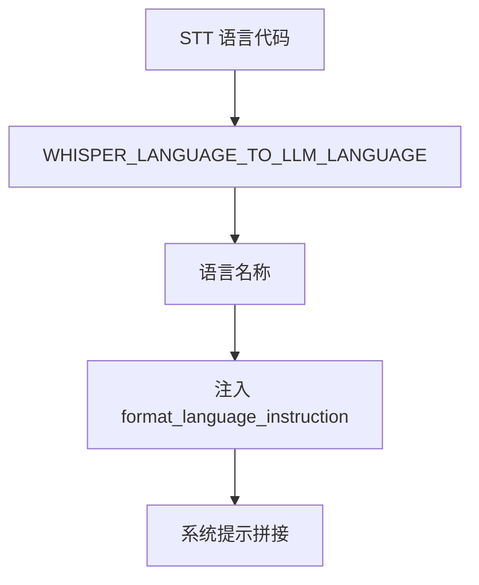

**图表来源**
- [utils.py:186-321](file://src/speech_to_speech/LLM/utils.py#L186-L321)
- [text_prompt.py:30-48](file://src/speech_to_speech/LLM/text_prompt.py#L30-L48)
- [voice_prompt.py:35-53](file://src/speech_to_speech/LLM/voice_prompt.py#L35-L53)

**章节来源**
- [utils.py:186-321](file://src/speech_to_speech/LLM/utils.py#L186-L321)
- [text_prompt.py:30-48](file://src/speech_to_speech/LLM/text_prompt.py#L30-L48)
- [voice_prompt.py:35-53](file://src/speech_to_speech/LLM/voice_prompt.py#L35-L53)

### 对话状态持久化、会话恢复与上下文压缩
- 持久化快照：snapshot_history_cleanup 捕获 init_message、buffer、pending_calls、ordered_call_ids、user_turn_count、deferred_compactor。
- 恢复机制：restore_history_cleanup 将快照还原，保障清理步骤失败时的原子性。
- 上下文压缩：_maybe_trigger_compaction 启动后台线程执行 compactor；_apply_compaction 将摘要替换为新的 user/assistant 消息对，保留未完成的工具链。

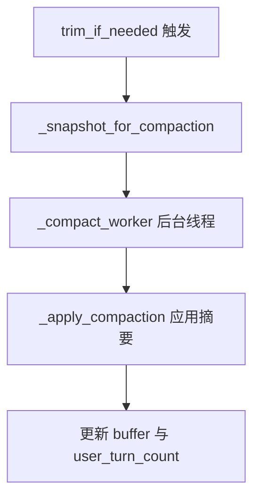

**图表来源**
- [chat.py:1212-1404](file://src/speech_to_speech/LLM/chat.py#L1212-L1404)
- [chat.py:1094-1125](file://src/speech_to_speech/LLM/chat.py#L1094-L1125)
- [compaction_prompt.py:139-181](file://src/speech_to_speech/LLM/compaction_prompt.py#L139-L181)

**章节来源**
- [chat.py:1212-1404](file://src/speech_to_speech/LLM/chat.py#L1212-L1404)
- [chat.py:1094-1125](file://src/speech_to_speech/LLM/chat.py#L1094-L1125)
- [compaction_prompt.py:139-181](file://src/speech_to_speech/LLM/compaction_prompt.py#L139-L181)

### 对话模板设计与提示工程最佳实践
- 文本通道模板：强调清晰直接、Markdown 适度使用、工具调用无需前言、慢工具直接调用。
- 语音通道模板：强调简短口语化、禁止视觉格式、工具结果不播报、表达型工具谨慎使用。
- 压缩摘要模板：要求 JSON 输出 user_summary 与 assistant_summary，保留关键信息，省略闲聊。

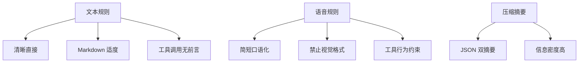

**图表来源**
- [text_prompt.py:5-17](file://src/speech_to_speech/LLM/text_prompt.py#L5-L17)
- [voice_prompt.py:5-22](file://src/speech_to_speech/LLM/voice_prompt.py#L5-L22)
- [compaction_prompt.py:33-62](file://src/speech_to_speech/LLM/compaction_prompt.py#L33-L62)

**章节来源**
- [text_prompt.py:5-17](file://src/speech_to_speech/LLM/text_prompt.py#L5-L17)
- [voice_prompt.py:5-22](file://src/speech_to_speech/LLM/voice_prompt.py#L5-L22)
- [compaction_prompt.py:33-62](file://src/speech_to_speech/LLM/compaction_prompt.py#L33-L62)

### 多语言支持策略
- STT 语言到 LLM 语言名映射：覆盖 Whisper、Parakeet、Qwen3-ASR 等后端报告的语言。
- 自动语言解析：strip “-auto” 后缀，返回 clean_code 与 language_name。
- 运行时语言选择：RuntimeConfig.selected_language 从 session.audio.input.transcription.language 读取，支持 “auto”。

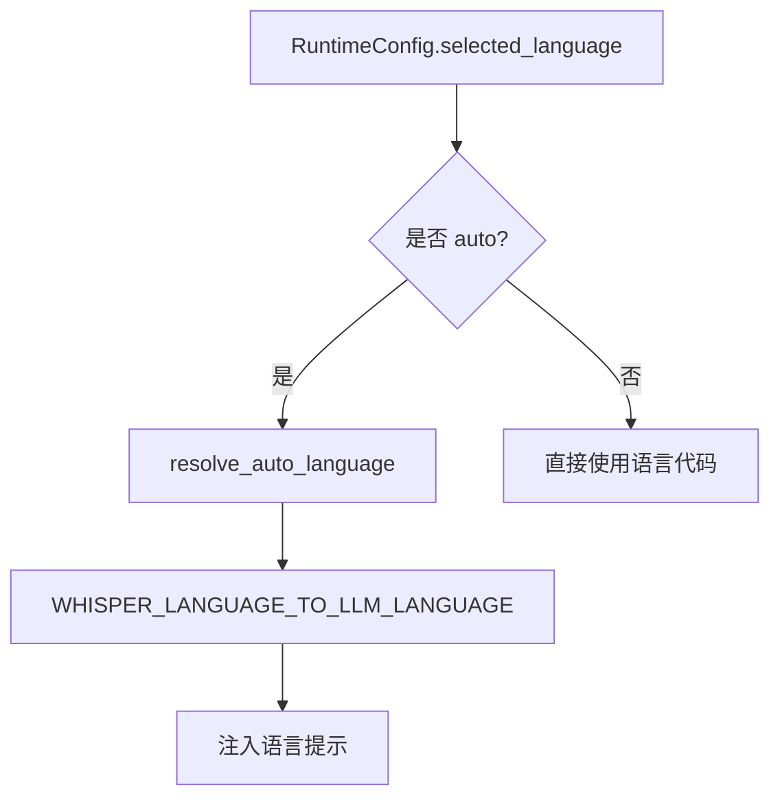

**图表来源**
- [runtime_config.py:107-116](file://src/speech_to_speech/api/openai_realtime/runtime_config.py#L107-L116)
- [utils.py:301-321](file://src/speech_to_speech/LLM/utils.py#L301-L321)
- [utils.py:186-293](file://src/speech_to_speech/LLM/utils.py#L186-L293)

**章节来源**
- [runtime_config.py:107-116](file://src/speech_to_speech/api/openai_realtime/runtime_config.py#L107-L116)
- [utils.py:301-321](file://src/speech_to_speech/LLM/utils.py#L301-L321)
- [utils.py:186-293](file://src/speech_to_speech/LLM/utils.py#L186-L293)

## 依赖关系分析
- Chat 依赖 OpenAI Realtime/Responses 类型定义，用于 ConversationItem 与 ResponseInputParam 的序列化。
- LLM 适配器依赖 Chat 的序列化方法：ResponsesApiModelHandler 使用 to_responses_api_chat；ChatCompletionsApiModelHandler 使用 to_transformers_chat。
- Pipeline 消息与 History 提案共同驱动 LLM 生成与 TTS 合成，RuntimeConfig 持有 Chat 实例。

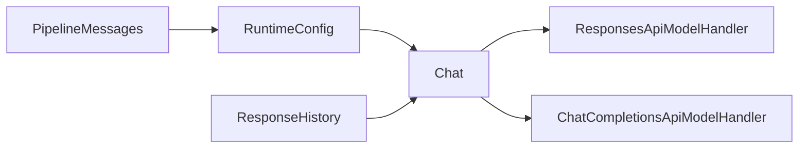

**图表来源**
- [chat.py:910-1068](file://src/speech_to_speech/LLM/chat.py#L910-L1068)
- [responses_api_language_model.py:183-227](file://src/speech_to_speech/LLM/responses_api_language_model.py#L183-L227)
- [chat_completions_language_model.py:357-367](file://src/speech_to_speech/LLM/chat_completions_language_model.py#L357-L367)
- [runtime_config.py:27-44](file://src/speech_to_speech/api/openai_realtime/runtime_config.py#L27-L44)
- [messages.py:376-416](file://src/speech_to_speech/pipeline/messages.py#L376-L416)
- [history.py:74-98](file://src/speech_to_speech/pipeline/history.py#L74-L98)

**章节来源**
- [chat.py:910-1068](file://src/speech_to_speech/LLM/chat.py#L910-L1068)
- [responses_api_language_model.py:183-227](file://src/speech_to_speech/LLM/responses_api_language_model.py#L183-L227)
- [chat_completions_language_model.py:357-367](file://src/speech_to_speech/LLM/chat_completions_language_model.py#L357-L367)
- [runtime_config.py:27-44](file://src/speech_to_speech/api/openai_realtime/runtime_config.py#L27-L44)
- [messages.py:376-416](file://src/speech_to_speech/pipeline/messages.py#L376-L416)
- [history.py:74-98](file://src/speech_to_speech/pipeline/history.py#L74-L98)

## 性能与并发
- 并发安全：Chat 使用 threading.Lock 保护所有可变状态；内部方法以 _locked 命名约定避免重复加锁。
- 后台压缩：_maybe_trigger_compaction 启动 daemon 线程执行压缩，单飞行控制 (_compact_in_flight)，避免重复触发。
- 硬上限保护：当用户轮次超过 2*size 时强制驱逐最老完整轮次，防止 OOM。
- 有序工具调用：_ordered_pending_calls 与 _with_adjacent_tool_outputs 保证本地模型的 tool call 与其输出相邻，避免无效上下文。
- 资源释放：close 与 reset 清理状态，gen_counter 用于标识不同生命周期，抑制过期压缩任务。

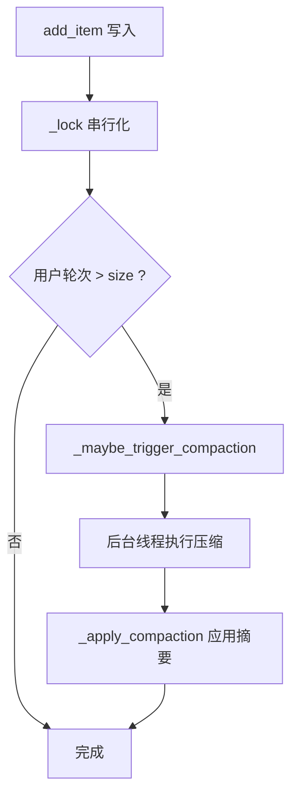

**图表来源**
- [chat.py:166-175](file://src/speech_to_speech/LLM/chat.py#L166-L175)
- [chat.py:475-500](file://src/speech_to_speech/LLM/chat.py#L475-L500)
- [chat.py:1277-1302](file://src/speech_to_speech/LLM/chat.py#L1277-L1302)
- [chat.py:1319-1350](file://src/speech_to_speech/LLM/chat.py#L1319-L1350)

**章节来源**
- [chat.py:166-175](file://src/speech_to_speech/LLM/chat.py#L166-L175)
- [chat.py:475-500](file://src/speech_to_speech/LLM/chat.py#L475-L500)
- [chat.py:1277-1302](file://src/speech_to_speech/LLM/chat.py#L1277-L1302)
- [chat.py:1319-1350](file://src/speech_to_speech/LLM/chat.py#L1319-L1350)

## 故障排查指南
- 工具调用缺失 call_id：add_supported_item 对 function_call 校验 call_id，缺失抛出 ChatItemError。
- 工具输出无法匹配：append_tool_output 若找不到对应 call_id，抛出 ChatItemError。
- 压缩摘要异常：_compact_worker 捕获异常并记录日志，不污染 chat 状态。
- 历史清理失败：ResponseHistory.clean_up 捕获异常并 restore_history_cleanup 恢复快照。

**章节来源**
- [chat.py:1544-1569](file://src/speech_to_speech/LLM/chat.py#L1544-L1569)
- [chat.py:281-299](file://src/speech_to_speech/LLM/chat.py#L281-L299)
- [chat.py:1319-1350](file://src/speech_to_speech/LLM/chat.py#L1319-L1350)
- [history.py:82-98](file://src/speech_to_speech/pipeline/history.py#L82-L98)

## 结论
Chat 类通过严格的类型校验、工具调用配对、上下文保护与压缩摘要机制，实现了稳定、可扩展的对话历史管理。配合文本/语音系统提示构建器与语言检测集成，系统在多语言与多模态场景下具备良好的鲁棒性。Pipeline 消息与响应历史提案进一步确保了实时交互中的数据流一致性与可恢复性。性能方面，并发安全与后台压缩有效控制了内存占用与延迟，适合生产环境部署。

## 附录：提示工程与多语言策略
- 提示工程最佳实践：
  - 文本通道强调清晰、Markdown 适度、工具调用无前言。
  - 语音通道强调简短口语化、禁止视觉格式、工具结果不播报。
  - 压缩摘要要求 JSON 双摘要，保留关键信息，省略闲聊。
- 多语言支持策略：
  - 使用 WHISPER_LANGUAGE_TO_LLM_LANGUAGE 映射 STT 语言到 LLM 语言名。
  - 通过 format_language_instruction 注入语言提示。
  - RuntimeConfig.selected_language 支持 “auto”，由 STT 动态决定。

**章节来源**
- [text_prompt.py:5-17](file://src/speech_to_speech/LLM/text_prompt.py#L5-L17)
- [voice_prompt.py:5-22](file://src/speech_to_speech/LLM/voice_prompt.py#L5-L22)
- [compaction_prompt.py:33-62](file://src/speech_to_speech/LLM/compaction_prompt.py#L33-L62)
- [utils.py:296-321](file://src/speech_to_speech/LLM/utils.py#L296-L321)
- [runtime_config.py:107-116](file://src/speech_to_speech/api/openai_realtime/runtime_config.py#L107-L116)