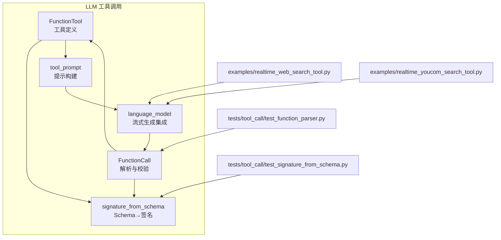
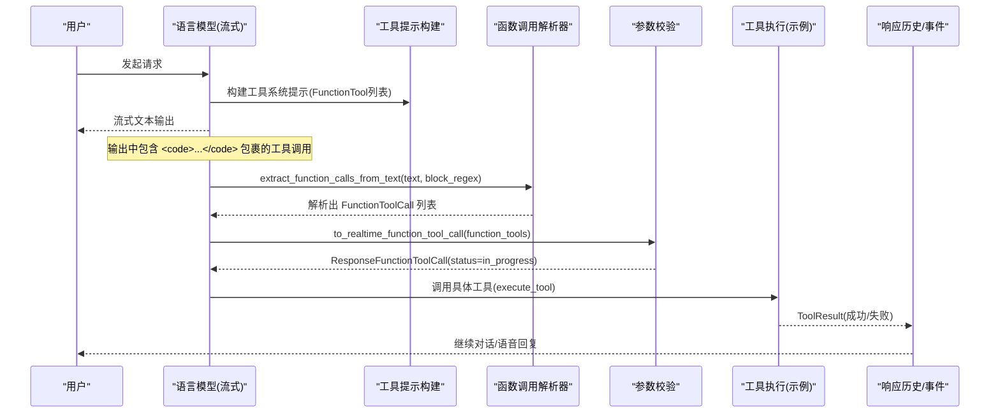
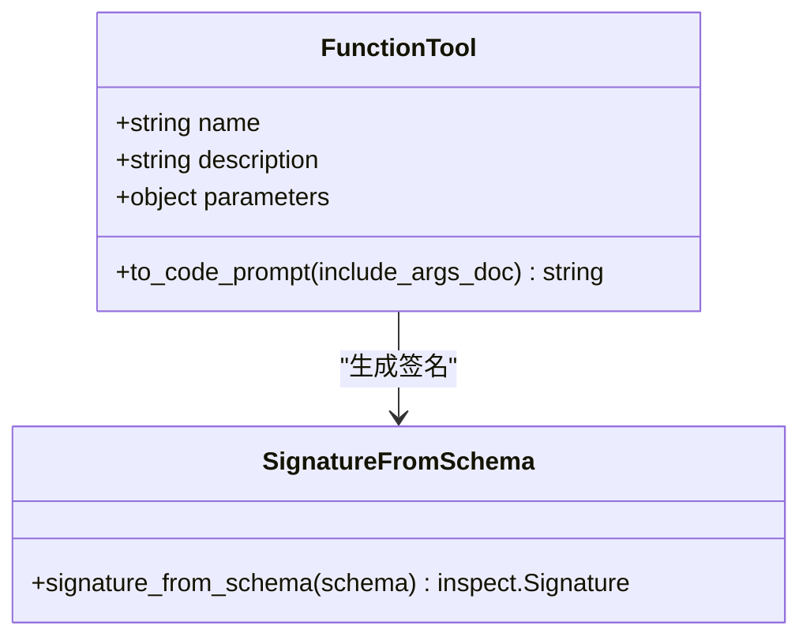
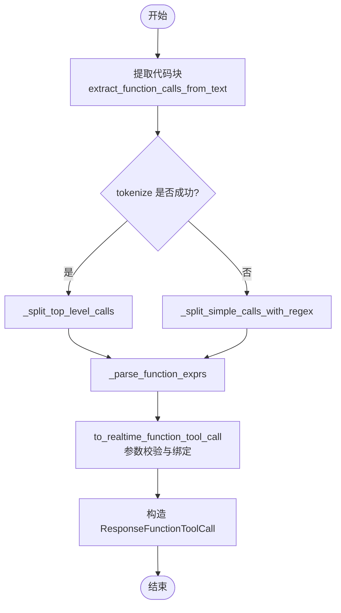
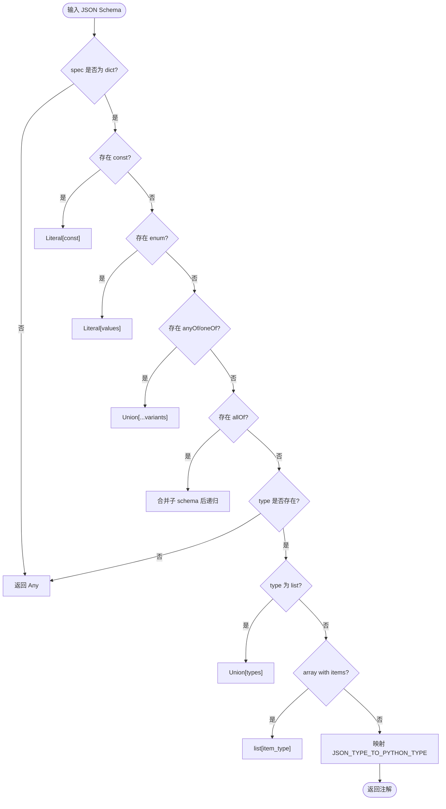
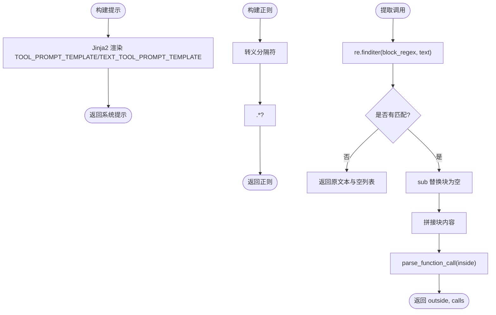
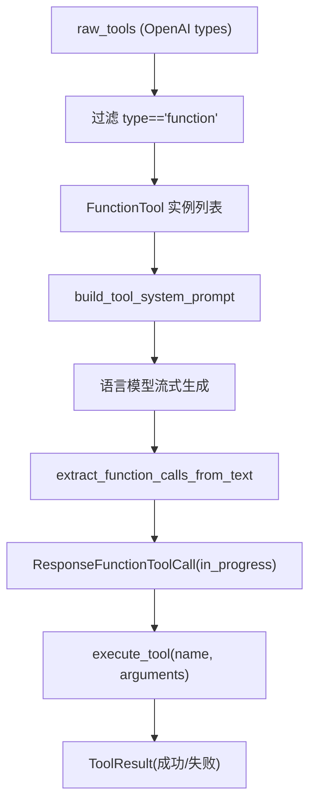
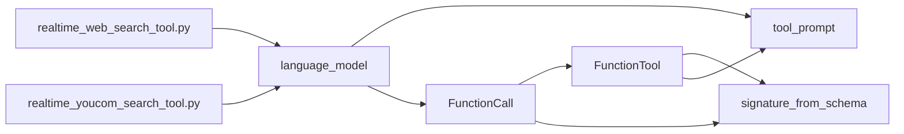

# 工具调用系统

<cite>
**本文引用的文件**   
- [function_tool.py](file://src/speech_to_speech/LLM/tool_call/function_tool.py)
- [function_call.py](file://src/speech_to_speech/LLM/tool_call/function_call.py)
- [signature_from_schema.py](file://src/speech_to_speech/LLM/tool_call/signature_from_schema.py)
- [tool_prompt.py](file://src/speech_to_speech/LLM/tool_call/tool_prompt.py)
- [language_model.py](file://src/speech_to_speech/LLM/language_model.py)
- [realtime_web_search_tool.py](file://examples/realtime_web_search_tool.py)
- [realtime_youcom_search_tool.py](file://examples/realtime_youcom_search_tool.py)
- [test_function_parser.py](file://tests/tool_call/test_function_parser.py)
- [test_signature_from_schema.py](file://tests/tool_call/test_signature_from_schema.py)
</cite>

## 目录
1. [引言](#引言)
2. [项目结构](#项目结构)
3. [核心组件](#核心组件)
4. [架构总览](#架构总览)
5. [详细组件分析](#详细组件分析)
6. [依赖关系分析](#依赖关系分析)
7. [性能与可扩展性](#性能与可扩展性)
8. [故障排查指南](#故障排查指南)
9. [结论](#结论)
10. [附录：工具开发规范与安全审计](#附录工具开发规范与安全审计)

## 引言
本技术文档聚焦于语音到语音系统中的“工具调用”子系统，围绕 FunctionTool、FunctionCall、JSON Schema 到函数签名自动生成、参数校验、工具提示构建、代码块提取与正则匹配、工具注册与动态发现、执行上下文管理展开。同时给出工具开发指南、API 设计规范、错误处理策略以及生产环境的安全性与审计要求。

该子系统位于 LLM 层，负责将大模型输出的工具调用指令解析为结构化调用对象，并驱动后续工具执行与结果回传。

## 项目结构
工具调用相关代码集中在以下路径：
- src/speech_to_speech/LLM/tool_call：工具定义、解析、签名生成、提示构建
- src/speech_to_speech/LLM/language_model.py：工具在语言模型流式生成中的集成点
- examples：示例工具（Web 搜索）
- tests/tool_call：解析与签名生成的单元测试

图表来源
- [function_tool.py:8-34](file://src/speech_to_speech/LLM/tool_call/function_tool.py#L8-L34)
- [function_call.py:189-263](file://src/speech_to_speech/LLM/tool_call/function_call.py#L189-L263)
- [signature_from_schema.py:79-124](file://src/speech_to_speech/LLM/tool_call/signature_from_schema.py#L79-L124)
- [tool_prompt.py:76-109](file://src/speech_to_speech/LLM/tool_call/tool_prompt.py#L76-L109)
- [language_model.py:296-301](file://src/speech_to_speech/LLM/language_model.py#L296-L301)
- [language_model.py:376-376](file://src/speech_to_speech/LLM/language_model.py#L376-L376)
- [realtime_web_search_tool.py:20-40](file://examples/realtime_web_search_tool.py#L20-L40)
- [realtime_youcom_search_tool.py:27-46](file://examples/realtime_youcom_search_tool.py#L27-L46)

章节来源
- [function_tool.py:1-35](file://src/speech_to_speech/LLM/tool_call/function_tool.py#L1-L35)
- [function_call.py:1-330](file://src/speech_to_speech/LLM/tool_call/function_call.py#L1-L330)
- [signature_from_schema.py:1-125](file://src/speech_to_speech/LLM/tool_call/signature_from_schema.py#L1-L125)
- [tool_prompt.py:1-110](file://src/speech_to_speech/LLM/tool_call/tool_prompt.py#L1-L110)
- [language_model.py:296-301](file://src/speech_to_speech/LLM/language_model.py#L296-L301)
- [language_model.py:376-376](file://src/speech_to_speech/LLM/language_model.py#L376-L376)

## 核心组件
- FunctionTool：继承自 OpenAI Realtime 的函数工具类型，扩展了 to_code_prompt，用于生成供模型理解的工具 Python 风格签名和文档字符串。
- FunctionCall：表示一次解析后的函数调用，包含函数名、参数字典、原始字符串等；提供 to_realtime_function_tool_call 将内部表示转换为实时协议所需的 ResponseFunctionToolCall。
- signature_from_schema：将 JSON Schema 映射为 Python inspect.Signature，支持 const、enum、anyOf/oneOf/allOf、数组、联合类型等。
- tool_prompt：基于 Jinja2 模板渲染工具系统提示，指导模型以指定代码块包裹工具调用；并提供构建代码块正则的方法。
- language_model：在流式生成中组装工具提示、从输出文本中提取代码块、解析函数调用，并将工具调用事件注入响应历史。

章节来源
- [function_tool.py:8-34](file://src/speech_to_speech/LLM/tool_call/function_tool.py#L8-L34)
- [function_call.py:189-263](file://src/speech_to_speech/LLM/tool_call/function_call.py#L189-L263)
- [signature_from_schema.py:79-124](file://src/speech_to_speech/LLM/tool_call/signature_from_schema.py#L79-L124)
- [tool_prompt.py:76-109](file://src/speech_to_speech/LLM/tool_call/tool_prompt.py#L76-L109)
- [language_model.py:296-301](file://src/speech_to_speech/LLM/language_model.py#L296-L301)
- [language_model.py:376-376](file://src/speech_to_speech/LLM/language_model.py#L376-L376)

## 架构总览
工具调用系统在语言模型流式生成流程中扮演“工具感知”角色：
- 工具声明：通过 FunctionTool 描述工具名称、描述与 JSON Schema 参数。
- 提示构建：使用 tool_prompt 将工具签名与规则渲染为系统提示，引导模型输出带分隔符的代码块。
- 输出解析：从模型输出中按正则提取代码块，再使用 tokenize+ast 解析函数调用，得到 FunctionToolCall。
- 参数校验：根据 FunctionTool 的 JSON Schema 进行位置参数绑定、必填字段检查、未知参数丢弃。
- 执行与回传：由上层服务或示例工具实现 execute_tool，返回 ToolResult，驱动后续对话。

图表来源
- [tool_prompt.py:76-109](file://src/speech_to_speech/LLM/tool_call/tool_prompt.py#L76-L109)
- [function_call.py:296-329](file://src/speech_to_speech/LLM/tool_call/function_call.py#L296-L329)
- [function_call.py:197-263](file://src/speech_to_speech/LLM/tool_call/function_call.py#L197-L263)
- [language_model.py:296-301](file://src/speech_to_speech/LLM/language_model.py#L296-L301)
- [language_model.py:376-376](file://src/speech_to_speech/LLM/language_model.py#L376-L376)
- [realtime_web_search_tool.py:44-117](file://examples/realtime_web_search_tool.py#L44-L117)

## 详细组件分析

### FunctionTool 结构与参数定义
FunctionTool 继承自 OpenAI RealtimeFunctionTool，主要扩展：
- to_code_prompt(include_args_doc=True)：根据 parameters(JSON Schema) 生成 Python 风格的函数签名与文档字符串，便于模型理解参数含义与顺序。
- 当 include_args_doc=True 时，会将 properties 中的 description 拼接为 Args 段落，增强模型对参数的理解，但会增加 token 消耗。

图表来源
- [function_tool.py:8-34](file://src/speech_to_speech/LLM/tool_call/function_tool.py#L8-L34)
- [signature_from_schema.py:79-124](file://src/speech_to_speech/LLM/tool_call/signature_from_schema.py#L79-L124)

章节来源
- [function_tool.py:8-34](file://src/speech_to_speech/LLM/tool_call/function_tool.py#L8-L34)

### FunctionCall 解析与执行流程
FunctionCall 的核心职责：
- parse_function_call：从字符串中解析所有函数调用，优先使用 tokenize 分割顶层调用，失败时回退到正则匹配。
- extract_function_calls_from_text：从包含代码块的文本中提取函数调用，返回去除代码块后的文本与解析结果。
- to_realtime_function_tool_call：将内部 FunctionToolCall 转换为实时协议所需的 ResponseFunctionToolCall，并进行参数校验与绑定。

关键流程：
1. 输入文本经正则匹配代码块，提取内部内容。
2. 使用 tokenize 尝试分割顶层调用表达式；若失败则用正则回退。
3. 对每个表达式使用 ast.parse(mode="eval") 解析为 Call 节点，提取函数名与参数。
4. 根据 FunctionTool 的 JSON Schema 进行位置参数绑定、必填字段校验、未知参数丢弃。
5. 生成 ResponseFunctionToolCall，状态为 in_progress，等待工具执行结果。

图表来源
- [function_call.py:37-120](file://src/speech_to_speech/LLM/tool_call/function_call.py#L37-L120)
- [function_call.py:163-183](file://src/speech_to_speech/LLM/tool_call/function_call.py#L163-L183)
- [function_call.py:197-263](file://src/speech_to_speech/LLM/tool_call/function_call.py#L197-L263)
- [function_call.py:296-329](file://src/speech_to_speech/LLM/tool_call/function_call.py#L296-L329)

章节来源
- [function_call.py:37-120](file://src/speech_to_speech/LLM/tool_call/function_call.py#L37-L120)
- [function_call.py:163-183](file://src/speech_to_speech/LLM/tool_call/function_call.py#L163-L183)
- [function_call.py:197-263](file://src/speech_to_speech/LLM/tool_call/function_call.py#L197-L263)
- [function_call.py:296-329](file://src/speech_to_speech/LLM/tool_call/function_call.py#L296-L329)

### 函数签名从 JSON Schema 自动生成
signature_from_schema 将 JSON Schema 映射为 Python inspect.Signature：
- 支持 const → Literal[const]
- 支持 enum → Literal[val1, val2, ...]
- 支持 anyOf/oneOf → Union[...]
- 支持 allOf → 合并子 schema 后递归解析
- 支持 type 为 list 的情况 → Union[str, None] 等
- 支持 array with items → list[item_type]
- required 字段无 default 时作为必参排在前面，其他可选参数在后，保持 Python 签名约束。

图表来源
- [signature_from_schema.py:23-76](file://src/speech_to_speech/LLM/tool_call/signature_from_schema.py#L23-L76)
- [signature_from_schema.py:79-124](file://src/speech_to_speech/LLM/tool_call/signature_from_schema.py#L79-L124)

章节来源
- [signature_from_schema.py:23-76](file://src/speech_to_speech/LLM/tool_call/signature_from_schema.py#L23-L76)
- [signature_from_schema.py:79-124](file://src/speech_to_speech/LLM/tool_call/signature_from_schema.py#L79-L124)

### 工具提示构建、代码块提取与正则匹配
- tool_prompt.build_tool_system_prompt：基于 Jinja2 模板渲染工具系统提示，包含工具签名与调用规则；text_only 模式针对纯文本通道增加“直接调用工具无需前言”的指导。
- tool_prompt.build_block_regex：根据 enter_code/end_code 生成非贪婪的正则，用于匹配单个代码块。
- function_call.extract_function_calls_from_text：使用正则匹配代码块，剥离外部文本，并对块内内容调用 parse_function_call。

图表来源
- [tool_prompt.py:29-46](file://src/speech_to_speech/LLM/tool_call/tool_prompt.py#L29-L46)
- [tool_prompt.py:50-68](file://src/speech_to_speech/LLM/tool_call/tool_prompt.py#L50-L68)
- [tool_prompt.py:100-109](file://src/speech_to_speech/LLM/tool_call/tool_prompt.py#L100-L109)
- [function_call.py:296-329](file://src/speech_to_speech/LLM/tool_call/function_call.py#L296-L329)

章节来源
- [tool_prompt.py:29-46](file://src/speech_to_speech/LLM/tool_call/tool_prompt.py#L29-L46)
- [tool_prompt.py:50-68](file://src/speech_to_speech/LLM/tool_call/tool_prompt.py#L50-L68)
- [tool_prompt.py:76-109](file://src/speech_to_speech/LLM/tool_call/tool_prompt.py#L76-L109)
- [function_call.py:296-329](file://src/speech_to_speech/LLM/tool_call/function_call.py#L296-L329)

### 工具注册机制、动态发现与执行上下文
- 工具注册：在语言模型初始化阶段，raw_tools 被过滤为 type=="function" 的条目，并实例化为 FunctionTool 列表。
- 动态发现：示例工具模块（如 realtime_web_search_tool.py、realtime_youcom_search_tool.py）暴露 TOOLS 列表与 execute_tool 函数，供上层服务加载。
- 执行上下文：语言模型在流式生成中将工具调用事件注入 StreamContext.output_parts，并通过 ResponseHistory.capture 记录历史，以便后续 follow-up 推理。

图表来源
- [language_model.py:296-296](file://src/speech_to_speech/LLM/language_model.py#L296-L296)
- [language_model.py:301-301](file://src/speech_to_speech/LLM/language_model.py#L301-L301)
- [language_model.py:376-376](file://src/speech_to_speech/LLM/language_model.py#L376-L376)
- [realtime_web_search_tool.py:20-40](file://examples/realtime_web_search_tool.py#L20-L40)
- [realtime_youcom_search_tool.py:27-46](file://examples/realtime_youcom_search_tool.py#L27-L46)

章节来源
- [language_model.py:296-301](file://src/speech_to_speech/LLM/language_model.py#L296-L301)
- [language_model.py:376-376](file://src/speech_to_speech/LLM/language_model.py#L376-L376)
- [realtime_web_search_tool.py:20-40](file://examples/realtime_web_search_tool.py#L20-L40)
- [realtime_youcom_search_tool.py:27-46](file://examples/realtime_youcom_search_tool.py#L27-L46)

## 依赖关系分析
- FunctionTool 依赖 signature_from_schema 生成签名，依赖 tool_prompt 渲染提示。
- FunctionCall 依赖 FunctionTool 获取参数 Schema，依赖 signature_from_schema 进行位置参数绑定。
- language_model 依赖 tool_prompt 构建系统提示，依赖 function_call 提取与解析调用。
- 示例工具依赖 httpx 进行网络请求，返回 ToolResult 给上层服务。

图表来源
- [function_tool.py:5-5](file://src/speech_to_speech/LLM/tool_call/function_tool.py#L5-L5)
- [function_call.py:21-22](file://src/speech_to_speech/LLM/tool_call/function_call.py#L21-L22)
- [language_model.py:46-48](file://src/speech_to_speech/LLM/language_model.py#L46-L48)
- [realtime_web_search_tool.py:10-12](file://examples/realtime_web_search_tool.py#L10-L12)
- [realtime_youcom_search_tool.py:10-12](file://examples/realtime_youcom_search_tool.py#L10-L12)

章节来源
- [function_tool.py:1-35](file://src/speech_to_speech/LLM/tool_call/function_tool.py#L1-L35)
- [function_call.py:1-330](file://src/speech_to_speech/LLM/tool_call/function_call.py#L1-L330)
- [language_model.py:46-48](file://src/speech_to_speech/LLM/language_model.py#L46-L48)
- [realtime_web_search_tool.py:10-12](file://examples/realtime_web_search_tool.py#L10-L12)
- [realtime_youcom_search_tool.py:10-12](file://examples/realtime_youcom_search_tool.py#L10-L12)

## 性能与可扩展性
- Token 优化：FunctionTool.to_code_prompt 的 include_args_doc 控制是否包含参数描述，开启会显著增加 token 消耗，应根据模型能力与上下文限制权衡。
- 解析鲁棒性：优先使用 tokenize 分割顶层调用，失败时回退到正则匹配，提升对不完整或畸形输出的容错率。
- 可扩展工具：通过 TOOLS 列表与 execute_tool 接口新增工具，无需修改核心解析逻辑。
- 流式集成：语言模型在流式生成中即时捕获工具调用事件，减少延迟并支持并发 follow-up。

[本节为通用指导，不直接分析具体文件]

## 故障排查指南
常见问题与定位建议：
- 工具未找到：to_realtime_function_tool_call 在未找到同名 FunctionTool 时会抛出 ValueError，检查 FunctionTool 列表是否正确注册。
- 参数缺失或多余：校验逻辑会报告缺少必填参数或丢弃未声明参数，检查 JSON Schema 的 required 与 properties。
- 位置参数冲突：当同一参数既有位置又有命名传入时会报错，检查模型输出是否混用位置与命名参数。
- 代码块未匹配：确认 block_regex 与 enter_code/end_code 一致，且模型输出确实包含代码块。
- 外部工具失败：示例工具返回 ToolResult.error 字段，检查网络请求、API Key、HTTP 状态码与 JSON 解析。

章节来源
- [function_call.py:213-254](file://src/speech_to_speech/LLM/tool_call/function_call.py#L213-L254)
- [function_call.py:296-329](file://src/speech_to_speech/LLM/tool_call/function_call.py#L296-L329)
- [realtime_web_search_tool.py:44-117](file://examples/realtime_web_search_tool.py#L44-L117)
- [realtime_youcom_search_tool.py:62-146](file://examples/realtime_youcom_search_tool.py#L62-L146)

## 结论
工具调用系统通过 FunctionTool 与 FunctionCall 的组合，实现了从 JSON Schema 到 Python 签名的自动映射、严格的参数校验、稳健的解析与回退机制，并在语言模型流式生成中无缝集成。示例工具展示了如何扩展新工具，而提示构建与代码块提取确保了模型输出的结构化与可解析性。生产环境中应关注安全性、权限控制与审计日志，确保工具调用的可控与可追溯。

[本节为总结，不直接分析具体文件]

## 附录：工具开发规范与安全审计

### 工具开发指南
- 定义工具声明：在模块中提供 TOOLS 列表，包含 type、name、description、parameters(JSON Schema)。
- 实现 execute_tool：接收 name 与 arguments，返回 ToolResult；对未知工具名抛出异常或返回错误信息。
- 参数校验：在 execute_tool 中对必要参数做前置校验，避免无效请求。
- 错误处理：对外部依赖（如 HTTP 请求）进行 try/except 捕获，返回结构化错误信息。

章节来源
- [realtime_web_search_tool.py:20-40](file://examples/realtime_web_search_tool.py#L20-L40)
- [realtime_web_search_tool.py:44-117](file://examples/realtime_web_search_tool.py#L44-L117)
- [realtime_youcom_search_tool.py:27-46](file://examples/realtime_youcom_search_tool.py#L27-L46)
- [realtime_youcom_search_tool.py:62-146](file://examples/realtime_youcom_search_tool.py#L62-L146)

### API 设计规范
- 工具名称唯一：FunctionTool.name 必须唯一，避免解析时歧义。
- JSON Schema 严谨：properties 与 required 明确，必要时使用 additionalProperties=False 限制额外字段。
- 参数类型清晰：使用 const、enum、anyOf/oneOf 等增强类型表达，便于签名生成与校验。
- 返回值结构稳定：ToolResult 应包含 query、answer、results、error 等字段，便于下游消费。

章节来源
- [signature_from_schema.py:23-76](file://src/speech_to_speech/LLM/tool_call/signature_from_schema.py#L23-L76)
- [realtime_web_search_tool.py:20-40](file://examples/realtime_web_search_tool.py#L20-L40)
- [realtime_youcom_search_tool.py:27-46](file://examples/realtime_youcom_search_tool.py#L27-L46)

### 错误处理策略
- 解析失败：parse_function_call 在 tokenize 失败时回退到正则匹配，并跳过无效表达式。
- 参数校验失败：to_realtime_function_tool_call 抛出 ValueError，包含缺失或重复参数的详细信息。
- 工具执行失败：execute_tool 返回 ToolResult.error，上层服务据此决定重试或降级。

章节来源
- [function_call.py:284-293](file://src/speech_to_speech/LLM/tool_call/function_call.py#L284-L293)
- [function_call.py:213-254](file://src/speech_to_speech/LLM/tool_call/function_call.py#L213-L254)
- [realtime_web_search_tool.py:69-95](file://examples/realtime_web_search_tool.py#L69-L95)
- [realtime_youcom_search_tool.py:87-126](file://examples/realtime_youcom_search_tool.py#L87-L126)

### 安全性考虑、权限控制与审计日志
- 权限控制：在 execute_tool 中验证调用者身份与权限，仅允许受信任的工具被调用。
- 输入清洗：对 arguments 进行严格校验与清洗，防止注入攻击。
- 审计日志：记录工具调用名、参数摘要、执行结果、耗时与错误信息，便于追踪与合规审计。
- 资源限制：对网络请求设置超时与重试上限，避免资源耗尽。

[本节为通用指导，不直接分析具体文件]