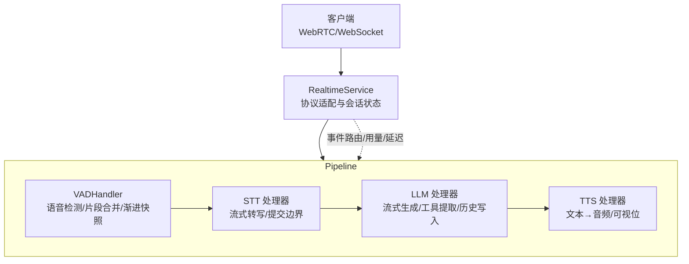
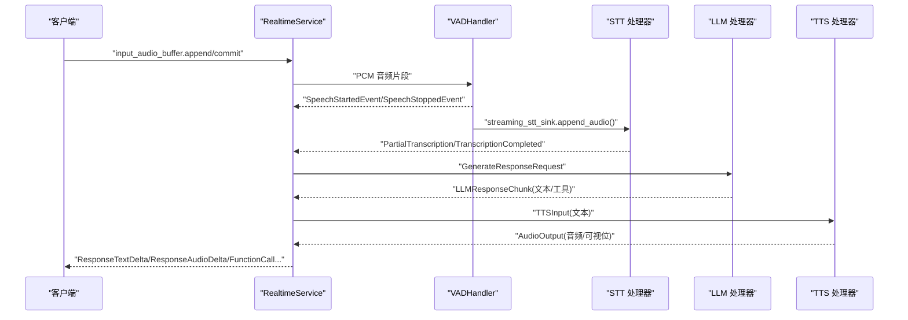
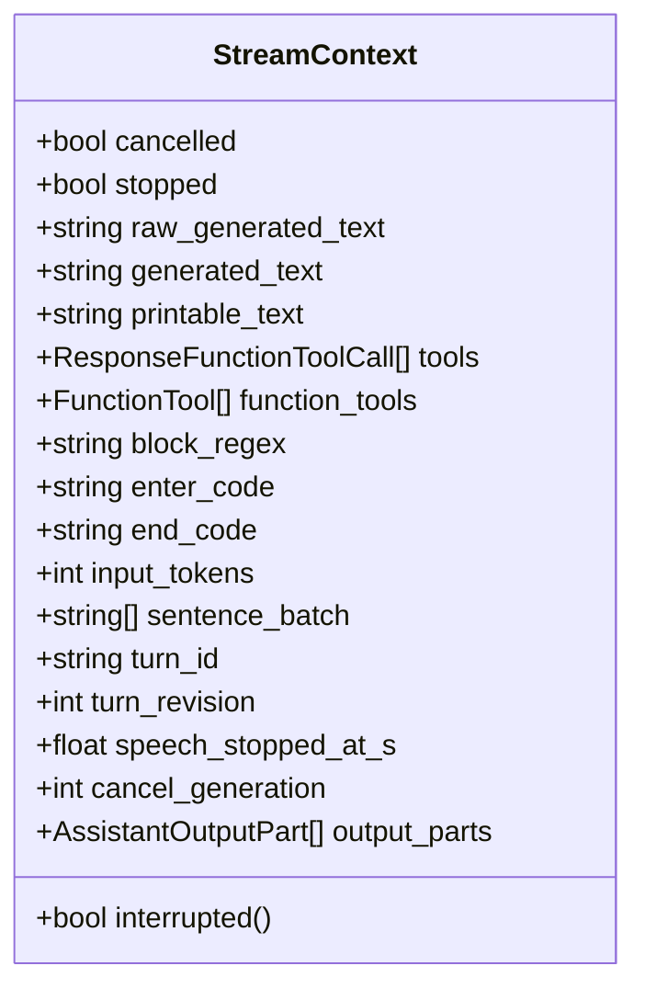
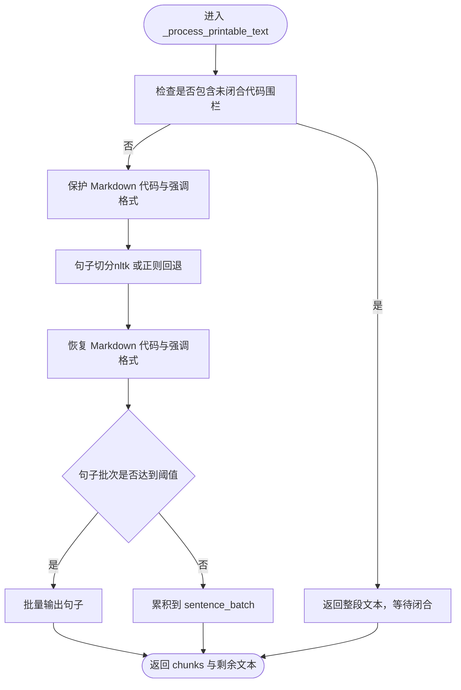
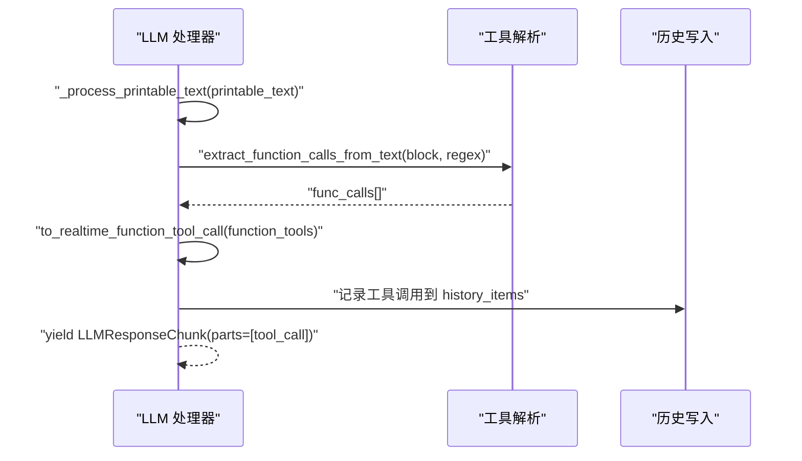
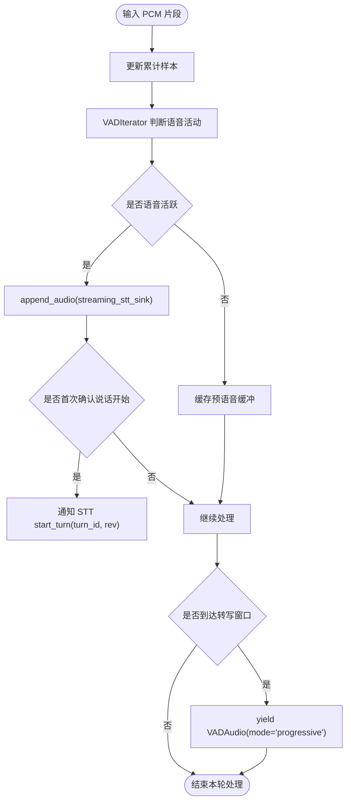
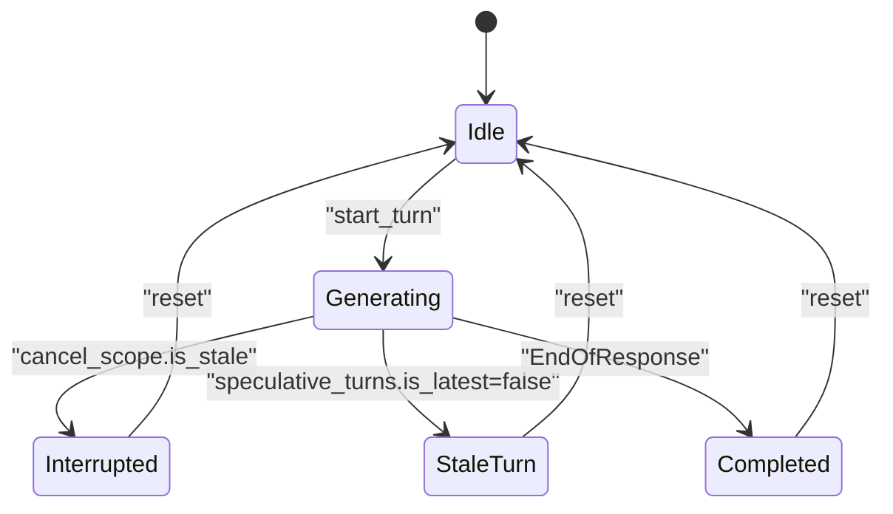
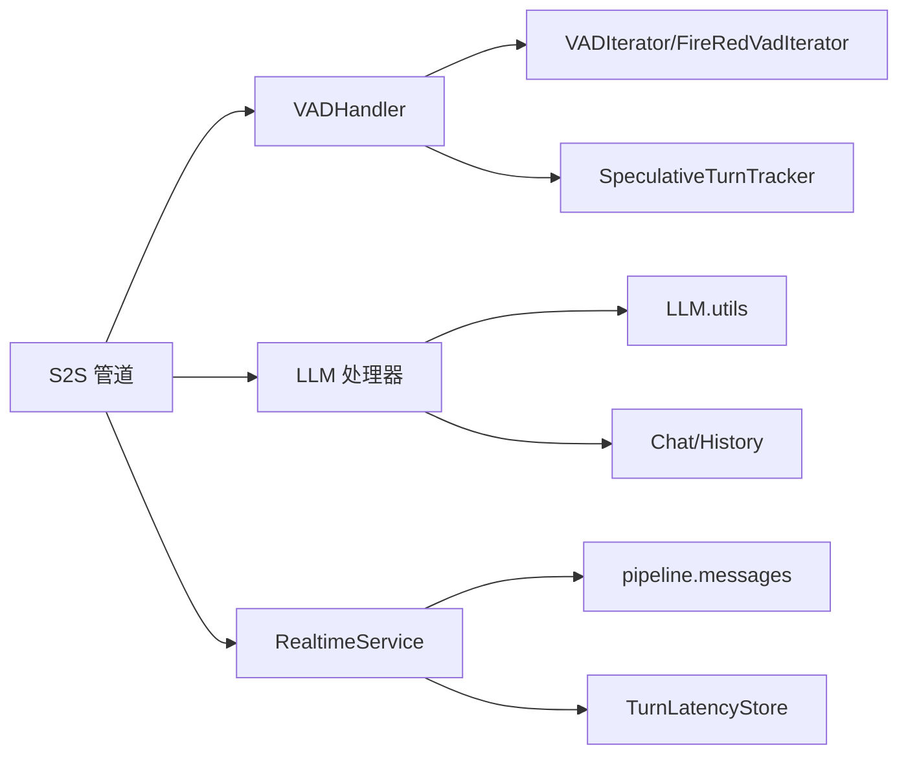

# 流式生成处理

<cite>
**本文引用的文件**   
- [language_model.py](file://src/speech_to_speech/LLM/language_model.py)
- [base_openai_compatible_language_model.py](file://src/speech_to_speech/LLM/base_openai_compatible_language_model.py)
- [utils.py](file://src/speech_to_speech/LLM/utils.py)
- [vad_handler.py](file://src/speech_to_speech/VAD/vad_handler.py)
- [service.py](file://src/speech_to_speech/api/openai_realtime/service.py)
- [messages.py](file://src/speech_to_speech/pipeline/messages.py)
- [s2s_pipeline.py](file://src/speech_to_speech/s2s_pipeline.py)
</cite>

## 目录
1. [引言](#引言)
2. [项目结构](#项目结构)
3. [核心组件](#核心组件)
4. [架构总览](#架构总览)
5. [详细组件分析](#详细组件分析)
6. [依赖关系分析](#依赖关系分析)
7. [性能与延迟优化](#性能与延迟优化)
8. [故障排查指南](#故障排查指南)
9. [结论](#结论)

## 引言
本文面向“语音到语音”实时对话系统中的流式生成处理，系统性解释以下关键主题：
- StreamContext 的状态管理与增量文本累积
- 句子分片策略、Markdown 保留与不可发音字符过滤
- 流式数据流、实时响应处理、中断与撤销机制
- Token 流处理、工具调用提取、代码块识别
- 延迟优化、缓冲区管理、背压处理策略
- 监控指标、性能分析与调试工具的集成使用

本说明以源码为依据，重点覆盖 VAD → STT → LLM → TTS 的端到端流式链路，以及 OpenAI Realtime 协议在服务器侧的编排。

## 项目结构
本项目采用分层模块化组织：
- VAD 层负责语音活动检测、片段合并、渐进式音频快照与转写窗口控制
- STT 层将音频流转换为文本（含部分结果与最终结果）
- LLM 层负责流式生成、文本清洗、Markdown 保护、工具调用解析与历史写入
- TTS 层将文本流合成音频并可选输出视位
- API 服务层将 OpenAI Realtime 协议事件映射为内部管道消息，并维护会话状态、用量统计与延迟追踪

**图表来源**
- [service.py:355-403](file://src/speech_to_speech/api/openai_realtime/service.py#L355-L403)
- [vad_handler.py:58-209](file://src/speech_to_speech/VAD/vad_handler.py#L58-L209)
- [language_model.py:166-256](file://src/speech_to_speech/LLM/language_model.py#L166-L256)
- [s2s_pipeline.py:488-574](file://src/speech_to_speech/s2s_pipeline.py#L488-L574)

**章节来源**
- [service.py:355-403](file://src/speech_to_speech/api/openai_realtime/service.py#L355-L403)
- [s2s_pipeline.py:488-574](file://src/speech_to_speech/s2s_pipeline.py#L488-L574)

## 核心组件
- StreamContext：LLM 流式生成的可变上下文，承载原始文本、清理后文本、可打印文本、工具列表、句子批次、轮次标识、取消状态等。
- VADHandler：语音活动检测与片段管理，支持短片段合并、渐进式音频快照、实时转写窗口、说话开始/结束事件。
- BaseLanguageModelHandler / BaseOpenAICompatibleHandler：统一流式生成生命周期，包括指令注入、工具系统提示、句子分片、Markdown 保护、不可发音字符过滤、历史写入与 Token 用量。
- RealtimeService：协议适配、会话状态、事件路由、用量统计、延迟追踪、推测性轮次门控。
- Pipeline Messages：统一的管道消息类型，如 VADAudio、PartialTranscription、Transcription、LLMResponseChunk、TokenUsage、EndOfResponse、GenerateResponseRequest 等。

**章节来源**
- [language_model.py:134-164](file://src/speech_to_speech/LLM/language_model.py#L134-L164)
- [vad_handler.py:58-209](file://src/speech_to_speech/VAD/vad_handler.py#L58-L209)
- [base_openai_compatible_language_model.py:174-249](file://src/speech_to_speech/LLM/base_openai_compatible_language_model.py#L174-L249)
- [service.py:355-403](file://src/speech_to_speech/api/openai_realtime/service.py#L355-L403)
- [messages.py:49-256](file://src/speech_to_speech/pipeline/messages.py#L49-L256)

## 架构总览
下图展示从输入音频到输出音频的完整流式路径，以及协议事件与内部消息的对应关系。

**图表来源**
- [service.py:393-403](file://src/speech_to_speech/api/openai_realtime/service.py#L393-L403)
- [vad_handler.py:288-337](file://src/speech_to_speech/VAD/vad_handler.py#L288-L337)
- [language_model.py:560-765](file://src/speech_to_speech/LLM/language_model.py#L560-L765)
- [messages.py:146-256](file://src/speech_to_speech/pipeline/messages.py#L146-L256)

## 详细组件分析

### StreamContext 状态管理与增量累积
StreamContext 是 LLM 流式生成的核心可变对象，贯穿 token 消费、文本清洗、工具提取与最终输出。关键字段与职责：
- raw_generated_text：模型原始输出，用于 Token 计数与日志
- generated_text：经 remove_unspeechable 清理后的文本（仅音频路径）
- printable_text：用于 Markdown 保护与句子切分的可打印文本
- sentence_batch：句子批次，达到阈值时批量输出
- tools：已解析的工具调用列表
- block_regex/enter_code/end_code：工具代码块的正则与标记
- turn_id/turn_revision/cancel_generation：轮次与取消语义
- output_parts：有序的输出部件（文本/工具），用于历史写入与协议序列化

**图表来源**
- [language_model.py:134-164](file://src/speech_to_speech/LLM/language_model.py#L134-L164)

**章节来源**
- [language_model.py:134-164](file://src/speech_to_speech/LLM/language_model.py#L134-L164)
- [language_model.py:486-554](file://src/speech_to_speech/LLM/language_model.py#L486-L554)

### 句子分片策略与 Markdown 保留
- 句子分片使用 sent_tokenize_preserving_markdown_code，优先尝试 nltk.sent_tokenize，缺失时回退到正则分割，保证离线环境可用。
- Markdown 代码块（围栏与行内）在分片前被保护，避免被错误切分；强调格式（*或_）在保守词边界处移除。
- 音频路径对每段增量文本先执行 remove_unspeechable，再按句子切分；文本路径保持原文，不应用不可发音字符过滤。
- 当检测到未闭合的代码围栏时，整段文本暂不分片，等待后续 token 闭合后再处理。

**图表来源**
- [utils.py:111-151](file://src/speech_to_speech/LLM/utils.py#L111-L151)
- [language_model.py:324-427](file://src/speech_to_speech/LLM/language_model.py#L324-L427)

**章节来源**
- [utils.py:111-151](file://src/speech_to_speech/LLM/utils.py#L111-L151)
- [language_model.py:324-427](file://src/speech_to_speech/LLM/language_model.py#L324-L427)

### 不可发音字符过滤与文本清洗
- remove_unspeechable：基于 Unicode 模式过滤非语音字符，保留字母、数字、标点与空白，兼容多语言。
- remove_markdown：去除常见 Markdown 分隔符，但保留内容；需作用于完整文本而非逐 delta。
- 音频路径：每个增量文本先 remove_unspeechable，再按句子切分并 remove_markdown。
- 文本路径：直接转发原始字符，不进行不可发音字符过滤，确保工具语法与代码块不被破坏。

**章节来源**
- [utils.py:167-177](file://src/speech_to_speech/LLM/utils.py#L167-L177)
- [utils.py:154-165](file://src/speech_to_speech/LLM/utils.py#L154-L165)
- [language_model.py:496-520](file://src/speech_to_speech/LLM/language_model.py#L496-L520)

### 流式工具调用提取与代码块识别
- 通过 build_block_regex、ENTER_CODE、END_CODE 构建工具代码块的正则与标记。
- 在 _process_printable_text 中，遇到 enter_code 时截取 before 文本进行句子切分；若存在 end_code，则提取完整代码块并解析函数调用。
- extract_function_calls_from_text 解析工具调用，to_realtime_function_tool_call 将其转换为实时协议所需的工具调用对象。
- 工具调用与文本交错输出，保持顺序一致，便于历史写入与协议序列化。

**图表来源**
- [language_model.py:357-398](file://src/speech_to_speech/LLM/language_model.py#L357-L398)
- [base_openai_compatible_language_model.py:577-611](file://src/speech_to_speech/LLM/base_openai_compatible_language_model.py#L577-L611)

**章节来源**
- [language_model.py:357-398](file://src/speech_to_speech/LLM/language_model.py#L357-L398)
- [base_openai_compatible_language_model.py:577-611](file://src/speech_to_speech/LLM/base_openai_compatible_language_model.py#L577-L611)

### VAD 流式数据流与实时响应处理
- VADHandler.process 接收 PCM 片段，更新累计样本数，调用 iterator 判断语音活动。
- 支持 streaming_stt_sink：在语音活跃时追加音频片段，并在说话开始时通知 STT 开始轮次。
- 支持 short_segment_merge_ms：将低于阈值的片段暂存，若在窗口内接续则合并，避免误触发。
- 支持 transcription_window_samples：按窗口大小周期性产出 progressive 音频快照，供实时转写。
- 说话开始/结束事件通过 text_output_queue 发送 SpeechStartedEvent/SpeechStoppedEvent，驱动上层流程。

**图表来源**
- [vad_handler.py:565-668](file://src/speech_to_speech/VAD/vad_handler.py#L565-L668)
- [vad_handler.py:670-728](file://src/speech_to_speech/VAD/vad_handler.py#L670-L728)

**章节来源**
- [vad_handler.py:565-668](file://src/speech_to_speech/VAD/vad_handler.py#L565-L668)
- [vad_handler.py:670-728](file://src/speech_to_speech/VAD/vad_handler.py#L670-L728)

### 中断机制与推测性轮次门控
- CancelScope：外部中断信号，LLM 生成过程中定期检查 is_stale(gen)，若过期则标记 ctx.cancelled。
- SpeculativeTurnTracker：推测性轮次跟踪，支持 speech_started、segment_discarded、is_latest、wait_for_gate 等，决定输出是否允许。
- PrefetchTransaction：预取事务，支持 claim/discard/abort，防止废弃的推测工作污染历史。
- 在服务层，dispatch_pipeline_event 会忽略陈旧轮次的事件，并清理 pending_turn。

**图表来源**
- [language_model.py:466-484](file://src/speech_to_speech/LLM/language_model.py#L466-L484)
- [service.py:630-646](file://src/speech_to_speech/api/openai_realtime/service.py#L630-L646)
- [messages.py:272-374](file://src/speech_to_speech/pipeline/messages.py#L272-L374)

**章节来源**
- [language_model.py:466-484](file://src/speech_to_speech/LLM/language_model.py#L466-L484)
- [service.py:630-646](file://src/speech_to_speech/api/openai_realtime/service.py#L630-L646)
- [messages.py:272-374](file://src/speech_to_speech/pipeline/messages.py#L272-L374)

### Token 流处理与用量统计
- _stream_tokens 消费 token_iter，累积 raw_generated_text 与 generated_text，按句子批次输出 LLMResponseChunk。
- 首次非空 token 记录 TTFT（Time To First Token）。
- 结束时计算 tokenizer.encode(raw_generated_text) 作为 output_tokens，并输出 TokenUsage。
- BaseOpenAICompatibleHandler 的 ProviderEvent Usage 也会累加 input/output tokens。

**章节来源**
- [language_model.py:486-554](file://src/speech_to_speech/LLM/language_model.py#L486-L554)
- [language_model.py:725-734](file://src/speech_to_speech/LLM/language_model.py#L725-L734)
- [base_openai_compatible_language_model.py:634-640](file://src/speech_to_speech/LLM/base_openai_compatible_language_model.py#L634-L640)

### 实时服务与协议事件映射
- RealtimeService 维护 ConnState，包含 response_key、pending_response_keys、response_usage 等。
- dispatch_pipeline_event 将内部事件路由到相应处理器，并处理陈旧轮次与失败响应。
- bind_response_latency_tracker 绑定延迟追踪器，关联 speech_anchor 与 source（speech/client/tool）。
- usage 统计聚合到 GlobalUsageMetrics，连接关闭时汇总并记录。

**章节来源**
- [service.py:228-327](file://src/speech_to_speech/api/openai_realtime/service.py#L228-L327)
- [service.py:448-470](file://src/speech_to_speech/api/openai_realtime/service.py#L448-L470)
- [service.py:610-669](file://src/speech_to_speech/api/openai_realtime/service.py#L610-L669)

## 依赖关系分析
- VADHandler 依赖 VADIterator/FireRedVadIterator 进行语音检测，依赖 SpeculativeTurnTracker 管理轮次。
- LLM 处理器依赖 utils.py 中的文本处理工具，依赖 chat/history 进行历史写入。
- RealtimeService 依赖 pipeline.messages 定义的消息类型，依赖 TurnLatencyStore 进行延迟追踪。
- S2S 管道组装各处理器，并通过队列连接各阶段。

**图表来源**
- [vad_handler.py:130-169](file://src/speech_to_speech/VAD/vad_handler.py#L130-L169)
- [language_model.py:49-57](file://src/speech_to_speech/LLM/language_model.py#L49-L57)
- [service.py:393-403](file://src/speech_to_speech/api/openai_realtime/service.py#L393-L403)
- [s2s_pipeline.py:556-574](file://src/speech_to_speech/s2s_pipeline.py#L556-L574)

**章节来源**
- [vad_handler.py:130-169](file://src/speech_to_speech/VAD/vad_handler.py#L130-L169)
- [language_model.py:49-57](file://src/speech_to_speech/LLM/language_model.py#L49-L57)
- [service.py:393-403](file://src/speech_to_speech/api/openai_realtime/service.py#L393-L403)
- [s2s_pipeline.py:556-574](file://src/speech_to_speech/s2s_pipeline.py#L556-L574)

## 性能与延迟优化
- 句子批次阈值 stream_batch_sentences：平衡首字延迟与吞吐，默认 3。
- 转写窗口 transcription_window_samples：控制 progressive 快照频率，避免频繁唤醒下游。
- 短片段合并 short_segment_merge_ms：减少误触发，提升鲁棒性。
- 预取线程池 PREFETCH_PROVIDER_WORKER_LIMIT：限制并发预取请求，避免资源竞争。
- 队列容量 PREFETCH_STREAM_QUEUE_MAXSIZE：背压控制，防止内存膨胀。
- 延迟追踪：TTFT、LLM 耗时、语音锚点，结合 TurnLatencyStore 进行全局统计。

建议调优方向：
- 降低 stream_batch_sentences 以提升首字速度，但可能增加网络开销
- 调整 transcription_window_samples 以平衡实时性与稳定性
- 启用 audio_enhancement（DeepFilterNet）改善噪声环境下的 VAD 准确率
- 根据后端能力调整 max_speech_ms 与 min_speech_ms，避免过长或过短的片段

**章节来源**
- [language_model.py:178-214](file://src/speech_to_speech/LLM/language_model.py#L178-L214)
- [vad_handler.py:61-103](file://src/speech_to_speech/VAD/vad_handler.py#L61-L103)
- [base_openai_compatible_language_model.py:70-75](file://src/speech_to_speech/LLM/base_openai_compatible_language_model.py#L70-L75)
- [service.py:448-470](file://src/speech_to_speech/api/openai_realtime/service.py#L448-L470)

## 故障排查指南
常见问题与定位方法：
- 生成提前终止：检查 cancel_scope 与 speculative_turns 状态，确认是否发生中断或陈旧轮次
- 工具调用未解析：检查 block_regex/enter_code/end_code 是否正确注入，确认 extract_function_calls_from_text 返回值
- 文本乱码或 Markdown 丢失：确认 remove_unspeechable/remove_markdown 的应用路径，音频路径需先过滤再切分
- 实时转写卡顿：检查 transcription_window_samples 与 realtime_processing_pause，确认 progressive 快照是否正常产出
- 用量统计异常：核对 TokenUsage 与 ProviderEvent Usage 的累加逻辑，确认 response_key 与 prefetch_transaction 的正确传递

调试工具：
- 日志级别：DEBUG/INFO 查看 VAD/LLM 的详细状态
- 监控追踪：使用 monitor.trace 记录 LLM 输入输出与工具调用数量
- 延迟追踪：TurnLatencyStore 提供 TTFT、LLM 耗时、语音锚点等指标

**章节来源**
- [language_model.py:735-765](file://src/speech_to_speech/LLM/language_model.py#L735-L765)
- [vad_handler.py:653-665](file://src/speech_to_speech/VAD/vad_handler.py#L653-L665)
- [service.py:437-443](file://src/speech_to_speech/api/openai_realtime/service.py#L437-L443)

## 结论
本系统通过 VAD、STT、LLM、TTS 的分层协作，实现了低延迟、高鲁棒的流式语音对话。StreamContext 统一管理生成状态，句子分片与 Markdown 保护确保文本质量，工具调用解析支持复杂交互。VAD 的片段合并与转写窗口控制提升了实时性，而推测性轮次与预取事务保障了中断与撤销的正确性。通过监控指标与延迟追踪，系统可实现可观测、可调优的流式生成处理。