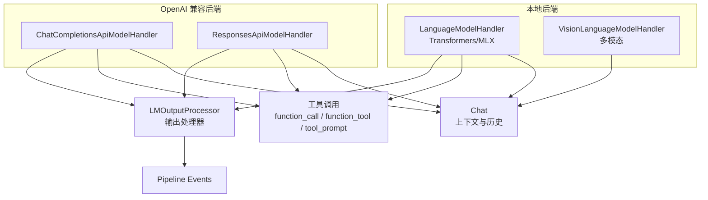
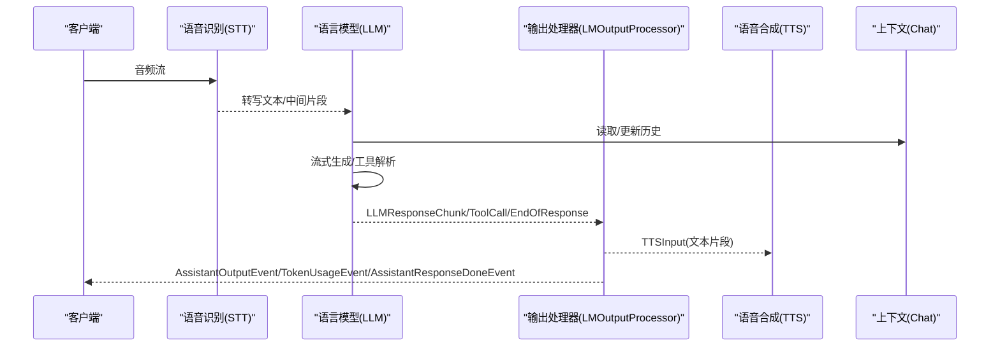
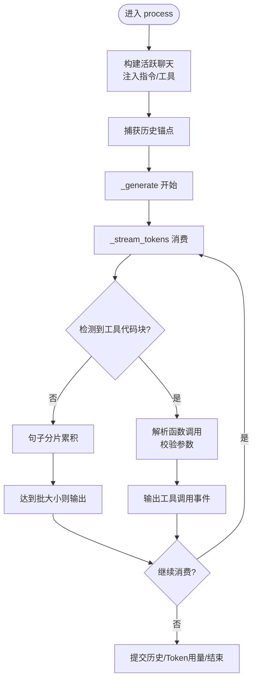
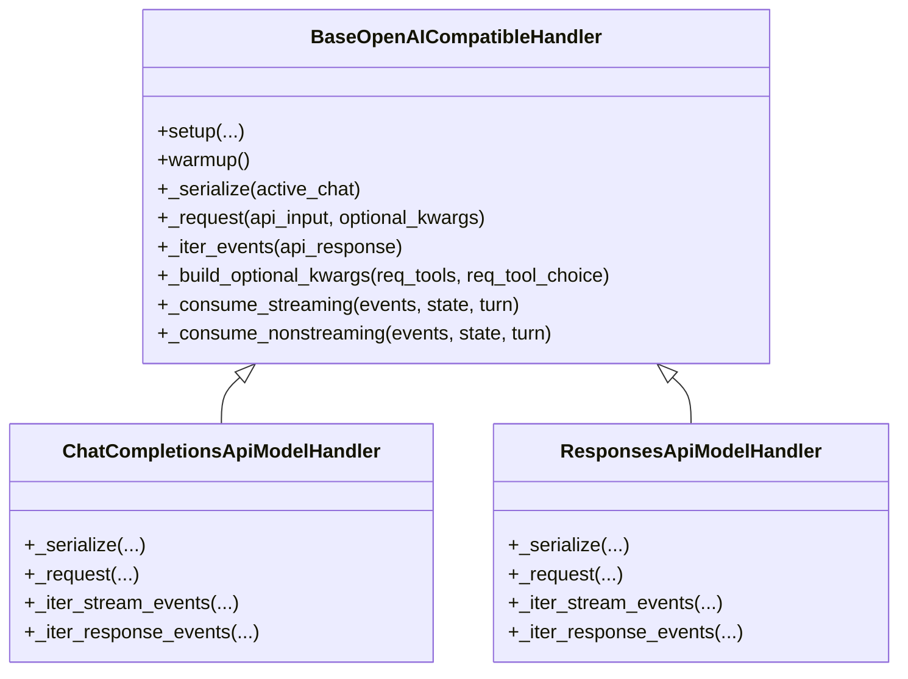
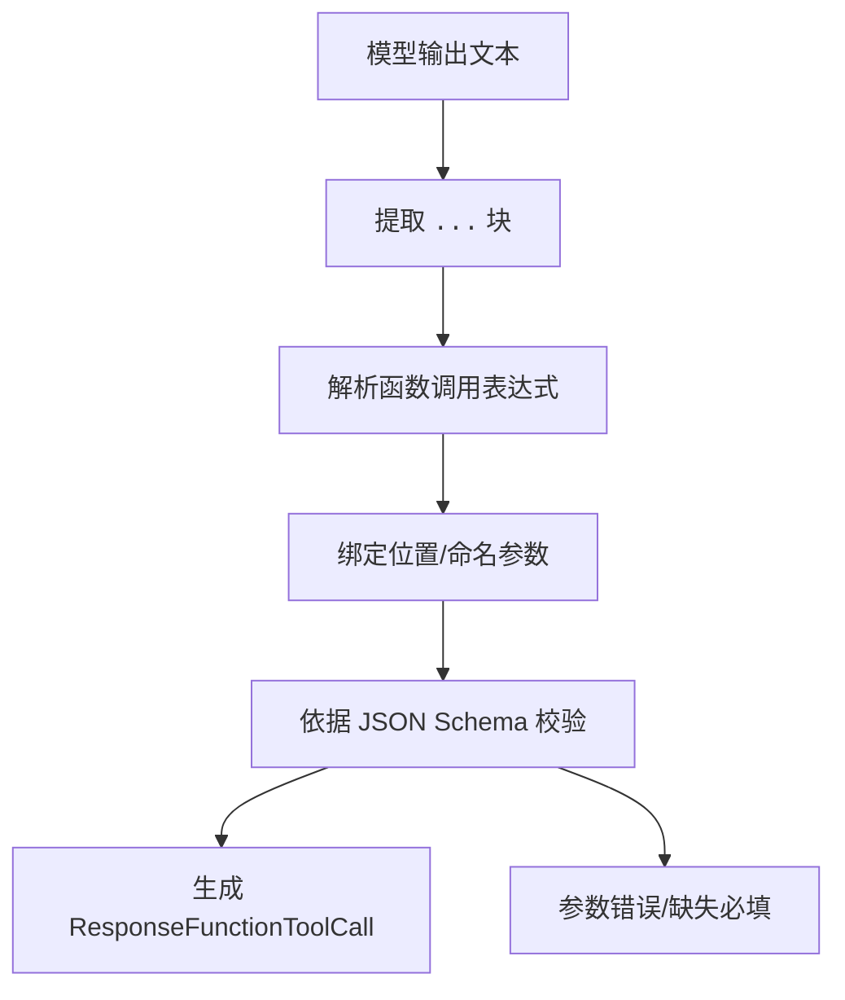
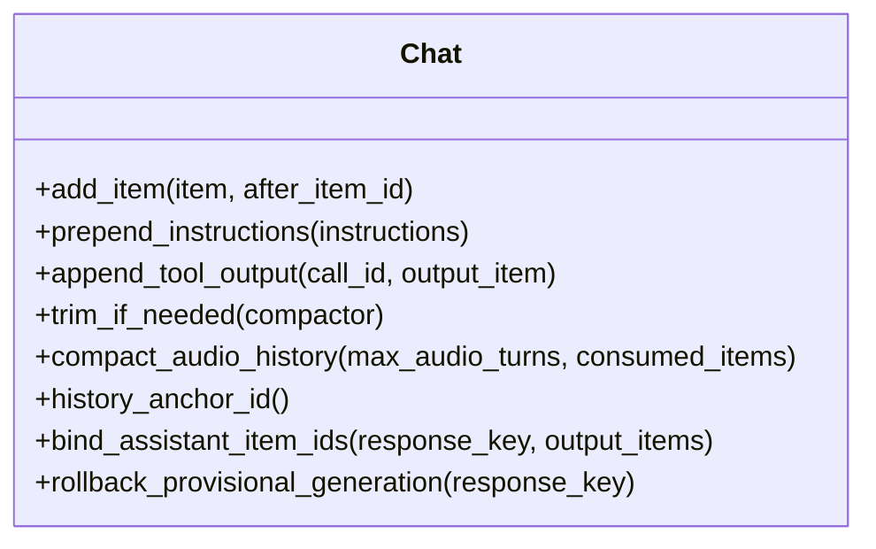
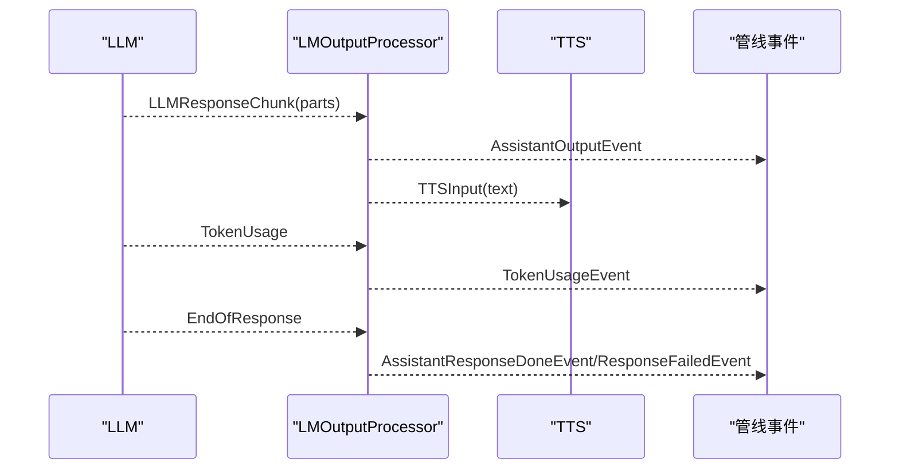
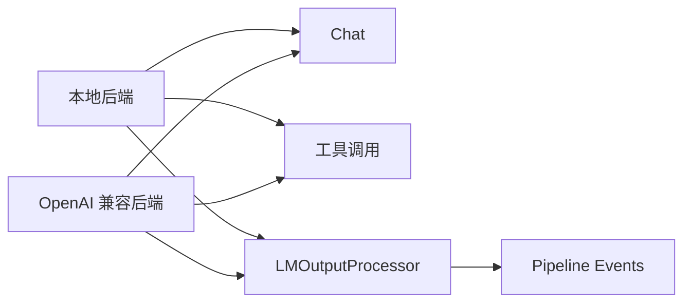

# 语言模型 (LLM)

<cite>
**本文引用的文件**   
- [language_model.py](file://src/speech_to_speech/LLM/language_model.py)
- [base_openai_compatible_language_model.py](file://src/speech_to_speech/LLM/base_openai_compatible_language_model.py)
- [chat_completions_language_model.py](file://src/speech_to_speech/LLM/chat_completions_language_model.py)
- [responses_api_language_model.py](file://src/speech_to_speech/LLM/responses_api_language_model.py)
- [chat.py](file://src/speech_to_speech/LLM/chat.py)
- [lm_output_processor.py](file://src/speech_to_speech/LLM/lm_output_processor.py)
- [function_call.py](file://src/speech_to_speech/LLM/tool_call/function_call.py)
- [function_tool.py](file://src/speech_to_speech/LLM/tool_call/function_tool.py)
- [signature_from_schema.py](file://src/speech_to_speech/LLM/tool_call/signature_from_schema.py)
- [tool_prompt.py](file://src/speech_to_speech/LLM/tool_call/tool_prompt.py)
- [events.py](file://src/speech_to_speech/pipeline/events.py)
</cite>

## 目录
1. [简介](#简介)
2. [项目结构](#项目结构)
3. [核心组件](#核心组件)
4. [架构总览](#架构总览)
5. [详细组件分析](#详细组件分析)
6. [依赖关系分析](#依赖关系分析)
7. [性能与生产环境考虑](#性能与生产环境考虑)
8. [故障排查指南](#故障排查指南)
9. [结论](#结论)
10. [附录：API 集成示例与配置要点](#附录api-集成示例与配置要点)

## 简介
本技术文档聚焦语音对话管道中的“语言模型（LLM）”子系统，解释其在端到端语音交互中的作用、处理流程与实现细节。系统支持三类后端：
- 本地推理后端：Transformers 与 MLX-LM
- OpenAI 兼容后端：Responses API 与 Chat Completions
并统一提供工具调用、函数解析与参数校验、上下文管理、消息历史、流式响应、多模态输入（文本/图像/音频）、错误处理、重试与超时等能力。

## 项目结构
LLM 子系统位于 `src/speech_to_speech/LLM`，主要模块职责如下：
- 抽象基类与通用流程
  - `BaseLanguageModelHandler`：本地 Transformers/MLX 的共享生成、流式分句、工具提取、取消与推测轮次门控。
  - `BaseOpenAICompatibleHandler`：OpenAI 兼容后端的共享请求编排、事件归一化、预取工作线程、历史写入与 Token 用量统计。
- 具体后端实现
  - `LanguageModelHandler` / `VisionLanguageModelHandler`：本地 Transformers/MLX 文本与视觉语言模型处理器。
  - `ChatCompletionsApiModelHandler`：OpenAI `/v1/chat/completions` 后端。
  - `ResponsesApiModelHandler`：OpenAI `/v1/responses` 后端。
- 工具调用
  - `function_call.py`：从模型输出中解析函数调用字符串，绑定参数并校验。
  - `function_tool.py` / `signature_from_schema.py`：将 JSON Schema 转为 Python 签名，生成代码风格提示。
  - `tool_prompt.py`：构建带分隔符的代码块指令，引导模型输出结构化工具调用。
- 上下文与历史
  - `chat.py`：会话历史、函数调用链、压缩摘要、占位与锚点定位、多模态内容过滤。
- 输出处理
  - `lm_output_processor.py`：将 LLM 输出顺序化为下游 TTS 与管线事件。
- 管线事件
  - `events.py`：Token 用量、助手完成、失败等事件定义。

**图表来源**
- [language_model.py:166-765](file://src/speech_to_speech/LLM/language_model.py#L166-L765)
- [base_openai_compatible_language_model.py:174-800](file://src/speech_to_speech/LLM/base_openai_compatible_language_model.py#L174-L800)
- [chat_completions_language_model.py:303-395](file://src/speech_to_speech/LLM/chat_completions_language_model.py#L303-L395)
- [responses_api_language_model.py:63-379](file://src/speech_to_speech/LLM/responses_api_language_model.py#L63-L379)
- [chat.py:123-800](file://src/speech_to_speech/LLM/chat.py#L123-L800)
- [lm_output_processor.py:44-308](file://src/speech_to_speech/LLM/lm_output_processor.py#L44-L308)
- [events.py:161-194](file://src/speech_to_speech/pipeline/events.py#L161-L194)

**章节来源**
- [language_model.py:166-765](file://src/speech_to_speech/LLM/language_model.py#L166-L765)
- [base_openai_compatible_language_model.py:174-800](file://src/speech_to_speech/LLM/base_openai_compatible_language_model.py#L174-L800)
- [chat_completions_language_model.py:303-395](file://src/speech_to_speech/LLM/chat_completions_language_model.py#L303-L395)
- [responses_api_language_model.py:63-379](file://src/speech_to_speech/LLM/responses_api_language_model.py#L63-L379)
- [chat.py:123-800](file://src/speech_to_speech/LLM/chat.py#L123-L800)
- [lm_output_processor.py:44-308](file://src/speech_to_speech/LLM/lm_output_processor.py#L44-L308)
- [events.py:161-194](file://src/speech_to_speech/pipeline/events.py#L161-L194)

## 核心组件
- 本地后端基类 `BaseLanguageModelHandler`
  - 负责加载模型、流式 token 消费、句子级分片、工具代码块解析、历史快照与回写、推测轮次门控、取消与停止信号。
- OpenAI 兼容后端基类 `BaseOpenAICompatibleHandler`
  - 负责建立 HTTP 客户端、预热、序列化聊天、发起请求、归一化 ProviderEvent、预取工作线程、中断与陈旧轮次丢弃、历史写入与 Token 用量。
- 具体后端
  - `LanguageModelHandler` / `VisionLanguageModelHandler`：封装 Transformers/MLX 的模型加载与生成。
  - `ChatCompletionsApiModelHandler`：适配 `/v1/chat/completions`，包括工具格式转换、流与非流事件映射。
  - `ResponsesApiModelHandler`：适配 `/v1/responses`，包括 Responses 事件流、工具安全化、历史项顺序追踪。
- 工具调用
  - 从模型输出的 `<code>...</code>` 块中提取函数调用，按 JSON Schema 校验参数，生成 Realtime 工具调用对象。
- 上下文与历史
  - `Chat` 维护会话缓冲、函数调用链、压缩摘要、锚点定位、多模态内容过滤与清理。
- 输出处理器
  - `LMOutputProcessor` 将 LLM 输出顺序化为 TTS 输入与管线事件，支持语言检测与响应生命周期管理。

**章节来源**
- [language_model.py:166-765](file://src/speech_to_speech/LLM/language_model.py#L166-L765)
- [base_openai_compatible_language_model.py:174-800](file://src/speech_to_speech/LLM/base_openai_compatible_language_model.py#L174-L800)
- [chat_completions_language_model.py:303-395](file://src/speech_to_speech/LLM/chat_completions_language_model.py#L303-L395)
- [responses_api_language_model.py:63-379](file://src/speech_to_speech/LLM/responses_api_language_model.py#L63-L379)
- [chat.py:123-800](file://src/speech_to_speech/LLM/chat.py#L123-L800)
- [lm_output_processor.py:44-308](file://src/speech_to_speech/LLM/lm_output_processor.py#L44-L308)

## 架构总览
下图展示语音对话管道中 LLM 的核心数据流与控制流：用户输入经 STT/VAD 进入 LLM，LLM 根据后端类型执行本地或远程推理，输出文本/工具调用，由输出处理器转发至 TTS 与管线事件。

**图表来源**
- [language_model.py:560-765](file://src/speech_to_speech/LLM/language_model.py#L560-L765)
- [base_openai_compatible_language_model.py:615-800](file://src/speech_to_speech/LLM/base_openai_compatible_language_model.py#L615-L800)
- [lm_output_processor.py:134-308](file://src/speech_to_speech/LLM/lm_output_processor.py#L134-L308)
- [chat.py:123-800](file://src/speech_to_speech/LLM/chat.py#L123-L800)

## 详细组件分析

### 本地后端：Transformers 与 MLX
- 设计模式
  - 抽象基类 `BaseLanguageModelHandler` 定义 `_load_model` 与 `_generate` 钩子，子类实现具体加载与生成逻辑。
  - 通过 `StreamContext` 累积生成状态、工具调用、句子批次、时间戳与取消标志。
- 关键流程
  - `process` 入口：校验请求、构造活跃聊天、注入指令与工具、捕获历史锚点、启动生成、流式消费、最终提交历史与 Token 用量。
  - `_stream_tokens`：消费 token 迭代器，累积原始文本与清洗文本，按句子分批输出；遇到工具代码块时解析并产出工具调用。
  - 取消与停止：检查预取事务丢弃、陈旧生成号、最新轮次门控、停止事件。
- 多模态
  - `VisionLanguageModelHandler` 扩展视觉输入处理，使用 Processor/Tokenizer 与 VLM 后端。
- 资源释放
  - `_finish_mlx_generation` 关闭 MLX 生成器；`_finish_transformers_generation` 触发停止条件、排空流、join 线程。

**图表来源**
- [language_model.py:560-765](file://src/speech_to_speech/LLM/language_model.py#L560-L765)
- [language_model.py:486-554](file://src/speech_to_speech/LLM/language_model.py#L486-L554)

**章节来源**
- [language_model.py:166-765](file://src/speech_to_speech/LLM/language_model.py#L166-L765)

### OpenAI 兼容后端：Responses 与 Chat Completions
- 设计模式
  - `BaseOpenAICompatibleHandler` 定义预热、序列化、请求、事件迭代、可选参数构建等钩子；子类实现具体协议差异。
  - 将不同后端的事件统一为 `ProviderEvent`（TextDelta、AssistantMessage、ToolCall、Usage、ProviderResponseEnd）。
- 关键流程
  - `_consume_streaming` / `_consume_nonstreaming`：消费事件流，累积文本、工具调用与用量，按句子分片输出，处理终止事件。
  - 预取工作线程：在受限槽位下并发连接上游，支持中断与原子 claim/discard。
  - 历史写入：记录助手消息、推理项、工具调用，并在结束时提交完整历史。
- 工具调用
  - Chat Completions：从 `choices[].delta.tool_calls` 聚合工具增量，组装为标准化 `ToolCall`。
  - Responses：从 `response.output_item.done` 等事件提取工具调用，维护历史项顺序。
- 音频输入
  - 支持 `input_audio` 与 `audio_url` 两种内容类型，自动设置 `max_tokens` 与 `temperature`。

**图表来源**
- [base_openai_compatible_language_model.py:174-800](file://src/speech_to_speech/LLM/base_openai_compatible_language_model.py#L174-L800)
- [chat_completions_language_model.py:303-395](file://src/speech_to_speech/LLM/chat_completions_language_model.py#L303-L395)
- [responses_api_language_model.py:63-379](file://src/speech_to_speech/LLM/responses_api_language_model.py#L63-L379)

**章节来源**
- [base_openai_compatible_language_model.py:174-800](file://src/speech_to_speech/LLM/base_openai_compatible_language_model.py#L174-L800)
- [chat_completions_language_model.py:303-395](file://src/speech_to_speech/LLM/chat_completions_language_model.py#L303-L395)
- [responses_api_language_model.py:63-379](file://src/speech_to_speech/LLM/responses_api_language_model.py#L63-L379)

### 工具调用机制：函数解析与参数校验
- 解析流程
  - 从模型输出的 `<code>...</code>` 块中提取函数调用字符串。
  - 使用 tokenizer/AST 解析表达式，支持嵌套括号、字符串包含特殊字符。
  - 将位置参数与命名参数映射到 JSON Schema 定义的参数名，校验必填字段与类型。
- 参数校验
  - 基于 `signature_from_schema` 将 JSON Schema 转为 Python 签名，确保必需参数在前、默认值在后。
  - 对未声明参数进行警告并丢弃；对缺失必填参数抛出错误。
- 提示工程
  - `tool_prompt.py` 渲染工具可用列表与调用规则，引导模型以代码块形式输出结构化调用。
  - `function_tool.py` 生成代码风格函数签名与文档，增强模型理解。

**图表来源**
- [function_call.py:296-330](file://src/speech_to_speech/LLM/tool_call/function_call.py#L296-L330)
- [function_call.py:103-183](file://src/speech_to_speech/LLM/tool_call/function_call.py#L103-L183)
- [signature_from_schema.py:79-125](file://src/speech_to_speech/LLM/tool_call/signature_from_schema.py#L79-L125)
- [tool_prompt.py:76-110](file://src/speech_to_speech/LLM/tool_call/tool_prompt.py#L76-L110)

**章节来源**
- [function_call.py:1-330](file://src/speech_to_speech/LLM/tool_call/function_call.py#L1-L330)
- [function_tool.py:1-35](file://src/speech_to_speech/LLM/tool_call/function_tool.py#L1-L35)
- [signature_from_schema.py:1-125](file://src/speech_to_speech/LLM/tool_call/signature_from_schema.py#L1-L125)
- [tool_prompt.py:1-110](file://src/speech_to_speech/LLM/tool_call/tool_prompt.py#L1-L110)

### 上下文管理与消息历史
- `Chat` 维护会话缓冲，支持：
  - 多模态内容过滤（仅保留 input_text/input_image/input_audio）。
  - 函数调用链跟踪与结果回填，即使调用被回收也能重新注入。
  - 历史锚点定位，保证生成输出插入到正确轮次位置。
  - 压缩摘要（compactor），后台线程总结旧轮次，避免 OOM。
  - 临时生成项追踪与回滚，支持推测轮次与快速客户端提前返回工具结果。
- 音频历史压缩：将旧音频替换为文本占位，保持角色与配对助手回复有效。

**图表来源**
- [chat.py:123-800](file://src/speech_to_speech/LLM/chat.py#L123-L800)

**章节来源**
- [chat.py:123-800](file://src/speech_to_speech/LLM/chat.py#L123-L800)

### 流式响应处理与输出处理器
- `LMOutputProcessor` 将 LLM 输出顺序化为：
  - `AssistantOutputEvent`：助手文本/工具调用部分。
  - `TTSInput`：文本片段，用于 TTS 合成。
  - `TokenUsageEvent`：Token 用量统计。
  - `AssistantResponseDoneEvent` / `ResponseFailedEvent`：响应完成或失败。
- 语言检测：可启用助手语言检测，动态选择 TTS 语言。
- 响应生命周期：维护 response_key、工具调用 ID 序列、输出序号，确保顺序一致。

**图表来源**
- [lm_output_processor.py:134-308](file://src/speech_to_speech/LLM/lm_output_processor.py#L134-L308)
- [events.py:161-194](file://src/speech_to_speech/pipeline/events.py#L161-L194)

**章节来源**
- [lm_output_processor.py:44-308](file://src/speech_to_speech/LLM/lm_output_processor.py#L44-L308)
- [events.py:161-194](file://src/speech_to_speech/pipeline/events.py#L161-L194)

## 依赖关系分析
- 组件耦合
  - 本地后端与 OpenAI 兼容后端均依赖 `Chat` 进行上下文管理。
  - 工具调用模块被本地后端与 OpenAI 兼容后端共同使用。
  - 输出处理器依赖 LLM 输出与管线事件。
- 外部依赖
  - Transformers/MLX：本地推理引擎。
  - OpenAI SDK：HTTP 客户端与类型定义。
  - NLTK/Jinja2：句子分词与模板渲染。

**图表来源**
- [language_model.py:166-765](file://src/speech_to_speech/LLM/language_model.py#L166-L765)
- [base_openai_compatible_language_model.py:174-800](file://src/speech_to_speech/LLM/base_openai_compatible_language_model.py#L174-L800)
- [lm_output_processor.py:44-308](file://src/speech_to_speech/LLM/lm_output_processor.py#L44-L308)

**章节来源**
- [language_model.py:166-765](file://src/speech_to_speech/LLM/language_model.py#L166-L765)
- [base_openai_compatible_language_model.py:174-800](file://src/speech_to_speech/LLM/base_openai_compatible_language_model.py#L174-L800)
- [lm_output_processor.py:44-308](file://src/speech_to_speech/LLM/lm_output_processor.py#L44-L308)

## 性能与生产环境考虑
- 模型选择指南
  - 本地部署：优先 Transformers（GPU/CPU）或 MLX（Apple Silicon），根据硬件与延迟需求选择。
  - 云端 API：Responses API 提供更丰富的原生工具与推理项；Chat Completions 更成熟稳定。
- 优化建议
  - 流式分句：调整 `stream_batch_sentences` 平衡延迟与吞吐。
  - 历史压缩：启用 `compact_history` 减少上下文长度，降低 Token 成本。
  - 音频参数：合理设置 `audio_max_tokens` 与 `audio_temperature`。
  - 预取工作线程：限制并发数，避免上游过载。
- 错误处理与重试
  - 上游不可用：提供 `provider_unavailable_message` 作为播报文本。
  - 超时管理：`request_timeout_s` 与 connect 超时分离。
  - 重试机制：预热阶段使用 `WARMUP_MAX_RETRIES`。
- 资源管理
  - 本地后端：显式关闭 MLX 生成器与 Transformers 流线程。
  - OpenAI 兼容后端：关闭 HTTP 客户端，释放连接。

[本节为通用指导，不直接分析具体文件]

## 故障排查指南
- 常见问题
  - 工具调用解析失败：检查模型输出是否包含 `<code>...</code>` 块，确认 JSON Schema 必填字段。
  - 历史错位：确认历史锚点与临时生成项回滚逻辑。
  - 流式卡顿：检查句子分片批大小与下游 TTS 处理能力。
  - 上游超时：调整 `request_timeout_s`，检查网络与服务商状态。
- 日志与调试
  - 启用转录日志与异常记录，查看 `log_exception` 与 `transcript_for_log`。
  - 输出处理器日志：观察 `LM processor: parts=...` 与 TTS 转发信息。

**章节来源**
- [language_model.py:735-751](file://src/speech_to_speech/LLM/language_model.py#L735-L751)
- [lm_output_processor.py:221-258](file://src/speech_to_speech/LLM/lm_output_processor.py#L221-L258)

## 结论
LLM 子系统通过统一的抽象层整合了本地与云端多种后端，提供了稳健的工具调用、上下文管理、流式响应与多模态支持。在生产环境中，应结合硬件与延迟需求选择合适的后端，合理配置流式分句、历史压缩与超时重试，确保系统稳定高效运行。

[本节为总结性内容，不直接分析具体文件]

## 附录：API 集成示例与配置要点
- OpenAI 兼容后端配置
  - `base_url`：指向兼容服务器（如 vLLM、HF Router）。
  - `api_key`：若本地服务可省略或使用占位符。
  - `stream`：启用流式响应以获得更低首字延迟。
  - `disable_thinking` / `reasoning_effort`：控制推理开关与强度。
- 工具调用配置
  - `tools`：函数工具列表，包含名称、描述与 JSON Schema。
  - `tool_choice`：auto/required/none 或强制函数。
- 音频输入配置
  - `audio_content_type`：`input_audio` 或 `audio_url`。
  - `audio_history_turns`：保留最近几轮音频上下文。

[本节为概念性说明，不直接分析具体文件]