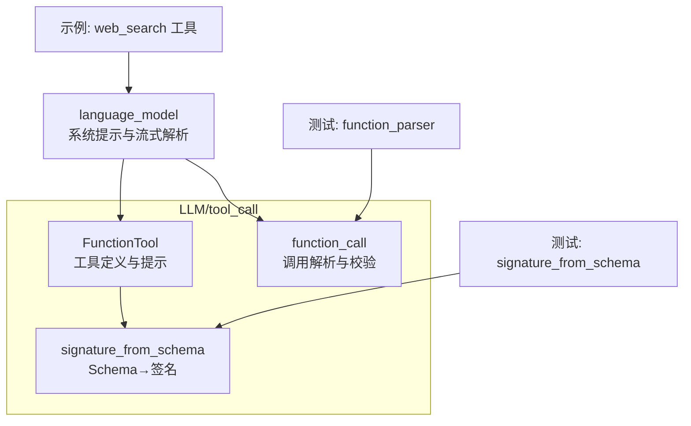
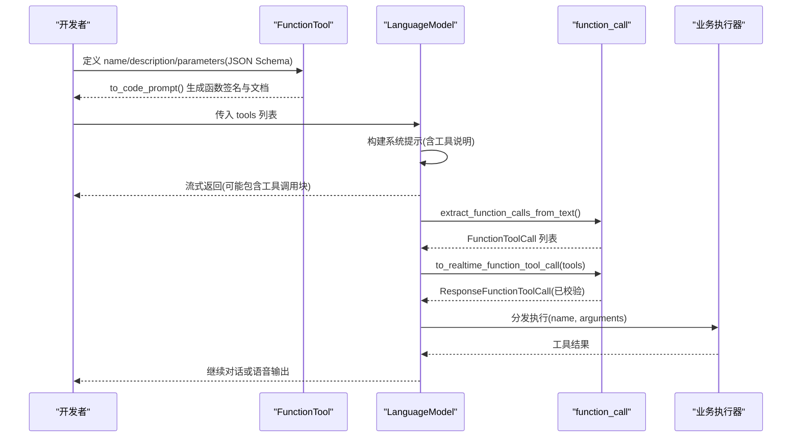
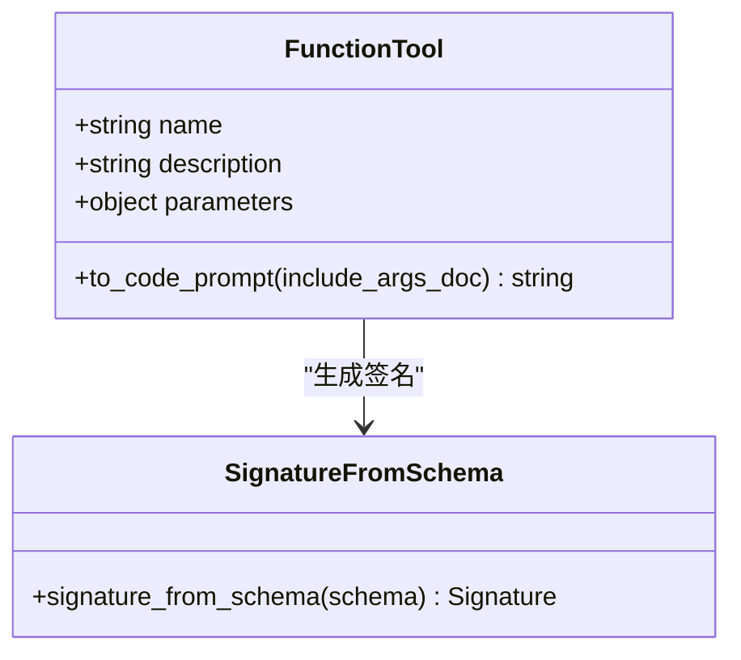
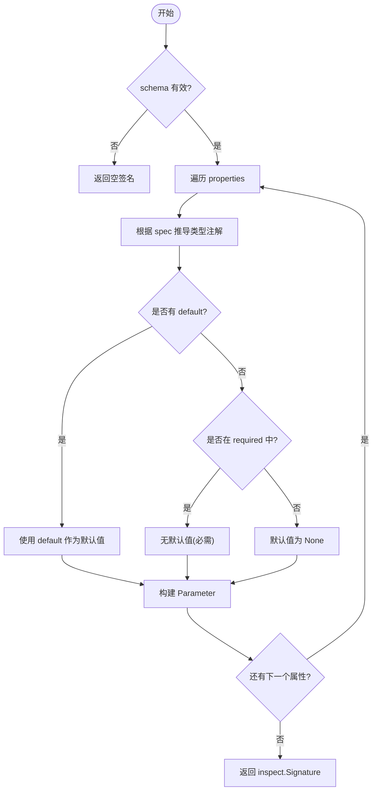
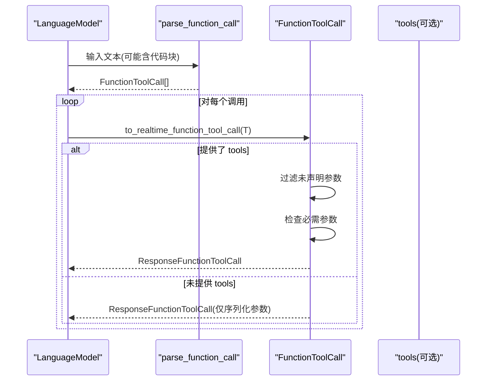
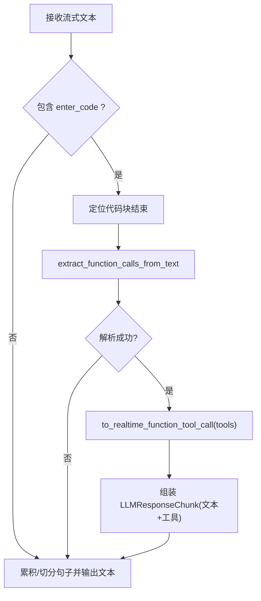
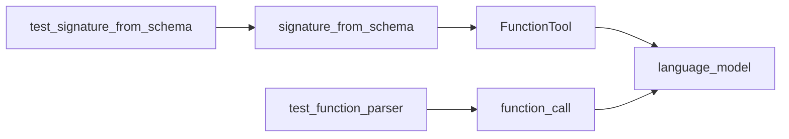

# 函数定义与声明

<cite>
**本文引用的文件**
- [function_tool.py](file://src/speech_to_speech/LLM/tool_call/function_tool.py)
- [signature_from_schema.py](file://src/speech_to_speech/LLM/tool_call/signature_from_schema.py)
- [function_call.py](file://src/speech_to_speech/LLM/tool_call/function_call.py)
- [language_model.py](file://src/speech_to_speech/LLM/language_model.py)
- [realtime_web_search_tool.py](file://examples/realtime_web_search_tool.py)
- [test_signature_from_schema.py](file://tests/tool_call/test_signature_from_schema.py)
- [test_function_parser.py](file://tests/tool_call/test_function_parser.py)
</cite>

## 目录
1. [简介](#简介)
2. [项目结构](#项目结构)
3. [核心组件](#核心组件)
4. [架构总览](#架构总览)
5. [详细组件分析](#详细组件分析)
6. [依赖关系分析](#依赖关系分析)
7. [性能考虑](#性能考虑)
8. [故障排查指南](#故障排查指南)
9. [结论](#结论)
10. [附录](#附录)

## 简介
本文件面向“函数工具”的定义、声明与使用，聚焦 FunctionTool 类及其配套能力：如何基于 JSON Schema 自动生成函数签名；如何配置工具元数据（名称、描述、参数结构、必需/可选参数、默认值、类型验证）；如何通过解析器将模型输出的函数调用字符串转换为可执行的工具调用；以及如何在系统中集成工具并处理版本与向后兼容。

## 项目结构
围绕函数工具的核心代码位于 LLM/tool_call 目录下，包含：
- 工具定义与提示生成：FunctionTool 及签名生成
- 调用解析与校验：从文本中解析函数调用并进行参数校验
- 系统集成：语言模型层将工具注入系统提示、解析流式输出中的工具调用

图表来源
- [function_tool.py:8-34](file://src/speech_to_speech/LLM/tool_call/function_tool.py#L8-L34)
- [signature_from_schema.py:79-108](file://src/speech_to_speech/LLM/tool_call/signature_from_schema.py#L79-L108)
- [function_call.py:183-237](file://src/speech_to_speech/LLM/tool_call/function_call.py#L183-L237)
- [language_model.py:280-320](file://src/speech_to_speech/LLM/language_model.py#L280-L320)

章节来源
- [function_tool.py:8-34](file://src/speech_to_speech/LLM/tool_call/function_tool.py#L8-L34)
- [signature_from_schema.py:79-108](file://src/speech_to_speech/LLM/tool_call/signature_from_schema.py#L79-L108)
- [function_call.py:183-237](file://src/speech_to_speech/LLM/tool_call/function_call.py#L183-L237)
- [language_model.py:280-320](file://src/speech_to_speech/LLM/language_model.py#L280-L320)

## 核心组件
- FunctionTool：继承自实时函数工具基类，提供 to_code_prompt 方法，根据工具的 parameters（JSON Schema）生成带类型注解的函数签名与文档字符串，便于向模型展示工具接口。
- signature_from_schema：将 JSON Schema 的属性映射为 Python 类型注解，支持 string/number/integer/boolean/object/array/null、enum/const、anyOf/oneOf/allOf、数组 items、nullable 等，并依据 required 与 default 生成 inspect.Signature。
- function_call：提供从模型输出文本中解析函数调用的能力，构造 FunctionToolCall，并在存在工具列表时进行参数白名单过滤、必需参数校验，最终转为标准响应对象。

章节来源
- [function_tool.py:8-34](file://src/speech_to_speech/LLM/tool_call/function_tool.py#L8-L34)
- [signature_from_schema.py:23-108](file://src/speech_to_speech/LLM/tool_call/signature_from_schema.py#L23-L108)
- [function_call.py:183-237](file://src/speech_to_speech/LLM/tool_call/function_call.py#L183-L237)

## 架构总览
下图展示了从工具定义到模型调用再到结果处理的完整流程：

图表来源
- [function_tool.py:8-34](file://src/speech_to_speech/LLM/tool_call/function_tool.py#L8-L34)
- [function_call.py:243-321](file://src/speech_to_speech/LLM/tool_call/function_call.py#L243-L321)
- [language_model.py:280-424](file://src/speech_to_speech/LLM/language_model.py#L280-L424)

## 详细组件分析

### FunctionTool：工具定义与提示生成
- 作用：封装工具的名称、描述、参数结构，并提供 to_code_prompt 方法，将 JSON Schema 转换为带类型注解的函数签名和文档字符串，便于在系统提示中向模型展示工具接口。
- 关键行为：
  - 通过 signature_from_schema 将 parameters 转换为 inspect.Signature
  - 若 include_args_doc=True，会从 properties 中提取每个参数的 description，拼入 docstring
  - 返回形如 def name(...) 的函数头与缩进的文档字符串

图表来源
- [function_tool.py:8-34](file://src/speech_to_speech/LLM/tool_call/function_tool.py#L8-L34)
- [signature_from_schema.py:79-108](file://src/speech_to_speech/LLM/tool_call/signature_from_schema.py#L79-L108)

章节来源
- [function_tool.py:8-34](file://src/speech_to_speech/LLM/tool_call/function_tool.py#L8-L34)
- [test_signature_from_schema.py:184-243](file://tests/tool_call/test_signature_from_schema.py#L184-L243)

### signature_from_schema：基于 JSON Schema 生成函数签名
- 类型映射：string→str、number→float、integer→int、boolean→bool、object→dict、array→list、null→None
- 高级特性：
  - enum → Literal[...]
  - const → Literal[常量]
  - anyOf/oneOf → Union[...]
  - allOf → 合并子 schema 后递归解析
  - array with items → list[item_type]
  - type 为 ["string","null"] → Optional[str]
- 参数默认值与必需性：
  - required 字段决定参数是否必需
  - 若属性有 default，则即使标记为 required，也使用该默认值
  - 未指定 default 且非必需的参数默认值为 None

图表来源
- [signature_from_schema.py:23-108](file://src/speech_to_speech/LLM/tool_call/signature_from_schema.py#L23-L108)

章节来源
- [signature_from_schema.py:23-108](file://src/speech_to_speech/LLM/tool_call/signature_from_schema.py#L23-L108)
- [test_signature_from_schema.py:9-179](file://tests/tool_call/test_signature_from_schema.py#L9-L179)

### function_call：调用解析与参数校验
- 解析能力：
  - 使用 tokenize+ast 安全拆分顶层函数调用，支持嵌套括号、字符串内括号、元组/字典等复杂结构
  - 当 token 化失败时回退到正则提取简单调用
  - 支持从带代码块的文本中提取函数调用，并剥离代码块内容
- 数据结构：
  - FunctionToolCall：包含 function_name、parameters、original_string、description
- 校验与转换：
  - 去除位置参数占位符 __arg_i__
  - 若提供 tools 列表，会按工具 schema 过滤未声明参数
  - 校验必需参数是否缺失，缺失则抛出异常
  - 转换为 ResponseFunctionToolCall 用于后续执行

图表来源
- [function_call.py:36-114](file://src/speech_to_speech/LLM/tool_call/function_call.py#L36-L114)
- [function_call.py:183-237](file://src/speech_to_speech/LLM/tool_call/function_call.py#L183-L237)
- [function_call.py:243-321](file://src/speech_to_speech/LLM/tool_call/function_call.py#L243-L321)

章节来源
- [function_call.py:36-114](file://src/speech_to_speech/LLM/tool_call/function_call.py#L36-L114)
- [function_call.py:183-237](file://src/speech_to_speech/LLM/tool_call/function_call.py#L183-L237)
- [function_call.py:243-321](file://src/speech_to_speech/LLM/tool_call/function_call.py#L243-L321)
- [test_function_parser.py:18-210](file://tests/tool_call/test_function_parser.py#L18-L210)
- [test_function_parser.py:218-286](file://tests/tool_call/test_function_parser.py#L218-L286)

### 系统集成：语言模型层工具注入与流式解析
- 工具注入：
  - 将 raw_tools 中 type="function" 的条目转换为 FunctionTool 列表
  - 若启用 tool_choice 不为 none，则构建包含工具说明的系统提示
  - 将 block_regex、enter_code、end_code 写入上下文，用于识别模型输出的工具调用块
- 流式解析：
  - 遇到 enter_code/end_code 包裹的代码块时，提取内部函数调用
  - 调用 parse_function_call 得到 FunctionToolCall
  - 通过 to_realtime_function_tool_call 完成参数校验并产出标准调用对象
  - 将工具调用与文本分片组合成响应块

图表来源
- [language_model.py:280-424](file://src/speech_to_speech/LLM/language_model.py#L280-L424)

章节来源
- [language_model.py:280-424](file://src/speech_to_speech/LLM/language_model.py#L280-L424)

### 工具定义示例：Web 搜索工具
- 工具声明：以 JSON Schema 形式定义 name、description、parameters（properties、required、additionalProperties）
- 执行逻辑：根据 name 路由到具体实现，校验参数，调用外部 API，返回结构化结果
- 该示例展示了从声明到执行的完整闭环，可作为复杂业务逻辑的模板

章节来源
- [realtime_web_search_tool.py:20-118](file://examples/realtime_web_search_tool.py#L20-L118)

## 依赖关系分析
- FunctionTool 依赖 signature_from_schema 生成签名
- language_model 依赖 FunctionTool 与 function_call 完成工具注入与解析
- 测试覆盖类型推导、签名生成、调用解析与参数校验

图表来源
- [function_tool.py:8-34](file://src/speech_to_speech/LLM/tool_call/function_tool.py#L8-L34)
- [signature_from_schema.py:79-108](file://src/speech_to_speech/LLM/tool_call/signature_from_schema.py#L79-L108)
- [function_call.py:183-237](file://src/speech_to_speech/LLM/tool_call/function_call.py#L183-L237)
- [language_model.py:280-320](file://src/speech_to_speech/LLM/language_model.py#L280-L320)

章节来源
- [function_tool.py:8-34](file://src/speech_to_speech/LLM/tool_call/function_tool.py#L8-L34)
- [signature_from_schema.py:79-108](file://src/speech_to_speech/LLM/tool_call/signature_from_schema.py#L79-L108)
- [function_call.py:183-237](file://src/speech_to_speech/LLM/tool_call/function_call.py#L183-L237)
- [language_model.py:280-320](file://src/speech_to_speech/LLM/language_model.py#L280-L320)

## 性能考虑
- 提示长度控制：to_code_prompt 的 include_args_doc 会增加 token 消耗，应根据模型上下文限制与能力权衡开启
- 解析效率：优先使用 tokenize+ast 解析，tokenize 失败时回退正则，避免整体失败
- 参数校验：仅在提供 tools 列表时进行白名单与必需参数校验，减少不必要的计算
- 流式处理：语言模型层按句子批处理与代码块边界切分，降低延迟

## 故障排查指南
- 参数缺失：当必需参数未在调用中提供时，to_realtime_function_tool_call 会抛出异常，需检查工具 schema 的 required 与调用参数
- 未声明参数：超出 schema 定义的参数会被丢弃并记录警告，确保调用参数与 schema 一致
- 位置参数：位置参数会以 __arg_i__ 形式保留，随后被丢弃；建议使用命名参数
- 解析失败：若代码块不完整或语法错误，会尝试正则回退；仍失败则忽略该块，不影响其他调用
- 外部服务错误：示例工具对外部 HTTP 请求的错误进行了捕获与友好返回，建议类似地处理网络异常

章节来源
- [function_call.py:191-237](file://src/speech_to_speech/LLM/tool_call/function_call.py#L191-L237)
- [function_call.py:243-321](file://src/speech_to_speech/LLM/tool_call/function_call.py#L243-L321)
- [realtime_web_search_tool.py:44-118](file://examples/realtime_web_search_tool.py#L44-L118)

## 结论
本项目提供了完整的函数工具生命周期：从基于 JSON Schema 的类型化声明、自动签名生成、到模型输出解析与参数校验，再到系统集成与流式处理。通过 FunctionTool 与 signature_from_schema，开发者可以以声明式方式定义工具，获得强类型的函数签名与清晰的文档；通过 function_call，系统能稳健地从模型输出中提取并校验工具调用；语言模型层则将工具无缝融入对话流程。建议在复杂业务中结合示例工具的模式，完善错误处理与日志记录，并谨慎控制提示长度以提升性能。

## 附录

### 工具元数据配置选项速查
- 名称与描述：name、description
- 参数结构：parameters.type=object，properties 定义各参数类型与描述
- 必需参数：required 列出必填字段
- 默认值：在对应属性的 schema 中设置 default
- 类型验证：
  - 基础类型：string/number/integer/boolean/object/array/null
  - 枚举：enum
  - 联合类型：anyOf/oneOf
  - 可空：type=["string","null"]
  - 数组元素：items

章节来源
- [signature_from_schema.py:23-108](file://src/speech_to_speech/LLM/tool_call/signature_from_schema.py#L23-L108)
- [test_signature_from_schema.py:9-179](file://tests/tool_call/test_signature_from_schema.py#L9-L179)

### 装饰器与工厂模式建议
- 当前仓库未提供内置装饰器或工厂来创建 FunctionTool；可通过封装工厂函数简化重复的 schema 构建与实例化
- 建议将常用工具封装为工厂函数，统一生成 name、description、parameters，并集中管理版本信息

[本节为通用实践建议，不直接分析具体文件]

### 版本管理与向后兼容
- 在 parameters.properties 中新增可选参数时，保持 backward compatible（不破坏现有调用）
- 修改必需参数或类型时，应引入版本号策略（例如在工具名或 schema 中体现），并通过条件分支兼容旧版调用
- 在 to_realtime_function_tool_call 中，可根据工具版本选择不同校验规则或参数映射

[本节为通用实践建议，不直接分析具体文件]