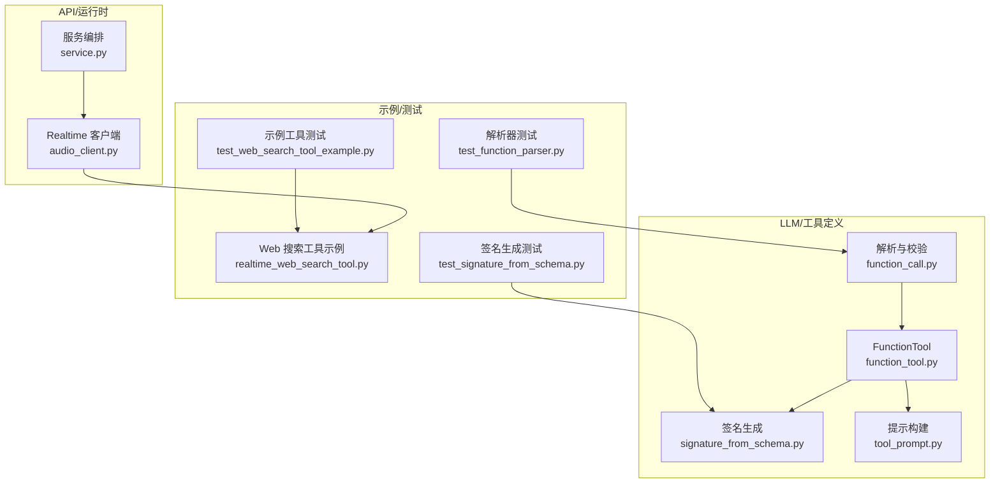
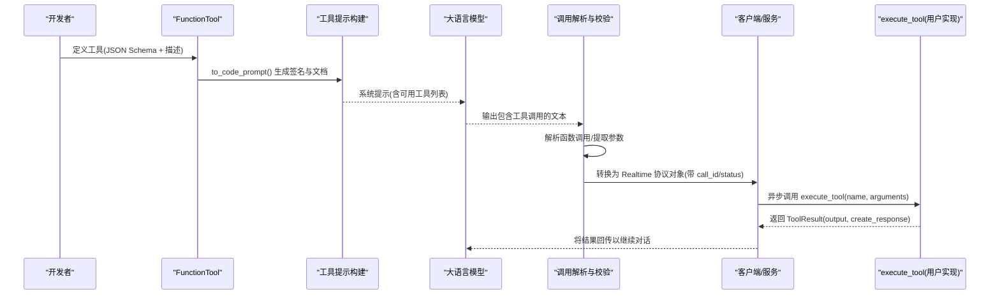
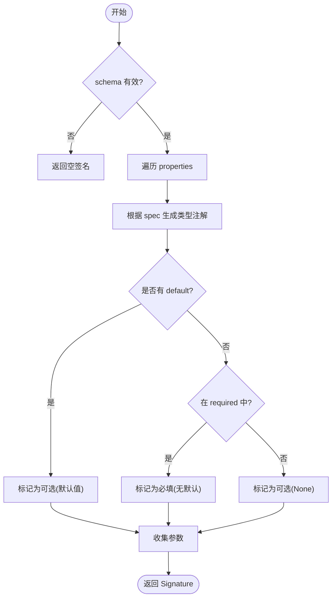
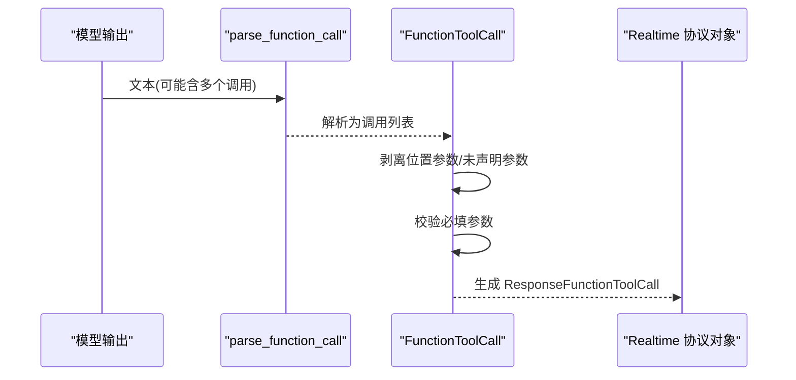
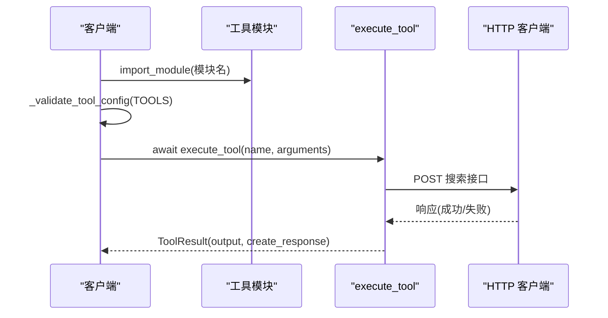
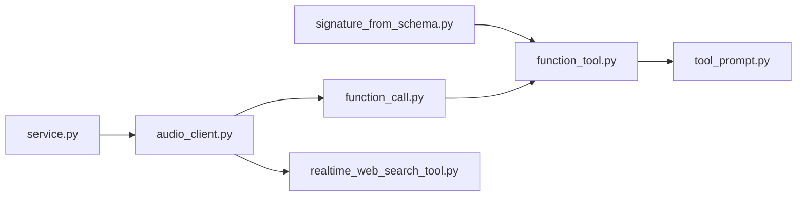

# 工具调用系统

<cite>
**本文引用的文件**
- [function_tool.py](file://src/speech_to_speech/LLM/tool_call/function_tool.py)
- [signature_from_schema.py](file://src/speech_to_speech/LLM/tool_call/signature_from_schema.py)
- [tool_prompt.py](file://src/speech_to_speech/LLM/tool_call/tool_prompt.py)
- [function_call.py](file://src/speech_to_speech/LLM/tool_call/function_call.py)
- [realtime_web_search_tool.py](file://examples/realtime_web_search_tool.py)
- [audio_client.py](file://src/speech_to_speech/api/openai_realtime/audio_client.py)
- [service.py](file://src/speech_to_speech/api/openai_realtime/service.py)
- [test_function_parser.py](file://tests/tool_call/test_function_parser.py)
- [test_signature_from_schema.py](file://tests/tool_call/test_signature_from_schema.py)
- [test_web_search_tool_example.py](file://tests/openai_realtime/test_web_search_tool_example.py)
</cite>

## 目录
1. [简介](#简介)
2. [项目结构](#项目结构)
3. [核心组件](#核心组件)
4. [架构总览](#架构总览)
5. [详细组件分析](#详细组件分析)
6. [依赖关系分析](#依赖关系分析)
7. [性能考虑](#性能考虑)
8. [故障排查指南](#故障排查指南)
9. [结论](#结论)
10. [附录](#附录)

## 简介
本文件面向“工具调用系统”的完整说明，聚焦 FunctionTool 类的实现与使用、函数签名自动生成机制（基于 JSON Schema）、工具调用的执行流程（参数验证、异步调用、结果处理）、自定义工具创建示例（HTTP 请求、数据库操作、文件处理等）、安全考量（权限控制与输入验证）、在对话中嵌入工具调用及结果处理、工具的注册/发现/版本管理，以及调试与监控方法。内容严格基于仓库中的源码与测试用例进行归纳与可视化。

## 项目结构
工具调用相关代码主要位于 LLM 子模块的 tool_call 目录，并在 API 层通过 Realtime 客户端与服务端集成；示例与测试提供了端到端的用法与验证。

图表来源
- [function_tool.py:8-34](file://src/speech_to_speech/LLM/tool_call/function_tool.py#L8-L34)
- [signature_from_schema.py:79-108](file://src/speech_to_speech/LLM/tool_call/signature_from_schema.py#L79-L108)
- [tool_prompt.py:76-109](file://src/speech_to_speech/LLM/tool_call/tool_prompt.py#L76-L109)
- [function_call.py:183-321](file://src/speech_to_speech/LLM/tool_call/function_call.py#L183-L321)
- [audio_client.py:76-119](file://src/speech_to_speech/api/openai_realtime/audio_client.py#L76-L119)
- [service.py:138-177](file://src/speech_to_speech/api/openai_realtime/service.py#L138-L177)

章节来源
- [function_tool.py:8-34](file://src/speech_to_speech/LLM/tool_call/function_tool.py#L8-L34)
- [signature_from_schema.py:79-108](file://src/speech_to_speech/LLM/tool_call/signature_from_schema.py#L79-L108)
- [tool_prompt.py:76-109](file://src/speech_to_speech/LLM/tool_call/tool_prompt.py#L76-L109)
- [function_call.py:183-321](file://src/speech_to_speech/LLM/tool_call/function_call.py#L183-L321)
- [audio_client.py:76-119](file://src/speech_to_speech/api/openai_realtime/audio_client.py#L76-L119)
- [service.py:138-177](file://src/speech_to_speech/api/openai_realtime/service.py#L138-L177)

## 核心组件
- FunctionTool：继承自 OpenAI Realtime 函数工具类型，提供 to_code_prompt 方法，将 JSON Schema 转换为 Python 风格的函数签名与文档字符串，便于向模型展示工具能力。
- signature_from_schema：根据 JSON Schema 的属性、required、enum/const、anyOf/oneOf/allOf、array items 等，生成 Python 类型注解与默认值，并构造 inspect.Signature。
- tool_prompt：构建系统提示，指导模型以特定分隔符包裹工具调用，并使用 FunctionTool.to_code_prompt 输出每个工具的签名。
- function_call：解析模型输出的函数调用字符串，提取函数名与参数，支持嵌套括号、元组、字典等复杂结构；并提供 FunctionToolCall 数据模型，用于转换到 Realtime 协议所需的 ResponseFunctionToolCall，并进行参数裁剪与必填校验。
- audio_client：加载外部工具模块（要求导出 TOOLS、execute_tool、可选 CREATE_RESPONSE），对工具声明进行 JSON Schema 校验，提供 ToolResult 数据结构封装执行结果与是否触发后续响应策略。
- service：在服务侧维护会话状态与指标（包含 tool_calls 计数），并与事件流协作完成工具调用生命周期。

章节来源
- [function_tool.py:8-34](file://src/speech_to_speech/LLM/tool_call/function_tool.py#L8-L34)
- [signature_from_schema.py:79-108](file://src/speech_to_speech/LLM/tool_call/signature_from_schema.py#L79-L108)
- [tool_prompt.py:76-109](file://src/speech_to_speech/LLM/tool_call/tool_prompt.py#L76-L109)
- [function_call.py:183-321](file://src/speech_to_speech/LLM/tool_call/function_call.py#L183-L321)
- [audio_client.py:76-119](file://src/speech_to_speech/api/openai_realtime/audio_client.py#L76-L119)
- [service.py:138-177](file://src/speech_to_speech/api/openai_realtime/service.py#L138-L177)

## 架构总览
下图展示了从“工具定义 → 提示构建 → 模型输出解析 → 参数校验 → 工具执行 → 结果返回”的端到端流程。

图表来源
- [function_tool.py:8-34](file://src/speech_to_speech/LLM/tool_call/function_tool.py#L8-L34)
- [tool_prompt.py:76-109](file://src/speech_to_speech/LLM/tool_call/tool_prompt.py#L76-L109)
- [function_call.py:183-321](file://src/speech_to_speech/LLM/tool_call/function_call.py#L183-L321)
- [audio_client.py:76-119](file://src/speech_to_speech/api/openai_realtime/audio_client.py#L76-L119)
- [realtime_web_search_tool.py:44-117](file://examples/realtime_web_search_tool.py#L44-L117)

## 详细组件分析

### FunctionTool 与签名自动生成
- FunctionTool.to_code_prompt：读取 parameters（JSON Schema），调用 signature_from_schema 生成函数签名，并将 description 与属性描述组装为 docstring，最终返回 Python 风格函数定义字符串。
- signature_from_schema：
  - 将 JSON Schema 的 type、enum、const、anyOf/oneOf/allOf、array items 映射为 Python 类型注解（如 str、int、float、bool、list[...]、Union[...]、Literal[...]）。
  - 根据 required 与 default 决定参数是否必填或带默认值。
  - 返回 inspect.Signature，供 to_code_prompt 拼接成函数签名。

图表来源
- [signature_from_schema.py:23-76](file://src/speech_to_speech/LLM/tool_call/signature_from_schema.py#L23-L76)
- [signature_from_schema.py:79-108](file://src/speech_to_speech/LLM/tool_call/signature_from_schema.py#L79-L108)

章节来源
- [function_tool.py:8-34](file://src/speech_to_speech/LLM/tool_call/function_tool.py#L8-L34)
- [signature_from_schema.py:23-108](file://src/speech_to_speech/LLM/tool_call/signature_from_schema.py#L23-L108)
- [test_signature_from_schema.py:9-80](file://tests/tool_call/test_signature_from_schema.py#L9-L80)
- [test_signature_from_schema.py:85-178](file://tests/tool_call/test_signature_from_schema.py#L85-L178)
- [test_signature_from_schema.py:184-243](file://tests/tool_call/test_signature_from_schema.py#L184-L243)

### 工具提示构建与模型交互
- tool_prompt 提供两个模板：通用版与 text_only 版，均会遍历 tools 并调用 to_code_prompt 输出函数签名与规则，指示模型将工具调用包裹在指定分隔符内（如 <code>...</code>）。
- build_block_regex 生成匹配代码块的正则，配合 extract_function_calls_from_text 从模型输出中提取工具调用。

章节来源
- [tool_prompt.py:18-68](file://src/speech_to_speech/LLM/tool_call/tool_prompt.py#L18-L68)
- [tool_prompt.py:76-109](file://src/speech_to_speech/LLM/tool_call/tool_prompt.py#L76-L109)
- [function_call.py:288-321](file://src/speech_to_speech/LLM/tool_call/function_call.py#L288-L321)
- [test_function_parser.py:139-210](file://tests/tool_call/test_function_parser.py#L139-L210)

### 调用解析与参数校验
- parse_function_call：使用 tokenize/ast 解析函数调用，支持嵌套括号、字符串内含特殊字符、元组/字典等；若分词失败则回退到正则提取。
- FunctionToolCall.to_realtime_function_tool_call：
  - 剥离位置参数（__arg_i__）并记录警告。
  - 若提供工具列表，按 JSON Schema 裁剪未声明参数，检查必填参数缺失。
  - 生成 ResponseFunctionToolCall（name、arguments JSON、call_id、status=in_progress）。

图表来源
- [function_call.py:36-94](file://src/speech_to_speech/LLM/tool_call/function_call.py#L36-L94)
- [function_call.py:157-237](file://src/speech_to_speech/LLM/tool_call/function_call.py#L157-L237)
- [test_function_parser.py:18-117](file://tests/tool_call/test_function_parser.py#L18-L117)
- [test_function_parser.py:225-286](file://tests/tool_call/test_function_parser.py#L225-L286)

章节来源
- [function_call.py:36-237](file://src/speech_to_speech/LLM/tool_call/function_call.py#L36-L237)
- [test_function_parser.py:18-117](file://tests/tool_call/test_function_parser.py#L18-L117)
- [test_function_parser.py:225-286](file://tests/tool_call/test_function_parser.py#L225-L286)

### 工具执行与结果处理（异步）
- 客户端侧通过 load_realtime_tool_module 动态导入工具模块，要求导出：
  - TOOLS：工具声明列表（type="function"，含 name、description、parameters）。
  - execute_tool(name, arguments)：异步可调用，返回 ToolResult(output, create_response)。
  - CREATE_RESPONSE（可选）：布尔值，控制是否自动创建后续响应。
- _validate_tool_config 对每个工具的 parameters 进行 JSON Schema 校验，确保 schema 合法且名称唯一。
- 示例工具 realtime_web_search_tool.execute_tool：
  - 校验查询参数与 API Key。
  - 使用 httpx.AsyncClient 发起 HTTP 请求，处理网络错误与 HTTP 非 200。
  - 解析响应体，提取 answerBox/knowledgeGraph 与 organic 结果，返回 ToolResult。

图表来源
- [audio_client.py:76-119](file://src/speech_to_speech/api/openai_realtime/audio_client.py#L76-L119)
- [realtime_web_search_tool.py:44-117](file://examples/realtime_web_search_tool.py#L44-L117)
- [test_web_search_tool_example.py:30-70](file://tests/openai_realtime/test_web_search_tool_example.py#L30-L70)

章节来源
- [audio_client.py:76-119](file://src/speech_to_speech/api/openai_realtime/audio_client.py#L76-L119)
- [realtime_web_search_tool.py:44-117](file://examples/realtime_web_search_tool.py#L44-L117)
- [test_web_search_tool_example.py:30-70](file://tests/openai_realtime/test_web_search_tool_example.py#L30-L70)

### 在服务侧集成与指标
- service 维护 UsageMetrics/GlobalUsageMetrics，其中包含 tool_calls 计数器，可用于统计工具调用次数。
- 结合事件流（如 ResponseFunctionCallArgumentsDoneEvent 等）可在服务端追踪工具调用生命周期。

章节来源
- [service.py:138-177](file://src/speech_to_speech/api/openai_realtime/service.py#L138-L177)

## 依赖关系分析
- FunctionTool 依赖 signature_from_schema 生成签名，并依赖 tool_prompt 渲染系统提示。
- function_call 依赖 FunctionTool 进行参数裁剪与必填校验，并产出 Realtime 协议对象。
- audio_client 负责加载外部工具模块、校验工具声明、执行工具并封装结果。
- 示例工具依赖 httpx 进行 HTTP 调用，并通过 ToolResult 返回结构化结果。

图表来源
- [signature_from_schema.py:79-108](file://src/speech_to_speech/LLM/tool_call/signature_from_schema.py#L79-L108)
- [function_tool.py:8-34](file://src/speech_to_speech/LLM/tool_call/function_tool.py#L8-L34)
- [tool_prompt.py:76-109](file://src/speech_to_speech/LLM/tool_call/tool_prompt.py#L76-L109)
- [function_call.py:183-321](file://src/speech_to_speech/LLM/tool_call/function_call.py#L183-L321)
- [audio_client.py:76-119](file://src/speech_to_speech/api/openai_realtime/audio_client.py#L76-L119)
- [realtime_web_search_tool.py:44-117](file://examples/realtime_web_search_tool.py#L44-L117)
- [service.py:138-177](file://src/speech_to_speech/api/openai_realtime/service.py#L138-L177)

章节来源
- [function_tool.py:8-34](file://src/speech_to_speech/LLM/tool_call/function_tool.py#L8-L34)
- [signature_from_schema.py:79-108](file://src/speech_to_speech/LLM/tool_call/signature_from_schema.py#L79-L108)
- [tool_prompt.py:76-109](file://src/speech_to_speech/LLM/tool_call/tool_prompt.py#L76-L109)
- [function_call.py:183-321](file://src/speech_to_speech/LLM/tool_call/function_call.py#L183-L321)
- [audio_client.py:76-119](file://src/speech_to_speech/api/openai_realtime/audio_client.py#L76-L119)
- [realtime_web_search_tool.py:44-117](file://examples/realtime_web_search_tool.py#L44-L117)
- [service.py:138-177](file://src/speech_to_speech/api/openai_realtime/service.py#L138-L177)

## 性能考虑
- 提示长度与 token 消耗：to_code_prompt 可选择是否包含参数描述（include_args_doc），开启后会显著增加 token 使用量，需根据模型上下文限制权衡。
- 解析鲁棒性：优先使用 tokenize/ast 解析，失败时回退到正则，避免模型输出不完整导致的整体失败。
- 异步 I/O：工具执行使用异步 HTTP 客户端，减少阻塞，提升吞吐。
- 指标统计：服务侧维护 tool_calls 等指标，便于容量规划与性能分析。

[本节为通用指导，不直接分析具体文件]

## 故障排查指南
- 工具模块加载失败：
  - 确认模块导出 TOOLS、execute_tool，且 execute_tool 为可调用对象；CREATE_RESPONSE 必须为布尔值。
  - 参考：load_realtime_tool_module 与 _validate_tool_config。
- 工具参数无效：
  - 检查 parameters 是否为有效的 JSON Schema；_validate_tool_config 会抛出 SchemaError。
- 模型输出无法解析：
  - 检查是否使用了正确的代码块分隔符；extract_function_calls_from_text 会尝试恢复部分调用。
- 必填参数缺失或未声明参数：
  - FunctionToolCall.to_realtime_function_tool_call 会在缺少必填参数时报错；未声明参数会被丢弃并记录警告。
- 网络或服务异常：
  - 工具执行应捕获网络异常与 HTTP 非 200，返回 ToolResult 中包含 error 字段以便上层处理。

章节来源
- [audio_client.py:76-119](file://src/speech_to_speech/api/openai_realtime/audio_client.py#L76-L119)
- [function_call.py:191-237](file://src/speech_to_speech/LLM/tool_call/function_call.py#L191-L237)
- [function_call.py:288-321](file://src/speech_to_speech/LLM/tool_call/function_call.py#L288-L321)
- [realtime_web_search_tool.py:44-117](file://examples/realtime_web_search_tool.py#L44-L117)

## 结论
该工具调用系统通过 JSON Schema 驱动的工具定义与签名自动生成，结合强鲁棒的调用解析与参数校验，实现了从模型输出到工具执行的闭环。客户端与服务端分别承担工具加载、执行与指标统计职责，示例工具展示了典型的 HTTP 调用场景。通过提示工程与分隔符约定，系统在对话中自然嵌入工具调用，并以结构化结果推进多轮交互。

[本节为总结性内容，不直接分析具体文件]

## 附录

### 自定义工具创建示例
- HTTP 请求（已提供示例）：
  - 定义 TOOLS（type="function"，含 name、description、parameters）。
  - 实现 execute_tool(name, arguments)，使用异步 HTTP 客户端调用外部服务，返回 ToolResult。
  - 参考：examples/realtime_web_search_tool.py。
- 数据库操作：
  - 在 execute_tool 中执行查询/写入，注意连接池与超时配置，返回结构化结果或错误信息。
- 文件处理：
  - 在 execute_tool 中读写文件，确保路径白名单与权限控制，返回摘要或错误。

章节来源
- [realtime_web_search_tool.py:44-117](file://examples/realtime_web_search_tool.py#L44-L117)
- [audio_client.py:76-119](file://src/speech_to_speech/api/openai_realtime/audio_client.py#L76-L119)

### 安全考虑
- 输入验证：
  - 所有工具参数必须通过 JSON Schema 校验；_validate_tool_config 会拒绝非法 schema。
  - FunctionToolCall 会裁剪未声明参数并检查必填项，防止注入与越权。
- 权限控制：
  - 在 execute_tool 内部实施最小权限原则（如仅允许访问必要资源、限制网络目标域、鉴权令牌管理等）。
- 敏感信息：
  - 避免在日志中打印敏感参数；示例中对错误信息进行脱敏处理。

章节来源
- [audio_client.py:96-119](file://src/speech_to_speech/api/openai_realtime/audio_client.py#L96-L119)
- [function_call.py:191-237](file://src/speech_to_speech/LLM/tool_call/function_call.py#L191-L237)
- [realtime_web_search_tool.py:44-117](file://examples/realtime_web_search_tool.py#L44-L117)

### 在对话中嵌入工具调用与结果处理
- 提示工程：
  - 使用 tool_prompt 生成的系统提示，指示模型将工具调用包裹在指定分隔符内，并仅使用命名参数。
- 结果回传：
  - 工具执行后，将 ToolResult.output 作为工具结果返回，由服务侧决定是否继续生成响应（create_response）。

章节来源
- [tool_prompt.py:76-109](file://src/speech_to_speech/LLM/tool_call/tool_prompt.py#L76-L109)
- [audio_client.py:40-46](file://src/speech_to_speech/api/openai_realtime/audio_client.py#L40-L46)
- [realtime_web_search_tool.py:44-117](file://examples/realtime_web_search_tool.py#L44-L117)

### 工具注册、发现与版本管理
- 注册与发现：
  - 通过模块级 TOOLS 列表集中声明工具；客户端使用 load_realtime_tool_module 动态加载。
- 版本管理建议：
  - 在工具描述中注明版本；必要时在 TOOLS 中增加 version 字段（需在业务层自行处理兼容性）。
  - 保持向后兼容的参数设计，避免破坏性变更。

章节来源
- [audio_client.py:76-119](file://src/speech_to_speech/api/openai_realtime/audio_client.py#L76-L119)
- [realtime_web_search_tool.py:20-41](file://examples/realtime_web_search_tool.py#L20-L41)

### 调试与监控
- 调试：
  - 启用 print_json 或日志输出，观察工具调用与结果。
  - 使用测试用例验证解析与签名生成逻辑。
- 监控：
  - 服务侧 UsageMetrics.tool_calls 统计工具调用次数；可结合错误计数与延迟指标进行分析。

章节来源
- [audio_client.py:48-69](file://src/speech_to_speech/api/openai_realtime/audio_client.py#L48-L69)
- [service.py:138-177](file://src/speech_to_speech/api/openai_realtime/service.py#L138-L177)
- [test_function_parser.py:18-210](file://tests/tool_call/test_function_parser.py#L18-L210)
- [test_signature_from_schema.py:9-178](file://tests/tool_call/test_signature_from_schema.py#L9-L178)