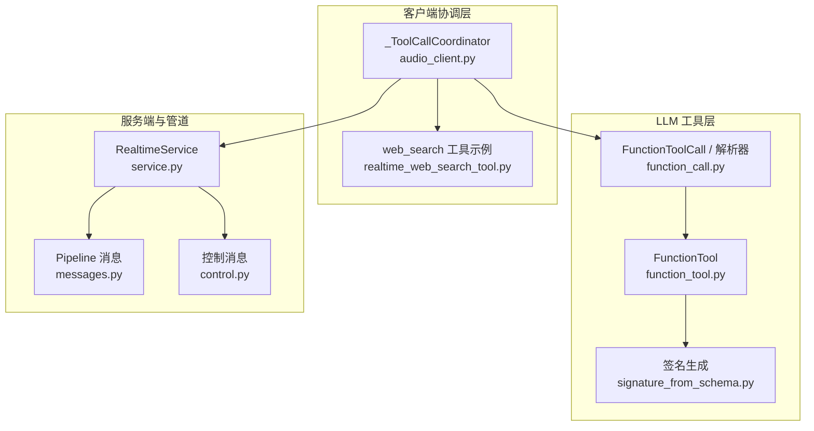
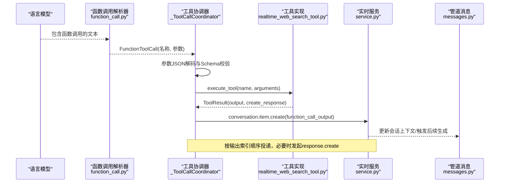
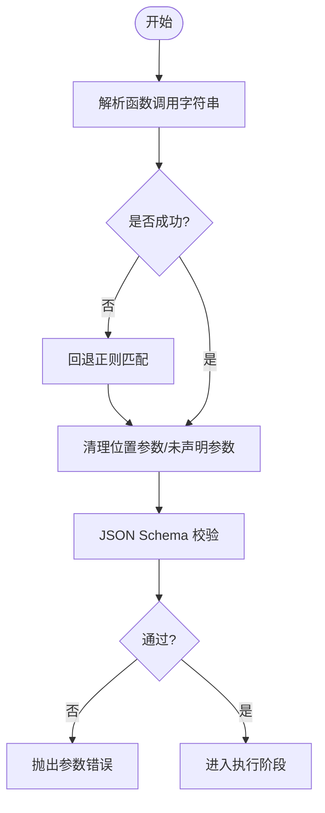
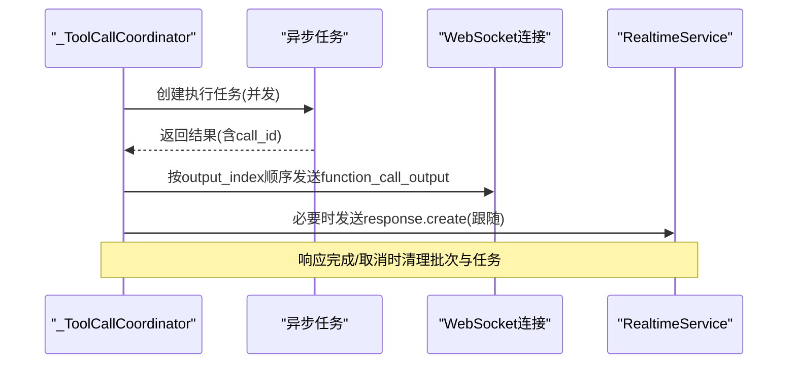
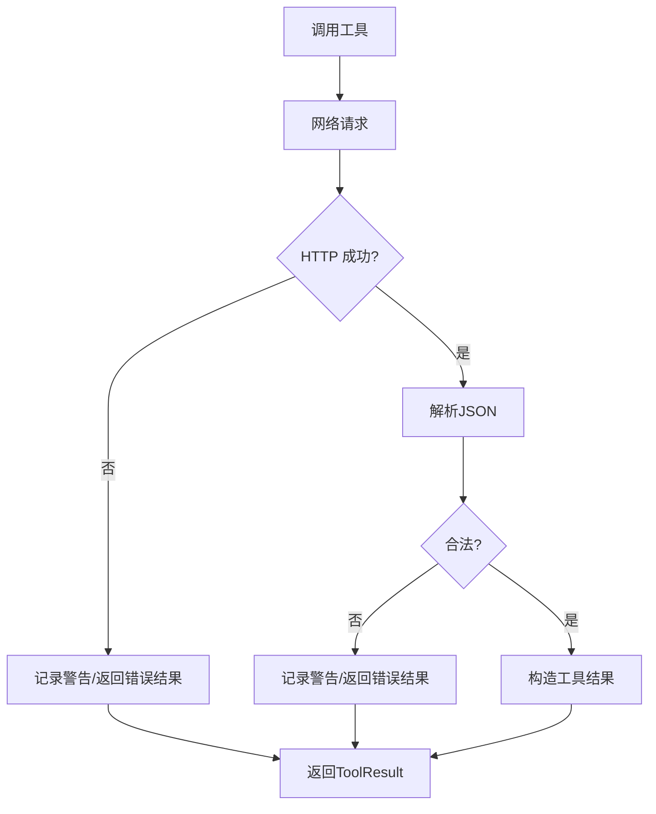
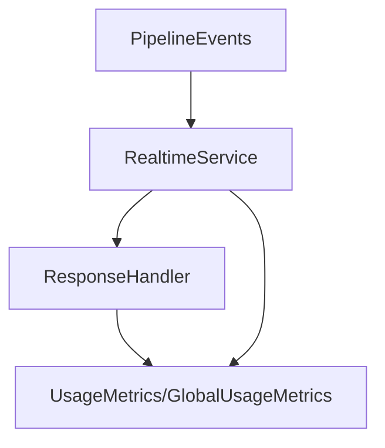
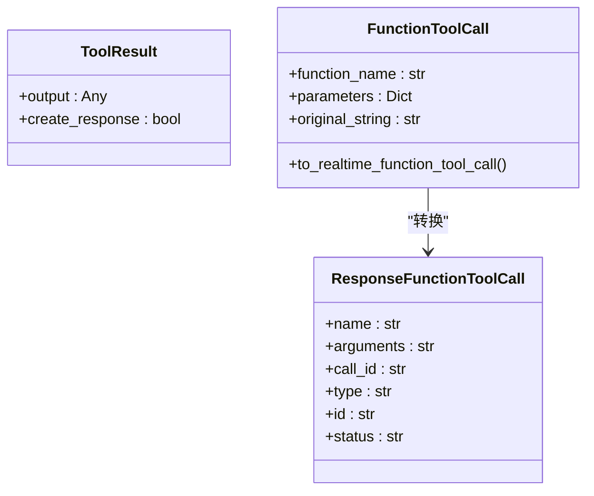
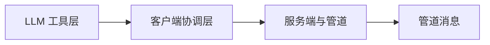

# 执行机制

<cite>
**本文引用的文件**
- [function_tool.py](file://src/speech_to_speech/LLM/tool_call/function_tool.py)
- [function_call.py](file://src/speech_to_speech/LLM/tool_call/function_call.py)
- [signature_from_schema.py](file://src/speech_to_speech/LLM/tool_call/signature_from_schema.py)
- [realtime_web_search_tool.py](file://examples/realtime_web_search_tool.py)
- [audio_client.py](file://src/speech_to_speech/api/openai_realtime/audio_client.py)
- [service.py](file://src/speech_to_speech/api/openai_realtime/service.py)
- [messages.py](file://src/speech_to_speech/pipeline/messages.py)
- [control.py](file://src/speech_to_speech/pipeline/control.py)
- [test_function_parser.py](file://tests/tool_call/test_function_parser.py)
</cite>

## 目录
1. [简介](#简介)
2. [项目结构](#项目结构)
3. [核心组件](#核心组件)
4. [架构总览](#架构总览)
5. [详细组件分析](#详细组件分析)
6. [依赖关系分析](#依赖关系分析)
7. [性能考量](#性能考量)
8. [故障排查指南](#故障排查指南)
9. [结论](#结论)
10. [附录](#附录)

## 简介
本文件面向“工具执行机制”的完整实现，覆盖从参数解析、类型校验、异步并发执行、超时与错误处理、结果序列化、到重试与熔断策略，以及外部服务集成的全链路。该机制在实时语音对话系统中用于驱动模型生成的函数调用（工具），并安全、有序地将工具输出回注到会话上下文，以触发后续生成或语音输出。

## 项目结构
围绕工具执行的关键模块分布如下：
- LLM 工具定义与解析：function_tool.py、function_call.py、signature_from_schema.py
- 客户端工具协调与执行：audio_client.py（含 _ToolCallCoordinator）
- 服务端事件路由与会话状态：service.py
- 管道消息与响应生命周期：messages.py
- 控制信号与会话结束：control.py
- 示例工具集成：realtime_web_search_tool.py
- 单元测试验证行为：test_function_parser.py

**图表来源**
- [function_tool.py:8-35](file://src/speech_to_speech/LLM/tool_call/function_tool.py#L8-L35)
- [function_call.py:183-237](file://src/speech_to_speech/LLM/tool_call/function_call.py#L183-L237)
- [signature_from_schema.py:79-109](file://src/speech_to_speech/LLM/tool_call/signature_from_schema.py#L79-L109)
- [audio_client.py:467-800](file://src/speech_to_speech/api/openai_realtime/audio_client.py#L467-L800)
- [service.py:287-580](file://src/speech_to_speech/api/openai_realtime/service.py#L287-L580)
- [messages.py:138-196](file://src/speech_to_speech/pipeline/messages.py#L138-L196)
- [control.py:7-27](file://src/speech_to_speech/pipeline/control.py#L7-L27)

**章节来源**
- [function_tool.py:8-35](file://src/speech_to_speech/LLM/tool_call/function_tool.py#L8-L35)
- [function_call.py:183-237](file://src/speech_to_speech/LLM/tool_call/function_call.py#L183-L237)
- [signature_from_schema.py:79-109](file://src/speech_to_speech/LLM/tool_call/signature_from_schema.py#L79-L109)
- [audio_client.py:467-800](file://src/speech_to_speech/api/openai_realtime/audio_client.py#L467-L800)
- [service.py:287-580](file://src/speech_to_speech/api/openai_realtime/service.py#L287-L580)
- [messages.py:138-196](file://src/speech_to_speech/pipeline/messages.py#L138-L196)
- [control.py:7-27](file://src/speech_to_speech/pipeline/control.py#L7-L27)

## 核心组件
- FunctionTool：将工具的 JSON Schema 转换为可执行的代码提示签名，便于模型理解参数结构与用途。
- FunctionToolCall 与解析器：从模型输出文本中稳健地提取函数调用名与参数，支持嵌套括号、字符串内特殊字符等复杂场景；并提供 to_realtime_function_tool_call 将调用转为协议所需的函数调用对象。
- 签名生成器：根据 JSON Schema 推导 Python 类型注解与默认值，辅助生成更准确的函数签名。
- _ToolCallCoordinator：客户端侧的工具执行协调器，负责按顺序调度、并发执行、结果排序投递、跟随式 response.create 发送、错误与冲突处理。
- RealtimeService：服务端事件路由与连接状态管理，将 STT/LLM 事件映射为协议事件，维护响应生命周期与使用量统计。
- Pipeline 消息：统一的消息类型，承载 LLM 响应片段、工具调用、音频输出、结束哨兵等。
- 控制消息：用于会话结束等强控信号。

**章节来源**
- [function_tool.py:8-35](file://src/speech_to_speech/LLM/tool_call/function_tool.py#L8-L35)
- [function_call.py:183-237](file://src/speech_to_speech/LLM/tool_call/function_call.py#L183-L237)
- [signature_from_schema.py:79-109](file://src/speech_to_speech/LLM/tool_call/signature_from_schema.py#L79-L109)
- [audio_client.py:467-800](file://src/speech_to_speech/api/openai_realtime/audio_client.py#L467-L800)
- [service.py:287-580](file://src/speech_to_speech/api/openai_realtime/service.py#L287-L580)
- [messages.py:138-196](file://src/speech_to_speech/pipeline/messages.py#L138-L196)
- [control.py:7-27](file://src/speech_to_speech/pipeline/control.py#L7-L27)

## 架构总览
下图展示了从模型输出到工具执行、再到结果回注的端到端流程。

**图表来源**
- [function_call.py:183-237](file://src/speech_to_speech/LLM/tool_call/function_call.py#L183-L237)
- [audio_client.py:533-708](file://src/speech_to_speech/api/openai_realtime/audio_client.py#L533-L708)
- [realtime_web_search_tool.py:44-118](file://examples/realtime_web_search_tool.py#L44-L118)
- [service.py:500-580](file://src/speech_to_speech/api/openai_realtime/service.py#L500-L580)
- [messages.py:138-196](file://src/speech_to_speech/pipeline/messages.py#L138-L196)

## 详细组件分析

### 参数解析与类型检查
- 解析策略：优先使用 token 化拆分顶层调用，失败时回退正则匹配以恢复部分有效调用；支持嵌套括号、字符串中的特殊字符、元组/列表/字典等复杂参数。
- 参数清洗：自动丢弃位置参数占位符（__arg_N__），剔除未声明参数，校验必填项缺失。
- 类型推断：基于 JSON Schema 生成 Python 类型注解与默认值，辅助签名构建与文档生成。
- 客户端校验：在客户端侧对工具参数进行 JSON 解码与 JSON Schema 校验，确保传入工具的数据符合声明。

**图表来源**
- [function_call.py:36-114](file://src/speech_to_speech/LLM/tool_call/function_call.py#L36-L114)
- [function_call.py:183-237](file://src/speech_to_speech/LLM/tool_call/function_call.py#L183-L237)
- [signature_from_schema.py:79-109](file://src/speech_to_speech/LLM/tool_call/signature_from_schema.py#L79-L109)
- [audio_client.py:96-119](file://src/speech_to_speech/api/openai_realtime/audio_client.py#L96-L119)

**章节来源**
- [function_call.py:36-114](file://src/speech_to_speech/LLM/tool_call/function_call.py#L36-L114)
- [function_call.py:183-237](file://src/speech_to_speech/LLM/tool_call/function_call.py#L183-L237)
- [signature_from_schema.py:79-109](file://src/speech_to_speech/LLM/tool_call/signature_from_schema.py#L79-L109)
- [audio_client.py:96-119](file://src/speech_to_speech/api/openai_realtime/audio_client.py#L96-L119)
- [test_function_parser.py:18-118](file://tests/tool_call/test_function_parser.py#L18-L118)
- [test_function_parser.py:225-286](file://tests/tool_call/test_function_parser.py#L225-L286)

### 异步调用机制与并发控制
- 并发执行：每个工具调用被封装为异步任务，批量并行执行，避免阻塞事件接收循环。
- 顺序投递：依据服务器返回的输出索引（output_index）对结果进行排序投递，保证工具输出顺序与模型输出一致。
- 批处理与取消：同一 response 的工具调用聚合为批次，支持响应完成或取消时清理未完成的任务与计数。
- 跟随式响应：当所有工具输出投递完成后，按需发起 response.create 以触发后续生成。

**图表来源**
- [audio_client.py:638-708](file://src/speech_to_speech/api/openai_realtime/audio_client.py#L638-L708)
- [audio_client.py:725-800](file://src/speech_to_speech/api/openai_realtime/audio_client.py#L725-L800)

**章节来源**
- [audio_client.py:638-708](file://src/speech_to_speech/api/openai_realtime/audio_client.py#L638-L708)
- [audio_client.py:725-800](file://src/speech_to_speech/api/openai_realtime/audio_client.py#L725-L800)

### 超时与错误处理
- 网络异常：工具实现中对 HTTP 请求捕获网络异常，返回结构化错误信息，避免中断主流程。
- 业务逻辑错误：服务端对无效输入、空上下文等拒绝情况记录日志并上报错误事件。
- 用户输入错误：客户端对工具参数进行严格校验，非法参数直接报错并记录。
- 响应冲突：处理服务器拒绝 follow-up response.create 的冲突错误，等待或终止后续流程。

**图表来源**
- [realtime_web_search_tool.py:62-96](file://examples/realtime_web_search_tool.py#L62-L96)
- [service.py:772-800](file://src/speech_to_speech/api/openai_realtime/service.py#L772-L800)
- [audio_client.py:533-577](file://src/speech_to_speech/api/openai_realtime/audio_client.py#L533-L577)

**章节来源**
- [realtime_web_search_tool.py:62-96](file://examples/realtime_web_search_tool.py#L62-L96)
- [service.py:772-800](file://src/speech_to_speech/api/openai_realtime/service.py#L772-L800)
- [audio_client.py:533-577](file://src/speech_to_speech/api/openai_realtime/audio_client.py#L533-L577)

### 执行监控与日志记录
- 使用量统计：服务端维护每响应与全局的使用指标（输入/输出 token、音频时长、响应数、工具调用次数等）。
- 事件路由：内部管道事件（如转录完成、助手输出、工具调用就绪）被路由到对应处理器，确保状态一致性。
- 日志与异常：关键路径记录警告与调试日志，异常通过专用方法记录，便于问题定位。

**图表来源**
- [service.py:138-178](file://src/speech_to_speech/api/openai_realtime/service.py#L138-L178)
- [service.py:500-580](file://src/speech_to_speech/api/openai_realtime/service.py#L500-L580)

**章节来源**
- [service.py:138-178](file://src/speech_to_speech/api/openai_realtime/service.py#L138-L178)
- [service.py:500-580](file://src/speech_to_speech/api/openai_realtime/service.py#L500-L580)

### 结果序列化与反序列化
- 工具输出：支持字符串或任意可 JSON 序列化的对象；若不可序列化则报错。
- 参数传递：工具参数以 JSON 字符串形式传递，客户端在执行前进行 JSON 解码与 Schema 校验。
- 协议对象：解析后的调用转换为 ResponseFunctionToolCall，携带 call_id、arguments、status 等字段。

**图表来源**
- [audio_client.py:40-46](file://src/speech_to_speech/api/openai_realtime/audio_client.py#L40-L46)
- [function_call.py:183-237](file://src/speech_to_speech/LLM/tool_call/function_call.py#L183-L237)

**章节来源**
- [audio_client.py:40-46](file://src/speech_to_speech/api/openai_realtime/audio_client.py#L40-L46)
- [function_call.py:183-237](file://src/speech_to_speech/LLM/tool_call/function_call.py#L183-L237)

### 重试机制与熔断器
- 重试：当前代码未内置通用重试逻辑；可在工具实现层针对特定外部 API 添加重试策略（例如指数退避）。
- 熔断：未实现显式熔断器；可通过客户端或服务端的状态机与计数器实现简易熔断（例如连续失败达到阈值后暂停调用）。
- 建议：在工具实现中增加可配置的重试次数与退避策略；在服务端集中记录失败率，动态调整工具可用性。

[本节为通用指导，不直接分析具体文件]

### 外部服务与API集成
- 示例工具：web_search 工具通过 httpx 异步客户端调用 Serper API，设置超时、处理非 2xx 响应、解析 JSON 并抽取答案与结果列表。
- 配置与密钥：通过环境变量注入 API Key，并在工具执行前校验是否存在。
- 错误反馈：网络异常、HTTP 错误、无效 JSON 均返回结构化错误，便于上层展示与处理。

**章节来源**
- [realtime_web_search_tool.py:16-41](file://examples/realtime_web_search_tool.py#L16-L41)
- [realtime_web_search_tool.py:44-118](file://examples/realtime_web_search_tool.py#L44-L118)

## 依赖关系分析
- 低耦合：工具定义与解析位于 LLM 工具层，客户端协调器仅依赖解析器与工具接口，服务端通过事件与消息解耦。
- 明确契约：工具通过 TOOLS 描述与 execute_tool 接口暴露能力；客户端通过 JSON Schema 校验参数，保障契约一致性。
- 潜在环：无直接循环依赖；各层通过消息与事件通信，保持单向依赖。

**图表来源**
- [function_call.py:183-237](file://src/speech_to_speech/LLM/tool_call/function_call.py#L183-L237)
- [audio_client.py:467-800](file://src/speech_to_speech/api/openai_realtime/audio_client.py#L467-L800)
- [service.py:287-580](file://src/speech_to_speech/api/openai_realtime/service.py#L287-L580)
- [messages.py:138-196](file://src/speech_to_speech/pipeline/messages.py#L138-L196)

**章节来源**
- [function_call.py:183-237](file://src/speech_to_speech/LLM/tool_call/function_call.py#L183-L237)
- [audio_client.py:467-800](file://src/speech_to_speech/api/openai_realtime/audio_client.py#L467-L800)
- [service.py:287-580](file://src/speech_to_speech/api/openai_realtime/service.py#L287-L580)
- [messages.py:138-196](file://src/speech_to_speech/pipeline/messages.py#L138-L196)

## 性能考量
- 并发执行：工具调用以异步任务并发执行，减少端到端延迟。
- 顺序投递：按 output_index 排序投递，避免乱序导致的上下文不一致。
- 批处理：同响应内的工具调用聚合为批次，降低频繁发送的开销。
- 资源释放：响应完成或取消时清理任务与计数，防止内存泄漏。
- 传输优化：音频与文本流式处理，减少缓冲与阻塞。

[本节提供一般性指导，不直接分析具体文件]

## 故障排查指南
- 参数错误：检查工具参数的 JSON Schema 是否合法，确认必填项是否齐全。
- 网络异常：查看工具实现中的网络请求日志，确认超时与重试策略是否合理。
- 响应冲突：关注 follow-up response.create 的错误类型与代码，必要时等待或终止。
- 日志定位：利用服务端的 UsageMetrics 与事件路由日志，定位失败点与耗时瓶颈。

**章节来源**
- [audio_client.py:533-577](file://src/speech_to_speech/api/openai_realtime/audio_client.py#L533-L577)
- [realtime_web_search_tool.py:62-96](file://examples/realtime_web_search_tool.py#L62-L96)
- [service.py:772-800](file://src/speech_to_speech/api/openai_realtime/service.py#L772-L800)

## 结论
该工具执行机制通过稳健的参数解析、严格的类型校验、高效的异步并发、有序的 result 投递与完善的错误处理，实现了从模型输出到工具执行再到结果回注的闭环。结合服务端的事件路由与使用量统计，系统具备良好的可观测性与可扩展性。建议在工具层引入重试与熔断策略，进一步提升鲁棒性。

[本节总结性内容，不直接分析具体文件]

## 附录
- 参考测试用例：验证解析器对多种调用形式的处理能力，包括嵌套括号、多行调用、位置参数与命名参数混合等。
- 控制消息：用于会话结束等强控信号，确保资源正确释放。

**章节来源**
- [test_function_parser.py:18-118](file://tests/tool_call/test_function_parser.py#L18-L118)
- [test_function_parser.py:225-286](file://tests/tool_call/test_function_parser.py#L225-L286)
- [control.py:7-27](file://src/speech_to_speech/pipeline/control.py#L7-L27)