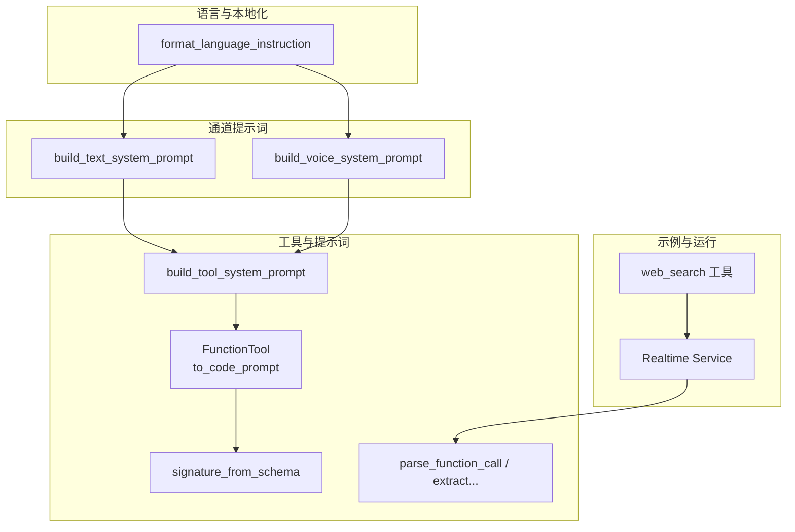
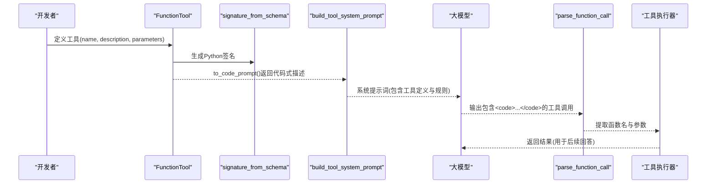
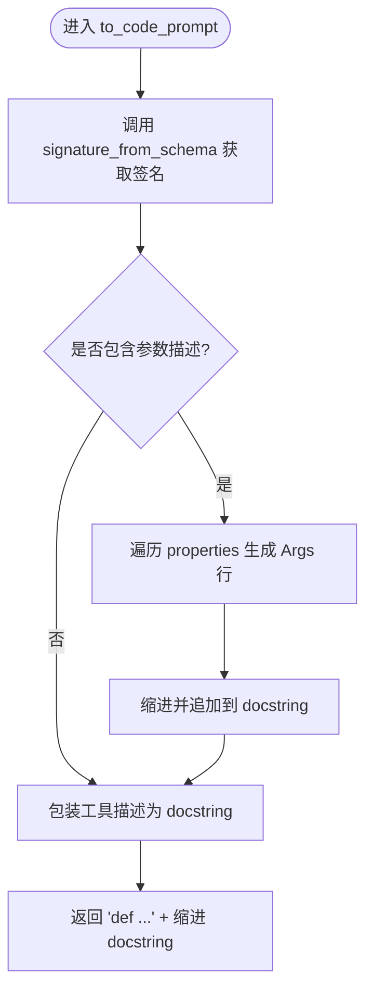
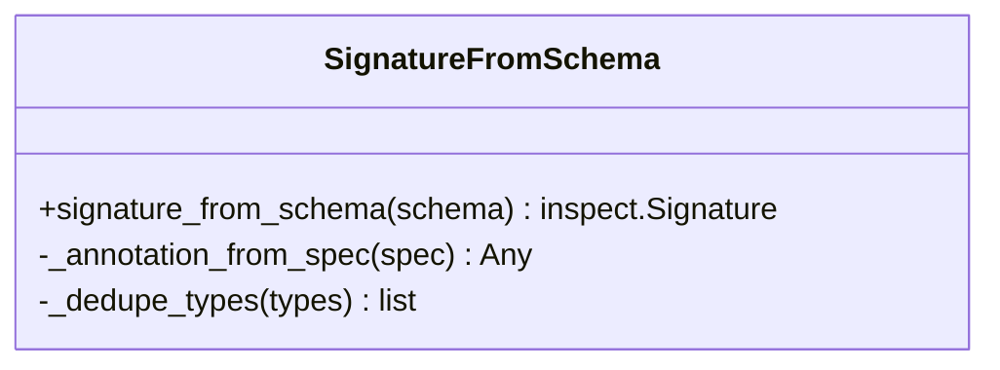
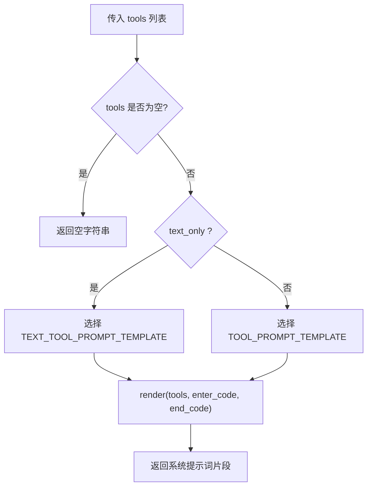
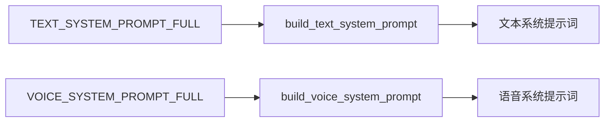
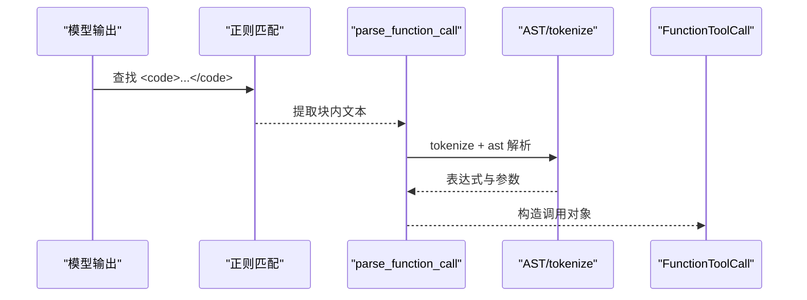
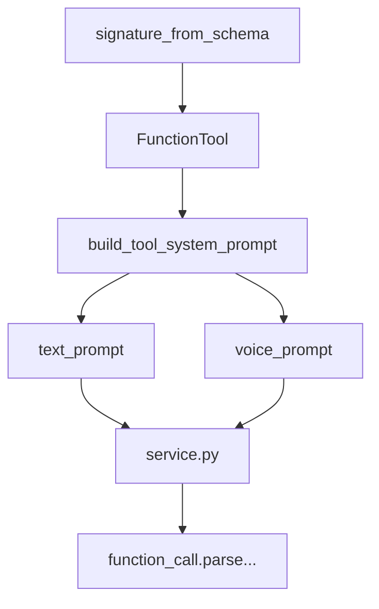

# 提示词集成

<cite>
**本文引用的文件**
- [tool_prompt.py](file://src/speech_to_speech/LLM/tool_call/tool_prompt.py)
- [function_tool.py](file://src/speech_to_speech/LLM/tool_call/function_tool.py)
- [signature_from_schema.py](file://src/speech_to_speech/LLM/tool_call/signature_from_schema.py)
- [function_call.py](file://src/speech_to_speech/LLM/tool_call/function_call.py)
- [text_prompt.py](file://src/speech_to_speech/LLM/text_prompt.py)
- [voice_prompt.py](file://src/speech_to_speech/LLM/voice_prompt.py)
- [utils.py](file://src/speech_to_speech/LLM/utils.py)
- [realtime_web_search_tool.py](file://examples/realtime_web_search_tool.py)
- [service.py](file://src/speech_to_speech/api/openai_realtime/service.py)
- [test_function_parser.py](file://tests/tool_call/test_function_parser.py)
- [test_signature_from_schema.py](file://tests/tool_call/test_signature_from_schema.py)
</cite>

## 目录
1. [简介](#简介)
2. [项目结构](#项目结构)
3. [核心组件](#核心组件)
4. [架构总览](#架构总览)
5. [详细组件分析](#详细组件分析)
6. [依赖关系分析](#依赖关系分析)
7. [性能与上下文窗口优化](#性能与上下文窗口优化)
8. [故障排查指南](#故障排查指南)
9. [结论](#结论)
10. [附录：模板定制与多语言支持](#附录模板定制与多语言支持)

## 简介
本文件面向“工具描述如何转换为模型可理解的提示词”的完整链路，覆盖从工具参数Schema到Python风格函数签名、文档字符串生成，再到系统提示词拼装、解析与执行的全流程。重点说明：
- to_code_prompt方法的实现细节（含参数描述的嵌入与格式化）
- 不同模型对工具描述的适配策略（文本通道与语音通道差异）
- 提示词模板的定制方法
- 上下文窗口优化与token使用控制
- 多语言支持与本地化考虑
- 在对话中动态插入工具信息的方式

## 项目结构
围绕提示词集成的关键代码位于 LLM 子模块与 tool_call 子模块中，配合示例工具与实时服务编排。整体组织方式如下：
- 工具定义与提示词生成：tool_call 下的 function_tool、signature_from_schema、tool_prompt、function_call
- 通道提示词组装：text_prompt、voice_prompt
- 语言指令与本地化：utils
- 示例工具：examples/realtime_web_search_tool.py
- 运行时编排与服务层：api/openai_realtime/service.py

图表来源
- [function_tool.py:8-35](file://src/speech_to_speech/LLM/tool_call/function_tool.py#L8-L35)
- [signature_from_schema.py:79-109](file://src/speech_to_speech/LLM/tool_call/signature_from_schema.py#L79-L109)
- [tool_prompt.py:76-97](file://src/speech_to_speech/LLM/tool_call/tool_prompt.py#L76-L97)
- [text_prompt.py:30-48](file://src/speech_to_speech/LLM/text_prompt.py#L30-L48)
- [voice_prompt.py:35-53](file://src/speech_to_speech/LLM/voice_prompt.py#L35-L53)
- [utils.py:254-279](file://src/speech_to_speech/LLM/utils.py#L254-L279)
- [realtime_web_search_tool.py:20-41](file://examples/realtime_web_search_tool.py#L20-L41)
- [service.py:138-177](file://src/speech_to_speech/api/openai_realtime/service.py#L138-L177)

章节来源
- [function_tool.py:8-35](file://src/speech_to_speech/LLM/tool_call/function_tool.py#L8-L35)
- [signature_from_schema.py:79-109](file://src/speech_to_speech/LLM/tool_call/signature_from_schema.py#L79-L109)
- [tool_prompt.py:76-97](file://src/speech_to_speech/LLM/tool_call/tool_prompt.py#L76-L97)
- [text_prompt.py:30-48](file://src/speech_to_speech/LLM/text_prompt.py#L30-L48)
- [voice_prompt.py:35-53](file://src/speech_to_speech/LLM/voice_prompt.py#L35-L53)
- [utils.py:254-279](file://src/speech_to_speech/LLM/utils.py#L254-L279)
- [realtime_web_search_tool.py:20-41](file://examples/realtime_web_search_tool.py#L20-L41)
- [service.py:138-177](file://src/speech_to_speech/api/openai_realtime/service.py#L138-L177)

## 核心组件
- FunctionTool.to_code_prompt：将工具的JSON Schema与描述转换为Python风格的函数定义和文档字符串，便于模型以“代码块”形式输出工具调用。
- signature_from_schema：将JSON Schema映射为inspect.Signature，处理类型、枚举、联合类型、可选参数、默认值等。
- build_tool_system_prompt：基于Jinja2模板渲染工具列表的系统提示词，并规定模型必须以指定分隔符包裹工具调用。
- parse_function_call / extract_function_calls_from_text：从模型输出中提取被分隔符包裹的工具调用，解析为结构化对象。
- text_prompt / voice_prompt：分别构建文本与语音通道的系统提示词骨架，并在会话提示后动态插入工具段与语言指令。
- utils.format_language_instruction：根据STT检测到的语言代码生成“请用{语言}回复”的指令片段。
- 示例工具：展示如何声明工具Schema与执行器，供服务层调度。

章节来源
- [function_tool.py:8-35](file://src/speech_to_speech/LLM/tool_call/function_tool.py#L8-L35)
- [signature_from_schema.py:79-109](file://src/speech_to_speech/LLM/tool_call/signature_from_schema.py#L79-L109)
- [tool_prompt.py:76-97](file://src/speech_to_speech/LLM/tool_call/tool_prompt.py#L76-L97)
- [function_call.py:243-322](file://src/speech_to_speech/LLM/tool_call/function_call.py#L243-L322)
- [text_prompt.py:30-48](file://src/speech_to_speech/LLM/text_prompt.py#L30-L48)
- [voice_prompt.py:35-53](file://src/speech_to_speech/LLM/voice_prompt.py#L35-L53)
- [utils.py:254-279](file://src/speech_to_speech/LLM/utils.py#L254-L279)
- [realtime_web_search_tool.py:20-41](file://examples/realtime_web_search_tool.py#L20-L41)

## 架构总览
下图展示了从工具Schema到模型提示词、再到解析执行的端到端流程。

图表来源
- [function_tool.py:8-35](file://src/speech_to_speech/LLM/tool_call/function_tool.py#L8-L35)
- [signature_from_schema.py:79-109](file://src/speech_to_speech/LLM/tool_call/signature_from_schema.py#L79-L109)
- [tool_prompt.py:76-97](file://src/speech_to_speech/LLM/tool_call/tool_prompt.py#L76-L97)
- [function_call.py:243-322](file://src/speech_to_speech/LLM/tool_call/function_call.py#L243-L322)

## 详细组件分析

### FunctionTool.to_code_prompt：Python风格函数定义与文档字符串
- 输入：工具名称、描述、参数Schema
- 过程：
  - 通过signature_from_schema将参数Schema转为Python签名
  - 若开启include_args_doc且存在properties，则遍历属性生成Args段落，缩进并拼接到docstring
  - 最终拼接为def name(...)并附带缩进的文档字符串
- 输出：一段可直接被Jinja2模板渲染的代码式工具描述

图表来源
- [function_tool.py:8-35](file://src/speech_to_speech/LLM/tool_call/function_tool.py#L8-L35)
- [signature_from_schema.py:79-109](file://src/speech_to_speech/LLM/tool_call/signature_from_schema.py#L79-L109)

章节来源
- [function_tool.py:8-35](file://src/speech_to_speech/LLM/tool_call/function_tool.py#L8-L35)
- [test_signature_from_schema.py:184-243](file://tests/tool_call/test_signature_from_schema.py#L184-L243)

### signature_from_schema：Schema到签名的映射
- 支持基础类型(string/number/boolean/integer/object/array/null)
- 支持const/enum→Literal
- 支持anyOf/oneOf→Union
- 支持allOf合并子schema
- 支持array with items→list[item_type]
- required字段决定是否为必填；若存在default则优先使用default作为默认值；否则可选参数默认None

图表来源
- [signature_from_schema.py:23-77](file://src/speech_to_speech/LLM/tool_call/signature_from_schema.py#L23-L77)
- [signature_from_schema.py:79-109](file://src/speech_to_speech/LLM/tool_call/signature_from_schema.py#L79-L109)

章节来源
- [signature_from_schema.py:23-77](file://src/speech_to_speech/LLM/tool_call/signature_from_schema.py#L23-L77)
- [signature_from_schema.py:79-109](file://src/speech_to_speech/LLM/tool_call/signature_from_schema.py#L79-L109)
- [test_signature_from_schema.py:9-80](file://tests/tool_call/test_signature_from_schema.py#L9-L80)
- [test_signature_from_schema.py:85-179](file://tests/tool_call/test_signature_from_schema.py#L85-L179)

### 系统提示词构建：build_tool_system_prompt
- 使用Jinja2模板渲染工具列表，每个工具调用to_code_prompt()
- 提供两种模板：通用版与text_only版（后者强调“无需前言直接调用工具”）
- 当tools为空时返回空字符串，便于无条件拼接到底层系统提示词
- 支持自定义enter_code/end_code分隔符

图表来源
- [tool_prompt.py:29-68](file://src/speech_to_speech/LLM/tool_call/tool_prompt.py#L29-L68)
- [tool_prompt.py:76-97](file://src/speech_to_speech/LLM/tool_call/tool_prompt.py#L76-L97)

章节来源
- [tool_prompt.py:29-68](file://src/speech_to_speech/LLM/tool_call/tool_prompt.py#L29-L68)
- [tool_prompt.py:76-97](file://src/speech_to_speech/LLM/tool_call/tool_prompt.py#L76-L97)

### 通道提示词：文本与语音
- 文本通道：强调简洁、Markdown可用、工具调用无需前言
- 语音通道：强调口语化、简短、不提及工具名、信息类工具立即调用、表达类工具先说话再调用
- 两者均支持在会话提示后插入工具段与语言指令

图表来源
- [text_prompt.py:5-27](file://src/speech_to_speech/LLM/text_prompt.py#L5-L27)
- [text_prompt.py:30-48](file://src/speech_to_speech/LLM/text_prompt.py#L30-L48)
- [voice_prompt.py:5-32](file://src/speech_to_speech/LLM/voice_prompt.py#L5-L32)
- [voice_prompt.py:35-53](file://src/speech_to_speech/LLM/voice_prompt.py#L35-L53)

章节来源
- [text_prompt.py:5-27](file://src/speech_to_speech/LLM/text_prompt.py#L5-L27)
- [text_prompt.py:30-48](file://src/speech_to_speech/LLM/text_prompt.py#L30-L48)
- [voice_prompt.py:5-32](file://src/speech_to_speech/LLM/voice_prompt.py#L5-L32)
- [voice_prompt.py:35-53](file://src/speech_to_speech/LLM/voice_prompt.py#L35-L53)

### 模型输出解析：extract_function_calls_from_text 与 parse_function_call
- 使用正则匹配分隔符包裹的代码块，仅对块内内容解析函数调用
- 使用tokenize+ast解析函数名与参数，支持嵌套括号、字符串中的特殊字符、元组/字典等复杂结构
- 支持回退方案：当tokenize失败时尝试正则提取简单调用
- 将解析结果转换为标准工具调用对象，并可校验必需参数与未声明参数

图表来源
- [function_call.py:288-322](file://src/speech_to_speech/LLM/tool_call/function_call.py#L288-L322)
- [function_call.py:36-95](file://src/speech_to_speech/LLM/tool_call/function_call.py#L36-L95)
- [function_call.py:157-177](file://src/speech_to_speech/LLM/tool_call/function_call.py#L157-L177)

章节来源
- [function_call.py:36-95](file://src/speech_to_speech/LLM/tool_call/function_call.py#L36-L95)
- [function_call.py:157-177](file://src/speech_to_speech/LLM/tool_call/function_call.py#L157-L177)
- [function_call.py:243-322](file://src/speech_to_speech/LLM/tool_call/function_call.py#L243-L322)
- [test_function_parser.py:18-118](file://tests/tool_call/test_function_parser.py#L18-L118)
- [test_function_parser.py:139-211](file://tests/tool_call/test_function_parser.py#L139-L211)

### 示例工具：web_search
- 工具Schema定义了name、description、parameters（含required）
- 执行器负责调用外部API、错误处理与结果封装
- 可作为服务层调用的真实工具样例

章节来源
- [realtime_web_search_tool.py:20-41](file://examples/realtime_web_search_tool.py#L20-L41)
- [realtime_web_search_tool.py:44-118](file://examples/realtime_web_search_tool.py#L44-L118)

## 依赖关系分析
- FunctionTool依赖signature_from_schema生成签名
- build_tool_system_prompt依赖FunctionTool.to_code_prompt渲染工具段
- 通道提示词构建依赖工具段与语言指令
- 解析器依赖正则与AST，服务于服务层的工具调用执行

图表来源
- [function_tool.py:8-35](file://src/speech_to_speech/LLM/tool_call/function_tool.py#L8-L35)
- [tool_prompt.py:76-97](file://src/speech_to_speech/LLM/tool_call/tool_prompt.py#L76-L97)
- [text_prompt.py:30-48](file://src/speech_to_speech/LLM/text_prompt.py#L30-L48)
- [voice_prompt.py:35-53](file://src/speech_to_speech/LLM/voice_prompt.py#L35-L53)
- [function_call.py:243-322](file://src/speech_to_speech/LLM/tool_call/function_call.py#L243-L322)

章节来源
- [function_tool.py:8-35](file://src/speech_to_speech/LLM/tool_call/function_tool.py#L8-L35)
- [tool_prompt.py:76-97](file://src/speech_to_speech/LLM/tool_call/tool_prompt.py#L76-L97)
- [text_prompt.py:30-48](file://src/speech_to_speech/LLM/text_prompt.py#L30-L48)
- [voice_prompt.py:35-53](file://src/speech_to_speech/LLM/voice_prompt.py#L35-L53)
- [function_call.py:243-322](file://src/speech_to_speech/LLM/tool_call/function_call.py#L243-L322)

## 性能与上下文窗口优化
- 参数描述嵌入开关：FunctionTool.to_code_prompt的include_args_doc参数可控制是否在docstring中包含参数描述。开启会显著增加token消耗（例如某工具配置下约从906增至3434 token），应依据模型能力与上下文限制权衡启用。
- 工具段长度控制：build_tool_system_prompt仅在tools非空时注入工具段，避免无工具场景下的冗余提示词。
- 分隔符与解析效率：使用明确的分隔符与正则匹配，减少模型输出噪声，提高解析成功率与速度。
- 语言指令按需注入：通过language_name_for_prompt与format_language_instruction仅在启用时注入语言指令，避免不必要的token开销。
- 服务层指标：service.py中的UsageMetrics记录tool_calls、turns、input/output tokens等，可用于监控与调优。

章节来源
- [function_tool.py:8-35](file://src/speech_to_speech/LLM/tool_call/function_tool.py#L8-L35)
- [tool_prompt.py:76-97](file://src/speech_to_speech/LLM/tool_call/tool_prompt.py#L76-L97)
- [utils.py:254-279](file://src/speech_to_speech/LLM/utils.py#L254-L279)
- [service.py:138-177](file://src/speech_to_speech/api/openai_realtime/service.py#L138-L177)

## 故障排查指南
- 模型输出未包含分隔符：检查系统提示词是否正确注入工具段与分隔符规则；确认模板渲染无误。
- 解析失败或丢失参数：查看extract_function_calls_from_text与parse_function_call的回退逻辑；确保模型输出尽量遵循命名参数与引号规范。
- 必需参数缺失：FunctionToolCall.to_realtime_function_tool_call会在缺少必需参数时报错；需调整提示词或工具Schema。
- 未声明参数被丢弃：解析后会过滤未在Schema中声明的参数；请核对工具Schema的properties与required。
- 语言指令未生效：确认已启用语言提示并正确映射STT语言代码到语言名称。

章节来源
- [function_call.py:243-322](file://src/speech_to_speech/LLM/tool_call/function_call.py#L243-L322)
- [test_function_parser.py:139-211](file://tests/tool_call/test_function_parser.py#L139-L211)
- [test_function_parser.py:225-286](file://tests/tool_call/test_function_parser.py#L225-L286)
- [utils.py:254-279](file://src/speech_to_speech/LLM/utils.py#L254-L279)

## 结论
该提示词集成方案通过“Schema→Python签名→代码式工具描述→系统提示词→模型输出→解析→执行”的闭环，实现了工具能力的稳定接入与跨模型适配。通过可开关的参数描述、通道差异化提示词、语言指令注入以及严格的解析与校验机制，既保证了易用性，也兼顾了性能与鲁棒性。

## 附录：模板定制与多语言支持
- 模板定制：
  - 可通过build_tool_system_prompt的enter_code/end_code参数自定义分隔符
  - 可选择text_only模式以获得更直接的调用引导
  - 可在通道提示词中插入自定义工具段，满足特定业务需求
- 多语言支持：
  - 通过WHISPER_LANGUAGE_TO_LLM_LANGUAGE映射STT语言代码到人类可读语言名
  - format_language_instruction生成“请用{语言}回复”的指令片段
  - language_name_for_prompt控制是否注入语言指令，避免不必要token消耗

章节来源
- [tool_prompt.py:76-97](file://src/speech_to_speech/LLM/tool_call/tool_prompt.py#L76-L97)
- [text_prompt.py:30-48](file://src/speech_to_speech/LLM/text_prompt.py#L30-L48)
- [voice_prompt.py:35-53](file://src/speech_to_speech/LLM/voice_prompt.py#L35-L53)
- [utils.py:139-279](file://src/speech_to_speech/LLM/utils.py#L139-L279)