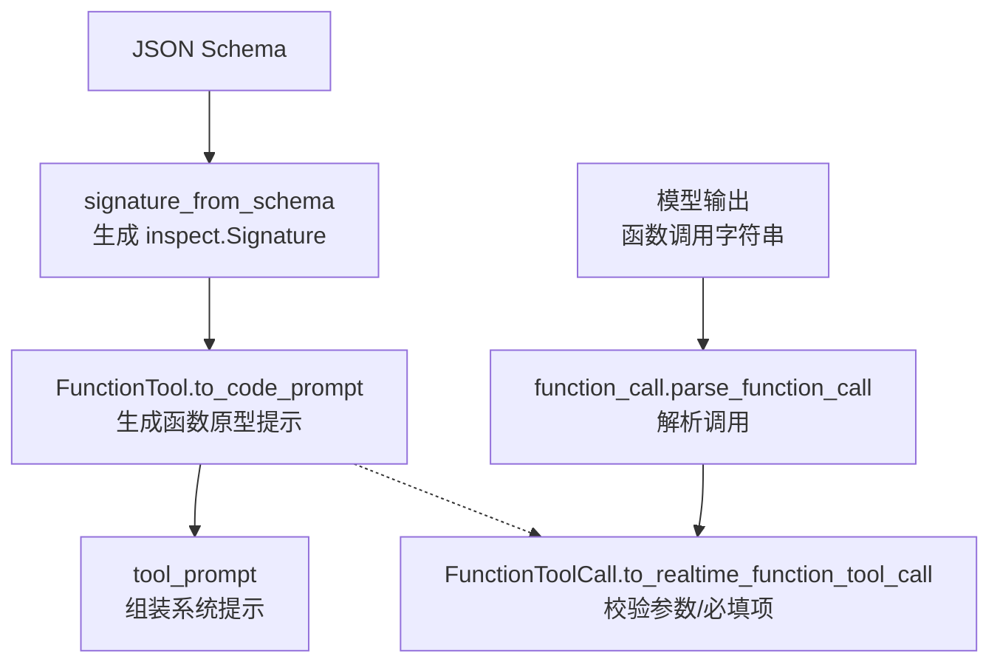
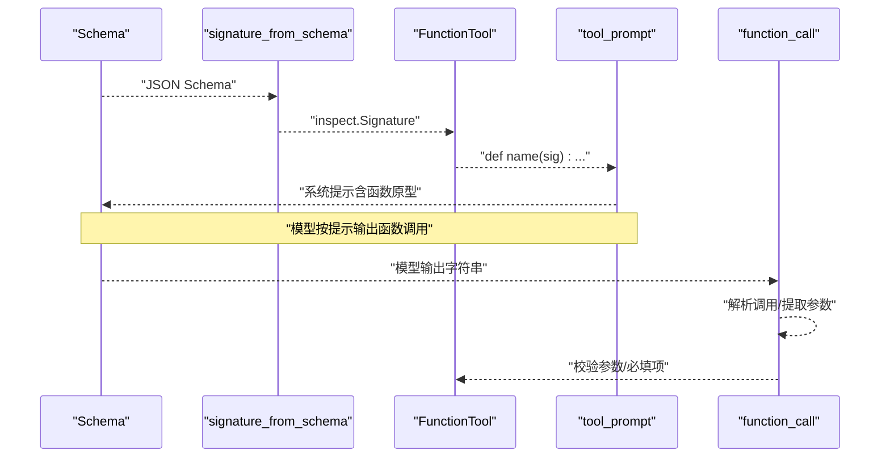
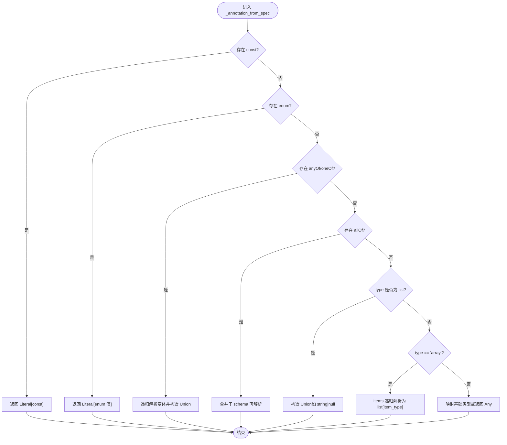
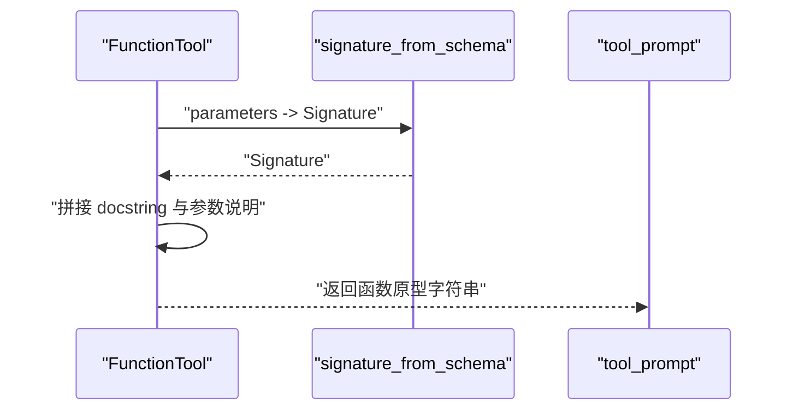
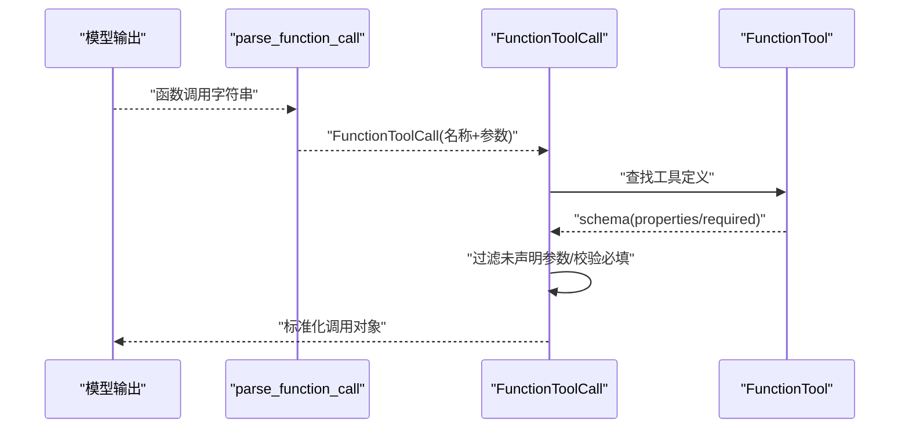
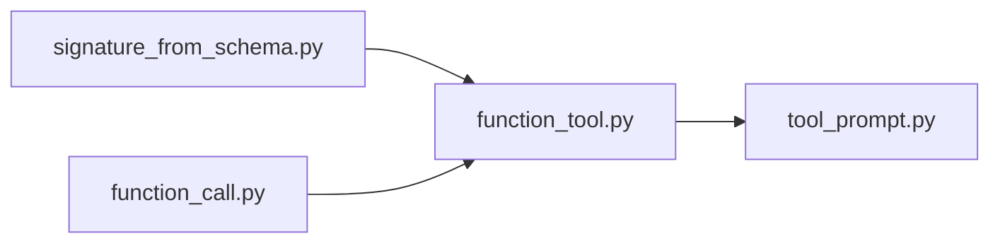

# 签名生成机制

<cite>
**本文引用的文件**
- [signature_from_schema.py](file://src/speech_to_speech/LLM/tool_call/signature_from_schema.py)
- [function_tool.py](file://src/speech_to_speech/LLM/tool_call/function_tool.py)
- [function_call.py](file://src/speech_to_speech/LLM/tool_call/function_call.py)
- [tool_prompt.py](file://src/speech_to_speech/LLM/tool_call/tool_prompt.py)
- [test_signature_from_schema.py](file://tests/tool_call/test_signature_from_schema.py)
</cite>

## 目录
1. [简介](#简介)
2. [项目结构](#项目结构)
3. [核心组件](#核心组件)
4. [架构总览](#架构总览)
5. [详细组件分析](#详细组件分析)
6. [依赖关系分析](#依赖关系分析)
7. [性能与缓存](#性能与缓存)
8. [调试与验证工具](#调试与验证工具)
9. [错误处理与异常](#错误处理与异常)
10. [结论](#结论)
11. [附录：类型映射与扩展指南](#附录类型映射与扩展指南)

## 简介
本文件系统性阐述“签名生成机制”的实现原理，重点解释 signature_from_schema 函数如何将 JSON Schema 转换为 Python 函数签名。文档涵盖支持的参数类型映射（字符串、数字、布尔值、数组、对象等）、复杂嵌套结构与联合类型的处理、自定义类型扩展方法、签名生成的调试与验证手段、签名缓存机制与性能优化策略，以及错误处理与异常情况处理方式。

## 项目结构
围绕签名生成机制的相关代码集中在 LLM 的 tool_call 子模块中，主要涉及以下文件：
- signature_from_schema.py：核心实现，负责将 JSON Schema 转为 Python 函数签名。
- function_tool.py：封装工具定义，并基于签名生成可执行的函数原型提示。
- function_call.py：解析模型输出的函数调用字符串，校验参数与工具定义的匹配性。
- tool_prompt.py：构建系统提示，引导模型以特定格式输出函数调用。
- test_signature_from_schema.py：覆盖各类边界场景的单元测试，用于验证签名生成行为。

图表来源
- [signature_from_schema.py:79-108](file://src/speech_to_speech/LLM/tool_call/signature_from_schema.py#L79-L108)
- [function_tool.py:8-34](file://src/speech_to_speech/LLM/tool_call/function_tool.py#L8-L34)
- [function_call.py:183-237](file://src/speech_to_speech/LLM/tool_call/function_call.py#L183-L237)
- [tool_prompt.py:76-97](file://src/speech_to_speech/LLM/tool_call/tool_prompt.py#L76-L97)

章节来源
- [signature_from_schema.py:1-109](file://src/speech_to_speech/LLM/tool_call/signature_from_schema.py#L1-L109)
- [function_tool.py:1-35](file://src/speech_to_speech/LLM/tool_call/function_tool.py#L1-L35)
- [function_call.py:1-322](file://src/speech_to_speech/LLM/tool_call/function_call.py#L1-L322)
- [tool_prompt.py:1-110](file://src/speech_to_speech/LLM/tool_call/tool_prompt.py#L1-L110)
- [test_signature_from_schema.py:1-243](file://tests/tool_call/test_signature_from_schema.py#L1-L243)

## 核心组件
- signature_from_schema：将 JSON Schema 转换为 Python 函数签名（inspect.Signature），支持基础类型、枚举、常量、可选/联合类型、数组、对象及 allOf/anyOf/oneOf 组合。
- _annotation_from_spec：内部递归函数，根据 JSON Schema 片段推导 Python 类型注解。
- FunctionTool.to_code_prompt：基于签名生成函数原型字符串，便于在系统提示中展示给模型。
- FunctionToolCall：解析并校验模型输出的函数调用，确保参数符合工具定义。

章节来源
- [signature_from_schema.py:23-77](file://src/speech_to_speech/LLM/tool_call/signature_from_schema.py#L23-L77)
- [signature_from_schema.py:79-108](file://src/speech_to_speech/LLM/tool_call/signature_from_schema.py#L79-L108)
- [function_tool.py:8-34](file://src/speech_to_speech/LLM/tool_call/function_tool.py#L8-L34)
- [function_call.py:183-237](file://src/speech_to_speech/LLM/tool_call/function_call.py#L183-L237)

## 架构总览
签名生成机制的整体流程如下：
- 输入：JSON Schema（描述工具的参数结构）。
- 转换：signature_from_schema 解析 properties 与 required，为每个属性生成带默认值的参数；_annotation_from_spec 递归推导类型注解。
- 输出：inspect.Signature，供 FunctionTool 生成函数原型提示，或用于运行时校验。
- 下游：function_call 解析模型输出的函数调用，结合工具定义进行参数校验与缺失必填项检查。

图表来源
- [signature_from_schema.py:79-108](file://src/speech_to_speech/LLM/tool_call/signature_from_schema.py#L79-L108)
- [function_tool.py:8-34](file://src/speech_to_speech/LLM/tool_call/function_tool.py#L8-L34)
- [tool_prompt.py:76-97](file://src/speech_to_speech/LLM/tool_call/tool_prompt.py#L76-L97)
- [function_call.py:243-267](file://src/speech_to_speech/LLM/tool_call/function_call.py#L243-L267)

## 详细组件分析

### signature_from_schema 实现原理
- 入口函数 signature_from_schema(schema)：
  - 若 schema 为空或非 dict，返回空签名。
  - 遍历 properties，为每个属性生成参数：
    - 使用 _annotation_from_spec(spec) 推导类型注解。
    - 若属性在 required 且未提供 default，则设为必需参数；否则默认值为 None 或 schema 中的 default。
  - 返回由参数列表构成的 inspect.Signature。

- 类型注解推导 _annotation_from_spec(spec)：
  - const → Literal[const]
  - enum → Literal[val1, val2, ...]
  - anyOf / oneOf → Union[Type1, Type2, ...]（去重后合并）
  - allOf → 合并子 schema 后再解析
  - type 为 list → Union（如 ["string","null"] → Optional[str]）
  - array with items → list[ItemType]
  - 基础类型映射：string→str, number→float, boolean→bool, integer→int, object→dict, array→list, null→NoneType
  - 未知或缺失 type → Any

图表来源
- [signature_from_schema.py:23-77](file://src/speech_to_speech/LLM/tool_call/signature_from_schema.py#L23-L77)

章节来源
- [signature_from_schema.py:79-108](file://src/speech_to_speech/LLM/tool_call/signature_from_schema.py#L79-L108)
- [signature_from_schema.py:23-77](file://src/speech_to_speech/LLM/tool_call/signature_from_schema.py#L23-L77)

### FunctionTool 与签名生成
- FunctionTool.to_code_prompt：
  - 调用 signature_from_schema(self.parameters) 获取签名。
  - 可选附加参数说明（从 properties.description 提取）。
  - 生成形如 def name(sig): 的函数原型字符串，便于系统提示展示。

图表来源
- [function_tool.py:8-34](file://src/speech_to_speech/LLM/tool_call/function_tool.py#L8-L34)
- [signature_from_schema.py:79-108](file://src/speech_to_speech/LLM/tool_call/signature_from_schema.py#L79-L108)

章节来源
- [function_tool.py:8-34](file://src/speech_to_speech/LLM/tool_call/function_tool.py#L8-L34)

### 函数调用解析与校验
- parse_function_call：
  - 使用 tokenize/ast 解析函数调用字符串，支持嵌套括号与复杂字面量。
  - 失败时回退到正则提取简单调用片段。
- FunctionToolCall.to_realtime_function_tool_call：
  - 丢弃位置参数（仅保留命名参数）。
  - 依据工具定义过滤未声明参数。
  - 校验必填参数是否缺失，缺失则抛出异常。

图表来源
- [function_call.py:243-267](file://src/speech_to_speech/LLM/tool_call/function_call.py#L243-L267)
- [function_call.py:183-237](file://src/speech_to_speech/LLM/tool_call/function_call.py#L183-L237)

章节来源
- [function_call.py:183-237](file://src/speech_to_speech/LLM/tool_call/function_call.py#L183-L237)
- [function_call.py:243-267](file://src/speech_to_speech/LLM/tool_call/function_call.py#L243-L267)

### 复杂嵌套结构与联合类型
- 联合类型：
  - anyOf/oneOf → Union（去重后合并）。
  - type 为 list（如 ["string","null"]）→ Optional[str]。
- 嵌套结构：
  - array with items → list[item_type]，item_type 可继续递归解析。
  - allOf → 合并子 schema 后再解析，支持约束叠加。
- 常量与枚举：
  - const → Literal[const]。
  - enum → Literal[val1, val2, ...]。

章节来源
- [signature_from_schema.py:23-77](file://src/speech_to_speech/LLM/tool_call/signature_from_schema.py#L23-L77)
- [test_signature_from_schema.py:31-79](file://tests/tool_call/test_signature_from_schema.py#L31-L79)

### 自定义类型扩展方法
- 当前实现通过 JSON_TYPE_TO_PYTHON_TYPE 映射基础类型。
- 扩展建议：
  - 新增自定义类型映射键（例如 "date" → datetime.date），并在 _annotation_from_spec 中增加分支处理。
  - 对更复杂的类型（如自定义类）可通过 anyOf/oneOf 组合或使用 Literal/Union 表达。
  - 在 FunctionTool 的 to_code_prompt 中可附加额外说明，帮助模型理解自定义类型。

章节来源
- [signature_from_schema.py:4-12](file://src/speech_to_speech/LLM/tool_call/signature_from_schema.py#L4-L12)
- [signature_from_schema.py:23-77](file://src/speech_to_speech/LLM/tool_call/signature_from_schema.py#L23-L77)

## 依赖关系分析
- signature_from_schema 无外部依赖，仅使用标准库 inspect 与 typing。
- FunctionTool 依赖 signature_from_schema 生成签名。
- tool_prompt 依赖 FunctionTool 渲染系统提示。
- function_call 依赖 FunctionTool 进行参数校验。

图表来源
- [signature_from_schema.py:79-108](file://src/speech_to_speech/LLM/tool_call/signature_from_schema.py#L79-L108)
- [function_tool.py:8-34](file://src/speech_to_speech/LLM/tool_call/function_tool.py#L8-L34)
- [tool_prompt.py:76-97](file://src/speech_to_speech/LLM/tool_call/tool_prompt.py#L76-L97)
- [function_call.py:183-237](file://src/speech_to_speech/LLM/tool_call/function_call.py#L183-L237)

章节来源
- [signature_from_schema.py:79-108](file://src/speech_to_speech/LLM/tool_call/signature_from_schema.py#L79-L108)
- [function_tool.py:8-34](file://src/speech_to_speech/LLM/tool_call/function_tool.py#L8-L34)
- [tool_prompt.py:76-97](file://src/speech_to_speech/LLM/tool_call/tool_prompt.py#L76-L97)
- [function_call.py:183-237](file://src/speech_to_speech/LLM/tool_call/function_call.py#L183-L237)

## 性能与缓存
- 当前实现未在 signature_from_schema 中内置缓存。每次调用都会重新解析 schema 并生成签名。
- 性能优化建议：
  - 引入 LRU 缓存（如 functools.lru_cache）对 signature_from_schema 的结果进行缓存，key 可为 schema 的规范化表示（如冻结字典或 JSON 字符串）。
  - 对大型 schema 或高频调用的工具，缓存可显著减少重复解析开销。
  - 注意缓存失效策略：当 schema 变更时需清除对应缓存条目。

章节来源
- [signature_from_schema.py:79-108](file://src/speech_to_speech/LLM/tool_call/signature_from_schema.py#L79-L108)

## 调试与验证工具
- 单元测试覆盖：
  - 基础类型映射（string、number、boolean、integer、object、array、null）。
  - 枚举与常量（enum、const）。
  - 可选与联合类型（type 为 list、anyOf、oneOf）。
  - allOf 合并与数组 items 嵌套。
  - 签名生成：必填/可选参数、默认值、混合参数顺序。
- 使用方法：
  - 运行 tests/tool_call/test_signature_from_schema.py 中的用例，验证各分支行为是否符合预期。
  - 针对新类型或复杂 schema，补充相应测试用例以确保稳定性。

章节来源
- [test_signature_from_schema.py:1-243](file://tests/tool_call/test_signature_from_schema.py#L1-L243)

## 错误处理与异常
- signature_from_schema：
  - 非 dict 或空 schema → 返回空签名，避免崩溃。
  - 未知类型或缺失 type → 返回 Any，保证兼容性。
- function_call：
  - 解析失败时回退到正则提取，尽可能恢复有效调用片段。
  - 缺少必填参数或未声明参数时记录警告或抛出异常，确保调用安全。
- 建议：
  - 在集成层捕获异常并记录上下文信息，便于定位问题。
  - 对模型输出进行预处理（如清理多余文本），降低解析失败概率。

章节来源
- [signature_from_schema.py:79-108](file://src/speech_to_speech/LLM/tool_call/signature_from_schema.py#L79-L108)
- [function_call.py:243-267](file://src/speech_to_speech/LLM/tool_call/function_call.py#L243-L267)
- [function_call.py:183-237](file://src/speech_to_speech/LLM/tool_call/function_call.py#L183-L237)

## 结论
signature_from_schema 提供了稳健的 JSON Schema 到 Python 签名的转换能力，支持丰富的类型组合与嵌套结构。配合 FunctionTool 与 function_call，形成了从“工具定义 → 模型提示 → 调用解析 → 参数校验”的完整闭环。通过单元测试与合理的错误处理策略，可在实际应用中可靠地驱动工具调用。未来可通过缓存机制进一步优化性能，并通过扩展类型映射支持更多自定义类型。

## 附录：类型映射与扩展指南
- 基础类型映射：
  - string → str
  - number → float
  - boolean → bool
  - integer → int
  - object → dict
  - array → list
  - null → NoneType
- 高级特性：
  - const → Literal[const]
  - enum → Literal[val1, val2, ...]
  - anyOf/oneOf → Union[...]
  - allOf → 合并子 schema 后再解析
  - array with items → list[item_type]
  - type 为 list → Optional[...]（如 ["string","null"]）
- 扩展方法：
  - 在 JSON_TYPE_TO_PYTHON_TYPE 中添加新类型映射。
  - 在 _annotation_from_spec 中增加分支处理自定义类型。
  - 在 FunctionTool 的 to_code_prompt 中附加说明，帮助模型理解自定义类型。

章节来源
- [signature_from_schema.py:4-12](file://src/speech_to_speech/LLM/tool_call/signature_from_schema.py#L4-L12)
- [signature_from_schema.py:23-77](file://src/speech_to_speech/LLM/tool_call/signature_from_schema.py#L23-L77)
- [function_tool.py:8-34](file://src/speech_to_speech/LLM/tool_call/function_tool.py#L8-L34)