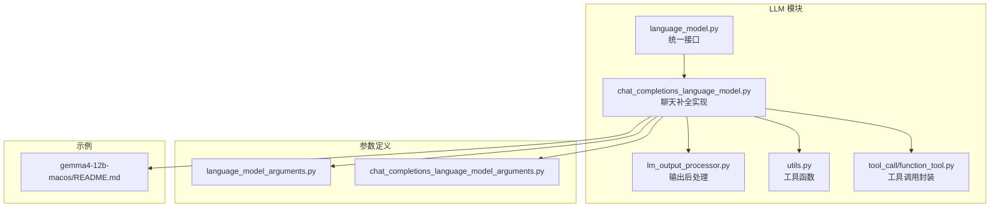
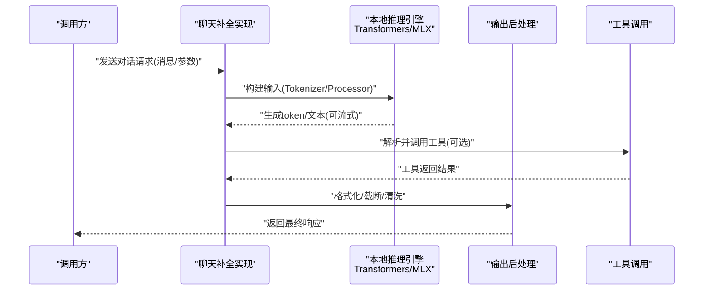
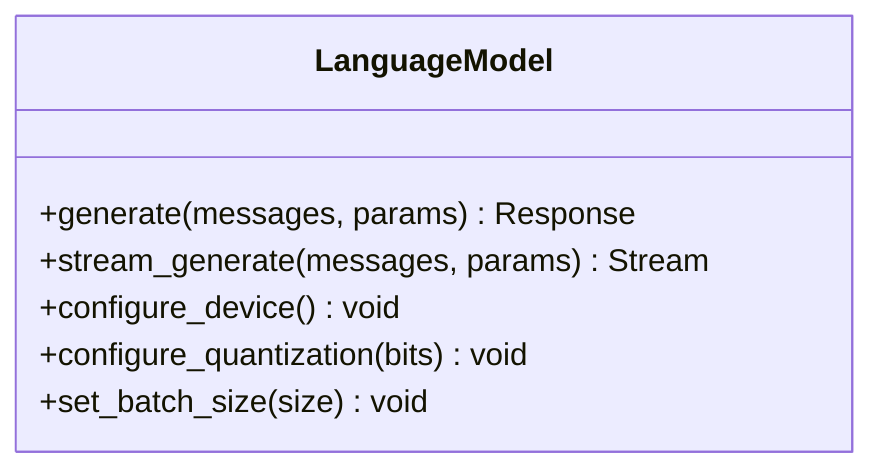
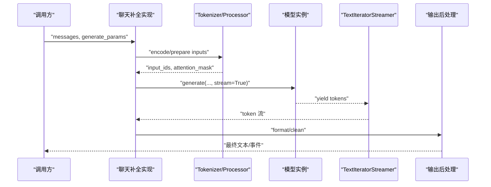
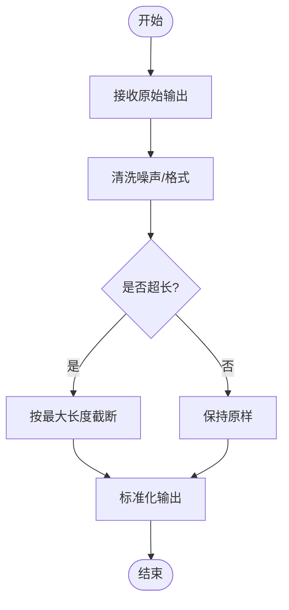
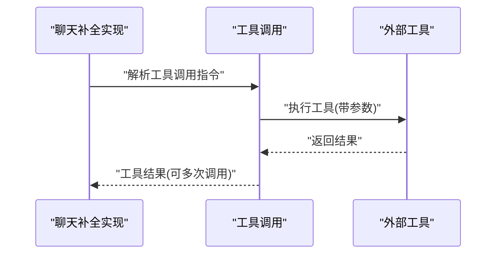
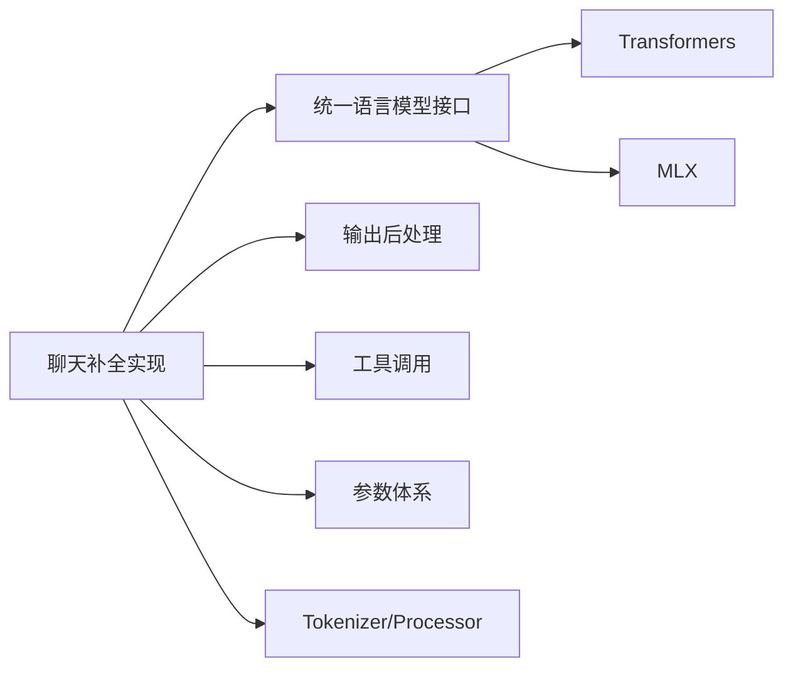

# 本地推理后端

<cite>
**本文引用的文件**
- [src/speech_to_speech/LLM/language_model.py](file://src/speech_to_speech/LLM/language_model.py)
- [src/speech_to_speech/LLM/chat_completions_language_model.py](file://src/speech_to_speech/LLM/chat_completions_language_model.py)
- [src/speech_to_speech/arguments_classes/language_model_arguments.py](file://src/speech_to_speech/arguments_classes/language_model_arguments.py)
- [src/speech_to_speech/arguments_classes/chat_completions_language_model_arguments.py](file://src/speech_to_speech/arguments_classes/chat_completions_language_model_arguments.py)
- [src/speech_to_speech/LLM/base_openai_compatible_language_model.py](file://src/speech_to_speech/LLM/base_openai_compatible_language_model.py)
- [src/speech_to_speech/LLM/chat.py](file://src/speech_to_speech/LLM/chat.py)
- [src/speech_to_speech/LLM/utils.py](file://src/speech_to_speech/LLM/utils.py)
- [src/speech_to_speech/LLM/lm_output_processor.py](file://src/speech_to_speech/LLM/lm_output_processor.py)
- [src/speech_to_speech/LLM/tool_call/function_tool.py](file://src/speech_to_speech/LLM/tool_call/function_tool.py)
- [examples/gemma4-12b-macos/README.md](file://examples/gemma4-12b-macos/README.md)
</cite>

## 目录
1. [简介](#简介)
2. [项目结构](#项目结构)
3. [核心组件](#核心组件)
4. [架构总览](#架构总览)
5. [详细组件分析](#详细组件分析)
6. [依赖关系分析](#依赖关系分析)
7. [性能考量](#性能考量)
8. [故障排查指南](#故障排查指南)
9. [结论](#结论)
10. [附录](#附录)

## 简介
本文件面向“本地推理后端”，聚焦于两种本地推理引擎的实现与使用：基于 Transformers 的通用语言模型推理，以及基于 MLX（Apple Silicon）的推理路径。文档重点涵盖：
- 模型加载机制：AutoModelForCausalLM、AutoProcessor、AutoTokenizer 的配置与选择
- 设备管理：CUDA、CPU、Apple Silicon（MLX）的设备选择与切换
- 内存优化：8bit、4bit 量化配置与适用场景
- 完整配置示例：模型选择、批处理大小、生成参数等
- 流式生成：TextIteratorStreamer 的使用与停止条件控制
- 开源模型支持：Qwen3、Llama、Mistral 等模型的加载与使用方式
- 性能调优建议与常见问题解决方案

## 项目结构
仓库围绕语音到语音（S2S）系统组织，本地推理后端位于 LLM 模块中，提供统一的接口抽象与多种实现。关键目录与职责：
- src/speech_to_speech/LLM：语言模型抽象、聊天补全实现、输出处理、工具调用等
- src/speech_to_speech/arguments_classes：各类参数的结构化定义（含语言模型相关参数）
- examples/gemma4-12b-macos：针对 Apple Silicon 的 MLX 推理示例说明
- tests：覆盖聊天、补全、输出处理等逻辑的测试用例

图表来源
- [src/speech_to_speech/LLM/language_model.py](file://src/speech_to_speech/LLM/language_model.py)
- [src/speech_to_speech/LLM/chat_completions_language_model.py](file://src/speech_to_speech/LLM/chat_completions_language_model.py)
- [src/speech_to_speech/LLM/lm_output_processor.py](file://src/speech_to_speech/LLM/lm_output_processor.py)
- [src/speech_to_speech/LLM/utils.py](file://src/speech_to_speech/LLM/utils.py)
- [src/speech_to_speech/LLM/tool_call/function_tool.py](file://src/speech_to_speech/LLM/tool_call/function_tool.py)
- [src/speech_to_speech/arguments_classes/language_model_arguments.py](file://src/speech_to_speech/arguments_classes/language_model_arguments.py)
- [src/speech_to_speech/arguments_classes/chat_completions_language_model_arguments.py](file://src/speech_to_speech/arguments_classes/chat_completions_language_model_arguments.py)
- [examples/gemma4-12b-macos/README.md](file://examples/gemma4-12b-macos/README.md)

章节来源
- [src/speech_to_speech/LLM/language_model.py](file://src/speech_to_speech/LLM/language_model.py)
- [src/speech_to_speech/LLM/chat_completions_language_model.py](file://src/speech_to_speech/LLM/chat_completions_language_model.py)
- [src/speech_to_speech/arguments_classes/language_model_arguments.py](file://src/speech_to_speech/arguments_classes/language_model_arguments.py)
- [src/speech_to_speech/arguments_classes/chat_completions_language_model_arguments.py](file://src/speech_to_speech/arguments_classes/chat_completions_language_model_arguments.py)
- [examples/gemma4-12b-macos/README.md](file://examples/gemma4-12b-macos/README.md)

## 核心组件
- 统一语言模型接口：对外暴露一致的对话与生成能力，屏蔽底层实现差异
- 聊天补全实现：封装 OpenAI 兼容的聊天补全流程，支持流式与非流式输出
- 输出后处理：对模型输出进行规范化、截断、格式清洗等
- 工具调用：将外部工具以函数形式注入到对话流程中
- 参数体系：集中管理模型、设备、量化、生成策略等配置项

章节来源
- [src/speech_to_speech/LLM/language_model.py](file://src/speech_to_speech/LLM/language_model.py)
- [src/speech_to_speech/LLM/chat_completions_language_model.py](file://src/speech_to_speech/LLM/chat_completions_language_model.py)
- [src/speech_to_speech/LLM/lm_output_processor.py](file://src/speech_to_speech/LLM/lm_output_processor.py)
- [src/speech_to_speech/LLM/tool_call/function_tool.py](file://src/speech_to_speech/LLM/tool_call/function_tool.py)
- [src/speech_to_speech/arguments_classes/language_model_arguments.py](file://src/speech_to_speech/arguments_classes/language_model_arguments.py)
- [src/speech_to_speech/arguments_classes/chat_completions_language_model_arguments.py](file://src/speech_to_speech/arguments_classes/chat_completions_language_model_arguments.py)

## 架构总览
下图展示了本地推理后端的整体架构：上层通过统一接口发起对话请求，聊天补全实现负责编排输入、调用底层推理引擎（Transformers 或 MLX）、执行输出后处理，并返回结果。参数体系贯穿整个流程，确保设备、量化、生成策略等配置的一致性。

图表来源
- [src/speech_to_speech/LLM/chat_completions_language_model.py](file://src/speech_to_speech/LLM/chat_completions_language_model.py)
- [src/speech_to_speech/LLM/lm_output_processor.py](file://src/speech_to_speech/LLM/lm_output_processor.py)
- [src/speech_to_speech/LLM/tool_call/function_tool.py](file://src/speech_to_speech/LLM/tool_call/function_tool.py)

## 详细组件分析

### 组件A：统一语言模型接口
- 职责：定义统一的对话与生成方法签名，屏蔽底层实现差异；提供设备、量化、批处理等配置的入口
- 关键点：
  - 设备管理：根据运行环境自动选择 CUDA/CPU/Apple Silicon（MLX）
  - 量化选项：支持 8bit、4bit 量化以降低显存占用
  - 批处理大小：控制并发与吞吐
  - 生成参数：温度、Top-K、Top-P、最大长度、重复惩罚等

图表来源
- [src/speech_to_speech/LLM/language_model.py](file://src/speech_to_speech/LLM/language_model.py)

章节来源
- [src/speech_to_speech/LLM/language_model.py](file://src/speech_to_speech/LLM/language_model.py)

### 组件B：聊天补全实现（OpenAI 兼容）
- 职责：将统一接口映射到具体的聊天补全流程，支持流式与非流式输出；集成工具调用与输出后处理
- 关键点：
  - 输入构造：使用 AutoTokenizer/AutoProcessor 将消息转换为模型输入
  - 生成策略：温度、Top-K、Top-P、最大长度、停止词等
  - 流式生成：通过 TextIteratorStreamer 逐步产出 token，降低首字延迟
  - 停止条件：基于停止词、最大长度、EOS token 等控制生成结束

图表来源
- [src/speech_to_speech/LLM/chat_completions_language_model.py](file://src/speech_to_speech/LLM/chat_completions_language_model.py)
- [src/speech_to_speech/LLM/lm_output_processor.py](file://src/speech_to_speech/LLM/lm_output_processor.py)

章节来源
- [src/speech_to_speech/LLM/chat_completions_language_model.py](file://src/speech_to_speech/LLM/chat_completions_language_model.py)
- [src/speech_to_speech/LLM/lm_output_processor.py](file://src/speech_to_speech/LLM/lm_output_processor.py)

### 组件C：输出后处理
- 职责：对模型原始输出进行规范化、截断、格式清洗，确保下游一致性
- 关键点：
  - 去除多余空白、HTML/Markdown 噪声
  - 按最大长度截断，避免超长响应
  - 标准化 JSON/工具调用格式

图表来源
- [src/speech_to_speech/LLM/lm_output_processor.py](file://src/speech_to_speech/LLM/lm_output_processor.py)

章节来源
- [src/speech_to_speech/LLM/lm_output_processor.py](file://src/speech_to_speech/LLM/lm_output_processor.py)

### 组件D：工具调用封装
- 职责：在对话过程中解析并调用外部工具，将工具返回结果注入上下文
- 关键点：
  - 工具注册与发现
  - 参数校验与类型转换
  - 错误处理与重试策略

图表来源
- [src/speech_to_speech/LLM/tool_call/function_tool.py](file://src/speech_to_speech/LLM/tool_call/function_tool.py)

章节来源
- [src/speech_to_speech/LLM/tool_call/function_tool.py](file://src/speech_to_speech/LLM/tool_call/function_tool.py)

### 组件E：参数体系（语言模型与聊天补全）
- 职责：集中管理模型选择、设备、量化、批处理、生成策略等配置
- 关键点：
  - 模型选择：支持 Qwen3、Llama、Mistral 等开源模型
  - 设备管理：CUDA、CPU、Apple Silicon（MLX）
  - 量化选项：8bit、4bit
  - 生成参数：温度、Top-K、Top-P、最大长度、停止词等
  - 批处理大小：影响吞吐与延迟

章节来源
- [src/speech_to_speech/arguments_classes/language_model_arguments.py](file://src/speech_to_speech/arguments_classes/language_model_arguments.py)
- [src/speech_to_speech/arguments_classes/chat_completions_language_model_arguments.py](file://src/speech_to_speech/arguments_classes/chat_completions_language_model_arguments.py)

## 依赖关系分析
- 聊天补全实现依赖：
  - 统一语言模型接口：获取设备、量化、生成策略等能力
  - 输出后处理：规范化输出
  - 工具调用：扩展对话能力
  - 参数体系：配置驱动行为
- 外部依赖：
  - Transformers：用于 CPU/GPU 上的模型加载与推理
  - MLX：用于 Apple Silicon 上的高效推理
  - Tokenizer/Processor：将消息转换为模型输入

图表来源
- [src/speech_to_speech/LLM/chat_completions_language_model.py](file://src/speech_to_speech/LLM/chat_completions_language_model.py)
- [src/speech_to_speech/LLM/language_model.py](file://src/speech_to_speech/LLM/language_model.py)
- [src/speech_to_speech/LLM/lm_output_processor.py](file://src/speech_to_speech/LLM/lm_output_processor.py)
- [src/speech_to_speech/LLM/tool_call/function_tool.py](file://src/speech_to_speech/LLM/tool_call/function_tool.py)
- [src/speech_to_speech/arguments_classes/language_model_arguments.py](file://src/speech_to_speech/arguments_classes/language_model_arguments.py)

章节来源
- [src/speech_to_speech/LLM/chat_completions_language_model.py](file://src/speech_to_speech/LLM/chat_completions_language_model.py)
- [src/speech_to_speech/LLM/language_model.py](file://src/speech_to_speech/LLM/language_model.py)
- [src/speech_to_speech/arguments_classes/language_model_arguments.py](file://src/speech_to_speech/arguments_classes/language_model_arguments.py)

## 性能考量
- 设备选择：
  - CUDA：适合 GPU 加速，注意显存与批处理大小的平衡
  - CPU：适合无 GPU 环境，可通过量化降低内存占用
  - Apple Silicon（MLX）：利用 Metal 加速，适合 macOS 设备
- 量化策略：
  - 8bit：显著降低显存占用，精度损失较小
  - 4bit：进一步降低显存，可能带来一定精度下降
- 批处理大小：
  - 增大批处理提升吞吐，但增加延迟与显存压力
- 生成参数：
  - 温度、Top-K、Top-P 控制多样性与稳定性
  - 最大长度与停止词控制输出长度与结束条件
- 流式生成：
  - 使用 TextIteratorStreamer 降低首字延迟，提升交互体验

[本节为通用性能指导，不直接分析具体文件]

## 故障排查指南
- 模型加载失败：
  - 检查模型名称与版本是否正确
  - 确认网络与缓存目录权限
  - 验证 Tokenizer/Processor 配置是否与模型匹配
- 设备问题：
  - CUDA 不可用：检查驱动与库安装
  - Apple Silicon：确认 MLX 环境正确配置
- 内存不足：
  - 启用 8bit/4bit 量化
  - 减小批处理大小或最大长度
- 生成异常：
  - 调整温度、Top-K、Top-P
  - 设置合适的停止词与最大长度
- 流式输出卡顿：
  - 检查 TextIteratorStreamer 配置
  - 优化网络与 I/O 性能

章节来源
- [src/speech_to_speech/LLM/chat_completions_language_model.py](file://src/speech_to_speech/LLM/chat_completions_language_model.py)
- [src/speech_to_speech/LLM/lm_output_processor.py](file://src/speech_to_speech/LLM/lm_output_processor.py)
- [src/speech_to_speech/LLM/utils.py](file://src/speech_to_speech/LLM/utils.py)

## 结论
本地推理后端通过统一接口与模块化设计，实现了 Transformers 与 MLX 两种推理引擎的无缝切换。借助参数体系与输出后处理，系统能够灵活适配不同设备与量化策略，并提供流式生成以提升用户体验。结合工具调用与丰富的生成参数，系统可支撑多种开源语言模型（如 Qwen3、Llama、Mistral）的高效本地推理。

[本节为总结性内容，不直接分析具体文件]

## 附录
- 配置示例要点：
  - 模型选择：指定模型名称（如 Qwen3、Llama、Mistral）
  - 设备管理：选择 CUDA、CPU 或 Apple Silicon（MLX）
  - 量化选项：启用 8bit 或 4bit 量化
  - 批处理大小：根据显存与延迟需求调整
  - 生成参数：温度、Top-K、Top-P、最大长度、停止词
- 流式生成：
  - 使用 TextIteratorStreamer 逐步产出 token
  - 设置停止条件（停止词、最大长度、EOS）
- Apple Silicon 示例：
  - 参考 gemma4-12b-macos 示例了解 MLX 推理配置

章节来源
- [examples/gemma4-12b-macos/README.md](file://examples/gemma4-12b-macos/README.md)
- [src/speech_to_speech/arguments_classes/language_model_arguments.py](file://src/speech_to_speech/arguments_classes/language_model_arguments.py)
- [src/speech_to_speech/arguments_classes/chat_completions_language_model_arguments.py](file://src/speech_to_speech/arguments_classes/chat_completions_language_model_arguments.py)
- [src/speech_to_speech/LLM/chat_completions_language_model.py](file://src/speech_to_speech/LLM/chat_completions_language_model.py)