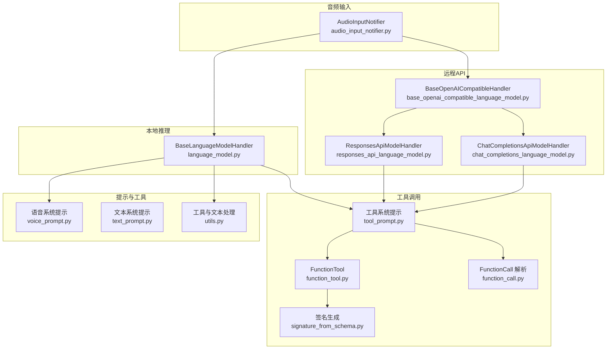
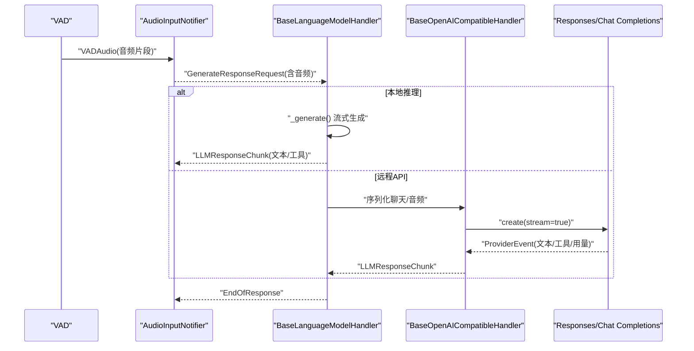
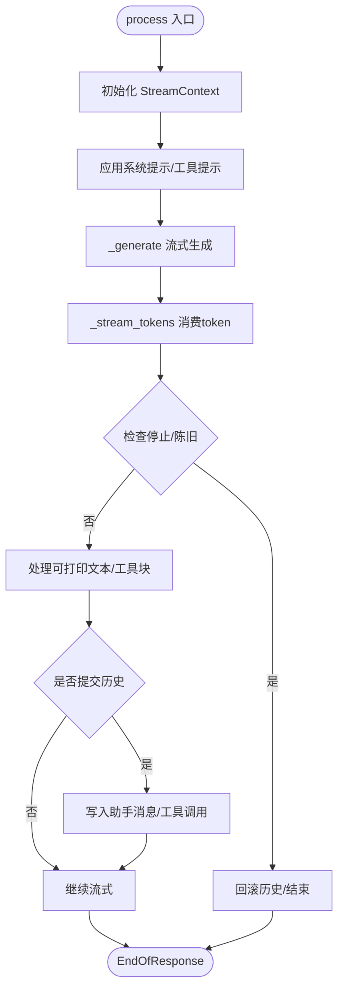
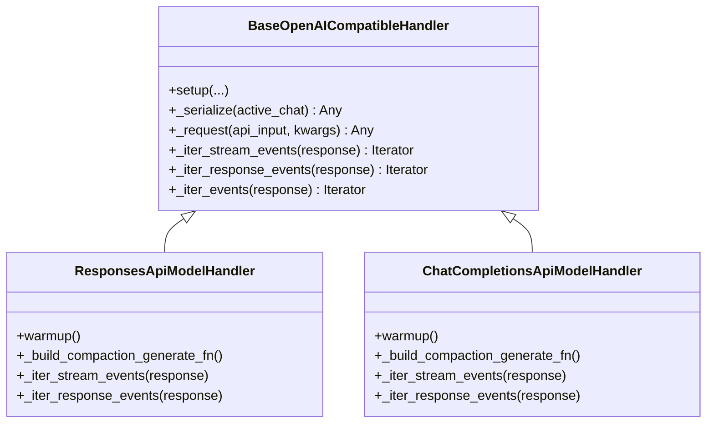
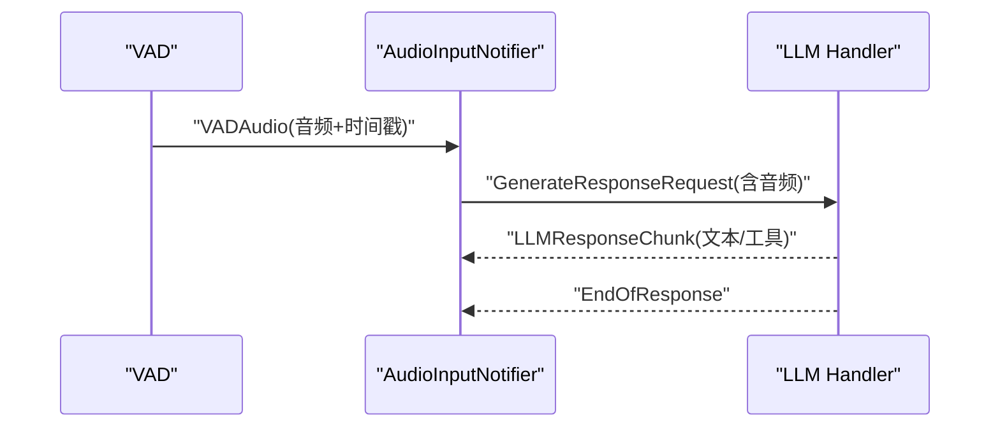
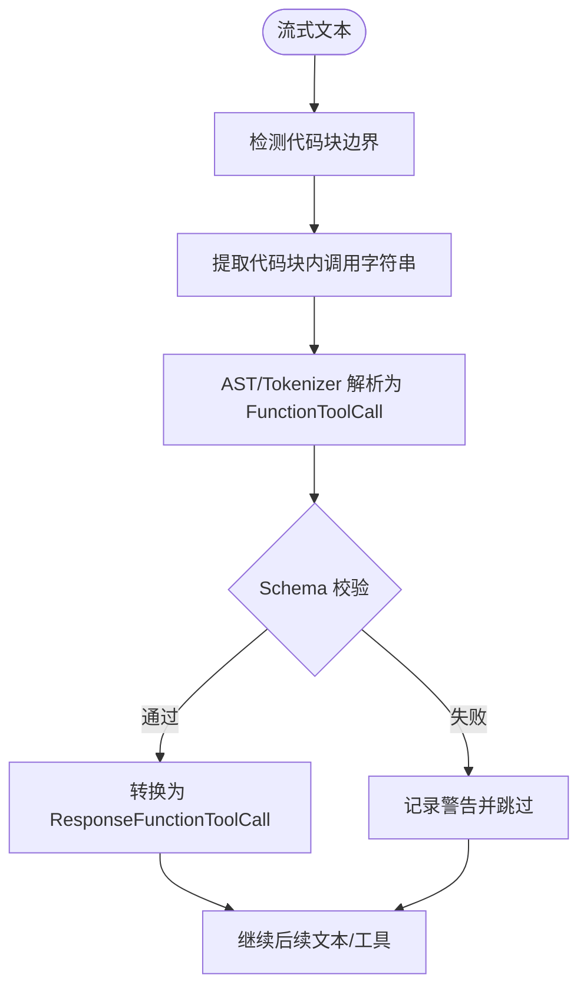
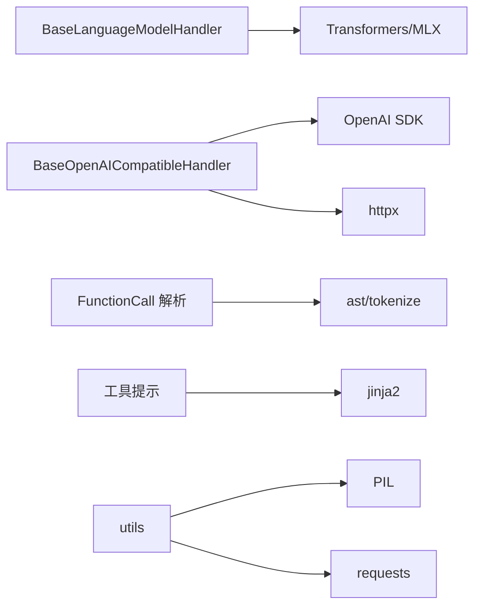

# 语言模型模块

<cite>
**本文引用的文件**
- [language_model.py](file://src/speech_to_speech/LLM/language_model.py)
- [base_openai_compatible_language_model.py](file://src/speech_to_speech/LLM/base_openai_compatible_language_model.py)
- [chat_completions_language_model.py](file://src/speech_to_speech/LLM/chat_completions_language_model.py)
- [responses_api_language_model.py](file://src/speech_to_speech/LLM/responses_api_language_model.py)
- [audio_input_notifier.py](file://src/speech_to_speech/LLM/audio_input_notifier.py)
- [function_tool.py](file://src/speech_to_speech/LLM/tool_call/function_tool.py)
- [function_call.py](file://src/speech_to_speech/LLM/tool_call/function_call.py)
- [tool_prompt.py](file://src/speech_to_speech/LLM/tool_call/tool_prompt.py)
- [signature_from_schema.py](file://src/speech_to_speech/LLM/tool_call/signature_from_schema.py)
- [text_prompt.py](file://src/speech_to_speech/LLM/text_prompt.py)
- [voice_prompt.py](file://src/speech_to_speech/LLM/voice_prompt.py)
- [utils.py](file://src/speech_to_speech/LLM/utils.py)
- [language_model_arguments.py](file://src/speech_to_speech/arguments_classes/language_model_arguments.py)
- [responses_api_language_model_arguments.py](file://src/speech_to_speech/arguments_classes/responses_api_language_model_arguments.py)
- [chat_completions_language_model_arguments.py](file://src/speech_to_speech/arguments_classes/chat_completions_language_model_arguments.py)
</cite>

## 目录
1. [简介](#简介)
2. [项目结构](#项目结构)
3. [核心组件](#核心组件)
4. [架构总览](#架构总览)
5. [详细组件分析](#详细组件分析)
6. [依赖关系分析](#依赖关系分析)
7. [性能考虑](#性能考虑)
8. [故障排查指南](#故障排查指南)
9. [结论](#结论)
10. [附录：配置与集成示例](#附录配置与集成示例)

## 简介
本模块提供统一的语言模型接入层，支持以下能力：
- 本地推理后端：Transformers（文本/多模态）与 mlx-lm（苹果芯片优化）。
- 远程 API 后端：OpenAI Responses API 与 Chat Completions。
- 音频输入直接处理：无需 STT 转换，将 VAD 输出的音频片段直接送入 LLM 进行语音到语音的响应。
- 工具调用：函数签名生成、代码块包裹提示、流式解析与外部工具集成。
- 流式响应、消息压缩与上下文管理：句子级分片、历史压缩、推测性轮次与取消控制。
- 多提供商集成：OpenAI、HF Inference Providers、vLLM、llama.cpp 等通过 OpenAI 兼容接口接入。

## 项目结构
语言模型模块位于 src/speech_to_speech/LLM，按职责划分为：
- 基础抽象与通用流程：BaseLanguageModelHandler、BaseOpenAICompatibleHandler
- 本地后端：Transformers/MLX 实现（在 language_model.py 中定义基类与共享逻辑）
- 远程后端：Responses API、Chat Completions 适配器
- 工具调用：函数解析、签名生成、系统提示构建
- 提示工程：文本/语音通道系统提示、语言提示
- 参数配置：各后端的 CLI/环境变量参数

**图表来源**
- [language_model.py:165-794](file://src/speech_to_speech/LLM/language_model.py#L165-L794)
- [base_openai_compatible_language_model.py:145-800](file://src/speech_to_speech/LLM/base_openai_compatible_language_model.py#L145-L800)
- [responses_api_language_model.py:43-215](file://src/speech_to_speech/LLM/responses_api_language_model.py#L43-L215)
- [chat_completions_language_model.py:278-370](file://src/speech_to_speech/LLM/chat_completions_language_model.py#L278-L370)
- [tool_prompt.py:76-110](file://src/speech_to_speech/LLM/tool_call/tool_prompt.py#L76-L110)
- [function_tool.py:8-35](file://src/speech_to_speech/LLM/tool_call/function_tool.py#L8-L35)
- [function_call.py:288-322](file://src/speech_to_speech/LLM/tool_call/function_call.py#L288-L322)
- [signature_from_schema.py:79-109](file://src/speech_to_speech/LLM/tool_call/signature_from_schema.py#L79-L109)
- [voice_prompt.py:35-53](file://src/speech_to_speech/LLM/voice_prompt.py#L35-L53)
- [text_prompt.py:30-48](file://src/speech_to_speech/LLM/text_prompt.py#L30-L48)
- [utils.py:99-136](file://src/speech_to_speech/LLM/utils.py#L99-L136)
- [audio_input_notifier.py:18-64](file://src/speech_to_speech/LLM/audio_input_notifier.py#L18-L64)

**章节来源**
- [language_model.py:165-794](file://src/speech_to_speech/LLM/language_model.py#L165-L794)
- [base_openai_compatible_language_model.py:145-800](file://src/speech_to_speech/LLM/base_openai_compatible_language_model.py#L145-L800)

## 核心组件
- BaseLanguageModelHandler：本地推理（Transformers/MLX）的通用流水线，负责流式分句、工具提取、历史提交、Token 用量统计、推测性轮次与取消控制。
- BaseOpenAICompatibleHandler：OpenAI 兼容后端（Responses/Chat Completions）的统一编排，封装请求构造、事件归一化、流式消费、历史回写与错误终止。
- ResponsesApiModelHandler：适配 /v1/responses 的事件流与用法统计。
- ChatCompletionsApiModelHandler：适配 /v1/chat/completions 的工具调用与流式输出。
- AudioInputNotifier：将 VAD 完成的音频直接注入 LLM 阶段，跳过 STT 转换。
- 工具调用子系统：FunctionTool、FunctionCall 解析、工具系统提示、JSON Schema 到 Python 签名映射。
- 提示工程：语音/文本系统提示模板、语言提示注入。

**章节来源**
- [language_model.py:165-794](file://src/speech_to_speech/LLM/language_model.py#L165-L794)
- [base_openai_compatible_language_model.py:145-800](file://src/speech_to_speech/LLM/base_openai_compatible_language_model.py#L145-L800)
- [responses_api_language_model.py:43-215](file://src/speech_to_speech/LLM/responses_api_language_model.py#L43-L215)
- [chat_completions_language_model.py:278-370](file://src/speech_to_speech/LLM/chat_completions_language_model.py#L278-L370)
- [audio_input_notifier.py:18-64](file://src/speech_to_speech/LLM/audio_input_notifier.py#L18-L64)
- [function_tool.py:8-35](file://src/speech_to_speech/LLM/tool_call/function_tool.py#L8-L35)
- [function_call.py:288-322](file://src/speech_to_speech/LLM/tool_call/function_call.py#L288-L322)
- [tool_prompt.py:76-110](file://src/speech_to_speech/LLM/tool_call/tool_prompt.py#L76-L110)
- [signature_from_schema.py:79-109](file://src/speech_to_speech/LLM/tool_call/signature_from_schema.py#L79-L109)
- [voice_prompt.py:35-53](file://src/speech_to_speech/LLM/voice_prompt.py#L35-L53)
- [text_prompt.py:30-48](file://src/speech_to_speech/LLM/text_prompt.py#L30-L48)

## 架构总览
语言模型模块采用“统一入口 + 多后端”的架构：
- 本地路径：BaseLanguageModelHandler 负责加载模型、流式生成、句子分片、工具提取、历史提交与 Token 统计。
- 远程路径：BaseOpenAICompatibleHandler 统一封装 OpenAI SDK 调用，子类分别实现 Responses 与 Chat Completions 的事件映射。
- 音频直入：AudioInputNotifier 将 VAD 完成的音频直接作为 LLM 输入，避免 STT 延迟。
- 工具调用：通过工具系统提示引导模型以代码块形式输出函数调用，再由解析器提取并转换为标准工具调用事件。

**图表来源**
- [audio_input_notifier.py:18-64](file://src/speech_to_speech/LLM/audio_input_notifier.py#L18-L64)
- [language_model.py:580-794](file://src/speech_to_speech/LLM/language_model.py#L580-L794)
- [base_openai_compatible_language_model.py:734-800](file://src/speech_to_speech/LLM/base_openai_compatible_language_model.py#L734-L800)
- [responses_api_language_model.py:162-215](file://src/speech_to_speech/LLM/responses_api_language_model.py#L162-L215)
- [chat_completions_language_model.py:347-370](file://src/speech_to_speech/LLM/chat_completions_language_model.py#L347-L370)

## 详细组件分析

### 本地推理：BaseLanguageModelHandler
- 生命周期：setup -> _load_model -> process -> _generate -> _stream_tokens -> _commit_ordered_output -> EndOfResponse。
- 流式处理：累积 raw/generated/printable 文本，按句子批次分片；音频路径去除不可发音字符，文本路径保留原样。
- 工具调用：当启用工具时，系统提示包含代码块规则；流式文本中检测进入/结束标记，提取完整代码块并解析为工具调用。
- 历史与压缩：提交有序输出到对话历史，必要时执行历史压缩；清理图像引用。
- 取消与推测：基于 CancelScope 与 SpeculativeTurnTracker 判断是否丢弃陈旧或中断的轮次。

**图表来源**
- [language_model.py:580-794](file://src/speech_to_speech/LLM/language_model.py#L580-L794)
- [language_model.py:321-424](file://src/speech_to_speech/LLM/language_model.py#L321-L424)
- [language_model.py:426-488](file://src/speech_to_speech/LLM/language_model.py#L426-L488)

**章节来源**
- [language_model.py:165-794](file://src/speech_to_speech/LLM/language_model.py#L165-L794)

### 远程API：BaseOpenAICompatibleHandler 与子类
- 统一编排：_serialize/_request/_iter_events 由子类实现；统一消费流式/非流式事件，归一化为 ProviderEvent（TextDelta/AssistantMessage/ToolCall/Usage）。
- 音频输入：支持 input_audio 与 audio_url 两种内容类型；可限制最近音频轮次数量以减少上下文膨胀。
- 推测性预取：后台线程安全地发起请求并消费事件，支持中断与资源释放。
- 工具调用：
  - Responses：直接从 ResponseOutputItemDoneEvent 中提取函数调用。
  - Chat Completions：累积 delta.tool_calls，最终合并为 ToolCall。

**图表来源**
- [base_openai_compatible_language_model.py:145-337](file://src/speech_to_speech/LLM/base_openai_compatible_language_model.py#L145-L337)
- [responses_api_language_model.py:43-215](file://src/speech_to_speech/LLM/responses_api_language_model.py#L43-L215)
- [chat_completions_language_model.py:278-370](file://src/speech_to_speech/LLM/chat_completions_language_model.py#L278-L370)

**章节来源**
- [base_openai_compatible_language_model.py:145-800](file://src/speech_to_speech/LLM/base_openai_compatible_language_model.py#L145-L800)
- [responses_api_language_model.py:43-215](file://src/speech_to_speech/LLM/responses_api_language_model.py#L43-L215)
- [chat_completions_language_model.py:278-370](file://src/speech_to_speech/LLM/chat_completions_language_model.py#L278-L370)

### 音频输入直接处理模式
- 触发点：VAD 完成一段语音后，AudioInputNotifier 将 VADAudio 转为 LLM 输入请求，不经过 STT。
- 优势：降低端到端延迟，适合实时语音交互。
- 注意：需确保 LLM 后端支持音频输入（如 Chat Completions 的 input_audio 或 audio_url）。

**图表来源**
- [audio_input_notifier.py:18-64](file://src/speech_to_speech/LLM/audio_input_notifier.py#L18-L64)
- [base_openai_compatible_language_model.py:315-337](file://src/speech_to_speech/LLM/base_openai_compatible_language_model.py#L315-L337)
- [chat_completions_language_model.py:96-157](file://src/speech_to_speech/LLM/chat_completions_language_model.py#L96-L157)

**章节来源**
- [audio_input_notifier.py:18-64](file://src/speech_to_speech/LLM/audio_input_notifier.py#L18-L64)
- [base_openai_compatible_language_model.py:315-337](file://src/speech_to_speech/LLM/base_openai_compatible_language_model.py#L315-L337)
- [chat_completions_language_model.py:96-157](file://src/speech_to_speech/LLM/chat_completions_language_model.py#L96-L157)

### 工具调用：函数解析与外部工具集成
- 系统提示：根据工具列表生成 Python 风格函数签名与使用规则，要求模型将调用包裹在代码块中。
- 解析流程：从流式文本中识别代码块边界，提取内部函数调用字符串，使用 AST/tokenize 解析为 FunctionToolCall，再转换为标准工具调用事件。
- 校验：可选地依据工具 JSON Schema 校验必需参数与类型，丢弃未声明参数。

**图表来源**
- [tool_prompt.py:76-110](file://src/speech_to_speech/LLM/tool_call/tool_prompt.py#L76-L110)
- [function_call.py:288-322](file://src/speech_to_speech/LLM/tool_call/function_call.py#L288-L322)
- [function_tool.py:8-35](file://src/speech_to_speech/LLM/tool_call/function_tool.py#L8-L35)
- [signature_from_schema.py:79-109](file://src/speech_to_speech/LLM/tool_call/signature_from_schema.py#L79-L109)

**章节来源**
- [tool_prompt.py:76-110](file://src/speech_to_speech/LLM/tool_call/tool_prompt.py#L76-L110)
- [function_call.py:288-322](file://src/speech_to_speech/LLM/tool_call/function_call.py#L288-L322)
- [function_tool.py:8-35](file://src/speech_to_speech/LLM/tool_call/function_tool.py#L8-L35)
- [signature_from_schema.py:79-109](file://src/speech_to_speech/LLM/tool_call/signature_from_schema.py#L79-L109)

### 流式响应、消息压缩与上下文管理
- 流式响应：按句子批次分片输出，减少首字延迟；音频路径过滤不可发音字符，文本路径保留 Markdown。
- 消息压缩：当启用 compact_history 时，使用 compactor 对长历史进行摘要，降低上下文长度。
- 上下文管理：记录本轮消耗的图像 ID，提交后裁剪历史；支持 out-of-band 响应与历史锚点定位，保证并发追加时的顺序一致性。

**章节来源**
- [language_model.py:321-424](file://src/speech_to_speech/LLM/language_model.py#L321-L424)
- [language_model.py:654-746](file://src/speech_to_speech/LLM/language_model.py#L654-L746)
- [base_openai_compatible_language_model.py:517-685](file://src/speech_to_speech/LLM/base_openai_compatible_language_model.py#L517-L685)

## 依赖关系分析
- 本地后端依赖 Transformers/MLX 库进行模型加载与生成；远程后端依赖 OpenAI SDK 与 httpx 进行网络请求。
- 工具调用依赖 jinja2 渲染提示、ast/tokenize 解析调用、pydantic 校验数据。
- 提示工程依赖 NLTK 进行句子分词，PIL/requests 处理图像。

**图表来源**
- [language_model.py:21-34](file://src/speech_to_speech/LLM/language_model.py#L21-L34)
- [base_openai_compatible_language_model.py:17-20](file://src/speech_to_speech/LLM/base_openai_compatible_language_model.py#L17-L20)
- [function_call.py:9-19](file://src/speech_to_speech/LLM/tool_call/function_call.py#L9-L19)
- [tool_prompt.py:11-13](file://src/speech_to_speech/LLM/tool_call/tool_prompt.py#L11-L13)
- [utils.py:7-8](file://src/speech_to_speech/LLM/utils.py#L7-L8)

**章节来源**
- [language_model.py:21-34](file://src/speech_to_speech/LLM/language_model.py#L21-L34)
- [base_openai_compatible_language_model.py:17-20](file://src/speech_to_speech/LLM/base_openai_compatible_language_model.py#L17-L20)
- [function_call.py:9-19](file://src/speech_to_speech/LLM/tool_call/function_call.py#L9-L19)
- [tool_prompt.py:11-13](file://src/speech_to_speech/LLM/tool_call/tool_prompt.py#L11-L13)
- [utils.py:7-8](file://src/speech_to_speech/LLM/utils.py#L7-L8)

## 性能考虑
- 本地推理：
  - 量化加载：支持 8-bit/4-bit 量化以降低显存占用（Transformers 后端）。
  - 设备选择：优先使用 GPU（cuda），CPU 仅用于测试或无 GPU 环境。
  - 流式批大小：调整 stream_batch_sentences 平衡首字延迟与吞吐。
- 远程 API：
  - 超时与重试：设置 request_timeout_s 与 WARMUP_MAX_RETRIES，提升冷启动稳定性。
  - 音频内容类型：input_audio 直接嵌入 base64；audio_url 使用 data URL，视提供商支持选择。
  - 历史轮次：audio_history_turns 控制保留的音频轮次数，避免上下文过大。
- 工具调用：
  - 启用工具系统提示会增加 token 消耗，按需开启 include_args_doc。
  - 使用 code block 约束可减少解析错误，提高工具调用成功率。

[本节为通用指导，不直接分析具体文件]

## 故障排查指南
- 生成被取消：检查 CancelScope 与 SpeculativeTurnTracker，确认是否为陈旧轮次或用户中断。
- 工具调用失败：查看日志中的“Skipping invalid tool call”，确认函数名与参数是否符合 Schema。
- 音频输入无效：确认后端支持音频输入（input_audio 或 audio_url），并检查 sample_rate 与格式。
- 历史回写异常：检查 response_key 与 history_anchor_id，确保并发追加时顺序一致。
- 远程请求失败：检查 base_url、api_key 与 extra_body（禁用思考/推理级别），以及提供商兼容性。

**章节来源**
- [language_model.py:490-508](file://src/speech_to_speech/LLM/language_model.py#L490-L508)
- [language_model.py:765-794](file://src/speech_to_speech/LLM/language_model.py#L765-L794)
- [base_openai_compatible_language_model.py:357-499](file://src/speech_to_speech/LLM/base_openai_compatible_language_model.py#L357-L499)
- [function_call.py:191-237](file://src/speech_to_speech/LLM/tool_call/function_call.py#L191-L237)

## 结论
本模块通过统一的抽象层屏蔽了本地与远程后端的差异，提供了稳定的流式响应、工具调用、音频直入与上下文管理能力。借助灵活的参数配置与提示工程，可快速对接多种提供商与模型，满足实时语音交互场景的低延迟与高可靠性需求。

[本节为总结，不直接分析具体文件]

## 附录：配置与集成示例

### 支持的 LLM 后端与关键参数
- Transformers 本地推理：
  - 设备与精度：llm_device、llm_torch_dtype
  - 量化：llm_load_in_8bit、llm_load_in_4bit
  - 生成：llm_gen_max_new_tokens、llm_gen_min_new_tokens、llm_gen_temperature、llm_gen_do_sample
  - 视觉模型：llm_is_vlm
- MLX 本地推理：
  - 通过 backend="mlx" 切换；利用 MLXLockContext 串行化生成。
- 远程 API：
  - model_name、responses_api_base_url、responses_api_api_key、responses_api_stream
  - 禁用思考：responses_api_disable_thinking
  - 推理级别：responses_api_reasoning_effort
  - 音频参数：responses_api_audio_max_tokens、responses_api_audio_temperature、responses_api_audio_content_type、responses_api_audio_history_turns

**章节来源**
- [language_model_arguments.py:6-58](file://src/speech_to_speech/arguments_classes/language_model_arguments.py#L6-L58)
- [responses_api_language_model_arguments.py:7-68](file://src/speech_to_speech/arguments_classes/responses_api_language_model_arguments.py#L7-L68)
- [chat_completions_language_model_arguments.py:9-30](file://src/speech_to_speech/arguments_classes/chat_completions_language_model_arguments.py#L9-L30)

### 各后端配置要点
- Transformers：
  - 使用 AutoModelForCausalLM/AutoProcessor 加载模型；支持 BitsAndBytesConfig 量化。
  - 通过 TextIteratorStreamer 实现流式输出；使用 StoppingCriteria 支持外部取消。
- MLX：
  - 使用 mlx_lm.load/stream_generate；通过 MLXLockContext 避免并发冲突。
- Responses API：
  - 使用 client.responses.create；事件流包含文本增量、工具调用完成与用量。
- Chat Completions：
  - 使用 client.chat.completions.create；工具调用通过 delta.tool_calls 累积。

**章节来源**
- [language_model.py:21-34](file://src/speech_to_speech/LLM/language_model.py#L21-L34)
- [responses_api_language_model.py:162-215](file://src/speech_to_speech/LLM/responses_api_language_model.py#L162-L215)
- [chat_completions_language_model.py:160-181](file://src/speech_to_speech/LLM/chat_completions_language_model.py#L160-L181)

### 与提供商的集成指南
- OpenAI：
  - 使用默认 base_url；可通过 responses_api_reasoning_effort 控制推理级别。
- HF Inference Providers：
  - 设置 responses_api_base_url 指向 HF 路由；注意 extra_body 键兼容性。
- vLLM：
  - 使用 Chat Completions 路径；通过 chat_template_kwargs.enable_thinking=false 禁用思考。
- llama.cpp：
  - 通过 OpenAI 兼容接口暴露 /v1/chat/completions；配置 base_url 与 api_key（可为 none）。

**章节来源**
- [base_openai_compatible_language_model.py:218-265](file://src/speech_to_speech/LLM/base_openai_compatible_language_model.py#L218-L265)
- [chat_completions_language_model.py:278-370](file://src/speech_to_speech/LLM/chat_completions_language_model.py#L278-L370)

### 本地模型与远程服务配置步骤
- 本地模型：
  - 选择 backend="transformers" 或 "mlx"；设置 device、dtype、量化选项。
  - 如需视觉输入，启用 llm_is_vlm 并使用多模态处理器。
- 远程服务：
  - 设置 model_name、base_url、api_key；根据需要启用/禁用思考。
  - 音频输入选择 input_audio 或 audio_url；调整温度与最大 token。

**章节来源**
- [language_model_arguments.py:6-58](file://src/speech_to_speech/arguments_classes/language_model_arguments.py#L6-L58)
- [responses_api_language_model_arguments.py:7-68](file://src/speech_to_speech/arguments_classes/responses_api_language_model_arguments.py#L7-L68)