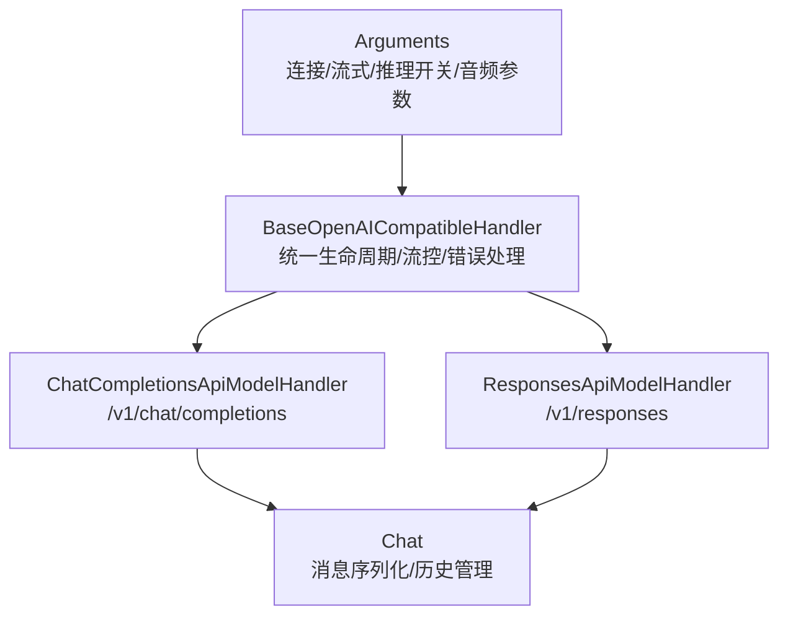
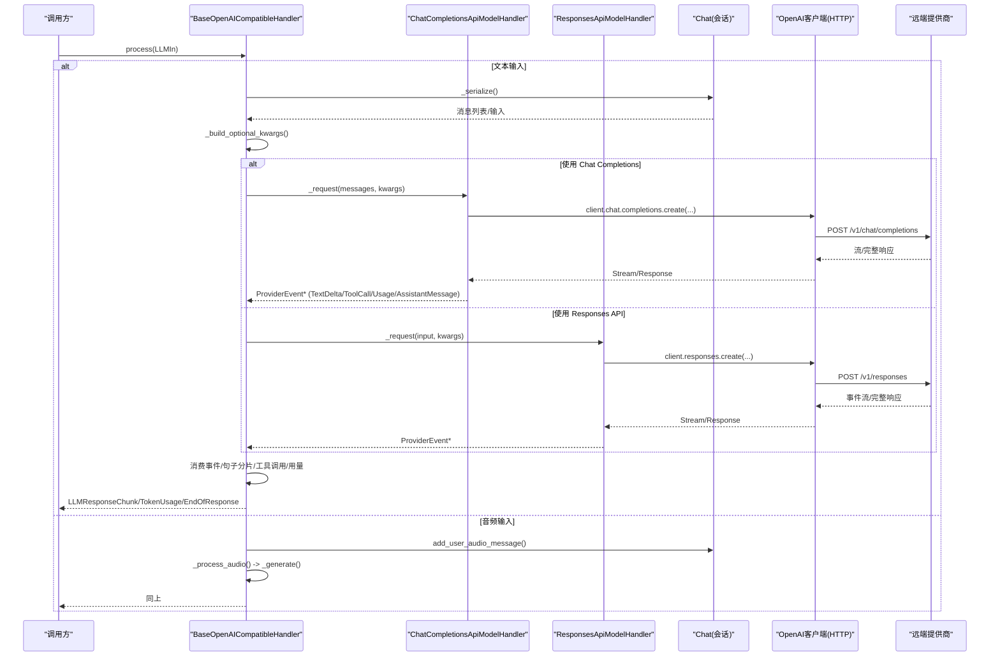
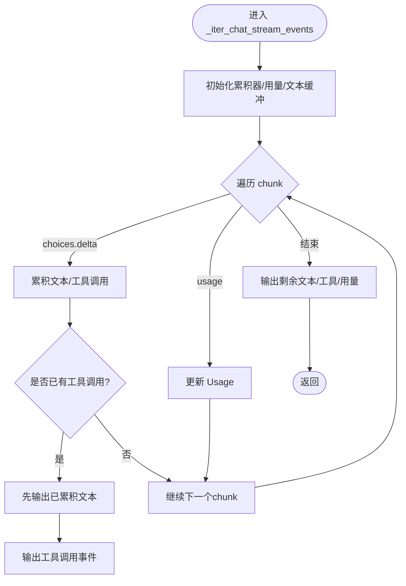
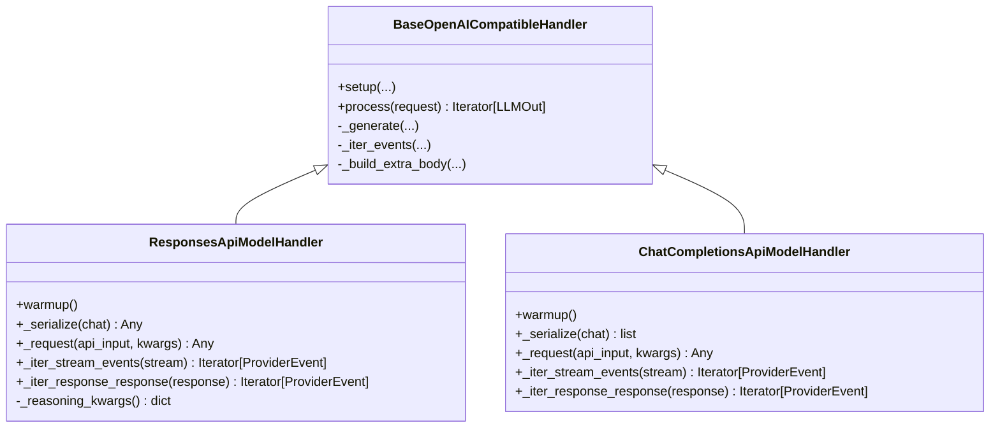
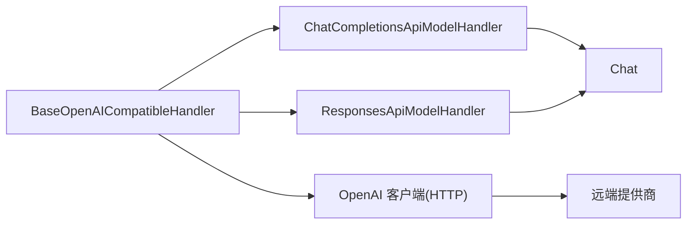

# 远程API集成

<cite>
**本文引用的文件**
- [base_openai_compatible_language_model.py](file://src/speech_to_speech/LLM/base_openai_compatible_language_model.py)
- [chat_completions_language_model.py](file://src/speech_to_speech/LLM/chat_completions_language_model.py)
- [responses_api_language_model.py](file://src/speech_to_speech/LLM/responses_api_language_model.py)
- [chat.py](file://src/speech_to_speech/LLM/chat.py)
- [language_model_base_arguments.py](file://src/speech_to_speech/arguments_classes/language_model_base_arguments.py)
- [responses_api_language_model_arguments.py](file://src/speech_to_speech/arguments_classes/responses_api_language_model_arguments.py)
- [chat_completions_language_model_arguments.py](file://src/speech_to_speech/arguments_classes/chat_completions_language_model_arguments.py)
- [openai-compatible-stt.md](file://docs/openai-compatible-stt.md)
- [README.md](file://README.md)
</cite>

## 目录
1. [简介](#简介)
2. [项目结构](#项目结构)
3. [核心组件](#核心组件)
4. [架构总览](#架构总览)
5. [详细组件分析](#详细组件分析)
6. [依赖关系分析](#依赖关系分析)
7. [性能与可靠性](#性能与可靠性)
8. [故障排除与调试](#故障排除与调试)
9. [结论](#结论)
10. [附录：配置与迁移指南](#附录：配置与迁移指南)

## 简介
本文件聚焦于语音到语音（Speech-to-Speech）管线中的“语言模型”层，详细说明两种远程API模式的实现与使用：
- Chat Completions 模式：通过 OpenAI 兼容的 /v1/chat/completions 接口调用后端。
- Responses API 模式：通过 OpenAI 兼容的 /v1/responses 接口调用后端。

两者共享统一的基类与事件抽象，屏蔽底层提供商差异，支持流式与非流式响应、工具调用、用量统计、历史压缩、取消与回滚等能力。代码库默认通过 OpenAI SDK 的 OpenAI 客户端发起 HTTP 请求，因此可对接官方 OpenAI 以及任何遵循 OpenAI 协议的后端（例如 vLLM、HF Inference Providers、本地推理服务等）。对于 Anthropic、Google 等提供商，若其提供 OpenAI 兼容端点，则可通过 base_url 指向该端点；否则需自行适配或选择原生适配器。

## 项目结构
与远程API集成直接相关的模块位于 LLM 子包中：
- 基类与通用流程：BaseOpenAICompatibleHandler
- 两种后端实现：ChatCompletionsApiModelHandler、ResponsesApiModelHandler
- 会话与消息序列化：Chat
- 参数定义：LanguageModelBaseArguments、ResponsesApiLanguageModelHandlerArguments、ChatCompletionsLanguageModelHandlerArguments

图表来源
- [base_openai_compatible_language_model.py:145-336](file://src/speech_to_speech/LLM/base_openai_compatible_language_model.py#L145-L336)
- [chat_completions_language_model.py:278-370](file://src/speech_to_speech/LLM/chat_completions_language_model.py#L278-L370)
- [responses_api_language_model.py:43-215](file://src/speech_to_speech/LLM/responses_api_language_model.py#L43-L215)
- [chat.py:93-200](file://src/speech_to_speech/LLM/chat.py#L93-L200)
- [language_model_base_arguments.py:1-47](file://src/speech_to_speech/arguments_classes/language_model_base_arguments.py#L1-L47)
- [responses_api_language_model_arguments.py:1-68](file://src/speech_to_speech/arguments_classes/responses_api_language_model_arguments.py#L1-L68)
- [chat_completions_language_model_arguments.py:1-30](file://src/speech_to_speech/arguments_classes/chat_completions_language_model_arguments.py#L1-L30)

章节来源
- [README.md:19-68](file://README.md#L19-L68)
- [openai-compatible-stt.md:1-85](file://docs/openai-compatible-stt.md#L1-L85)

## 核心组件
- BaseOpenAICompatibleHandler：封装 OpenAI 兼容后端的通用能力，包括：
  - 初始化 OpenAI 客户端、超时设置、extra_body（用于关闭推理或注入 provider 特定字段）
  - 流式/非流式事件消费、句子分片、工具调用记录、用量统计、历史提交与回滚
  - 预取工作线程、取消范围、陈旧请求丢弃
- ChatCompletionsApiModelHandler：将对话序列化为 Chat Completions 请求，解析流式/非流式响应为统一 ProviderEvent
- ResponsesApiModelHandler：将对话序列化为 Responses API 请求，解析其事件流为统一 ProviderEvent
- Chat：维护会话历史、系统提示、工具调用、图片/音频内容、历史裁剪与摘要

章节来源
- [base_openai_compatible_language_model.py:145-336](file://src/speech_to_speech/LLM/base_openai_compatible_language_model.py#L145-L336)
- [chat_completions_language_model.py:278-370](file://src/speech_to_speech/LLM/chat_completions_language_model.py#L278-L370)
- [responses_api_language_model.py:43-215](file://src/speech_to_speech/LLM/responses_api_language_model.py#L43-L215)
- [chat.py:93-200](file://src/speech_to_speech/LLM/chat.py#L93-L200)

## 架构总览
下图展示了从上层请求到远端 API 的端到端流程，包含两种后端路径与统一的事件归一化。

图表来源
- [base_openai_compatible_language_model.py:734-909](file://src/speech_to_speech/LLM/base_openai_compatible_language_model.py#L734-L909)
- [chat_completions_language_model.py:160-181](file://src/speech_to_speech/LLM/chat_completions_language_model.py#L160-L181)
- [responses_api_language_model.py:162-170](file://src/speech_to_speech/LLM/responses_api_language_model.py#L162-L170)
- [chat.py:93-200](file://src/speech_to_speech/LLM/chat.py#L93-L200)

## 详细组件分析

### ChatCompletionsApiModelHandler（/v1/chat/completions）
- 请求构造
  - 将 Chat 对象序列化为 OpenAI chat messages，支持文本、图像、音频（input_audio 或 audio_url）
  - 工具定义与 tool_choice 自动转换（扁平 function 转为嵌套 function）
  - 可选 extra_body 注入（如 reasoning_effort 或 enable_thinking=false）
- 流式事件解析
  - 将 choices[].delta.tool_calls 累积为 ToolCall 事件
  - 文本增量以 TextDelta 输出，最终汇总为 AssistantMessage
  - 用量 Usage 在流末尾或中间 chunk 中采集
- 非流式事件解析
  - 从 message.content 与 tool_calls 提取结果并生成对应事件

图表来源
- [chat_completions_language_model.py:202-253](file://src/speech_to_speech/LLM/chat_completions_language_model.py#L202-L253)
- [chat_completions_language_model.py:160-181](file://src/speech_to_speech/LLM/chat_completions_language_model.py#L160-L181)

章节来源
- [chat_completions_language_model.py:43-181](file://src/speech_to_speech/LLM/chat_completions_language_model.py#L43-L181)
- [chat_completions_language_model.py:278-370](file://src/speech_to_speech/LLM/chat_completions_language_model.py#L278-L370)

### ResponsesApiModelHandler（/v1/responses）
- 请求构造
  - 将 Chat 转换为 responses input（message + content parts），支持工具与 tool_choice
  - 推理参数通过 reasoning={'effort': ...} 注入
- 事件解析
  - 流式：按 ResponseTextDeltaEvent、ResponseOutputItemDoneEvent、ResponseCompletedEvent 解析
  - 非流式：遍历 output 列表，提取文本与工具调用
- 音频路径复用
  - 音频输入时复用 Chat Completions 的消息序列化与事件解析逻辑

图表来源
- [base_openai_compatible_language_model.py:145-336](file://src/speech_to_speech/LLM/base_openai_compatible_language_model.py#L145-L336)
- [responses_api_language_model.py:43-215](file://src/speech_to_speech/LLM/responses_api_language_model.py#L43-L215)
- [chat_completions_language_model.py:278-370](file://src/speech_to_speech/LLM/chat_completions_language_model.py#L278-L370)

章节来源
- [responses_api_language_model.py:43-215](file://src/speech_to_speech/LLM/responses_api_language_model.py#L43-L215)
- [chat_completions_language_model.py:278-370](file://src/speech_to_speech/LLM/chat_completions_language_model.py#L278-L370)

### 会话与消息序列化（Chat）
- 维护系统消息、用户/助手消息、工具调用与输出
- 支持图片与音频内容（input_audio/audio_url）
- 历史裁剪与背景摘要（compactor）
- 为两种后端分别提供序列化方法（transformers chat / responses api chat）

章节来源
- [chat.py:93-200](file://src/speech_to_speech/LLM/chat.py#L93-L200)
- [chat_completions_language_model.py:139-157](file://src/speech_to_speech/LLM/chat_completions_language_model.py#L139-L157)
- [responses_api_language_model.py:151-152](file://src/speech_to_speech/LLM/responses_api_language_model.py#L151-L152)

## 依赖关系分析
- 运行时依赖
  - OpenAI SDK：用于构建 HTTP 客户端与类型化请求/响应
  - httpx：用于超时控制与底层传输
  - 标准库：json、wave、base64、threading、queue 等
- 内部依赖
  - 基类负责统一编排，子类仅关注各自协议的序列化与事件映射
  - Chat 作为会话状态中心，被两个后端共同复用

图表来源
- [base_openai_compatible_language_model.py:145-336](file://src/speech_to_speech/LLM/base_openai_compatible_language_model.py#L145-L336)
- [chat_completions_language_model.py:278-370](file://src/speech_to_speech/LLM/chat_completions_language_model.py#L278-L370)
- [responses_api_language_model.py:43-215](file://src/speech_to_speech/LLM/responses_api_language_model.py#L43-L215)

章节来源
- [base_openai_compatible_language_model.py:145-336](file://src/speech_to_speech/LLM/base_openai_compatible_language_model.py#L145-L336)

## 性能与可靠性
- 流式优化
  - 句子级分片输出，降低首字延迟
  - 预取工作线程与队列限流，避免并发过载
- 超时与重试
  - 基于 httpx.Timeout 的连接/读取超时
  - warmup 阶段使用最大重试次数确保连接就绪
- 取消与回滚
  - 通过 CancelScope 标记陈旧请求，及时中断消费
  - 历史写入采用事务性提交，失败时回滚
- 用量统计
  - 统一收集 input/output tokens，便于计费与监控

章节来源
- [base_openai_compatible_language_model.py:64-69](file://src/speech_to_speech/LLM/base_openai_compatible_language_model.py#L64-L69)
- [base_openai_compatible_language_model.py:197-200](file://src/speech_to_speech/LLM/base_openai_compatible_language_model.py#L197-L200)
- [base_openai_compatible_language_model.py:380-495](file://src/speech_to_speech/LLM/base_openai_compatible_language_model.py#L380-L495)
- [base_openai_compatible_language_model.py:803-909](file://src/speech_to_speech/LLM/base_openai_compatible_language_model.py#L803-L909)

## 故障排除与调试
- 常见错误
  - 读取超时：会记录警告并终止当前响应，避免阻塞后续请求
  - 其他异常：记录日志并发送兜底消息，保证管线不卡死
  - 历史提交失败：触发回滚，防止不一致状态
- 诊断建议
  - 检查 base_url 是否为官方 OpenAI 地址，避免向官方发送 provider 专属 extra_body
  - 确认 API Key 与环境变量 OPENAI_API_KEY 的正确性
  - 对本地服务，验证端口连通性与模型加载状态
  - 启用日志级别 INFO/DEBUG 观察事件消费与工具调用

章节来源
- [base_openai_compatible_language_model.py:218-229](file://src/speech_to_speech/LLM/base_openai_compatible_language_model.py#L218-L229)
- [base_openai_compatible_language_model.py:803-909](file://src/speech_to_speech/LLM/base_openai_compatible_language_model.py#L803-L909)

## 结论
本项目通过统一的基类与事件抽象，将 Chat Completions 与 Responses API 两种远程模式无缝接入语音到语音管线。借助 OpenAI SDK 的兼容性，可灵活对接官方与第三方 OpenAI 兼容服务端。流式事件、工具调用、历史管理与错误恢复均得到完善支持，适合生产环境的高可用与低延迟需求。

## 附录：配置与迁移指南

### 认证与端点
- 认证方式
  - 通过构造函数传入 api_key，或依赖环境变量 OPENAI_API_KEY
  - 当 base_url 指向本地或回环地址且未提供 key 时，会自动使用占位 key
- 端点 URL
  - base_url 指向任意 OpenAI 兼容服务器（例如 vLLM、HF Inference Providers、本地推理服务）
  - 官方地址会被识别，从而跳过 provider 专属 extra_body

章节来源
- [base_openai_compatible_language_model.py:159-211](file://src/speech_to_speech/LLM/base_openai_compatible_language_model.py#L159-L211)
- [base_openai_compatible_language_model.py:218-229](file://src/speech_to_speech/LLM/base_openai_compatible_language_model.py#L218-L229)

### 请求格式转换
- Chat Completions
  - 将消息、工具、tool_choice 转换为 OpenAI chat 形状
  - 音频内容支持 input_audio（WAV base64）与 audio_url（data URL）
- Responses API
  - 将消息与内容部件转换为 responses input
  - 推理参数通过 reasoning.effort 注入

章节来源
- [chat_completions_language_model.py:43-157](file://src/speech_to_speech/LLM/chat_completions_language_model.py#L43-L157)
- [responses_api_language_model.py:151-170](file://src/speech_to_speech/LLM/responses_api_language_model.py#L151-L170)

### 响应解析机制
- 流式
  - Chat Completions：解析 choices[].delta 与 tool_calls，聚合为 TextDelta/ToolCall/Usage/AssistantMessage
  - Responses API：解析 ResponseTextDeltaEvent、ResponseOutputItemDoneEvent、ResponseCompletedEvent
- 非流式
  - 从完整响应中提取文本与工具调用，生成相同的事件集合

章节来源
- [chat_completions_language_model.py:202-276](file://src/speech_to_speech/LLM/chat_completions_language_model.py#L202-L276)
- [responses_api_language_model.py:178-210](file://src/speech_to_speech/LLM/responses_api_language_model.py#L178-L210)

### 各提供商配置示例
- 官方 OpenAI
  - base_url: https://api.openai.com/v1
  - 认证：OPENAI_API_KEY 或 api_key
  - 注意：官方不接受 provider 专属 extra_body，基类会自动规避
- vLLM/HF Inference Providers/本地服务
  - base_url: 自定义地址（如 http://127.0.0.1:8080/v1）
  - 认证：根据服务端要求设置 api_key 或空 key（本地）
  - 推理开关：disable_thinking 或 reasoning_effort 可按需调整

章节来源
- [base_openai_compatible_language_model.py:243-265](file://src/speech_to_speech/LLM/base_openai_compatible_language_model.py#L243-L265)
- [responses_api_language_model_arguments.py:31-45](file://src/speech_to_speech/arguments_classes/responses_api_language_model_arguments.py#L31-L45)
- [chat_completions_language_model_arguments.py:21-29](file://src/speech_to_speech/arguments_classes/chat_completions_language_model_arguments.py#L21-L29)

### 流式响应与SSE
- 事件解析
  - 两种后端均将远端事件归一化为 ProviderEvent，上层无需关心具体协议
- 错误与重试
  - 读取超时会终止当前响应并记录日志
  - 其他异常会记录并发送兜底消息，保证管线稳定
- 预取与取消
  - 预取工作线程限制并发，支持取消与回滚

章节来源
- [base_openai_compatible_language_model.py:380-495](file://src/speech_to_speech/LLM/base_openai_compatible_language_model.py#L380-L495)
- [base_openai_compatible_language_model.py:803-909](file://src/speech_to_speech/LLM/base_openai_compatible_language_model.py#L803-L909)

### 代理、超时与速率限制
- 超时
  - request_timeout_s 控制整体超时，connect 超时上限为 10s
- 代理
  - 通过 OpenAI SDK 的 httpx 传输层配置代理（由 SDK 负责）
- 速率限制
  - 预取工作线程数固定为 1，避免并发过高导致后端限流

章节来源
- [base_openai_compatible_language_model.py:197-200](file://src/speech_to_speech/LLM/base_openai_compatible_language_model.py#L197-L200)
- [base_openai_compatible_language_model.py:380-404](file://src/speech_to_speech/LLM/base_openai_compatible_language_model.py#L380-L404)

### 版本兼容性与迁移
- 从 Chat Completions 迁移到 Responses API
  - 主要差异在于请求形状与事件类型；基类与 Chat 序列化已提供桥接
  - 工具调用与用量统计保持一致
- 从 Responses API 迁移到 Chat Completions
  - 工具定义与 tool_choice 需要转换为 chat 形状
  - 音频内容类型可在 input_audio 与 audio_url 之间切换

章节来源
- [chat_completions_language_model.py:43-93](file://src/speech_to_speech/LLM/chat_completions_language_model.py#L43-L93)
- [responses_api_language_model.py:113-147](file://src/speech_to_speech/LLM/responses_api_language_model.py#L113-L147)

### 调试技巧
- 开启日志：观察 ProviderEvent 消费、工具调用与用量
- 检查 base_url 与 api_key：确保能连通目标服务
- 使用 warmup：启动时进行一次轻量请求，快速发现配置问题
- 针对本地服务：确认模型加载完成与端口监听正常

章节来源
- [base_openai_compatible_language_model.py:288-301](file://src/speech_to_speech/LLM/base_openai_compatible_language_model.py#L288-L301)
- [base_openai_compatible_language_model.py:803-909](file://src/speech_to_speech/LLM/base_openai_compatible_language_model.py#L803-L909)