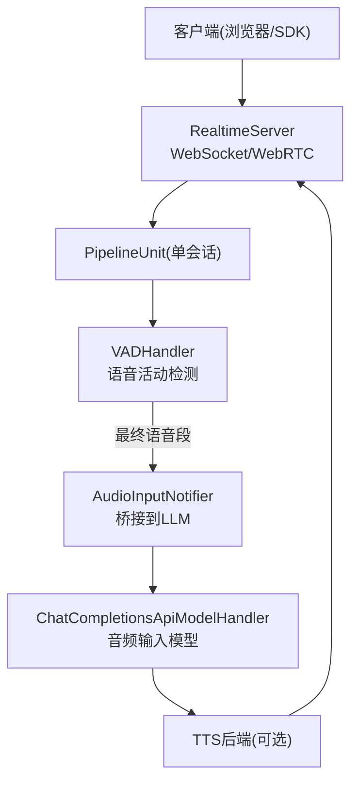
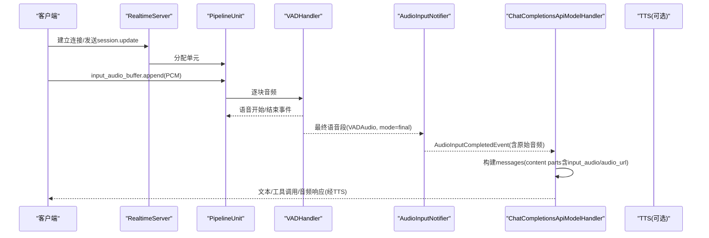
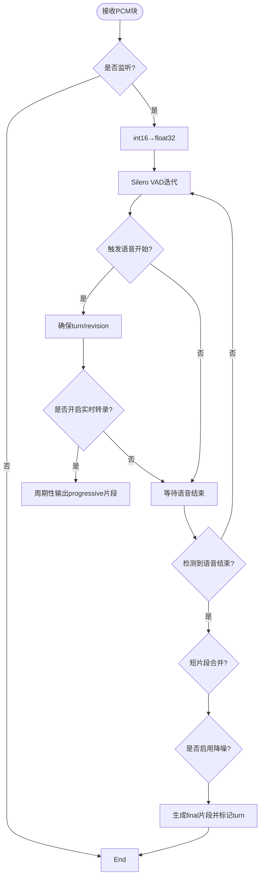
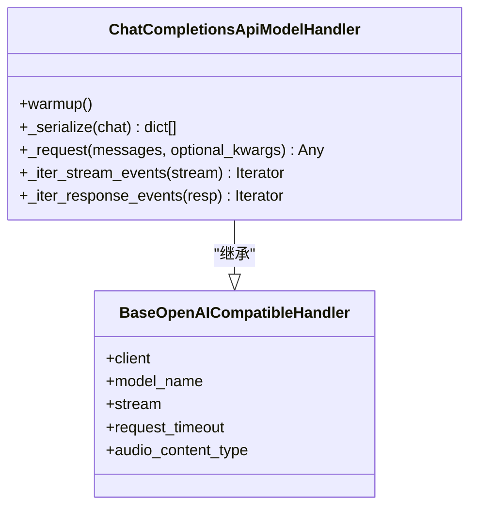
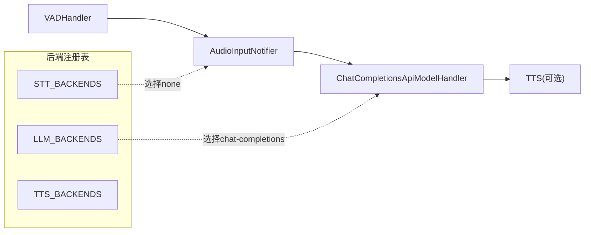

# 音频输入直接处理

<cite>
**本文引用的文件**
- [README.md](file://README.md)
- [s2s_pipeline.py](file://src/speech_to_speech/s2s_pipeline.py)
- [backend_registry.py](file://src/speech_to_speech/backend_registry.py)
- [vad_handler.py](file://src/speech_to_speech/VAD/vad_handler.py)
- [base_stt_handler.py](file://src/speech_to_speech/STT/base_stt_handler.py)
- [audio_input_notifier.py](file://src/speech_to_speech/LLM/audio_input_notifier.py)
- [chat_completions_language_model.py](file://src/speech_to_speech/LLM/chat_completions_language_model.py)
- [server.py](file://src/speech_to_speech/api/openai_realtime/server.py)
- [audio_client.py](file://src/speech_to_speech/api/openai_realtime/audio_client.py)
- [module_arguments.py](file://src/speech_to_speech/arguments_classes/module_arguments.py)
- [vad_arguments.py](file://src/speech_to_speech/arguments_classes/vad_arguments.py)
- [local_audio_arguments.py](file://src/speech_to_speech/arguments_classes/local_audio_arguments.py)
- [runtime_config.py](file://src/speech_to_speech/api/openai_realtime/runtime_config.py)
</cite>

## 目录
1. [简介](#简介)
2. [项目结构](#项目结构)
3. [核心组件](#核心组件)
4. [架构总览](#架构总览)
5. [详细组件分析](#详细组件分析)
6. [依赖关系分析](#依赖关系分析)
7. [性能考量](#性能考量)
8. [故障排查指南](#故障排查指南)
9. [结论](#结论)
10. [附录](#附录)

## 简介
本文件面向“无需 STT 转换的直接语音理解”场景，说明如何将 VAD 输出的完整语音片段直接送入支持音频输入的 LLM（如 OpenAI Chat Completions 的 gpt-audio 系列），从而跳过传统 STT 环节。文档涵盖：
- 音频数据格式与采样率、声道数、编码格式
- 预处理流程（降噪、归一化、特征提取）在系统中的位置与可选项
- 多模态模型集成方式（以 chat-completions 后端为例）
- 实时音频流与批量音频文件的处理方式
- 配置示例与性能优化建议
- 与传统 STT+LLM 方案的性能对比与适用场景

## 项目结构
本项目采用模块化流水线：VAD → STT/AudioInput → LLM → TTS，通过队列在各线程间传递消息。对于“直接音频输入”模式，STT 被替换为 AudioInputNotifier，将 VAD 的最终语音段直接转发给 LLM。

图表来源
- [server.py:14-70](file://src/speech_to_speech/api/openai_realtime/server.py#L14-L70)
- [s2s_pipeline.py:354-458](file://src/speech_to_speech/s2s_pipeline.py#L354-L458)
- [backend_registry.py:309-396](file://src/speech_to_speech/backend_registry.py#L309-L396)
- [vad_handler.py:53-172](file://src/speech_to_speech/VAD/vad_handler.py#L53-L172)
- [audio_input_notifier.py:18-64](file://src/speech_to_speech/LLM/audio_input_notifier.py#L18-L64)
- [chat_completions_language_model.py:278-370](file://src/speech_to_speech/LLM/chat_completions_language_model.py#L278-L370)

章节来源
- [README.md:87-96](file://README.md#L87-L96)
- [s2s_pipeline.py:354-458](file://src/speech_to_speech/s2s_pipeline.py#L354-L458)

## 核心组件
- VADHandler：负责语音起止检测、分段、短时合并、Smart Turn 决策、可选增强（DeepFilterNet）。
- AudioInputNotifier：当 STT 选择 none 时，将 VAD 的最终语音段转换为 LLM 可消费的输入事件。
- ChatCompletionsApiModelHandler：调用 OpenAI 兼容的 /v1/chat/completions，支持将音频作为 content part 传入（input_audio 或 audio_url）。
- RealtimeServer：提供 WebSocket/WebRTC 接入，管理 PipelineUnit 池。
- 配置模块：ModuleArguments、VADHandlerArguments、LocalAudioArguments、RuntimeConfig 等。

章节来源
- [vad_handler.py:53-172](file://src/speech_to_speech/VAD/vad_handler.py#L53-L172)
- [audio_input_notifier.py:18-64](file://src/speech_to_speech/LLM/audio_input_notifier.py#L18-L64)
- [chat_completions_language_model.py:278-370](file://src/speech_to_speech/LLM/chat_completions_language_model.py#L278-L370)
- [server.py:14-70](file://src/speech_to_speech/api/openai_realtime/server.py#L14-L70)
- [module_arguments.py:12-105](file://src/speech_to_speech/arguments_classes/module_arguments.py#L12-L105)
- [vad_arguments.py:4-116](file://src/speech_to_speech/arguments_classes/vad_arguments.py#L4-L116)
- [local_audio_arguments.py:5-46](file://src/speech_to_speech/arguments_classes/local_audio_arguments.py#L5-L46)
- [runtime_config.py:27-82](file://src/speech_to_speech/api/openai_realtime/runtime_config.py#L27-L82)

## 架构总览
下图展示“直接音频输入”模式下的端到端数据流与控制流：

图表来源
- [s2s_pipeline.py:354-458](file://src/speech_to_speech/s2s_pipeline.py#L354-L458)
- [backend_registry.py:309-396](file://src/speech_to_speech/backend_registry.py#L309-L396)
- [audio_input_notifier.py:18-64](file://src/speech_to_speech/LLM/audio_input_notifier.py#L18-L64)
- [chat_completions_language_model.py:96-157](file://src/speech_to_speech/LLM/chat_completions_language_model.py#L96-L157)
- [server.py:14-70](file://src/speech_to_speech/api/openai_realtime/server.py#L14-L70)

## 详细组件分析

### VAD 与音频分段
- 采样率：默认 16 kHz（可通过 VADHandlerArguments.sample_rate 设置）。
- 声道：内部使用 numpy 数组处理，通常按单声道 PCM 处理；若输入为立体声，应在上游重采样/混音为单声道后再进入 VAD。
- 分段策略：基于 Silero VAD v5，支持 min_silence_ms、min_speech_ms、short_segment_merge_ms、max_speech_ms 等参数；支持 Smart Turn 动态调整“可重新打开”窗口与延迟。
- 可选增强：启用 audio_enhancement 后，可使用 DeepFilterNet 进行降噪与均衡（需额外依赖）。

图表来源
- [vad_handler.py:548-788](file://src/speech_to_speech/VAD/vad_handler.py#L548-L788)
- [vad_arguments.py:4-116](file://src/speech_to_speech/arguments_classes/vad_arguments.py#L4-L116)

章节来源
- [vad_handler.py:53-172](file://src/speech_to_speech/VAD/vad_handler.py#L53-L172)
- [vad_handler.py:548-788](file://src/speech_to_speech/VAD/vad_handler.py#L548-L788)
- [vad_arguments.py:4-116](file://src/speech_to_speech/arguments_classes/vad_arguments.py#L4-L116)

### 直接音频输入桥接（AudioInputNotifier）
- 作用：当 STT 设置为 none 时，将 VAD 的 final 语音段转换为 LLM 可消费的事件，包含原始音频字节、采样率、时长、turn_id/revision 等元信息。
- 稳定性控制：仅在满足“稳定窗口”后才放行，避免中间结果污染下游。

章节来源
- [audio_input_notifier.py:18-64](file://src/speech_to_speech/LLM/audio_input_notifier.py#L18-L64)
- [backend_registry.py:309-396](file://src/speech_to_speech/backend_registry.py#L309-L396)

### LLM 集成（Chat Completions + 音频输入）
- 后端：chat-completions 后端具备 supports_audio_input 能力，可将音频作为 content part 传入。
- 音频内容类型：
  - input_audio：内嵌 base64 WAV 数据（data URI 形式）
  - audio_url：以 data URL 形式引用 base64 WAV
- 消息构造：将历史消息与媒体内容（文本、图像、音频）序列化为 OpenAI Chat Completions 请求体；工具调用与流式响应均受支持。
- 注意：responses-api 后端不支持直接音频输入；必须使用 chat-completions。

图表来源
- [chat_completions_language_model.py:278-370](file://src/speech_to_speech/LLM/chat_completions_language_model.py#L278-L370)
- [chat_completions_language_model.py:96-157](file://src/speech_to_speech/LLM/chat_completions_language_model.py#L96-L157)

章节来源
- [chat_completions_language_model.py:96-157](file://src/speech_to_speech/LLM/chat_completions_language_model.py#L96-L157)
- [chat_completions_language_model.py:278-370](file://src/speech_to_speech/LLM/chat_completions_language_model.py#L278-L370)
- [backend_registry.py:398-441](file://src/speech_to_speech/backend_registry.py#L398-L441)

### 实时流与批量处理
- 实时流：
  - 客户端通过 input_audio_buffer.append 持续发送 PCM 块（默认 16 kHz，单声道）。
  - VAD 在语音结束时产出 final 片段，交由 AudioInputNotifier 转交给 LLM。
  - 播放缓冲：本地客户端支持 playback_buffer_ms 控制起始缓冲，降低卡顿。
- 批量音频文件：
  - 可将整段音频切分为符合 VAD 期望的 PCM 块（16 kHz 单声道 int16），按相同协议送入服务；或在应用层先完成分片再调用 API。
  - 也可通过 HTTP 代理（LLM Proxy）将音频作为独立任务提交，但语音对话主路径仍推荐走 Realtime 流。

章节来源
- [audio_client.py:48-74](file://src/speech_to_speech/api/openai_realtime/audio_client.py#L48-L74)
- [audio_client.py:164-207](file://src/speech_to_speech/api/openai_realtime/audio_client.py#L164-L207)
- [s2s_pipeline.py:590-625](file://src/speech_to_speech/s2s_pipeline.py#L590-L625)

### 配置示例与最佳实践
- 启用直接音频输入：
  - 设置 STT 为 none，LLM 后端为 chat-completions，并指定支持音频的 model_name。
  - 通过 responses_api_audio_content_type 选择 input_audio 或 audio_url。
- 关键参数：
  - VAD：thresh、min_speech_ms、min_silence_ms、short_segment_merge_ms、smart_turn_* 等。
  - 本地客户端：send_rate/recv_rate（16 kHz 或 24 kHz）、playback_buffer_ms、chunk_size。
- 最佳实践：
  - 保持输入为 16 kHz 单声道 PCM，减少重采样与编解码开销。
  - 合理设置 min_speech_ms 与 short_segment_merge_ms，避免误触发与碎片化。
  - 在低延迟场景关闭不必要的增强（如 DeepFilterNet）以降低 CPU/GPU 占用。
  - 对长会话启用压缩提示（compaction）以减少上下文长度与延迟。

章节来源
- [module_arguments.py:26-34](file://src/speech_to_speech/arguments_classes/module_arguments.py#L26-L34)
- [vad_arguments.py:4-116](file://src/speech_to_speech/arguments_classes/vad_arguments.py#L4-L116)
- [local_audio_arguments.py:5-46](file://src/speech_to_speech/arguments_classes/local_audio_arguments.py#L5-L46)
- [README.md:368-396](file://README.md#L368-L396)

## 依赖关系分析
- 后端注册表集中管理 STT/LLM/TTS 的实现与能力声明，决定在 direct audio 模式下如何装配链路。
- VAD 与 STT 之间通过队列解耦；当 STT=none 时，AudioInputNotifier 替代 STT 并将 VAD 输出转为 LLM 输入事件。
- LLM 后端通过 OpenAI SDK 与远程或本地服务通信，支持流式与非流式响应。

图表来源
- [backend_registry.py:309-441](file://src/speech_to_speech/backend_registry.py#L309-L441)
- [s2s_pipeline.py:354-458](file://src/speech_to_speech/s2s_pipeline.py#L354-L458)

章节来源
- [backend_registry.py:309-441](file://src/speech_to_speech/backend_registry.py#L309-L441)
- [s2s_pipeline.py:354-458](file://src/speech_to_speech/s2s_pipeline.py#L354-L458)

## 性能考量
- 端到端延迟主要取决于 LLM 推理与网络往返；直接音频输入省去了 STT 阶段，可降低首包延迟。
- 实时转录与渐进式输出：
  - 开启 enable_live_transcription 可在说话过程中周期性输出 progressive 片段，便于前端显示与交互。
  - 在 Apple Silicon 多 pipeline 下，MLX 全局锁可能导致 live transcription 告警增多；必要时可关闭该功能。
- 计算资源：
  - 启用 DeepFilterNet 会引入额外 CPU/GPU 负载；在资源受限环境建议关闭。
  - 合理设置 chunk_size 与 playback_buffer_ms，平衡流畅度与延迟。
- 并发与吞吐：
  - num_pipelines 控制最大并发会话数；根据硬件与模型规模调优。
  - 使用流式响应与工具调用批处理，减少多次往返。

章节来源
- [s2s_pipeline.py:639-655](file://src/speech_to_speech/s2s_pipeline.py#L639-L655)
- [vad_handler.py:548-788](file://src/speech_to_speech/VAD/vad_handler.py#L548-L788)
- [module_arguments.py:96-105](file://src/speech_to_speech/arguments_classes/module_arguments.py#L96-L105)

## 故障排查指南
- 无法启用直接音频输入：
  - 确认 STT 设置为 none，且 LLM 后端为 chat-completions；responses-api 不支持音频输入。
  - 检查 model_name 是否为支持音频的模型。
- 音频格式错误：
  - 确保输入为 16 kHz 单声道 PCM（int16）；非标准格式需在客户端重采样/编码。
  - 若使用 24 kHz，需显式声明 PCM 格式（OpenAI SDK 校验要求）。
- 语音未触发或频繁中断：
  - 调整 thresh、min_speech_ms、min_silence_ms；必要时启用 short_segment_merge_ms 合并短片段。
  - 检查麦克风设备与音量，避免底噪过高导致误判。
- 实时转录卡顿：
  - 调整 realtime_processing_pause 与 playback_buffer_ms；在 Apple Silicon 多 pipeline 下考虑关闭 live transcription。
- 工具调用异常：
  - 检查工具定义与参数 JSON Schema；确保 tool_executor 返回可序列化结果。

章节来源
- [module_arguments.py:26-34](file://src/speech_to_speech/arguments_classes/module_arguments.py#L26-L34)
- [vad_arguments.py:4-116](file://src/speech_to_speech/arguments_classes/vad_arguments.py#L4-L116)
- [audio_client.py:164-207](file://src/speech_to_speech/api/openai_realtime/audio_client.py#L164-L207)
- [chat_completions_language_model.py:96-157](file://src/speech_to_speech/LLM/chat_completions_language_model.py#L96-L157)

## 结论
直接音频输入模式通过跳过 STT，将 VAD 的最终语音段直接送入支持音频的 LLM，适用于需要更低延迟与更简链路的场景。结合合理的 VAD 参数、音频格式规范与性能调优，可在保证质量的同时显著降低端到端时延。对于复杂语言理解或多语言场景，仍可保留 STT 以获得更好的鲁棒性；而在强实时交互、本地化部署或对延迟敏感的场景中，直接音频输入更具优势。

## 附录

### 音频数据格式与采样率
- 采样率：默认 16 kHz；客户端可配置 send_rate/recv_rate（16 kHz 或 24 kHz）。
- 声道数：建议单声道；立体声需在上游混音为单声道。
- 编码格式：PCM int16；LLM 侧以 WAV 的 base64 数据或 data URL 形式传输。

章节来源
- [local_audio_arguments.py:22-35](file://src/speech_to_speech/arguments_classes/local_audio_arguments.py#L22-L35)
- [audio_client.py:164-207](file://src/speech_to_speech/api/openai_realtime/audio_client.py#L164-L207)
- [chat_completions_language_model.py:96-157](file://src/speech_to_speech/LLM/chat_completions_language_model.py#L96-L157)

### 预处理流程（降噪、归一化、特征提取）
- 降噪：VAD 可启用 DeepFilterNet 进行增强（可选，需额外依赖）。
- 归一化：VAD 内部将 int16 转为 float32 进行处理；后续 STT/LLM 仅消费最终片段。
- 特征提取：直接音频输入模式下不执行 STT 特征提取；由 LLM 自行处理音频特征。

章节来源
- [vad_handler.py:548-788](file://src/speech_to_speech/VAD/vad_handler.py#L548-L788)
- [vad_arguments.py:48-53](file://src/speech_to_speech/arguments_classes/vad_arguments.py#L48-L53)

### 与传统 STT+LLM 方案对比
- 延迟：直接音频输入省去 STT，首包延迟更低。
- 鲁棒性：STT 方案在多语言、嘈杂环境下通常更稳健；直接音频输入依赖模型对音频的理解能力。
- 成本：直接音频输入可能增加 LLM 侧的音频处理成本；STT 方案可复用专用低成本 STT 服务。
- 适用场景：
  - 直接音频输入：低延迟、强实时、本地化部署、模型原生支持音频。
  - STT+LLM：多语言、复杂指令、对识别精度要求高、已有 STT 基础设施。

章节来源
- [README.md:368-396](file://README.md#L368-L396)
- [backend_registry.py:398-441](file://src/speech_to_speech/backend_registry.py#L398-L441)