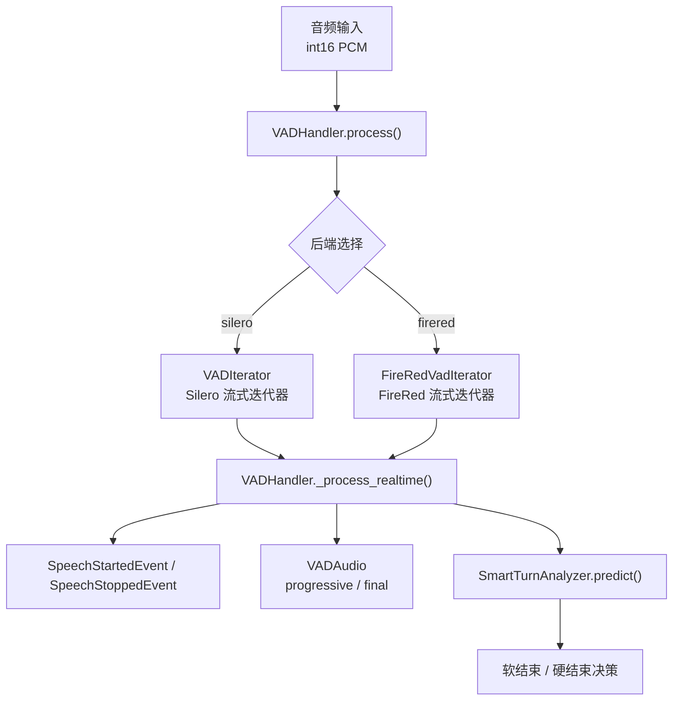
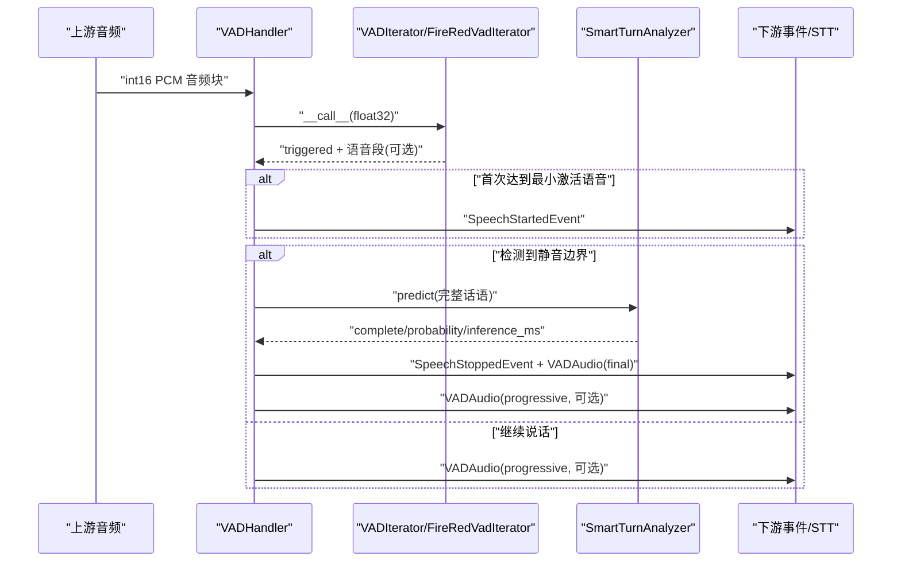
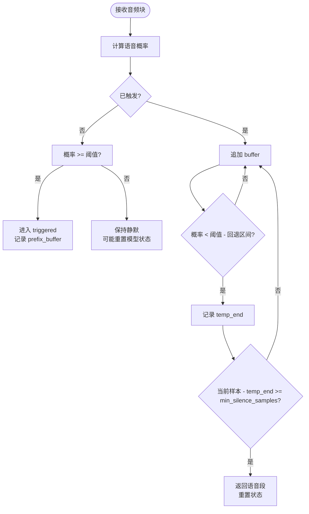
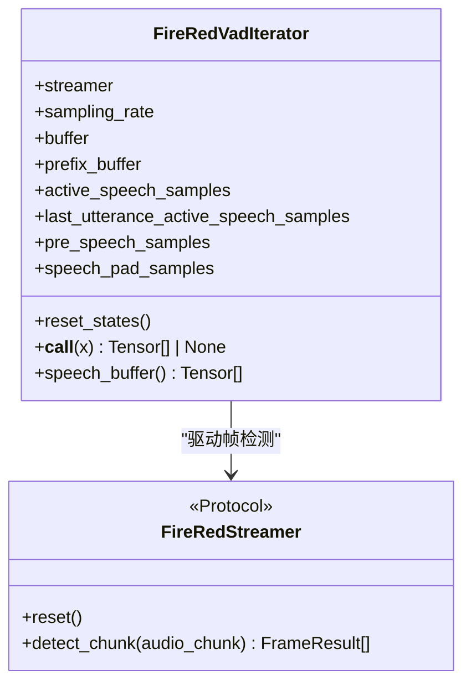
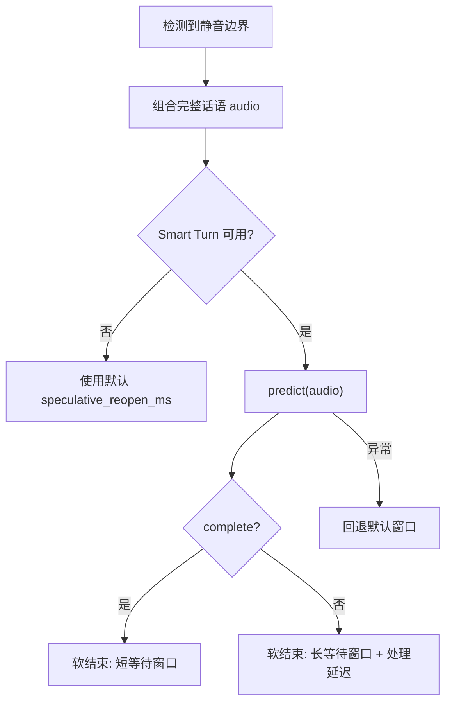
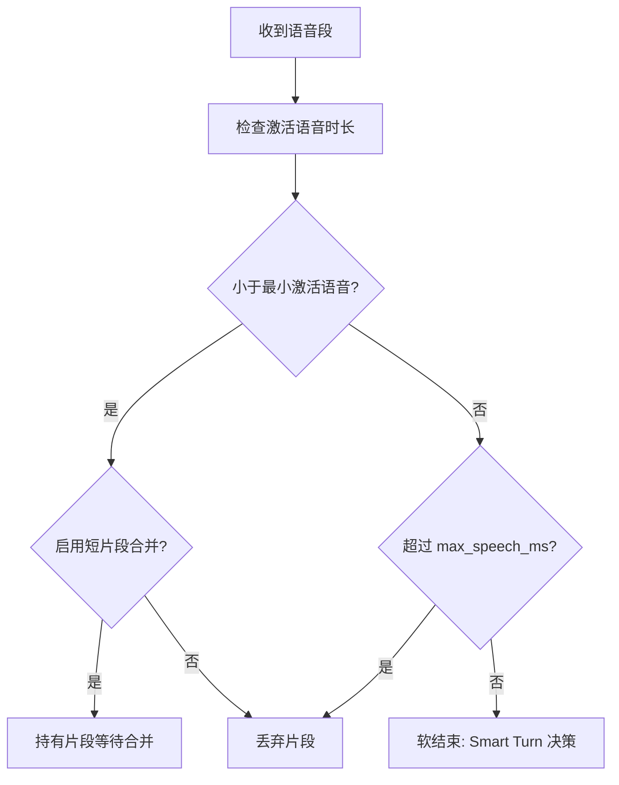
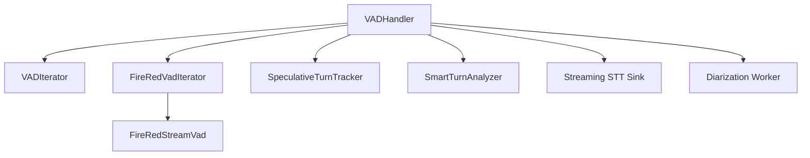

# 语音活动检测 (VAD)

<cite>
**本文引用的文件**   
- [vad_handler.py](file://src/speech_to_speech/VAD/vad_handler.py)
- [vad_iterator.py](file://src/speech_to_speech/VAD/vad_iterator.py)
- [firered_vad_iterator.py](file://src/speech_to_speech/VAD/firered_vad_iterator.py)
- [smart_turn.py](file://src/speech_to_speech/VAD/smart_turn.py)
- [README.md](file://src/speech_to_speech/VAD/README.md)
- [events.py](file://src/speech_to_speech/pipeline/events.py)
</cite>

## 目录
1. [引言](#引言)
2. [项目结构](#项目结构)
3. [核心组件](#核心组件)
4. [架构总览](#架构总览)
5. [详细组件分析](#详细组件分析)
6. [依赖关系分析](#依赖关系分析)
7. [性能与调优指南](#性能与调优指南)
8. [故障排查](#故障排查)
9. [结论](#结论)

## 引言
语音活动检测是实时语音对话系统的“第一道门”。它负责从连续音频流中判断“是否有人说话”“何时开始”“何时结束”，并向上游的语音识别、语言模型和语音合成模块提供稳定的话轮边界。在本仓库中，VAD 不仅承担基础的话音起止检测，还集成了：
- 可插拔后端：Silero VAD 与 FireRed VAD。
- 智能话轮结束判断：Smart Turn 在检测到静音后对完整话语进行语义级完整性评估。
- 软结束与硬结束切换：根据 Smart Turn 结果动态调整响应等待窗口和处理延迟。
- 渐进式音频快照：在长话轮中周期性输出累积音频，提升端到端体验。
- 短片段合并：将短时噪声或断续语音合并为有效片段，降低误触发。
- 运行时参数热更新：支持通过运行时配置动态调整阈值和静音时长。

这些能力共同降低了误打断、过早结束、长句卡顿等问题，使系统更贴近自然对话节奏。

## 项目结构
VAD 相关代码集中在 `src/speech_to_speech/VAD` 目录下，核心文件职责如下：
- `vad_handler.py`：VAD 处理器，串联音频输入、后端迭代器、话轮状态、渐进式快照、Smart Turn 和下游事件。
- `vad_iterator.py`：基于 Silero 模型的流式迭代器，维护激活语音样本计数、前缀缓冲、静音超时等。
- `firered_vad_iterator.py`：FireRed 流式 VAD 适配器，封装帧检测、start/end 事件、阈值映射和前缀缓冲。
- `smart_turn.py`：Smart Turn v3.2 ONNX 推理器，用于在静音边界后判断用户话轮是否完整。
- `README.md`：后端选择、安装说明、渐进式快照用法和 FireRed 配置入口。

**图表来源**
- [vad_handler.py:58-100](file://src/speech_to_speech/VAD/vad_handler.py#L58-L100)
- [vad_handler.py:565-668](file://src/speech_to_speech/VAD/vad_handler.py#L565-L668)
- [vad_iterator.py:9-57](file://src/speech_to_speech/VAD/vad_iterator.py#L9-L57)
- [firered_vad_iterator.py:28-58](file://src/speech_to_speech/VAD/firered_vad_iterator.py#L28-L58)
- [smart_turn.py:36-86](file://src/speech_to_speech/VAD/smart_turn.py#L36-L86)

**章节来源**
- [vad_handler.py:58-209](file://src/speech_to_speech/VAD/vad_handler.py#L58-L209)
- [vad_iterator.py:9-57](file://src/speech_to_speech/VAD/vad_iterator.py#L9-L57)
- [firered_vad_iterator.py:28-58](file://src/speech_to_speech/VAD/firered_vad_iterator.py#L28-L58)
- [smart_turn.py:36-86](file://src/speech_to_speech/VAD/smart_turn.py#L36-L86)
- [README.md:1-53](file://src/speech_to_speech/VAD/README.md#L1-L53)

## 核心组件
- **VADHandler**：统一入口，负责音频采样、后端初始化、运行时参数应用、话轮生命周期、渐进式快照、短片段合并、Smart Turn 调用、下游事件和 STT/Diarization 集成。
- **VADIterator（Silero）**：基于概率阈值的流式检测，维护 `triggered`、`buffer`、`prefix_buffer`、`active_speech_samples`、`last_utterance_active_speech_samples` 等状态，并在静音超过最小静音时长后返回一段语音。
- **FireRedVadIterator（FireRed）**：基于 start/end 事件的流式检测，内部按固定窗口和步长切帧，映射到统一的 buffer/prefix 接口，便于与 VADHandler 复用逻辑。
- **SmartTurnAnalyzer**：加载 ONNX 模型，对最多 8 秒的完整话语做完整性预测，返回是否完成、概率和推理耗时。

**章节来源**
- [vad_handler.py:58-209](file://src/speech_to_speech/VAD/vad_handler.py#L58-L209)
- [vad_iterator.py:9-188](file://src/speech_to_speech/VAD/vad_iterator.py#L9-L188)
- [firered_vad_iterator.py:28-244](file://src/speech_to_speech/VAD/firered_vad_iterator.py#L28-L244)
- [smart_turn.py:36-153](file://src/speech_to_speech/VAD/smart_turn.py#L36-L153)

## 架构总览
VAD 的整体数据流可以概括为：
1. 上游传入 int16 PCM 音频块。
2. VADHandler 转换为 float32 并调用当前后端迭代器。
3. 后端返回“是否触发”和“语音段”；VADHandler 维护话轮候选、已确认开始、渐进式快照和最终化。
4. 若启用 Smart Turn，则在软结束时对完整话语做完整性判断，决定响应等待窗口和处理延迟。
5. 向下游发出 SpeechStartedEvent、SpeechStoppedEvent 和 VADAudio（progressive 或 final）。

**图表来源**
- [vad_handler.py:565-668](file://src/speech_to_speech/VAD/vad_handler.py#L565-L668)
- [vad_handler.py:670-895](file://src/speech_to_speech/VAD/vad_handler.py#L670-L895)
- [smart_turn.py:130-153](file://src/speech_to_speech/VAD/smart_turn.py#L130-L153)
- [events.py:36-39](file://src/speech_to_speech/pipeline/events.py#L36-L39)

## 详细组件分析

### Silero VAD 实现
Silero 后端通过 `VADIterator` 实现流式检测。关键行为包括：
- 当语音概率大于等于阈值且未触发时，进入 `triggered=True`，记录前缀缓冲和激活语音样本。
- 在触发状态下，若概率低于阈值减去回退区间，则启动静音计时；超过 `min_silence_samples` 后返回语音段。
- 空闲时定期重置模型状态，避免长时间静默导致状态漂移。
- 对外暴露 `speech_buffer()`，包含前缀缓冲和当前 buffer，保证语音起始部分不被截断。

**图表来源**
- [vad_iterator.py:115-188](file://src/speech_to_speech/VAD/vad_iterator.py#L115-L188)

**章节来源**
- [vad_iterator.py:9-188](file://src/speech_to_speech/VAD/vad_iterator.py#L9-L188)

### FireRed VAD 实现
FireRed 后端通过 `FireRedVadIterator` 适配外部 `FireRedStreamVad`。其特点包括：
- 使用固定窗口 `_FIRERED_WINDOW_SAMPLES=400` 和步长 `_FIRERED_HOP_SAMPLES=160` 切帧。
- 将输入音频从 Silero 的 [-1,1] 缩放为 int16 PCM 风格，以匹配 FireRed fbank 训练格式。
- 根据 `is_speech_start` 和 `is_speech_end` 事件管理 `triggered`、`buffer`、`prefix_buffer` 和激活语音样本。
- 支持动态设置 `threshold` 和 `min_silence_samples`，并通过 streamer/postprocessor 的配置属性生效。

**图表来源**
- [firered_vad_iterator.py:28-58](file://src/speech_to_speech/VAD/firered_vad_iterator.py#L28-L58)
- [firered_vad_iterator.py:149-244](file://src/speech_to_speech/VAD/firered_vad_iterator.py#L149-L244)

**章节来源**
- [firered_vad_iterator.py:1-269](file://src/speech_to_speech/VAD/firered_vad_iterator.py#L1-L269)

### 话轮检测与智能结束判断
VADHandler 在检测到语音开始后，会维护“话轮候选”和“已确认开始”；在检测到静音边界后，若启用 Smart Turn，则对完整话语进行完整性判断：
- 若 Smart Turn 返回 `complete=True`，使用较短的响应等待窗口（默认 `speculative_reopen_ms`），尽快释放响应。
- 若 Smart Turn 返回 `complete=False`，使用较长的最大等待窗口（`smart_turn_max_wait_ms`）并引入处理延迟（`smart_turn_incomplete_delay_ms`），避免过早打断用户。
- 若 Smart Turn 推理失败，回退到普通短窗口，不阻塞响应。

**图表来源**
- [vad_handler.py:523-563](file://src/speech_to_speech/VAD/vad_handler.py#L523-L563)
- [vad_handler.py:838-881](file://src/speech_to_speech/VAD/vad_handler.py#L838-L881)
- [smart_turn.py:130-153](file://src/speech_to_speech/VAD/smart_turn.py#L130-L153)

**章节来源**
- [vad_handler.py:523-563](file://src/speech_to_speech/VAD/vad_handler.py#L523-L563)
- [vad_handler.py:838-881](file://src/speech_to_speech/VAD/vad_handler.py#L838-L881)
- [smart_turn.py:36-153](file://src/speech_to_speech/VAD/smart_turn.py#L36-L153)

### 软结束与硬结束的切换逻辑
在当前实现中，“软结束”对应检测到静音边界后仍保留一段等待窗口，允许用户在短时间内继续说话；“硬结束”通常指超出最大语音时长或明确丢弃片段。切换逻辑包括：
- 若激活语音时长小于最小要求，且启用了短片段合并窗口，则暂时“持有”该片段，等待后续片段合并。
- 若超过 `max_speech_ms`，直接丢弃并视为无效片段。
- 若未达到最小激活语音且不在合并窗口内，直接丢弃。
- 若达到最小激活语音，则进入软结束流程，调用 Smart Turn 并设置 `output_hold_ms` 和 `processing_delay_ms`。

**图表来源**
- [vad_handler.py:771-837](file://src/speech_to_speech/VAD/vad_handler.py#L771-L837)

**章节来源**
- [vad_handler.py:771-837](file://src/speech_to_speech/VAD/vad_handler.py#L771-L837)

### 渐进式音频快照
VADHandler 支持两种渐进式快照模式：
- 实时转录模式：`enable_realtime_transcription=True`，按 `realtime_processing_pause` 周期输出累积音频。
- 窗口模式：`transcription_window_samples` 设置为非空时，按输入样本间隔输出累积音频，独立于实时转录。

渐进式快照不会分割话轮或结束话轮，仅作为消费者侧的增量音频更新；最终化时可追加之前持有的短片段。

**章节来源**
- [vad_handler.py:184-202](file://src/speech_to_speech/VAD/vad_handler.py#L184-L202)
- [vad_handler.py:670-728](file://src/speech_to_speech/VAD/vad_handler.py#L670-L728)
- [README.md:14-31](file://src/speech_to_speech/VAD/README.md#L14-L31)

## 依赖关系分析
VAD 组件之间的依赖关系如下：
- `VADHandler` 依赖后端迭代器（`VADIterator` 或 `FireRedVadIterator`）。
- `VADHandler` 依赖 `SpeculativeTurnTracker` 管理话轮候选、重开和最终化。
- `VADHandler` 可选依赖 `SmartTurnAnalyzer` 进行话轮完整性判断。
- `VADHandler` 可选依赖 STT 流式 sink 和说话人分离 worker，用于流式转写和说话人标注。
- `FireRedVadIterator` 依赖外部 `FireRedStreamVad`，通过 Protocol 解耦具体实现。

**图表来源**
- [vad_handler.py:58-209](file://src/speech_to_speech/VAD/vad_handler.py#L58-L209)
- [firered_vad_iterator.py:28-58](file://src/speech_to_speech/VAD/firered_vad_iterator.py#L28-L58)

**章节来源**
- [vad_handler.py:58-209](file://src/speech_to_speech/VAD/vad_handler.py#L58-L209)
- [firered_vad_iterator.py:28-58](file://src/speech_to_speech/VAD/firered_vad_iterator.py#L28-L58)

## 性能与调优指南

### 参数调优建议
- **阈值 threshold**：控制语音概率判定灵敏度。提高阈值可减少误触发，但可能漏掉轻声；降低阈值可提高灵敏度，但可能增加噪声触发。
- **最小静音时长 min_silence_ms**：控制静音后结束话轮的敏感度。增大可减少频繁中断，但可能延长话轮结束延迟；减小可更快结束，但可能误判短句。
- **最小语音时长 min_speech_ms**：过滤过短片段，减少误触发。增大可降低误触发，但可能错过短促语音。
- **最小续接语音时长 min_speech_continuation_ms**：在可重开话轮中降低激活语音门槛，提升续接流畅性。
- **最大语音时长 max_speech_ms**：限制单条话轮长度，防止过长语音阻塞系统。
- **语音前缀 padding speech_pad_ms**：保留触发前的少量音频，确保语音起始完整。
- **渐进式暂停 realtime_processing_pause**：控制实时转录模式下渐进式快照频率；结合 `_progressive_processing_pause` 的动态倍数，随话轮长度自适应。
- **Smart Turn 参数**：
  - `smart_turn_threshold`：控制话轮完整性判断阈值。
  - `smart_turn_max_wait_ms`：控制不完整时的最大等待窗口。
  - `smart_turn_incomplete_delay_ms`：控制不完整时的处理延迟。
  - `smart_turn_cpu_count`：ONNX CPU 推理线程数。

**章节来源**
- [vad_handler.py:61-88](file://src/speech_to_speech/VAD/vad_handler.py#L61-L88)
- [vad_handler.py:260-273](file://src/speech_to_speech/VAD/vad_handler.py#L260-L273)
- [vad_handler.py:898-909](file://src/speech_to_speech/VAD/vad_handler.py#L898-L909)
- [smart_turn.py:39-86](file://src/speech_to_speech/VAD/smart_turn.py#L39-L86)

### 用户体验影响
- **阈值过高**：可能导致轻声被忽略，用户需提高音量或重复说话。
- **阈值过低**：环境噪声易被误判为语音，造成误打断。
- **最小静音过短**：用户短暂停顿可能被误判为结束，导致话轮过早切断。
- **最小静音过长**：用户说完后系统反应慢，影响对话节奏。
- **Smart Turn 不完整延迟过大**：用户说完后系统等待过久，影响响应速度。
- **渐进式快照过频**：增加下游处理压力；过疏则用户体验不够流畅。

### 性能优化建议
- 使用本地 Silero 模型加载，避免网络依赖。
- 合理设置 `realtime_processing_pause`，避免高频快照造成下游拥塞。
- 启用 DeepFilterNet 音频增强仅在必要时开启，注意额外开销。
- 对于 FireRed，确保模型路径正确，并根据硬件选择 GPU/CPU。
- 控制 Smart Turn 的 `cpu_count`，避免占用过多 CPU 资源。

**章节来源**
- [vad_handler.py:150-168](file://src/speech_to_speech/VAD/vad_handler.py#L150-L168)
- [vad_handler.py:174-183](file://src/speech_to_speech/VAD/vad_handler.py#L174-L183)
- [vad_handler.py:898-909](file://src/speech_to_speech/VAD/vad_handler.py#L898-L909)
- [README.md:33-53](file://src/speech_to_speech/VAD/README.md#L33-L53)

## 故障排查
- **FireRed 模型缺失或路径错误**：启动时会抛出缺少 extra 或模型目录的错误。
- **Smart Turn 推理失败**：回退到默认短窗口，不影响整体流程，但日志会记录异常。
- **渐进式快照未触发**：检查 `transcription_window_samples` 或 `enable_realtime_transcription` 是否启用。
- **话轮过早结束**：调低 `min_silence_ms` 或提高 `threshold`。
- **话轮迟迟不结束**：调高 `min_silence_ms` 或降低 `threshold`。
- **误触发频繁**：提高 `threshold` 或增大 `min_speech_ms`。
- **长话轮卡顿**：调整 `realtime_processing_pause` 或启用 `transcription_window_samples`。

**章节来源**
- [vad_handler.py:131-170](file://src/speech_to_speech/VAD/vad_handler.py#L131-L170)
- [vad_handler.py:523-563](file://src/speech_to_speech/VAD/vad_handler.py#L523-L563)
- [vad_handler.py:670-728](file://src/speech_to_speech/VAD/vad_handler.py#L670-L728)
- [README.md:33-53](file://src/speech_to_speech/VAD/README.md#L33-L53)

## 结论
本项目的 VAD 组件在基础话音检测之上，提供了可插拔后端、智能话轮结束、软/硬结束切换、渐进式快照和短片段合并等高级能力。通过合理调参和优化，可以在不同场景下平衡灵敏度、延迟和用户体验。Silero 适合通用场景，FireRed 适合需要 start/end 事件驱动的流式检测；Smart Turn 则为长话轮提供更自然的结束判断。实际部署时，建议结合业务场景逐步调参，并关注日志中的触发、结束和 Smart Turn 状态，以便快速定位问题。