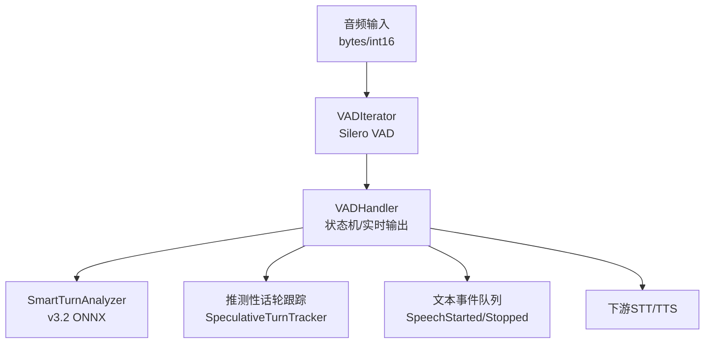
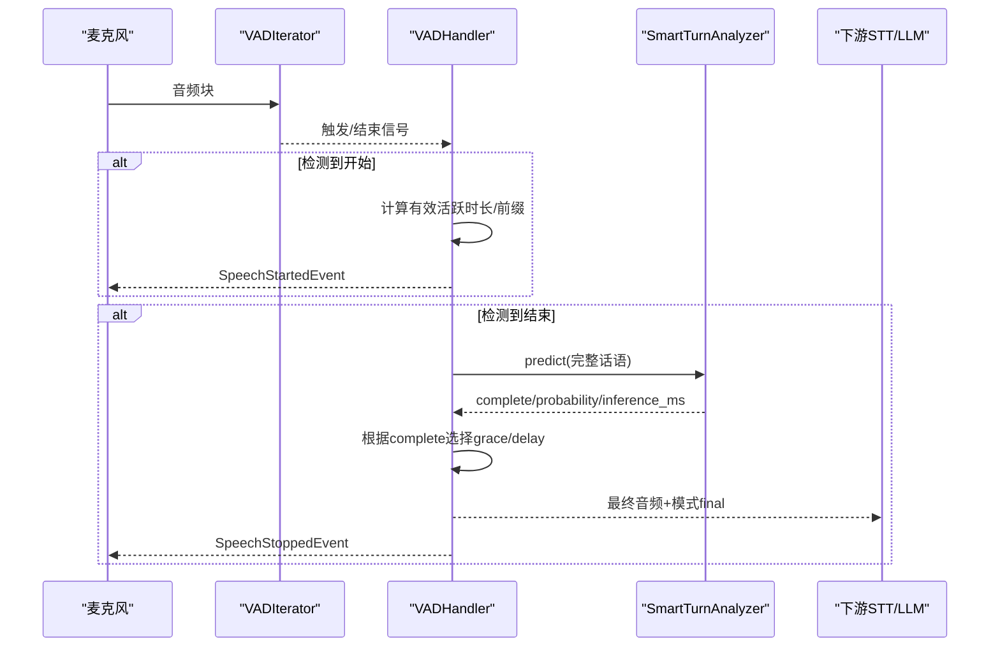
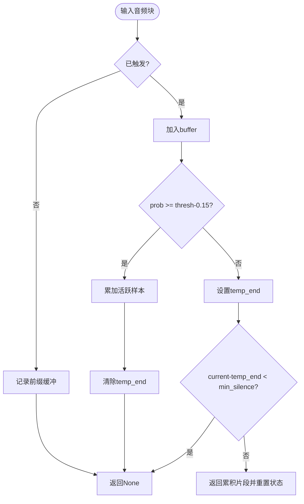
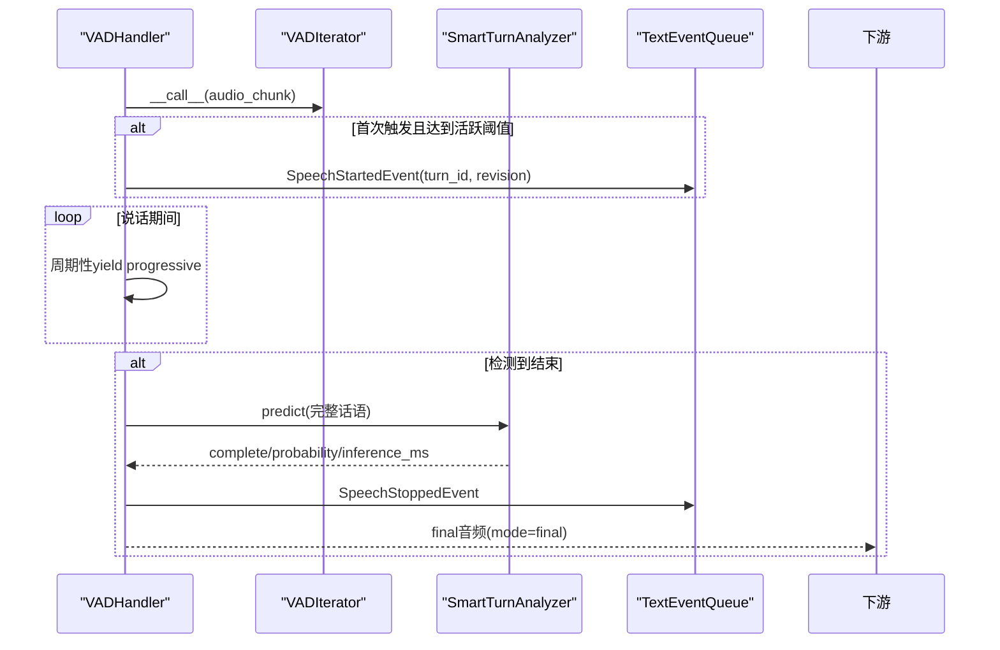
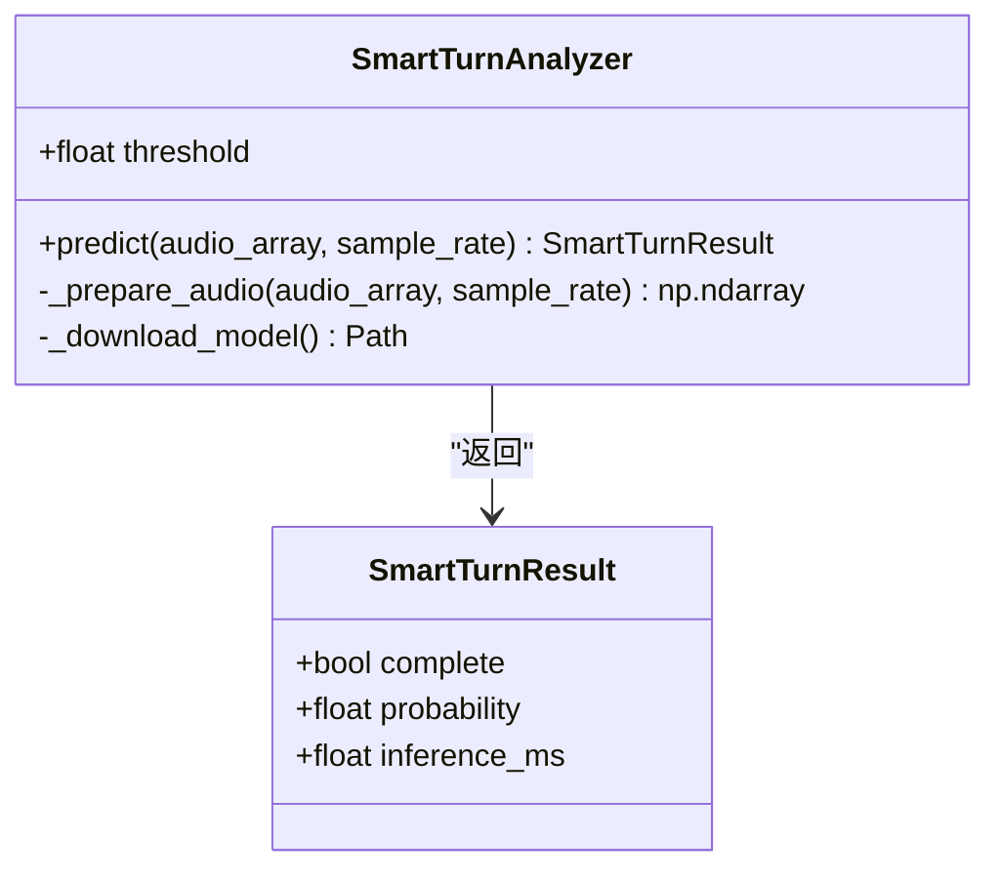
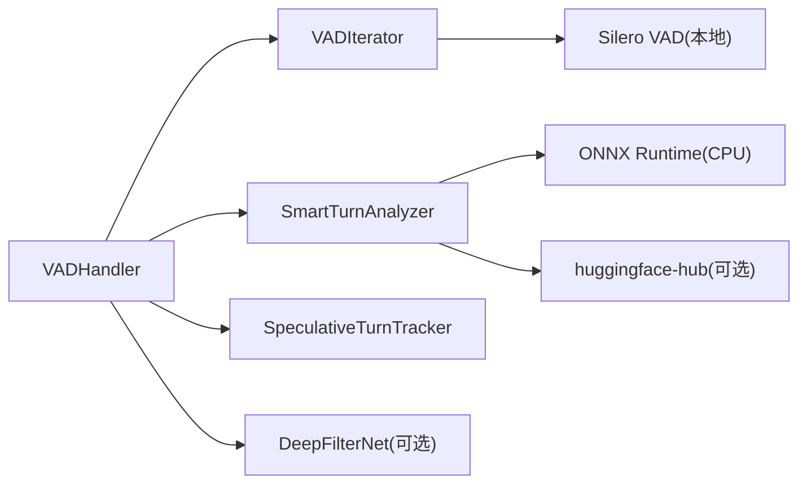

# 语音活动检测模块

<cite>
**本文引用的文件**
- [vad_handler.py](file://src/speech_to_speech/VAD/vad_handler.py)
- [smart_turn.py](file://src/speech_to_speech/VAD/smart_turn.py)
- [vad_iterator.py](file://src/speech_to_speech/VAD/vad_iterator.py)
- [vad_arguments.py](file://src/speech_to_speech/arguments_classes/vad_arguments.py)
- [s2s_pipeline.py](file://src/speech_to_speech/s2s_pipeline.py)
- [test_smart_turn.py](file://tests/test_smart_turn.py)
- [test_vad_iterator.py](file://tests/test_vad_iterator.py)
</cite>

## 目录
1. [简介](#简介)
2. [项目结构](#项目结构)
3. [核心组件](#核心组件)
4. [架构总览](#架构总览)
5. [详细组件分析](#详细组件分析)
6. [依赖关系分析](#依赖关系分析)
7. [性能考虑](#性能考虑)
8. [故障排查指南](#故障排查指南)
9. [结论](#结论)
10. [附录：参数调优与场景配置](#附录参数调优与场景配置)

## 简介
本模块提供基于 Silero VAD v5 的语音活动检测（VAD）与智能停顿检测（Smart Turn v3.2），用于实时对话系统中的说话人切换检测、语音边界识别与实时转录支持。其目标是在保证低延迟的同时，准确判断用户话语的开始与结束，并在必要时延长等待以容纳“犹豫性停顿”，从而减少误切分与重复开麦。

## 项目结构
VAD 相关代码位于 src/speech_to_speech/VAD 目录下，包含三个核心文件：
- vad_handler.py：VAD 处理器，负责流式音频输入、Silero VAD 调用、短片段合并、实时分段输出、与 Smart Turn 集成、以及推测性话轮管理。
- smart_turn.py：Smart Turn v3.2 推理器，使用 ONNX 模型对完整话语进行“是否已结束”的判断，返回概率与耗时。
- vad_iterator.py：基于 Silero 模型的流式迭代器，维护缓冲、前缀保留、活跃语音时长统计等。

此外，vad_arguments.py 提供统一的参数数据类；s2s_pipeline.py 将 VADHandlerArguments 注入到整体管线中。测试文件验证了关键行为与边界条件。

图表来源
- [vad_handler.py:53-172](file://src/speech_to_speech/VAD/vad_handler.py#L53-L172)
- [vad_iterator.py:6-54](file://src/speech_to_speech/VAD/vad_iterator.py#L6-L54)
- [smart_turn.py:36-85](file://src/speech_to_speech/VAD/smart_turn.py#L36-L85)

章节来源
- [vad_handler.py:53-172](file://src/speech_to_speech/VAD/vad_handler.py#L53-L172)
- [vad_iterator.py:6-54](file://src/speech_to_speech/VAD/vad_iterator.py#L6-L54)
- [smart_turn.py:36-85](file://src/speech_to_speech/VAD/smart_turn.py#L36-L85)
- [vad_arguments.py:4-116](file://src/speech_to_speech/arguments_classes/vad_arguments.py#L4-L116)
- [s2s_pipeline.py:28-56](file://src/speech_to_speech/s2s_pipeline.py#L28-L56)

## 核心组件
- VADIterator：封装 Silero VAD 的流式处理，维护触发状态、前缀缓冲、活跃语音样本计数，按最小静音时长判定话语结束并返回累积片段。
- VADHandler：在 VADIterator 之上实现业务逻辑，包括：
  - 实时渐进式音频释放（enable_realtime_transcription）
  - 短片段合并窗口（short_segment_merge_ms）
  - 推测性话轮与软结束重开（speculative_reopen_ms、unanswered_reopen_ms）
  - 可选音频增强（DeepFilterNet）
  - 与 Smart Turn 集成，动态调整响应等待与处理延迟
- SmartTurnAnalyzer：加载 ONNX 模型，对最多 8 秒的音频做特征提取与推理，返回是否“已完成”的概率与耗时。

章节来源
- [vad_iterator.py:6-171](file://src/speech_to_speech/VAD/vad_iterator.py#L6-L171)
- [vad_handler.py:53-850](file://src/speech_to_speech/VAD/vad_handler.py#L53-L850)
- [smart_turn.py:36-154](file://src/speech_to_speech/VAD/smart_turn.py#L36-L154)

## 架构总览
VAD 模块采用“流式检测 + 智能收尾”的两阶段设计：
- 第一阶段：Silero VAD 快速检测语音起止，结合 min_silence_ms、speech_pad_ms、min_speech_ms 等阈值控制边界。
- 第二阶段：当 Silero 判定话语结束时，调用 Smart Turn v3.2 对完整话语进行语义/韵律分析，决定是否延长等待或立即提交结果。

图表来源
- [vad_handler.py:548-788](file://src/speech_to_speech/VAD/vad_handler.py#L548-L788)
- [smart_turn.py:130-154](file://src/speech_to_speech/VAD/smart_turn.py#L130-L154)

## 详细组件分析

### VADIterator（Silero 流式迭代器）
- 功能要点
  - 维护 triggered、buffer、prefix_buffer、active_speech_samples、last_utterance_active_speech_samples 等状态。
  - 通过 threshold 与 hysteresis（threshold - 0.15）判断进入/退出语音段。
  - 支持 speech_pad_ms 的前缀保留，确保开头不丢失。
  - 依据 min_silence_duration_ms 判定结束，并返回累积片段。
- 复杂度与性能
  - 每块 O(1) 更新状态，拼接为 list 的 buffer 在结束时一次性返回。
  - 内存占用与 chunk 大小和会话长度线性相关，适合流式处理。
- 错误处理
  - 不支持非 8k/16k 采样率，会抛出异常。
  - 输入必须可转为 torch.Tensor，否则抛 TypeError。

图表来源
- [vad_iterator.py:110-171](file://src/speech_to_speech/VAD/vad_iterator.py#L110-L171)

章节来源
- [vad_iterator.py:6-171](file://src/speech_to_speech/VAD/vad_iterator.py#L6-L171)
- [test_vad_iterator.py:26-199](file://tests/test_vad_iterator.py#L26-L199)

### VADHandler（业务层与实时控制）
- 功能要点
  - 初始化 Silero 模型（本地路径 /opt/silero-vad），构建 VADIterator。
  - 支持运行时动态调整 threshold 与 silence_duration_ms。
  - 实时渐进式输出：在说话期间按 realtime_processing_pause 周期性释放 progressive 音频。
  - 短片段合并：将低于 min_speech_ms 的相邻片段在 short_segment_merge_ms 窗口内拼接，避免误切分。
  - 推测性话轮：soft-end 后保持 reopenable 窗口（speculative_reopen_ms），若未收到助手回复则延长至 unanswered_reopen_ms。
  - 与 Smart Turn 集成：根据 complete 与否决定 grace 与 processing_delay。
  - 可选音频增强：启用 DeepFilterNet 提升音质。
- 关键流程
  - process()：读取音频块，调用 iterator，延迟发射 SpeechStartedEvent 直到达到有效活跃时长。
  - _process_realtime()：在说话期间周期性 yield progressive 音频；在结束时根据 Smart Turn 决策 yield final 音频并设置 reopen grace。
- 错误与健壮性
  - Smart Turn 推理失败时回退到默认 speculative_reopen_ms 且无额外延迟。
  - 丢弃被覆盖的 progressive 音频，避免下游重复处理。

图表来源
- [vad_handler.py:548-788](file://src/speech_to_speech/VAD/vad_handler.py#L548-L788)
- [smart_turn.py:130-154](file://src/speech_to_speech/VAD/smart_turn.py#L130-L154)

章节来源
- [vad_handler.py:53-850](file://src/speech_to_speech/VAD/vad_handler.py#L53-L850)
- [test_smart_turn.py:44-128](file://tests/test_smart_turn.py#L44-L128)

### SmartTurnAnalyzer（v3.2 智能停顿检测）
- 功能要点
  - 使用 WhisperFeatureExtractor 将音频重采样至 16kHz，裁剪/填充至 8 秒。
  - 通过 ONNX Runtime CPUExecutionProvider 执行推理，返回 complete、probability、inference_ms。
  - 支持自定义模型路径或自动下载 pipecat-ai/smart-turn-v3:v3.2-cpu.onnx。
- 性能优化
  - 顺序执行模式、单 inter_op 线程、可配置 intra_op 线程数。
  - 预热（warmup）以减少首帧延迟。
- 错误处理
  - 非单声道或负采样率会报错。
  - 推理结果非有限值会抛出 RuntimeError。

图表来源
- [smart_turn.py:36-154](file://src/speech_to_speech/VAD/smart_turn.py#L36-L154)

章节来源
- [smart_turn.py:36-154](file://src/speech_to_speech/VAD/smart_turn.py#L36-L154)
- [test_smart_turn.py:131-236](file://tests/test_smart_turn.py#L131-L236)

## 依赖关系分析
- VADHandler 依赖：
  - VADIterator（Silero 流式迭代器）
  - SmartTurnAnalyzer（ONNX 推理）
  - SpeculativeTurnTracker（推测性话轮跟踪）
  - Optional: DeepFilterNet（音频增强）
- 外部依赖：
  - torch.hub 加载本地 Silero VAD 模型（/opt/silero-vad）
  - onnxruntime、transformers（WhisperFeatureExtractor）
  - huggingface_hub（可选，用于下载 Smart Turn 模型）

图表来源
- [vad_handler.py:122-149](file://src/speech_to_speech/VAD/vad_handler.py#L122-L149)
- [smart_turn.py:52-101](file://src/speech_to_speech/VAD/smart_turn.py#L52-L101)

章节来源
- [vad_handler.py:122-149](file://src/speech_to_speech/VAD/vad_handler.py#L122-L149)
- [smart_turn.py:52-101](file://src/speech_to_speech/VAD/smart_turn.py#L52-L101)

## 性能考虑
- 降低延迟
  - 合理设置 realtime_processing_pause（如 0.5s）以平衡渐进式输出频率与开销。
  - 使用较短的 min_silence_ms（如 64ms）配合 short_segment_merge_ms 避免碎片化。
  - 启用 audio_enhancement 可能增加延迟，仅在需要时开启。
- 提高吞吐
  - 调整 smart_turn_cpu_count 以利用多核 CPU 并行推理（注意与系统负载权衡）。
  - 使用本地 Silero 模型避免网络开销。
- 稳定性
  - 对 Smart Turn 推理失败有回退策略，不会阻塞主流程。
  - 丢弃被覆盖的 progressive 音频，防止下游重复处理。

[本节为通用性能建议，无需特定文件引用]

## 故障排查指南
- 无法加载 Smart Turn 模型
  - 现象：导入 onnxruntime 或 huggingface_hub 失败。
  - 解决：安装缺失依赖；或使用 model_path 指定本地模型。
- Smart Turn 推理结果为非有限值
  - 现象：RuntimeError 提示概率非有限。
  - 解决：检查输入音频格式与采样率；确认预处理正确。
- 误切分或频繁开麦
  - 现象：min_speech_ms 过小导致短噪声触发。
  - 解决：增大 min_speech_ms；启用 short_segment_merge_ms；适当提高 thresh。
- 长停顿误判为结束
  - 现象：用户思考时被切断。
  - 解决：增大 min_silence_ms；启用 Smart Turn 并提高 smart_turn_threshold；增大 smart_turn_max_wait_ms。
- 实时转录卡顿
  - 现象：progressive 输出间隔过长。
  - 解决：减小 realtime_processing_pause；检查下游 STT 处理能力。

章节来源
- [smart_turn.py:52-101](file://src/speech_to_speech/VAD/smart_turn.py#L52-L101)
- [smart_turn.py:130-154](file://src/speech_to_speech/VAD/smart_turn.py#L130-L154)
- [vad_handler.py:548-788](file://src/speech_to_speech/VAD/vad_handler.py#L548-L788)

## 结论
本模块通过 Silero VAD 的快速检测与 Smart Turn v3.2 的智能收尾，实现了稳健的说话人切换与语音边界识别，同时支持实时渐进式转录与推测性话轮管理。通过合理的参数调优与场景适配，可在不同环境与需求下取得最佳效果。

[本节为总结性内容，无需特定文件引用]

## 附录：参数调优与场景配置

### 关键参数说明（来自 VADHandlerArguments）
- thresh：VAD 阈值，范围 0~1，越高越严格。
- sample_rate：采样率，通常 16000 Hz。
- min_silence_ms：最小静音时长，用于分割话语。
- min_speech_ms：最小有效语音时长，低于此值的片段视为噪声。
- min_speech_continuation_ms：延续话轮的活性阈值（滞后），用于软结束后的reopen窗口。
- max_speech_ms：强制切分的最大连续语音时长。
- speech_pad_ms：VAD 触发前保留的前缀时长。
- enable_realtime_transcription：是否启用渐进式输出。
- realtime_processing_pause：渐进式输出的时间间隔。
- speculative_reopen_ms：软结束后保持可reopen的时间。
- unanswered_reopen_ms：未回答话轮的reopen上限。
- short_segment_merge_ms：短片段合并窗口。
- smart_turn：是否启用 Smart Turn。
- smart_turn_model_path：自定义模型路径。
- smart_turn_threshold：完成概率阈值。
- smart_turn_max_wait_ms：不完整话轮的等待上限。
- smart_turn_incomplete_delay_ms：不完整话轮的处理延迟。
- smart_turn_cpu_count：ONNX 推理线程数。

章节来源
- [vad_arguments.py:4-116](file://src/speech_to_speech/arguments_classes/vad_arguments.py#L4-L116)

### 场景化调优建议
- 嘈杂环境
  - 提高 thresh；增大 min_speech_ms；启用 audio_enhancement；适当增大 min_silence_ms。
- 快速对话（多人交替）
  - 降低 min_silence_ms；启用 short_segment_merge_ms；减小 realtime_processing_pause。
- 长句/思考型发言
  - 启用 Smart Turn；提高 smart_turn_threshold；增大 smart_turn_max_wait_ms；增大 unanswered_reopen_ms。
- 低延迟优先
  - 关闭 audio_enhancement；减小 realtime_processing_pause；使用较小 min_speech_ms 但配合 short_segment_merge_ms。
- 资源受限设备
  - 降低 smart_turn_cpu_count；关闭不必要的增强；使用本地模型。

[本节为通用指导，无需特定文件引用]