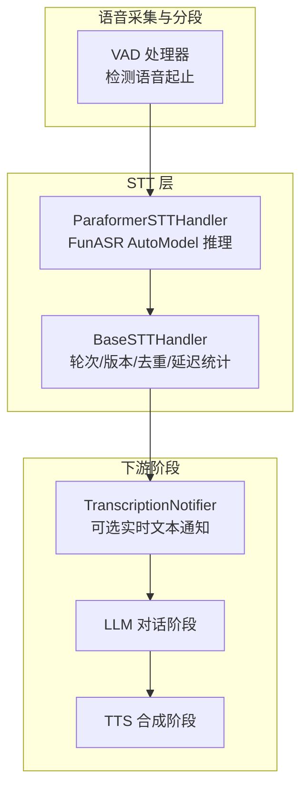
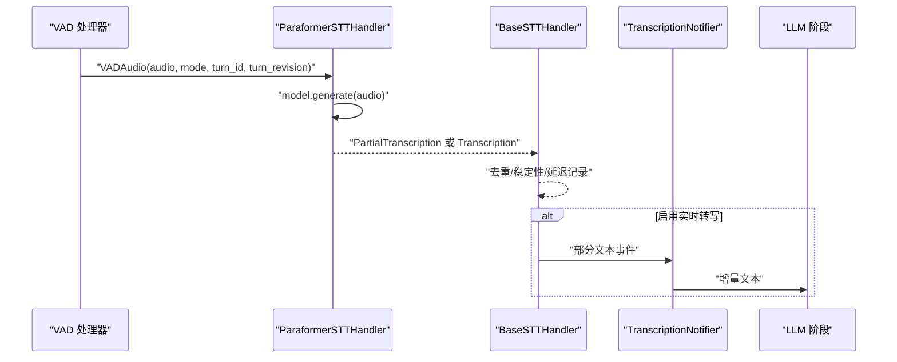
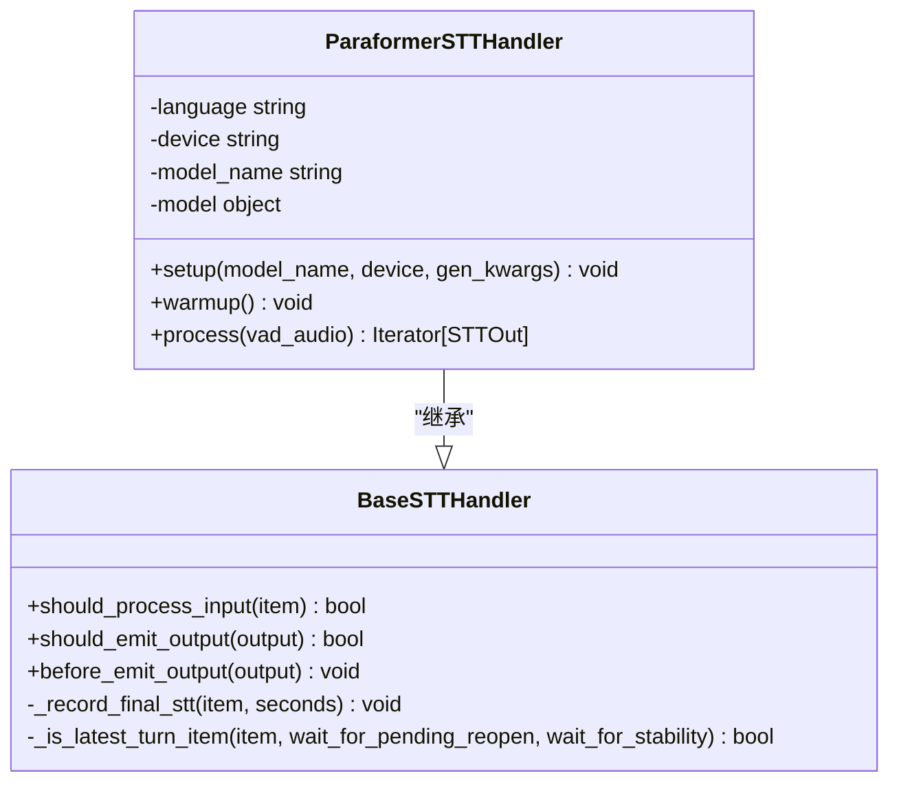
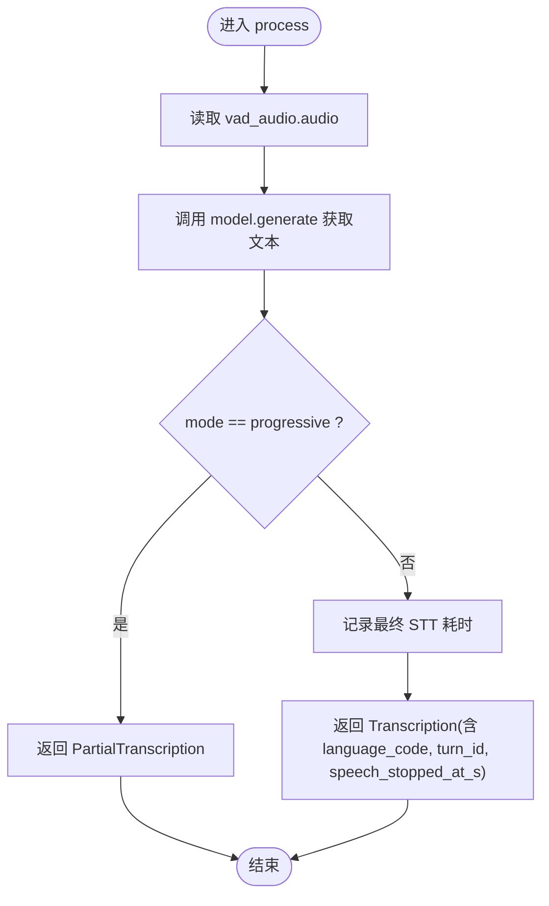
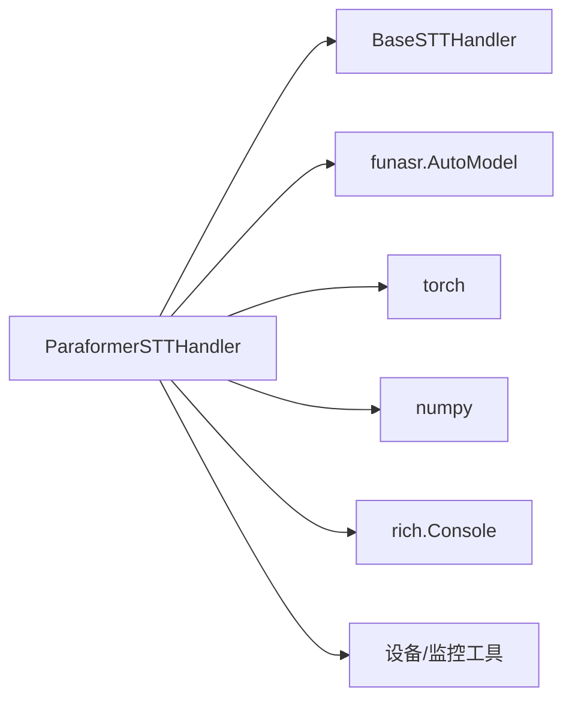
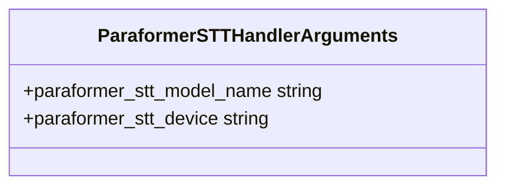

# Paraformer 实现

<cite>
**本文引用的文件**   
- [paraformer_handler.py](file://src/speech_to_speech/STT/paraformer_handler.py)
- [paraformer_stt_arguments.py](file://src/speech_to_speech/arguments_classes/paraformer_stt_arguments.py)
- [base_stt_handler.py](file://src/speech_to_speech/STT/base_stt_handler.py)
- [README.md](file://src/speech_to_speech/STT/README.md)
- [test_paraformer_transcription_events.py](file://tests/test_paraformer_transcription_events.py)
- [s2s_pipeline.py](file://src/speech_to_speech/s2s_pipeline.py)
- [vad_handler.py](file://src/speech_to_speech/VAD/vad_handler.py)
- [openai-compatible-stt-CN.md](file://docs/openai-compatible-stt-CN.md)
</cite>

## 目录
1. [简介](#简介)
2. [项目结构](#项目结构)
3. [核心组件](#核心组件)
4. [架构总览](#架构总览)
5. [详细组件分析](#详细组件分析)
6. [依赖关系分析](#依赖关系分析)
7. [性能与实时性](#性能与实时性)
8. [配置参数详解](#配置参数详解)
9. [与其他 STT 后端的对比](#与其他-stt-后端的对比)
10. [部署与使用示例](#部署与使用示例)
11. [常见问题与排障](#常见问题与排障)
12. [结论](#结论)

## 简介
本技术文档围绕仓库中的 Paraformer 语音转文本（STT）实现展开，重点说明其在当前流水线中的集成方式、输入输出契约、渐进式转录行为、设备与语言处理策略，以及与 VAD、说话人分离和 LLM/TTS 阶段的协作关系。需要特别说明的是：Paraformer 模型本身由 FunASR 提供；本仓库的 `ParaformerSTTHandler` 负责加载模型、执行推理、封装结果并接入统一的 STT 事件流。关于“自回归解码器”的具体内部细节属于 FunASR/FunASR 模型侧的实现，不在本仓库源码范围内；本文在涉及模型内部机制时仅描述本仓库实际调用到的接口和行为。

## 项目结构
Paraformer 相关代码主要位于以下位置：
- STT 处理器：`src/speech_to_speech/STT/paraformer_handler.py`
- 参数定义：`src/speech_to_speech/arguments_classes/paraformer_stt_arguments.py`
- STT 基类与通用逻辑：`src/speech_to_speech/STT/base_stt_handler.py`
- STT 模块说明与用法：`src/speech_to_speech/STT/README.md`
- 端到端测试：`tests/test_paraformer_transcription_events.py`
- 流水线装配与 VAD 联动：`src/speech_to_speech/s2s_pipeline.py`、`src/speech_to_speech/VAD/vad_handler.py`



**图表来源**
- [paraformer_handler.py:22-99](file://src/speech_to_speech/STT/paraformer_handler.py#L22-L99)
- [base_stt_handler.py:16-130](file://src/speech_to_speech/STT/base_stt_handler.py#L16-L130)
- [s2s_pipeline.py:488-505](file://src/speech_to_speech/s2s_pipeline.py#L488-L505)

**章节来源**
- [paraformer_handler.py:22-99](file://src/speech_to_speech/STT/paraformer_handler.py#L22-L99)
- [README.md:84-93](file://src/speech_to_speech/STT/README.md#L84-L93)

## 核心组件
- `ParaformerSTTHandler`：基于 FunASR 的 `AutoModel` 完成音频到文本的推理，支持中文默认模型，并在 MPS 设备上清理缓存。
- `ParaformerSTTHandlerArguments`：声明可配置的模型名称和设备类型。
- `BaseSTTHandler`：提供轮次稳定性、渐进式结果过滤、最终结果标记、陈旧输入丢弃、延迟记录等通用能力。
- 流水线与 VAD：VAD 将语音片段交给 STT；当启用实时转写时，STT 可通过管道通知器向 LLM 推送部分文本。

**章节来源**
- [paraformer_handler.py:22-99](file://src/speech_to_speech/STT/paraformer_handler.py#L22-L99)
- [paraformer_stt_arguments.py:4-18](file://src/speech_to_speech/arguments_classes/paraformer_stt_arguments.py#L4-L18)
- [base_stt_handler.py:16-130](file://src/speech_to_speech/STT/base_stt_handler.py#L16-L130)

## 架构总览
Paraformer 在本项目中作为本地 STT 后端之一被注册和使用。其典型数据流如下：
1. VAD 检测到语音段，生成 `VADAudio`。
2. `ParaformerSTTHandler.process` 接收音频，调用 FunASR `model.generate` 得到文本。
3. 根据输入模式返回：
   - 渐进式：返回 `PartialTranscription`。
   - 最终：返回 `Transcription`，包含语言代码、轮次 ID、修订号、语音结束时间等元信息。
4. `BaseSTTHandler` 对输出进行去重、稳定性校验和延迟统计。
5. 可选地通过 `TranscriptionNotifier` 把部分文本推送到 LLM 阶段。



**图表来源**
- [paraformer_handler.py:61-99](file://src/speech_to_speech/STT/paraformer_handler.py#L61-L99)
- [base_stt_handler.py:32-130](file://src/speech_to_speech/STT/base_stt_handler.py#L32-L130)
- [s2s_pipeline.py:488-505](file://src/speech_to_speech/s2s_pipeline.py#L488-L505)

## 详细组件分析

### ParaformerSTTHandler
该处理器负责：
- 从参数中解析模型名和设备，默认使用中文模型。
- 动态导入 FunASR，若缺失则抛出明确安装提示。
- 初始化 `AutoModel` 并执行一次 warmup。
- 在推理过程中记录输入摘要、输出文本长度，并在 MPS 设备上清理 GPU 缓存。
- 根据 `mode` 返回不同消息类型：
  - `progressive`：返回部分转录，不包含语言代码。
  - `final`：返回完整转录，包含语言代码、轮次元信息和语音结束时间。



**图表来源**
- [paraformer_handler.py:22-99](file://src/speech_to_speech/STT/paraformer_handler.py#L22-L99)
- [base_stt_handler.py:16-130](file://src/speech_to_speech/STT/base_stt_handler.py#L16-L130)

**章节来源**
- [paraformer_handler.py:22-99](file://src/speech_to_speech/STT/paraformer_handler.py#L22-L99)
- [test_paraformer_transcription_events.py:25-46](file://tests/test_paraformer_transcription_events.py#L25-L46)
- [test_paraformer_transcription_events.py:49-95](file://tests/test_paraformer_transcription_events.py#L49-L95)

### 渐进式与最终转录流程
Paraformer 的 `process` 方法根据输入模式决定输出类型：
- 渐进式：直接返回部分文本，不记录最终 STT 延迟。
- 最终：记录 STT 耗时，返回带语言代码和语音结束时间的完整转录。



**图表来源**
- [paraformer_handler.py:61-99](file://src/speech_to_speech/STT/paraformer_handler.py#L61-L99)

**章节来源**
- [paraformer_handler.py:61-99](file://src/speech_to_speech/STT/paraformer_handler.py#L61-L99)
- [test_paraformer_transcription_events.py:49-95](file://tests/test_paraformer_transcription_events.py#L49-L95)

### 语言与设备处理
- 语言：从模型名中提取，例如 `paraformer-zh` 对应中文；若未包含语言后缀则默认为中文。
- 设备：通过统一工具解析 `auto`、`cuda`、`mps`、`cpu` 等值，避免直接调用 FunASR 前就确定设备。
- MPS 优化：在 Apple Silicon 上推理完成后清理 MPS 缓存，减少显存占用。

**章节来源**
- [paraformer_handler.py:29-49](file://src/speech_to_speech/STT/paraformer_handler.py#L29-L49)
- [paraformer_handler.py:75-79](file://src/speech_to_speech/STT/paraformer_handler.py#L75-L79)
- [test_paraformer_transcription_events.py:25-46](file://tests/test_paraformer_transcription_events.py#L25-L46)

### 与 VAD 和流水线的协作
- VAD 负责语音起止检测，并将音频块传递给 STT。
- 当启用实时转写时，STT 的部分文本可通过 `TranscriptionNotifier` 推送给 LLM。
- 对于 OpenAI 兼容远程 STT，VAD 会控制窗口大小和提交边界；但 Paraformer 是本地模型，通常以 VAD 输出的整段语音为推理单元。

**章节来源**
- [s2s_pipeline.py:488-505](file://src/speech_to_speech/s2s_pipeline.py#L488-L505)
- [vad_handler.py:297-315](file://src/speech_to_speech/VAD/vad_handler.py#L297-L315)
- [vad_handler.py:676-698](file://src/speech_to_speech/VAD/vad_handler.py#L676-L698)

## 依赖关系分析
Paraformer 实现的依赖链如下：
- 运行时依赖：`funasr.AutoModel`，若未安装则抛出明确错误。
- 框架依赖：`torch`、`numpy`、`rich.Console`。
- 内部依赖：`BaseSTTHandler`、`STTIn/STTOut`、`PartialTranscription/Transcription`、设备解析工具、模型监控工具。



**图表来源**
- [paraformer_handler.py:1-15](file://src/speech_to_speech/STT/paraformer_handler.py#L1-L15)
- [paraformer_handler.py:41-49](file://src/speech_to_speech/STT/paraformer_handler.py#L41-L49)

**章节来源**
- [paraformer_handler.py:1-15](file://src/speech_to_speech/STT/paraformer_handler.py#L1-L15)
- [paraformer_handler.py:41-49](file://src/speech_to_speech/STT/paraformer_handler.py#L41-L49)

## 性能与实时性
- 推理模式：当前 `ParaformerSTTHandler.process` 对每段 `VADAudio` 进行一次完整推理，并非逐 token 自回归流式解码。因此，真正的“流式”体现在 VAD 驱动的渐进式分段与部分文本输出，而非模型内部的 token-by-token 生成。
- Warmup：启动时执行一次 dummy 推理，有助于 CUDA Graph 或编译路径预热。
- 内存管理：在 MPS 设备上推理后清理缓存，降低长时间运行的显存压力。
- 延迟统计：仅在最终转录时记录 STT 耗时，渐进式结果不计入最终 STT 指标。
- 实时转写：通过 `TranscriptionNotifier` 可将部分文本推送给 LLM，提升交互响应速度。

**章节来源**
- [paraformer_handler.py:51-59](file://src/speech_to_speech/STT/paraformer_handler.py#L51-L59)
- [paraformer_handler.py:75-79](file://src/speech_to_speech/STT/paraformer_handler.py#L75-L79)
- [paraformer_handler.py:84-99](file://src/speech_to_speech/STT/paraformer_handler.py#L84-L99)
- [s2s_pipeline.py:488-505](file://src/speech_to_speech/s2s_pipeline.py#L488-L505)

## 配置参数详解
- `paraformer_stt_model_name`：FunASR 预训练模型名称，默认 `paraformer-zh`。可从 FunASR 支持的模型列表中选择。
- `paraformer_stt_device`：运行设备，支持 `auto`、`cuda`、`npu`、`xpu`、`mps`、`cpu`，默认 `cuda`。



**图表来源**
- [paraformer_stt_arguments.py:4-18](file://src/speech_to_speech/arguments_classes/paraformer_stt_arguments.py#L4-L18)

**章节来源**
- [paraformer_stt_arguments.py:4-18](file://src/speech_to_speech/arguments_classes/paraformer_stt_arguments.py#L4-L18)
- [README.md:84-93](file://src/speech_to_speech/STT/README.md#L84-L93)

## 与其他 STT 后端的对比
- Whisper 系列：多语言支持广泛，本地或远程均可；语言自动检测与回退策略较成熟。
- Faster-Whisper：高性能离线推理，语言由生成参数控制。
- Parakeet TDT：Apple Silicon 使用 MLX，其他平台使用 nano-parakeet；语言自动选择。
- Qwen3-ASR：支持多语言表，可强制语言并提供上下文热词；渐进式窗口较短，语言复用上一轮最终语言。
- Paraformer：默认中文模型，语言从模型名推断；适合中文场景，依赖 FunASR 生态。

| 后端 | 语言策略 | 流式特性 | 典型用途 |
|---|---|---|---|
| Whisper | 固定或 auto，内部支持列表 | 可配合 VAD 做分段 | 多语言通用识别 |
| Faster-Whisper | 生成参数控制 | 离线为主 | 高性能本地识别 |
| Parakeet TDT | 自动选择 | 支持渐进式 | Apple Silicon 优化 |
| Qwen3-ASR | 语言表 + 强制语言 | 短窗口渐进式 | 多语言 + 热词 |
| Paraformer | 模型名推断，默认 zh | VAD 驱动分段 | 中文优先场景 |

**章节来源**
- [README.md:31-106](file://src/speech_to_speech/STT/README.md#L31-L106)

## 部署与使用示例
- 本地服务启动 Paraformer：
  ```bash
  speech-to-speech serve --stt paraformer --paraformer_stt_model_name paraformer-zh
  ```
- 如需远程 OpenAI 兼容 STT，可参考文档中的 vLLM 或 OpenAI 托管方案。

**章节来源**
- [README.md:234-238](file://src/speech_to_speech/STT/README.md#L234-L238)
- [openai-compatible-stt-CN.md:13-31](file://docs/openai-compatible-stt-CN.md#L13-L31)

## 常见问题与排障
- 缺少 FunASR 依赖：
  - 现象：导入或初始化时报模块缺失。
  - 解决：按提示安装可选依赖 `speech-to-speech[paraformer]`。
- MPS 显存增长：
  - 现象：Apple Silicon 上长时间运行显存占用上升。
  - 解决：处理器已在推理后清理 MPS 缓存；确保使用最新依赖。
- 渐进式结果未出现：
  - 现象：只收到最终转录，没有部分文本。
  - 排查：确认是否启用实时转写；检查 VAD 与 `TranscriptionNotifier` 的配置。
- 语言代码不正确：
  - 现象：最终转录的语言代码不符合预期。
  - 排查：确认模型名是否包含语言后缀；必要时更换为对应语言的 FunASR 模型。

**章节来源**
- [paraformer_handler.py:41-49](file://src/speech_to_speech/STT/paraformer_handler.py#L41-L49)
- [paraformer_handler.py:75-79](file://src/speech_to_speech/STT/paraformer_handler.py#L75-L79)
- [test_paraformer_transcription_events.py:25-46](file://tests/test_paraformer_transcription_events.py#L25-L46)
- [test_paraformer_transcription_events.py:49-95](file://tests/test_paraformer_transcription_events.py#L49-L95)

## 结论
Paraformer 在本项目中作为中文优先的本地 STT 后端，通过 FunASR 的 `AutoModel` 提供稳定的语音转文本能力。其优势在于：
- 中文场景下开箱即用，默认模型为中文。
- 与 VAD 和流水线良好集成，支持渐进式部分文本输出。
- 在 MPS 设备上具备基础显存管理。
- 配置简洁，易于替换不同 FunASR 模型以适配多语言需求。

需要注意的是，当前处理器对每段 VAD 音频执行一次性推理，真正的自回归 token 级流式解码由 FunASR 模型侧负责；本仓库更强调 VAD 驱动的渐进式分段与部分文本推送。对于抗噪性能、多说话人支持和实时处理能力，建议结合 VAD、说话人分离以及 LLM/TTS 的整体链路进行调优与评估。