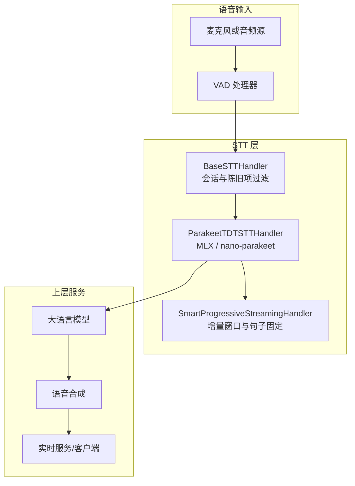
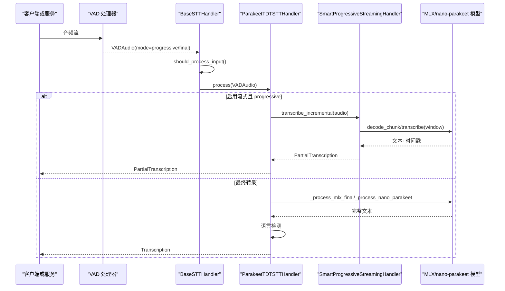
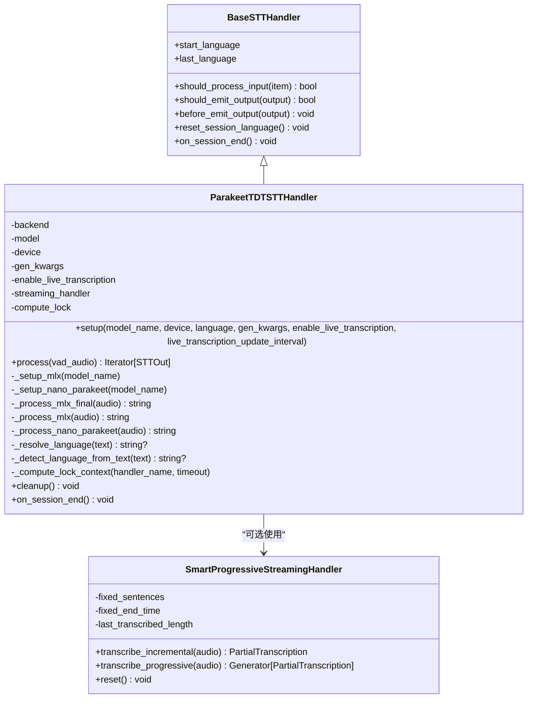
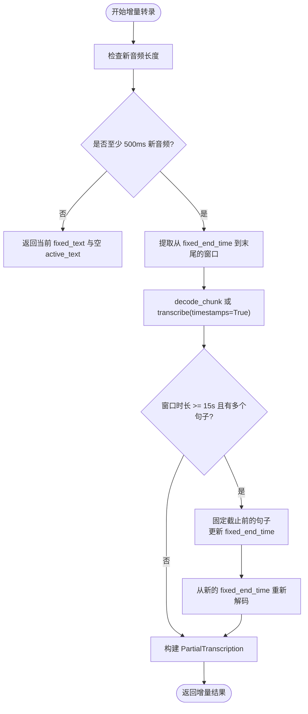
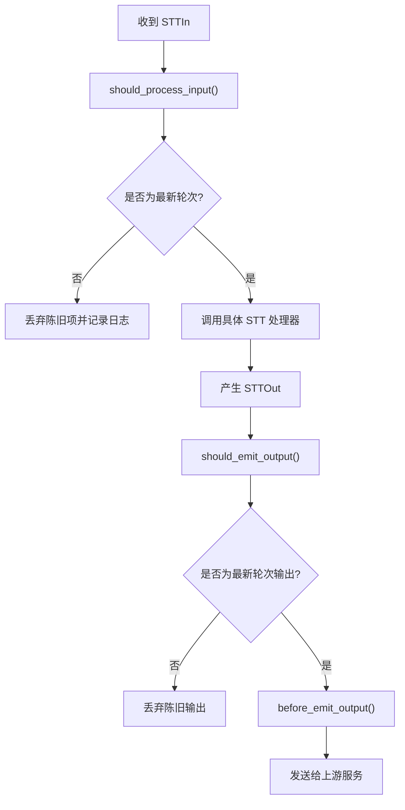
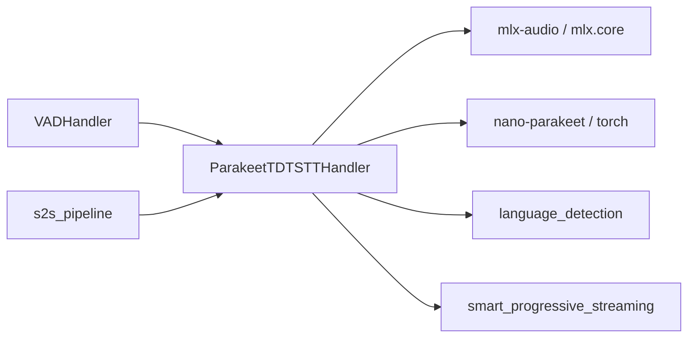
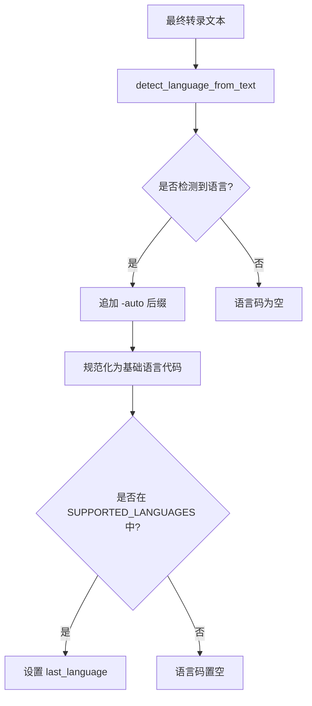
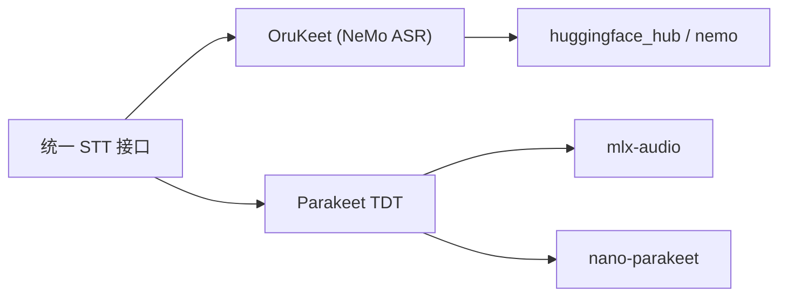

# Parakeet TDT 实现

<cite>
**本文引用的文件**   
- [parakeet_tdt_handler.py](file://src/speech_to_speech/STT/parakeet_tdt_handler.py)
- [parakeet_tdt_arguments.py](file://src/speech_to_speech/arguments_classes/parakeet_tdt_arguments.py)
- [smart_progressive_streaming.py](file://src/speech_to_speech/STT/smart_progressive_streaming.py)
- [base_stt_handler.py](file://src/speech_to_speech/STT/base_stt_handler.py)
- [vad_handler.py](file://src/speech_to_speech/VAD/vad_handler.py)
- [s2s_pipeline.py](file://src/speech_to_speech/s2s_pipeline.py)
- [test_parakeet_language_detection.py](file://tests/test_parakeet_language_detection.py)
- [test_orukeet_stt.py](file://tests/test_orukeet_stt.py)
- [parameter-catalog.yaml](file://docs/parameter-catalog.yaml)
</cite>

## 目录
1. [简介](#简介)
2. [项目结构定位](#项目结构定位)
3. [核心组件总览](#核心组件总览)
4. [架构与数据流](#架构与数据流)
5. [详细组件分析](#详细组件分析)
6. [依赖关系分析](#依赖关系分析)
7. [配置参数详解](#配置参数详解)
8. [性能优化建议](#性能优化建议)
9. [多语言支持与语言检测机制](#多语言支持与语言检测机制)
10. [与 OruKeet 的关系和兼容性](#与-orukeet-的关系和兼容性)
11. [集成示例与最佳实践](#集成示例与最佳实践)
12. [故障排查指南](#故障排查指南)
13. [结论](#结论)

## 简介
Parakeet TDT STT 实现基于 NVIDIA Parakeet TDT 0.6B v3 模型，提供高质量的多语言端到端语音转文本能力。该实现通过统一处理器接口接入 speech-to-speech 管道，支持：
- Apple Silicon 上使用 MLX Audio 推理；
- CUDA/CPU 上使用 nano-parakeet 纯 PyTorch 推理；
- 可选的流式增量转录；
- 基于已转录文本的语言检测；
- 与 VAD、LLM、TTS 等模块协同工作。

本技术文档从系统架构、处理逻辑、流式算法、语言检测、OruKeet 兼容性、配置参数、性能优化和多语言支持等方面展开说明，并给出可操作的集成指导。

## 项目结构定位
Parakeet TDT STT 的核心代码位于 STT 子模块中，并通过统一的后端注册机制被 pipeline 构建器加载。关键位置如下：
- STT 处理器实现：`src/speech_to_speech/STT/parakeet_tdt_handler.py`
- 处理器参数定义：`src/speech_to_speech/arguments_classes/parakeet_tdt_arguments.py`
- 流式增量转录辅助：`src/speech_to_speech/STT/smart_progressive_streaming.py`
- STT 基类与会话状态管理：`src/speech_to_speech/STT/base_stt_handler.py`
- VAD 流式音频投递：`src/speech_to_speech/VAD/vad_handler.py`
- Pipeline 构建与后端选择：`src/speech_to_speech/s2s_pipeline.py`

**图表来源**
- [parakeet_tdt_handler.py:69-151](file://src/speech_to_speech/STT/parakeet_tdt_handler.py#L69-L151)
- [smart_progressive_streaming.py:28-61](file://src/speech_to_speech/STT/smart_progressive_streaming.py#L28-L61)
- [base_stt_handler.py:16-86](file://src/speech_to_speech/STT/base_stt_handler.py#L16-L86)
- [vad_handler.py:297-315](file://src/speech_to_speech/VAD/vad_handler.py#L297-L315)

**章节来源**
- [parakeet_tdt_handler.py:1-10](file://src/speech_to_speech/STT/parakeet_tdt_handler.py#L1-L10)
- [s2s_pipeline.py:208-238](file://src/speech_to_speech/s2s_pipeline.py#L208-L238)

## 核心组件总览
- `ParakeetTDTSTTHandler`：封装 Parakeet TDT 模型的初始化、设备选择、推理流程、流式处理、语言检测与清理。
- `SmartProgressiveStreamingHandler`：负责增量转录窗口管理、句子边界固定、活跃部分更新。
- `BaseSTTHandler`：提供会话级陈旧输入过滤、最终结果稳定性门控、延迟记录与清理。
- `ParakeetTDTSTTHandlerArguments`：声明 CLI 与配置文件中的 Parakeet TDT 参数。
- VAD 与 Pipeline：将音频片段按说话起止事件组织为 `VADAudio`，并驱动 STT 处理器输出 `PartialTranscription` 与 `Transcription`。

**章节来源**
- [parakeet_tdt_handler.py:69-151](file://src/speech_to_speech/STT/parakeet_tdt_handler.py#L69-L151)
- [smart_progressive_streaming.py:18-61](file://src/speech_to_speech/STT/smart_progressive_streaming.py#L18-L61)
- [base_stt_handler.py:16-86](file://src/speech_to_speech/STT/base_stt_handler.py#L16-L86)
- [parakeet_tdt_arguments.py:5-37](file://src/speech_to_speech/arguments_classes/parakeet_tdt_arguments.py#L5-L37)

## 架构与数据流
Parakeet TDT 在 pipeline 中的典型调用链如下：

**图表来源**
- [parakeet_tdt_handler.py:207-360](file://src/speech_to_speech/STT/parakeet_tdt_handler.py#L207-L360)
- [smart_progressive_streaming.py:87-157](file://src/speech_to_speech/STT/smart_progressive_streaming.py#L87-L157)
- [base_stt_handler.py:43-86](file://src/speech_to_speech/STT/base_stt_handler.py#L43-L86)

**章节来源**
- [parakeet_tdt_handler.py:207-360](file://src/speech_to_speech/STT/parakeet_tdt_handler.py#L207-L360)
- [vad_handler.py:297-315](file://src/speech_to_speech/VAD/vad_handler.py#L297-L315)

## 详细组件分析

### ParakeetTDTSTTHandler
该处理器承担以下职责：
- 根据设备自动选择 MLX（Apple Silicon）或 nano-parakeet（CUDA/CPU）。
- 初始化模型、预热、样本率设置。
- 处理 `progressive` 与 `final` 两种模式。
- 可选启用流式增量转录，使用 `SmartProgressiveStreamingHandler`。
- 对最终转录进行语言检测，并以 `-auto` 后缀报告检测结果。
- 管理计算锁、会话状态清理与日志。

**图表来源**
- [parakeet_tdt_handler.py:69-151](file://src/speech_to_speech/STT/parakeet_tdt_handler.py#L69-L151)
- [parakeet_tdt_handler.py:515-590](file://src/speech_to_speech/STT/parakeet_tdt_handler.py#L515-L590)
- [smart_progressive_streaming.py:28-61](file://src/speech_to_speech/STT/smart_progressive_streaming.py#L28-L61)
- [base_stt_handler.py:16-31](file://src/speech_to_speech/STT/base_stt_handler.py#L16-L31)

**章节来源**
- [parakeet_tdt_handler.py:80-151](file://src/speech_to_speech/STT/parakeet_tdt_handler.py#L80-L151)
- [parakeet_tdt_handler.py:207-360](file://src/speech_to_speech/STT/parakeet_tdt_handler.py#L207-L360)
- [parakeet_tdt_handler.py:369-393](file://src/speech_to_speech/STT/parakeet_tdt_handler.py#L369-L393)
- [parakeet_tdt_handler.py:395-425](file://src/speech_to_speech/STT/parakeet_tdt_handler.py#L395-L425)
- [parakeet_tdt_handler.py:515-590](file://src/speech_to_speech/STT/parakeet_tdt_handler.py#L515-L590)
- [parakeet_tdt_handler.py:592-605](file://src/speech_to_speech/STT/parakeet_tdt_handler.py#L592-L605)

### SmartProgressiveStreamingHandler
该组件实现“智能渐进流式”策略：
- 每约 500ms 发射一次增量结果。
- 使用增长窗口（最大 15 秒）提升准确性。
- 当窗口超过上限时，依据句子边界滑动窗口，将已完成句子固定为 `fixed_text`，仅对活跃部分重新转录。
- 返回 `PartialTranscription`，包含固定文本、活跃文本、时间戳与是否最终标志。

**图表来源**
- [smart_progressive_streaming.py:87-157](file://src/speech_to_speech/STT/smart_progressive_streaming.py#L87-L157)

**章节来源**
- [smart_progressive_streaming.py:18-61](file://src/speech_to_speech/STT/smart_progressive_streaming.py#L18-L61)
- [smart_progressive_streaming.py:87-157](file://src/speech_to_speech/STT/smart_progressive_streaming.py#L87-L157)

### BaseSTTHandler 与会话陈旧项过滤
BaseSTTHandler 提供统一的 STT 行为：
- 丢弃陈旧输入与输出，避免旧轮次覆盖新轮次。
- 对 final 模式增加稳定性门控，等待推测轮次稳定。
- 记录 STT 耗时与 VAD settle 时间。
- 重置会话语言状态。

**图表来源**
- [base_stt_handler.py:43-86](file://src/speech_to_speech/STT/base_stt_handler.py#L43-L86)
- [base_stt_handler.py:114-130](file://src/speech_to_speech/STT/base_stt_handler.py#L114-L130)

**章节来源**
- [base_stt_handler.py:43-86](file://src/speech_to_speech/STT/base_stt_handler.py#L43-L86)
- [base_stt_handler.py:114-130](file://src/speech_to_speech/STT/base_stt_handler.py#L114-L130)
- [base_stt_handler.py:286-312](file://src/speech_to_speech/STT/base_stt_handler.py#L286-L312)

## 依赖关系分析
- Parakeet TDT 处理器依赖：
  - MLX Audio（Apple Silicon）：`mlx-audio` 与 `mlx.core`。
  - nano-parakeet（CUDA/CPU）：`torch` 与 `nano_parakeet`。
  - 语言检测：`speech_to_speech.pipeline.language_detection`。
  - 流式处理：`speech_to_speech.STT.smart_progressive_streaming`。
- Pipeline 与 VAD：
  - VAD 将音频片段以 `VADAudio` 形式送入 STT。
  - Pipeline 解析后端选择并构建处理器实例。

**图表来源**
- [parakeet_tdt_handler.py:153-184](file://src/speech_to_speech/STT/parakeet_tdt_handler.py#L153-L184)
- [parakeet_tdt_handler.py:25-34](file://src/speech_to_speech/STT/parakeet_tdt_handler.py#L25-L34)
- [s2s_pipeline.py:208-238](file://src/speech_to_speech/s2s_pipeline.py#L208-L238)

**章节来源**
- [parakeet_tdt_handler.py:153-184](file://src/speech_to_speech/STT/parakeet_tdt_handler.py#L153-L184)
- [s2s_pipeline.py:208-238](file://src/speech_to_speech/s2s_pipeline.py#L208-L238)

## 配置参数详解
Parakeet TDT 的配置参数由 `ParakeetTDTSTTHandlerArguments` 定义，并在参数目录中登记。

| 参数名 | 类型 | 默认值 | 含义与行为 |
|---|---|---:|---|
| `parakeet_tdt_model_name` | `Optional[str]` | `None` | 指定 Parakeet TDT 模型标识。未设置时，Apple Silicon 使用 `mlx-community/parakeet-tdt-0.6b-v3`，其他设备使用 `nvidia/parakeet-tdt-0.6b-v3`。 |
| `parakeet_tdt_device` | `str` | `"auto"` | 运行设备。`auto` 在 macOS 上优先 MPS，否则依次尝试 CUDA、NPU、CPU。 |
| `parakeet_tdt_language` | `Optional[str]` | `None` | 兼容现有命令的参数。Parakeet 解码器始终自动选择语言，该值不会约束转录或替换检测到的语言元数据。建议使用 `auto` 或不设置。 |

这些参数在运行时会被解析并传入 `ParakeetTDTSTTHandler.setup`，用于决定模型名称、设备与语言偏好。

**章节来源**
- [parakeet_tdt_arguments.py:5-37](file://src/speech_to_speech/arguments_classes/parakeet_tdt_arguments.py#L5-L37)
- [parameter-catalog.yaml:1907-1948](file://docs/parameter-catalog.yaml#L1907-L1948)
- [parakeet_tdt_handler.py:80-124](file://src/speech_to_speech/STT/parakeet_tdt_handler.py#L80-L124)

## 性能优化建议
- 设备选择：
  - Apple Silicon 使用 MLX 路径可获得更优能效与延迟。
  - CUDA 环境优先使用 GPU；若不可用则回退 CPU。
- 流式转录：
  - 启用 `enable_live_transcription` 可在用户说话期间提供低延迟反馈。
  - 调整 `live_transcription_update_interval` 控制增量更新频率。
  - 合理设置 `max_window_size` 与 `sentence_buffer`，平衡准确性与重算开销。
- 计算锁：
  - MLX 路径使用 `MLXLockContext`，非 MLX 路径使用线程锁。
  - 最终转录使用较长超时，避免阻塞；渐进更新使用短超时，跳过繁忙时段。
- 预热：
  - 使用 1 秒静音音频预热模型，减少首次推理延迟。
- 资源清理：
  - 会话结束时重置语言状态与流式状态，避免跨会话污染。

**章节来源**
- [parakeet_tdt_handler.py:111-131](file://src/speech_to_speech/STT/parakeet_tdt_handler.py#L111-L131)
- [parakeet_tdt_handler.py:186-206](file://src/speech_to_speech/STT/parakeet_tdt_handler.py#L186-L206)
- [parakeet_tdt_handler.py:227-276](file://src/speech_to_speech/STT/parakeet_tdt_handler.py#L227-L276)
- [parakeet_tdt_handler.py:395-425](file://src/speech_to_speech/STT/parakeet_tdt_handler.py#L395-L425)
- [parakeet_tdt_handler.py:592-605](file://src/speech_to_speech/STT/parakeet_tdt_handler.py#L592-L605)

## 多语言支持与语言检测机制
- 模型支持 25 种欧洲语言，包括英语、德语、法语、西班牙语、意大利语、葡萄牙语、荷兰语、波兰语、俄语、乌克兰语、捷克语、斯洛伐克语、匈牙利语、罗马尼亚语、保加利亚语、克罗地亚语、斯洛文尼亚语、塞尔维亚语、丹麦语、挪威语、瑞典语、芬兰语、爱沙尼亚语、拉脱维亚语、立陶宛语。
- 语言检测：
  - 基于已转录文本调用 `detect_language_from_text`。
  - 检测结果附加 `-auto` 后缀，例如 `en-auto`。
  - 如果检测到语言不在支持列表中，则不设置 `last_language`。
  - 配置的 `language` 参数仅用于兼容，不会强制 Parakeet 解码器。
- 测试覆盖：
  - 验证预加载语言模型、短文本不触发检测、英文短文本检测、挪威语映射、CJK 短文本允许快速识别、数值片段拒绝歧义检测。

**图表来源**
- [parakeet_tdt_handler.py:369-393](file://src/speech_to_speech/STT/parakeet_tdt_handler.py#L369-L393)
- [parakeet_tdt_handler.py:312-321](file://src/speech_to_speech/STT/parakeet_tdt_handler.py#L312-L321)

**章节来源**
- [parakeet_tdt_handler.py:39-66](file://src/speech_to_speech/STT/parakeet_tdt_handler.py#L39-L66)
- [parakeet_tdt_handler.py:369-393](file://src/speech_to_speech/STT/parakeet_tdt_handler.py#L369-L393)
- [test_parakeet_language_detection.py:8-40](file://tests/test_parakeet_language_detection.py#L8-L40)
- [test_parakeet_language_detection.py:42-53](file://tests/test_parakeet_language_detection.py#L42-L53)
- [test_parakeet_language_detection.py:55-102](file://tests/test_parakeet_language_detection.py#L55-L102)
- [test_parakeet_language_detection.py:105-141](file://tests/test_parakeet_language_detection.py#L105-L141)

## 与 OruKeet 的关系和兼容性
- OruKeet 是基于 NeMo ASR 的实现，使用 `oruk/orukeet` 仓库与 `.nemo` 检查点。
- Parakeet TDT 与 OruKeet 是两个独立的 STT 后端：
  - Parakeet TDT 使用 MLX 或 nano-parakeet。
  - OruKeet 使用 NeMo 模型恢复与下载。
- 两者均遵循统一的 STT 接口，但配置、依赖与行为不同：
  - OruKeet 通过 `NemoASRSTTHandler` 加载检查点并支持语言检测。
  - Parakeet TDT 通过 `ParakeetTDTSTTHandler` 加载模型并自动选择语言。
- 测试用例验证了 OruKeet 的默认参数、检查点下载、缺失依赖报错、语言检测等行为。

**图表来源**
- [test_orukeet_stt.py:33-43](file://tests/test_orukeet_stt.py#L33-L43)
- [test_orukeet_stt.py:46-93](file://tests/test_orukeet_stt.py#L46-L93)
- [test_orukeet_stt.py:129-140](file://tests/test_orukeet_stt.py#L129-L140)
- [test_orukeet_stt.py:143-233](file://tests/test_orukeet_stt.py#L143-L233)

**章节来源**
- [test_orukeet_stt.py:33-43](file://tests/test_orukeet_stt.py#L33-L43)
- [test_orukeet_stt.py:46-93](file://tests/test_orukeet_stt.py#L46-L93)
- [test_orukeet_stt.py:129-140](file://tests/test_orukeet_stt.py#L129-L140)
- [test_orukeet_stt.py:143-233](file://tests/test_orukeet_stt.py#L143-L233)

## 集成示例与最佳实践
- 在 pipeline 中选择 Parakeet TDT：
  - 通过命令行或配置文件选择 `stt_backend` 为 `parakeet-tdt`。
  - 设置 `parakeet_tdt_device` 为 `auto` 或明确设备。
  - 如需流式体验，启用 `enable_live_transcription` 并调整更新间隔。
- 音频输入：
  - VAD 将音频切片为 `VADAudio`，mode 为 `progressive` 或 `final`。
  - 确保音频采样率为 16kHz，类型为 float32 numpy 数组。
- 输出消费：
  - 消费 `PartialTranscription` 用于实时显示。
  - 消费 `Transcription` 作为最终结果传给 LLM。
- 最佳实践：
  - 在 Apple Silicon 设备上优先使用 MLX 路径。
  - 在高并发场景下，合理设置流式更新间隔与窗口大小。
  - 注意会话结束时的状态清理，避免跨会话污染。

**章节来源**
- [s2s_pipeline.py:208-238](file://src/speech_to_speech/s2s_pipeline.py#L208-L238)
- [parakeet_tdt_handler.py:80-151](file://src/speech_to_speech/STT/parakeet_tdt_handler.py#L80-L151)
- [vad_handler.py:297-315](file://src/speech_to_speech/VAD/vad_handler.py#L297-L315)

## 故障排查指南
- 导入错误：
  - Apple Silicon 缺少 `mlx-audio`：安装依赖后重试。
  - CUDA/CPU 缺少 `nano-parakeet`：安装依赖后重试。
- 设备不可用：
  - 请求 CUDA 但不可用时，会回退到 CPU。
- 流式转录异常：
  - 检查 `enable_live_transcription` 是否正确启用。
  - 确认 `streaming_handler` 已初始化。
- 语言检测失败：
  - 短文本可能无法检测，属于预期行为。
  - 检测结果不在支持列表时会清空语言码。
- 陈旧项丢弃：
  - 观察日志中的陈旧项丢弃信息，确认轮次与版本是否正确。

**章节来源**
- [parakeet_tdt_handler.py:153-184](file://src/speech_to_speech/STT/parakeet_tdt_handler.py#L153-L184)
- [parakeet_tdt_handler.py:227-276](file://src/speech_to_speech/STT/parakeet_tdt_handler.py#L227-L276)
- [parakeet_tdt_handler.py:312-327](file://src/speech_to_speech/STT/parakeet_tdt_handler.py#L312-L327)
- [base_stt_handler.py:205-231](file://src/speech_to_speech/STT/base_stt_handler.py#L205-L231)

## 结论
Parakeet TDT STT 实现在 speech-to-speech 管道中提供了高质量、多语言、可选流式的语音转文本能力。其设计兼顾了 Apple Silicon 与 CUDA/CPU 平台的差异化推理路径，并通过统一的 STT 接口与 VAD、LLM、TTS 等模块无缝协作。结合智能渐进流式算法与语言检测机制，该实现能够在保证准确性的同时提供低延迟的用户体验。在生产环境中，建议根据硬件条件选择合适的后端，合理配置流式参数，并关注会话状态清理与陈旧项过滤，以获得稳定可靠的语音交互体验。