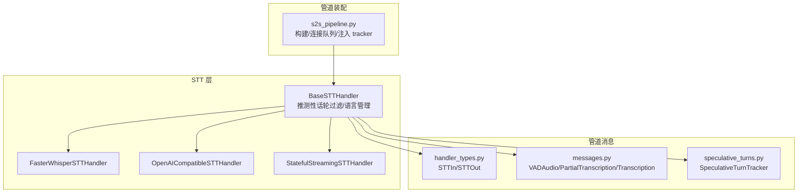
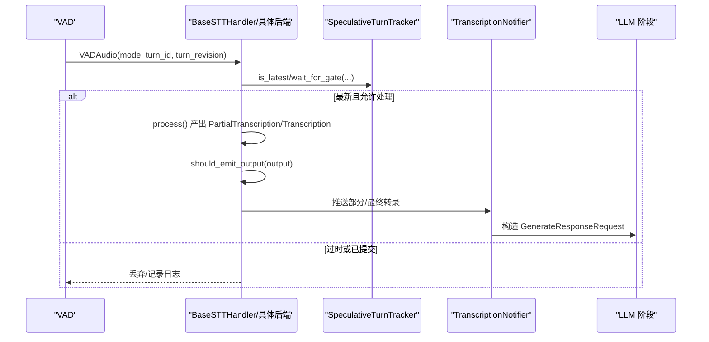
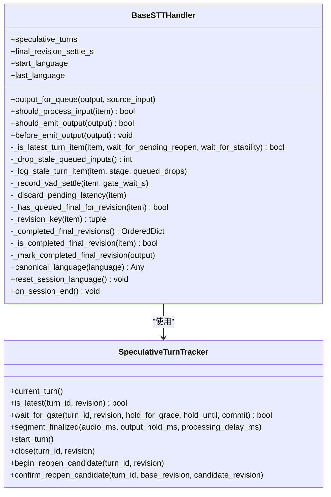
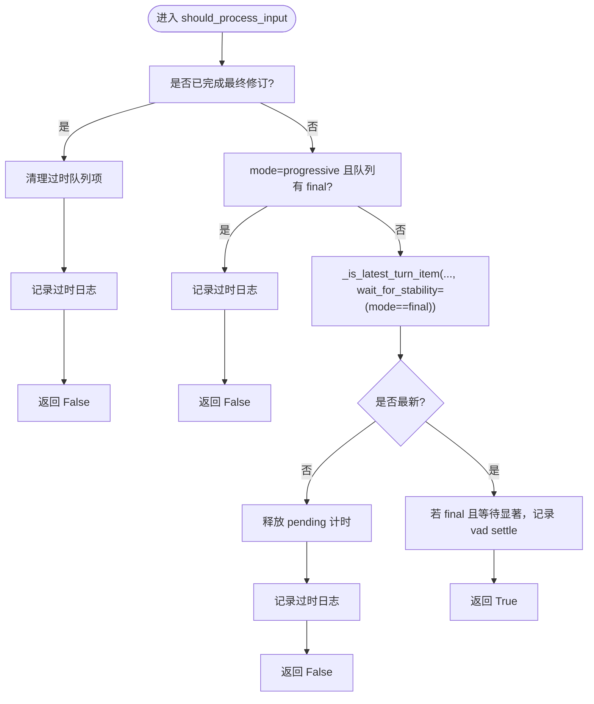
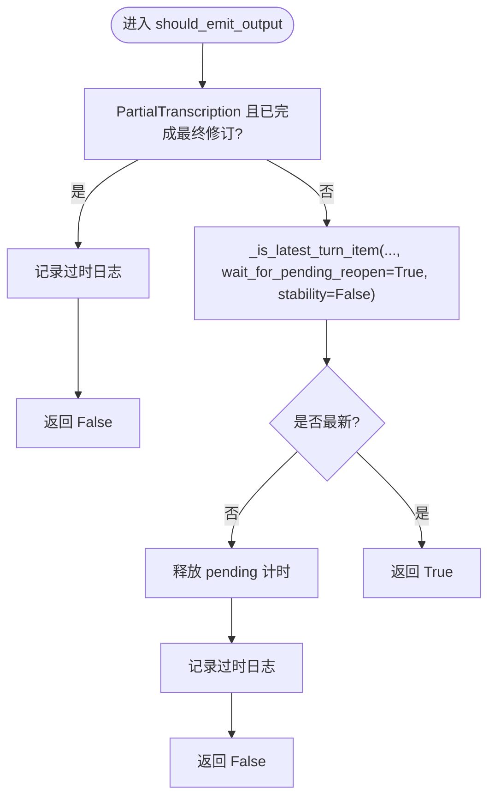
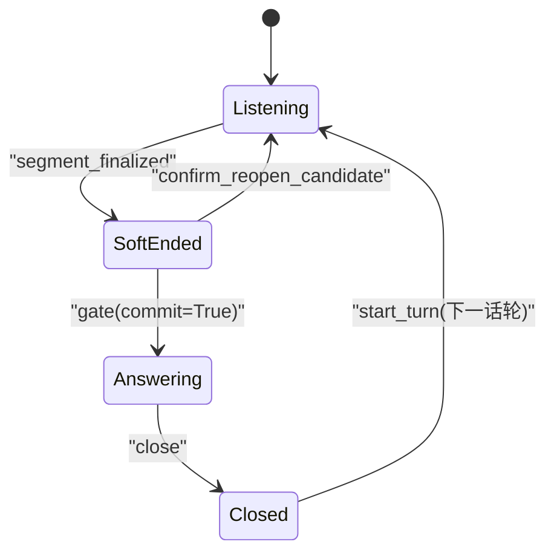
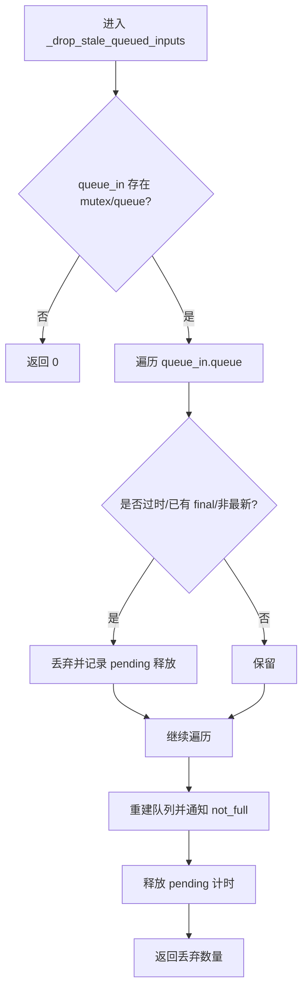
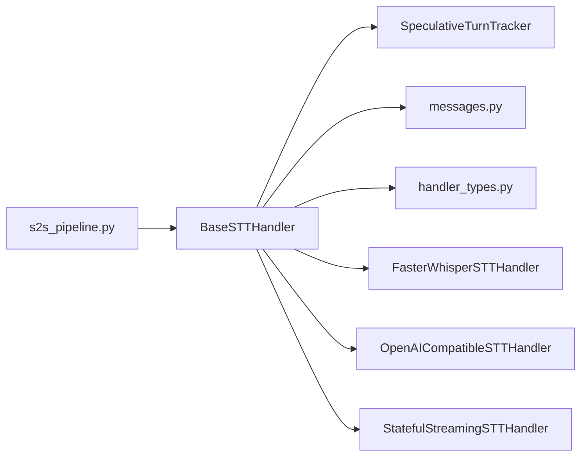

# STT 基础架构

<cite>
**本文引用的文件**   
- [base_stt_handler.py](file://src/speech_to_speech/STT/base_stt_handler.py)
- [speculative_turns.py](file://src/speech_to_speech/pipeline/speculative_turns.py)
- [handler_types.py](file://src/speech_to_speech/pipeline/handler_types.py)
- [messages.py](file://src/speech_to_speech/pipeline/messages.py)
- [faster_whisper_handler.py](file://src/speech_to_speech/STT/faster_whisper_handler.py)
- [openai_compatible_handler.py](file://src/speech_to_speech/STT/openai_compatible_handler.py)
- [streaming_handler.py](file://src/speech_to_speech/STT/streaming_handler.py)
- [s2s_pipeline.py](file://src/speech_to_speech/s2s_pipeline.py)
</cite>

## 目录
1. [引言](#引言)
2. [项目结构](#项目结构)
3. [核心组件](#核心组件)
4. [架构总览](#架构总览)
5. [详细组件分析](#详细组件分析)
6. [依赖关系分析](#依赖关系分析)
7. [性能与监控](#性能与监控)
8. [故障排查指南](#故障排查指南)
9. [扩展新 STT 后端的最佳实践](#扩展新-stt-后端的最佳实践)
10. [结论](#结论)

## 引言
本文面向 Speech-to-Speech 管道中的语音转文本（STT）基础架构，重点解释 BaseSTTHandler 的设计模式、推测性话轮（speculative turns）的过时输入过滤、会话语言管理、流式处理状态跟踪等关键机制。文档同时梳理 STTIn/STTOut 数据模型、事件处理流程、队列管理机制，并说明 should_process_input、should_emit_output 等核心方法的调用时机与决策逻辑。最后给出错误处理、性能监控、资源管理实现细节，以及扩展新 STT 后端的指导原则。

## 项目结构
STT 相关代码主要分布在以下位置：
- STT 基础处理器与具体后端实现位于 src/speech_to_speech/STT。
- 管道消息类型、类型别名和推测性话轮状态机位于 src/speech_to_speech/pipeline。
- STT 在整体 S2S 管道中的装配、队列连接与会话生命周期由 s2s_pipeline.py 负责。

**图表来源**
- [base_stt_handler.py:16-311](file://src/speech_to_speech/STT/base_stt_handler.py#L16-L311)
- [handler_types.py:35-37](file://src/speech_to_speech/pipeline/handler_types.py#L35-L37)
- [messages.py:49-98](file://src/speech_to_speech/pipeline/messages.py#L49-L98)
- [speculative_turns.py:65-489](file://src/speech_to_speech/pipeline/speculative_turns.py#L65-L489)
- [s2s_pipeline.py:469-484](file://src/speech_to_speech/s2s_pipeline.py#L469-L484)

**章节来源**
- [base_stt_handler.py:16-311](file://src/speech_to_speech/STT/base_stt_handler.py#L16-L311)
- [handler_types.py:35-37](file://src/speech_to_speech/pipeline/handler_types.py#L35-L37)
- [messages.py:49-98](file://src/speech_to_speech/pipeline/messages.py#L49-L98)
- [speculative_turns.py:65-489](file://src/speech_to_speech/pipeline/speculative_turns.py#L65-L489)
- [s2s_pipeline.py:469-484](file://src/speech_to_speech/s2s_pipeline.py#L469-L484)

## 核心组件
- BaseSTTHandler：所有 STT 后端的基类，提供推测性话轮过时输入过滤、最终修订版本追踪、会话语言管理与清理、输出前修正说话人归属等通用能力。
- SpeculativeTurnTracker：线程安全的“推测性话轮”状态机，维护当前话轮、提交态、软结束、重开候选、处理截止时间等，决定工作项是否最新、是否需要等待或丢弃。
- STTIn/STTOut：STT 阶段的输入输出类型别名，分别对应 VADAudio 与 PartialTranscription/Transcription/TranscriptionFailure。
- messages.py：定义跨阶段消息，包括 VADAudio、PartialTranscription、Transcription、TranscriptionFailure 等，承载 turn_id、turn_revision、mode、speech_end_at_s 等关键字段。
- FasterWhisperSTTHandler、OpenAICompatibleSTTHandler、StatefulStreamingSTTHandler：具体 STT 后端实现，继承 BaseSTTHandler，封装本地推理、HTTP 转录、WebSocket 流式协议等差异。

**章节来源**
- [base_stt_handler.py:16-311](file://src/speech_to_speech/STT/base_stt_handler.py#L16-L311)
- [speculative_turns.py:65-489](file://src/speech_to_speech/pipeline/speculative_turns.py#L65-L489)
- [handler_types.py:35-37](file://src/speech_to_speech/pipeline/handler_types.py#L35-L37)
- [messages.py:49-98](file://src/speech_to_speech/pipeline/messages.py#L49-L98)
- [faster_whisper_handler.py:38-174](file://src/speech_to_speech/STT/faster_whisper_handler.py#L38-L174)
- [openai_compatible_handler.py:262-692](file://src/speech_to_speech/STT/openai_compatible_handler.py#L262-L692)
- [streaming_handler.py:928-1086](file://src/speech_to_speech/STT/streaming_handler.py#L928-L1086)

## 架构总览
STT 在 S2S 管道中的角色是承接 VAD 输出的音频片段，将其转为部分或最终转录结果，并通过 TranscriptionNotifier 或直接进入 LLM 生成阶段。BaseSTTHandler 通过 SpeculativeTurnTracker 控制“哪个修订版本是当前有效版本”，从而避免旧话轮或旧修订版本的过时输入/输出污染后续响应。

**图表来源**
- [base_stt_handler.py:43-125](file://src/speech_to_speech/STT/base_stt_handler.py#L43-L125)
- [speculative_turns.py:195-248](file://src/speech_to_speech/pipeline/speculative_turns.py#L195-L248)
- [s2s_pipeline.py:469-505](file://src/speech_to_speech/s2s_pipeline.py#L469-L505)

## 详细组件分析

### BaseSTTHandler 设计模式与核心机制
BaseSTTHandler 的职责可概括为：
- 输入门控：should_process_input 决定是否处理该 VADAudio。
- 输出门控：should_emit_output 决定是否将 PartialTranscription/Transcription/TranscriptionFailure 推入下游队列。
- 推测性话轮集成：_is_latest_turn_item 使用 SpeculativeTurnTracker 判断是否为最新修订；必要时阻塞等待稳定性窗口。
- 最终修订版本追踪：_completed_final_revisions 记录已提交的最终修订，用于拒绝同修订的后续过时输入/输出。
- 会话语言管理：start_language/last_language/reset_session_language/on_session_end 保证会话间语言状态隔离。
- 说话人归属延迟解析：output_for_queue 在输出时解析 PendingSpeakerAttribution，避免阻塞推理。

**图表来源**
- [base_stt_handler.py:16-311](file://src/speech_to_speech/STT/base_stt_handler.py#L16-L311)
- [speculative_turns.py:65-489](file://src/speech_to_speech/pipeline/speculative_turns.py#L65-L489)

#### should_process_input 逻辑与调用时机
- 若该修订已是“已完成最终修订”，则丢弃并清理队列中过时项。
- 若 mode 为 progressive 且队列中存在同修订的 final，则丢弃 progressive（避免重复）。
- 对 final 模式启用稳定性等待：根据 SpeculativeTurnTracker.processing_deadline 与 final_revision_settle_s 计算 hold_until，必要时阻塞等待。
- 若非最新修订，丢弃并释放 pending 计时槽位。

**图表来源**
- [base_stt_handler.py:43-86](file://src/speech_to_speech/STT/base_stt_handler.py#L43-L86)
- [base_stt_handler.py:131-166](file://src/speech_to_speech/STT/base_stt_handler.py#L131-L166)

#### should_emit_output 逻辑与调用时机
- 若 PartialTranscription 来自已完成最终修订，直接丢弃。
- 若非最新修订，丢弃并释放 pending 计时；否则放行。
- before_emit_output 在 Transcription 发出前标记该修订为“已完成最终修订”。

**图表来源**
- [base_stt_handler.py:114-129](file://src/speech_to_speech/STT/base_stt_handler.py#L114-L129)

#### 会话语言管理
- start_language：setup 时保存用户配置的语言（None 表示 auto）。
- last_language：会话内检测到的语言状态。
- reset_session_language：会话结束时恢复为初始语义（auto 或固定语言）。
- on_session_end：清理已完成最终修订集合并重置语言状态。
- canonical_language：统一 “auto” 哨兵写法，避免不同后端对 “auto” 的歧义。

**章节来源**
- [base_stt_handler.py:287-311](file://src/speech_to_speech/STT/base_stt_handler.py#L287-L311)

### SpeculativeTurnTracker 状态机
SpeculativeTurnTracker 维护如下状态与边界：
- TurnPhase：listening、soft_ended、answering、closed。
- 当前话轮 current_turn：包含 sequence、turn_id、revision。
- 提交态 committed：已确认的话轮修订，不再可重开。
- 软结束与重开：segment_finalized 设置 soft_ended 与 processing_deadline；can_reopen/speech_candidate_started/begin_reopen_candidate/confirm_reopen_candidate 管理重开候选。
- 门控 gate/wait_for_gate：根据 grace 期、hold_until、commit 标志决定 ACCEPT/DROP/HOLD。
- close：响应终止后释放提交态，关闭当前话轮。

**图表来源**
- [speculative_turns.py:13-17](file://src/speech_to_speech/pipeline/speculative_turns.py#L13-L17)
- [speculative_turns.py:149-193](file://src/speech_to_speech/pipeline/speculative_turns.py#L149-L193)
- [speculative_turns.py:201-248](file://src/speech_to_speech/pipeline/speculative_turns.py#L201-L248)
- [speculative_turns.py:272-290](file://src/speech_to_speech/pipeline/speculative_turns.py#L272-L290)

### STTIn/STTOut 数据模型
- STTIn = VADAudio：携带 audio、mode、turn_id、turn_revision、processing_delay_s、speech_end_at_s、created_at_s 等字段。
- STTOut = PartialTranscription | Transcription | TranscriptionFailure：携带 text、language_code、speaker_attribution、turn_id、turn_revision、speech_stopped_at_s 等字段。

这些类型定义了 STT 阶段的数据契约，确保上游 VAD 与下游 TranscriptionNotifier/LLM 之间的消息一致性。

**章节来源**
- [handler_types.py:35-37](file://src/speech_to_speech/pipeline/handler_types.py#L35-L37)
- [messages.py:49-98](file://src/speech_to_speech/pipeline/messages.py#L49-L98)

### 队列管理机制
- BaseSTTHandler._drop_stale_queued_inputs：在检测到过时修订或已有 final 时，遍历 queue_in.queue，丢弃过时 VADAudio，并释放其 pending 计时。
- OpenAICompatibleSTTHandler：维护 _pending_finals、_active、_windowed_turns，按 session_generation 与 revision 取消/保留请求；支持分窗转录与进度合并。
- StatefulStreamingSTTHandler：维护 _StreamingSession，序列化 append_audio/start_turn/commit/discard/reset/stop 命令，处理 WebSocket 事件流，维护 item_id/content_index 绑定与失败话轮标记。

**图表来源**
- [base_stt_handler.py:168-203](file://src/speech_to_speech/STT/base_stt_handler.py#L168-L203)

**章节来源**
- [base_stt_handler.py:168-203](file://src/speech_to_speech/STT/base_stt_handler.py#L168-L203)
- [openai_compatible_handler.py:331-443](file://src/speech_to_speech/STT/openai_compatible_handler.py#L331-L443)
- [streaming_handler.py:349-475](file://src/speech_to_speech/STT/streaming_handler.py#L349-L475)

### 具体 STT 后端实现要点

#### FasterWhisperSTTHandler
- setup 时规范化 language（None 表示 auto），并根据 selected_language 动态覆盖 gen_kwargs。
- process 中按 segments 拼接文本；mode=progressive 时输出 PartialTranscription，否则输出 Transcription 并记录 STT 耗时。
- adapt_gen_kwargs 将 return_timestamps 转换为 without_timestamps，避免共享配置被意外修改。

**章节来源**
- [faster_whisper_handler.py:47-78](file://src/speech_to_speech/STT/faster_whisper_handler.py#L47-L78)
- [faster_whisper_handler.py:111-174](file://src/speech_to_speech/STT/faster_whisper_handler.py#L111-L174)

#### OpenAICompatibleSTTHandler
- 支持 HTTP 转录与分窗（max_window_s）策略，维护 _windowed_turns 以增量拼接文本。
- 异步 worker 线程执行 _run_request，捕获 TranscriptionRequestError/Cancelled，发布 TranscriptionFailure。
- _publish_output 在 should_emit_output 通过后写入 queue_out，并记录 STT 耗时到 turn_latency_store。
- on_session_end/cleanup 清理 session_generation、pending 队列、活跃请求与 worker 线程。

**章节来源**
- [openai_compatible_handler.py:268-318](file://src/speech_to_speech/STT/openai_compatible_handler.py#L268-L318)
- [openai_compatible_handler.py:331-443](file://src/speech_to_speech/STT/openai_compatible_handler.py#L331-L443)
- [openai_compatible_handler.py:566-608](file://src/speech_to_speech/STT/openai_compatible_handler.py#L566-L608)
- [openai_compatible_handler.py:628-692](file://src/speech_to_speech/STT/openai_compatible_handler.py#L628-L692)

#### StatefulStreamingSTTHandler
- 基于 WebSocket 的实时转录协议（OpenAI Realtime / vLLM Realtime），维护 _StreamingSession 与命令队列。
- 处理 delta/completed/failed/error 事件，维护 committed_prefixes 与 failed_turn_ids，确保 item_id/content_index 一致。
- begin_commit/commit 管理 boundary 超时与完成事件，emit_partial 在 is_latest 检查后推送 PartialTranscription。

**章节来源**
- [streaming_handler.py:72-216](file://src/speech_to_speech/STT/streaming_handler.py#L72-L216)
- [streaming_handler.py:349-475](file://src/speech_to_speech/STT/streaming_handler.py#L349-L475)
- [streaming_handler.py:630-770](file://src/speech_to_speech/STT/streaming_handler.py#L630-L770)

## 依赖关系分析
- BaseSTTHandler 依赖 SpeculativeTurnTracker 进行话轮状态判定，依赖 pipeline.messages 中的 VADAudio/PartialTranscription/Transcription 等消息类型。
- 具体 STT 后端依赖 BaseSTTHandler 提供的通用过滤与语言管理能力，并在 process 中产出 STTOut。
- s2s_pipeline.py 负责创建 STT handler、连接队列、注入 speculative_turns 与 turn_latency_store，并设置 live transcription 行为。

**图表来源**
- [s2s_pipeline.py:469-484](file://src/speech_to_speech/s2s_pipeline.py#L469-L484)
- [base_stt_handler.py:16-311](file://src/speech_to_speech/STT/base_stt_handler.py#L16-L311)
- [handler_types.py:35-37](file://src/speech_to_speech/pipeline/handler_types.py#L35-L37)
- [messages.py:49-98](file://src/speech_to_speech/pipeline/messages.py#L49-L98)

**章节来源**
- [s2s_pipeline.py:469-484](file://src/speech_to_speech/s2s_pipeline.py#L469-L484)
- [base_stt_handler.py:16-311](file://src/speech_to_speech/STT/base_stt_handler.py#L16-L311)

## 性能与监控
- VAD settle 时间记录：BaseSTTHandler._record_vad_settle 在 final 模式且 gate 等待显著时记录 vad settle 时间到 turn_latency_store。
- STT 耗时记录：具体后端（如 OpenAICompatibleSTTHandler）在 _publish_output 中记录 elapsed_s 到 turn_latency_store。
- Smart wait 记录：BaseSTTHandler._is_latest_turn_item 在 wait_for_stability 分支中记录智能等待时长。
- 队列大小与安全访问：_safe_qsize 兼容不支持 qsize 的队列实现。

建议：
- 在生产环境开启 turn_latency_store 以采集端到端时延指标。
- 合理设置 final_revision_settle_s 与 max_window_s，平衡低延迟与稳定性。
- 监控 _drop_stale_queued_inputs 的丢弃计数，评估推测性话轮策略的有效性。

**章节来源**
- [base_stt_handler.py:88-104](file://src/speech_to_speech/STT/base_stt_handler.py#L88-L104)
- [base_stt_handler.py:145-161](file://src/speech_to_speech/STT/base_stt_handler.py#L145-L161)
- [openai_compatible_handler.py:594-608](file://src/speech_to_speech/STT/openai_compatible_handler.py#L594-L608)

## 故障排查指南
常见问题与定位方法：
- 过时输入/输出被丢弃：检查 should_process_input/should_emit_output 的日志，关注 turn_id/turn_revision 与 completed final revisions。
- 流式转录超时：查看 streaming_handler 中的 boundary 超时与 connection 失败处理，确认 final_timeout 与网络状况。
- HTTP 转录失败：OpenAICompatibleSTTHandler 会抛出 TranscriptionRequestError/Cancelled，检查 endpoint_url、model、language、timeout 与服务器限制（如 413/最大时长）。
- 会话语言不一致：确认 start_language/last_language/reset_session_language 的使用，避免跨会话污染。
- 队列积压：观察 _drop_stale_queued_inputs 的丢弃数量与 queue_in.qsize，调整生产者速率或增大缓冲区。

**章节来源**
- [base_stt_handler.py:205-231](file://src/speech_to_speech/STT/base_stt_handler.py#L205-L231)
- [streaming_handler.py:539-577](file://src/speech_to_speech/STT/streaming_handler.py#L539-L577)
- [openai_compatible_handler.py:175-216](file://src/speech_to_speech/STT/openai_compatible_handler.py#L175-L216)
- [openai_compatible_handler.py:566-608](file://src/speech_to_speech/STT/openai_compatible_handler.py#L566-L608)

## 扩展新 STT 后端的最佳实践
- 继承 BaseSTTHandler：复用推测性话轮过滤、语言管理与会话清理能力。
- 实现 process：根据 mode 产出 PartialTranscription 或 Transcription；必要时产出 TranscriptionFailure。
- 集成 SpeculativeTurnTracker：在 process 前后遵循 BaseSTTHandler 的 should_process_input/should_emit_output 约定，必要时记录 STT 耗时。
- 语言处理：使用 BaseSTTHandler.canonical_language 统一 “auto” 语义；在 setup 中保存 start_language，并在 process 中根据 runtime_config.selected_language 动态选择语言。
- 队列与资源管理：避免阻塞主循环；后台线程/任务需支持取消与超时；cleanup/on_session_end 中释放资源与状态。
- 测试建议：覆盖 progressive/final 模式、过时修订丢弃、会话结束清理、语言自动检测与固定语言场景。

**章节来源**
- [base_stt_handler.py:16-311](file://src/speech_to_speech/STT/base_stt_handler.py#L16-L311)
- [faster_whisper_handler.py:47-78](file://src/speech_to_speech/STT/faster_whisper_handler.py#L47-L78)
- [openai_compatible_handler.py:268-318](file://src/speech_to_speech/STT/openai_compatible_handler.py#L268-L318)

## 结论
BaseSTTHandler 通过 SpeculativeTurnTracker 实现了稳健的推测性话轮过滤与会话语言管理，结合 STTIn/STTOut 数据模型与队列机制，确保了 STT 阶段在高并发、低延迟场景下的正确性与可观测性。具体后端（FasterWhisper、OpenAI Compatible、Stateful Streaming）在此基础上封装了本地推理、HTTP 转录与 WebSocket 流式协议差异。扩展新 STT 后端时，应严格遵循 BaseSTTHandler 的接口约定，合理使用推测性话轮与语言管理，完善错误处理与性能监控，以保证整体 S2S 管道的稳定运行。