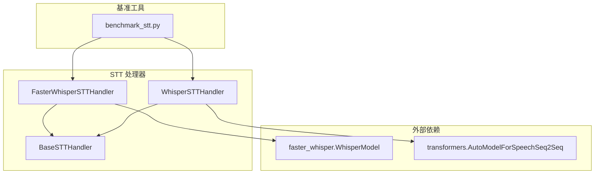
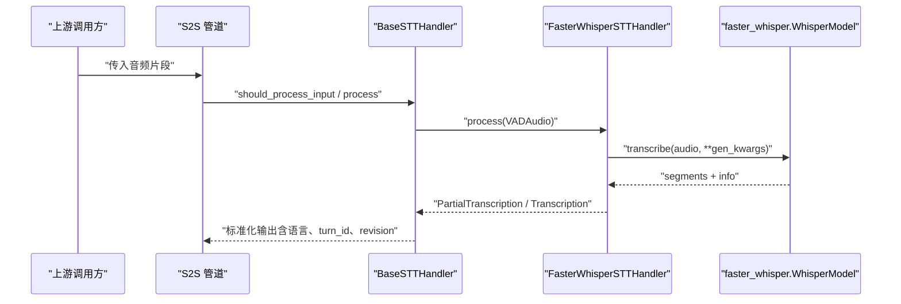
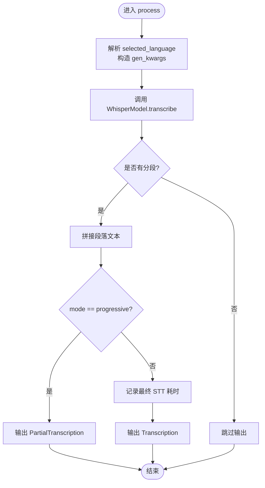
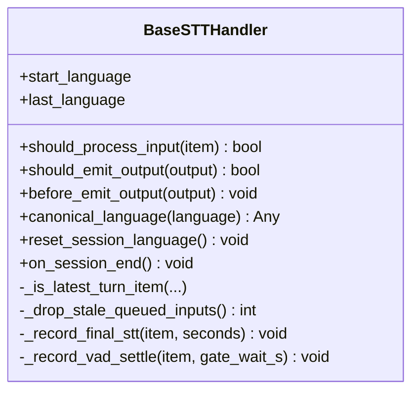
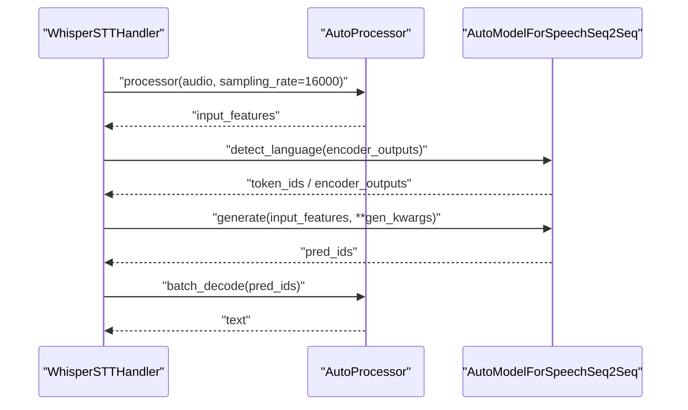
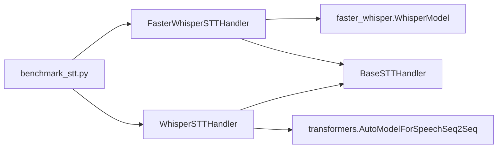

# Faster Whisper 实现

<cite>
**本文引用的文件**   
- [faster_whisper_handler.py](file://src/speech_to_speech/STT/faster_whisper_handler.py)
- [faster_whisper_stt_arguments.py](file://src/speech_to_speech/arguments_classes/faster_whisper_stt_arguments.py)
- [whisper_stt_handler.py](file://src/speech_to_speech/STT/whisper_stt_handler.py)
- [base_stt_handler.py](file://src/speech_to_speech/STT/base_stt_handler.py)
- [benchmark_stt.py](file://scripts/benchmark_stt.py)
- [test_faster_whisper_gen_kwargs_adaptation.py](file://tests/test_faster_whisper_gen_kwargs_adaptation.py)
</cite>

## 目录
1. [引言](#引言)
2. [项目结构](#项目结构)
3. [核心组件](#核心组件)
4. [架构总览](#架构总览)
5. [详细组件分析](#详细组件分析)
6. [依赖关系分析](#依赖关系分析)
7. [性能与优化策略](#性能与优化策略)
8. [配置与参数调优](#配置与参数调优)
9. [基准测试与部署建议](#基准测试与部署建议)
10. [兼容性处理与迁移指南](#兼容性处理与迁移指南)
11. [故障排查](#故障排查)
12. [结论](#结论)

## 引言
本技术文档聚焦于仓库中的 Faster Whisper 语音转文本（STT）实现，系统对比标准 Transformers Whisper 与 Faster Whisper 的实现差异、推理加速机制、内存与计算路径，以及可配置的推理参数。文档同时给出在不同硬件环境下的基准测试方法、部署建议，以及与标准 Whisper API 的兼容性与迁移要点。

## 项目结构
Faster Whisper STT 的核心位于 STT 模块中，采用“处理器 + 基类”的分层设计：
- Faster Whisper 处理器封装了 faster-whisper 库的 WhisperModel 调用。
- BaseSTTHandler 提供统一的流式输出、轮次稳定性过滤、语言状态管理、延迟统计等通用能力。
- 标准 Whisper 处理器基于 transformers 的 AutoModelForSpeechSeq2Seq，用于对比和替代方案。
- 参数定义集中在 arguments_classes 中，便于通过配置或命令行注入。
- benchmark_stt.py 提供了跨后端（含 Faster Whisper）的统一基准脚本。

图表来源
- [faster_whisper_handler.py:38-174](file://src/speech_to_speech/STT/faster_whisper_handler.py#L38-L174)
- [whisper_stt_handler.py:48-295](file://src/speech_to_speech/STT/whisper_stt_handler.py#L48-L295)
- [base_stt_handler.py:16-312](file://src/speech_to_speech/STT/base_stt_handler.py#L16-L312)
- [benchmark_stt.py:110-178](file://scripts/benchmark_stt.py#L110-L178)

章节来源
- [faster_whisper_handler.py:38-174](file://src/speech_to_speech/STT/faster_whisper_handler.py#L38-L174)
- [whisper_stt_handler.py:48-295](file://src/speech_to_speech/STT/whisper_stt_handler.py#L48-L295)
- [base_stt_handler.py:16-312](file://src/speech_to_speech/STT/base_stt_handler.py#L16-L312)
- [benchmark_stt.py:110-178](file://scripts/benchmark_stt.py#L110-L178)

## 核心组件
- FasterWhisperSTTHandler：封装 faster-whisper 的 WhisperModel，负责设备选择、compute_type 量化类型、语言自动检测、转录结果聚合、时间戳适配、进度模式输出等。
- BaseSTTHandler：统一处理输入门控、轮次稳定性、最终结果去重、语言会话状态、延迟记录等。
- WhisperSTTHandler：基于 transformers 的标准 Whisper 实现，支持 torch.compile、CUDA Graphs 预热、显式语言检测与编码器复用。
- FasterWhisperSTTHandlerArguments：声明 Faster Whisper 相关配置项，包括模型名、设备、compute_type、beam_size、任务、语言、是否返回时间戳等。
- benchmark_stt.py：统一基准脚本，支持多种 STT 后端（含 Faster Whisper），输出平均推理时间、TTFT、错误统计等。

章节来源
- [faster_whisper_handler.py:38-174](file://src/speech_to_speech/STT/faster_whisper_handler.py#L38-L174)
- [base_stt_handler.py:16-312](file://src/speech_to_speech/STT/base_stt_handler.py#L16-L312)
- [whisper_stt_handler.py:48-295](file://src/speech_to_speech/STT/whisper_stt_handler.py#L48-L295)
- [faster_whisper_stt_arguments.py:4-64](file://src/speech_to_speech/arguments_classes/faster_whisper_stt_arguments.py#L4-L64)
- [benchmark_stt.py:110-178](file://scripts/benchmark_stt.py#L110-L178)

## 架构总览
下图展示 Faster Whisper 在整体 STT 管线中的位置，以及与标准 Whisper 的并行存在方式。

图表来源
- [faster_whisper_handler.py:111-150](file://src/speech_to_speech/STT/faster_whisper_handler.py#L111-L150)
- [base_stt_handler.py:32-86](file://src/speech_to_speech/STT/base_stt_handler.py#L32-L86)

## 详细组件分析

### FasterWhisperSTTHandler 分析
- 初始化与设备选择：
  - 使用 validate_device 校验 device 为 cpu/cuda/auto；compute_type 由 CTranslate2 解析，默认 auto。
  - 设置 KMP_DUPLICATE_LIB_OK 环境变量以兼容某些 OpenMP 行为。
  - 实例化 WhisperModel(model_name, device, compute_type)。
- 语言处理：
  - _normalize_language 将字符串 "auto" 规范化为 None，表示让 faster-whisper 自动检测。
  - _resolve_language 优先使用模型实际识别的语言代码；若请求语言与实际不一致则记录警告；自动模式下追加 "-auto" 后缀以便下游区分。
- 推理流程：
  - process 中根据 runtime_config.selected_language 动态覆盖 gen_kwargs 中的 language。
  - 调用 model.transcribe 获取 segments 与 info，拼接文本并输出 PartialTranscription 或 Transcription。
  - 非 progressive 模式时记录最终 STT 耗时到延迟追踪器。
- 参数适配：
  - adapt_gen_kwargs 将 pipeline 的 return_timestamps 反转为 faster-whisper 的 without_timestamps，且不消费原字典，保证多次复用一致性。

图表来源
- [faster_whisper_handler.py:111-150](file://src/speech_to_speech/STT/faster_whisper_handler.py#L111-L150)

章节来源
- [faster_whisper_handler.py:47-66](file://src/speech_to_speech/STT/faster_whisper_handler.py#L47-L66)
- [faster_whisper_handler.py:68-109](file://src/speech_to_speech/STT/faster_whisper_handler.py#L68-L109)
- [faster_whisper_handler.py:111-150](file://src/speech_to_speech/STT/faster_whisper_handler.py#L111-L150)
- [faster_whisper_handler.py:161-173](file://src/speech_to_speech/STT/faster_whisper_handler.py#L161-L173)

### BaseSTTHandler 分析
- 输入门控与轮次稳定性：
  - should_process_input 判断是否为最新轮次、是否等待稳定性、是否丢弃陈旧输入。
  - 对 progressive 模式且已有最终结果的输入进行丢弃。
- 输出过滤与延迟记录：
  - should_emit_output 过滤陈旧输出，并在必要时丢弃 pending 延迟。
  - before_emit_output 标记已完成 final revision。
- 语言会话状态：
  - canonical_language 统一 "auto" 语义。
  - reset_session_language 与 on_session_end 清理会话级语言状态。

图表来源
- [base_stt_handler.py:16-312](file://src/speech_to_speech/STT/base_stt_handler.py#L16-L312)

章节来源
- [base_stt_handler.py:32-86](file://src/speech_to_speech/STT/base_stt_handler.py#L32-L86)
- [base_stt_handler.py:114-130](file://src/speech_to_speech/STT/base_stt_handler.py#L114-L130)
- [base_stt_handler.py:286-312](file://src/speech_to_speech/STT/base_stt_handler.py#L286-L312)

### WhisperSTTHandler 分析（标准实现）
- 初始化与编译：
  - 使用 AutoProcessor 与 AutoModelForSpeechSeq2Seq 加载模型，支持 torch_dtype 与 device。
  - 可选 compile_mode 启用 torch.compile，并预热 CUDA Graphs。
- 语言检测与编码器复用：
  - 优先 detect_language 获取 encoder_outputs，避免重复编码，降低显存占用。
  - 若 detect_language 不可用，回退到从生成序列前缀解析语言 token。
- 推理流程：
  - prepare_model_inputs 预处理音频特征。
  - generate 生成 token ids，解码得到文本。
  - progressive 模式输出 PartialTranscription，否则输出 Transcription。

图表来源
- [whisper_stt_handler.py:55-85](file://src/speech_to_speech/STT/whisper_stt_handler.py#L55-L85)
- [whisper_stt_handler.py:170-201](file://src/speech_to_speech/STT/whisper_stt_handler.py#L170-L201)
- [whisper_stt_handler.py:229-295](file://src/speech_to_speech/STT/whisper_stt_handler.py#L229-L295)

章节来源
- [whisper_stt_handler.py:55-85](file://src/speech_to_speech/STT/whisper_stt_handler.py#L55-L85)
- [whisper_stt_handler.py:170-201](file://src/speech_to_speech/STT/whisper_stt_handler.py#L170-L201)
- [whisper_stt_handler.py:229-295](file://src/speech_to_speech/STT/whisper_stt_handler.py#L229-L295)

## 依赖关系分析
- FasterWhisperSTTHandler 依赖 faster_whisper.WhisperModel，底层由 CTranslate2 驱动，支持多 compute_type 量化。
- WhisperSTTHandler 依赖 transformers 的 AutoModelForSpeechSeq2Seq，支持 torch.compile 与 CUDA Graphs。
- BaseSTTHandler 提供公共逻辑，被两者继承。
- benchmark_stt.py 通过动态导入不同 handler 进行统一评测。

图表来源
- [faster_whisper_handler.py:8-16](file://src/speech_to_speech/STT/faster_whisper_handler.py#L8-L16)
- [whisper_stt_handler.py:8-16](file://src/speech_to_speech/STT/whisper_stt_handler.py#L8-L16)
- [benchmark_stt.py:110-178](file://scripts/benchmark_stt.py#L110-L178)

章节来源
- [faster_whisper_handler.py:8-16](file://src/speech_to_speech/STT/faster_whisper_handler.py#L8-L16)
- [whisper_stt_handler.py:8-16](file://src/speech_to_speech/STT/whisper_stt_handler.py#L8-L16)
- [benchmark_stt.py:110-178](file://scripts/benchmark_stt.py#L110-L178)

## 性能与优化策略

### 量化与计算类型（compute_type）
- Faster Whisper 通过 CTranslate2 的 compute_type 控制量化与数据类型，支持 default、auto、int8、int8_float32、int8_float16、int8_bfloat16、int16、float16、float32、bfloat16 等。
- 推荐策略：
  - GPU 环境优先 float16 或 bfloat16，兼顾速度与精度。
  - CPU 环境可使用 int8 系列量化以降低内存带宽压力。
  - 对延迟敏感场景，先以 auto 评估，再固定为更具体的类型以获得稳定性能。

章节来源
- [faster_whisper_stt_arguments.py:26-33](file://src/speech_to_speech/arguments_classes/faster_whisper_stt_arguments.py#L26-L33)
- [faster_whisper_handler.py:47-66](file://src/speech_to_speech/STT/faster_whisper_handler.py#L47-L66)

### 内核优化与推理路径
- Faster Whisper：
  - 直接调用 WhisperModel.transcribe，内部由 CTranslate2 执行高效核与内存布局优化。
  - 不暴露 torch.compile 接口，但可通过 compute_type 与设备选择获得显著加速。
- 标准 Whisper：
  - 支持 torch.compile 与 CUDA Graphs 预热，减少图构建开销。
  - 显式语言检测复用 encoder_outputs，避免重复编码，降低显存占用。

章节来源
- [whisper_stt_handler.py:81-85](file://src/speech_to_speech/STT/whisper_stt_handler.py#L81-L85)
- [whisper_stt_handler.py:170-201](file://src/speech_to_speech/STT/whisper_stt_handler.py#L170-L201)

### 内存管理与批处理
- Faster Whisper：
  - 当前实现未暴露 batch_size 参数；单次 transcribe 处理一段音频。
  - 如需批处理，可在上层聚合多个 VADAudio 后批量调用，但需自行管理并发与队列。
- 标准 Whisper：
  - 同样以单段音频为主；可通过自定义批处理包装器实现，但需注意 tokenizer 与模型支持的 batch 维度。

章节来源
- [faster_whisper_handler.py:111-150](file://src/speech_to_speech/STT/faster_whisper_handler.py#L111-L150)
- [whisper_stt_handler.py:229-295](file://src/speech_to_speech/STT/whisper_stt_handler.py#L229-L295)

## 配置与参数调优

### Faster Whisper 关键参数
- faster_whisper_stt_model_name：预训练模型名称，如 tiny.en、small、medium、large-v3 等。
- faster_whisper_stt_device：运行设备，cpu/cuda/auto。
- faster_whisper_stt_compute_type：CTranslate2 量化与数据类型。
- faster_whisper_stt_gen_beam_size：束搜索宽度，默认 1（贪心解码）。
- faster_whisper_stt_gen_return_timestamps：是否返回时间戳（内部转换为 without_timestamps）。
- faster_whisper_stt_gen_task：任务类型，通常为 transcribe。
- faster_whisper_stt_gen_language：目标语言，支持 "auto" 自动检测。

章节来源
- [faster_whisper_stt_arguments.py:4-64](file://src/speech_to_speech/arguments_classes/faster_whisper_stt_arguments.py#L4-L64)

### 参数适配与一致性
- adapt_gen_kwargs 确保 return_timestamps 与 without_timestamps 的反向映射正确，且不污染原始配置字典，保证同一配置可被多个处理器安全复用。
- 测试用例验证了默认行为、反向映射、共享配置复用与透传其他参数。

章节来源
- [faster_whisper_handler.py:161-173](file://src/speech_to_speech/STT/faster_whisper_handler.py#L161-L173)
- [test_faster_whisper_gen_kwargs_adaptation.py:24-73](file://tests/test_faster_whisper_gen_kwargs_adaptation.py#L24-L73)

### 语言与自动检测
- Faster Whisper：
  - 当 start_language 为 None 时，不传递 language 给 transcribe，触发 faster-whisper 自动检测。
  - 报告语言时使用模型实际识别的代码，并在自动模式下追加 "-auto" 后缀。
- 标准 Whisper：
  - 优先 detect_language 获取编码器输出与语言 token，避免重复编码。
  - 若 detect_language 不可用，回退到从生成序列前缀解析语言。

章节来源
- [faster_whisper_handler.py:47-66](file://src/speech_to_speech/STT/faster_whisper_handler.py#L47-L66)
- [faster_whisper_handler.py:80-109](file://src/speech_to_speech/STT/faster_whisper_handler.py#L80-L109)
- [whisper_stt_handler.py:170-201](file://src/speech_to_speech/STT/whisper_stt_handler.py#L170-L201)

## 基准测试与部署建议

### 基准测试方法
- 使用 scripts/benchmark_stt.py 对不同 STT 后端进行统一评测，包括 whisper、mlx-audio-whisper、faster-whisper 等。
- 指标包括热身时间、平均推理时间、最小/最大/标准差、首次 token 时间（TTFT）、样本转录与错误统计。
- Faster Whisper 示例配置：model_name="large-v3"、device="auto"、compute_type="float16"。

章节来源
- [benchmark_stt.py:1-10](file://scripts/benchmark_stt.py#L1-L10)
- [benchmark_stt.py:110-178](file://scripts/benchmark_stt.py#L110-L178)
- [benchmark_stt.py:266-330](file://scripts/benchmark_stt.py#L266-L330)

### 不同硬件环境的建议
- GPU（CUDA）：
  - Faster Whisper：compute_type=float16 或 bfloat16，device=cuda 或 auto。
  - 标准 Whisper：torch_dtype=float16，可选 compile_mode 启用 torch.compile。
- CPU：
  - Faster Whisper：compute_type=int8 或 int8_float32，device=cpu。
  - 标准 Whisper：torch_dtype=float32，注意内存与速度权衡。
- Apple Silicon（MLX）：
  - 使用 mlx-audio-whisper 或 lightning_whisper_mlx_handler，结合 MPS 设备。

章节来源
- [benchmark_stt.py:127-178](file://scripts/benchmark_stt.py#L127-L178)
- [whisper_stt_handler.py:55-85](file://src/speech_to_speech/STT/whisper_stt_handler.py#L55-L85)

## 兼容性处理与迁移指南

### 与标准 Whisper API 的兼容性
- 输出格式：
  - 两种处理器均输出 PartialTranscription 与 Transcription，包含 text、language_code、turn_id、turn_revision、speech_stopped_at_s 等字段。
- 语言报告：
  - Faster Whisper 报告模型实际识别的语言，自动模式追加 "-auto"。
  - 标准 Whisper 优先 detect_language，回退到前缀解析或默认语言。
- 时间戳：
  - Faster Whisper 通过 adapt_gen_kwargs 将 return_timestamps 反转为 without_timestamps。
  - 标准 Whisper 在 decode 时禁用时间戳。

章节来源
- [faster_whisper_handler.py:111-150](file://src/speech_to_speech/STT/faster_whisper_handler.py#L111-L150)
- [faster_whisper_handler.py:161-173](file://src/speech_to_speech/STT/faster_whisper_handler.py#L161-L173)
- [whisper_stt_handler.py:229-295](file://src/speech_to_speech/STT/whisper_stt_handler.py#L229-L295)

### 迁移步骤
- 替换处理器：
  - 将 WhisperSTTHandler 替换为 FasterWhisperSTTHandler，保持 setup_kwargs 结构一致。
- 调整参数：
  - 将 torch_dtype 替换为 compute_type（Faster Whisper）。
  - 保留 beam_size、task、language 等推理参数。
- 验证语言与时间戳：
  - 确认 language 自动检测行为符合预期。
  - 检查 return_timestamps 与 without_timestamps 的映射是否正确。

章节来源
- [faster_whisper_stt_arguments.py:4-64](file://src/speech_to_speech/arguments_classes/faster_whisper_stt_arguments.py#L4-L64)
- [test_faster_whisper_gen_kwargs_adaptation.py:24-73](file://tests/test_faster_whisper_gen_kwargs_adaptation.py#L24-L73)

## 故障排查
- 语言不一致警告：
  - 当请求语言与模型实际识别语言不一致时，Faster Whisper 会记录警告日志，提示使用英语独占模型（如 tiny.en）总是解析为英语。
- 时间戳映射异常：
  - 若 return_timestamps 未在第二次使用时生效，检查 adapt_gen_kwargs 是否被多次调用且未复制原字典。
- 设备与量化类型错误：
  - 确保 device 为 cpu/cuda/auto，compute_type 为 CTranslate2 支持的值。
- 无文本输出：
  - 检查音频质量与语言设置，确认没有静音或噪声过大导致无分段。

章节来源
- [faster_whisper_handler.py:101-109](file://src/speech_to_speech/STT/faster_whisper_handler.py#L101-L109)
- [faster_whisper_handler.py:161-173](file://src/speech_to_speech/STT/faster_whisper_handler.py#L161-L173)

## 结论
Faster Whisper 在本仓库中通过 CTranslate2 的量化与内核优化，提供了比标准 Transformers Whisper 更高的推理效率与更低的内存占用。其配置简洁、参数直观，适合在生产环境中快速部署。对于需要极致可控性的场景，标准 Whisper 仍提供 torch.compile 与显式语言检测等高级特性。建议在 GPU 环境下优先使用 Faster Whisper 的 float16/bfloat16 量化，在 CPU 环境下使用 int8 量化，并结合 benchmark_stt.py 进行持续的性能回归与调优。