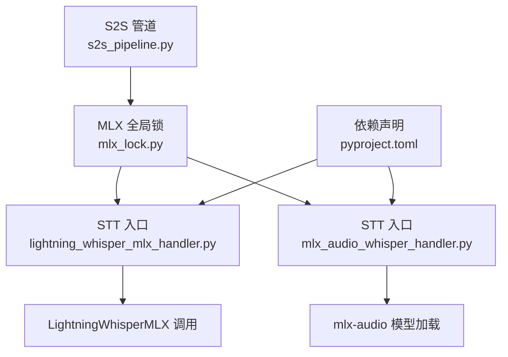
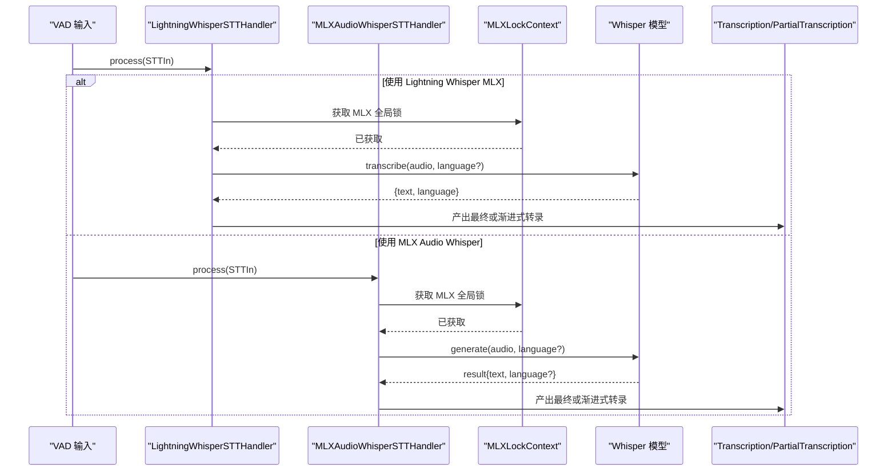
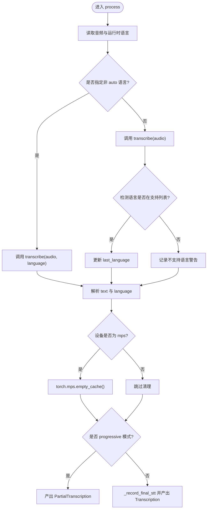
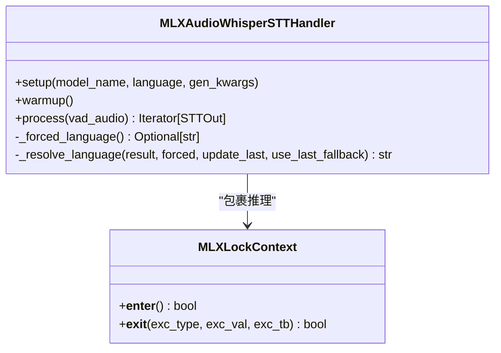
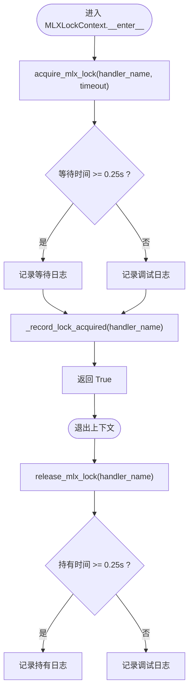
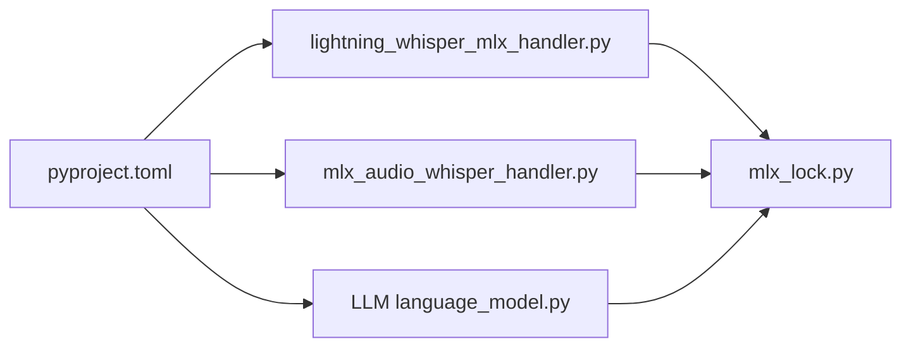

# Lightning Whisper MLX 实现

<cite>
**本文引用的文件**   
- [lightning_whisper_mlx_handler.py](file://src/speech_to_speech/STT/lightning_whisper_mlx_handler.py)
- [mlx_audio_whisper_handler.py](file://src/speech_to_speech/STT/mlx_audio_whisper_handler.py)
- [mlx_lock.py](file://src/speech_to_speech/utils/mlx_lock.py)
- [s2s_pipeline.py](file://src/speech_to_speech/s2s_pipeline.py)
- [README.md](file://src/speech_to_speech/STT/README.md)
- [pyproject.toml](file://pyproject.toml)
- [language_model.py](file://src/speech_to_speech/LLM/language_model.py)
</cite>

## 目录
1. [简介](#简介)
2. [项目结构](#项目结构)
3. [核心组件](#核心组件)
4. [架构总览](#架构总览)
5. [详细组件分析](#详细组件分析)
6. [依赖关系分析](#依赖关系分析)
7. [性能与优化建议](#性能与优化建议)
8. [故障排查指南](#故障排查指南)
9. [结论](#结论)
10. [附录：硬件、安装与环境配置](#附录硬件安装与环境配置)

## 简介
本文面向在 Apple Silicon 上使用 MLX 框架运行 Whisper 语音转文本（STT）的开发者，重点梳理仓库中两条 MLX 路径的实现差异、模型加载与推理流程、并发安全机制以及部署注意事项。仓库提供了两种基于 MLX 的 Whisper STT 后端：
- Lightning Whisper MLX：通过第三方 `lightning_whisper_mlx` 包封装的 Whisper 推理接口。
- MLX Audio Whisper：通过 `mlx-audio` 提供的 STT 生成接口直接加载 MLX 量化模型。

MLX 的优势体现在对 Apple Silicon 的统一内存和 Metal GPU 的原生支持、更低的内存占用、更高效的图执行与内核融合，以及在 macOS 上低功耗运行的能力。本仓库通过全局锁将 STT/LLM/TTS 三条 MLX 推理路径串行化，避免多路并发导致的 Metal MMU 重启或 GPU 挂起问题。

## 项目结构
围绕 Lightning Whisper MLX 的关键代码位于 STT 模块与工具模块中：
- STT 层提供两类 MLX Whisper 处理器。
- 工具层提供 MLX 全局锁，用于跨线程串行化 Metal/MLX 访问。
- 管道层在 macOS 下自动禁用实时渐进式转录以避免 MLX 锁竞争日志风暴。
- 依赖声明在 `pyproject.toml` 中限定 Darwin 平台下的 MLX 相关包版本。

**图表来源**
- [lightning_whisper_mlx_handler.py:37-120](file://src/speech_to_speech/STT/lightning_whisper_mlx_handler.py#L37-L120)
- [mlx_audio_whisper_handler.py:37-194](file://src/speech_to_speech/STT/mlx_audio_whisper_handler.py#L37-L194)
- [mlx_lock.py:1-196](file://src/speech_to_speech/utils/mlx_lock.py#L1-L196)
- [s2s_pipeline.py:802-814](file://src/speech_to_speech/s2s_pipeline.py#L802-L814)
- [pyproject.toml:62-66](file://pyproject.toml#L62-L66)

**章节来源**
- [lightning_whisper_mlx_handler.py:37-120](file://src/speech_to_speech/STT/lightning_whisper_mlx_handler.py#L37-L120)
- [mlx_audio_whisper_handler.py:37-194](file://src/speech_to_speech/STT/mlx_audio_whisper_handler.py#L37-L194)
- [mlx_lock.py:1-196](file://src/speech_to_speech/utils/mlx_lock.py#L1-L196)
- [s2s_pipeline.py:802-814](file://src/speech_to_speech/s2s_pipeline.py#L802-L814)
- [pyproject.toml:62-66](file://pyproject.toml#L62-L66)

## 核心组件
- Lightning Whisper STT 处理器：封装 `LightningWhisperMLX`，负责语言选择、预热、推理、结果解析与 MPS 缓存清理。
- MLX Audio Whisper STT 处理器：封装 `mlx_audio.stt.generate.load_model`，负责模型与处理器加载、语言强制与回退、推理与错误处理。
- MLX 全局锁：提供可重入的全局锁，记录持有者与等待时间，防止 STT/LLM/TTS 并发导致 Metal 不稳定。
- S2S 管道：在 macOS 且多流水线时自动关闭实时渐进式转录，避免 MLX 锁竞争产生大量警告。

**章节来源**
- [lightning_whisper_mlx_handler.py:37-120](file://src/speech_to_speech/STT/lightning_whisper_mlx_handler.py#L37-L120)
- [mlx_audio_whisper_handler.py:37-194](file://src/speech_to_speech/STT/mlx_audio_whisper_handler.py#L37-L194)
- [mlx_lock.py:1-196](file://src/speech_to_speech/utils/mlx_lock.py#L1-L196)
- [s2s_pipeline.py:802-814](file://src/speech_to_speech/s2s_pipeline.py#L802-L814)

## 架构总览
下图展示了两条 MLX Whisper 路径在 STT 层的统一入口、共享锁与下游消息类型。

**图表来源**
- [lightning_whisper_mlx_handler.py:72-120](file://src/speech_to_speech/STT/lightning_whisper_mlx_handler.py#L72-L120)
- [mlx_audio_whisper_handler.py:133-194](file://src/speech_to_speech/STT/mlx_audio_whisper_handler.py#L133-L194)
- [mlx_lock.py:175-196](file://src/speech_to_speech/utils/mlx_lock.py#L175-L196)

## 详细组件分析

### Lightning Whisper MLX 处理器
该处理器以 `LightningWhisperMLX` 作为推理后端，默认使用 `distil-large-v3` 模型，并在 setup 阶段进行一轮预热。推理时根据运行时语言设置决定是否传入语言参数；若为自动检测且检测到不支持的语言，会记录警告并保留上次语言。当设备为 `mps` 时，会在推理后清理 PyTorch MPS 缓存。

**图表来源**
- [lightning_whisper_mlx_handler.py:72-120](file://src/speech_to_speech/STT/lightning_whisper_mlx_handler.py#L72-L120)

**章节来源**
- [lightning_whisper_mlx_handler.py:37-120](file://src/speech_to_speech/STT/lightning_whisper_mlx_handler.py#L37-L120)

### MLX Audio Whisper 处理器
该处理器通过 `mlx_audio.stt.generate.load_model` 加载 MLX 模型，并在缺失处理器时从原始 Whisper 仓库映射加载 `WhisperProcessor`。推理时使用 `_resolve_language` 策略决定报告语言：优先使用强制语言，其次使用检测结果，最后回退到上次已知语言或默认英语。所有 MLX 推理均被 `MLXLockContext` 包裹，避免并发访问 Metal 命令队列。

**图表来源**
- [mlx_audio_whisper_handler.py:37-194](file://src/speech_to_speech/STT/mlx_audio_whisper_handler.py#L37-L194)
- [mlx_lock.py:175-196](file://src/speech_to_speech/utils/mlx_lock.py#L175-L196)

**章节来源**
- [mlx_audio_whisper_handler.py:37-194](file://src/speech_to_speech/STT/mlx_audio_whisper_handler.py#L37-L194)

### MLX 全局锁
全局锁用于序列化所有 MLX 模型的访问，包括 STT、LLM 与 TTS。它记录锁持有者、线程名、获取时间与深度，并在超时或释放异常时输出诊断信息。注释明确指出：尽管 MLX 文档称多线程独立计算可用，但在完整语音管线中仍需串行化，否则会出现 Metal MMU GPU 重启或解码器索引错误。

**图表来源**
- [mlx_lock.py:96-196](file://src/speech_to_speech/utils/mlx_lock.py#L96-L196)

**章节来源**
- [mlx_lock.py:1-196](file://src/speech_to_speech/utils/mlx_lock.py#L1-L196)

### S2S 管道中的 MLX 行为
在 macOS 且启用多流水线与实时渐进式转录时，管道会自动关闭实时转录，以避免 MLX 锁竞争产生的大量警告。这是出于稳定性考虑，而非功能限制。

**章节来源**
- [s2s_pipeline.py:802-814](file://src/speech_to_speech/s2s_pipeline.py#L802-L814)

## 依赖关系分析
- `lightning-whisper-mlx` 作为可选依赖，仅在 Darwin 平台引入，对应 `whisper-mlx` 后端。
- `mlx`, `mlx-audio`, `mlx-lm`, `mlx-metal` 在 Darwin 平台固定版本，确保 MLX 生态稳定。
- LLM 侧也支持 MLX 后端，通过 `mlx_lm` 加载模型并使用相同的 `MLXLockContext`。

**图表来源**
- [pyproject.toml:62-66](file://pyproject.toml#L62-L66)
- [pyproject.toml:114-116](file://pyproject.toml#L114-L116)
- [language_model.py:78-88](file://src/speech_to_speech/LLM/language_model.py#L78-L88)

**章节来源**
- [pyproject.toml:62-66](file://pyproject.toml#L62-L66)
- [pyproject.toml:114-116](file://pyproject.toml#L114-L116)
- [language_model.py:78-88](file://src/speech_to_speech/LLM/language_model.py#L78-L88)

## 性能与优化建议
- 使用 MLX 后端时，尽量在单设备（Apple Silicon）上运行，避免跨设备迁移带来的额外开销。
- 合理设置批量大小与量化策略：Lightning Whisper MLX 示例使用 batch_size=6 且 quant=None，可根据设备内存调整。
- 在 MPS 设备上推理后清理缓存，减少显存碎片。
- 避免在 macOS 上同时开启多流水线与实时渐进式转录，以免 MLX 锁竞争导致日志风暴与潜在不稳定。
- 对于 MLX Audio Whisper，优先使用官方 MLX 模型名称映射，确保处理器正确加载。

[本节为通用指导，不直接分析具体文件]

## 故障排查指南
- MLX 锁竞争警告：若日志中出现“Failed to acquire MLX lock after ...”，说明多个 MLX 处理器在竞争同一 Metal 资源。检查是否启用了多流水线与实时转录，必要时关闭实时转录。
- 不支持语言警告：当 Whisper 检测到不支持的语言时，会记录警告并回退到上次语言。确认语言列表与模型能力匹配。
- 处理器加载失败：MLX Audio Whisper 在缺失处理器时会尝试从原始 Whisper 仓库加载。若失败，检查模型名称映射是否正确。
- MPS 缓存问题：在 MPS 设备上出现内存不足或崩溃时，确认推理后调用了 `torch.mps.empty_cache()`。

**章节来源**
- [mlx_lock.py:117-172](file://src/speech_to_speech/utils/mlx_lock.py#L117-L172)
- [lightning_whisper_mlx_handler.py:86-95](file://src/speech_to_speech/STT/lightning_whisper_mlx_handler.py#L86-L95)
- [mlx_audio_whisper_handler.py:64-86](file://src/speech_to_speech/STT/mlx_audio_whisper_handler.py#L64-L86)

## 结论
Lightning Whisper MLX 实现通过两条路径为 Apple Silicon 用户提供高效、低延迟的语音转文本能力。Lightning Whisper MLX 侧重简洁封装与 MPS 缓存管理，MLX Audio Whisper 侧重原生 MLX 模型加载与语言回退策略。两者均通过全局锁保证 Metal 资源的安全访问。在生产环境中，建议结合设备能力调整批量大小与量化策略，并谨慎使用多流水线与实时转录组合。

[本节为总结性内容，不直接分析具体文件]

## 附录：硬件、安装与环境配置
- 硬件要求：Apple Silicon（M1/M2/M3 系列），macOS 系统。
- 依赖安装：
  - 基础依赖由 `pyproject.toml` 管理，Darwin 平台固定 MLX 相关包版本。
  - 启用 Lightning Whisper MLX 需安装可选依赖 `whisper-mlx`。
- 环境配置：
  - 使用 `speech-to-speech serve --stt whisper-mlx --language auto --device mps` 启动 Lightning Whisper MLX。
  - 使用 `speech-to-speech serve --stt mlx-audio-whisper --mlx_audio_whisper_model_name mlx-community/whisper-large-v3-turbo --language auto` 启动 MLX Audio Whisper。
- 参考文档：STT 模块 README 提供了各后端的使用示例与语言支持说明。

**章节来源**
- [pyproject.toml:62-66](file://pyproject.toml#L62-L66)
- [pyproject.toml:114-116](file://pyproject.toml#L114-L116)
- [README.md:198-210](file://src/speech_to_speech/STT/README.md#L198-L210)