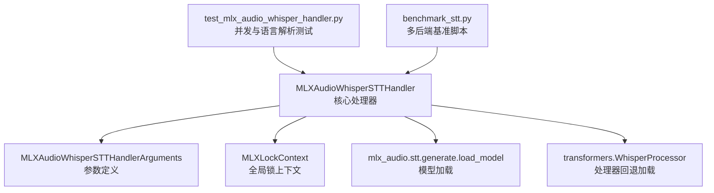
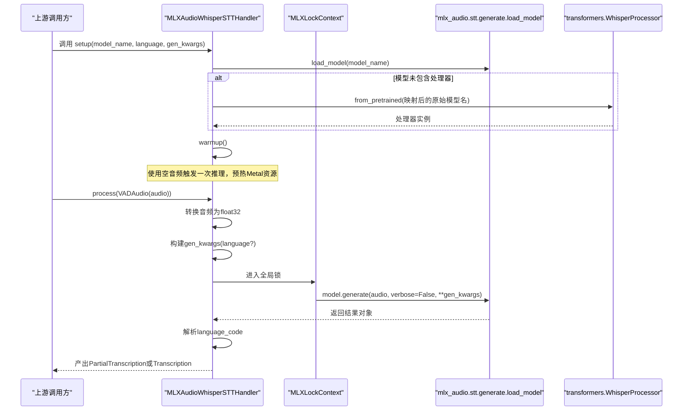
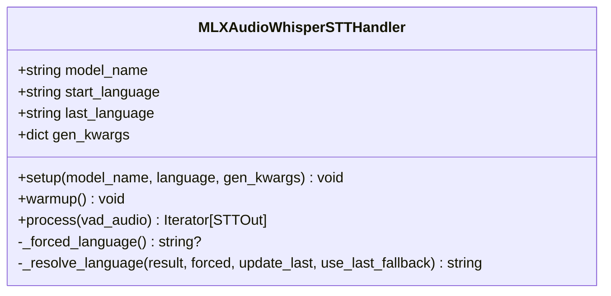
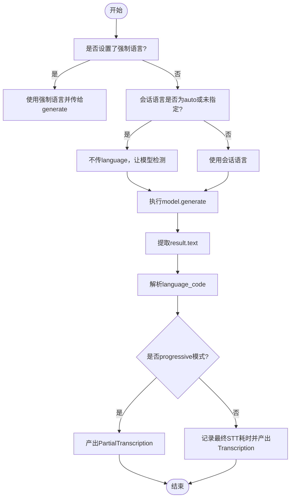
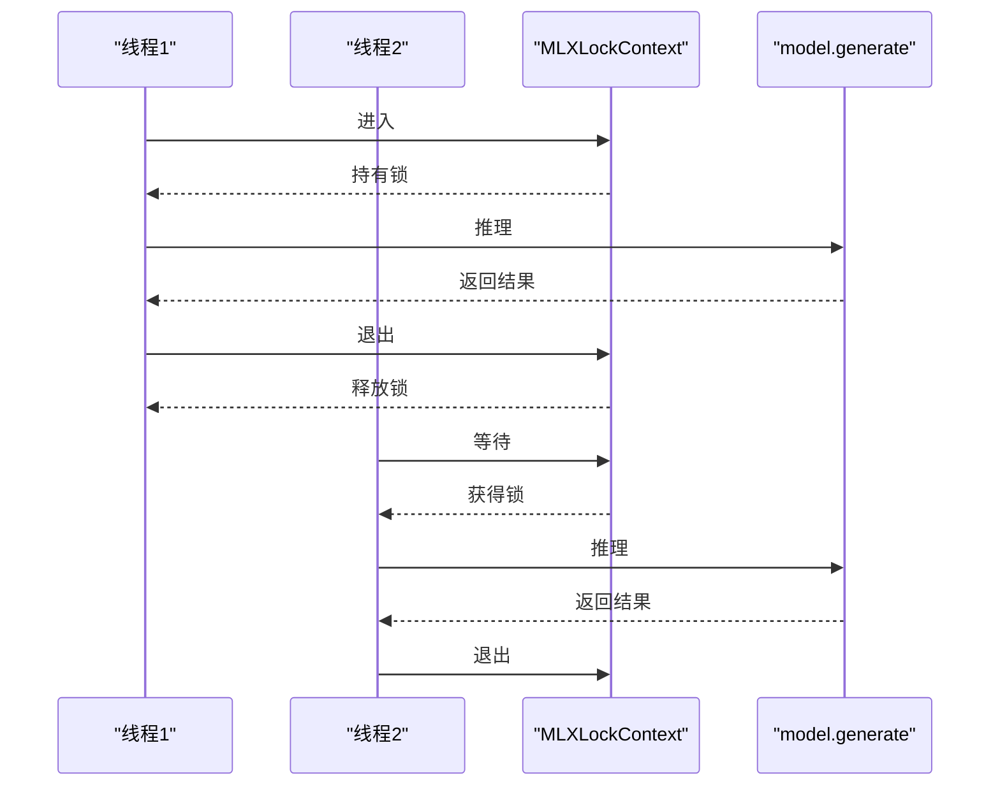

# MLX Audio Whisper 实现

<cite>
**本文引用的文件**   
- [mlx_audio_whisper_handler.py](file://src/speech_to_speech/STT/mlx_audio_whisper_handler.py)
- [mlx_audio_whisper_arguments.py](file://src/speech_to_speech/arguments_classes/mlx_audio_whisper_arguments.py)
- [test_mlx_audio_whisper_handler.py](file://tests/test_mlx_audio_whisper_handler.py)
- [benchmark_stt.py](file://scripts/benchmark_stt.py)
</cite>

## 目录
1. [简介](#简介)
2. [项目结构](#项目结构)
3. [核心组件](#核心组件)
4. [架构总览](#架构总览)
5. [详细组件分析](#详细组件分析)
6. [依赖关系分析](#依赖关系分析)
7. [性能与调优](#性能与调优)
8. [故障排查指南](#故障排查指南)
9. [结论](#结论)
10. [附录](#附录)

## 简介
本文件面向基于 MLX Audio 的 Whisper 语音转文本（STT）集成方案，聚焦以下目标：
- 完整说明从音频输入到转录输出的处理流程，包括预处理、特征提取、模型推理与结果后处理。
- 解释 MLX Audio 在 Apple Silicon 上的特性与优势，如 Metal 后端、单命令队列约束、锁串行化等。
- 给出配置参数与性能调优方法，包括采样率、语言设置、批处理与预热策略。
- 提供在不同 Apple 设备上的部署建议，以及与传统实现的对比与选型指南。

该实现以处理器类为核心，封装了模型加载、Warmup、语言解析、并发安全与输出构造等关键逻辑，并通过测试脚本与基准脚本验证行为与性能。

## 项目结构
围绕 MLX Audio Whisper 的关键代码位于 STT 模块与参数定义中，同时配套测试与基准脚本用于验证与评测。

**图表来源**
- [mlx_audio_whisper_handler.py:37-194](file://src/speech_to_speech/STT/mlx_audio_whisper_handler.py#L37-L194)
- [mlx_audio_whisper_arguments.py:5-21](file://src/speech_to_speech/arguments_classes/mlx_audio_whisper_arguments.py#L5-L21)
- [test_mlx_audio_whisper_handler.py:1-282](file://tests/test_mlx_audio_whisper_handler.py#L1-L282)
- [benchmark_stt.py:154-164](file://scripts/benchmark_stt.py#L154-L164)

**章节来源**
- [mlx_audio_whisper_handler.py:37-194](file://src/speech_to_speech/STT/mlx_audio_whisper_handler.py#L37-L194)
- [mlx_audio_whisper_arguments.py:5-21](file://src/speech_to_speech/arguments_classes/mlx_audio_whisper_arguments.py#L5-L21)
- [test_mlx_audio_whisper_handler.py:1-282](file://tests/test_mlx_audio_whisper_handler.py#L1-L282)
- [benchmark_stt.py:154-164](file://scripts/benchmark_stt.py#L154-L164)

## 核心组件
- MLXAudioWhisperSTTHandler：负责模型加载、预热、推理、语言解析与输出构造。
- MLXAudioWhisperSTTHandlerArguments：声明可配置的参数，包括模型名、生成参数与默认语言。
- MLXLockContext：确保 MLX 推理在 Metal 命令队列上的串行执行，避免并发崩溃。
- 外部依赖：mlx_audio.stt.generate.load_model 用于加载 MLX Whisper 模型；transformers.WhisperProcessor 作为处理器回退路径。

关键职责与交互：
- setup：加载模型与处理器，初始化语言状态，执行 Warmup。
- warmup：使用空音频触发一次推理，预热 Metal 资源。
- process：将输入音频转换为 float32，准备生成参数，串行调用 generate，解析语言并产出 Transcription 或 PartialTranscription。
- 语言解析：支持强制语言、自动检测、上次成功语言回退与默认英语。

**章节来源**
- [mlx_audio_whisper_handler.py:37-194](file://src/speech_to_speech/STT/mlx_audio_whisper_handler.py#L37-L194)
- [mlx_audio_whisper_arguments.py:5-21](file://src/speech_to_speech/arguments_classes/mlx_audio_whisper_arguments.py#L5-L21)

## 架构总览
下图展示 MLX Audio Whisper 在整体 STT 管线中的位置与数据流。

**图表来源**
- [mlx_audio_whisper_handler.py:43-105](file://src/speech_to_speech/STT/mlx_audio_whisper_handler.py#L43-L105)
- [mlx_audio_whisper_handler.py:133-194](file://src/speech_to_speech/STT/mlx_audio_whisper_handler.py#L133-L194)

## 详细组件分析

### MLXAudioWhisperSTTHandler 类
该类是 MLX Audio Whisper 的核心处理器，承担以下职责：
- 模型加载与处理器回退：优先从 MLX 模型获取处理器，若缺失则通过 transformers 从原始 Whisper 模型加载。
- 语言管理：维护 start_language、last_language，并在每次推理时根据会话配置与强制语言决定传入的语言参数。
- 并发安全：所有 MLX 推理均通过 MLXLockContext 串行执行，避免 Metal 命令队列冲突。
- 输出构造：根据模式（progressive 或最终）产出 PartialTranscription 或 Transcription，并记录耗时。

**图表来源**
- [mlx_audio_whisper_handler.py:37-194](file://src/speech_to_speech/STT/mlx_audio_whisper_handler.py#L37-L194)

#### 关键方法与流程
- setup
  - 加载 MLX Whisper 模型。
  - 若模型未包含处理器，则映射到原始 Whisper 模型名并加载处理器。
  - 执行 warmup。
- warmup
  - 使用长度为 16000 的零向量音频进行一次性推理，预热 Metal 资源。
- process
  - 校验输入为 numpy 数组并转为 float32。
  - 根据会话配置决定是否传入 language 参数。
  - 在 MLXLockContext 内调用 model.generate。
  - 解析 result.text 与 result.language，结合 _resolve_language 得到最终 language_code。
  - 根据 mode 产出 PartialTranscription 或 Transcription。

**章节来源**
- [mlx_audio_whisper_handler.py:43-105](file://src/speech_to_speech/STT/mlx_audio_whisper_handler.py#L43-L105)
- [mlx_audio_whisper_handler.py:133-194](file://src/speech_to_speech/STT/mlx_audio_whisper_handler.py#L133-L194)

#### 语言解析策略
- 强制语言：当 start_language 非 auto 且未被会话覆盖时，作为权威语言传入 generate。
- 自动检测：当会话语言为 auto 或未指定且 start_language 为 auto 时，不传 language，由模型检测。
- 回退机制：若检测结果不支持或为空，则回退到 last_language；若仍无可用语言，则默认 en。
- 标记后缀：当启用自动检测时，language_code 追加 “-auto” 以标识来源。

**图表来源**
- [mlx_audio_whisper_handler.py:106-131](file://src/speech_to_speech/STT/mlx_audio_whisper_handler.py#L106-L131)
- [mlx_audio_whisper_handler.py:133-194](file://src/speech_to_speech/STT/mlx_audio_whisper_handler.py#L133-L194)

**章节来源**
- [mlx_audio_whisper_handler.py:106-131](file://src/speech_to_speech/STT/mlx_audio_whisper_handler.py#L106-L131)
- [mlx_audio_whisper_handler.py:133-194](file://src/speech_to_speech/STT/mlx_audio_whisper_handler.py#L133-L194)

### 参数定义：MLXAudioWhisperSTTHandlerArguments
该数据类定义了三个关键参数：
- mlx_audio_whisper_model_name：MLX Whisper 模型名称，默认使用较大且更快的变体。
- mlx_audio_whisper_gen_kwargs：传递给模型的额外生成参数，默认为空字典。
- language：对话默认语言或“auto”，默认英语。

这些参数通过 handler.setup 注入，影响模型加载与推理行为。

**章节来源**
- [mlx_audio_whisper_arguments.py:5-21](file://src/speech_to_speech/arguments_classes/mlx_audio_whisper_arguments.py#L5-L21)

### 并发与锁机制：MLXLockContext
MLX 模型共享单一 Metal 命令队列，多线程并发推理会导致进程崩溃。因此，所有 MLX 推理路径必须通过 MLXLockContext 串行执行。测试覆盖了：
- 推理期间全局锁被持有。
- 推理结束后锁释放。
- 异常情况下锁正确释放。
- 多次并发调用不会重叠。

**图表来源**
- [test_mlx_audio_whisper_handler.py:103-173](file://tests/test_mlx_audio_whisper_handler.py#L103-L173)

**章节来源**
- [test_mlx_audio_whisper_handler.py:103-173](file://tests/test_mlx_audio_whisper_handler.py#L103-L173)

## 依赖关系分析
- 内部依赖
  - BaseSTTHandler：抽象基类，定义 STT 处理器的统一接口。
  - pipeline.messages：定义 PartialTranscription、Transcription 等消息类型。
  - utils.mlx_lock：提供 MLXLockContext，保证 MLX 推理串行化。
- 外部依赖
  - mlx_audio.stt.generate.load_model：加载 MLX Whisper 模型。
  - transformers.WhisperProcessor：回退加载处理器，确保模型具备必要的预处理能力。

耦合与内聚：
- 处理器类高内聚地封装了模型生命周期管理与推理流程。
- 通过 MLXLockContext 与外部库解耦，仅暴露统一的 generate 接口。
- 语言解析逻辑独立于模型实现，便于扩展其他 STT 后端。

潜在循环依赖：
- 当前实现未见循环导入；处理器仅在运行时动态导入 mlx_audio 与 transformers。

**章节来源**
- [mlx_audio_whisper_handler.py:1-194](file://src/speech_to_speech/STT/mlx_audio_whisper_handler.py#L1-L194)

## 性能与调优

### 采样率与音频格式
- 输入要求：numpy 浮点数组，dtype 为 float32。
- 基准脚本对任意采样率音频进行重采样至 16kHz，因为多数 Whisper 模型期望 16kHz。
- 处理器与模型通常内置 16kHz 假设；若上游 VAD 或其他模块输出不同采样率，应在上游统一重采样。

建议：
- 在上游统一将音频重采样至 16kHz，减少重复计算。
- 保持单声道，避免立体声通道带来的冗余。

**章节来源**
- [benchmark_stt.py:84-107](file://scripts/benchmark_stt.py#L84-L107)
- [mlx_audio_whisper_handler.py:133-139](file://src/speech_to_speech/STT/mlx_audio_whisper_handler.py#L133-L139)

### 语言设置与自动检测
- 支持固定语言与自动检测。
- 自动检测时，language_code 追加 “-auto” 以区分来源。
- 会话级语言可覆盖启动时的默认语言，但不修改 handler 的内部状态。

调优建议：
- 若已知对话语言，固定 language 可减少检测开销并提升稳定性。
- 在多语言场景中，使用 auto 并结合 last_language 回退，提高鲁棒性。

**章节来源**
- [mlx_audio_whisper_handler.py:106-131](file://src/speech_to_speech/STT/mlx_audio_whisper_handler.py#L106-L131)
- [mlx_audio_whisper_handler.py:133-194](file://src/speech_to_speech/STT/mlx_audio_whisper_handler.py#L133-L194)

### 批处理优化
- 当前实现为逐条推理，未显式批处理。
- 由于 MLX 命令队列串行化，批量推理需自行在应用层合并音频片段，并在模型侧支持 batched generate。
- 若需批处理，建议在业务层聚合多个 VADAudio 片段，构造更大的音频张量，再调用 generate。

注意：
- 批处理可能增加首字延迟（TTFT），需权衡吞吐与时延。

**章节来源**
- [mlx_audio_whisper_handler.py:133-194](file://src/speech_to_speech/STT/mlx_audio_whisper_handler.py#L133-L194)

### 预热与冷启动
- 首次加载模型与处理器会消耗时间；warmup 通过空音频触发一次推理，预热 Metal 资源。
- 在生产环境中，建议在服务启动阶段完成模型加载与预热，降低首请求延迟。

**章节来源**
- [mlx_audio_whisper_handler.py:60-105](file://src/speech_to_speech/STT/mlx_audio_whisper_handler.py#L60-L105)

### 与传统实现的性能对比与选型
- 基准脚本支持多种 STT 后端，包括 whisper、whisper-mlx、mlx-audio-whisper、faster-whisper 等。
- 可通过脚本对不同后端在同一音频上进行多次迭代，统计平均推理时间、最小/最大时间、标准差与 TTFT。
- 在 Apple Silicon 上，MLX 后端通常能利用 Metal 加速，但受限于单命令队列串行化，并发场景需谨慎设计。

选型建议：
- 追求低延迟与 Apple 原生优化：选择 MLX Audio Whisper。
- 需要跨平台或 GPU 集群：考虑 faster-whisper 或 PyTorch 实现。
- 实时流式场景：结合 progressive 模式与上游 VAD，降低端到端时延。

**章节来源**
- [benchmark_stt.py:127-178](file://scripts/benchmark_stt.py#L127-L178)
- [benchmark_stt.py:224-253](file://scripts/benchmark_stt.py#L224-L253)

## 故障排查指南
常见问题与定位方法：
- 推理崩溃或 Metal 命令队列错误
  - 现象：进程崩溃，提示命令队列相关断言失败。
  - 原因：多线程并发调用 MLX 推理。
  - 解决：确保所有 MLX 推理路径通过 MLXLockContext 串行执行。
- 处理器加载失败
  - 现象：无法从 MLX 模型获取处理器，回退加载也失败。
  - 原因：模型名映射错误或网络不可达。
  - 解决：检查模型名映射表，确认 transformers 可从 HuggingFace 下载处理器。
- 语言解析异常
  - 现象：language_code 为 None 或 unsupported。
  - 原因：检测结果不在 SUPPORTED_LANGUAGES 或结果为 None。
  - 解决：使用 last_language 回退或固定 language。

调试建议：
- 开启日志级别 DEBUG，观察推理开始与结束时间。
- 使用测试用例中的 FakeModel 与 FakeResult 模拟推理，验证锁与语言解析逻辑。

**章节来源**
- [test_mlx_audio_whisper_handler.py:1-14](file://tests/test_mlx_audio_whisper_handler.py#L1-L14)
- [mlx_audio_whisper_handler.py:60-88](file://src/speech_to_speech/STT/mlx_audio_whisper_handler.py#L60-L88)
- [mlx_audio_whisper_handler.py:112-131](file://src/speech_to_speech/STT/mlx_audio_whisper_handler.py#L112-L131)

## 结论
MLX Audio Whisper 实现以简洁的处理器类为核心，结合 MLX 框架与 Metal 后端，在 Apple Silicon 设备上提供了高效的语音转文本能力。其关键优势包括：
- 原生 Metal 加速与内存优化。
- 严格的并发控制，避免命令队列冲突。
- 灵活的语言解析与回退机制。
- 完善的测试与基准工具，便于评估与调优。

在实际部署中，建议：
- 在服务启动阶段完成模型加载与预热。
- 固定语言以提升稳定性，或在多语言场景中使用 auto 与 last_language 回退。
- 在上游统一音频采样率为 16kHz，减少重复重采样。
- 根据业务需求权衡批处理与首字延迟。

## 附录

### 配置参数速查
- mlx_audio_whisper_model_name：MLX Whisper 模型名称。
- mlx_audio_whisper_gen_kwargs：传递给模型的额外生成参数。
- language：默认语言或 “auto”。

**章节来源**
- [mlx_audio_whisper_arguments.py:5-21](file://src/speech_to_speech/arguments_classes/mlx_audio_whisper_arguments.py#L5-L21)

### 基准脚本使用示例
- 运行基准：python benchmark_stt.py --audio_file path/to/audio.wav --handlers mlx-audio-whisper --iterations 5
- 查看结果：控制台输出各后端平均推理时间与 TTFT，并保存 JSON 报告。

**章节来源**
- [benchmark_stt.py:333-386](file://scripts/benchmark_stt.py#L333-L386)