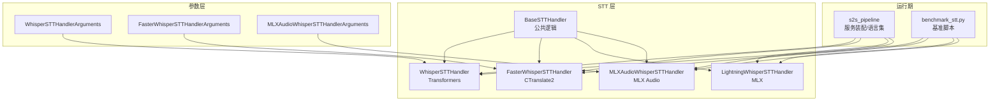
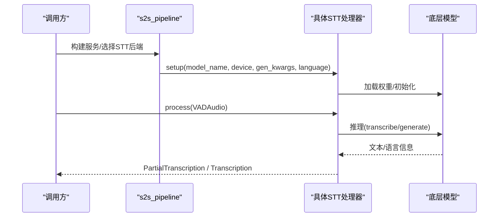
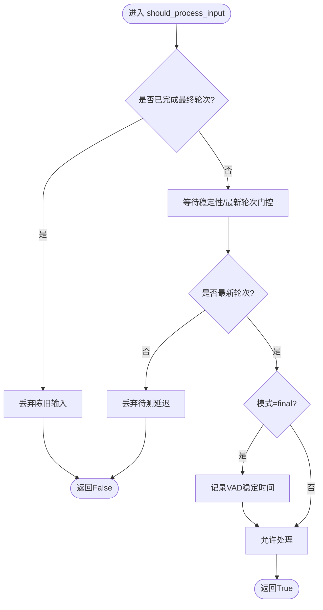
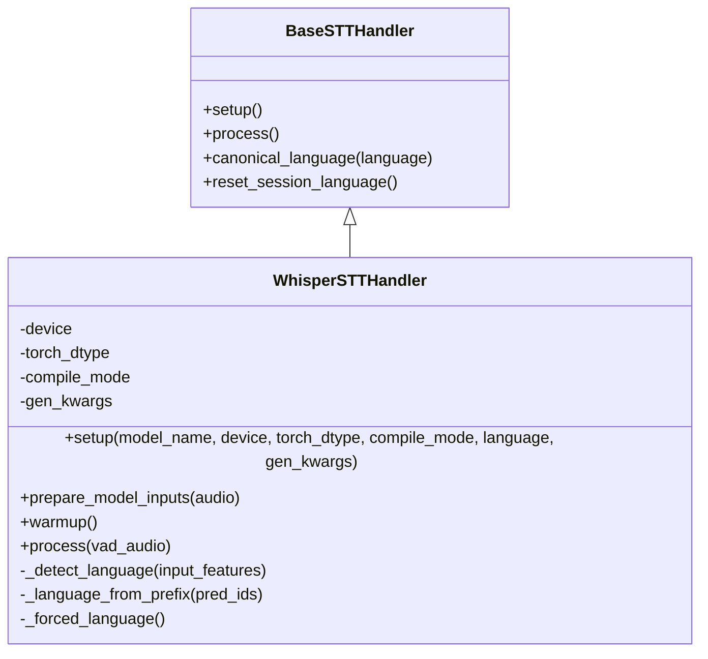
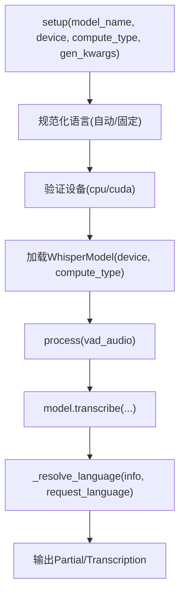
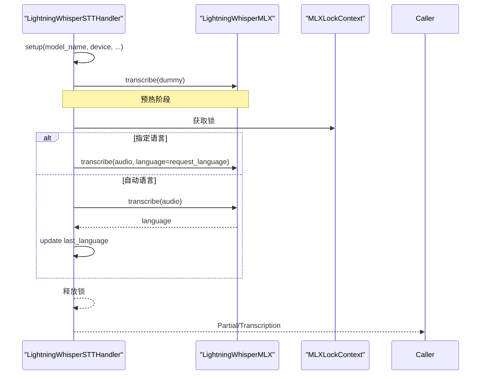
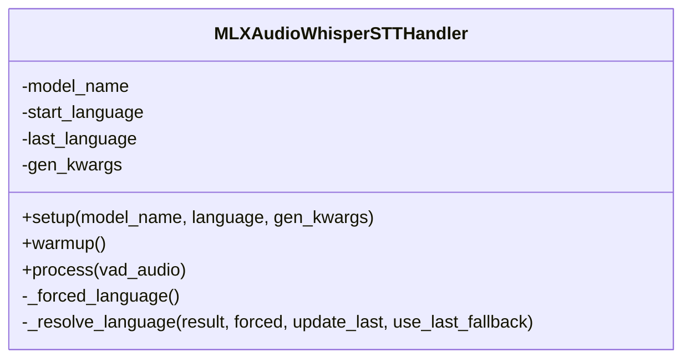
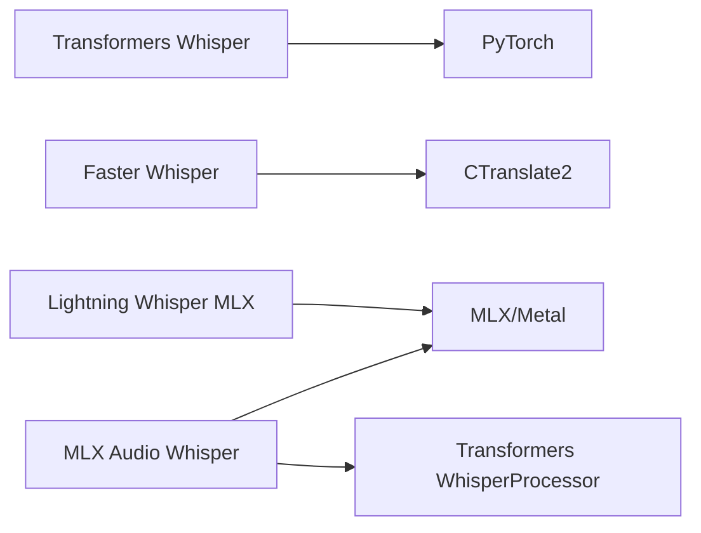
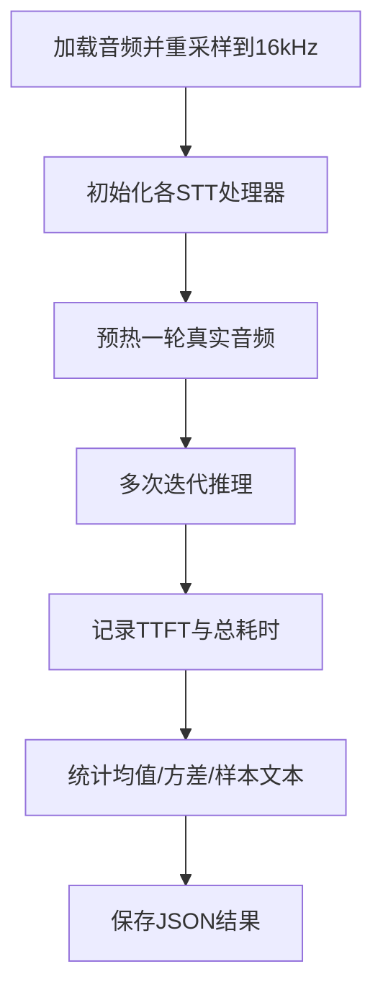

# Whisper 系列实现

<cite>
**本文引用的文件**   
- [base_stt_handler.py](file://src/speech_to_speech/STT/base_stt_handler.py)
- [whisper_stt_handler.py](file://src/speech_to_speech/STT/whisper_stt_handler.py)
- [faster_whisper_handler.py](file://src/speech_to_speech/STT/faster_whisper_handler.py)
- [lightning_whisper_mlx_handler.py](file://src/speech_to_speech/STT/lightning_whisper_mlx_handler.py)
- [mlx_audio_whisper_handler.py](file://src/speech_to_speech/STT/mlx_audio_whisper_handler.py)
- [whisper_stt_arguments.py](file://src/speech_to_speech/arguments_classes/whisper_stt_arguments.py)
- [faster_whisper_stt_arguments.py](file://src/speech_to_speech/arguments_classes/faster_whisper_stt_arguments.py)
- [mlx_audio_whisper_arguments.py](file://src/speech_to_speech/arguments_classes/mlx_audio_whisper_arguments.py)
- [benchmark_stt.py](file://scripts/benchmark_stt.py)
- [s2s_pipeline.py](file://src/speech_to_speech/s2s_pipeline.py)
</cite>

## 目录
1. [引言](#引言)
2. [项目结构](#项目结构)
3. [核心组件](#核心组件)
4. [架构总览](#架构总览)
5. [详细组件分析](#详细组件分析)
6. [依赖关系分析](#依赖关系分析)
7. [性能与优化](#性能与优化)
8. [部署指南](#部署指南)
9. [故障排除](#故障排除)
10. [结论](#结论)

## 引言
本技术文档聚焦仓库中的 Whisper 系列语音转文本（STT）实现，系统对比标准 Transformers Whisper、Faster Whisper、Lightning Whisper MLX 以及 MLX Audio Whisper 四类实现的架构差异、语言支持、推理路径、内存与设备选择策略，并给出配置调优、基准测试方法与常见问题排查建议。文档同时说明这些 STT 模块如何接入统一管道、如何处理“自动语言”语义、如何避免陈旧轮次干扰，以及如何通过量化、编译、半精度和 Apple Silicon 专用后端提升性能。

## 项目结构
Whisper 相关代码集中在 `src/speech_to_speech/STT` 下，每个实现以独立 Handler 类暴露统一的输入输出接口；参数定义位于 `arguments_classes`；基准脚本位于 `scripts/benchmark_stt.py`；服务装配与语言集校验在 `s2s_pipeline.py` 中完成。

**图表来源**
- [whisper_stt_handler.py:48-85](file://src/speech_to_speech/STT/whisper_stt_handler.py#L48-L85)
- [faster_whisper_handler.py:38-66](file://src/speech_to_speech/STT/faster_whisper_handler.py#L38-L66)
- [lightning_whisper_mlx_handler.py:37-59](file://src/speech_to_speech/STT/lightning_whisper_mlx_handler.py#L37-L59)
- [mlx_audio_whisper_handler.py:37-90](file://src/speech_to_speech/STT/mlx_audio_whisper_handler.py#L37-L90)
- [whisper_stt_arguments.py:5-55](file://src/speech_to_speech/arguments_classes/whisper_stt_arguments.py#L5-L55)
- [faster_whisper_stt_arguments.py:4-64](file://src/speech_to_speech/arguments_classes/faster_whisper_stt_arguments.py#L4-L64)
- [mlx_audio_whisper_arguments.py:6-21](file://src/speech_to_speech/arguments_classes/mlx_audio_whisper_arguments.py#L6-L21)
- [s2s_pipeline.py:671-677](file://src/speech_to_speech/s2s_pipeline.py#L671-L677)
- [benchmark_stt.py:127-178](file://scripts/benchmark_stt.py#L127-L178)

**章节来源**
- [whisper_stt_handler.py:48-85](file://src/speech_to_speech/STT/whisper_stt_handler.py#L48-L85)
- [faster_whisper_handler.py:38-66](file://src/speech_to_speech/STT/faster_whisper_handler.py#L38-L66)
- [lightning_whisper_mlx_handler.py:37-59](file://src/speech_to_speech/STT/lightning_whisper_mlx_handler.py#L37-L59)
- [mlx_audio_whisper_handler.py:37-90](file://src/speech_to_speech/STT/mlx_audio_whisper_handler.py#L37-L90)
- [whisper_stt_arguments.py:5-55](file://src/speech_to_speech/arguments_classes/whisper_stt_arguments.py#L5-L55)
- [faster_whisper_stt_arguments.py:4-64](file://src/speech_to_speech/arguments_classes/faster_whisper_stt_arguments.py#L4-L64)
- [mlx_audio_whisper_arguments.py:6-21](file://src/speech_to_speech/arguments_classes/mlx_audio_whisper_arguments.py#L6-L21)
- [s2s_pipeline.py:671-677](file://src/speech_to_speech/s2s_pipeline.py#L671-L677)
- [benchmark_stt.py:127-178](file://scripts/benchmark_stt.py#L127-L178)

## 核心组件
- BaseSTTHandler：提供推测轮次去重、最终结果收敛、语言状态管理、队列陈旧项清理等通用能力。
- WhisperSTTHandler：基于 Transformers + PyTorch，支持模型加载、可选 torch.compile、显式语言检测与回退。
- FasterWhisperSTTHandler：基于 CTranslate2 的 faster-whisper，支持 compute_type 量化、auto 设备选择、更丰富的语言集合。
- LightningWhisperSTTHandler：基于 lightning_whisper_mlx，面向 Apple Silicon MPS，使用 MLXLockContext 串行化 Metal 命令队列。
- MLXAudioWhisperSTTHandler：基于 mlx_audio.stt.generate.load_model，自动补全 Processor，同样使用 MLXLockContext 串行化。

**章节来源**
- [base_stt_handler.py:16-312](file://src/speech_to_speech/STT/base_stt_handler.py#L16-L312)
- [whisper_stt_handler.py:48-295](file://src/speech_to_speech/STT/whisper_stt_handler.py#L48-L295)
- [faster_whisper_handler.py:38-174](file://src/speech_to_speech/STT/faster_whisper_handler.py#L38-L174)
- [lightning_whisper_mlx_handler.py:37-120](file://src/speech_to_speech/STT/lightning_whisper_mlx_handler.py#L37-L120)
- [mlx_audio_whisper_handler.py:37-194](file://src/speech_to_speech/STT/mlx_audio_whisper_handler.py#L37-L194)

## 架构总览
所有 Whisper 变体均继承 BaseSTTHandler，对外暴露统一的 process 接口，输入为 VADAudio，输出为 PartialTranscription 或 Transcription。服务侧通过 s2s_pipeline 组装处理器，并根据所选后端计算 stt_supported_languages。

**图表来源**
- [s2s_pipeline.py:671-677](file://src/speech_to_speech/s2s_pipeline.py#L671-L677)
- [whisper_stt_handler.py:55-85](file://src/speech_to_speech/STT/whisper_stt_handler.py#L55-L85)
- [faster_whisper_handler.py:47-66](file://src/speech_to_speech/STT/faster_whisper_handler.py#L47-L66)
- [lightning_whisper_mlx_handler.py:42-59](file://src/speech_to_speech/STT/lightning_whisper_mlx_handler.py#L42-L59)
- [mlx_audio_whisper_handler.py:43-90](file://src/speech_to_speech/STT/mlx_audio_whisper_handler.py#L43-L90)

## 详细组件分析

### BaseSTTHandler：推测轮次与语言状态
- 推测轮次过滤：根据 turn_id/turn_revision 判断是否最新轮次，丢弃陈旧输入与输出，避免旧结果污染响应。
- 最终结果收敛：记录已完成 final revision，限制最大保留数，防止无限增长。
- 语言状态：start_language 表示用户配置，last_language 表示会话内检测到的最近语言；reset_session_language 在会话结束时恢复默认。
- canonical_language：将字符串 "auto" 标准化为内部哨兵，避免不同后端对 "auto" 的歧义。

**图表来源**
- [base_stt_handler.py:43-86](file://src/speech_to_speech/STT/base_stt_handler.py#L43-L86)
- [base_stt_handler.py:114-166](file://src/speech_to_speech/STT/base_stt_handler.py#L114-L166)
- [base_stt_handler.py:286-312](file://src/speech_to_speech/STT/base_stt_handler.py#L286-L312)

**章节来源**
- [base_stt_handler.py:16-312](file://src/speech_to_speech/STT/base_stt_handler.py#L16-L312)

### WhisperSTTHandler（Transformers）
- 模型加载：AutoModelForSpeechSeq2Seq + AutoProcessor，支持 float16/bfloat16/float32。
- 编译加速：可选 torch.compile，设置 cache_implementation="static"，并对 forward 进行 fullgraph 编译。
- 预热：dummy input 生成若干步，CUDA 环境下用 Event 计时预热耗时。
- 语言检测：优先调用 detect_language(encoder_outputs)，复用编码器输出减少重复编码；若不可用则从生成 token 前缀扫描语言特殊 token。
- 语言报告：如果 selected 为 auto 或未指定且 start_language 为 auto，则在语言码后追加 "-auto" 标记。

**图表来源**
- [whisper_stt_handler.py:48-295](file://src/speech_to_speech/STT/whisper_stt_handler.py#L48-L295)
- [base_stt_handler.py:16-312](file://src/speech_to_speech/STT/base_stt_handler.py#L16-L312)

**章节来源**
- [whisper_stt_handler.py:48-295](file://src/speech_to_speech/STT/whisper_stt_handler.py#L48-L295)

### FasterWhisperSTTHandler（CTranslate2）
- 模型加载：WhisperModel，device 可为 cpu/cuda/auto；compute_type 支持多种量化格式。
- 语言处理：传入 None 表示自动检测；若请求语言与模型实际转录语言不一致，会记录警告并以实际语言为准。
- 参数适配：将 return_timestamps 转换为 without_timestamps，避免共享 gen_kwargs 被意外修改。
- 语言集合：内置完整 Whisper 语言列表，用于测试与下游校验。

**图表来源**
- [faster_whisper_handler.py:47-66](file://src/speech_to_speech/STT/faster_whisper_handler.py#L47-L66)
- [faster_whisper_handler.py:80-109](file://src/speech_to_speech/STT/faster_whisper_handler.py#L80-L109)
- [faster_whisper_handler.py:111-174](file://src/speech_to_speech/STT/faster_whisper_handler.py#L111-L174)

**章节来源**
- [faster_whisper_handler.py:38-174](file://src/speech_to_speech/STT/faster_whisper_handler.py#L38-L174)

### LightningWhisperSTTHandler（MLX）
- 模型加载：LightningWhisperMLX，batch_size=6，quant=None；默认 device="mps"。
- 预热：dummy 输入一次 transcribe，确保 Metal 命令队列就绪。
- 并发控制：使用 MLXLockContext 串行化 MLX 推理，避免多线程并发导致 Metal 命令提交冲突。
- 语言处理：当 request_language != "auto" 时强制语言；否则自动检测并更新 last_language。

**图表来源**
- [lightning_whisper_mlx_handler.py:42-59](file://src/speech_to_speech/STT/lightning_whisper_mlx_handler.py#L42-L59)
- [lightning_whisper_mlx_handler.py:61-89](file://src/speech_to_speech/STT/lightning_whisper_mlx_handler.py#L61-L89)
- [lightning_whisper_mlx_handler.py:91-120](file://src/speech_to_speech/STT/lightning_whisper_mlx_handler.py#L91-L120)

**章节来源**
- [lightning_whisper_mlx_handler.py:37-120](file://src/speech_to_speech/STT/lightning_whisper_mlx_handler.py#L37-L120)

### MLXAudioWhisperSTTHandler（MLX Audio）
- 模型加载：load_model(model_name)，若未包含 Processor，则映射到原始 Whisper 名称并加载 WhisperProcessor。
- 预热：generate(dummy_audio) 预热模型。
- 语言处理：_forced_language 与 _resolve_language 组合，支持强制语言、检测语言、回退 last_language 与默认英语。
- 并发控制：同样使用 MLXLockContext 串行化 Metal 命令队列。

**图表来源**
- [mlx_audio_whisper_handler.py:43-90](file://src/speech_to_speech/STT/mlx_audio_whisper_handler.py#L43-L90)
- [mlx_audio_whisper_handler.py:106-131](file://src/speech_to_speech/STT/mlx_audio_whisper_handler.py#L106-L131)
- [mlx_audio_whisper_handler.py:133-194](file://src/speech_to_speech/STT/mlx_audio_whisper_handler.py#L133-L194)

**章节来源**
- [mlx_audio_whisper_handler.py:37-194](file://src/speech_to_speech/STT/mlx_audio_whisper_handler.py#L37-L194)

## 依赖关系分析
- Transformers Whisper：依赖 transformers.AutoModelForSpeechSeq2Seq/AutoProcessor，PyTorch 设备与 dtype 由 resolve_device 与 torch_dtype 决定。
- Faster Whisper：依赖 faster_whisper.WhisperModel，底层 CTranslate2 负责量化与设备调度。
- Lightning Whisper MLX：依赖 lightning_whisper_mlx.LightningWhisperMLX，Metal 命令队列需串行化。
- MLX Audio Whisper：依赖 mlx_audio.stt.generate.load_model，必要时从 transformers 加载 WhisperProcessor。

**图表来源**
- [whisper_stt_handler.py:8-16](file://src/speech_to_speech/STT/whisper_stt_handler.py#L8-L16)
- [faster_whisper_handler.py:8-15](file://src/speech_to_speech/STT/faster_whisper_handler.py#L8-L15)
- [lightning_whisper_mlx_handler.py:7-15](file://src/speech_to_speech/STT/lightning_whisper_mlx_handler.py#L7-L15)
- [mlx_audio_whisper_handler.py:7-13](file://src/speech_to_speech/STT/mlx_audio_whisper_handler.py#L7-L13)

**章节来源**
- [whisper_stt_handler.py:8-16](file://src/speech_to_speech/STT/whisper_stt_handler.py#L8-L16)
- [faster_whisper_handler.py:8-15](file://src/speech_to_speech/STT/faster_whisper_handler.py#L8-L15)
- [lightning_whisper_mlx_handler.py:7-15](file://src/speech_to_speech/STT/lightning_whisper_mlx_handler.py#L7-L15)
- [mlx_audio_whisper_handler.py:7-13](file://src/speech_to_speech/STT/mlx_audio_whisper_handler.py#L7-L13)

## 性能与优化

### 推理加速策略
- Transformers Whisper：
  - torch.compile：可启用 default/reduce-overhead/max-autotune，fullgraph=True；预热时使用 min_new_tokens=max_new_tokens 触发 CUDA graphs capture。
  - 半精度：torch_dtype=float16/bfloat16/float32。
- Faster Whisper：
  - CTranslate2 量化：compute_type 支持 int8/int8_float32/int8_float16/int8_bfloat16/int16/float16/float32/bfloat16。
  - 设备选择：device=cpu/cuda/auto，auto 由 CTranslate2 自行解析。
- MLX 系列：
  - Lightning Whisper MLX：batch_size=6，quant=None；MPS 上 warmup 一次 transcribe。
  - MLX Audio Whisper：load_model 后可能需额外加载 WhisperProcessor；Metal 命令队列串行化。

**章节来源**
- [whisper_stt_handler.py:81-130](file://src/speech_to_speech/STT/whisper_stt_handler.py#L81-L130)
- [faster_whisper_stt_arguments.py:26-33](file://src/speech_to_speech/arguments_classes/faster_whisper_stt_arguments.py#L26-L33)
- [lightning_whisper_mlx_handler.py:42-70](file://src/speech_to_speech/STT/lightning_whisper_mlx_handler.py#L42-L70)
- [mlx_audio_whisper_handler.py:43-105](file://src/speech_to_speech/STT/mlx_audio_whisper_handler.py#L43-L105)

### 语言支持与自动语言
- Transformers Whisper：SUPPORTED_LANGUAGES 为常用语种；自动语言通过 detect_language 或 token 前缀回退。
- Faster Whisper：内置完整 Whisper 语言集合；auto 检测仅在未传 language 时生效；若英文单语模型 tiny.en 被请求其他语言，仍报告英语。
- MLX 系列：Lightning 与 MLX Audio 均维护 SUPPORTED_LANGUAGES；自动语言会在语言码后追加 "-auto" 标记。

**章节来源**
- [whisper_stt_handler.py:21-41](file://src/speech_to_speech/STT/whisper_stt_handler.py#L21-L41)
- [whisper_stt_handler.py:170-222](file://src/speech_to_speech/STT/whisper_stt_handler.py#L170-L222)
- [faster_whisper_handler.py:21-35](file://src/speech_to_speech/STT/faster_whisper_handler.py#L21-L35)
- [faster_whisper_handler.py:80-109](file://src/speech_to_speech/STT/faster_whisper_handler.py#L80-L109)
- [lightning_whisper_mlx_handler.py:21-34](file://src/speech_to_speech/STT/lightning_whisper_mlx_handler.py#L21-L34)
- [mlx_audio_whisper_handler.py:21-34](file://src/speech_to_speech/STT/mlx_audio_whisper_handler.py#L21-L34)

### 基准测试方法
- 脚本支持 whisper、whisper-mlx、mlx-audio-whisper、faster-whisper、parakeet-tdt 等处理器。
- 指标包括 warmup_time、avg/min/max/std inference_time、time_to_first_token、errors、sample_transcription。
- 音频预处理：librosa 或 scipy resample 至 16kHz，mono 混合。

**图表来源**
- [benchmark_stt.py:84-107](file://scripts/benchmark_stt.py#L84-L107)
- [benchmark_stt.py:110-263](file://scripts/benchmark_stt.py#L110-L263)
- [benchmark_stt.py:266-330](file://scripts/benchmark_stt.py#L266-L330)

**章节来源**
- [benchmark_stt.py:1-386](file://scripts/benchmark_stt.py#L1-L386)

## 部署指南

### 设备选择
- Transformers Whisper：stt_device 支持 auto/cuda/npu/xpu/mps/cpu；resolve_device 会根据可用设备选择。
- Faster Whisper：faster_whisper_stt_device 支持 cpu/cuda/auto；validate_device 仅接受 cpu/cuda。
- MLX 系列：Lightning 默认 mps；MLX Audio 不直接暴露 device，但通过 MLXLockContext 保证 Metal 串行。

**章节来源**
- [whisper_stt_arguments.py:11-16](file://src/speech_to_speech/arguments_classes/whisper_stt_arguments.py#L11-L16)
- [faster_whisper_stt_arguments.py:18-24](file://src/speech_to_speech/arguments_classes/faster_whisper_stt_arguments.py#L18-L24)
- [lightning_whisper_mlx_handler.py:42-59](file://src/speech_to_speech/STT/lightning_whisper_mlx_handler.py#L42-L59)

### 量化与半精度
- Faster Whisper：compute_type 支持多种量化格式，适合 CPU/GPU 资源受限场景。
- Transformers Whisper：torch_dtype 支持 float16/bfloat16/float32，结合 torch.compile 可进一步降低延迟。
- MLX Audio Whisper：load_model 通常使用 MLX 量化权重；必要时手动加载 Processor。

**章节来源**
- [faster_whisper_stt_arguments.py:26-33](file://src/speech_to_speech/arguments_classes/faster_whisper_stt_arguments.py#L26-L33)
- [whisper_stt_arguments.py:17-28](file://src/speech_to_speech/arguments_classes/whisper_stt_arguments.py#L17-L28)
- [mlx_audio_whisper_handler.py:43-90](file://src/speech_to_speech/STT/mlx_audio_whisper_handler.py#L43-L90)

### 语言配置
- 统一入口：arguments_classes 中 language 字段支持 "en"/"fr"/... 或 "auto"。
- 行为差异：
  - Transformers Whisper：auto 通过 detect_language 或 token 前缀回退。
  - Faster Whisper：None 表示 auto；tiny.en 始终报告英语。
  - MLX 系列：自动语言会在语言码后追加 "-auto"。

**章节来源**
- [whisper_stt_arguments.py:45-55](file://src/speech_to_speech/arguments_classes/whisper_stt_arguments.py#L45-L55)
- [faster_whisper_stt_arguments.py:51-64](file://src/speech_to_speech/arguments_classes/faster_whisper_stt_arguments.py#L51-L64)
- [mlx_audio_whisper_arguments.py:17-21](file://src/speech_to_speech/arguments_classes/mlx_audio_whisper_arguments.py#L17-L21)

### 服务装配与语言集校验
- s2s_pipeline 在构建 handlers 后，根据所选后端设置 stt_supported_languages。
- Faster Whisper 的语言集来自已加载 checkpoint 的实际语言集合。

**章节来源**
- [s2s_pipeline.py:671-677](file://src/speech_to_speech/s2s_pipeline.py#L671-L677)

## 故障排除

### 常见错误与定位
- Transformers Whisper 语言检测失败：
  - 现象：detect_language 不可用或抛出异常。
  - 处理：回退到 token 前缀扫描或 last_language/default。
- Faster Whisper 语言不一致：
  - 现象：请求语言与模型实际转录语言不一致。
  - 处理：记录警告，以实际语言为准；英文单语模型始终报告英语。
- MLX 并发冲突：
  - 现象：Metal 命令队列并发提交报错。
  - 处理：使用 MLXLockContext 串行化推理。

**章节来源**
- [whisper_stt_handler.py:189-201](file://src/speech_to_speech/STT/whisper_stt_handler.py#L189-L201)
- [faster_whisper_handler.py:101-109](file://src/speech_to_speech/STT/faster_whisper_handler.py#L101-L109)
- [mlx_audio_whisper_handler.py:149-169](file://src/speech_to_speech/STT/mlx_audio_whisper_handler.py#L149-L169)

### 性能问题定位
- 高延迟：
  - 检查是否启用 torch.compile（Transformers）。
  - 检查 compute_type 是否合理（Faster Whisper）。
  - 检查 MLX 是否串行化（Lightning/MLX Audio）。
- OOM：
  - 降低 batch_size（Lightning）。
  - 使用半精度或量化（Faster Whisper/Transformers）。
  - 清理 MPS 缓存（Lightning 在 MPS 设备上）。

**章节来源**
- [whisper_stt_handler.py:81-130](file://src/speech_to_speech/STT/whisper_stt_handler.py#L81-L130)
- [faster_whisper_stt_arguments.py:26-33](file://src/speech_to_speech/arguments_classes/faster_whisper_stt_arguments.py#L26-L33)
- [lightning_whisper_mlx_handler.py:61-70](file://src/speech_to_speech/STT/lightning_whisper_mlx_handler.py#L61-L70)
- [lightning_whisper_mlx_handler.py:93-96](file://src/speech_to_speech/STT/lightning_whisper_mlx_handler.py#L93-L96)

## 结论
- Transformers Whisper 适合需要灵活编译与 PyTorch 生态的场景，可通过 torch.compile 与半精度优化延迟。
- Faster Whisper 凭借 CTranslate2 量化与 auto 设备选择，在 CPU/GPU 上具备良好吞吐与易用性，语言覆盖更广。
- MLX 系列专为 Apple Silicon 优化，Lightning 与 MLX Audio 均通过 MLXLockContext 保证 Metal 命令队列串行，避免并发崩溃。
- 统一 BaseSTTHandler 提供推测轮次去重、语言状态管理与陈旧项清理，确保多后端一致性与鲁棒性。
- 基准脚本提供可复现的性能对比框架，建议在不同硬件与量化配置下运行以获得本地化基准数据。