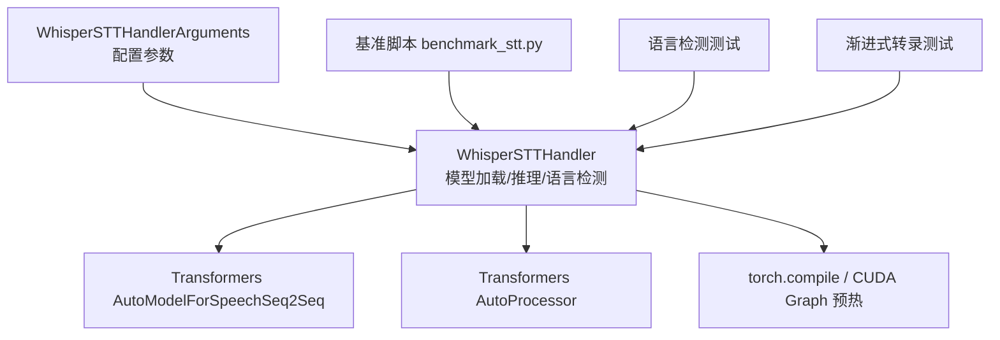
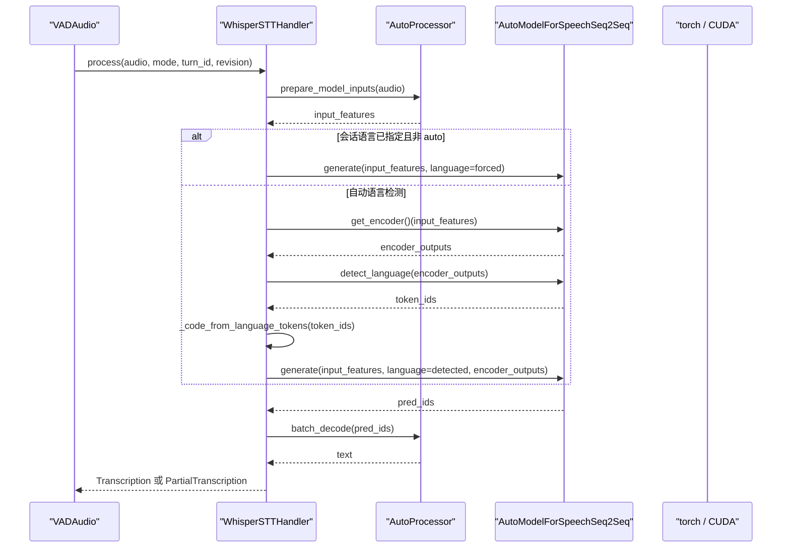
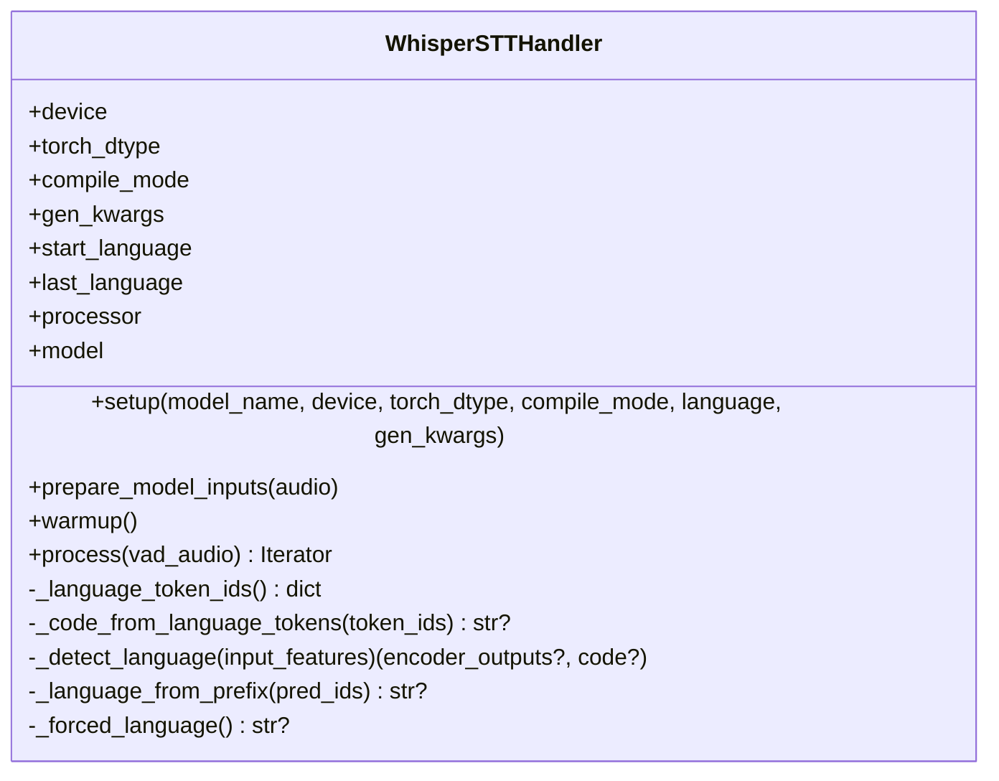
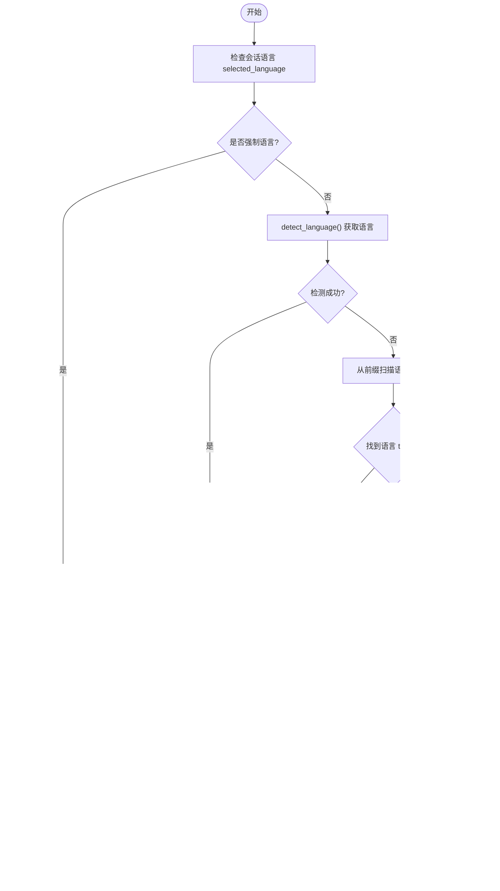
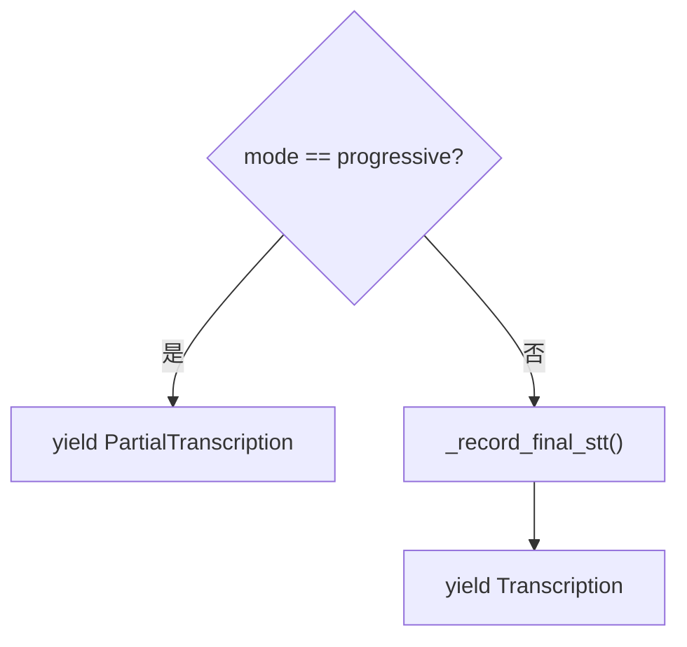
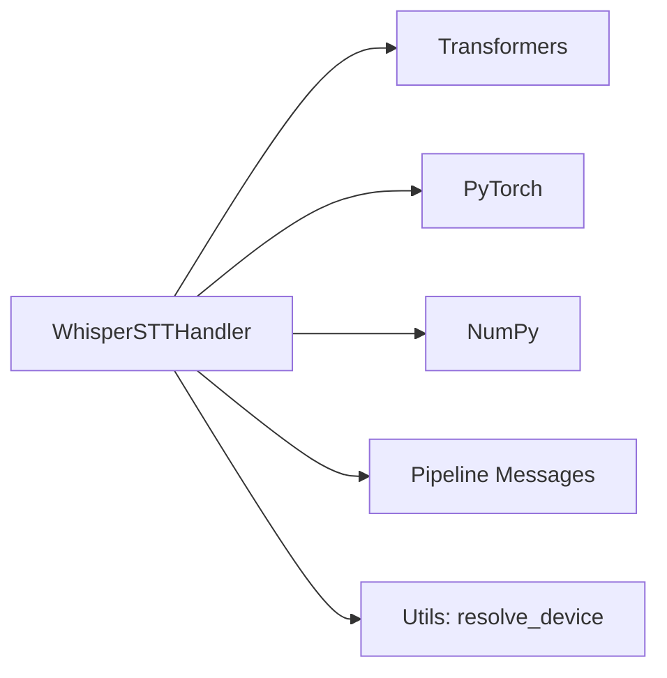
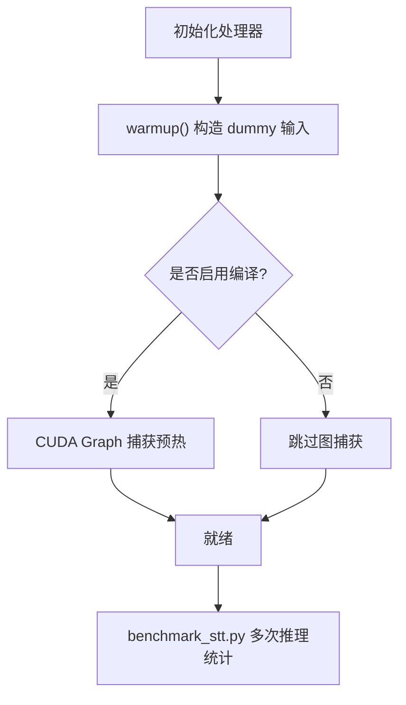

# 标准 Whisper 实现

<cite>
**本文引用的文件**   
- [whisper_stt_handler.py](file://src/speech_to_speech/STT/whisper_stt_handler.py)
- [whisper_stt_arguments.py](file://src/speech_to_speech/arguments_classes/whisper_stt_arguments.py)
- [test_whisper_language_detection.py](file://tests/test_whisper_language_detection.py)
- [test_whisper_progressive_transcription.py](file://tests/test_whisper_progressive_transcription.py)
- [benchmark_stt.py](file://scripts/benchmark_stt.py)
</cite>

## 目录
1. [简介](#简介)
2. [项目结构](#项目结构)
3. [核心组件](#核心组件)
4. [架构总览](#架构总览)
5. [详细组件分析](#详细组件分析)
6. [依赖关系分析](#依赖关系分析)
7. [性能与优化](#性能与优化)
8. [故障排查指南](#故障排查指南)
9. [结论](#结论)
10. [附录](#附录)

## 简介
本文面向基于 Transformers 库的标准 Whisper 语音转文本（STT）实现，聚焦以下目标：
- 模型加载、设备管理、数据类型与编译模式等配置参数的作用与调优方法。
- 语言自动检测机制的实现原理，包括 detect_language() 调用路径、语言特殊 token 解析与回退策略。
- 流式转录支持、预热机制优化、CUDA 图编译等技术细节。
- 基准测试脚本的使用方式与可观测指标。
- 最佳实践建议，帮助在真实部署中取得稳定低延迟与高吞吐。

该实现通过 `WhisperSTTHandler` 封装了 HuggingFace Transformers 的 `AutoModelForSpeechSeq2Seq` 与 `AutoProcessor`，并在推理前完成设备选择、dtype 转换、可选的 torch.compile 编译与 CUDA Graph 预热；在推理时根据会话或配置的语言设置进行强制语言或自动语言检测，并输出最终转录或渐进式中间结果。

## 项目结构
本仓库中与标准 Whisper STT 直接相关的代码主要位于以下位置：
- 处理器实现：`src/speech_to_speech/STT/whisper_stt_handler.py`
- 参数定义：`src/speech_to_speech/arguments_classes/whisper_stt_arguments.py`
- 语言检测行为验证：`tests/test_whisper_language_detection.py`
- 渐进式转录行为验证：`tests/test_whisper_progressive_transcription.py`
- STT 基准测试脚本：`scripts/benchmark_stt.py`

**图表来源**
- [whisper_stt_handler.py:48-85](file://src/speech_to_speech/STT/whisper_stt_handler.py#L48-L85)
- [whisper_stt_arguments.py:6-54](file://src/speech_to_speech/arguments_classes/whisper_stt_arguments.py#L6-L54)
- [benchmark_stt.py:127-139](file://scripts/benchmark_stt.py#L127-L139)

**章节来源**
- [whisper_stt_handler.py:1-85](file://src/speech_to_speech/STT/whisper_stt_handler.py#L1-L85)
- [whisper_stt_arguments.py:1-54](file://src/speech_to_speech/arguments_classes/whisper_stt_arguments.py#L1-L54)
- [benchmark_stt.py:1-139](file://scripts/benchmark_stt.py#L1-L139)

## 核心组件
- `WhisperSTTHandler`：封装 Whisper 模型的加载、预处理、推理、语言检测、流式输出与日志记录。
- `WhisperSTTHandlerArguments`：声明 STT 相关配置项，如模型名称、设备、数据类型、编译模式、生成参数与语言。
- 测试模块：覆盖语言检测正确性、渐进式转录语义、会话语言覆盖等关键行为。
- 基准脚本：提供多后端对比、TTFT 统计、推理耗时与错误汇总。

**章节来源**
- [whisper_stt_handler.py:48-295](file://src/speech_to_speech/STT/whisper_stt_handler.py#L48-L295)
- [whisper_stt_arguments.py:6-54](file://src/speech_to_speech/arguments_classes/whisper_stt_arguments.py#L6-L54)
- [test_whisper_language_detection.py:1-510](file://tests/test_whisper_language_detection.py#L1-L510)
- [test_whisper_progressive_transcription.py:1-270](file://tests/test_whisper_progressive_transcription.py#L1-L270)
- [benchmark_stt.py:1-386](file://scripts/benchmark_stt.py#L1-L386)

## 架构总览
下图展示 Whisper STT 处理器的核心交互流程：输入音频经处理器转换为特征张量，随后根据语言策略执行语言检测或直接生成，最后解码为文本并输出。

**图表来源**
- [whisper_stt_handler.py:87-131](file://src/speech_to_speech/STT/whisper_stt_handler.py#L87-L131)
- [whisper_stt_handler.py:170-201](file://src/speech_to_speech/STT/whisper_stt_handler.py#L170-L201)
- [whisper_stt_handler.py:229-295](file://src/speech_to_speech/STT/whisper_stt_handler.py#L229-L295)

## 详细组件分析

### WhisperSTTHandler：模型加载、设备管理与编译
- 模型加载
  - 使用 `AutoProcessor.from_pretrained(model_name)` 加载处理器。
  - 使用 `AutoModelForSpeechSeq2Seq.from_pretrained(model_name, torch_dtype=self.torch_dtype)` 加载模型，并通过 `.to(self.device)` 放置到目标设备。
- 设备管理
  - 通过 `resolve_device(device, TORCH_DEVICES, "Whisper STT")` 统一处理设备选择，支持 `cuda`、`cpu` 等常见设备。
- 数据类型
  - `self.torch_dtype = getattr(torch, torch_dtype)`，将字符串类型映射为 PyTorch dtype，默认 `float16`。
- 编译模式
  - 当 `compile_mode` 非空时，启用 `torch.compile(self.model.forward, mode=self.compile_mode, fullgraph=True)`，并将缓存实现设置为 `static`，以利于 CUDA Graph 捕获。
- 预热
  - `warmup()` 构造 dummy 输入 `(1, num_mel_bins, 3000)`，并根据是否启用 CUDA Graph 决定 warmup 步数；在 CUDA 设备上使用事件计时打印预热耗时。

**图表来源**
- [whisper_stt_handler.py:48-131](file://src/speech_to_speech/STT/whisper_stt_handler.py#L48-L131)

**章节来源**
- [whisper_stt_handler.py:55-85](file://src/speech_to_speech/STT/whisper_stt_handler.py#L55-L85)
- [whisper_stt_handler.py:87-131](file://src/speech_to_speech/STT/whisper_stt_handler.py#L87-L131)

### 语言自动检测机制
- 语言特殊 token 解析
  - 使用正则匹配 `<|xx|>` 形式的语言 token，构建 `token_id -> ISO 代码` 的映射。
  - `_code_from_language_tokens()` 扫描生成的 token 序列，返回首个语言 token 对应的代码。
- detect_language() 优先路径
  - 若模型暴露 `detect_language()`，则先调用 `get_encoder()` 计算一次编码器输出，再调用 `detect_language(encoder_outputs)` 得到语言 token ids。
  - 将 `encoder_outputs` 与检测到的 `language` 注入 `generate()`，避免重复编码与二次语言检测。
- 回退策略
  - 若 `detect_language()` 不可用或失败，回退到从生成序列前缀扫描语言 token。
  - 若无前缀语言 token，则回退到上次已知语言；仍无则回退到默认英语。
- 会话语言覆盖
  - 若会话层传入 `selected_language`，则覆盖本次推理的 `language`，但不修改 handler 自身的 `gen_kwargs` 与 `last_language`。
- 自动语言后缀
  - 当会话或启动语言为 `auto` 时，输出的 `language_code` 追加 `-auto` 标记，便于下游区分自动检测结果。

**图表来源**
- [whisper_stt_handler.py:132-201](file://src/speech_to_speech/STT/whisper_stt_handler.py#L132-L201)
- [whisper_stt_handler.py:229-295](file://src/speech_to_speech/STT/whisper_stt_handler.py#L229-L295)

**章节来源**
- [whisper_stt_handler.py:132-201](file://src/speech_to_speech/STT/whisper_stt_handler.py#L132-L201)
- [whisper_stt_handler.py:229-295](file://src/speech_to_speech/STT/whisper_stt_handler.py#L229-L295)
- [test_whisper_language_detection.py:156-510](file://tests/test_whisper_language_detection.py#L156-L510)

### 流式转录与渐进式输出
- 渐进式模式
  - 当 `vad_audio.mode == "progressive"` 时，处理器输出 `PartialTranscription`，不结束当前轮次，允许后续片段继续累积。
- 最终模式
  - 否则输出 `Transcription`，包含完整文本、语言代码、轮次标识与语音结束时间戳。
- 测试保障
  - 渐进式测试确保连续片段不会提前终结轮次，最终只输出一条完整转录。

**图表来源**
- [whisper_stt_handler.py:279-295](file://src/speech_to_speech/STT/whisper_stt_handler.py#L279-L295)

**章节来源**
- [whisper_stt_handler.py:279-295](file://src/speech_to_speech/STT/whisper_stt_handler.py#L279-L295)
- [test_whisper_progressive_transcription.py:180-230](file://tests/test_whisper_progressive_transcription.py#L180-L230)

### 配置参数说明与调优建议
- model_name（stt_model_name）
  - 用于加载预训练 Whisper 模型，默认 `distil-whisper/distil-large-v3`。
  - 调优建议：在精度与速度之间权衡，小模型更快但可能略降准确率。
- device（stt_device）
  - 支持 `auto`、`cuda`、`npu`、`xpu`、`mps`、`cpu`。
  - 调优建议：优先使用 GPU/MPS/NPU；CPU 仅用于兼容或调试。
- torch_dtype（stt_torch_dtype）
  - 支持 `float32`、`float16`、`bfloat16`。
  - 调优建议：GPU 上常用 `float16` 或 `bfloat16` 以降低显存占用并提升吞吐；对数值稳定性敏感的场景可使用 `float32`。
- compile_mode（stt_compile_mode）
  - 支持 `default`、`reduce-overhead`、`max-autotune`，默认 `None`。
  - 调优建议：开启后启用 `torch.compile` 与静态缓存；CUDA Graph 场景需预热更多步数以捕获图。
- 生成参数
  - `stt_gen_max_new_tokens`：最大新 token 数，默认 128。
  - `stt_gen_num_beams`：束搜索宽度，默认 1（贪心解码）。
  - `stt_gen_return_timestamps`：是否返回时间戳，默认 False。
  - `stt_gen_task`：任务类型，默认 `transcribe`。
- language
  - 支持具体语言代码或 `auto`。
  - 调优建议：固定语言可减少检测开销；自动语言适合多语种对话。

**章节来源**
- [whisper_stt_arguments.py:6-54](file://src/speech_to_speech/arguments_classes/whisper_stt_arguments.py#L6-L54)

## 依赖关系分析
- 外部依赖
  - `transformers.AutoModelForSpeechSeq2Seq`、`transformers.AutoProcessor`：模型与处理器加载。
  - `torch`：设备管理、dtype 转换、编译与 CUDA 事件计时。
  - `numpy`：音频数组处理。
- 内部依赖
  - `speech_to_speech.pipeline.handler_types.STTIn/STTOut`：输入输出类型。
  - `speech_to_speech.pipeline.messages.PartialTranscription/Transcription`：消息类型。
  - `speech_to_speech.utils.utils.resolve_device`：设备解析。

**图表来源**
- [whisper_stt_handler.py:1-17](file://src/speech_to_speech/STT/whisper_stt_handler.py#L1-L17)

**章节来源**
- [whisper_stt_handler.py:1-17](file://src/speech_to_speech/STT/whisper_stt_handler.py#L1-L17)

## 性能与优化
- 预热机制
  - 非编译模式或 `compile_mode == "default"`：1 次 warmup。
  - 其他编译模式：2 次 warmup，并使用 `min_new_tokens=max_new_tokens` 触发 CUDA Graph 捕获，确保后续生成步长不超过预热上限。
- CUDA 图编译
  - 启用 `torch.compile` 并设置 `cache_implementation="static"`，有利于减少动态图开销。
- 基准测试
  - 脚本 `scripts/benchmark_stt.py` 支持测量 warmup 时间、平均/最小/最大推理时间、标准差、首次 token 时间（TTFT）、样本转录与错误信息。
  - 可通过 `--handlers whisper` 单独评测标准 Whisper 处理器。

**图表来源**
- [whisper_stt_handler.py:93-131](file://src/speech_to_speech/STT/whisper_stt_handler.py#L93-L131)
- [benchmark_stt.py:33-81](file://scripts/benchmark_stt.py#L33-L81)
- [benchmark_stt.py:127-139](file://scripts/benchmark_stt.py#L127-L139)

**章节来源**
- [whisper_stt_handler.py:93-131](file://src/speech_to_speech/STT/whisper_stt_handler.py#L93-L131)
- [benchmark_stt.py:1-386](file://scripts/benchmark_stt.py#L1-L386)

## 故障排查指南
- 语言检测失败
  - 现象：`detect_language()` 抛出异常或未暴露 API。
  - 处理：记录警告日志并回退到前缀扫描或上次语言；不影响最终转录。
- 不支持的语言
  - 现象：检测到不在 `SUPPORTED_LANGUAGES` 中的语言。
  - 处理：仍保留转录结果，仅记录警告；该语言不会成为 sticky fallback。
- 渐进式转录截断
  - 现象：实时模式下只收到第一个片段。
  - 处理：确认处理器在 `mode == "progressive"` 时输出 `PartialTranscription`，避免提前终结轮次。
- 编译模式不稳定
  - 现象：CUDA Graph 未捕获导致性能抖动。
  - 处理：增大 warmup 步数并确保 `min_new_tokens` 不小于预期生成长度。

**章节来源**
- [whisper_stt_handler.py:189-201](file://src/speech_to_speech/STT/whisper_stt_handler.py#L189-L201)
- [whisper_stt_handler.py:265-269](file://src/speech_to_speech/STT/whisper_stt_handler.py#L265-L269)
- [test_whisper_language_detection.py:445-461](file://tests/test_whisper_language_detection.py#L445-L461)
- [test_whisper_progressive_transcription.py:204-230](file://tests/test_whisper_progressive_transcription.py#L204-L230)

## 结论
标准 Whisper STT 实现通过清晰的处理器抽象、稳健的语言检测与回退策略、以及可选的编译与预热优化，提供了在生产环境中可用的语音转文本能力。配合基准脚本与单元测试，可在不同硬件与模型配置下进行性能评估与回归验证。推荐在 GPU/MPS/NPU 上使用 `float16` 或 `bfloat16`，并结合 `torch.compile` 与 CUDA Graph 预热以获得更稳定的低延迟表现；在多语种场景中优先使用自动语言检测，同时关注不支持语言的日志与回退行为。

## 附录
- 使用示例
  - 通过 `benchmark_stt.py --audio_file path/to/audio.wav --handlers whisper --iterations 10` 运行标准 Whisper 处理器基准测试。
  - 在运行时配置中设置 `stt_model_name`、`stt_device`、`stt_torch_dtype`、`stt_compile_mode` 与 `language` 以适配不同部署环境。

**章节来源**
- [benchmark_stt.py:333-386](file://scripts/benchmark_stt.py#L333-L386)
- [whisper_stt_arguments.py:6-54](file://src/speech_to_speech/arguments_classes/whisper_stt_arguments.py#L6-L54)