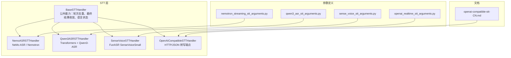
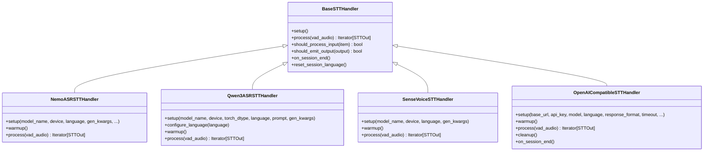
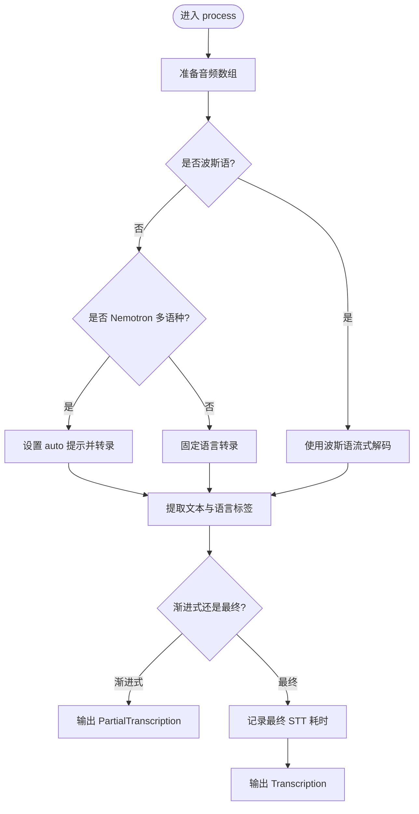
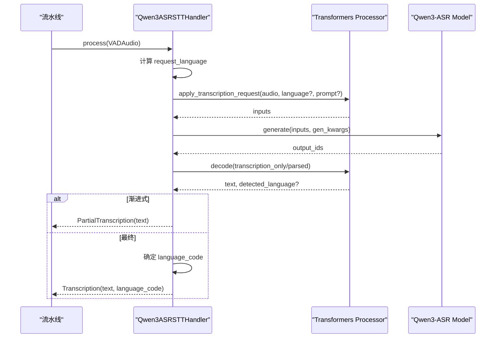
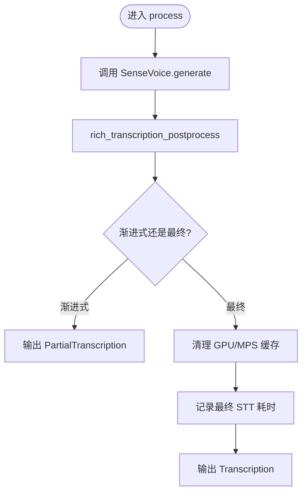
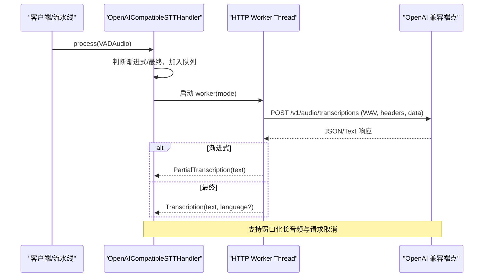
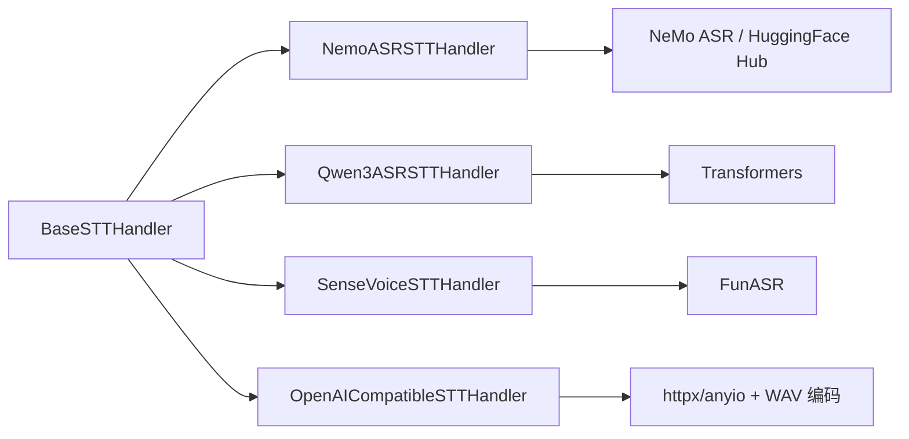

# 其他 STT 后端

<cite>
**本文引用的文件**   
- [base_stt_handler.py](file://src/speech_to_speech/STT/base_stt_handler.py)
- [nemo_asr_handler.py](file://src/speech_to_speech/STT/nemo_asr_handler.py)
- [qwen3_asr_handler.py](file://src/speech_to_speech/STT/qwen3_asr_handler.py)
- [sense_voice_handler.py](file://src/speech_to_speech/STT/sense_voice_handler.py)
- [openai_compatible_handler.py](file://src/speech_to_speech/STT/openai_compatible_handler.py)
- [nemotron_streaming_stt_arguments.py](file://src/speech_to_speech/arguments_classes/nemotron_streaming_stt_arguments.py)
- [qwen3_asr_stt_arguments.py](file://src/speech_to_speech/arguments_classes/qwen3_asr_stt_arguments.py)
- [sense_voice_stt_arguments.py](file://src/speech_to_speech/arguments_classes/sense_voice_stt_arguments.py)
- [openai_realtime_stt_arguments.py](file://src/speech_to_speech/arguments_classes/openai_realtime_stt_arguments.py)
- [openai-compatible-stt-CN.md](file://docs/openai-compatible-stt-CN.md)
</cite>

## 目录
1. [引言](#引言)
2. [项目结构](#项目结构)
3. [核心组件](#核心组件)
4. [架构总览](#架构总览)
5. [详细组件分析](#详细组件分析)
6. [依赖关系分析](#依赖关系分析)
7. [性能与平台特性](#性能与平台特性)
8. [配置方式与参数说明](#配置方式与参数说明)
9. [适用场景与选型建议](#适用场景与选型建议)
10. [集成示例](#集成示例)
11. [故障排除指南](#故障排除指南)
12. [结论](#结论)

## 引言
本技术文档聚焦于仓库中的“其他 STT 后端”，包括 Nemo ASR、Qwen3-ASR、SenseVoice 以及 OpenAI Compatible STT。这些后端既可用于本地推理，也可通过 OpenAI 兼容接口对接云端或第三方服务。文档从系统架构、数据流、处理逻辑、错误处理、性能特征、平台兼容性、配置方式、适用场景和选型建议等维度展开，并给出可视化图示与排错指引，帮助读者快速理解与正确集成。

## 项目结构
STT 相关代码集中在 `src/speech_to_speech/STT` 目录下，每个后端以独立的 handler 模块实现，并通过统一的基类与消息类型接入流水线。参数定义位于 `src/speech_to_speech/arguments_classes`，OpenAI 兼容 STT 的使用说明位于 `docs/openai-compatible-stt-CN.md`。

**图表来源**
- [base_stt_handler.py:16-312](file://src/speech_to_speech/STT/base_stt_handler.py#L16-L312)
- [nemo_asr_handler.py:110-268](file://src/speech_to_speech/STT/nemo_asr_handler.py#L110-L268)
- [qwen3_asr_handler.py:58-187](file://src/speech_to_speech/STT/qwen3_asr_handler.py#L58-L187)
- [sense_voice_handler.py:19-86](file://src/speech_to_speech/STT/sense_voice_handler.py#L19-L86)
- [openai_compatible_handler.py:262-692](file://src/speech_to_speech/STT/openai_compatible_handler.py#L262-L692)
- [nemotron_streaming_stt_arguments.py:1-24](file://src/speech_to_speech/arguments_classes/nemotron_streaming_stt_arguments.py#L1-L24)
- [qwen3_asr_stt_arguments.py:1-55](file://src/speech_to_speech/arguments_classes/qwen3_asr_stt_arguments.py#L1-L55)
- [sense_voice_stt_arguments.py:1-21](file://src/speech_to_speech/arguments_classes/sense_voice_stt_arguments.py#L1-L21)
- [openai_realtime_stt_arguments.py:1-37](file://src/speech_to_speech/arguments_classes/openai_realtime_stt_arguments.py#L1-L37)
- [openai-compatible-stt-CN.md:1-60](file://docs/openai-compatible-stt-CN.md#L1-L60)

**章节来源**
- [base_stt_handler.py:16-312](file://src/speech_to_speech/STT/base_stt_handler.py#L16-L312)
- [openai-compatible-stt-CN.md:1-60](file://docs/openai-compatible-stt-CN.md#L1-L60)

## 核心组件
- BaseSTTHandler：提供所有 STT 后端的通用能力，包括推测性轮次的输入过滤、最终结果收敛、会话语言状态管理、延迟统计钩子等。
- NemoASRSTTHandler：基于 NeMo ASR 的本地推理后端，支持英文单语、多语种 Nemotron 模型及波斯语专用 checkpoint。
- Qwen3ASRSTTHandler：基于 Transformers 的 Qwen3-ASR 推理后端，支持自动语言识别、提示词上下文、设备与 dtype 自适应。
- SenseVoiceSTTHandler：基于 FunASR 的 SenseVoiceSmall 推理后端，支持多语言解码与简单缓存清理。
- OpenAICompatibleSTTHandler：面向 OpenAI 兼容转写端点的异步 HTTP 后端，支持 JSON/文本响应、窗口化长音频、请求取消与会话生命周期管理。

**章节来源**
- [base_stt_handler.py:16-312](file://src/speech_to_speech/STT/base_stt_handler.py#L16-L312)
- [nemo_asr_handler.py:110-268](file://src/speech_to_speech/STT/nemo_asr_handler.py#L110-L268)
- [qwen3_asr_handler.py:58-187](file://src/speech_to_speech/STT/qwen3_asr_handler.py#L58-L187)
- [sense_voice_handler.py:19-86](file://src/speech_to_speech/STT/sense_voice_handler.py#L19-L86)
- [openai_compatible_handler.py:262-692](file://src/speech_to_speech/STT/openai_compatible_handler.py#L262-L692)

## 架构总览
下图展示各 STT 后端在系统中的位置与交互关系。所有后端继承自 BaseSTTHandler，接收 VAD 切分后的音频片段，输出 PartialTranscription 或 Transcription；OpenAI Compatible 后端额外通过 HTTP 调用外部转写服务。

**图表来源**
- [base_stt_handler.py:16-312](file://src/speech_to_speech/STT/base_stt_handler.py#L16-L312)
- [nemo_asr_handler.py:110-268](file://src/speech_to_speech/STT/nemo_asr_handler.py#L110-L268)
- [qwen3_asr_handler.py:58-187](file://src/speech_to_speech/STT/qwen3_asr_handler.py#L58-L187)
- [sense_voice_handler.py:19-86](file://src/speech_to_speech/STT/sense_voice_handler.py#L19-L86)
- [openai_compatible_handler.py:262-692](file://src/speech_to_speech/STT/openai_compatible_handler.py#L262-L692)

## 详细组件分析

### Nemo ASR 后端
- 特点与优势
  - 使用 NeMo ASR 的 ASRModel.transcribe 进行推理，支持英文单语与多语种 Nemotron 模型。
  - 针对波斯语提供专用 checkpoint，固定 fa-IR 提示与流式解码策略。
  - 支持按 utterance 的多语言检测（当模型为 Nemotron 3.5 系列时），可从输出中解析语言标签。
  - 支持 CPU/NPU/CUDA 设备选择，并提供语言检测兜底机制。
- 关键流程
  - setup：加载模型、设置设备、初始化语言与可选的语言检测器、执行 warmup。
  - process：将音频转为 numpy 数组，调用内部 transcribe，根据模式输出 PartialTranscription 或 Transcription，并记录最终 STT 耗时。
- 语言与设备
  - 默认语言为英语；若未启用语言检测且未报告语言，会发出警告。
  - 设备支持 CUDA/NPU/CPU，自动选择策略由 resolve_device 提供。
- 错误处理
  - warmup 失败时对非波斯语模型仅记录警告；波斯语模型则直接抛出异常。
  - 对未知语言代码或 auto 语义进行规范化与告警。

**图表来源**
- [nemo_asr_handler.py:185-268](file://src/speech_to_speech/STT/nemo_asr_handler.py#L185-L268)

**章节来源**
- [nemo_asr_handler.py:110-268](file://src/speech_to_speech/STT/nemo_asr_handler.py#L110-L268)
- [nemotron_streaming_stt_arguments.py:1-24](file://src/speech_to_speech/arguments_classes/nemotron_streaming_stt_arguments.py#L1-L24)

### Qwen3-ASR 后端
- 特点与优势
  - 基于 Transformers 的 Qwen3-ASR，支持自动语言识别与强制语言提示。
  - 支持 prompt 上下文（需要较新版本的 transformers）。
  - 设备与 dtype 自适应：CUDA 优先 bfloat16，MPS 使用 float16，CPU 使用 float32。
  - 每轮最终转写可报告语言代码；渐进式转写复用上一轮最终语言以避免短窗口误判。
- 关键流程
  - setup：加载处理器与模型，配置语言，执行 warmup。
  - _transcribe：构造转录请求，生成输出，解码文本与语言信息。
  - process：根据运行时配置与 forced_language 决定请求语言，输出 PartialTranscription 或 Transcription。
- 语言策略
  - 当 language="auto" 时，最终轮次返回带 “-auto” 后缀的语言代码；渐进式复用 last_language。
  - 支持 ISO 代码与语言名称映射，未知值透传给 processor 校验。

**图表来源**
- [qwen3_asr_handler.py:108-187](file://src/speech_to_speech/STT/qwen3_asr_handler.py#L108-L187)

**章节来源**
- [qwen3_asr_handler.py:58-187](file://src/speech_to_speech/STT/qwen3_asr_handler.py#L58-L187)
- [qwen3_asr_stt_arguments.py:1-55](file://src/speech_to_speech/arguments_classes/qwen3_asr_stt_arguments.py#L1-L55)

### SenseVoice 后端
- 特点与优势
  - 基于 FunASR 的 SenseVoiceSmall，轻量且易于部署。
  - 支持多语言解码（auto、zh、en、yue、ja、ko）。
  - 在 GPU/MPS 上主动清理缓存以降低显存压力。
- 关键流程
  - setup：加载 FunASR AutoModel，设置语言与 gen_kwargs，执行 warmup。
  - _generate：调用 model.generate 并 postprocess 文本。
  - process：输出 PartialTranscription 或 Transcription，并在 GPU/MPS 上清理缓存。
- 注意事项
  - 该后端不直接输出 language_code；如需语言信息需在上层处理。

**图表来源**
- [sense_voice_handler.py:45-86](file://src/speech_to_speech/STT/sense_voice_handler.py#L45-L86)

**章节来源**
- [sense_voice_handler.py:19-86](file://src/speech_to_speech/STT/sense_voice_handler.py#L19-L86)
- [sense_voice_stt_arguments.py:1-21](file://src/speech_to_speech/arguments_classes/sense_voice_stt_arguments.py#L1-L21)

### OpenAI Compatible STT 后端
- 特点与优势
  - 通过 HTTP POST 到 OpenAI 兼容的 `/v1/audio/transcriptions` 端点进行转写。
  - 支持 JSON 与纯文本响应格式，自动适配 gpt-transcribe 的复数字段 languages[]。
  - 支持窗口化长音频：按最大窗口长度分段转写并拼接结果，避免超长音频被拒绝。
  - 具备请求取消与会话生命周期管理：session 切换时清理未完成请求，防止资源泄漏。
  - 启动时进行 warmup，验证端点连通性与认证有效性。
- 关键流程
  - setup：校验参数、构建 endpoint URL、设置 API Key（OpenAI 官方端点自动读取环境变量）、初始化状态机。
  - process：区分渐进式与最终请求，维护 pending/final 队列，启动 worker 线程执行 HTTP 请求。
  - _transcribe_windows：对长音频进行能量检测切分，逐段转写并拼接 CJK 文本边界。
  - cleanup/on_session_end：清理工作线程、取消活动请求、重置会话状态。
- 错误处理
  - 将 HTTP 状态码与常见服务端限制转换为可读的错误消息（如 413、时长超限、文件大小超限）。
  - 渐进式失败仅记录警告；最终失败输出 TranscriptionFailure。

**图表来源**
- [openai_compatible_handler.py:262-692](file://src/speech_to_speech/STT/openai_compatible_handler.py#L262-L692)
- [openai-compatible-stt-CN.md:1-60](file://docs/openai-compatible-stt-CN.md#L1-L60)

**章节来源**
- [openai_compatible_handler.py:262-692](file://src/speech_to_speech/STT/openai_compatible_handler.py#L262-L692)
- [openai-realtime-stt-arguments.py:1-37](file://src/speech_to_speech/arguments_classes/openai_realtime_stt_arguments.py#L1-L37)
- [openai-compatible-stt-CN.md:1-60](file://docs/openai-compatible-stt-CN.md#L1-L60)

## 依赖关系分析
- BaseSTTHandler 是所有后端的抽象基类，提供统一的输入过滤、输出过滤、会话语言状态与延迟统计钩子。
- NemoASRSTTHandler 依赖 NeMo ASR 的 ASRModel 与 HuggingFace Hub 下载工具。
- Qwen3ASRSTTHandler 依赖 Transformers 的 AutoProcessor 与 AutoModelForMultimodalLM。
- SenseVoiceSTTHandler 依赖 FunASR 的 AutoModel 与 rich_transcription_postprocess。
- OpenAICompatibleSTTHandler 依赖 httpx 与 anyio 进行异步 HTTP 请求，并使用标准库 wave 编码 PCM 音频。

**图表来源**
- [base_stt_handler.py:16-312](file://src/speech_to_speech/STT/base_stt_handler.py#L16-L312)
- [nemo_asr_handler.py:110-268](file://src/speech_to_speech/STT/nemo_asr_handler.py#L110-L268)
- [qwen3_asr_handler.py:58-187](file://src/speech_to_speech/STT/qwen3_asr_handler.py#L58-L187)
- [sense_voice_handler.py:19-86](file://src/speech_to_speech/STT/sense_voice_handler.py#L19-L86)
- [openai_compatible_handler.py:262-692](file://src/speech_to_speech/STT/openai_compatible_handler.py#L262-L692)

**章节来源**
- [base_stt_handler.py:16-312](file://src/speech_to_speech/STT/base_stt_handler.py#L16-L312)
- [nemo_asr_handler.py:110-268](file://src/speech_to_speech/STT/nemo_asr_handler.py#L110-L268)
- [qwen3_asr_handler.py:58-187](file://src/speech_to_speech/STT/qwen3_asr_handler.py#L58-L187)
- [sense_voice_handler.py:19-86](file://src/speech_to_speech/STT/sense_voice_handler.py#L19-L86)
- [openai_compatible_handler.py:262-692](file://src/speech_to_speech/STT/openai_compatible_handler.py#L262-L692)

## 性能与平台特性
- Nemo ASR
  - 设备支持：CUDA/NPU/CPU；波斯语模型要求特定推理提示与解码策略。
  - 语言检测：Nemotron 3.5 系列可按 utterance 检测语言；否则需依赖文本语言检测或固定语言。
  - Warmup：对非波斯语模型 warmup 失败仅警告，不影响后续运行。
- Qwen3-ASR
  - 设备与 dtype：CUDA 优先 bfloat16，MPS 使用 float16，CPU 使用 float32；可通过参数显式指定。
  - 语言识别：最终轮次自动识别语言；渐进式复用上一轮最终语言以减少误判。
  - Prompt：需要较新版本的 transformers 以支持 prompt 上下文。
- SenseVoice
  - 设备：默认 cuda，支持 MPS 与 GPU 缓存清理。
  - 语言：支持 auto、zh、en、yue、ja、ko；不直接输出 language_code。
- OpenAI Compatible
  - 网络与超时：支持自定义 base_url、api_key、timeout；OpenAI 官方端点自动读取 OPENAI_API_KEY。
  - 窗口化：通过能量检测切分长音频，避免服务端限制；CJK 文本拼接保留自然边界。
  - 并发与取消：worker 线程独立执行 HTTP 请求，支持取消与 session 生命周期管理。

**章节来源**
- [nemo_asr_handler.py:110-268](file://src/speech_to_speech/STT/nemo_asr_handler.py#L110-L268)
- [qwen3_asr_handler.py:58-187](file://src/speech_to_speech/STT/qwen3_asr_handler.py#L58-L187)
- [sense_voice_handler.py:19-86](file://src/speech_to_speech/STT/sense_voice_handler.py#L19-L86)
- [openai_compatible_handler.py:262-692](file://src/speech_to_speech/STT/openai_compatible_handler.py#L262-L692)

## 配置方式与参数说明
- Nemo ASR
  - 主要参数：模型名、设备、语言、gen_kwargs、checkpoint_filename、checkpoint_revision、detect_language_from_text。
  - 行为差异：波斯语模型固定 fa-IR 提示；Nemotron 3.5 支持 per-utterance 语言检测。
- Qwen3-ASR
  - 主要参数：模型名、设备、torch_dtype、language、prompt、gen_kwargs、max_new_tokens。
  - 语言策略：auto 模式下最终轮次返回带 “-auto” 后缀的语言代码；prompt 用于上下文增强。
- SenseVoice
  - 主要参数：模型名、设备、language、gen_kwargs。
  - 语言范围：auto、zh、en、yue、ja、ko；不直接输出 language_code。
- OpenAI Compatible
  - 主要参数：base_url、api_key、model、language、response_format、timeout、speculative_turns、final_revision_settle_s、gen_kwargs、max_window_s。
  - 官方端点：当 base_url 为 OpenAI 官方地址且未设置 api_key 时，自动读取 OPENAI_API_KEY。
  - 响应格式：json 或 text；gpt-transcribe 使用复数字段 languages[]。

**章节来源**
- [nemotron_streaming_stt_arguments.py:1-24](file://src/speech_to_speech/arguments_classes/nemotron_streaming_stt_arguments.py#L1-L24)
- [qwen3_asr_stt_arguments.py:1-55](file://src/speech_to_speech/arguments_classes/qwen3_asr_stt_arguments.py#L1-L55)
- [sense_voice_stt_arguments.py:1-21](file://src/speech_to_speech/arguments_classes/sense_voice_stt_arguments.py#L1-L21)
- [openai_realtime_stt_arguments.py:1-37](file://src/speech_to_speech/arguments_classes/openai_realtime_stt_arguments.py#L1-L37)
- [openai-compatible-stt-CN.md:1-60](file://docs/openai-compatible-stt-CN.md#L1-L60)

## 适用场景与选型建议
- Nemo ASR
  - 适合需要 NeMo 生态与 Nemotron 多语种能力的场景；波斯语专用模型适合单一语言高稳定需求。
  - 推荐用于本地部署、可控硬件环境、需要语言检测兜底的场景。
- Qwen3-ASR
  - 适合需要 Transformers 生态、prompt 上下文增强、自动语言识别的场景。
  - 推荐用于中英文等多语言混合对话，且希望语言信息传递给 LLM/TTS 的场景。
- SenseVoice
  - 适合轻量级部署、多语言基础识别、对显存敏感的设备。
  - 推荐用于边缘设备或资源受限环境，语言范围覆盖中日韩英粤语。
- OpenAI Compatible
  - 适合需要云端转写能力、统一 OpenAI 兼容接口的场景；可对接 vLLM 本地服务或 OpenAI 官方服务。
  - 推荐用于快速集成、无需本地模型部署、需要高可用与弹性扩展的场景。

## 集成示例
- 使用 vLLM 托管 Qwen3-ASR 作为 OpenAI 兼容端点
  - 安装 vLLM 并启动服务，然后通过 speech-to-speech 指定 openai STT 后端与对应 base_url/model。
  - 参考文档路径：[openai-compatible-stt-CN.md:13-31](file://docs/openai-compatible-stt-CN.md#L13-L31)
- 使用 OpenAI 官方转写 API
  - 导出 OPENAI_API_KEY，设置 base_url 为 https://api.openai.com/v1，选择 gpt-transcribe 模型。
  - 参考文档路径：[openai-compatible-stt-CN.md:33-47](file://docs/openai-compatible-stt-CN.md#L33-L47)
- 本地 Qwen3-ASR 推理
  - 通过 qwen3_asr_model_name 指定模型，device 与 torch_dtype 自动选择，language 设为 auto 以启用自动语言识别。
  - 参考参数路径：[qwen3_asr_stt_arguments.py:7-55](file://src/speech_to_speech/arguments_classes/qwen3_asr_stt_arguments.py#L7-L55)
- 本地 SenseVoice 推理
  - 通过 sense_voice_stt_model_name 指定 FunAudioLLM/SenseVoiceSmall，device 设为 cuda，language 设为 auto。
  - 参考参数路径：[sense_voice_stt_arguments.py:6-21](file://src/speech_to_speech/arguments_classes/sense_voice_stt_arguments.py#L6-L21)
- 本地 Nemo ASR 推理
  - 通过 nemotron_streaming_model_name 指定英文或多语种模型，device 设为 auto，language 设为 en 或 fa。
  - 参考参数路径：[nemotron_streaming_stt_arguments.py:6-24](file://src/speech_to_speech/arguments_classes/nemotron_streaming_stt_arguments.py#L6-L24)

**章节来源**
- [openai-compatible-stt-CN.md:13-47](file://docs/openai-compatible-stt-CN.md#L13-L47)
- [qwen3_asr_stt_arguments.py:7-55](file://src/speech_to_speech/arguments_classes/qwen3_asr_stt_arguments.py#L7-L55)
- [sense_voice_stt_arguments.py:6-21](file://src/speech_to_speech/arguments_classes/sense_voice_stt_arguments.py#L6-L21)
- [nemotron_streaming_stt_arguments.py:6-24](file://src/speech_to_speech/arguments_classes/nemotron_streaming_stt_arguments.py#L6-L24)

## 故障排除指南
- OpenAI Compatible
  - 413 请求过大：缩短转写窗口或增大服务端上传限制。
  - 时长超限：缩短转写窗口或增大服务器 VLLM_MAX_AUDIO_DECODE_DURATION_S。
  - 文件大小超限：缩短转写窗口或增大服务端上传限制。
  - 认证失败：检查 base_url 与 api_key；OpenAI 官方端点会自动读取 OPENAI_API_KEY。
  - 参考路径：[openai_compatible_handler.py:186-216](file://src/speech_to_speech/STT/openai_compatible_handler.py#L186-L216)
- Nemo ASR
  - Warmup 失败：非波斯语模型仅记录警告；波斯语模型直接抛出异常，需检查模型路径与依赖。
  - 语言代码未知：当未启用语言检测时，可能无法正确报告语言，建议启用 detect_language_from_text 或固定语言。
  - 参考路径：[nemo_asr_handler.py:176-184](file://src/speech_to_speech/STT/nemo_asr_handler.py#L176-L184)
- Qwen3-ASR
  - Prompt 忽略：当 transformers 版本较低时，prompt 会被忽略，需升级至支持 prompt 的版本。
  - 语言不支持：当检测到不支持的语言时会记录警告，建议使用 supported languages 列表或强制语言。
  - 参考路径：[qwen3_asr_handler.py:83-86](file://src/speech_to_speech/STT/qwen3_asr_handler.py#L83-L86)
- SenseVoice
  - 依赖缺失：缺少 sensevoice extra 时会抛出 ModuleNotFoundError，需安装相应依赖。
  - 显存不足：在 GPU/MPS 上主动清理缓存，但仍需注意模型大小与 batch 设置。
  - 参考路径：[sense_voice_handler.py:29-36](file://src/speech_to_speech/STT/sense_voice_handler.py#L29-L36)

**章节来源**
- [openai_compatible_handler.py:186-216](file://src/speech_to_speech/STT/openai_compatible_handler.py#L186-L216)
- [nemo_asr_handler.py:176-184](file://src/speech_to_speech/STT/nemo_asr_handler.py#L176-L184)
- [qwen3_asr_handler.py:83-86](file://src/speech_to_speech/STT/qwen3_asr_handler.py#L83-L86)
- [sense_voice_handler.py:29-36](file://src/speech_to_speech/STT/sense_voice_handler.py#L29-L36)

## 结论
上述四个 STT 后端分别覆盖了本地 NeMo 生态、Transformers 生态、FunASR 轻量方案与 OpenAI 兼容云端服务。选择时应综合考虑语言支持、设备资源、部署环境与业务需求：
- 若需要多语种与 NeMo 生态，选择 Nemo ASR。
- 若需要 Transformers 生态与 prompt 上下文，选择 Qwen3-ASR。
- 若需要轻量部署与多语言基础识别，选择 SenseVoice。
- 若需要云端转写与统一 OpenAI 兼容接口，选择 OpenAI Compatible。

通过合理的配置与故障排除策略，可在不同平台上稳定运行并获得良好的转写效果。