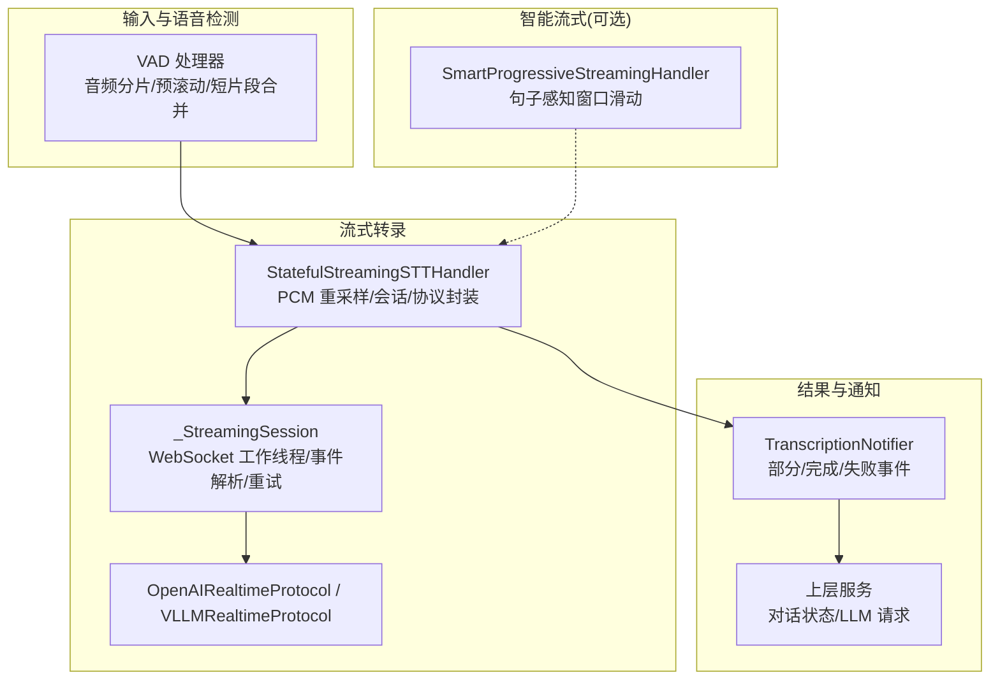
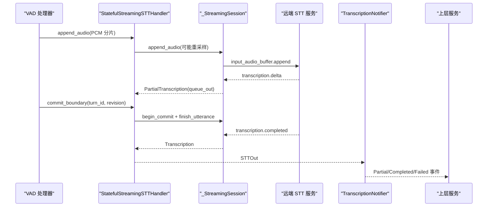
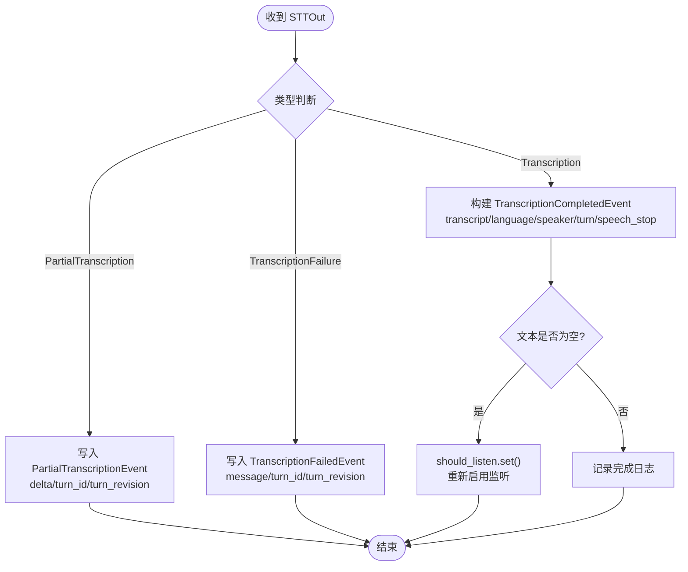
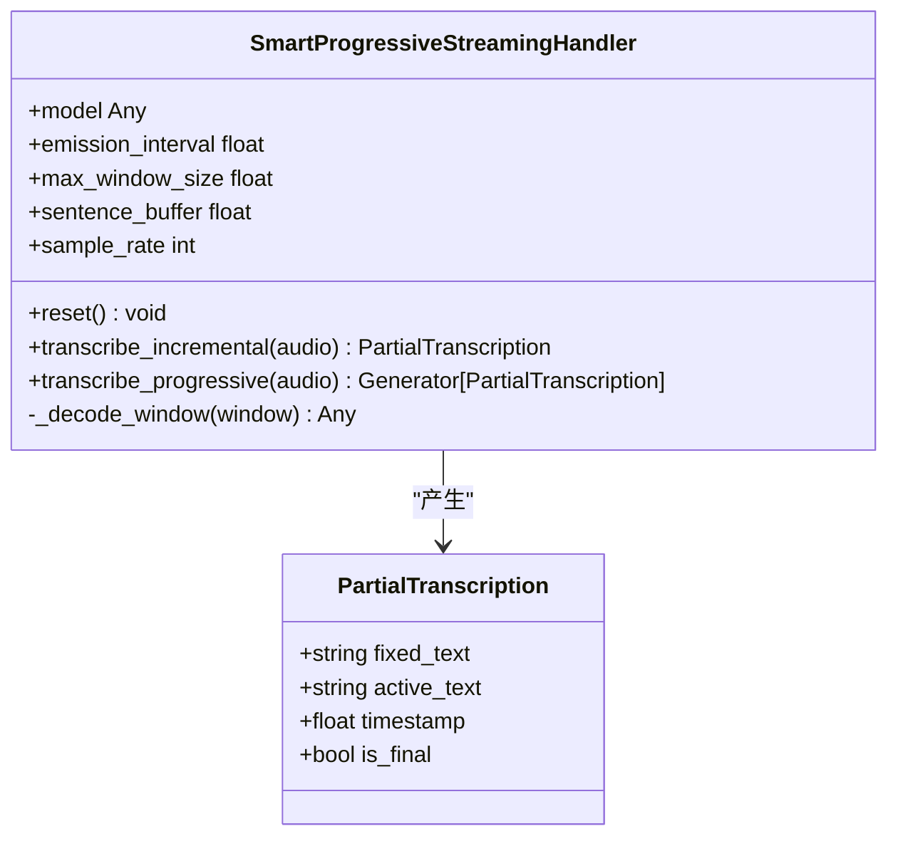
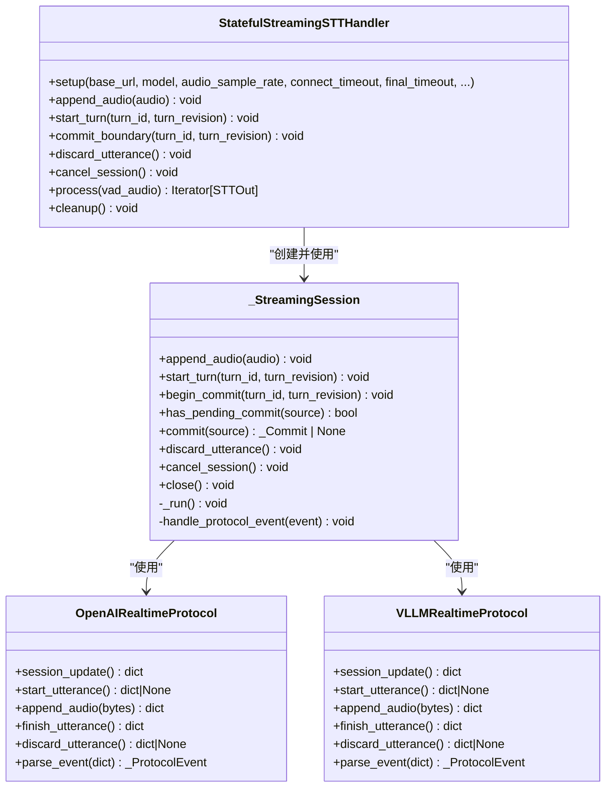
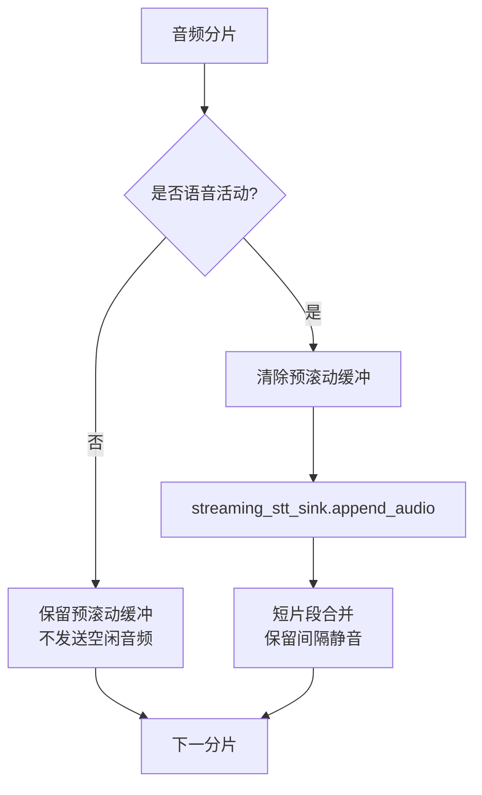
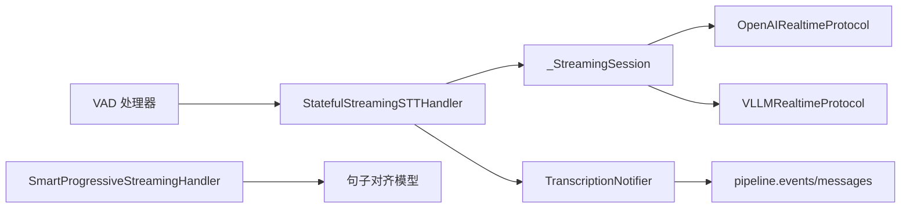

# 流式转录机制

<cite>
**本文引用的文件**   
- [transcription_notifier.py](file://src/speech_to_speech/STT/transcription_notifier.py)
- [smart_progressive_streaming.py](file://src/speech_to_speech/STT/smart_progressive_streaming.py)
- [streaming_handler.py](file://src/speech_to_speech/STT/streaming_handler.py)
- [vad_handler.py](file://src/speech_to_speech/VAD/vad_handler.py)
- [test_streaming_stt_handler.py](file://tests/test_streaming_stt_handler.py)
</cite>

## 目录
1. [引言](#引言)
2. [项目结构](#项目结构)
3. [核心组件](#核心组件)
4. [架构总览](#架构总览)
5. [详细组件分析](#详细组件分析)
6. [依赖关系分析](#依赖关系分析)
7. [性能与延迟优化](#性能与延迟优化)
8. [内存管理与错误恢复](#内存管理与错误恢复)
9. [配置与调优指南](#配置与调优指南)
10. [故障排查](#故障排查)
11. [结论](#结论)

## 引言
本技术文档聚焦于语音到文本的流式转录机制，重点解释以下能力：
- 流式音频处理：将实时 PCM 音频分片送入远端或本地 STT 服务。
- 增量转录：在说话过程中持续输出部分结果，并在句末或静音边界提交最终结果。
- 事件通知：通过 TranscriptionNotifier 将部分结果、完成结果和失败事件统一转发给上层。
- 智能流式算法：SmartProgressiveStreamingHandler 基于句子对齐进行窗口滑动，兼顾低延迟与高准确率。
- 关键技术点：音频分片、时间戳对齐、结果合并、延迟优化、内存管理、错误恢复。
- 配置与调优：针对连接超时、最终结果超时、采样率转换、VAD 短片段合并等参数的优化建议。

## 项目结构
与流式转录直接相关的代码主要位于以下模块：
- STT 层：负责与远端实时转录协议交互、PCM 重采样、会话生命周期、增量结果与最终结果产出。
- VAD 层：负责语音活动检测、音频分片、预滚动缓冲、短片段合并，以及向 STT 推送流式音频。
- 通知层：TranscriptionNotifier 将 STT 的输出转换为协议无关的事件，供 RealtimeService 消费。
- 智能流式：SmartProgressiveStreamingHandler 提供基于句子的渐进式转录策略（适用于具备句子对齐能力的模型）。

图表来源
- [streaming_handler.py:928-1086](file://src/speech_to_speech/STT/streaming_handler.py#L928-L1086)
- [streaming_handler.py:349-926](file://src/speech_to_speech/STT/streaming_handler.py#L349-L926)
- [transcription_notifier.py:26-121](file://src/speech_to_speech/STT/transcription_notifier.py#L26-L121)
- [smart_progressive_streaming.py:28-240](file://src/speech_to_speech/STT/smart_progressive_streaming.py#L28-L240)
- [vad_handler.py:294-426](file://src/speech_to_speech/VAD/vad_handler.py#L294-L426)

章节来源
- [streaming_handler.py:928-1086](file://src/speech_to_speech/STT/streaming_handler.py#L928-L1086)
- [transcription_notifier.py:26-121](file://src/speech_to_speech/STT/transcription_notifier.py#L26-L121)
- [smart_progressive_streaming.py:28-240](file://src/speech_to_speech/STT/smart_progressive_streaming.py#L28-L240)
- [vad_handler.py:294-426](file://src/speech_to_speech/VAD/vad_handler.py#L294-L426)

## 核心组件
- StatefulStreamingSTTHandler：面向实时协议的流式 STT 处理器，负责 PCM 输入、采样率转换、会话建立、音频追加、提交边界、结果聚合与错误上报。
- _StreamingSession：封装 WebSocket 连接、命令队列、事件解析、部分结果累积、最终结果提交、超时与重试、会话取消与清理。
- OpenAIRealtimeProtocol / VLLMRealtimeProtocol：定义不同远端服务的消息格式与事件语义。
- TranscriptionNotifier：将 STTOut 转换为 PartialTranscriptionEvent、TranscriptionCompletedEvent、TranscriptionFailedEvent，并写入 text_output_queue。
- SmartProgressiveStreamingHandler：基于句子对齐的智能流式策略，维护固定文本与活跃文本，按句滑动窗口，控制最大窗口大小与活跃缓冲区。
- VAD 处理器：负责音频分片、预滚动缓冲、短片段合并、向 STT 推送流式音频，以及与说话人分离协作。

章节来源
- [streaming_handler.py:928-1086](file://src/speech_to_speech/STT/streaming_handler.py#L928-L1086)
- [streaming_handler.py:349-926](file://src/speech_to_speech/STT/streaming_handler.py#L349-L926)
- [transcription_notifier.py:26-121](file://src/speech_to_speech/STT/transcription_notifier.py#L26-L121)
- [smart_progressive_streaming.py:28-240](file://src/speech_to_speech/STT/smart_progressive_streaming.py#L28-L240)
- [vad_handler.py:294-426](file://src/speech_to_speech/VAD/vad_handler.py#L294-L426)

## 架构总览
流式转录的整体流程如下：
1. VAD 检测到语音活动，将音频分片（含预滚动）推送到 STT 的 append_audio。
2. StatefulStreamingSTTHandler 根据目标服务要求对 PCM 进行重采样，并通过 _StreamingSession 发送 input_audio_buffer.append。
3. 远端服务返回 delta 事件，_StreamingSession 累积 remote_hypothesis，并通过 queue_out 发出 PartialTranscription。
4. VAD 触发提交边界（如静音结束），调用 commit_boundary，_StreamingSession 发送 finish_utterance。
5. 远端返回 completed 事件，_StreamingSession 生成 Transcription；若失败则生成 TranscriptionFailure。
6. TranscriptionNotifier 接收 STTOut，转换为协议无关事件，写入 text_output_queue，供 RealtimeService 消费。

图表来源
- [streaming_handler.py:928-1086](file://src/speech_to_speech/STT/streaming_handler.py#L928-L1086)
- [streaming_handler.py:349-926](file://src/speech_to_speech/STT/streaming_handler.py#L349-L926)
- [transcription_notifier.py:26-121](file://src/speech_to_speech/STT/transcription_notifier.py#L26-L121)
- [vad_handler.py:294-426](file://src/speech_to_speech/VAD/vad_handler.py#L294-L426)

## 详细组件分析

### TranscriptionNotifier 事件通知机制
TranscriptionNotifier 位于 STT 与 LLM 之间，职责是：
- 接收 STTOut（PartialTranscription、Transcription、TranscriptionFailure）。
- 将部分结果转换为 PartialTranscriptionEvent，包含 delta、turn_id、turn_revision。
- 将完成结果转换为 TranscriptionCompletedEvent，携带 transcript、speaker_attribution、language_code、turn_id、turn_revision、speech_stopped_at_s。
- 将失败结果转换为 TranscriptionFailedEvent，携带 message、turn_id、turn_revision。
- 当最终结果为空时，重新启用监听（should_listen.set()），避免阻塞后续语音输入。

图表来源
- [transcription_notifier.py:26-121](file://src/speech_to_speech/STT/transcription_notifier.py#L26-L121)

章节来源
- [transcription_notifier.py:26-121](file://src/speech_to_speech/STT/transcription_notifier.py#L26-L121)

### SmartProgressiveStreamingHandler 智能流式算法
SmartProgressiveStreamingHandler 的核心思想：
- 每 500ms 发射一次部分结果（emission_interval=0.5s）。
- 使用增长窗口（max_window_size=15s）提升准确率。
- 当音频超过 15s，按句子边界滑动窗口：已完成句子成为 fixed_text，仅对 active_text 重转录。
- 支持两种解码路径：
  - 若模型具备 decode_chunk（MLX），则使用 MLX 数组进行增量解码。
  - 否则使用 transcribe(timestamps=True)，从 timestamp.segment 提取句子 end 时间。

关键数据结构：
- PartialTranscription：fixed_text、active_text、timestamp、is_final。
- 内部状态：fixed_sentences、fixed_end_time、last_transcribed_length。

图表来源
- [smart_progressive_streaming.py:18-240](file://src/speech_to_speech/STT/smart_progressive_streaming.py#L18-L240)

章节来源
- [smart_progressive_streaming.py:28-240](file://src/speech_to_speech/STT/smart_progressive_streaming.py#L28-L240)

### StatefulStreamingSTTHandler 与 _StreamingSession
StatefulStreamingSTTHandler 的职责：
- 参数校验：model、audio_sample_rate、connect_timeout、final_timeout。
- 采样率转换：当管道采样率为 16kHz，而远端需要 24kHz（OpenAI Realtime）或 16kHz（vLLM Realtime）时，使用 _StreamingPCMResampler 保持滤波器与相位状态。
- 会话创建：构造 protocol（OpenAIRealtimeProtocol 或 VLLMRealtimeProtocol），设置 endpoint_url、headers、connect_factory。
- 音频追加：append_audio 经重采样后进入 _StreamingSession。
- 提交边界：commit_boundary 先 flush 重采样器，再 begin_commit。
- process：根据 VADAudio 模式决定是否提交；等待 _StreamingSession.commit 返回；若失败则输出 TranscriptionFailure；若成功则输出 Transcription。

_S treamingSession 的职责：
- 单连接可重连的 WebSocket 会话，串行化 audio/commit 命令。
- 维护 pending_commits、committed_prefixes、failed_turn_ids、retired_item_ids 等状态。
- 事件解析：parse_event 将远端事件映射为 _ProtocolEvent（ignore/committed/delta/completed/failed/error）。
- 部分结果：累积 remote_hypothesis，结合 committed_prefixes 生成 combined_hypothesis，并发出 PartialTranscription。
- 最终结果：finish_utterance 后等待 completed，记录 language、result、completed_at_s，并释放 active_commit。
- 错误处理：connection failed、remote error、timeout、no audio、stale final 等场景均有对应处理。

图表来源
- [streaming_handler.py:928-1086](file://src/speech_to_speech/STT/streaming_handler.py#L928-L1086)
- [streaming_handler.py:349-926](file://src/speech_to_speech/STT/streaming_handler.py#L349-L926)

章节来源
- [streaming_handler.py:928-1086](file://src/speech_to_speech/STT/streaming_handler.py#L928-L1086)
- [streaming_handler.py:349-926](file://src/speech_to_speech/STT/streaming_handler.py#L349-L926)

### VAD 与流式 STT 的协作
VAD 处理器负责：
- 将音频分片推送到 streaming_stt_sink（即 STT 的 append_audio）。
- 非语音阶段保留预滚动缓冲，避免将空闲麦克风音频发送给远端。
- 短片段合并：将相邻过短的语音片段合并，保留间隔静音，确保声学间隙与长度匹配。
- 与说话人分离协作：在流式模式下收集说话人信息，并在最终阶段合并。

图表来源
- [vad_handler.py:294-426](file://src/speech_to_speech/VAD/vad_handler.py#L294-L426)

章节来源
- [vad_handler.py:294-426](file://src/speech_to_speech/VAD/vad_handler.py#L294-L426)

## 依赖关系分析
- STT 层依赖 VAD 层提供的音频分片与提交边界。
- _StreamingSession 依赖具体协议实现（OpenAIRealtimeProtocol / VLLMRealtimeProtocol）。
- TranscriptionNotifier 依赖 pipeline.events 与 pipeline.messages 中的事件与消息类型。
- SmartProgressiveStreamingHandler 依赖具备句子对齐能力的模型（mlx 或 nano-parakeet）。

图表来源
- [streaming_handler.py:928-1086](file://src/speech_to_speech/STT/streaming_handler.py#L928-L1086)
- [transcription_notifier.py:26-121](file://src/speech_to_speech/STT/transcription_notifier.py#L26-L121)
- [smart_progressive_streaming.py:28-240](file://src/speech_to_speech/STT/smart_progressive_streaming.py#L28-L240)

章节来源
- [streaming_handler.py:928-1086](file://src/speech_to_speech/STT/streaming_handler.py#L928-L1086)
- [transcription_notifier.py:26-121](file://src/speech_to_speech/STT/transcription_notifier.py#L26-L121)
- [smart_progressive_streaming.py:28-240](file://src/speech_to_speech/STT/smart_progressive_streaming.py#L28-L240)

## 性能与延迟优化
- 连接建立与初始化：
  - connect_timeout 控制 session.created 等待时间；过长会导致首包延迟增加。
  - requires_session_updated 仅在 OpenAIRealtimeProtocol 下等待 session.updated，减少不必要的握手。
- 部分结果输出：
  - _StreamingSession 在收到 delta 后立即累积 remote_hypothesis 并尝试 emit_partial，降低用户感知延迟。
  - committed_prefixes 保证最终结果与前缀一致，避免重复拼接。
- 提交边界与最终结果：
  - final_timeout 控制 finish_utterance 后的等待时间；合理设置可平衡准确性与延迟。
  - 若 active_commit 超时，_StreamingSession 会标记失败并关闭连接，防止长时间阻塞。
- 采样率转换：
  - _StreamingPCMResampler 保持滤波器与相位状态，跨分片连续重采样，避免音质劣化与额外延迟。
- VAD 短片段合并：
  - 合并过短片段可减少远端调用次数，同时保留间隔静音，提高整体准确率。

章节来源
- [streaming_handler.py:349-926](file://src/speech_to_speech/STT/streaming_handler.py#L349-L926)
- [streaming_handler.py:928-1086](file://src/speech_to_speech/STT/streaming_handler.py#L928-L1086)
- [vad_handler.py:294-426](file://src/speech_to_speech/VAD/vad_handler.py#L294-L426)

## 内存管理与错误恢复
- 内存管理：
  - _StreamingSession 使用 Queue 串行化命令，避免并发写冲突。
  - pending_commits 与 retired_item_ids 管理提交状态与会话项生命周期，及时清理已退休项。
  - committed_prefixes 存储每个 turn 的最终前缀，避免重复计算。
- 错误恢复：
  - connection failed：关闭连接、标记失败 turn、重置 utterance 状态。
  - remote error：记录警告、关闭连接、标记失败 turn。
  - timeout：active_commit 超时或 setup 超时均会触发 fail_connection。
  - no audio：commit_boundary 若无音频则立即失败，避免无效提交。
  - stale final：忽略未归属或已退休 item 的完成事件，防止污染当前转轮。
- 测试覆盖：
  - test_streaming_stt_handler.py 覆盖了超时、连接失败、重开修订丢弃、恢复最终结果等场景。

章节来源
- [streaming_handler.py:349-926](file://src/speech_to_speech/STT/streaming_handler.py#L349-L926)
- [test_streaming_stt_handler.py:757-1516](file://tests/test_streaming_stt_handler.py#L757-L1516)

## 配置与调优指南
- 连接与超时：
  - connect_timeout：建议根据网络质量调整，过小易误判连接失败，过大影响首包延迟。
  - final_timeout：建议根据远端服务响应特性调整，过小易导致最终结果超时，过大影响用户体验。
- 采样率：
  - OpenAI Realtime 要求 24kHz PCM；vLLM Realtime 要求 16kHz PCM。
  - 若管道为 16kHz，需启用 _StreamingPCMResampler 进行重采样。
- VAD 参数：
  - short_segment_merge_ms：控制短片段合并阈值，过小会增加远端调用次数，过大可能丢失细节。
  - speech_pad_ms：预滚动缓冲大小，影响首帧完整性与延迟。
- 智能流式参数：
  - emission_interval：部分结果发射间隔，默认 500ms，越小越流畅但计算压力越大。
  - max_window_size：最大窗口大小，默认 15s，越大准确率越高但延迟增加。
  - sentence_buffer：活跃缓冲区大小，默认 2s，用于保持最近句子上下文。

章节来源
- [streaming_handler.py:928-1086](file://src/speech_to_speech/STT/streaming_handler.py#L928-L1086)
- [smart_progressive_streaming.py:28-240](file://src/speech_to_speech/STT/smart_progressive_streaming.py#L28-L240)
- [vad_handler.py:294-426](file://src/speech_to_speech/VAD/vad_handler.py#L294-L426)

## 故障排查
- 常见问题：
  - 连接建立失败：检查 base_url、api_key、connect_timeout。
  - 最终结果超时：检查 final_timeout、远端服务负载、网络状况。
  - 无音频提交：确认 VAD 是否正确触发 commit_boundary，且 streaming_stt_sink 已配置。
  - 部分结果缺失：检查 delta 事件是否到达，remote_hypothesis 是否累积。
  - 结果不一致：检查 committed_prefixes 与 combined_hypothesis 逻辑，确保前缀拼接正确。
- 调试建议：
  - 启用日志：观察 STT 连接建立、事件解析、提交边界、错误信息。
  - 单元测试：参考 test_streaming_stt_handler.py 模拟远端事件，验证超时、失败、恢复行为。
  - 性能监控：记录 boundary_queued_at_s 与 completed_at_s，计算 STT 延迟。

章节来源
- [streaming_handler.py:349-926](file://src/speech_to_speech/STT/streaming_handler.py#L349-L926)
- [test_streaming_stt_handler.py:757-1516](file://tests/test_streaming_stt_handler.py#L757-L1516)

## 结论
本流式转录机制通过 VAD 与 STT 的深度协作，实现了低延迟、高准确率的实时语音转文本。TranscriptionNotifier 提供了协议无关的事件通知，SmartProgressiveStreamingHandler 提供了句子感知的智能流式策略，StatefulStreamingSTTHandler 与 _StreamingSession 确保了连接的稳定性与错误恢复。通过合理的配置与调优，可在不同硬件与网络环境下获得良好的用户体验。