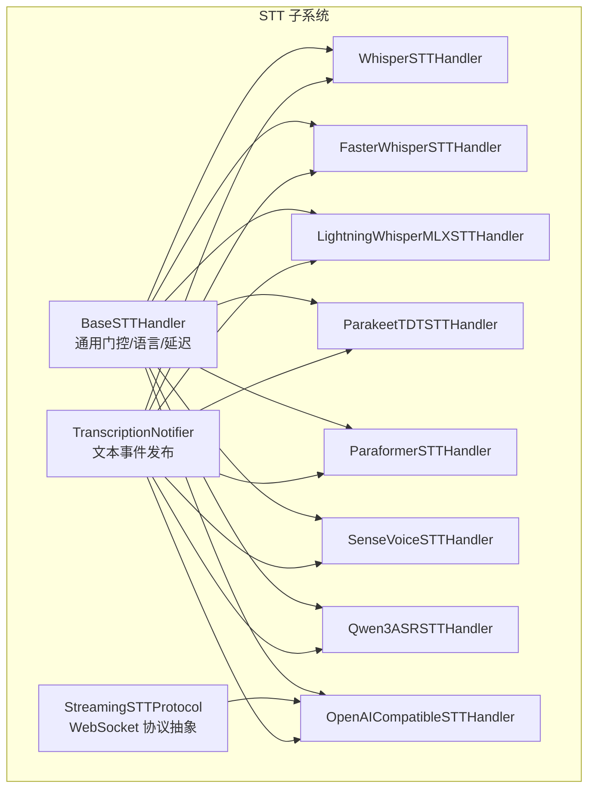
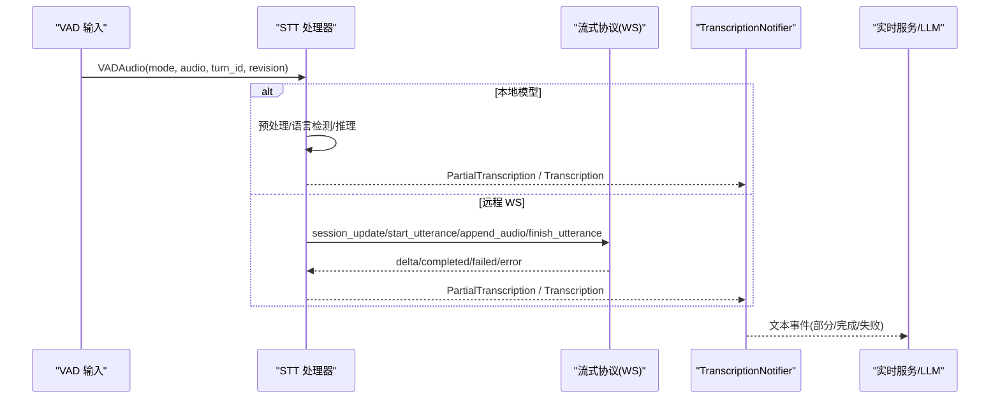
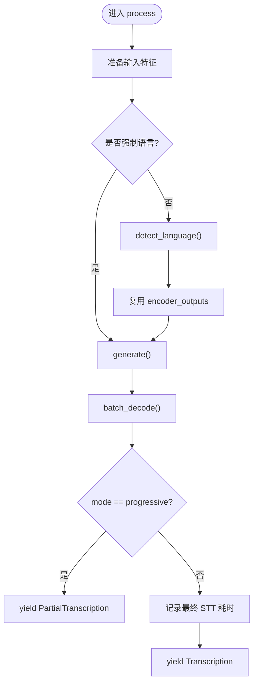
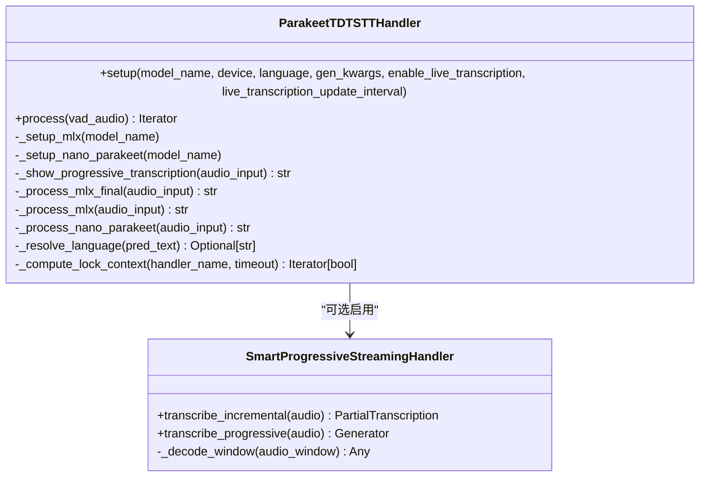
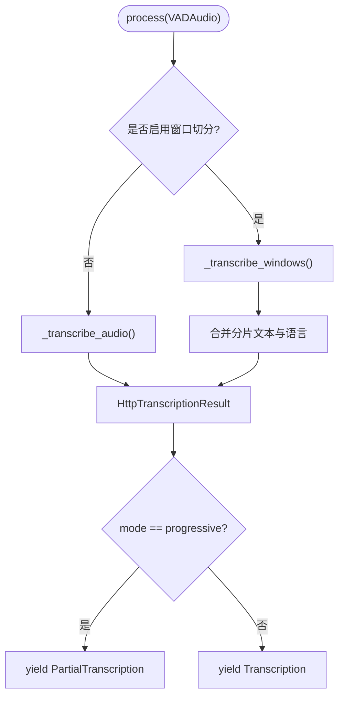
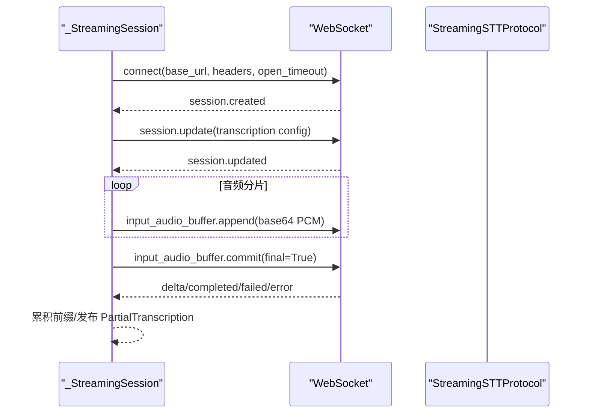
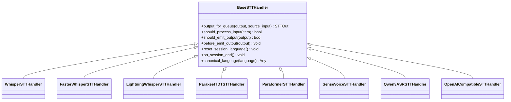

# 语音转文字 (STT)

<cite>
**本文引用的文件**   
- [base_stt_handler.py](file://src/speech_to_speech/STT/base_stt_handler.py)
- [streaming_handler.py](file://src/speech_to_speech/STT/streaming_handler.py)
- [transcription_notifier.py](file://src/speech_to_speech/STT/transcription_notifier.py)
- [whisper_stt_handler.py](file://src/speech_to_speech/STT/whisper_stt_handler.py)
- [faster_whisper_handler.py](file://src/speech_to_speech/STT/faster_whisper_handler.py)
- [lightning_whisper_mlx_handler.py](file://src/speech_to_speech/STT/lightning_whisper_mlx_handler.py)
- [parakeet_tdt_handler.py](file://src/speech_to_speech/STT/parakeet_tdt_handler.py)
- [smart_progressive_streaming.py](file://src/speech_to_speech/STT/smart_progressive_streaming.py)
- [paraformer_handler.py](file://src/speech_to_speech/STT/paraformer_handler.py)
- [openai_compatible_handler.py](file://src/speech_to_speech/STT/openai_compatible_handler.py)
- [qwen3_asr_handler.py](file://src/speech_to_speech/STT/qwen3_asr_handler.py)
- [sense_voice_handler.py](file://src/speech_to_speech/STT/sense_voice_handler.py)
</cite>

## 目录
1. [简介](#简介)
2. [项目结构](#项目结构)
3. [核心组件](#核心组件)
4. [架构总览](#架构总览)
5. [详细组件分析](#详细组件分析)
6. [依赖关系分析](#依赖关系分析)
7. [性能与资源特性](#性能与资源特性)
8. [配置优化指南](#配置优化指南)
9. [故障排除](#故障排除)
10. [结论](#结论)
11. [附录：集成示例与最佳实践](#附录集成示例与最佳实践)

## 简介
本技术文档面向 STT（语音转文字）子系统，系统性梳理多后端实现、流式转录机制、语言检测与增量处理策略，并给出性能对比、平台兼容性、配置优化与故障排除建议。代码库采用“处理器基类 + 多后端实现”的插件化设计，既支持本地推理模型（Whisper 系列、Paraformer、SenseVoice、Qwen3-ASR、Parakeet TDT），也支持 OpenAI 兼容 HTTP 与 Realtime WebSocket 两种远程接入方式。

## 项目结构
STT 子系统位于 `src/speech_to_speech/STT`，核心由以下层次组成：
- 基类与通用能力：`BaseSTTHandler` 提供会话语言状态、推测轮次去重、最终结果门控、延迟记录等通用逻辑。
- 流式协议层：`StreamingSTTProtocol` 抽象 OpenAI Realtime 与 vLLM Realtime 的 WebSocket 协议差异，统一音频分片、事件解析与连接生命周期管理。
- 通知器：`TranscriptionNotifier` 将 STT 输出转换为统一的文本事件，供上层服务消费。
- 各后端处理器：Whisper、Faster Whisper、Lightning Whisper MLX、Parakeet TDT、Paraformer、SenseVoice、Qwen3-ASR、OpenAI 兼容 HTTP/Realtime。

**图示来源**
- [base_stt_handler.py:16-312](file://src/speech_to_speech/STT/base_stt_handler.py#L16-L312)
- [streaming_handler.py:55-216](file://src/speech_to_speech/STT/streaming_handler.py#L55-L216)
- [transcription_notifier.py:26-122](file://src/speech_to_speech/STT/transcription_notifier.py#L26-L122)
- [whisper_stt_handler.py:48-295](file://src/speech_to_speech/STT/whisper_stt_handler.py#L48-L295)
- [faster_whisper_handler.py:38-174](file://src/speech_to_speech/STT/faster_whisper_handler.py#L38-L174)
- [lightning_whisper_mlx_handler.py:37-120](file://src/speech_to_speech/STT/lightning_whisper_mlx_handler.py#L37-L120)
- [parakeet_tdt_handler.py:69-605](file://src/speech_to_speech/STT/parakeet_tdt_handler.py#L69-L605)
- [paraformer_handler.py:22-100](file://src/speech_to_speech/STT/paraformer_handler.py#L22-L100)
- [sense_voice_handler.py:19-86](file://src/speech_to_speech/STT/sense_voice_handler.py#L19-L86)
- [qwen3_asr_handler.py:58-187](file://src/speech_to_speech/STT/qwen3_asr_handler.py#L58-L187)
- [openai_compatible_handler.py:262-692](file://src/speech_to_speech/STT/openai_compatible_handler.py#L262-L692)

**章节来源**
- [base_stt_handler.py:16-312](file://src/speech_to_speech/STT/base_stt_handler.py#L16-L312)
- [streaming_handler.py:55-216](file://src/speech_to_speech/STT/streaming_handler.py#L55-L216)
- [transcription_notifier.py:26-122](file://src/speech_to_speech/STT/transcription_notifier.py#L26-L122)

## 核心组件
- BaseSTTHandler：统一处理“最新轮次门控”“最终结果稳定等待”“陈旧输入丢弃”“会话语言重置”“最终 STT 延迟记录”。
- StreamingSTTProtocol：封装 OpenAI Realtime 与 vLLM Realtime 的会话建立、音频追加、提交完成、错误处理与增量文本拼接。
- TranscriptionNotifier：将 PartialTranscription/Transcription/TranscriptionFailure 转为统一的事件流，供实时服务消费。

关键职责与行为要点：
- 推测轮次去重：通过 SpeculativeTurnTracker 判断是否最新轮次，避免旧结果污染新对话。
- 最终结果门控：在 final 模式下等待稳定性窗口，减少抖动。
- 语言标准化：canonical_language 将 “auto” 归一化，避免不同后端对 “auto” 的语义不一致。
- 会话结束清理：on_session_end 清空已完成最终修订集合并重置语言状态。

**章节来源**
- [base_stt_handler.py:16-312](file://src/speech_to_speech/STT/base_stt_handler.py#L16-L312)
- [streaming_handler.py:349-800](file://src/speech_to_speech/STT/streaming_handler.py#L349-L800)
- [transcription_notifier.py:26-122](file://src/speech_to_speech/STT/transcription_notifier.py#L26-L122)

## 架构总览
STT 子系统以“处理器 + 协议 + 通知器”的分层架构组织：
- 处理器层：各后端实现 process(vad_audio) -> Iterator[STTOut]，遵循 BaseSTTHandler 的通用门控与语言策略。
- 协议层：针对远程 STT（OpenAI/vLLM Realtime）维护 WebSocket 会话、音频分片、事件解析与超时控制。
- 通知层：将 STT 输出转化为统一事件，驱动下游 LLM 请求与会话状态更新。

**图示来源**
- [streaming_handler.py:73-216](file://src/speech_to_speech/STT/streaming_handler.py#L73-L216)
- [transcription_notifier.py:42-122](file://src/speech_to_speech/STT/transcription_notifier.py#L42-L122)

## 详细组件分析

### Whisper 系列处理器

#### WhisperSTTHandler（Transformers）
- 使用 transformers AutoModelForSpeechSeq2Seq 加载 distil-whisper 模型。
- 支持 compile_mode（torch.compile）与 CUDA Graphs 预热。
- 语言检测：优先调用 detect_language(encoder_outputs)，再强制 language；若不可用则回退到生成序列前缀扫描。
- 渐进模式：yield PartialTranscription；否则 yield Transcription 并记录最终 STT 耗时。

**图示来源**
- [whisper_stt_handler.py:229-295](file://src/speech_to_speech/STT/whisper_stt_handler.py#L229-L295)
- [whisper_stt_handler.py:170-223](file://src/speech_to_speech/STT/whisper_stt_handler.py#L170-L223)

**章节来源**
- [whisper_stt_handler.py:48-295](file://src/speech_to_speech/STT/whisper_stt_handler.py#L48-L295)

#### FasterWhisperSTTHandler（CTranslate2）
- 基于 faster_whisper.WhisperModel，支持 CPU/CUDA，compute_type 自动选择。
- 语言策略：setup 时根据 language 决定 auto-detect 或强制；process 中依据 TranscriptionInfo.language 报告实际语言，必要时附加 “-auto” 标记。
- 参数适配：adapt_gen_kwargs 将 return_timestamps 映射为 without_timestamps，避免共享 gen_kwargs 被意外修改。

**章节来源**
- [faster_whisper_handler.py:38-174](file://src/speech_to_speech/STT/faster_whisper_handler.py#L38-L174)

#### LightningWhisperSTTHandler（MLX）
- 基于 lightning_whisper_mlx.LightningWhisperMLX，默认 MPS 设备。
- 使用 MLXLockContext 保证 MLX 线程安全；MPS 后释放 torch.mps.empty_cache()。
- 语言策略：支持 auto 检测，仅记录 SUPPORTED_LANGUAGES 内的语言作为 last_language。

**章节来源**
- [lightning_whisper_mlx_handler.py:37-120](file://src/speech_to_speech/STT/lightning_whisper_mlx_handler.py#L37-L120)

### Parakeet TDT 处理器
- 双后端：Apple Silicon 使用 mlx-audio，CUDA/CPU 使用 nano-parakeet。
- 语言检测：不直接接受语言约束，而是通过后处理 lingua-py 从文本推断语言，并以 “-auto” 后缀上报。
- 流式增量：可选 SmartProgressiveStreamingHandler，按句边界滑动窗口，固定已确认句子，仅重算活跃段，降低长音频重复计算。

**图示来源**
- [parakeet_tdt_handler.py:69-605](file://src/speech_to_speech/STT/parakeet_tdt_handler.py#L69-L605)
- [smart_progressive_streaming.py:28-244](file://src/speech_to_speech/STT/smart_progressive_streaming.py#L28-L244)

**章节来源**
- [parakeet_tdt_handler.py:69-605](file://src/speech_to_speech/STT/parakeet_tdt_handler.py#L69-L605)
- [smart_progressive_streaming.py:28-244](file://src/speech_to_speech/STT/smart_progressive_streaming.py#L28-L244)

### Paraformer 处理器
- 基于 funasr.AutoModel，默认中文模型 paraformer-zh。
- 简单流程：generate -> text -> 可选 MPS 缓存清理 -> 输出 Partial/Transcription。
- 语言固定：language 来自模型名解析，非自动检测。

**章节来源**
- [paraformer_handler.py:22-100](file://src/speech_to_speech/STT/paraformer_handler.py#L22-L100)

### SenseVoice 处理器
- 基于 funasr AutoModel，SenseVoiceSmall 检查点。
- 支持 use_itn 后处理，CUDA/MPS 显存清理。
- 语言策略：setup 传入 language，process 透传至 generate。

**章节来源**
- [sense_voice_handler.py:19-86](file://src/speech_to_speech/STT/sense_voice_handler.py#L19-L86)

### Qwen3-ASR 处理器
- 基于 transformers AutoModelForMultimodalLM，processor.apply_transcription_request 支持 prompt。
- 语言策略：auto 模式下每次 final 检测语言；progressive 复用上次 final 的语言以避免短窗误判。
- dtype 自适应：根据设备选择 bfloat16/float16/float32。

**章节来源**
- [qwen3_asr_handler.py:58-187](file://src/speech_to_speech/STT/qwen3_asr_handler.py#L58-L187)

### OpenAI 兼容处理器（HTTP 与 Realtime）

#### OpenAICompatibleSTTHandler（HTTP）
- 异步 HTTP 请求封装 HttpTranscriptionOperation，支持取消、超时、413/400 错误分类。
- 窗口切分：当 max_window_s 设置时，按能量最低帧对齐切分音频窗口，合并 CJK 文本边界。
- 进度与最终：progressive 返回 PartialTranscription；final 返回 Transcription 并记录耗时。

**图示来源**
- [openai_compatible_handler.py:467-564](file://src/speech_to_speech/STT/openai_compatible_handler.py#L467-L564)
- [openai_compatible_handler.py:331-466](file://src/speech_to_speech/STT/openai_compatible_handler.py#L331-L466)

**章节来源**
- [openai_compatible_handler.py:262-692](file://src/speech_to_speech/STT/openai_compatible_handler.py#L262-L692)

#### StreamingSTTProtocol（OpenAI Realtime / vLLM Realtime）
- OpenAIRealtimeProtocol：session.update(input.transcription)、input_audio_buffer.append/commit、delta/completed/failed/error 事件解析。
- VLLMRealtimeProtocol：session.update(model)、input_audio_buffer.append/commit(final)、transcription.delta/done/error。
- _StreamingSession：单连接、命令序列化、重连、超时、item_id/content_index 归属校验、committed_prefixes 累积前缀。

**图示来源**
- [streaming_handler.py:73-216](file://src/speech_to_speech/STT/streaming_handler.py#L73-L216)
- [streaming_handler.py:349-800](file://src/speech_to_speech/STT/streaming_handler.py#L349-L800)

**章节来源**
- [streaming_handler.py:55-216](file://src/speech_to_speech/STT/streaming_handler.py#L55-L216)
- [streaming_handler.py:349-800](file://src/speech_to_speech/STT/streaming_handler.py#L349-L800)

## 依赖关系分析
- BaseSTTHandler 是所有处理器的共同基类，提供：
  - 推测轮次去重与最终修订跟踪。
  - 会话语言状态 reset_session_language/on_session_end。
  - 最终 STT 耗时记录接口 _record_final_stt。
- 各处理器继承 BaseSTTHandler，并在 process 中实现具体推理与输出。
- TranscriptionNotifier 订阅 STTOut，向 text_output_queue 发送 PartialTranscriptionEvent/TranscriptionCompletedEvent/TranscriptionFailedEvent。

**图示来源**
- [base_stt_handler.py:16-312](file://src/speech_to_speech/STT/base_stt_handler.py#L16-L312)
- [whisper_stt_handler.py:48-295](file://src/speech_to_speech/STT/whisper_stt_handler.py#L48-L295)
- [faster_whisper_handler.py:38-174](file://src/speech_to_speech/STT/faster_whisper_handler.py#L38-L174)
- [lightning_whisper_mlx_handler.py:37-120](file://src/speech_to_speech/STT/lightning_whisper_mlx_handler.py#L37-L120)
- [parakeet_tdt_handler.py:69-605](file://src/speech_to_speech/STT/parakeet_tdt_handler.py#L69-L605)
- [paraformer_handler.py:22-100](file://src/speech_to_speech/STT/paraformer_handler.py#L22-L100)
- [sense_voice_handler.py:19-86](file://src/speech_to_speech/STT/sense_voice_handler.py#L19-L86)
- [qwen3_asr_handler.py:58-187](file://src/speech_to_speech/STT/qwen3_asr_handler.py#L58-L187)
- [openai_compatible_handler.py:262-692](file://src/speech_to_speech/STT/openai_compatible_handler.py#L262-L692)

**章节来源**
- [base_stt_handler.py:16-312](file://src/speech_to_speech/STT/base_stt_handler.py#L16-L312)

## 性能与资源特性
- Whisper（Transformers）：
  - 支持 torch.compile 与 CUDA Graphs 预热；首次推理可能较长，但后续稳定。
  - 语言检测可复用 encoder_outputs，避免重复编码。
- Faster Whisper（CTranslate2）：
  - 通常具备更高吞吐与更低内存占用；CPU/CUDA 均可运行。
  - 语言报告更贴近模型实际使用的语言。
- Lightning Whisper MLX：
  - 专为 Apple Silicon 优化；需 MLX 环境；MPS 后清理缓存。
- Parakeet TDT：
  - 双后端：mlx-audio（MPS）与 nano-parakeet（CUDA/CPU）。
  - 可选智能流式：句边界滑动窗口，长音频显著降低重复计算。
- Paraformer/SenseVoice/Qwen3-ASR：
  - 依赖 funasr/transformers；MPS/CUDA 显存清理策略各异。
  - Qwen3-ASR 支持 prompt 与自动语言检测，progressive 复用上次语言。
- OpenAI 兼容：
  - HTTP：异步请求、窗口切分、错误分类；适合服务端限制场景。
  - Realtime：WebSocket 低延迟增量；需要正确设置采样率与认证。

[本节为通用性能讨论，不直接分析具体文件]

## 配置优化指南
- 设备与精度：
  - Whisper：device=cuda/cpu/mps；torch_dtype=float16/bfloat16；compile_mode=default/eager。
  - Faster Whisper：device=cpu/cuda；compute_type=auto/int8/float16。
  - Lightning Whisper MLX：device=mps；quant=None。
  - Qwen3-ASR：torch_dtype=auto（按设备选择 bf16/fp16/fp32）。
- 语言策略：
  - 统一使用 canonical_language("auto") 归一化；各后端对 “auto” 的处理差异已在基类与处理器内处理。
  - Whisper/Faster Whisper/Lightning Whisper/Parakeet TDT/Qwen3-ASR 均支持 auto 检测，并以 “-auto” 后缀标识。
- 流式与窗口：
  - OpenAI Compatible：max_window_s 控制分片长度；response_format=json/text；timeout 控制请求超时。
  - Realtime：audio_sample_rate 必须匹配后端要求（OpenAI 官方 Realtime 要求 24kHz PCM）。
- 并发与锁：
  - Parakeet TDT：compute_lock_context 控制 MLX 与 nano-parakeet 的互斥访问；progressive 短超时跳过竞争。
- 日志与监控：
  - 使用 _record_final_stt 记录最终 STT 耗时；TranscriptionNotifier 输出完整日志。

**章节来源**
- [whisper_stt_handler.py:55-85](file://src/speech_to_speech/STT/whisper_stt_handler.py#L55-L85)
- [faster_whisper_handler.py:47-66](file://src/speech_to_speech/STT/faster_whisper_handler.py#L47-L66)
- [lightning_whisper_mlx_handler.py:42-59](file://src/speech_to_speech/STT/lightning_whisper_mlx_handler.py#L42-L59)
- [qwen3_asr_handler.py:67-89](file://src/speech_to_speech/STT/qwen3_asr_handler.py#L67-L89)
- [parakeet_tdt_handler.py:80-151](file://src/speech_to_speech/STT/parakeet_tdt_handler.py#L80-L151)
- [openai_compatible_handler.py:268-318](file://src/speech_to_speech/STT/openai_compatible_handler.py#L268-L318)

## 故障排除
- 语言检测失败：
  - Whisper：detect_language 不可用时回退到前缀扫描；记录警告日志。
  - Parakeet TDT：lingua-py 检测失败时留空 language_code。
  - Qwen3-ASR：不支持的语言会记录警告并回退 last_language 或默认语言。
- 流式连接问题：
  - OpenAI Realtime：session.update/input_audio_buffer.commit 超时；remote error/failed 事件触发重连与失败事件。
  - vLLM Realtime：无 per-buffer clear，关闭 socket 以隔离拒绝的 PCM。
- HTTP 请求失败：
  - 413/400 错误分类；提示缩短窗口或调整服务端限制。
  - 超时与网络异常统一包装为 TranscriptionRequestError。
- 会话与轮次：
  - on_session_end 清理 pending 请求与窗口状态；SpeculativeTurnTracker 确保只处理最新轮次。

**章节来源**
- [whisper_stt_handler.py:170-223](file://src/speech_to_speech/STT/whisper_stt_handler.py#L170-L223)
- [parakeet_tdt_handler.py:369-385](file://src/speech_to_speech/STT/parakeet_tdt_handler.py#L369-L385)
- [qwen3_asr_handler.py:127-144](file://src/speech_to_speech/STT/qwen3_asr_handler.py#L127-L144)
- [streaming_handler.py:588-628](file://src/speech_to_speech/STT/streaming_handler.py#L588-L628)
- [openai_compatible_handler.py:149-216](file://src/speech_to_speech/STT/openai_compatible_handler.py#L149-L216)
- [openai_compatible_handler.py:628-650](file://src/speech_to_speech/STT/openai_compatible_handler.py#L628-L650)

## 结论
STT 子系统通过统一的 BaseSTTHandler 与可扩展的后端处理器，实现了多模型、多协议的语音转文字能力。Whisper 系列提供成熟的本地推理方案；Faster Whisper 在效率上更具优势；Lightning Whisper MLX 针对 Apple Silicon 优化。Parakeet TDT 的双后端与智能流式策略在长音频场景下表现突出。Paraformer/SenseVoice/Qwen3-ASR 覆盖中文与多语言需求。OpenAI 兼容 HTTP/Realtime 提供了灵活的远程接入路径。结合语言检测、增量处理与严格的会话/轮次管理，系统在高并发与低延迟场景中具备良好鲁棒性。

[本节为总结性内容，不直接分析具体文件]

## 附录：集成示例与最佳实践
- 本地模型集成：
  - 初始化处理器 setup(model_name, device, language, gen_kwargs)。
  - 调用 process(vad_audio) 获取 PartialTranscription/Transcription。
  - 参考路径：
    - [whisper_stt_handler.py:55-85](file://src/speech_to_speech/STT/whisper_stt_handler.py#L55-L85)
    - [faster_whisper_handler.py:47-66](file://src/speech_to_speech/STT/faster_whisper_handler.py#L47-L66)
    - [lightning_whisper_mlx_handler.py:42-59](file://src/speech_to_speech/STT/lightning_whisper_mlx_handler.py#L42-L59)
    - [paraformer_handler.py:29-49](file://src/speech_to_speech/STT/paraformer_handler.py#L29-L49)
    - [sense_voice_handler.py:22-43](file://src/speech_to_speech/STT/sense_voice_handler.py#L22-L43)
    - [qwen3_asr_handler.py:67-89](file://src/speech_to_speech/STT/qwen3_asr_handler.py#L67-L89)
- 远程接入集成：
  - HTTP：OpenAICompatibleSTTHandler(base_url, api_key, model, response_format, timeout, max_window_s)。
  - Realtime：StreamingSTTProtocol(OpenAIRealtimeProtocol/VLLMRealtimeProtocol) 配合 _StreamingSession。
  - 参考路径：
    - [openai_compatible_handler.py:268-318](file://src/speech_to_speech/STT/openai_compatible_handler.py#L268-L318)
    - [streaming_handler.py:73-216](file://src/speech_to_speech/STT/streaming_handler.py#L73-L216)
- 流式增量最佳实践：
  - 启用 Parakeet TDT 的 SmartProgressiveStreamingHandler，设置 emission_interval/max_window_size/sentence_buffer。
  - 参考路径：
    - [parakeet_tdt_handler.py:133-151](file://src/speech_to_speech/STT/parakeet_tdt_handler.py#L133-L151)
    - [smart_progressive_streaming.py:40-58](file://src/speech_to_speech/STT/smart_progressive_streaming.py#L40-L58)

**章节来源**
- [whisper_stt_handler.py:55-85](file://src/speech_to_speech/STT/whisper_stt_handler.py#L55-L85)
- [faster_whisper_handler.py:47-66](file://src/speech_to_speech/STT/faster_whisper_handler.py#L47-L66)
- [lightning_whisper_mlx_handler.py:42-59](file://src/speech_to_speech/STT/lightning_whisper_mlx_handler.py#L42-L59)
- [paraformer_handler.py:29-49](file://src/speech_to_speech/STT/paraformer_handler.py#L29-L49)
- [sense_voice_handler.py:22-43](file://src/speech_to_speech/STT/sense_voice_handler.py#L22-L43)
- [qwen3_asr_handler.py:67-89](file://src/speech_to_speech/STT/qwen3_asr_handler.py#L67-L89)
- [openai_compatible_handler.py:268-318](file://src/speech_to_speech/STT/openai_compatible_handler.py#L268-L318)
- [streaming_handler.py:73-216](file://src/speech_to_speech/STT/streaming_handler.py#L73-L216)
- [parakeet_tdt_handler.py:133-151](file://src/speech_to_speech/STT/parakeet_tdt_handler.py#L133-L151)
- [smart_progressive_streaming.py:40-58](file://src/speech_to_speech/STT/smart_progressive_streaming.py#L40-L58)