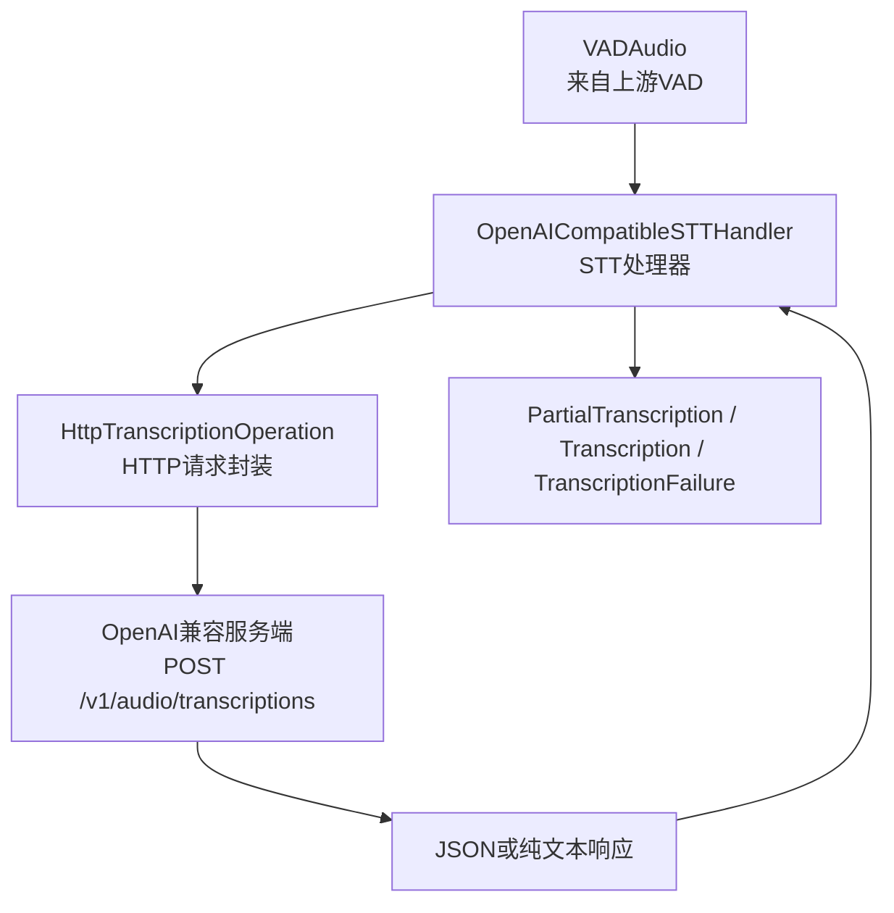
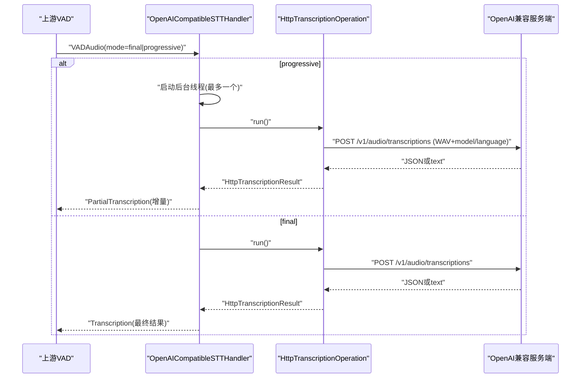
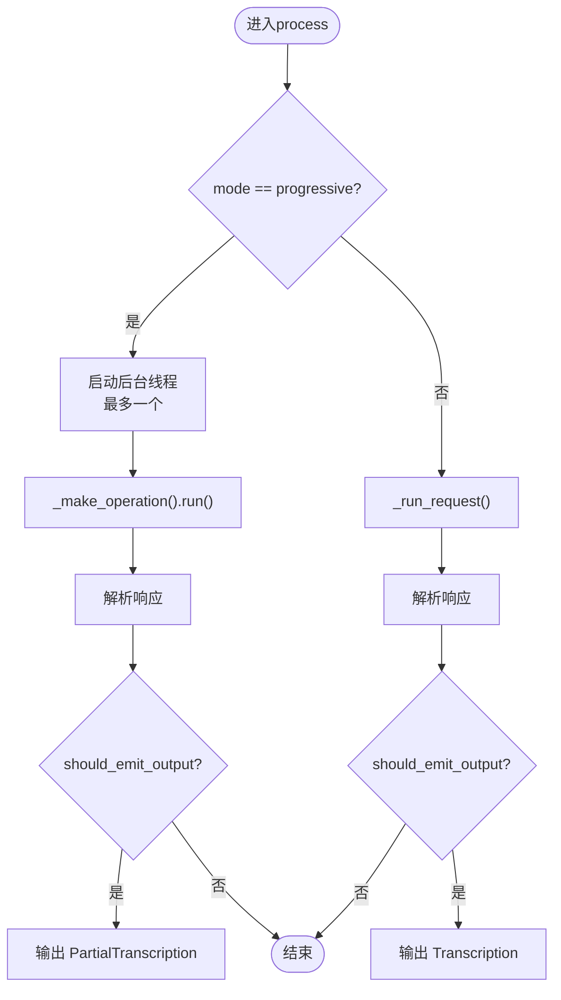
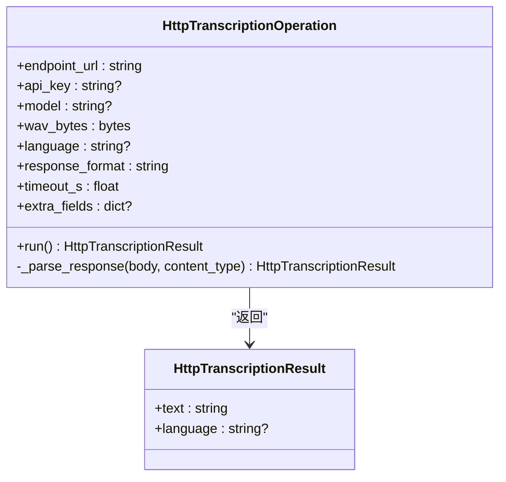
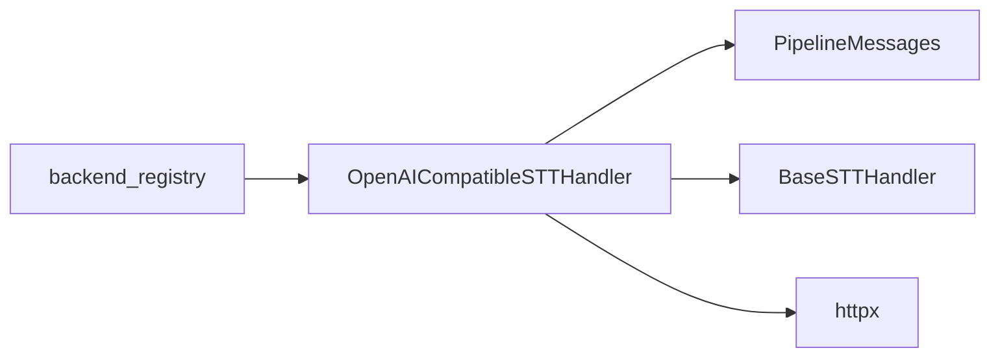
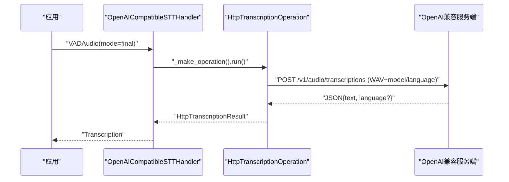

# OpenAI兼容STT后端

<cite>
**本文引用的文件**
- [openai_compatible_handler.py](file://src/speech_to_speech/STT/openai_compatible_handler.py)
- [openai_stt_arguments.py](file://src/speech_to_speech/arguments_classes/openai_stt_arguments.py)
- [base_stt_handler.py](file://src/speech_to_speech/STT/base_stt_handler.py)
- [messages.py](file://src/speech_to_speech/pipeline/messages.py)
- [backend_registry.py](file://src/speech_to_speech/backend_registry.py)
- [test_openai_stt_handler.py](file://tests/test_openai_stt_handler.py)
- [openai-compatible-stt.md](file://docs/openai-compatible-stt.md)
- [openai-compatible-stt-CN.md](file://docs/openai-compatible-stt-CN.md)
</cite>

## 目录
1. [简介](#简介)
2. [项目结构](#项目结构)
3. [核心组件](#核心组件)
4. [架构总览](#架构总览)
5. [详细组件分析](#详细组件分析)
6. [依赖关系分析](#依赖关系分析)
7. [性能与延迟特性](#性能与延迟特性)
8. [错误处理、速率限制与成本控制](#错误处理速率限制与成本控制)
9. [配置示例与集成指南](#配置示例与集成指南)
10. [故障排查](#故障排查)
11. [结论](#结论)

## 简介
本文档面向需要在语音到语音（Speech-to-Speech）流水线中接入“OpenAI 兼容”的远程语音转文本（STT）后端的工程团队。该后端通过 HTTP POST /v1/audio/transcriptions 将音频上传至任意遵循 OpenAI Audio API 的服务器，包括 OpenAI 官方服务、Azure OpenAI、LocalAI、vLLM 等。它支持 Whisper Large V3 等远程模型，提供渐进式（progressive）与最终（final）两种转写模式，并在本地完成 VAD、轮次管理、会话状态与响应处理，仅将识别任务委托给外部服务。

## 项目结构
围绕 OpenAI 兼容 STT 的关键代码位于 STT 模块与参数定义、注册表以及测试用例中：
- STT 处理器实现：负责音频编码、HTTP 请求、响应解析、渐进式输出控制与错误处理
- 参数定义：暴露 CLI/配置项，如 base_url、api_key、model、language、response_format、timeout
- 基类与消息：统一输入输出类型、流控与废弃结果过滤
- 后端注册：将 openai STT 后端挂载到系统
- 测试：覆盖 WAV 编码、multipart 表单、gpt-transcribe 字段差异、渐进式行为、失败路径等

图表来源
- [openai_compatible_handler.py:115-340](file://src/speech_to_speech/STT/openai_compatible_handler.py#L115-L340)
- [messages.py:46-90](file://src/speech_to_speech/pipeline/messages.py#L46-L90)

章节来源
- [openai_compatible_handler.py:1-340](file://src/speech_to_speech/STT/openai_compatible_handler.py#L1-L340)
- [messages.py:46-90](file://src/speech_to_speech/pipeline/messages.py#L46-L90)

## 核心组件
- OpenAICompatibleSTTHandler：对外暴露 setup/process/warmup/cleanup，内部维护渐进式并发控制、请求去重与过期结果丢弃
- HttpTranscriptionOperation：封装一次 HTTP 请求，构造 multipart/form-data（包含 WAV），发送并解析响应
- BaseSTTHandler：提供基于 turn_id/turn_revision 的废弃输入/输出过滤与稳定性窗口等待
- 参数对象：OpenAICompatibleSTTHandlerArguments 暴露可配置项
- 后端注册：backend_registry 将 openai STT 后端注入系统

章节来源
- [openai_compatible_handler.py:115-340](file://src/speech_to_speech/STT/openai_compatible_handler.py#L115-L340)
- [openai_stt_arguments.py:5-39](file://src/speech_to_speech/arguments_classes/openai_stt_arguments.py#L5-L39)
- [base_stt_handler.py:16-214](file://src/speech_to_speech/STT/base_stt_handler.py#L16-L214)
- [backend_registry.py:384-394](file://src/speech_to_speech/backend_registry.py#L384-L394)

## 架构总览
OpenAI 兼容 STT 后端在 speech-to-speech 内部保留 VAD、轮次、会话与响应处理，仅将音频片段以单声道 PCM16、16 kHz 的 WAV 形式上传至远程端点。请求体为 multipart/form-data，包含 file(audio.wav)、可选 model、可选 language（或 gpt-transcribe 专用的 languages[]）。响应可为 JSON（含 text 与可选 language/languages）或纯文本。

图表来源
- [openai_compatible_handler.py:167-235](file://src/speech_to_speech/STT/openai_compatible_handler.py#L167-L235)
- [openai_compatible_handler.py:56-112](file://src/speech_to_speech/STT/openai_compatible_handler.py#L56-L112)
- [messages.py:62-90](file://src/speech_to_speech/pipeline/messages.py#L62-L90)

## 详细组件分析

### 处理器：OpenAICompatibleSTTHandler
- 初始化与校验
  - 校验 response_format 必须为 json 或 text；timeout > 0；至少提供 model 或 language
  - 自动拼接 endpoint_url = base_url + "/audio/transcriptions"
  - 当 base_url 为 OpenAI 官方地址且未显式设置 api_key 时，从环境变量 OPENAI_API_KEY 读取
- 预热（warmup）
  - 使用合成静音进行一次性请求，验证端点、认证、模型与响应格式是否可用
- 处理流程（process）
  - 若为 progressive 模式：启动后台线程发起请求，期间屏蔽重复的 progressive 请求
  - 若为 final 模式：直接发起请求并产出 Transcription
  - 对废弃/过期的 turn 结果进行过滤，避免无用工作
- 渐进式控制
  - 同一时刻最多一个 progressive 请求在途；新请求到来会丢弃旧 progressive 更新
  - 最终请求独立提交，不阻塞于在途 progressive
  - 会话结束时抑制仍在运行的 progressive 结果
- 音频编码
  - 将浮点波形裁剪到 [-1,1] 并量化为 int16，写入单声道、16kHz、PCM16 WAV
- 错误处理
  - 将 HTTPStatusError、TimeoutException、HTTPError 转换为安全的 TranscriptionRequestError
  - 最终失败返回 TranscriptionFailure；渐进式失败被静默丢弃

图表来源
- [openai_compatible_handler.py:167-235](file://src/speech_to_speech/STT/openai_compatible_handler.py#L167-L235)
- [openai_compatible_handler.py:237-314](file://src/speech_to_speech/STT/openai_compatible_handler.py#L237-L314)
- [base_stt_handler.py:24-71](file://src/speech_to_speech/STT/base_stt_handler.py#L24-L71)

章节来源
- [openai_compatible_handler.py:115-340](file://src/speech_to_speech/STT/openai_compatible_handler.py#L115-L340)
- [base_stt_handler.py:24-71](file://src/speech_to_speech/STT/base_stt_handler.py#L24-L71)

### 请求封装：HttpTranscriptionOperation
- 请求头：若提供 api_key，则添加 Authorization: Bearer
- 请求体：multipart/form-data
  - file: audio.wav（二进制）
  - model: 可选
  - language: 普通模型使用单数字段；gpt-transcribe 使用复数字段 languages[]
- 超时：由 timeout_s 控制
- 响应解析：
  - 纯文本：直接作为 text
  - JSON：提取 text；优先从 languages[...].code 取语言，否则回退到 language 字段
- 异常映射：
  - HTTP 状态错误 -> TranscriptionRequestError
  - 超时 -> TranscriptionRequestError
  - 其他传输错误 -> TranscriptionRequestError

图表来源
- [openai_compatible_handler.py:37-112](file://src/speech_to_speech/STT/openai_compatible_handler.py#L37-L112)

章节来源
- [openai_compatible_handler.py:37-112](file://src/speech_to_speech/STT/openai_compatible_handler.py#L37-L112)

### 参数与配置：OpenAICompatibleSTTHandlerArguments
- openai_stt_base_url：基础 URL（需包含 /v1）
- openai_stt_api_key：可选 bearer token；仅在官方 OpenAI 地址且未显式设置时，才自动读取 OPENAI_API_KEY
- openai_stt_model：可选模型标识；可由 server 根据 language 选择
- openai_stt_language：ISO 语言提示
- openai_stt_response_format：json 或 text
- openai_stt_timeout：HTTP 超时秒数

章节来源
- [openai_stt_arguments.py:5-39](file://src/speech_to_speech/arguments_classes/openai_stt_arguments.py#L5-L39)

### 消息与流控：BaseSTTHandler 与 PipelineMessage
- VADAudio：携带音频、模式（progressive/final）、turn_id/turn_revision、时间戳
- PartialTranscription：中间增量文本，供实时客户端消费
- Transcription：最终转写结果
- TranscriptionFailure：最终请求失败的信号，不会触发下游 LLM 工作
- 废弃过滤：基于 turn_id/turn_revision 的“最新性”判断与稳定性窗口等待，丢弃陈旧结果

章节来源
- [messages.py:46-90](file://src/speech_to_speech/pipeline/messages.py#L46-L90)
- [base_stt_handler.py:16-214](file://src/speech_to_speech/STT/base_stt_handler.py#L16-L214)

## 依赖关系分析
- 处理器依赖 httpx 进行 HTTP 请求
- 处理器依赖 pipeline 的消息类型与日志上下文
- 处理器继承 BaseSTTHandler 获得废弃结果过滤能力
- 后端通过 backend_registry 注册为 “openai” STT 后端，并附加 speculative turns 支持

图表来源
- [openai_compatible_handler.py:1-26](file://src/speech_to_speech/STT/openai_compatible_handler.py#L1-L26)
- [backend_registry.py:384-394](file://src/speech_to_speech/backend_registry.py#L384-L394)

章节来源
- [backend_registry.py:384-394](file://src/speech_to_speech/backend_registry.py#L384-L394)

## 性能与延迟特性
- 渐进式请求尽力而为：每个流水线最多一个 progressive 请求在途，后续更新会被丢弃，避免拥塞
- 最终请求独立提交：不等待在途 progressive，保证最终结果尽快返回
- 预热阶段：启动时进行一次真实请求，提前发现端点/认证/模型/响应格式问题
- 网络与超时：可通过 timeout 控制单次请求超时，避免长时间阻塞
- 成本与用量：启用 progressive 会重复上传累积话语，增加请求量与提供方用量；按需开启

章节来源
- [openai_compatible_handler.py:167-235](file://src/speech_to_speech/STT/openai_compatible_handler.py#L167-L235)
- [openai_compatible_handler.py:156-165](file://src/speech_to_speech/STT/openai_compatible_handler.py#L156-L165)
- [openai-compatible-stt.md:13-16](file://docs/openai-compatible-stt.md#L13-L16)

## 错误处理、速率限制与成本控制
- 错误分类与透传
  - HTTP 状态错误、超时、传输错误均被转换为安全的 TranscriptionRequestError
  - 最终失败输出 TranscriptionFailure，不会创建下游 LLM 工作
  - 渐进式失败被静默丢弃，不影响最终请求
- 速率限制与重试
  - 当前实现未内置指数退避或重试逻辑；建议在调用方或服务端网关层实现限流与重试
  - 可通过合理设置 timeout 与关闭不必要的 progressive 降低突发流量
- 成本控制策略
  - 谨慎启用 progressive，以减少重复上传与请求次数
  - 明确指定 model 或 language，减少服务端模型切换开销
  - 使用本地或低成本兼容服务（如 vLLM 部署 Qwen3-ASR）替代高成本云端

章节来源
- [openai_compatible_handler.py:81-112](file://src/speech_to_speech/STT/openai_compatible_handler.py#L81-L112)
- [openai_compatible_handler.py:180-235](file://src/speech_to_speech/STT/openai_compatible_handler.py#L180-L235)
- [openai-compatible-stt.md:72-84](file://docs/openai-compatible-stt.md#L72-L84)

## 配置示例与集成指南

### 基本配置项
- base_url：指向 OpenAI 兼容服务的 /v1 根路径
- api_key：Bearer Token；仅在官方 OpenAI 地址且未显式设置时，自动读取 OPENAI_API_KEY
- model：可选，用于指定远端模型
- language：可选，ISO 语言提示
- response_format：json 或 text
- timeout：HTTP 请求超时秒数

章节来源
- [openai_stt_arguments.py:5-39](file://src/speech_to_speech/arguments_classes/openai_stt_arguments.py#L5-L39)
- [openai_compatible_handler.py:118-154](file://src/speech_to_speech/STT/openai_compatible_handler.py#L118-L154)

### 与本地STT后端的区别
- 延迟：本地 STT 通常更低延迟；远程 STT 受网络往返影响
- 成本：本地无需按 token/时长计费；远程可能产生费用
- 准确性：取决于所选模型与服务质量；远程可使用更强模型
- 渐进式：远程启用 progressive 会增加请求量与成本

章节来源
- [openai-compatible-stt.md:13-16](file://docs/openai-compatible-stt.md#L13-L16)
- [openai-compatible-stt-CN.md:11-11](file://docs/openai-compatible-stt-CN.md#L11-L11)

### 端到端调用序列（最终请求）

图表来源
- [openai_compatible_handler.py:180-235](file://src/speech_to_speech/STT/openai_compatible_handler.py#L180-L235)
- [openai_compatible_handler.py:56-112](file://src/speech_to_speech/STT/openai_compatible_handler.py#L56-L112)

### 集成第三方 OpenAI 兼容服务
- Azure OpenAI：将 base_url 指向 Azure 托管的 /v1 端点，并通过 api_key 传入密钥
- LocalAI：部署 LocalAI 并提供 /v1 端点，设置 base_url 与 model
- vLLM 运行 Qwen3-ASR：参考文档中的命令启动服务，再配置 base_url 与 model

章节来源
- [openai-compatible-stt.md:18-57](file://docs/openai-compatible-stt.md#L18-L57)
- [openai-compatible-stt-CN.md:13-47](file://docs/openai-compatible-stt-CN.md#L13-L47)

### 不同网络环境下的连接优化与故障转移
- 优化建议
  - 合理设置 timeout，避免长尾请求占用资源
  - 在网络不稳定时，考虑关闭 progressive，减少重复上传
  - 使用就近区域的服务端点以降低 RTT
- 故障转移思路
  - 在调用层实现多端点切换：主用 OpenAI 兼容服务，备用本地 STT（如 faster-whisper）
  - 当检测到超时或特定 HTTP 状态码时，切换到备用后端
  - 结合业务指标（延迟、成功率）动态选择后端

说明：上述为通用实践建议，具体实现需在调用层扩展。

## 故障排查
- 常见错误
  - 404/认证失败：检查 base_url 与 api_key；确认端点是否需要 Bearer Token
  - 超时：增大 timeout 或检查网络状况
  - 响应格式不符：确保 response_format 与服务器一致（json/text）
- 渐进式问题
  - 无增量输出：确认已启用 progressive 且服务端支持增量
  - 结果被丢弃：可能是会话结束或 turn 版本变更导致
- 验证方法
  - 使用测试用例中的最小化服务端模拟，验证 WAV 编码与 multipart 表单
  - 检查 warmup 是否成功，失败会阻止会话建立

章节来源
- [test_openai_stt_handler.py:54-165](file://tests/test_openai_stt_handler.py#L54-L165)
- [test_openai_stt_handler.py:236-276](file://tests/test_openai_stt_handler.py#L236-L276)
- [openai_compatible_handler.py:156-165](file://src/speech_to_speech/STT/openai_compatible_handler.py#L156-L165)

## 结论
OpenAI 兼容 STT 后端以最小侵入方式将语音转文本能力扩展到任意遵循 OpenAI Audio API 的服务，既可用于 OpenAI 官方服务，也可用于 Azure OpenAI、LocalAI、vLLM 等第三方方案。它在本地完成 VAD、轮次与会话管理，提供渐进式与最终转写模式，并通过严格的错误处理与废弃结果过滤保障系统稳定性。通过合理配置 base_url、api_key、model、language、response_format 与 timeout，可在不同网络环境下取得良好的延迟、成本与准确性平衡。对于更高可用性需求，可在调用层实现多后端故障转移与限流重试策略。